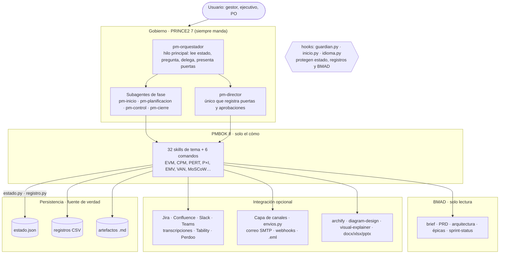
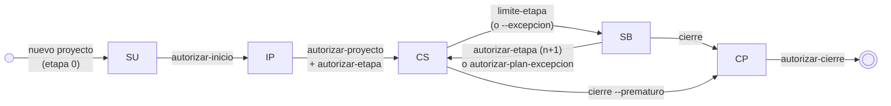
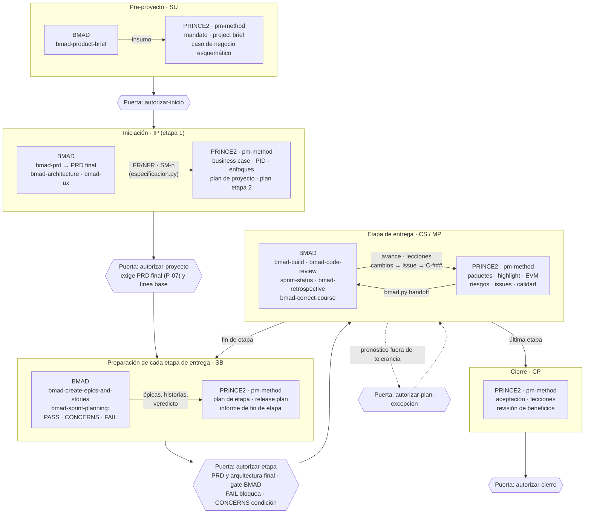
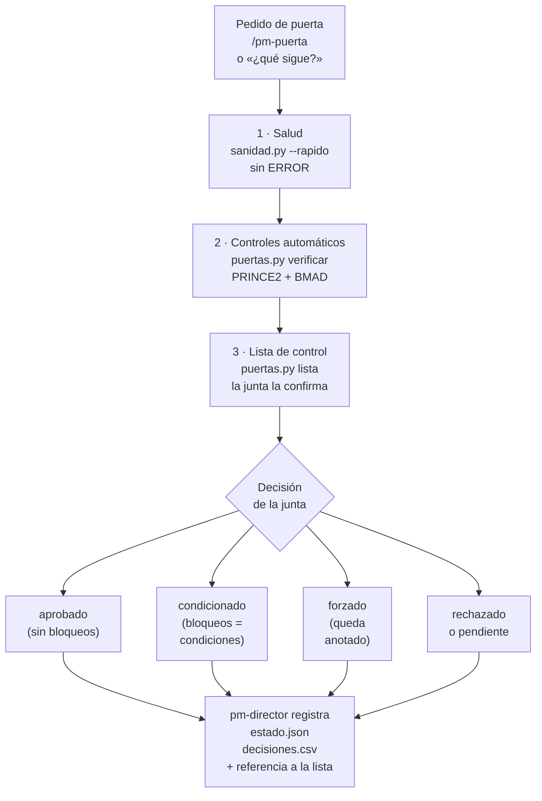
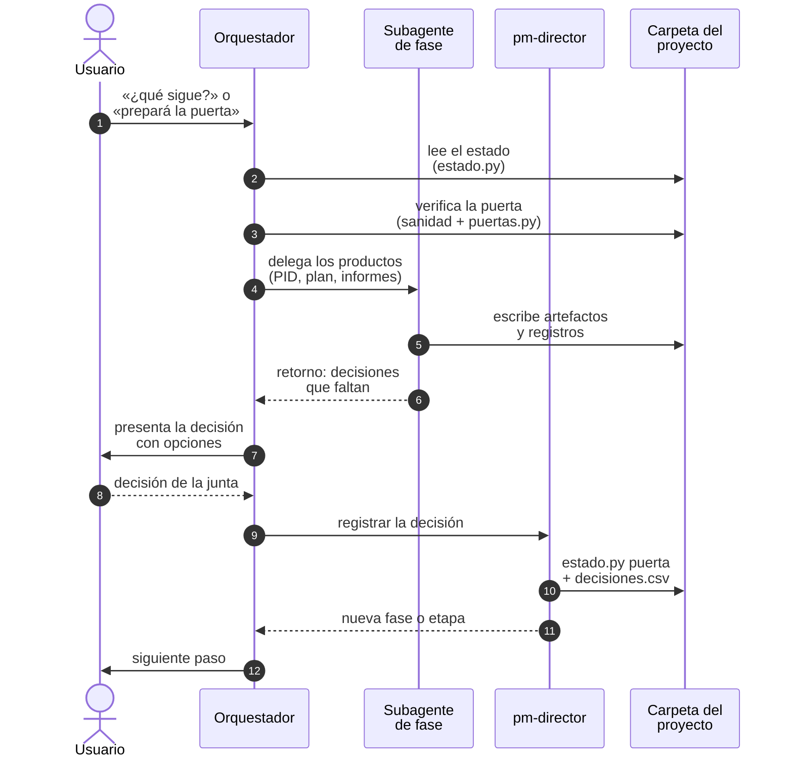
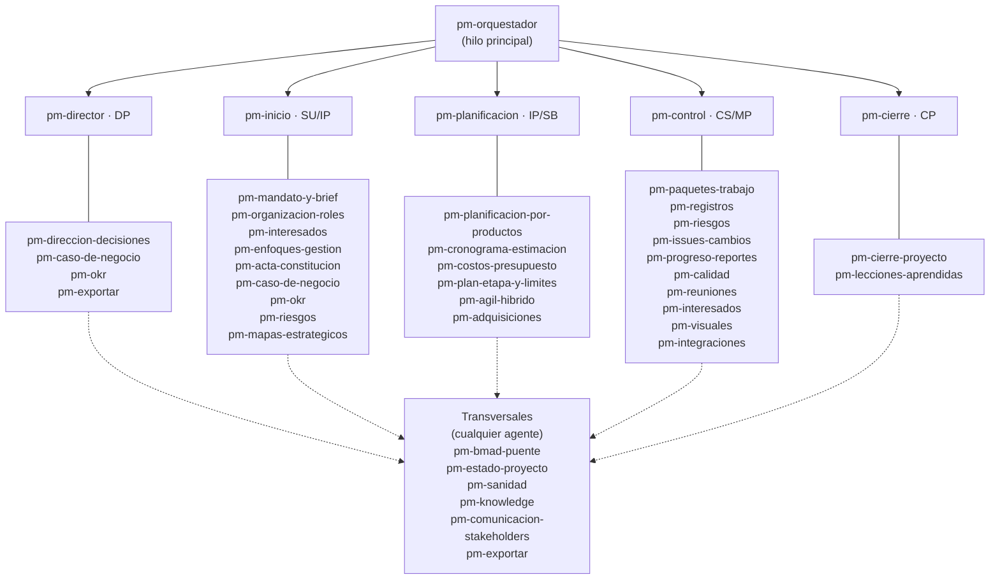
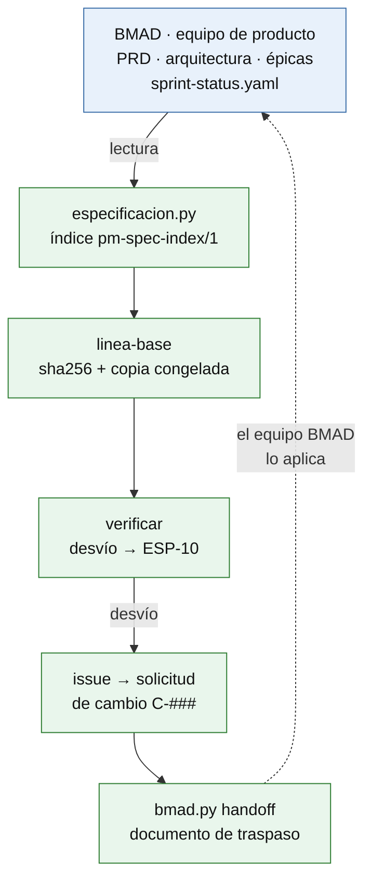

# pm-method · Agentes y skills de gestión de proyectos (ES/EN) · v2.4.0

Ecosistema bilingüe de **6 agentes**, **39 skills** y **3 hooks** para Claude Code (también Cowork y Hermes) que
gestiona un proyecto de la idea al cierre con **PRINCE2 7** como método y ciclo de vida, **PMBOK 8** como caja de
técnicas, plantillas profesionales como artefactos y **BMAD** como fuente única de la especificación del producto.

> **En una frase:** el equipo de producto especifica en BMAD; pm-method gobierna el proyecto con PRINCE2 sobre esa
> especificación, sin copiarla, y deja cada decisión registrada, trazable y verificada.

---

## ¿Por qué pm-method? (justificación)

Los asistentes de IA ya redactan planes e informes, pero sin **método**, sin **ciclo de vida** y sin **gobierno**: nadie
sabe qué está aprobado, la especificación del producto vive separada de la gestión y el modelo termina "decidiendo"
cosas que corresponden a personas. pm-method resuelve eso con una jerarquía fija: **PRINCE2 7 manda** (etapas, puertas,
tolerancias, gestión por excepción), **PMBOK 8** aporta solo técnicas, las **plantillas** dan forma a los artefactos y
**BMAD** es la especificación de solo lectura. El modelo prepara; la persona decide; los scripts verifican y registran.

| Problema habitual | Qué aporta pm-method |
|---|---|
| Los asistentes de IA producen documentos de gestión sueltos, sin método ni ciclo de vida | Un **método único y dominante** (PRINCE2 7): etapas, puertas de la junta, gestión por excepción y tolerancias; PMBOK 8 solo aporta el "cómo" |
| La especificación (PRD, épicas, historias) y la gestión viven en mundos separados y se desincronizan | **Fuente única por dato**: BMAD es la especificación, pm-method la lee por una fachada (`especificacion.py`), detecta desvíos contra líneas base con sha256 y devuelve decisiones con un documento de traspaso |
| El modelo "decide" cosas que debería decidir una persona | **Puertas humanas**: solo `pm-director` registra decisiones de la junta, y un hook lo hace cumplir también en los subagentes |
| Archivos de estado editados a mano, registros inconsistentes | **Guardarraíles**: `estado.json` y los registros solo cambian por scripts que validan; el hook `guardian.py` bloquea ediciones directas por Edit **y** por Bash |
| Comunicaciones iguales para todos y RACI desconectado del alcance | **Maestro de interesados** (`pm-interesados`): matriz poder/interés con estrategia por cuadrante, RACI ligada a WBS, requisitos, historias y KR, preferencias confirmadas por una persona y un perfil de comunicación por interesado |
| Integraciones frágiles o atadas a un proveedor | **MCP genérico** (Jira, Confluence, Slack, Teams, transcripciones, OKR) sin conectores predefinidos y una **capa de canales** propia (correo SMTP, webhooks de Slack o Teams, `.eml`) que solo envía mensajes aprobados; skills externas de diagramas y Office con **respaldo interno** si no están |
| Nadie sabe si "todo está bien" | **Sanidad permanente**: `sanidad.py` (93 códigos en 12 familias: INS, EST, ART, REG, CAM, QUA, TOL, SUP, ESP, INT, STK, MAP) al iniciar sesión, antes de cada puerta y a pedido; en cada inicio de sesión, un resumen derivado de los registros y una línea de **radar** con lo que hay que decidir, escalar, desbloquear y vigilar |
| Se invierte sobre supuestos que nadie validó y opciones que nadie comparó con números | **Validar antes de invertir**: supuestos críticos como hipótesis con experimento, criterio y fecha (SUP-01…03, puerta P-11) y opciones evaluadas con VAN, TIR, repago, sensibilidad y punto de equilibrio (`inversion.py`) |
| Controles que se hacen a mano, tarde o nunca: cuánto queda del presupuesto de cambio, historias "terminadas" sin revisión, pronósticos que nadie vuelve a mirar, condiciones de la junta olvidadas, interesados sin contacto, lecciones que nadie aplica | **Controles permanentes**: presupuestos de la junta contra el costo de cada cambio, calidad a volumen sobre el backlog y la WBS, cortes de EVM vigilados contra las tolerancias, condiciones formales de puertas con seguimiento hasta cumplirse, cadencia de contacto por interesado y lecciones con acción y verificación |
| Decisiones tomadas a ojo: la primera respuesta a un riesgo, el cambio que "es obligatorio", lo acordado en una reunión según quién tomó notas | **Decidir con datos y con una persona**: opciones de respuesta comparadas por valor neto con plan de contingencia (`riesgos.py opciones`), análisis de impacto antes de cada cambio con quién decide (`impacto.py`) y acuerdos extraídos de la transcripción con cita, que se registran solo al confirmarlos (`extraccion.py`) |

**Valor agregado:** gobierno auditable (cada puerta con su fila en `decisiones.csv`), trazabilidad requisito → historia →
paquete de trabajo → aceptación, informes de avance y excepción con valor ganado, visuales y exportaciones listos para la
junta, y un ecosistema probado con **353 pruebas de regresión**, una suite de integración cruzada de 99 comprobaciones,
cinco recorridos E2E reproducibles y pruebas en vivo con Claude Code real.

---

## Beneficios

| Para | Beneficio concreto |
|---|---|
| Gestor de proyectos | planes, registros, informes (highlight, checkpoint, excepción, fin de etapa con valor ganado) y puertas preparados con método; comunicados personalizados por interesado y enviados con aprobación; menos trabajo administrativo |
| Ejecutivo y junta | decisiones claras con opciones, tolerancias y excepciones a tiempo; cada puerta verificada (salud, criterios de éxito, lista de control) antes de decidir |
| Product owner / equipo ágil | backlog sincronizado con BMAD, MoSCoW, release plan y avance por puntos sin copiar la especificación |
| PMO / CoE de IA | un estándar reproducible y auditable: `estado.json` + `decisiones.csv`, trazabilidad requisito → historia → paquete → aceptación |

| Evidencia (2026-10-22) | Resultado |
|---|---|
| Pruebas de regresión (`probar_paquete.py`) | 353 OK · 0 FALLO con Python 3.13 (352 con 3.9), incluida una instalación real de BMAD 6.12.4 y envíos SMTP y por webhooks contra servidores locales |
| Integración cruzada (`scripts/pruebas/integracion/correr.py`) | 99 OK · 0 FALLO en 34 eslabones de seis cadenas sobre un mismo proyecto |
| Recorridos E2E de las guías (`guias_e2e/correr.py`) | 5/5 OK con los scripts reales, evidencia e imágenes idénticas en dos corridas |
| Diagramas Mermaid (`validar_mermaid.py --render`) | 128 bloques, 0 errores |
| Enrutamiento en vivo con Claude Code real | 60/60 en la batería base; 27/28 con vocabulario de PRINCE2 y PMBOK en español; 25/25 con las skills de BMAD instaladas; 8/8 en las frases de mapas estratégicos; 28/28 en las frases 103–130 de opciones, personas, radar, reuniones, impacto, auditoría, lecciones, productos, período y estimación ([PRUEBAS §3](docs/PRUEBAS.md)) |
| Guardarraíles, idioma y robustez en vivo | 4/4 · 5/5 · inyección, datos desordenados, escala y varias sesiones: todos OK; integración con BMAD instalado 12/12 con un contexto máximo de 64.177 tokens |

Límites conocidos y detalle para presentar el proyecto: **[docs/RESUMEN-EJECUTIVO.md](docs/RESUMEN-EJECUTIVO.md)**.

---

## Capacidades principales

| Capacidad | Qué hace | Dónde |
|---|---|---|
| Validar antes de invertir | supuestos críticos de deseabilidad, viabilidad y factibilidad con criticidad, certeza, experimento, criterio y fecha límite; la sanidad avisa lo que falta (SUP-01…03) y la puerta `autorizar-proyecto` lo pone como condición (P-11) salvo que la junta lo acepte con una decisión registrada | `pm-mandato-y-brief` §9 · plantilla `hipotesis-y-experimentos` |
| Opciones con números | VAN, TIR (con aviso de TIR ambigua), repago simple y descontado, VAN incremental, sensibilidad por concepto y de la tasa y punto de equilibrio, desde un CSV de flujos por opción | `pm-caso-de-negocio` · `inversion.py` |
| Mapas estratégicos | mapas de Wardley (qué construir, comprar o tercerizar; inercias) y de recorrido del cliente (emoción con fuente, dolores, oportunidades Kano, service blueprint), desde BMAD o desde el proyecto; cada inercia termina en un riesgo y cada dolor en un tratamiento con id (MAP-01…05) | `pm-mapas-estrategicos` · `mapas.py` |
| Maestro de interesados | matriz **poder/interés** con su estrategia por cuadrante, estereotipos, preferencias confirmadas por una persona con cita y vigencia, y un perfil de comunicación por interesado | `pm-interesados` · `interesados.py` |
| RACI ligada al plan | RACI sobre paquetes de la WBS, requisitos y épicas, historias, KR y decisiones; un solo A por elemento; la sanidad avisa si falta A, hay sobre-consulta o un actor clave sin rol | `interesados.py raci` · `integridad` |
| Capa de canales | envío por correo SMTP, webhooks de Slack o Teams, archivos `.eml` o MCP conectados; simulación por defecto, solo mensajes aprobados, confirmación de una persona antes de enviar y registro en `envios.csv` | `pm-integraciones` · `envios.py` |
| OKR | tipos de KR (de-a, mantener, binario, hito), aspiracional o comprometido, pesos, iniciativas, check-ins, salud contra el avance esperado y propuesta de sincronización con Tability o Perdoo | `pm-okr` · `okr.py` |
| Riesgos candidatos | identificación desde BMAD, transcripciones, el tracker (Jira) y los artefactos del proyecto, con cita y ubicación; nada se registra sin evaluarse | `pm-riesgos` · `riesgos.py candidatos` |
| Opciones de respuesta y contingencia | para cada riesgo alto, opciones (evitar, reducir, transferir, compartir, contingencia, aceptar) comparadas por valor neto contra el EMV; decide el propietario con nombre y motivo, y la contingencia queda como plan con disparador, monto, fuente y quién lo activa (REG-10) | `pm-riesgos` · `riesgos.py opciones` |
| Radar y briefing | qué hay que decidir, escalar, desbloquear y vigilar hoy, con regla, id, responsable, siguiente paso y prioridad; una línea en cada inicio de sesión; briefing de incorporación de ≈ 2 páginas para quien se suma a la junta o al equipo | `estado.py radar` · `estado.py briefing` |
| Highlight y tablero desde el dato | un solo cálculo del período para el informe y el tablero, con semáforos por regla que el juicio del gestor puede empeorar pero no mejorar, y la cadena de reporte verificada contra el EVM guardado antes de enviar | `pm-progreso-reportes` · `estado.py periodo` |
| Reuniones con cita | decisiones con su nivel, compromisos con responsable y fecha, supuestos, riesgos y lecciones de una transcripción, cada uno con cita y hora; nada se registra sin la confirmación de una persona y las instrucciones incrustadas nunca se ejecutan | `pm-reuniones` · `extraccion.py` |
| Impacto antes del cambio | tiempo y camino crítico, reserva de cronograma, capacidad del release, costo, presupuesto de cambio, autoridad, VAN, personas afectadas y quién decide, con el borrador de la solicitud de cambio | `pm-issues-cambios` · `impacto.py` |
| Tres valores y capacidad | estimación optimista, más probable y pesimista con la distribución declarada (beta-PERT o triangular), σ del camino crítico y reserva de cronograma; capacidad del release por MoSCoW contra velocidad × iteraciones | `cpm.py --estimacion` · `release.py capacidad` |
| Personas de usuario | quién pide, usa o aprovecha cada capacidad, desde los recorridos de BMAD, los mapas de recorrido o el backlog; ningún Must sin persona (STK-13) | `pm-interesados` · `interesados.py personas` |
| Estado de productos y cierre por id | estado de cada producto derivado de los registros (backlog o WBS, calidad, issues, aceptaciones), sin registro nuevo; el cierre comprueba por id los issues y riesgos abiertos (C-03) y los Must sin aceptar (C-07) | `estado.py productos` · `puertas.py` |
| Ciclo de las lecciones | lecciones de otros proyectos al empezar; en la retrospectiva, candidatas con cita; clasificación por impacto y proceso, acción, verificación e informe que alimenta el índice de la organización (E-11, REG-11, REG-12) | `pm-lecciones-aprendidas` · `lecciones.py` |
| Expediente de auditoría | cronología de puertas, decisiones, cambios, aceptaciones y envíos, líneas base, registros, evidencia y sanidad al corte, con `SHA256SUMS` verificable | `pm-exportar` · `paquete.py auditoria` |
| Controles permanentes | presupuestos de la junta contra el costo y el cargo de cada cambio (CAM-01…05; excedido = ERROR que bloquea puertas), calidad a volumen (QUA-01…04), cortes de EVM contra las tolerancias (TOL-01…03), condiciones formales de puertas hasta cumplirse (EST-12, G-01), revisión de riesgos vencida (REG-09), riesgos altos con opciones y contingencia con plan (REG-10), lecciones con acción y verificación (REG-11, REG-12, E-11), beneficios que no quedan solo en OKR (P-04) y cadencia de contacto por interesado (STK-12) | `sanidad.py --corte` · `puertas.py` · [SANIDAD](docs/SANIDAD.md) |
| Contexto controlado | al abrir, retomar o compactar la sesión, un resumen derivado de `estado.json` y los registros (≤ 2.000 caracteres, con ids) que prevalece sobre cualquier nota de memoria; salidas de los scripts acotadas con muchos registros | `estado.py contexto` · hook de inicio |
| Formación | cinco casos E2E con guía, evidencia reproducible, gráficos, guion del instructor, ejercicio y diapositivas (PPTX y HTML) para dos clases de 90 minutos por caso | [docs/guias/](docs/guias/README.md) · [docs/webinar/](docs/webinar/README.md) |

El perfil de comunicación solo adapta comunicaciones: no infiere emociones, personalidad ni datos sensibles, y no
analiza audio ni tono. Cada guía E2E tiene la tabla "Del uso único al control continuo": qué actividad se hace hoy a
mano, una sola vez o nunca, con qué frecuencia y control la sostiene pm-method y qué indicador la muestra.

---

## Arquitectura



## Ciclo de vida PRINCE2 y puertas



## Ciclo de vida integrado: PRINCE2 + BMAD



### Verificación de cada puerta



Cada puerta se verifica en tres capas (salud, controles automáticos PRINCE2 y BMAD, lista de control confirmada por la
junta) y la decisión queda registrada: **[docs/PUERTAS.md](docs/PUERTAS.md)**.

## Orquestación de una puerta



## Agentes y skills



Relación completa agente ↔ skill ↔ humano: [docs/RACI.md](docs/RACI.md) · catálogo: [docs/CATALOGO.md](docs/CATALOGO.md) · cómo pedir las cosas con el vocabulario de PRINCE2, de PMBOK o de tu organización: [docs/TERMINOLOGIA.md](docs/TERMINOLOGIA.md).

## Sincronización con BMAD (fuente única)



---

## Instalación rápida

```bash
# 1. Plugin desde GitHub (Claude Code)
claude plugin marketplace add Arturo-Penas-Rial/pm-method
claude plugin install pm-method@pm-method
# 2. Python 3.9+ y paquetes recomendados
pip install pyyaml python-docx openpyxl
# 3. (opcional) BMAD en el repositorio del producto
npx bmad-method@6.12.4 install --modules bmm --tools claude-code --yes --user-name "<nombre>" --set core.project_name=<proyecto> --no-shims
```

Actualizar: `claude plugin marketplace update pm-method` y `claude plugin update pm-method@pm-method`.

**Hermes Agent** (skills y scripts; sin subagentes ni hooks):
```bash
git clone https://github.com/Arturo-Penas-Rial/pm-method.git ~/pm-method
python3 ~/pm-method/scripts/instalar_hermes.py      # adapta las rutas a ${HERMES_SKILL_DIR}; luego /reload-skills
```
Windows: los hooks corren en Git Bash; el lanzador `hooks/py.sh` busca `python3`, `python` o `py -3`.
Guía completa (requisitos por sistema operativo, BMAD, skills externas, MCP, Cowork, Hermes, verificación y problemas
frecuentes): **[docs/INSTALACION.md](docs/INSTALACION.md)**.
Alternativa opcional: **entorno Docker** aislado (Linux, Claude Code CLI, Python, Node, Mermaid y Chromium fijados y
probados; la instalación manual no cambia): **[docs/DOCKER.md](docs/DOCKER.md)**.

### Credenciales: dónde va la API-KEY

pm-method **no usa claves propias**: la credencial es la del cliente que ejecuta el modelo y la de cada conector MCP.

| Cliente | Opción recomendada | Con clave de API |
|---|---|---|
| Claude Code | suscripción Pro/Max/Team/Enterprise: `claude` → iniciar sesión en el navegador (o `/login`) | `export ANTHROPIC_API_KEY="…"` en `~/.bashrc` (Linux/WSL) o `~/.zshrc` (macOS); variable de usuario en Windows; comprobar con `/status` |
| Hermes Agent | `hermes model` o `hermes setup` (asistente) | `hermes config set ANTHROPIC_API_KEY "…"` → se guarda en `~/.hermes/.env` |
| Conectores MCP | `claude mcp add … -e TOKEN=…` (queda en `~/.claude.json`, privado) | en `.mcp.json` versionado, solo `${TOKEN}`, nunca el valor |

Nunca pegar claves en el chat ni guardarlas en la carpeta del proyecto o en commits. Si hay suscripción **y**
`ANTHROPIC_API_KEY`, Claude Code usa la clave (con cargo a la API) una vez aprobada. Detalle, precedencia, CI y WSL:
**[INSTALACION §0.7](docs/INSTALACION.md#07-claves-de-api-y-credenciales-cuáles-dónde-y-cómo)**.

### Opcional: Orca para ver varios agentes y proyectos a la vez

[Orca](https://github.com/stablyai/orca) (MIT) es una aplicación de escritorio que corre Claude Code, Hermes y otros
agentes en paralelo, cada uno en su worktree, con terminales persistentes, tableros de GitHub/Linear, notificaciones y
app móvil: útil para tener juntas la sesión de gestión (`pm-orquestador`) y las del equipo de producto. Es una interfaz
gráfica con terminales (no una TUI); pm-method sigue usándose desde Claude Code o Hermes dentro de ellas. Instalación
por sistema operativo y notas para WSL: **[INSTALACION §0.8](docs/INSTALACION.md#08-orca-opcional-varias-sesiones-de-agentes-y-proyectos-en-un-solo-lugar)**.

## Primeros pasos

```
/pm-method:pm-ayuda                      # qué escribir en cada situación
/pm-method:pm-nuevo "Proyecto Faro"      # crea la carpeta del proyecto y detecta BMAD
¿qué sigue?                              # el orquestador lee el estado y propone el siguiente paso
/pm-method:pm-sanidad                    # chequeo de consistencia (también antes de cada puerta)
```

**Probar las capacidades paso a paso:** [docs/guias/](docs/guias/README.md) tiene cinco recorridos de punta a punta por
prompts, con reporte y gráficos de la corrida real: gestión de riesgos (identificación desde BMAD, transcripciones, Jira
y artefactos, opciones de respuesta por valor neto, plan de contingencia y reserva de riesgo vigilada); alcance, cambio,
esfuerzo, priorización y mapa de ruta (tres valores, capacidad del release, personas de usuario, análisis de impacto y
gestión por excepción); interesados, comunicaciones, OKR y avance (matriz poder/interés, preferencias, RACI, acuerdos de
reunión con cita, radar, highlight desde el dato, envío por canales y cadencia de contacto); el producto de la idea al
producto con BMAD (condiciones formales de puertas, calidad a volumen y estado de productos, recorrido del cliente, ciclo
de las lecciones, cierre por id, expediente de auditoría y revisión de beneficios posterior); y de la idea al proyecto
diseñado (lecciones de otros proyectos, supuestos validados, opciones con VAN, enfoque de entrega, mapas de Wardley y de
recorrido, personas de usuario, tres diseños del mismo proyecto). El material para dictarlos como webinar está en [docs/webinar/](docs/webinar/README.md).

Para que el orquestador sea el agente de toda la sesión: `claude --agent pm-method:pm-orquestador`.
Si el pedido nombra un producto concreto ("armá el business case", "highlight de esta semana", "acta de la reunión"),
Claude invoca directamente la skill dueña; el orquestador queda para "¿qué sigue?", "¿cómo venimos?" y pedidos que
cruzan procesos.

---

## Componentes

### Agentes

| Agente | Tipo | Procesos | Qué hace |
|---|---|---|---|
| `pm-orquestador` | hilo principal (también skill) | todos | lee el estado, pregunta, delega, presenta puertas |
| `pm-director` | subagente | DP | solicitudes de decisión; **único** que registra puertas y aprobaciones de junta |
| `pm-inicio` | subagente | SU, IP | mandato, brief, supuestos y experimentos, business case con evaluación de opciones, mapas estratégicos, OKR, organización, interesados y RACI, enfoques, PID |
| `pm-planificacion` | subagente | Plans, IP, SB | PBS/WBS o backlog, estimación, cronograma, presupuesto, planes |
| `pm-control` | subagente | CS, MP | paquetes, registros, riesgos, issues, informes, calidad, actas, preferencias, check-ins de OKR, envíos, sincronización |
| `pm-cierre` | subagente | CP | aceptación, handover, lecciones, revisión de beneficios, informe final |

Los subagentes no preguntan al usuario, no delegan en otros agentes, heredan las herramientas de la sesión (incluidos
los MCP) y devuelven un bloque "Retorno al orquestador". Diseño: [docs/ARQUITECTURA.md](docs/ARQUITECTURA.md).

### Comandos de uso humano

| Comando | Uso |
|---|---|
| `pm-ayuda [tema]` | ayuda contextual |
| `pm-nuevo "Nombre" [carpeta]` | crear un proyecto |
| `pm-estado [carpeta]` | estado y siguiente paso |
| `pm-reporte highlight\|checkpoint\|excepcion` | informe de avance |
| `pm-puerta <tipo>` | preparar una puerta de la junta |
| `pm-sync [bmad\|tracker\|okr]` | sincronizar fuentes externas |

Toda skill es invocable como `/pm-method:<skill>` (plugin) o `/<skill>` (copia manual y Hermes).

### Hooks (plugin de Claude Code)

- **`PreToolUse` → `guardian.py`**: bloquea ediciones directas (Write/Edit y Bash: `sed -i`, redirecciones, `tee`,
  `cp`/`mv`, Python en línea) de `estado.json`, registros CSV, derivados de la especificación, copias congeladas e
  instantáneas de fuentes; impide que los subagentes escriban en BMAD y que nadie salvo `pm-director` ejecute los comandos de decisión (puertas, tolerancias, roles);
  pide la confirmación de una persona para aprobar y enviar comunicaciones (`envios.py aprobar`, `enviar --confirmar`).
- **`SessionStart` → `inicio.py`** (también tras compactar): agrega fase, etapa, sanidad rápida, un resumen derivado de
  los registros con ids (riesgos altos sin respuesta, riesgos con la revisión vencida, issues, acciones vencidas,
  condiciones, próxima puerta; ≤ 2.000 caracteres), una línea de radar (decidir, escalar, desbloquear, vigilar), la precedencia de los registros sobre la memoria del cliente, reglas de enrutamiento e idioma, y la ruta
  absoluta de los scripts.
- **`UserPromptSubmit` → `idioma.py`**: si el pedido está en otro idioma que el proyecto (ES/EN), recuerda responder en
  el idioma del pedido.

### Catálogo resumido (39 skills)

| Grupo | Skills |
|---|---|
| Dirección y estado | `pm-orquestador`, `pm-direccion-decisiones`, `pm-estado-proyecto`, `pm-sanidad` |
| Inicio (SU, IP) | `pm-mandato-y-brief`, `pm-caso-de-negocio`, `pm-okr`, `pm-organizacion-roles`, `pm-interesados`, `pm-enfoques-gestion`, `pm-acta-constitucion`, `pm-mapas-estrategicos` |
| Planificación | `pm-planificacion-por-productos`, `pm-cronograma-estimacion`, `pm-costos-presupuesto`, `pm-plan-etapa-y-limites`, `pm-agil-hibrido`, `pm-adquisiciones` |
| Control (CS, MP) | `pm-paquetes-trabajo`, `pm-registros`, `pm-riesgos`, `pm-issues-cambios`, `pm-progreso-reportes`, `pm-calidad`, `pm-comunicacion-stakeholders`, `pm-reuniones`, `pm-visuales` |
| Cierre (CP) | `pm-cierre-proyecto`, `pm-lecciones-aprendidas` |
| Transversales | `pm-bmad-puente`, `pm-integraciones`, `pm-exportar`, `pm-knowledge` |
| Comandos | `pm-ayuda`, `pm-nuevo`, `pm-estado`, `pm-reporte`, `pm-puerta`, `pm-sync` |

---

## Dependencias

| Dependencia | Nivel | Para qué | Origen |
|---|---|---|---|
| Claude Code (o Cowork / Hermes Agent) | obligatoria (un cliente) | ejecutar agentes y skills | https://github.com/anthropics/claude-code |
| Python ≥ 3.9 | obligatoria | scripts y hooks | https://github.com/python/cpython |
| git (Git for Windows en Windows) | obligatoria para instalar desde GitHub; en Windows, para los hooks | instalar y actualizar | https://github.com/git/git · https://github.com/git-for-windows/git |
| pyyaml · python-docx · openpyxl | recomendadas | BMAD, actas `.docx`, exportar Word/Excel | https://pypi.org/project/pyyaml/ · https://pypi.org/project/python-docx/ · https://pypi.org/project/openpyxl/ |
| Node.js y npx | opcional (obligatoria para BMAD y skills externas) | `npx bmad-method`, `npx skills add` | https://github.com/nodejs/node |
| BMAD Method 6.12.4 (también v4, 6.11) | opcional | capa de especificación | https://github.com/bmad-code-org/BMAD-METHOD |
| archify | opcional | diagramas HTML interactivos (organigrama, WBS) | https://github.com/tt-a1i/archify |
| diagram-design | opcional | diagramas editoriales | https://github.com/cathrynlavery/diagram-design |
| visual-explainer | opcional | one-pagers y explicadores HTML | https://github.com/nicobailon/visual-explainer |
| anthropics/skills (docx, xlsx, pptx) | opcional | exportación Office de calidad | https://github.com/anthropics/skills |
| drawio-mcp (draw.io oficial) | opcional | diagramas editables | https://github.com/jgraph/drawio-mcp |
| `skills` CLI | opcional | instalar skills externas | https://github.com/vercel-labs/skills |
| MPXJ (+ Java) | opcional | validar el MSPDI exportado | https://github.com/joniles/mpxj |
| Conectores MCP (Atlassian, Slack, Teams, Granola, Fireflies, Zoom, Tability, Perdoo) | opcionales | fuentes y canales | ver [DEPENDENCIAS §5](docs/DEPENDENCIAS.md) |
| Servidor SMTP · webhook entrante de Slack · flujo de Workflows de Teams | opcionales | capa de canales (`envios.py`, solo biblioteca estándar); configuración solo por variables de entorno | ver `skills/pm-integraciones/references/guia.md` |

Versiones probadas, licencias, comandos de instalación y cómo se verificó cada URL: **[docs/DEPENDENCIAS.md](docs/DEPENDENCIAS.md)**.

---

## Documentación y pruebas

Índice completo con rutas de lectura por perfil: **[docs/INDICE.md](docs/INDICE.md)**.

| Documento | Contenido |
|---|---|
| [RESUMEN-EJECUTIVO](docs/RESUMEN-EJECUTIVO.md) | propuesta de valor, beneficios, diferenciales, evidencia |
| [INSTALACION](docs/INSTALACION.md) | requisitos, plugin, BMAD, skills externas, MCP, Cowork, Hermes, verificación, problemas frecuentes |
| [DEPENDENCIAS](docs/DEPENDENCIAS.md) | dependencias con URL de origen, versión probada y licencia |
| [ARQUITECTURA](docs/ARQUITECTURA.md) | capas, precedencia PRINCE2/PMBOK, agentes vs subagentes, carga progresiva |
| [INTEGRACIONES](docs/INTEGRACIONES.md) | decisiones por candidato, contratos, verificación en vivo |
| [SINCRONIZACION](docs/sincronizacion.md) | fuente única, fachada de especificación, traspaso BMAD ↔ gobierno |
| [SANIDAD](docs/SANIDAD.md) | comprobaciones de consistencia y controles permanentes |
| [RACI](docs/RACI.md) | responsabilidades por rol, agente y skill |
| [CATALOGO](docs/CATALOGO.md) | las 39 skills: disparadores, artefactos, agente, scripts |
| [TERMINOLOGIA](docs/TERMINOLOGIA.md) | equivalencias PRINCE2 7 · PRINCE2 en español · PMBOK en español · uso habitual, con la skill que responde y la frase verificada en vivo |
| [CASOS-DE-USO](docs/CASOS-DE-USO.md) | situaciones típicas por skill |
| [CASOS-DE-USO-INTEGRACIONES](docs/CASOS-DE-USO-INTEGRACIONES.md) | un caso por repositorio integrado (visuales, reportes, planificación, OKR, reuniones, trackers, BMAD) |
| [CASO-MAESTRO](docs/CASO-MAESTRO.md) | proyecto de punta a punta con BMAD |
| [PRUEBAS](docs/PRUEBAS.md) | pruebas automáticas, integración cruzada, pruebas en vivo y guía de aceptación |
| [Guías E2E](docs/guias/README.md) · [Webinar](docs/webinar/README.md) | cinco recorridos por prompts con evidencia reproducible; guion, ejercicio y diapositivas por caso |
| [SEGURIDAD](docs/SEGURIDAD.md) | revisión de seguridad del paquete: hallazgos, estado y pruebas |
| [DOCKER](docs/DOCKER.md) | entorno Docker opcional, aislado y probado |
| [PILOTO](docs/PILOTO.md) | plan de piloto con métricas, rúbrica experta y prueba de usabilidad |
| [PUERTAS](docs/PUERTAS.md) | verificación y registro de cada puerta; controles de BMAD integrados; ciclo de vida PRINCE2 + BMAD |
| [Colisiones](docs/colisiones.md) | dueños únicos y pistas de alcance entre skills |
| [CHANGELOG](CHANGELOG.md) | cambios por versión |
| [SPEC.md](SPEC.md) | especificación de construcción y convenciones canónicas |
| [CLAUDE.md](CLAUDE.md) · [AGENTS.md](AGENTS.md) | contexto para seguir desarrollando el paquete con Claude Code u otros agentes |
| [Resumen ejecutivo](docs/resumen-ejecutivo/README.md) · [Informe 2](docs/informe/README.md) | presentación comercial e informe completo del ecosistema en HTML y PowerPoint, con sus generadores |

### Calidad verificada (2026-10-22)

| Verificación | Resultado |
|---|---|
| `python3 scripts/validar_paquete.py` | OK · 39 skills, 33 invocables, listado de 6.957 caracteres (límite 7.500); sintaxis verificada con Python 3.9 |
| `python3 scripts/probar_paquete.py` | 353 OK · 0 FALLO con Python 3.13; 352 OK · 0 FALLO con Python 3.9 (sin `matplotlib` se omite una comprobación de visuales). Casos A–N (con A2, I2, J2 y L2), P, PU, RA, PE, LX, LC, RD, IM, TV, AU, PS, S, X e Y: BMAD v6, 6.12.4 real, v4 y nativo, hook guardian, puertas, interesados y canales, riesgos desde cuatro fuentes, opciones y contingencia, controles permanentes, autoridad y presupuesto de cambio al registrar, supuestos, webinar, seguridad, contexto, mapas, salidas de los scripts, personas, radar y briefing, datos del período, lecciones entre proyectos y su ciclo, reuniones, impacto, tres valores y capacidad, expediente de auditoría, estado de productos y cierre, integración y `--help` de 34 scripts |
| `python3 scripts/pruebas/integracion/correr.py` | 99 OK · 0 FALLO en 34 eslabones (seis cadenas); 94 OK en 32 eslabones con `--sin-e2e` |
| `python3 scripts/pruebas/guias_e2e/correr.py` | 5/5 OK (E2E-1 15 pasos, E2E-2 10, E2E-3 14, E2E-4 15, E2E-5 20; 51 imágenes), evidencia e imágenes idénticas en dos corridas |
| `python3 scripts/validar_mermaid.py --render` | 128 bloques, 0 errores |
| `python3 scripts/webinar/generar.py --todos --validar` | 5/5 mazos sin errores ni avisos (195 diapositivas de contenido, 125 términos de glosario) |
| `python3 scripts/webinar/documentos.py --todos` | 5/5 casos sin errores: 15 documentos HTML (guía, guion y ejercicio con el ejemplo resuelto plegado) e `index.html`; 18 diagramas Mermaid dibujados |
| `claude plugin validate .` | aprobado con Claude Code 2.1.308 (un aviso esperado: `CLAUDE.md` de la raíz es para quien desarrolla el repositorio, no contexto del plugin; los controles del directorio de plugins, que no cambian el resultado, señalan además que no hay ícono) |
| Enrutamiento en vivo (Claude Code real) | 130 frases en `docs/evaluacion/frases-enrutamiento.tsv`. Resultados registrados: 60/60 en la batería base (Sonnet 59/60, Haiku 56/60), 14/14 en las frases de las cinco skills de interesados, organización, comunicación, canales y OKR, 27/28 con vocabulario de PRINCE2 y PMBOK en español y de uso habitual, 25/25 con las skills de BMAD instaladas en el mismo proyecto, 14/14 con el resumen de contexto del hook de inicio, 8/8 en las frases de mapas estratégicos y 28/28 en las frases 103–130 ([resultados](docs/evaluacion/resultados/)) |
| Guardarraíles, idioma y robustez en vivo | guardarraíles 4/4; idioma 5/5 con el hook `idioma.py`; inyección en fuentes 6/6; datos desordenados 7/7; escala 5/5; varias sesiones con `/compact` 10/10; controles permanentes 6/6; integración con BMAD instalado 12/12 |
| Skills externas en vivo | archify, diagram-design, visual-explainer y docx/xlsx/pptx delegadas y funcionando; respaldo interno sin ellas |

---

## Estructura del repositorio

```
pm-method/
  .claude-plugin/     plugin.json (pm-method 2.4.0) · marketplace.json (pm-method)
  agents/             6 agentes (orquestador + 5 subagentes; personas en Hermes)
  skills/             39 skills (SKILL.md + references/ + templates/ + scripts/)
  hooks/              hooks.json · py.sh · guardian.py (PreToolUse) · inicio.py (SessionStart) · idioma.py (UserPromptSubmit)
  scripts/            validar_paquete.py · probar_paquete.py · validar_mermaid.py · instalar_hermes.py
                      pruebas/ (fixtures, guias_e2e/ de las guías, integracion/ cruzada) · pruebas_vivo/ (Claude Code real)
                      webinar/ (diapositivas PPTX y HTML, documentos HTML e índice)
  docker/             entorno Docker opcional (Dockerfile, compose.yaml, dependencias fijadas)
  docs/               documentación · guias/ (E2E) · webinar/ · resumen-ejecutivo/ · informe/ · evaluacion/ · ejemplos/
  compatibilidad.json versiones probadas, dependencias y clientes
  SPEC.md             especificación y convenciones canónicas
  CLAUDE.md · AGENTS.md · CHANGELOG.md · LICENSE
```

## Reglas que el paquete aplica siempre

Etapas de gestión por defecto; toda desviación prevista fuera de tolerancia se escala como excepción; nada se da por
aprobado sin un acto humano registrado; escrituras externas solo con confirmación; un dueño por dato; contenido
generado marcado como borrador y datos faltantes como `[por confirmar]` / `[to be confirmed]`; respuesta en el idioma
del usuario. Convenciones completas: `SPEC.md` §1.10.

---

## English summary

pm-method 2.4.0 is a bilingual (Spanish/English) pack of 6 agents, 39 Agent Skills and 3 hooks for end-to-end project
management in Claude Code (also Cowork and Hermes). PRINCE2 7 provides the method and life cycle, PMBOK 8 only the
techniques, a templates book the artifacts, BMAD the read-only product specification (single source of truth), and
user-connected MCP tools the optional sources and channels. A main-thread orchestrator talks to the user; five phase
subagents produce artifacts and return a structured block; only `pm-director` records board decisions, enforced by a
PreToolUse hook that also blocks direct edits of state and registers. It includes a stakeholder master (power/interest
grid, RACI linked to WBS/PRD/stories/OKR, human-confirmed preferences, communication profiles), a delivery channels layer
(SMTP, Slack/Teams webhooks, .eml, MCP; approval and logging), OKR check-ins and health, assumption validation before
investing (SUP checks, gate control P-11), option appraisal (NPV, IRR, payback, sensitivity, break-even), Wardley and
customer journey maps, a session-start context summary and attention radar derived from the registers, risk response
options with contingency plans, change impact analysis, meeting extraction with human confirmation, three-point
estimating and release capacity, user personas, period data for the highlight report and dashboard, a derived product
status account, the full lessons cycle across projects, an audit pack with verifiable hashes, 93 health checks in 12
families, and five end-to-end cases with webinar material. Install with `claude plugin marketplace add Arturo-Penas-Rial/pm-method`
and `claude plugin install pm-method@pm-method`, then start with `/pm-method:pm-ayuda` or ask "what's next?". See
`docs/INDICE.md` for the documentation map.

## Licencia

MIT (ver [LICENSE](LICENSE)). El contenido de las fuentes está destilado en palabras propias, sin texto literal.
PRINCE2® y PMBOK® son marcas registradas de sus respectivos titulares. BMAD Method, archify, diagram-design y
visual-explainer son proyectos de terceros con licencia MIT que el paquete no incluye; las skills de Office de
`anthropics/skills` tienen licencia propia (ver su `LICENSE.txt`).
