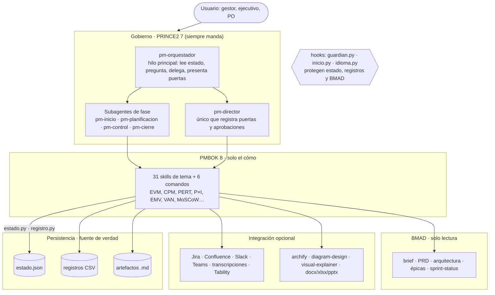
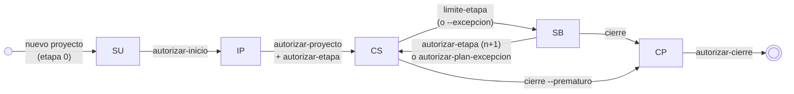
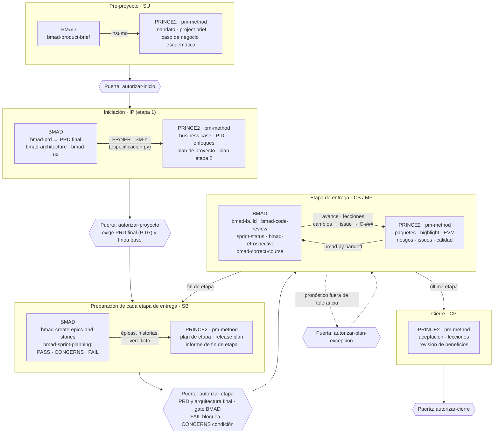
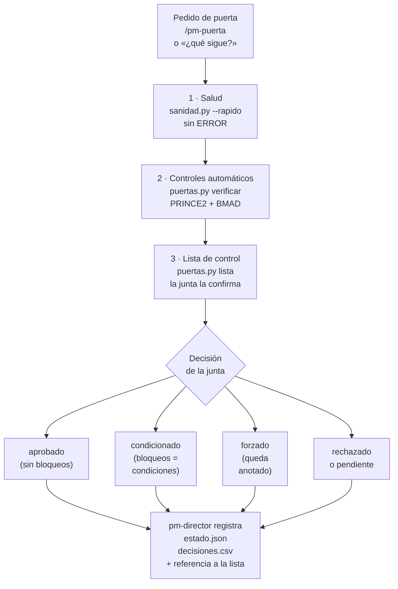
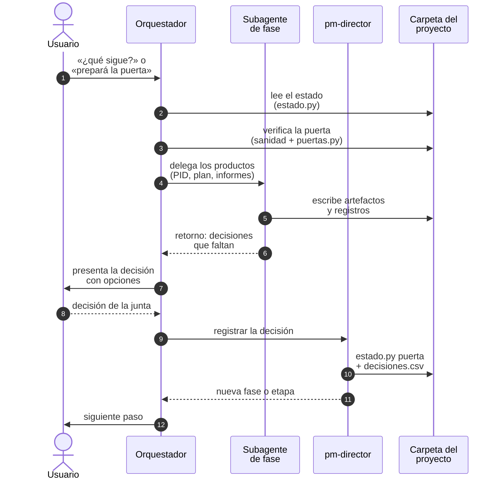
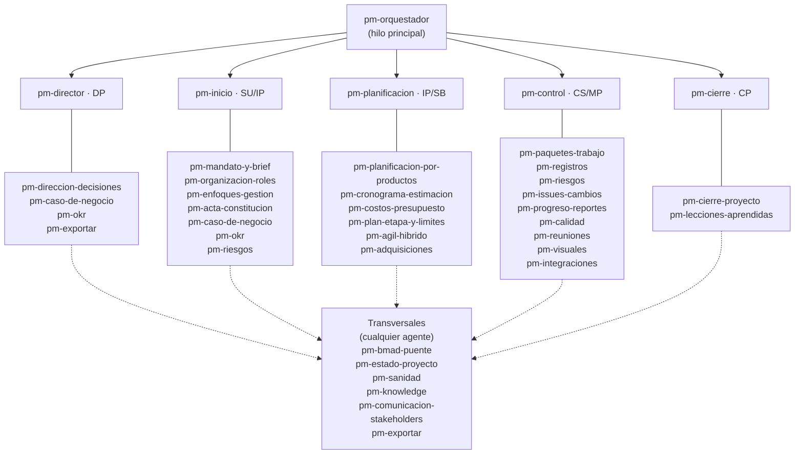
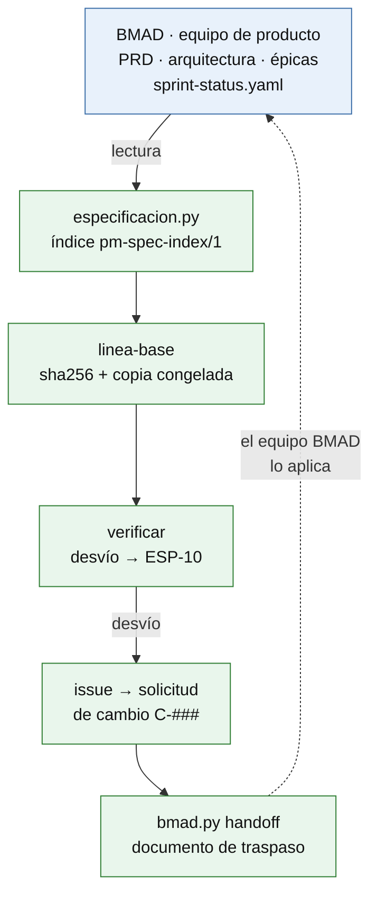

# pm-method · Agentes y skills de gestión de proyectos (ES/EN) · v2.1.0

Ecosistema bilingüe de **6 agentes**, **37 skills** y **3 hooks** para Claude Code (también Cowork y Hermes) que
gestiona un proyecto de la idea al cierre con **PRINCE2 7** como método y ciclo de vida, **PMBOK 8** como caja de
técnicas, plantillas profesionales como artefactos y **BMAD** como fuente única de la especificación del producto.

> **En una frase:** el equipo de producto especifica en BMAD; pm-method gobierna el proyecto con PRINCE2 sobre esa
> especificación, sin copiarla, y deja cada decisión registrada, trazable y verificada.

---

## ¿Por qué pm-method? (justificación)

Los asistentes de IA ya redactan planes e informes, pero sin **método**, sin **ciclo de vida** y sin **gobierno**: nadie
sabe qué está aprobado, la especificación del producto vive separada de la gestión y el modelo termina "decidiendo"
cosas que corresponden a personas. pm-method resuelve eso con una jerarquía fija: **PRINCE2 7 manda** (etapas, puertas,
tolerancias, gestión por excepción), **PMBOK 8** aporta solo técnicas, las **plantillas** dan forma a los artefactos y
**BMAD** es la especificación de solo lectura. El modelo prepara; la persona decide; los scripts verifican y registran.

| Problema habitual | Qué aporta pm-method |
|---|---|
| Los asistentes de IA producen documentos de gestión sueltos, sin método ni ciclo de vida | Un **método único y dominante** (PRINCE2 7): etapas, puertas de la junta, gestión por excepción y tolerancias; PMBOK 8 solo aporta el "cómo" |
| La especificación (PRD, épicas, historias) y la gestión viven en mundos separados y se desincronizan | **Fuente única por dato**: BMAD es la especificación, pm-method la lee por una fachada (`especificacion.py`), detecta desvíos contra líneas base con sha256 y devuelve decisiones con un documento de traspaso |
| El modelo "decide" cosas que debería decidir una persona | **Puertas humanas**: solo `pm-director` registra decisiones de la junta, y un hook lo hace cumplir también en los subagentes |
| Archivos de estado editados a mano, registros inconsistentes | **Guardarraíles**: `estado.json` y los registros solo cambian por scripts que validan; el hook `guardian.py` bloquea ediciones directas por Edit **y** por Bash |
| Integraciones frágiles o atadas a un proveedor | **MCP genérico** (Jira, Confluence, Slack, Teams, transcripciones, OKR) sin conectores predefinidos; skills externas de diagramas y Office con **respaldo interno** si no están |
| Nadie sabe si "todo está bien" | **Sanidad permanente**: `sanidad.py` (familias INS, EST, ART, REG, ESP, INT) al iniciar sesión, antes de cada puerta y a pedido |

**Valor agregado:** gobierno auditable (cada puerta con su fila en `decisiones.csv`), trazabilidad requisito → historia →
paquete de trabajo → aceptación, informes de avance y excepción con valor ganado, visuales y exportaciones listos para la
junta, y un ecosistema probado con **80 pruebas de regresión** y pruebas en vivo con Claude Code real.

---

## Beneficios

| Para | Beneficio concreto |
|---|---|
| Gestor de proyectos | planes, registros, informes (highlight, checkpoint, excepción, fin de etapa con valor ganado) y puertas preparados con método; menos trabajo administrativo |
| Ejecutivo y junta | decisiones claras con opciones, tolerancias y excepciones a tiempo; cada puerta verificada (salud, criterios de éxito, lista de control) antes de decidir |
| Product owner / equipo ágil | backlog sincronizado con BMAD, MoSCoW, release plan y avance por puntos sin copiar la especificación |
| PMO / CoE de IA | un estándar reproducible y auditable: `estado.json` + `decisiones.csv`, trazabilidad requisito → historia → paquete → aceptación |

| Evidencia (2026-10-17) | Resultado |
|---|---|
| Pruebas de regresión (`probar_paquete.py`) | 80 OK · 0 FALLO, incluida una instalación real de BMAD 6.12.4 |
| Enrutamiento en vivo con Claude Code real | 60/60 frases a la skill o agente correcto |
| Guardarraíles, idioma y robustez en vivo | 4/4 · 5/5 · inyección, datos desordenados, escala y varias sesiones: todos OK |
| Diagramas Mermaid (`validar_mermaid.py --render`) | 122 bloques, 0 errores |
| Recorridos E2E de las guías (`guias_e2e/correr.py`) | 4/4 OK con los scripts reales |

Límites conocidos y detalle para presentar el proyecto: **[docs/RESUMEN-EJECUTIVO.md](docs/RESUMEN-EJECUTIVO.md)**.

---

## Arquitectura



## Ciclo de vida PRINCE2 y puertas



## Ciclo de vida integrado: PRINCE2 + BMAD



### Verificación de cada puerta



Cada puerta se verifica en tres capas (salud, controles automáticos PRINCE2 y BMAD, lista de control confirmada por la
junta) y la decisión queda registrada: **[docs/PUERTAS.md](docs/PUERTAS.md)**.

## Orquestación de una puerta



## Agentes y skills



Relación completa agente ↔ skill ↔ humano: [docs/RACI.md](docs/RACI.md) · catálogo: [docs/CATALOGO.md](docs/CATALOGO.md).

## Sincronización con BMAD (fuente única)



---

## Instalación rápida

```bash
# 1. Plugin desde GitHub (Claude Code)
claude plugin marketplace add Arturo-Penas-Rial/pm-method
claude plugin install pm-method@pm-method
# 2. Python 3.9+ y paquetes recomendados
pip install pyyaml python-docx openpyxl
# 3. (opcional) BMAD en el repositorio del producto
npx bmad-method@6.12.4 install --modules bmm --tools claude-code --yes --user-name "<nombre>" --set core.project_name=<proyecto> --no-shims
```

Actualizar: `claude plugin marketplace update pm-method` y `claude plugin update pm-method@pm-method`.

**Hermes Agent** (skills y scripts; sin subagentes ni hooks):
```bash
git clone https://github.com/Arturo-Penas-Rial/pm-method.git ~/pm-method
python3 ~/pm-method/scripts/instalar_hermes.py      # adapta las rutas a ${HERMES_SKILL_DIR}; luego /reload-skills
```
Windows: los hooks corren en Git Bash; el lanzador `hooks/py.sh` busca `python3`, `python` o `py -3`.
Guía completa (requisitos por sistema operativo, BMAD, skills externas, MCP, Cowork, Hermes, verificación y problemas
frecuentes): **[docs/INSTALACION.md](docs/INSTALACION.md)**.

### Credenciales: dónde va la API-KEY

pm-method **no usa claves propias**: la credencial es la del cliente que ejecuta el modelo y la de cada conector MCP.

| Cliente | Opción recomendada | Con clave de API |
|---|---|---|
| Claude Code | suscripción Pro/Max/Team/Enterprise: `claude` → iniciar sesión en el navegador (o `/login`) | `export ANTHROPIC_API_KEY="…"` en `~/.bashrc` (Linux/WSL) o `~/.zshrc` (macOS); variable de usuario en Windows; comprobar con `/status` |
| Hermes Agent | `hermes model` o `hermes setup` (asistente) | `hermes config set ANTHROPIC_API_KEY "…"` → se guarda en `~/.hermes/.env` |
| Conectores MCP | `claude mcp add … -e TOKEN=…` (queda en `~/.claude.json`, privado) | en `.mcp.json` versionado, solo `${TOKEN}`, nunca el valor |

Nunca pegar claves en el chat ni guardarlas en la carpeta del proyecto o en commits. Si hay suscripción **y**
`ANTHROPIC_API_KEY`, Claude Code usa la clave (con cargo a la API) una vez aprobada. Detalle, precedencia, CI y WSL:
**[INSTALACION §0.7](docs/INSTALACION.md#07-claves-de-api-y-credenciales-cuáles-dónde-y-cómo)**.

### Opcional: Orca para ver varios agentes y proyectos a la vez

[Orca](https://github.com/stablyai/orca) (MIT) es una aplicación de escritorio que corre Claude Code, Hermes y otros
agentes en paralelo, cada uno en su worktree, con terminales persistentes, tableros de GitHub/Linear, notificaciones y
app móvil: útil para tener juntas la sesión de gestión (`pm-orquestador`) y las del equipo de producto. Es una interfaz
gráfica con terminales (no una TUI); pm-method sigue usándose desde Claude Code o Hermes dentro de ellas. Instalación
por sistema operativo y notas para WSL: **[INSTALACION §0.8](docs/INSTALACION.md#08-orca-opcional-varias-sesiones-de-agentes-y-proyectos-en-un-solo-lugar)**.

## Primeros pasos

```
/pm-method:pm-ayuda                      # qué escribir en cada situación
/pm-method:pm-nuevo "Proyecto Faro"      # crea la carpeta del proyecto y detecta BMAD
¿qué sigue?                              # el orquestador lee el estado y propone el siguiente paso
/pm-method:pm-sanidad                    # chequeo de consistencia (también antes de cada puerta)
```

**Probar las capacidades paso a paso:** [docs/guias/](docs/guias/README.md) tiene cuatro recorridos de punta a punta por
prompts, con reporte y gráficos: gestión de riesgos; alcance, cambio, esfuerzo, priorización y mapa de ruta; interesados,
comunicaciones, OKR y avance; y el producto de la idea al producto con BMAD.

Para que el orquestador sea el agente de toda la sesión: `claude --agent pm-method:pm-orquestador`.
Si el pedido nombra un producto concreto ("armá el business case", "highlight de esta semana", "acta de la reunión"),
Claude invoca directamente la skill dueña; el orquestador queda para "¿qué sigue?", "¿cómo venimos?" y pedidos que
cruzan procesos.

---

## Componentes

### Agentes

| Agente | Tipo | Procesos | Qué hace |
|---|---|---|---|
| `pm-orquestador` | hilo principal (también skill) | todos | lee el estado, pregunta, delega, presenta puertas |
| `pm-director` | subagente | DP | solicitudes de decisión; **único** que registra puertas y aprobaciones de junta |
| `pm-inicio` | subagente | SU, IP | mandato, brief, business case, OKR, organización, enfoques, PID |
| `pm-planificacion` | subagente | Plans, IP, SB | PBS/WBS o backlog, estimación, cronograma, presupuesto, planes |
| `pm-control` | subagente | CS, MP | paquetes, registros, riesgos, issues, informes, calidad, actas, sincronización |
| `pm-cierre` | subagente | CP | aceptación, handover, lecciones, revisión de beneficios, informe final |

Los subagentes no preguntan al usuario, no delegan en otros agentes, heredan las herramientas de la sesión (incluidos
los MCP) y devuelven un bloque "Retorno al orquestador". Diseño: [docs/ARQUITECTURA.md](docs/ARQUITECTURA.md).

### Comandos de uso humano

| Comando | Uso |
|---|---|
| `pm-ayuda [tema]` | ayuda contextual |
| `pm-nuevo "Nombre" [carpeta]` | crear un proyecto |
| `pm-estado [carpeta]` | estado y siguiente paso |
| `pm-reporte highlight\|checkpoint\|excepcion` | informe de avance |
| `pm-puerta <tipo>` | preparar una puerta de la junta |
| `pm-sync [bmad\|tracker\|okr]` | sincronizar fuentes externas |

Toda skill es invocable como `/pm-method:<skill>` (plugin) o `/<skill>` (copia manual y Hermes).

### Hooks (plugin de Claude Code)

- **`PreToolUse` → `guardian.py`**: bloquea ediciones directas (Write/Edit y Bash: `sed -i`, redirecciones, `tee`,
  `cp`/`mv`, Python en línea) de `estado.json`, registros CSV, derivados de la especificación, copias congeladas e
  instantáneas de fuentes; impide que los subagentes escriban en BMAD y que nadie salvo `pm-director` ejecute los comandos de decisión (puertas, tolerancias, roles).
- **`SessionStart` → `inicio.py`**: agrega fase, etapa, sanidad rápida, reglas de enrutamiento e idioma, y la ruta
  absoluta de los scripts.
- **`UserPromptSubmit` → `idioma.py`**: si el pedido está en otro idioma que el proyecto (ES/EN), recuerda responder en
  el idioma del pedido.

### Catálogo resumido (37 skills)

| Grupo | Skills |
|---|---|
| Dirección y estado | `pm-orquestador`, `pm-direccion-decisiones`, `pm-estado-proyecto`, `pm-sanidad` |
| Inicio (SU, IP) | `pm-mandato-y-brief`, `pm-caso-de-negocio`, `pm-okr`, `pm-organizacion-roles`, `pm-enfoques-gestion`, `pm-acta-constitucion` |
| Planificación | `pm-planificacion-por-productos`, `pm-cronograma-estimacion`, `pm-costos-presupuesto`, `pm-plan-etapa-y-limites`, `pm-agil-hibrido`, `pm-adquisiciones` |
| Control (CS, MP) | `pm-paquetes-trabajo`, `pm-registros`, `pm-riesgos`, `pm-issues-cambios`, `pm-progreso-reportes`, `pm-calidad`, `pm-comunicacion-stakeholders`, `pm-reuniones`, `pm-visuales` |
| Cierre (CP) | `pm-cierre-proyecto`, `pm-lecciones-aprendidas` |
| Transversales | `pm-bmad-puente`, `pm-integraciones`, `pm-exportar`, `pm-knowledge` |
| Comandos | `pm-ayuda`, `pm-nuevo`, `pm-estado`, `pm-reporte`, `pm-puerta`, `pm-sync` |

---

## Dependencias

| Dependencia | Nivel | Para qué | Origen |
|---|---|---|---|
| Claude Code (o Cowork / Hermes Agent) | obligatoria (un cliente) | ejecutar agentes y skills | https://github.com/anthropics/claude-code |
| Python ≥ 3.9 | obligatoria | scripts y hooks | https://github.com/python/cpython |
| git (Git for Windows en Windows) | obligatoria para instalar desde GitHub; en Windows, para los hooks | instalar y actualizar | https://github.com/git/git · https://github.com/git-for-windows/git |
| pyyaml · python-docx · openpyxl | recomendadas | BMAD, actas `.docx`, exportar Word/Excel | https://pypi.org/project/pyyaml/ · https://pypi.org/project/python-docx/ · https://pypi.org/project/openpyxl/ |
| Node.js y npx | opcional (obligatoria para BMAD y skills externas) | `npx bmad-method`, `npx skills add` | https://github.com/nodejs/node |
| BMAD Method 6.12.4 (también v4, 6.11) | opcional | capa de especificación | https://github.com/bmad-code-org/BMAD-METHOD |
| archify | opcional | diagramas HTML interactivos (organigrama, WBS) | https://github.com/tt-a1i/archify |
| diagram-design | opcional | diagramas editoriales | https://github.com/cathrynlavery/diagram-design |
| visual-explainer | opcional | one-pagers y explicadores HTML | https://github.com/nicobailon/visual-explainer |
| anthropics/skills (docx, xlsx, pptx) | opcional | exportación Office de calidad | https://github.com/anthropics/skills |
| drawio-mcp (draw.io oficial) | opcional | diagramas editables | https://github.com/jgraph/drawio-mcp |
| `skills` CLI | opcional | instalar skills externas | https://github.com/vercel-labs/skills |
| MPXJ (+ Java) | opcional | validar el MSPDI exportado | https://github.com/joniles/mpxj |
| Conectores MCP (Atlassian, Slack, Teams, Granola, Fireflies, Zoom, Tability) | opcionales | fuentes y canales | ver [DEPENDENCIAS §5](docs/DEPENDENCIAS.md) |

Versiones probadas, licencias, comandos de instalación y cómo se verificó cada URL: **[docs/DEPENDENCIAS.md](docs/DEPENDENCIAS.md)**.

---

## Documentación y pruebas

Índice completo con rutas de lectura por perfil: **[docs/INDICE.md](docs/INDICE.md)**.

| Documento | Contenido |
|---|---|
| [RESUMEN-EJECUTIVO](docs/RESUMEN-EJECUTIVO.md) | propuesta de valor, beneficios, diferenciales, evidencia |
| [INSTALACION](docs/INSTALACION.md) | requisitos, plugin, BMAD, skills externas, MCP, Cowork, Hermes, verificación, problemas frecuentes |
| [DEPENDENCIAS](docs/DEPENDENCIAS.md) | dependencias con URL de origen, versión probada y licencia |
| [ARQUITECTURA](docs/ARQUITECTURA.md) | capas, precedencia PRINCE2/PMBOK, agentes vs subagentes, carga progresiva |
| [INTEGRACIONES](docs/INTEGRACIONES.md) | decisiones por candidato, contratos, verificación en vivo |
| [SINCRONIZACION](docs/sincronizacion.md) | fuente única, fachada de especificación, traspaso BMAD ↔ gobierno |
| [SANIDAD](docs/SANIDAD.md) | comprobaciones de consistencia y controles permanentes |
| [RACI](docs/RACI.md) | responsabilidades por rol, agente y skill |
| [CATALOGO](docs/CATALOGO.md) | las 37 skills: disparadores, artefactos, agente, scripts |
| [CASOS-DE-USO](docs/CASOS-DE-USO.md) | situaciones típicas por skill |
| [CASOS-DE-USO-INTEGRACIONES](docs/CASOS-DE-USO-INTEGRACIONES.md) | un caso por repositorio integrado (visuales, reportes, planificación, OKR, reuniones, trackers, BMAD) |
| [CASO-MAESTRO](docs/CASO-MAESTRO.md) | proyecto de punta a punta con BMAD |
| [PRUEBAS](docs/PRUEBAS.md) | pruebas automáticas, pruebas en vivo y guía de aceptación |
| [PILOTO](docs/PILOTO.md) | plan de piloto con métricas, rúbrica experta y prueba de usabilidad |
| [PUERTAS](docs/PUERTAS.md) | verificación y registro de cada puerta; controles de BMAD integrados; ciclo de vida PRINCE2 + BMAD |
| [Colisiones](docs/colisiones.md) | dueños únicos y pistas de alcance entre skills |
| [CHANGELOG](CHANGELOG.md) | cambios por versión |
| [SPEC.md](SPEC.md) | especificación de construcción y convenciones canónicas |
| [CLAUDE.md](CLAUDE.md) · [AGENTS.md](AGENTS.md) | contexto para seguir desarrollando el paquete con Claude Code u otros agentes |
| [Informe 2](docs/informe/README.md) | informe completo del ecosistema en HTML y PowerPoint, con su generador |

### Calidad verificada (2026-10-17)

| Verificación | Resultado |
|---|---|
| `python3 scripts/validar_paquete.py` | OK · 37 skills, 31 invocables, listado de 6.289 caracteres (límite 7.500) |
| `python3 scripts/probar_paquete.py` | 80 OK · 0 FALLO (BMAD v6, 6.12.4 real, v4, nativo, hook guardian, puertas, regresiones) |
| `claude plugin validate .` | aprobado (un aviso esperado: `CLAUDE.md` de la raíz es para quien desarrolla el repositorio, no contexto del plugin) |
| Enrutamiento en vivo (Claude Code real) | v2.0: 82 % de 75 frases → v2.1: 60/60 en la batería del repositorio (Sonnet 59/60, Haiku 56/60) |
| Guardarraíles, idioma y robustez en vivo | guardarraíles 4/4; idioma 5/5 con el hook `idioma.py`; inyección en fuentes 6/6; datos desordenados 7/7; escala 5/5; varias sesiones con `/compact` 10/10 |
| Skills externas en vivo | archify, diagram-design, visual-explainer y docx/xlsx/pptx delegadas y funcionando; respaldo interno sin ellas |

---

## Estructura del repositorio

```
pm-method/
  .claude-plugin/     plugin.json (pm-method 2.1.0) · marketplace.json (pm-method)
  agents/             6 agentes (orquestador + 5 subagentes; personas en Hermes)
  skills/             37 skills (SKILL.md + references/ + templates/ + scripts/)
  hooks/              hooks.json · py.sh · guardian.py (PreToolUse) · inicio.py (SessionStart) · idioma.py (UserPromptSubmit)
  scripts/            validar_paquete.py · probar_paquete.py · pruebas/fixtures · pruebas_vivo/ (arnés con Claude Code real)
  docs/               documentación · evaluacion/frases-enrutamiento.tsv · ejemplos/
  compatibilidad.json versiones probadas, dependencias y clientes
  SPEC.md             especificación y convenciones canónicas
  CLAUDE.md · AGENTS.md · CHANGELOG.md · LICENSE
```

## Reglas que el paquete aplica siempre

Etapas de gestión por defecto; toda desviación prevista fuera de tolerancia se escala como excepción; nada se da por
aprobado sin un acto humano registrado; escrituras externas solo con confirmación; un dueño por dato; contenido
generado marcado como borrador y datos faltantes como `[por confirmar]` / `[to be confirmed]`; respuesta en el idioma
del usuario. Convenciones completas: `SPEC.md` §1.10.

---

## English summary

pm-method 2.1.0 is a bilingual (Spanish/English) pack of 6 agents, 37 Agent Skills and 3 hooks for end-to-end project
management in Claude Code (also Cowork and Hermes). PRINCE2 7 provides the method and life cycle, PMBOK 8 only the
techniques, a templates book the artifacts, BMAD the read-only product specification (single source of truth), and
user-connected MCP tools the optional sources and channels. A main-thread orchestrator talks to the user; five phase
subagents produce artifacts and return a structured block; only `pm-director` records board decisions, enforced by a
PreToolUse hook that also blocks direct edits of state and registers. Install with
`claude plugin marketplace add Arturo-Penas-Rial/pm-method` and `claude plugin install pm-method@pm-method`, then start
with `/pm-method:pm-ayuda` or ask "what's next?". See `docs/INDICE.md` for the documentation map.

## Licencia

MIT (ver [LICENSE](LICENSE)). El contenido de las fuentes está destilado en palabras propias, sin texto literal.
PRINCE2® y PMBOK® son marcas registradas de sus respectivos titulares. BMAD Method, archify, diagram-design y
visual-explainer son proyectos de terceros con licencia MIT que el paquete no incluye; las skills de Office de
`anthropics/skills` tienen licencia propia (ver su `LICENSE.txt`).
