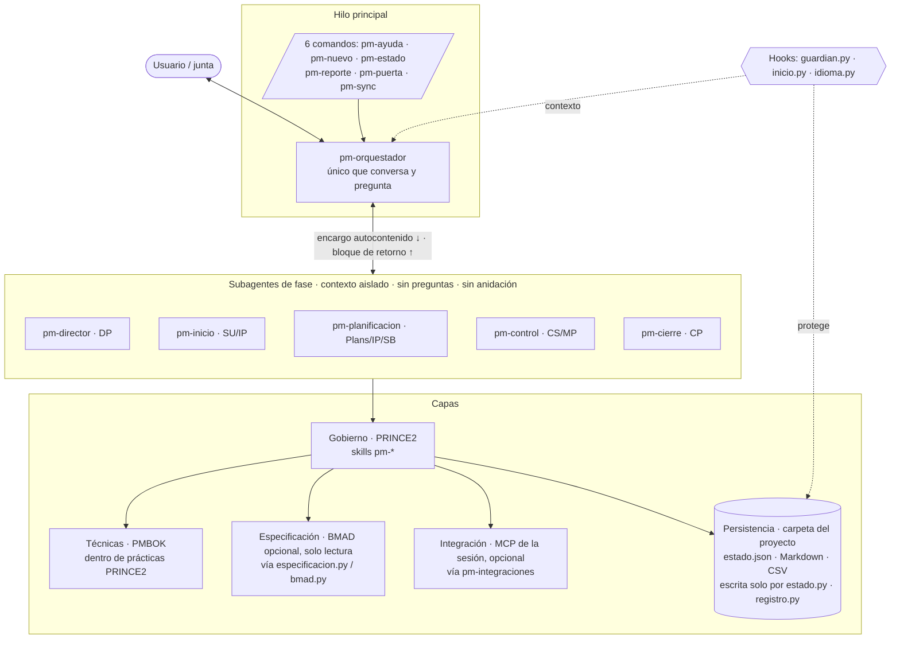
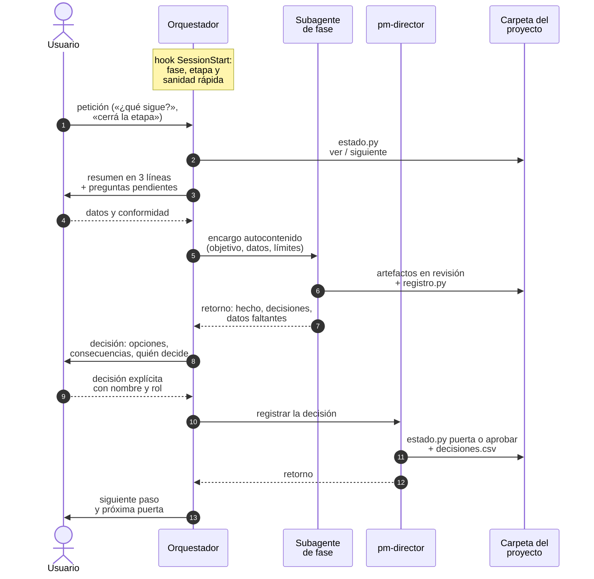

# Arquitectura · pm-method 2.1.0

Este documento explica cómo está construido pm-method y por qué: las capas y su precedencia, el reparto entre agente
orquestador y subagentes, las herramientas que usan las skills, los comandos, la carga progresiva del contexto y el
control de precisión en la activación de skills. La especificación vinculante es `SPEC.md` (§0, §1.10–§1.17); aquí se
resume y se justifica.

---

## 1. Visión general

pm-method es un paquete de **37 skills** (31 que el modelo activa por su descripción y 6 comandos de uso humano), **6
agentes** (un orquestador para el hilo principal y 5 subagentes de fase) y **3 hooks** (protección de datos y sanidad
al inicio de sesión). Su fuente de verdad es una carpeta de proyecto en Markdown, CSV y `estado.json`.



---

## 2. Capas

| Capa | Dueño | Qué aporta | Dónde vive | Cómo se accede |
|---|---|---|---|---|
| **Gobierno** | PRINCE2 7 (agentes y skills pm-*) | justificación, organización, planes, etapas, tolerancias, puertas, cambios, informes | carpeta del proyecto | skills de fase |
| **Técnicas** | PMBOK 8, aplicado dentro de PRINCE2 | cómo estimar, programar, costear, medir, analizar | procedimientos de las skills y `pm-knowledge/references/` | por sección, a demanda |
| **Especificación** (opcional) | BMAD | brief de producto, PRD (FR/NFR/UJ/SM), arquitectura (AD), UX, épicas, historias, estado del sprint | `_bmad-output/` (v6) o `docs/` (v4) | solo lectura: `bmad.py` como proveedor, `especificacion.py` como fachada |
| **Integración** (opcional) | MCP que conecte el usuario | fuentes y canales: tracker, docs, chat, correo, calendario, transcripciones, OKR | herramientas de la sesión; instantáneas en `03-control/fuentes/` | `pm-integraciones` |
| **Persistencia** | `pm-estado-proyecto` | fuente de verdad del gobierno | carpeta del proyecto; `exportados/` solo copias | `estado.py`, `registro.py`, `nuevo_proyecto.py` |

Una cuarta fuente, el libro de plantillas, no es una capa de ejecución sino la biblioteca de artefactos: campos y
listas de verificación de las plantillas `templates/` de cada skill.

Principios transversales de las capas:
- **Un dueño por dato.** Ningún dato se escribe en dos lugares; las demás capas lo citan por id (FR-3, B-1, SM-1,
  WBS 1.2.3, WP-…). Detalle en `docs/sincronizacion.md`.
- **Los sistemas externos no son fuente de verdad del gobierno.** Un dato de Jira o de BMAD entra como instantánea
  fechada o se lee por la fachada; no reemplaza un registro.
- **Escritura externa solo con confirmación humana**, nunca desde un subagente.

---

## 3. Precedencia: PRINCE2 manda, PMBOK aporta el cómo

PRINCE2 define **qué** se hace, **cuándo** y **quién** decide (ciclo de vida por etapas de gestión, gestión por
excepción, roles de la junta, procesos SU/DP/IP/CS/MP/SB/CP). El PMBOK aporta técnicas y cubre vacíos, pero **nunca**
aporta ciclo de vida, fases ni grupos de procesos. Toda regla tomada del PMBOK se etiqueta con la práctica, proceso o
producto PRINCE2 donde se aplica (`[PMBOK→<práctica>/<proceso>]`). Ante conflicto, manda PRINCE2.

| Situación | Lo que aporta el PMBOK | Cómo lo encuadra PRINCE2 |
|---|---|---|
| Estimar el plan de la próxima etapa | PERT, estimación análoga y paramétrica, puntos | `[PMBOK→Plans/SB]`: técnica dentro de la planificación basada en productos; cada estimación declara método, supuestos y rango, y `[por confirmar]` nunca pasa a línea base |
| Medir el desempeño | EVM (CPI, SPI, EAC) | `[PMBOK→Progress/CS]`: insumo del highlight; el semáforo se calcula contra las **tolerancias PRINCE2** (verde ≤ 50 %, ámbar 50–100 %, rojo = fuera → excepción a la junta) |
| Pronóstico fuera de tolerancia | análisis de variación y acciones correctivas | la desviación no se "corrige" dentro del equipo: es **excepción**; pm-control informa, la junta decide, pm-director registra |
| EVM en un proyecto ágil con costo y fecha fijos | EAC > BAC | se lee como alcance que no entra contra la tolerancia de alcance (MoSCoW), no como sobrecosto; hay excepción solo si los Must no entran (`evm.py --modo agil`) |
| Analizar interesados | matriz poder/interés, nivel de compromiso | técnica dentro de la práctica de organización (`pm-organizacion-roles`) |
| Control de cambios | comité de control de cambios | la decisión es de la **autoridad de cambio** PRINCE2 dentro de su presupuesto de cambios; fuera de él, la junta |
| Fases del proyecto | ciclo de vida por fases | no se usa: el ciclo de vida es SU (etapa 0) → iniciación (etapa 1) → entrega (2…n) → CP |
| Reservas | contingencia y reserva de gestión | BAC = Σ paquetes + contingencia de riesgos identificados; la reserva de gestión queda fuera del BAC y solo la libera la junta |
| Acta de constitución | project charter | `pm-acta-constitucion` produce el charter como complemento; el documento de autorización es el **PID** |

El enfoque de entrega (predictivo, ágil o híbrido) cambia cómo se trabaja **dentro** de las etapas (paquetes de trabajo
iterativos, backlog, release plan), nunca elimina las puertas de decisión.

---

## 4. Agentes y subagentes

### 4.1 Opciones evaluadas

| Diseño | Ventaja | Problema | Veredicto |
|---|---|---|---|
| Solo skills, sin agentes | mínimo costo de contexto | el trabajo de fase (muchos archivos, scripts y registros) llena la conversación; no hay aislamiento | descartado como modo único |
| Un agente monolítico | simple | contexto saturado; sin separación de responsabilidades (quién registra puertas) | descartado |
| Orquestador como subagente | simetría | los subagentes **no pueden usar `AskUserQuestion`**: un orquestador delegado no podría preguntar ni presentar puertas | descartado |
| Subagentes que delegan en otros (anidación) | flexibilidad | Claude Code lo permite (hasta 3 niveles, `CLAUDE_CODE_MAX_SUBAGENT_SPAWN_DEPTH`), pero las decisiones humanas quedarían enterradas en niveles que no conversan y se pierde trazabilidad | descartado por diseño (`disallowedTools: Agent`) |
| **Orquestador en el hilo principal + 5 subagentes de fase** | una sola voz ante el usuario; producción aislada por fase; decisiones siempre visibles | requiere un protocolo de retorno estricto | **adoptado** |

### 4.2 Reparto de responsabilidades

- **`pm-orquestador`** (hilo principal, sin `disallowedTools`): lee `estado.json`, resume la situación en tres líneas,
  clasifica la petición con su tabla de enrutamiento, **hace todas las preguntas**, delega con un encargo
  autocontenido, lee el retorno, presenta las decisiones humanas (pregunta · opciones con consecuencias · rol que
  decide) y solo después invoca a `pm-director` para registrar.
- **Subagentes de fase** (`model: inherit`, `disallowedTools: Agent`):

| Subagente | Procesos PRINCE2 | Prepara | Registra |
|---|---|---|---|
| `pm-director` | DP | solicitudes de decisión, evaluación de excepciones, actas de junta | **único** que ejecuta `estado.py puerta` y `estado.py aprobar`; fija líneas base BMAD |
| `pm-inicio` | SU, IP | mandato, brief, business case, OKR, organización, riesgos iniciales, enfoques, PID | productos `en-revision` |
| `pm-planificacion` | Plans, IP, SB | PBS/WBS o backlog, estimación, cronograma, presupuesto, planes de proyecto, etapa y excepción | productos `en-revision` |
| `pm-control` | CS, MP | paquetes, registros, riesgos, issues, informes y EVM, calidad, actas, sincronización, informe de excepción | registros vía `registro.py` |
| `pm-cierre` | CP | aceptación, handover, lecciones, revisión de beneficios, informe final | productos `en-revision` |

### 4.3 Reglas de los subagentes

1. **Sin preguntas al usuario.** Claude Code les quita `AskUserQuestion`; todo lo que requiera decisión o dato vuelve
   en el bloque de retorno y nunca se supone respondido.
2. **Sin anidación.** `disallowedTools: Agent`; el orquestador es el único que reparte trabajo.
3. **Herencia de herramientas.** Ningún agente declara `tools`: heredan todas las de la sesión, **incluidos los MCP**
   que el usuario conecte después. La organización puede restringir con `disallowedTools`. Esto es además necesario
   porque los agentes de plugin ignoran `hooks`, `mcpServers` y `permissionMode` en su frontmatter: un agente no puede
   traer su propio conector.
4. **Skills por demanda.** No se precargan skills en el frontmatter (`skills:`) para no gastar contexto; el subagente
   invoca la que necesita en el orden indicado en su archivo.
5. **Hooks también en subagentes.** Los hooks del plugin corren dentro de los subagentes y reciben `agent_type`;
   `guardian.py` lo usa para impedir que un subagente `pm-*` escriba en carpetas de BMAD.
6. **Escrituras externas** (tickets, mensajes, correos, publicaciones) se devuelven como "decisión humana requerida".

### 4.4 Protocolo de retorno

Obligatorio al final de cada subagente:

```
## Retorno al orquestador / Return
- Hecho: <artefactos con ruta y estado; ids de registros>
- Decisiones humanas requeridas: <pregunta · opciones · quién decide (rol)>   (o "ninguna")
- Datos faltantes: <campo · a quién preguntar>                                  (o "ninguno")
- Siguiente paso sugerido: <agente/skill>
```

El orquestador verifica *Hecho* contra `estado.py ver` (ninguna puerta registrada fuera de `pm-director`), pregunta los
*Datos faltantes*, presenta las *Decisiones humanas* y vuelve a delegar.

### 4.5 Correspondencia en Hermes Agent

| Concepto en Claude Code | Equivalente en Hermes |
|---|---|
| Orquestador en el hilo principal | perfil dedicado (`hermes profile create <n>`) con el cuerpo de `agents/pm-orquestador.md` como `SOUL.md` |
| Subagentes de fase con nombre | no existen archivos de subagente; el orquestador ejecuta las skills de fase en el mismo hilo; los agentes de fase pueden declararse como personalidades (`agent.personalities`, `/personality`); la delegación genérica es `delegate_task` |
| Skills `/pm-method:<skill>` | comandos `/nombre-skill` (hasta 5 apilados; `/reload-skills`) |
| Hooks de protección y sanidad | sin equivalente documentado: la sanidad la ejecutan `pm-orquestador` al empezar y `pm-puerta` antes de cada puerta; puede programarse con el planificador de Hermes **[verificar sintaxis vigente]** |

---

## 5. Herramientas de las skills

Las skills no dependen de conectores ni servicios: su "motor" son **scripts deterministas en Python** (biblioteca
estándar; `pyyaml`, `python-docx` y `openpyxl` solo donde hacen falta). Un script da el mismo resultado para la misma
entrada, valida valores y deja traza; el modelo redacta, el script calcula y registra.

| Script | Skill | Función |
|---|---|---|
| `esquema.py` | pm-estado-proyecto | esquemas de `estado.json` y de los 9 registros; migración |
| `nuevo_proyecto.py` | pm-estado-proyecto | crea la carpeta, los registros y `estado.json` |
| `estado.py` | pm-estado-proyecto | fase, etapa, tolerancias, roles, integraciones, artefactos, puertas, transiciones |
| `registro.py` | pm-estado-proyecto | alta, actualización, listado y resumen de registros con validación |
| `especificacion.py` | pm-estado-proyecto | fachada única de lectura de la especificación (contrato `pm-spec-index/1`) |
| `sanidad.py` | pm-estado-proyecto | comprobaciones INS, EST, ART, REG, ESP, INT |
| `wbs.py` | pm-estado-proyecto | PBS/WBS y su diagrama |
| `cpm.py` | pm-estado-proyecto | camino crítico, Gantt Mermaid y exportación MSPDI (`--mspdi`, validada leyendo con MPXJ) |
| `evm.py` | pm-estado-proyecto | valor ganado con semáforo contra tolerancias; modo ágil |
| `exportar.py` | pm-estado-proyecto | `.docx` / `.xlsx` |
| `bmad.py` | pm-bmad-puente | `detectar`, `inventario`, `requisitos`, `trazabilidad`, `backlog`, `avance`, `linea-base`, `verificar`, `indice`, `handoff` |
| `okr.py` | pm-okr | validación de vínculos y puntuación de KR |
| `transcripcion.py` | pm-reuniones | normalización de transcripciones VTT/SRT/TXT/DOCX |
| `paquete.py` | pm-exportar | ZIP de puerta o de cierre con manifiesto |

**Sin conectores predefinidos.** Las skills describen capacidades (leer issues, crear issue, publicar mensaje, leer
transcripción…) y `pm-integraciones` las resuelve con los MCP presentes en la sesión. El paquete no incluye
`.mcp.json` ni credenciales. Ver `INTEGRACIONES.md`.

---

## 6. Comandos

- **Toda skill es invocable como comando:** `/pm-method:<skill>` en el plugin; `/<skill>` en copia manual y en Hermes.
- **Seis skills-comando de uso humano** llevan `disable-model-invocation: true`: el modelo no las activa solo y **no
  consumen presupuesto del listado**.

| Comando | Para qué |
|---|---|
| `pm-ayuda [tema]` | qué escribir en cada situación, skills, comandos, ciclo de vida, carpetas |
| `pm-nuevo "Nombre" [carpeta]` | crea la carpeta del proyecto y detecta BMAD |
| `pm-estado [carpeta]` | fase, etapa, tolerancias, puertas pendientes, registros abiertos, avance BMAD, siguiente paso |
| `pm-reporte highlight\|checkpoint\|excepcion [carpeta]` | informe de avance vía `pm-progreso-reportes` |
| `pm-puerta <tipo> [carpeta]` | prepara una puerta: productos requeridos, sanidad, verificación BMAD, solicitud de decisión |
| `pm-sync [bmad\|tracker\|okr]` | sincroniza BMAD e instantáneas de tracker y OKR; escribe afuera solo con confirmación |

La carpeta `commands/` de v1 desapareció: es un formato heredado y los comandos son ahora skills.

---

## 7. Carga progresiva del contexto

| Nivel | Qué se carga | Cuándo | Límite en pm-method |
|---|---|---|---|
| 1 | `name` + `description` | siempre, en todas las sesiones | descripción ≤ 240 caracteres; total del listado del paquete ≤ 7.500 caracteres |
| 2 | cuerpo de `SKILL.md` | al activarse la skill | ≤ 12.000 caracteres y ≤ 200 líneas (≈3,5 k tokens) |
| 3 | `references/`, `templates/`, `scripts/` | solo cuando un paso lo pide | sin límite fijo; se consultan por sección |

Cifras reales de v2 (medidas con `scripts/validar_paquete.py` y sobre los archivos):
- Listado del nivel 1: **6.289 caracteres** para las 31 skills invocables por el modelo (las 6 skills-comando no
  cuentan).
- El presupuesto del listado de skills en Claude Code es **≈1 % de la ventana de contexto**; si se instalan BMAD u otros
  repos, puede ampliarse con `"skillListingBudgetFraction": 0.02` en `settings.json`. `skillOverrides` no aplica a skills
  de plugins. La sanidad avisa (INS-05) cuando las descripciones visibles superan ≈8.000 caracteres.
- Nivel 2: el `SKILL.md` más largo (`pm-orquestador`) ronda 12,1 k bytes y ninguno supera 124 líneas; el validador
  tolera hasta 12.500 bytes para absorber la diferencia entre bytes y caracteres acentuados.
- Tras compactar, Claude Code conserva hasta 5.000 tokens por skill, por eso el nivel 2 se mantiene por debajo.
- El conocimiento destilado de las fuentes (`pm-knowledge/references/`, 8 archivos) se consulta por encabezado con
  `grep`, nunca entero.

---

## 8. Precisión, pistas de alcance y colisiones

### 8.1 Formato de la descripción

Una línea, ≤ 240 caracteres:

```
<Objeto que produce o decide>. Usar: <4–7 disparadores ES/EN>. No: <tema vecino>→<skill dueña>.
```

- Empieza por el **objeto** que la skill produce (sustantivo), no por el procedimiento.
- `Usar:` disparadores concretos en español e inglés, sin sinónimos redundantes.
- `No:` la **pista de alcance** que evita la colisión más probable y apunta a la dueña. Ejemplo real:
  `pm-riesgos` → "No: issue ya ocurrido→pm-issues-cambios".

### 8.2 Dueños únicos

Cada tema tiene una sola skill dueña; las demás la invocan. Pares sensibles: registros genéricos (`pm-registros`) vs
riesgos (`pm-riesgos`) vs issues/cambios (`pm-issues-cambios`); informes (`pm-progreso-reportes`) vs visuales
(`pm-visuales`); plan de etapa vs cronograma; comunicación vs reuniones; business case vs OKR; requisitos sin BMAD
(`pm-planificacion-por-productos`) vs PRD (`pm-bmad-puente`). Matriz completa en `docs/colisiones.md`.

### 8.3 Evaluación ciega de enrutamiento

Conjunto de 52 frases en español e inglés con la skill esperada (`docs/evaluacion/frases-enrutamiento.tsv`), evaluado
a ciegas por modelos que debían elegir la skill. **[verificar]** el detalle del protocolo (qué contexto exacto recibió
el evaluador) no está documentado en el archivo.

| Ronda | Modelo | Aciertos |
|---|---|---|
| 1 (descripciones iniciales) | haiku | 49/52 |
| 1 (descripciones iniciales) | sonnet | 49/52 |
| 2 (tras ajustar descripciones) | haiku | 51/52 |

No consta una segunda ronda con sonnet. El archivo registra las frases y la skill esperada, no las respuestas por
modelo.

### 8.4 Colisiones con skills de otros repositorios

`sanidad.py` inventaría las skills instaladas (proyecto, `~/.claude/skills`, `~/.claude/plugins`, `~/.hermes/skills`) y
avisa **INS-06** cuando una skill externa comparte tres o más disparadores con una skill pm-*. La corrección es ajustar
la descripción local u ocultar la externa con `skillOverrides`.

---

## 9. Persistencia y controles

- **Persistencia:** solo `estado.py` (y `nuevo_proyecto.py`, `bmad.py`) escriben `estado.json`; solo `registro.py`
  escribe los 9 registros (R, I, C, D, S, L, ST, Q, A). `estado.json` y los registros migran solos al leerse.
- **Sincronización con la especificación:** fuente única + fachada de lectura (`especificacion.py`) + traspaso de
  decisiones (`bmad.py handoff`). Ver `docs/sincronizacion.md`.
- **Controles permanentes:** `sanidad.py`, hooks `PreToolUse` y `SessionStart`, regla de puerta en `pm-puerta` y
  `pm-director`, esquemas versionados, `validar_paquete.py` y `probar_paquete.py`. Ver `docs/SANIDAD.md`.

---

## 10. Flujo de orquestación



Transiciones que el orquestador secuencia: SU → IP con `autorizar-inicio`; IP → entrega con `autorizar-proyecto` +
`autorizar-etapa`; CS → SB con `estado.py limite-etapa` y SB → CS con `autorizar-etapa`; excepción: pm-control informa
→ decisión humana → pm-director registra → pm-planificacion prepara el plan → `autorizar-plan-excepcion`; última etapa
→ CP con `estado.py cierre` → pm-cierre → `autorizar-cierre`. Con BMAD, `bmad.py verificar` antes de cada puerta.
