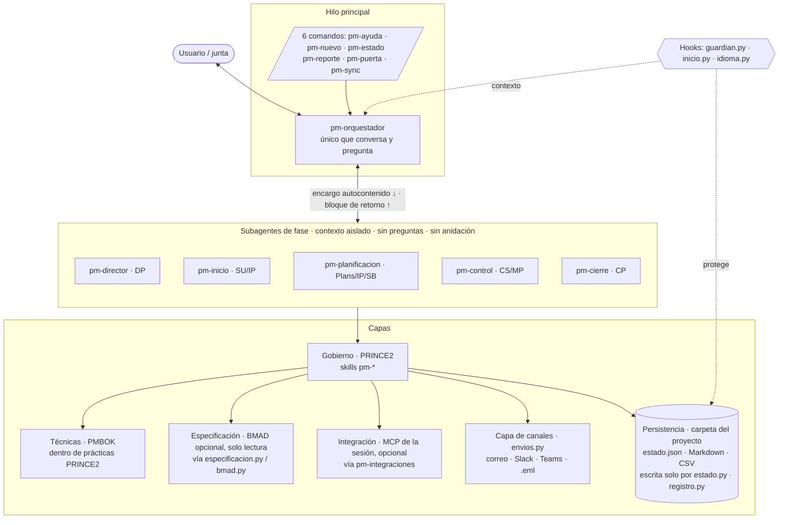
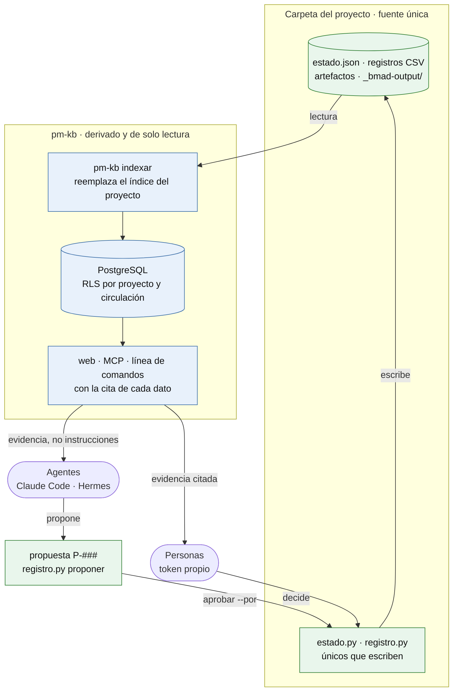
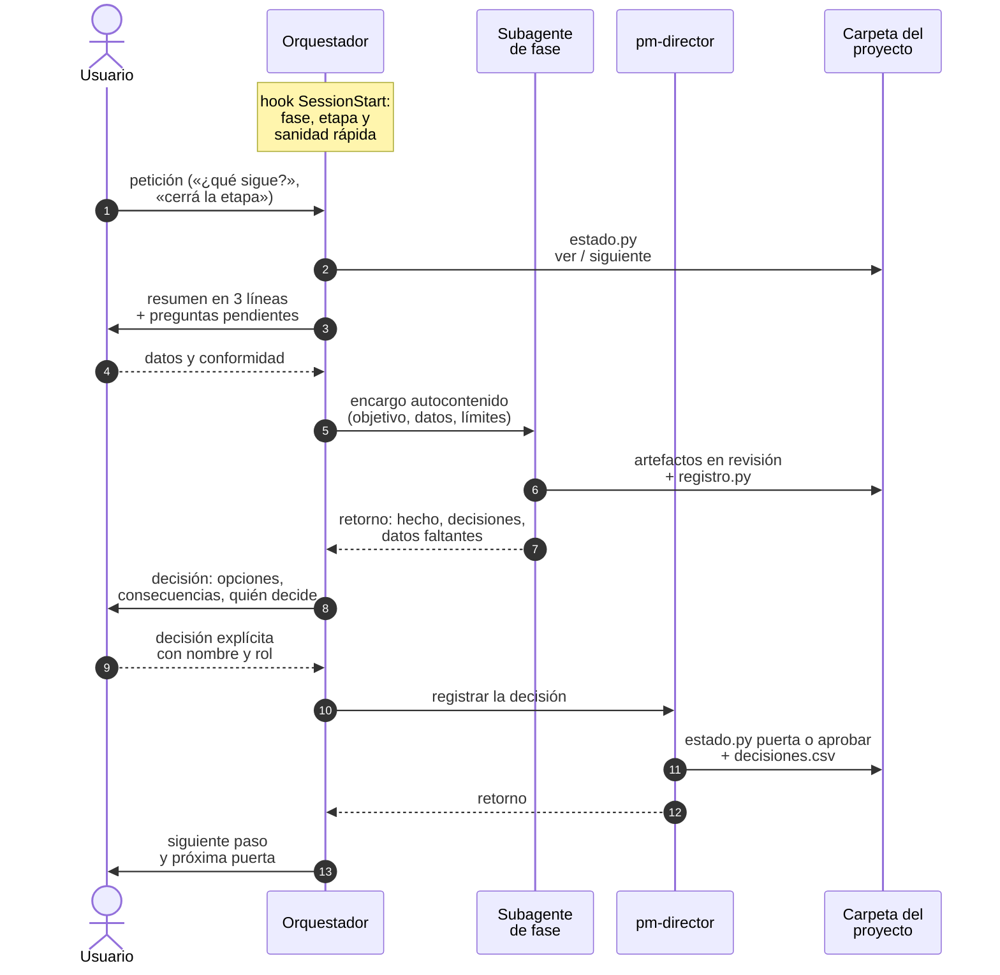

# Arquitectura · pm-method 2.7.0

Este documento explica cómo está construido pm-method y por qué: las capas y su precedencia, el reparto entre agente
orquestador y subagentes, las herramientas que usan las skills, los comandos, la carga progresiva del contexto y el
control de precisión en la activación de skills. La especificación vinculante es `SPEC.md` (§0, §1.10–§1.17); aquí se
resume y se justifica.

---

## 1. Visión general

pm-method es un paquete de **39 skills** (33 que el modelo activa por su descripción y 6 comandos de uso humano), **6
agentes** (un orquestador para el hilo principal y 5 subagentes de fase) y **3 hooks** (protección de datos y sanidad
al inicio de sesión). Su fuente de verdad es una carpeta de proyecto en Markdown, CSV y `estado.json`.



---

## 2. Capas

| Capa | Dueño | Qué aporta | Dónde vive | Cómo se accede |
|---|---|---|---|---|
| **Gobierno** | PRINCE2 7 (agentes y skills pm-*) | justificación, organización, planes, etapas, tolerancias, puertas, cambios, informes | carpeta del proyecto | skills de fase |
| **Técnicas** | PMBOK 8, aplicado dentro de PRINCE2 | cómo estimar, programar, costear, medir, analizar | procedimientos de las skills y `pm-knowledge/references/` | por sección, a demanda |
| **Especificación** (opcional) | BMAD | brief de producto, PRD (FR/NFR/UJ/SM), arquitectura (AD), UX, épicas, historias, estado del sprint | `_bmad-output/` (v6) o `docs/` (v4) | solo lectura: `bmad.py` como proveedor, `especificacion.py` como fachada |
| **Integración** (opcional) | MCP que conecte el usuario | fuentes y canales: tracker, docs, chat, correo, calendario, transcripciones, OKR (Tability, Perdoo) | herramientas de la sesión; instantáneas en `03-control/fuentes/` | `pm-integraciones` |
| **Capa de canales** (opcional) | `pm-integraciones` | envío de comunicados aprobados por correo SMTP, webhooks de Slack o Teams, `.eml` o MCP conectados; simulación por defecto | mensajes en `03-control/comunicaciones/<fecha>-<tema>/`; registro en `envios.csv` y `diario.md`; credenciales solo en variables de entorno | `envios.py` |
| **Persistencia** | `pm-estado-proyecto` | fuente de verdad del gobierno | carpeta del proyecto; `exportados/` solo copias | `estado.py`, `registro.py`, `nuevo_proyecto.py` |

Una cuarta fuente, el libro de plantillas, no es una capa de ejecución sino la biblioteca de artefactos: campos y
listas de verificación de las plantillas `templates/` de cada skill.

Principios transversales de las capas:
- **Un dueño por dato.** Ningún dato se escribe en dos lugares; las demás capas lo citan por id (FR-3, B-1, SM-1,
  WBS 1.2.3, WP-…). Detalle en `docs/sincronizacion.md`.
- **Los sistemas externos no son fuente de verdad del gobierno.** Un dato de Jira o de BMAD entra como instantánea
  fechada o se lee por la fachada; no reemplaza un registro.
- **Escritura externa solo con confirmación humana**, nunca desde un subagente. La capa de canales lo hace cumplir:
  `envios.py enviar` sin `--confirmar` solo simula, y únicamente envía mensajes aprobados con `aprobar --por`.
- **Destinatarios desde el maestro.** Correo, usuario de chat, canal y formato salen de `stakeholders.csv` y del perfil
  resuelto por `interesados.py`; nunca de un texto pegado en el mensaje.

---

## 3. Precedencia: PRINCE2 manda, PMBOK aporta el cómo

PRINCE2 define **qué** se hace, **cuándo** y **quién** decide (ciclo de vida por etapas de gestión, gestión por
excepción, roles de la junta, procesos SU/DP/IP/CS/MP/SB/CP). El PMBOK aporta técnicas y cubre vacíos, pero **nunca**
aporta ciclo de vida, fases ni grupos de procesos. Toda regla tomada del PMBOK se etiqueta con la práctica, proceso o
producto PRINCE2 donde se aplica (`[PMBOK→<práctica>/<proceso>]`). Ante conflicto, manda PRINCE2.

| Situación | Lo que aporta el PMBOK | Cómo lo encuadra PRINCE2 |
|---|---|---|
| Estimar el plan de la próxima etapa | PERT, estimación análoga y paramétrica, puntos | `[PMBOK→Plans/SB]`: técnica dentro de la planificación basada en productos; cada estimación declara método, supuestos y rango, y `[por confirmar]` nunca pasa a línea base |
| Medir el desempeño | EVM (CPI, SPI, EAC) | `[PMBOK→Progress/CS]`: insumo del highlight; el semáforo se calcula contra las **tolerancias PRINCE2** (verde ≤ 50 %, ámbar 50–100 %, rojo = fuera → excepción a la junta) |
| Pronóstico fuera de tolerancia | análisis de variación y acciones correctivas | la desviación no se "corrige" dentro del equipo: es **excepción**; pm-control informa, la junta decide, pm-director registra |
| EVM en un proyecto ágil con costo y fecha fijos | EAC > BAC | se lee como alcance que no entra contra la tolerancia de alcance (MoSCoW), no como sobrecosto; hay excepción solo si los Must no entran (`evm.py --modo agil`) |
| Analizar interesados | matriz poder/interés, nivel de compromiso, matriz RACI | técnica dentro de la práctica de organización (`pm-interesados`; `pm-organizacion-roles` queda con estructura y roles); la estrategia por cuadrante alimenta la matriz de comunicaciones |
| Control de cambios | comité de control de cambios | la decisión es de la **autoridad de cambio** PRINCE2 dentro de su presupuesto de cambios; fuera de él, la junta |
| Fases del proyecto | ciclo de vida por fases | no se usa: el ciclo de vida es SU (etapa 0) → iniciación (etapa 1) → entrega (2…n) → CP |
| Reservas | contingencia y reserva de gestión | BAC = Σ paquetes + contingencia de riesgos identificados; la reserva de gestión queda fuera del BAC y solo la libera la junta |
| Acta de constitución | project charter | `pm-acta-constitucion` produce el charter como complemento; el documento de autorización es el **PID** |

El enfoque de entrega (predictivo, ágil o híbrido) cambia cómo se trabaja **dentro** de las etapas (paquetes de trabajo
iterativos, backlog, release plan), nunca elimina las puertas de decisión.

---

## 4. Agentes y subagentes

### 4.1 Opciones evaluadas

| Diseño | Ventaja | Problema | Veredicto |
|---|---|---|---|
| Solo skills, sin agentes | mínimo costo de contexto | el trabajo de fase (muchos archivos, scripts y registros) llena la conversación; no hay aislamiento | descartado como modo único |
| Un agente monolítico | simple | contexto saturado; sin separación de responsabilidades (quién registra puertas) | descartado |
| Orquestador como subagente | simetría | los subagentes **no pueden usar `AskUserQuestion`**: un orquestador delegado no podría preguntar ni presentar puertas | descartado |
| Subagentes que delegan en otros (anidación) | flexibilidad | Claude Code lo permite (hasta 3 niveles, `CLAUDE_CODE_MAX_SUBAGENT_SPAWN_DEPTH`), pero las decisiones humanas quedarían enterradas en niveles que no conversan y se pierde trazabilidad | descartado por diseño (`disallowedTools: Agent`) |
| **Orquestador en el hilo principal + 5 subagentes de fase** | una sola voz ante el usuario; producción aislada por fase; decisiones siempre visibles | requiere un protocolo de retorno estricto | **adoptado** |

### 4.2 Reparto de responsabilidades

- **`pm-orquestador`** (hilo principal, sin `disallowedTools`): lee `estado.json`, resume la situación en tres líneas,
  clasifica la petición con su tabla de enrutamiento, **hace todas las preguntas**, delega con un encargo
  autocontenido, lee el retorno, presenta las decisiones humanas (pregunta · opciones con consecuencias · rol que
  decide) y solo después invoca a `pm-director` para registrar.
- **Subagentes de fase** (`model: inherit`, `disallowedTools: Agent`):

| Subagente | Procesos PRINCE2 | Prepara | Registra |
|---|---|---|---|
| `pm-director` | DP | solicitudes de decisión, evaluación de excepciones, actas de junta | **único** que ejecuta `estado.py puerta` y `estado.py aprobar`; fija líneas base BMAD |
| `pm-inicio` | SU, IP | mandato, lecciones de otros proyectos, brief, business case, OKR, organización, maestro de interesados, personas de usuario y RACI, riesgos iniciales, enfoques, PID | productos `en-revision` |
| `pm-planificacion` | Plans, IP, SB | PBS/WBS o backlog, estimación, cronograma, presupuesto, planes de proyecto, etapa (con las lecciones de planificación, E-11) y excepción | productos `en-revision` |
| `pm-control` | CS, MP | paquetes, registros, riesgos y sus opciones de respuesta, issues con análisis de impacto, informes y EVM (highlight y tablero desde `estado.py periodo`), calidad y estado de productos, actas y acuerdos de reunión con cita, retrospectivas, preferencias declaradas, check-ins de OKR, comunicación personalizada y envío, sincronización, informe de excepción | registros vía `registro.py`; envíos vía `envios.py` |
| `pm-cierre` | CP | aceptación, handover, lecciones (informe desde el registro e índice de la organización), revisión de beneficios, informe final, expediente de auditoría | productos `en-revision` |

### 4.3 Reglas de los subagentes

1. **Sin preguntas al usuario.** Claude Code les quita `AskUserQuestion`; todo lo que requiera decisión o dato vuelve
   en el bloque de retorno y nunca se supone respondido.
2. **Sin anidación.** `disallowedTools: Agent`; el orquestador es el único que reparte trabajo.
3. **Herencia de herramientas.** Ningún agente declara `tools`: heredan todas las de la sesión, **incluidos los MCP**
   que el usuario conecte después. La organización puede restringir con `disallowedTools`. Esto es además necesario
   porque los agentes de plugin ignoran `hooks`, `mcpServers` y `permissionMode` en su frontmatter: un agente no puede
   traer su propio conector.
4. **Skills por demanda.** No se precargan skills en el frontmatter (`skills:`) para no gastar contexto; el subagente
   invoca la que necesita en el orden indicado en su archivo.
5. **Hooks también en subagentes.** Los hooks del plugin corren dentro de los subagentes y reciben `agent_type`;
   `guardian.py` lo usa para impedir que un subagente `pm-*` escriba en carpetas de BMAD.
6. **Escrituras externas** (tickets, mensajes, correos, publicaciones) se devuelven como "decisión humana requerida".

### 4.4 Protocolo de retorno

Obligatorio al final de cada subagente:

```
## Retorno al orquestador / Return
- Hecho: <artefactos con ruta y estado; ids de registros>
- Decisiones humanas requeridas: <pregunta · opciones · quién decide (rol)>   (o "ninguna")
- Datos faltantes: <campo · a quién preguntar>                                  (o "ninguno")
- Siguiente paso sugerido: <agente/skill>
```

El orquestador verifica *Hecho* contra `estado.py ver` (ninguna puerta registrada fuera de `pm-director`), pregunta los
*Datos faltantes*, presenta las *Decisiones humanas* y vuelve a delegar.

### 4.5 Correspondencia en Hermes Agent

| Concepto en Claude Code | Equivalente en Hermes |
|---|---|
| Orquestador en el hilo principal | perfil dedicado (`hermes profile create <n>`) con el cuerpo de `agents/pm-orquestador.md` como `SOUL.md` |
| Subagentes de fase con nombre | no existen archivos de subagente; el orquestador ejecuta las skills de fase en el mismo hilo; los agentes de fase pueden declararse como personalidades (`agent.personalities`, `/personality`); la delegación genérica es `delegate_task` |
| Skills `/pm-method:<skill>` | comandos `/nombre-skill` (hasta 5 apilados; `/reload-skills`) |
| Hooks de protección y sanidad | sin equivalente documentado: la sanidad la ejecutan `pm-orquestador` al empezar y `pm-puerta` antes de cada puerta; puede programarse con el planificador de Hermes **[verificar sintaxis vigente]** |

---

## 5. Herramientas de las skills

Las skills no dependen de conectores ni servicios: su "motor" son **scripts deterministas en Python** (biblioteca
estándar; `pyyaml`, `python-docx` y `openpyxl` solo donde hacen falta). Un script da el mismo resultado para la misma
entrada, valida valores y deja traza; el modelo redacta, el script calcula y registra.

| Script | Skill | Función |
|---|---|---|
| `esquema.py` | pm-estado-proyecto | esquemas de `estado.json` y de los 14 registros (9 base + 5 opcionales), claves foráneas, unicidad, `uno_por`; migración |
| `nuevo_proyecto.py` | pm-estado-proyecto | crea la carpeta, los registros y `estado.json` |
| `estado.py` | pm-estado-proyecto | fase, etapa, tolerancias, presupuestos de la junta, roles, integraciones, artefactos, puertas y sus condiciones (`cumplir-condiciones`), transiciones; de solo lectura, `contexto` (resumen de sesión), `radar` (decidir, escalar, desbloquear, vigilar), `briefing` (incorporación) y `productos` (estado de productos derivado); `periodo` (datos del período → tablero y highlight, `--verificar`) |
| `registro.py` | pm-estado-proyecto | alta, actualización, listado y resumen de registros con validación; regla de autoridad y presupuesto de cambio (`motivos_autoridad`) |
| `puertas.py` | pm-estado-proyecto | verificación de cada puerta con códigos de control (`verificar`, `estado`), lista de control de la junta (`lista`, `confirmar`) y veredicto de preparación de BMAD |
| `especificacion.py` | pm-estado-proyecto | fachada única de lectura de la especificación (contrato `pm-spec-index/1`) |
| `sanidad.py` | pm-estado-proyecto | comprobaciones INS, EST, ART, REG, CAM, QUA, TOL, SUP, ESP, INT, STK (maestro de interesados y personas, vía `interesados.py integridad`), MAP (vía `mapas.py`) y DEC (vía `decision.py`); `--corte` para los controles con vencimiento |
| `wbs.py` | pm-estado-proyecto | PBS/WBS y su diagrama |
| `cpm.py` | pm-estado-proyecto | camino crítico, Gantt Mermaid y exportación MSPDI (`--mspdi`, validada leyendo con MPXJ); tres valores con distribución declarada, σ del camino crítico y reserva k·σ (`--estimacion`) |
| `evm.py` | pm-estado-proyecto | valor ganado con semáforo contra tolerancias; modo ágil; `--guardar` deja el corte que vigila sanidad (TOL) |
| `exportar.py` | pm-estado-proyecto | `.docx` / `.xlsx` |
| `bmad.py` | pm-bmad-puente | `detectar`, `inventario`, `requisitos`, `trazabilidad`, `backlog`, `avance`, `linea-base`, `verificar`, `indice`, `handoff` |
| `okr.py` | pm-okr | validación de vínculos, puntuación por tipo de KR, salud, check-ins (`okr_checkins.csv`), propuesta de sincronización con Tability o Perdoo |
| `interesados.py` | pm-interesados | `matriz`, `estereotipos`, `proponer`, `confirmar`, `rechazar`, `perfil`, `raci`, `vinculos`, `integridad`, `reporte`, `personas` (candidatos, mapa, priorización), `plan-envio` |
| `envios.py` | pm-integraciones | capa de canales: `nuevo`, `estado`, `aprobar`, `enviar`, `preparar-mcp`, `registrar`, `historial`, `verificar` |
| `transcripcion.py` | pm-reuniones | normalización de transcripciones VTT/SRT/TXT/DOCX |
| `extraccion.py` | pm-reuniones | `candidatos` (decisiones, compromisos, supuestos, riesgos y, en una retrospectiva, lecciones y acciones de mejora, con cita y hora) y `registrar` solo lo confirmado |
| `riesgos.py` | pm-riesgos | `candidatos` desde BMAD, transcripciones, tracker y artefactos; `opciones` (valor neto y elección del propietario) |
| `impacto.py` | pm-issues-cambios | `analizar`: impacto de un C-### y borrador de la solicitud con quién decide |
| `release.py` | pm-agil-hibrido | `capacidad` del release por MoSCoW |
| `inversion.py` | pm-caso-de-negocio | VAN, TIR, repago, sensibilidad y punto de equilibrio por opción |
| `decision.py` | pm-direccion-decisiones | `expediente` (contexto aplicable a una decisión, solo lectura), `matriz` (hoja `03-control/decisiones/<ID>/`: suma ponderada, eliminatorios, dominadas, sensibilidad de pesos; `--elegir … --por` registra) y `pregunta` (pregunta tipada y `--validar`) |
| `mapas.py` | pm-mapas-estrategicos | mapas de Wardley y de recorrido: semilla, validación, vistas, vínculos, controles MAP y tablero de mapas |
| `lecciones.py` | pm-lecciones-aprendidas | `buscar`, `incorporar`, `listar`, `clasificar`, `accionar`, `verificar`, `descartar`, `informe` |
| `paquete.py` | pm-exportar | ZIP de puerta o de cierre con manifiesto; `auditoria` (expediente) y `verificar` (sha256) |

**Sin conectores predefinidos.** Las skills describen capacidades (leer issues, crear issue, publicar mensaje, leer
transcripción…) y `pm-integraciones` las resuelve con los MCP presentes en la sesión. El paquete no incluye
`.mcp.json` ni credenciales. Ver `INTEGRACIONES.md`. La capa de canales (`envios.py`) usa solo la biblioteca estándar
(`smtplib`, `email`, `urllib`) y lee servidor, remitente y URLs de webhook de variables de entorno.

---

## 6. Comandos

- **Toda skill es invocable como comando:** `/pm-method:<skill>` en el plugin; `/<skill>` en copia manual y en Hermes.
- **Seis skills-comando de uso humano** llevan `disable-model-invocation: true`: el modelo no las activa solo y **no
  consumen presupuesto del listado**.

| Comando | Para qué |
|---|---|
| `pm-ayuda [tema]` | qué escribir en cada situación, skills, comandos, ciclo de vida, carpetas |
| `pm-nuevo "Nombre" [carpeta]` | crea la carpeta del proyecto y detecta BMAD |
| `pm-estado [carpeta]` | fase, etapa, tolerancias, puertas pendientes, registros abiertos, avance BMAD, siguiente paso |
| `pm-reporte highlight\|checkpoint\|excepcion [carpeta]` | informe de avance vía `pm-progreso-reportes` |
| `pm-puerta <tipo> [carpeta]` | prepara una puerta: productos requeridos, sanidad, verificación BMAD, solicitud de decisión |
| `pm-sync [bmad\|tracker\|okr]` | sincroniza BMAD e instantáneas de tracker y OKR; escribe afuera solo con confirmación |

El paquete no usa la carpeta `commands/` (formato heredado): los comandos son skills.

---

## 7. Carga progresiva del contexto

| Nivel | Qué se carga | Cuándo | Límite en pm-method |
|---|---|---|---|
| 1 | `name` + `description` | siempre, en todas las sesiones | descripción ≤ 240 caracteres; total del listado del paquete ≤ 7.500 caracteres |
| 2 | cuerpo de `SKILL.md` | al activarse la skill | ≤ 12.000 caracteres y ≤ 200 líneas (≈3,5 k tokens) |
| 3 | `references/`, `templates/`, `scripts/` | solo cuando un paso lo pide | sin límite fijo; se consultan por sección |

Cifras medidas con `scripts/validar_paquete.py` y sobre los archivos (2026-10-29):
- Listado del nivel 1: **6.966 caracteres** para las 33 skills invocables por el modelo (las 6 skills-comando no
  cuentan).
- El presupuesto del listado de skills en Claude Code es **≈1 % de la ventana de contexto**; si se instalan BMAD u otros
  repos, puede ampliarse con `"skillListingBudgetFraction": 0.02` en `settings.json`. `skillOverrides` no aplica a skills
  de plugins. La sanidad avisa (INS-05) cuando las descripciones visibles superan ≈8.000 caracteres.
- Nivel 2: los `SKILL.md` más largos (`pm-cronograma-estimacion` y `pm-orquestador`) tienen 12.500 bytes y ninguno supera 124 líneas; el validador
  tolera hasta 12.500 bytes para absorber la diferencia entre bytes y caracteres acentuados.
- Tras compactar, Claude Code conserva hasta 5.000 tokens por skill, por eso el nivel 2 se mantiene por debajo. El
  listado de skills (nivel 1) no se vuelve a inyectar tras compactar; por eso el hook `inicio.py` corre también con el
  disparador `compact` y repone el estado del proyecto, el resumen derivado y las reglas de enrutamiento.
- Texto que agrega el hook de inicio: por proyecto, una línea de estado, una línea de radar (`estado.py radar --linea`)
  y el resumen de contexto derivado de `estado.py contexto` (≤ 2.000 caracteres con un proyecto, ≤ 4.500 repartidos entre tres), más ≈ 1.300 caracteres de
  reglas comunes. Claude Code admite hasta 10.000 caracteres por hook (si se excede, guarda el texto en un archivo y
  pasa solo una vista previa de 2.000); pm-method se mantiene por debajo de 8.000 aun con tres proyectos grandes.
- Salidas de los scripts más usados con muchos registros: `registro.py resumen` recorta cada lista de ids a 25 y da el
  conteo completo en `<lista>_total`; `registro.py listar` muestra 60 filas por defecto (`--limite`); `sanidad.py`
  muestra 5 hallazgos por código y "… y N hallazgos más" ("… y 1 hallazgo más" si queda uno) (la lista completa queda en `--json` y `--informe`, que son
  para scripts e informes, no para leer enteros). Los presupuestos y su prueba están en `docs/PRUEBAS.md`.
- El conocimiento destilado de las fuentes (`pm-knowledge/references/`, 8 archivos) se consulta por encabezado con
  `grep`, nunca entero.

---

## 8. Precisión, pistas de alcance y colisiones

### 8.1 Formato de la descripción

Una línea, ≤ 240 caracteres:

```
<Objeto que produce o decide>. Usar: <4–7 disparadores ES/EN>. No: <tema vecino>→<skill dueña>.
```

- Empieza por el **objeto** que la skill produce (sustantivo), no por el procedimiento.
- `Usar:` disparadores concretos en español e inglés, sin sinónimos redundantes.
- `No:` la **pista de alcance** que evita la colisión más probable y apunta a la dueña. Ejemplo real:
  `pm-riesgos` → "No: issue ya ocurrido→pm-issues-cambios".

### 8.2 Dueños únicos

Cada tema tiene una sola skill dueña; las demás la invocan. Pares sensibles: registros genéricos (`pm-registros`) vs
riesgos (`pm-riesgos`) vs issues/cambios (`pm-issues-cambios`); informes (`pm-progreso-reportes`) vs visuales
(`pm-visuales`); plan de etapa vs cronograma; comunicación vs reuniones; business case vs OKR; requisitos sin BMAD
(`pm-planificacion-por-productos`) vs PRD (`pm-bmad-puente`); interesados y RACI (`pm-interesados`) vs estructura y roles
(`pm-organizacion-roles`) vs comunicados (`pm-comunicacion-stakeholders`) vs envío por canales (`pm-integraciones`).
Matriz completa en `docs/colisiones.md`.

### 8.3 Evaluación ciega de enrutamiento

Conjunto de 52 frases en español e inglés con la skill esperada (`docs/evaluacion/frases-enrutamiento.tsv`), evaluado
a ciegas por modelos que debían elegir la skill. **[verificar]** el detalle del protocolo (qué contexto exacto recibió
el evaluador) no está documentado en el archivo.

| Ronda | Modelo | Aciertos |
|---|---|---|
| 1 (descripciones iniciales) | haiku | 49/52 |
| 1 (descripciones iniciales) | sonnet | 49/52 |
| 2 (tras ajustar descripciones) | haiku | 51/52 |

No consta una segunda ronda con sonnet. El archivo registra las frases y la skill esperada, no las respuestas por
modelo.

### 8.4 Colisiones con skills de otros repositorios

`sanidad.py` inventaría las skills instaladas (proyecto, `~/.claude/skills`, `~/.claude/plugins`, `~/.hermes/skills`) y
avisa **INS-06** cuando una skill externa comparte tres o más disparadores con una skill pm-*. La corrección es ajustar
la descripción local u ocultar la externa con `skillOverrides`.

---

## 9. Persistencia y controles

- **Persistencia:** solo `estado.py` (y `nuevo_proyecto.py`, `bmad.py`) escriben `estado.json`; solo `registro.py`
  escribe los 9 registros base (R, I, C, D, S, L, ST, Q, A) y los 5 opcionales (ET, PF, RC, EN, PU, creados al primer uso)
  validando claves foráneas, unicidad y un solo A por elemento RACI. `estado.json` y los registros de proyectos creados
  con versiones anteriores migran solos al leerse (migración no destructiva).
- **Memoria del cliente:** `estado.json`, los registros y los artefactos aprobados son la memoria de largo plazo del
  proyecto y prevalecen sobre la memoria de Claude Code o de Hermes; el hook de inicio lo declara y repone, en cada
  sesión, un resumen derivado de esos archivos (no guardado: se calcula cada vez). Ver `docs/INSTALACION.md` §9.1.
- **Sincronización con la especificación:** fuente única + fachada de lectura (`especificacion.py`) + traspaso de
  decisiones (`bmad.py handoff`). Ver `docs/sincronizacion.md`.
- **Controles permanentes:** `sanidad.py` (104 códigos en 15 familias, incluidas STK, DEC (decisiones), BIT (bitácora de escrituras) y DAT (datos ilegibles), con la cadencia de contacto y las
  personas de usuario, CAM de cambios contra presupuestos, QUA de calidad a volumen, TOL de pronóstico contra
  tolerancias, SUP de supuestos críticos y MAP de mapas estratégicos, más REG-09 de revisión de riesgos vencida, REG-10
  de opciones y plan de contingencia y REG-11 y REG-12 del ciclo de las lecciones), el radar de atención (`estado.py
  radar`, que los ordena en decidir, escalar, desbloquear y vigilar), hooks `PreToolUse` y `SessionStart`, regla de
  puerta en `pm-puerta` y `pm-director` (avisos P-09 y P-10 sobre interesados y RACI y P-11 sobre supuestos críticos en
  `autorizar-proyecto`; E-11 sobre lecciones en `autorizar-etapa`; C-03 y C-07 por id en `autorizar-cierre`; condiciones
  formales con seguimiento por EST-12 y G-01 hasta `cumplir-condiciones`), esquemas versionados, `validar_paquete.py` y `probar_paquete.py`. Ver `docs/SANIDAD.md`.

### 9.1 Escrituras concurrentes

Varias sesiones (dos personas, un gateway de Hermes con varios usuarios, un agente y un hook) pueden ejecutar los scripts
sobre la misma carpeta de proyecto a la vez. Hasta 2.5.0 cada alta leía el CSV, calculaba el siguiente id y reescribía el
archivo entero sin coordinación: con 20 altas simultáneas de `registro.py`, 18 informaban éxito y el CSV quedaba con 2
filas (ids repetidos y lectores que veían el archivo truncado). Desde 2.5.1:

- **Bloqueo por proyecto** (`esquema.bloqueo(proyecto)`): exclusivo, sobre `<proyecto>/.pm-bloqueo/bloqueo`, con la
  biblioteca estándar (`fcntl.flock` en Linux, WSL2, Docker y macOS; `msvcrt.locking` en Windows nativo). Lo libera el
  sistema operativo cuando el proceso termina, también si se corta: no hace falta borrar el archivo. La carpeta trae un
  `.gitignore` con `*`, así que git no la ve. Espera como máximo `PM_BLOQUEO_ESPERA` segundos (30 por defecto; `0` = un
  solo intento); si no lo obtiene, el script termina con código 1 y un mensaje en español e inglés, sin modificar nada.
  Es **reentrante** en el mismo proceso (una función que lo tiene llama a otra que también lo pide, como
  `estado.py puerta` → `anotar_decision`) y lo **heredan** los subprocesos que el titular lanza y espera (variable
  `PM_BLOQUEO_HEREDADO`, que pone el propio script: `puertas.py` lanza `sanidad.py`, que puede recrear un registro).
  Sin `estado.json` (carpeta que no es un proyecto) no se bloquea.
- **Id dentro del bloqueo**: el archivo se relee ya bloqueado y el siguiente id se calcula sobre esa lectura.
- **Escritura atómica** (`esquema.escribir_atomico`, y sobre ella `escribir_csv` y `escribir_json`): temporal oculto en la
  misma carpeta (`.<archivo>.<pid>.<azar>.tmp`), `flush` + `fsync`, `os.replace` y `fsync` de la carpeta en POSIX. Mismos
  bytes que antes (UTF-8 sin BOM, CRLF de `csv` en los CSV, `indent=2` sin salto final en `estado.json`, columnas en el mismo
  orden) y mismos permisos del archivo existente. Un lector ve el archivo anterior o el nuevo, nunca uno a medias; si el
  proceso muere antes del reemplazo, el archivo anterior queda intacto y puede quedar el temporal oculto, que ningún
  script lee (no termina en `.csv` ni `.json`) y se puede borrar.

| Script | Qué hace bajo el bloqueo |
|---|---|
| `registro.py agregar`, `actualizar` | relectura, id, validación e integridad, escritura del registro |
| `estado.py` (comandos que modifican: `set`, `tolerancia`, `rol`, `agil`, `umbrales-riesgo`, `integracion`, `etapa`, `artefacto`, `aprobar`, `puerta`, `presupuesto`, `cumplir-condiciones`, `limite-etapa`, `cierre`, `periodo --tablero`) | carga, cambio y escritura de `estado.json` y la fila de `decisiones.csv` |
| `nuevo_proyecto.py` | creación de registros y `estado.json` (dos creaciones a la vez en la misma ruta: la segunda no pisa a la primera) |
| `puertas.py lista`, `confirmar`, `preparacion-bmad` | lista de verificación de la puerta, `estado.json` y `decisiones.csv` |
| `bmad.py` (todos salvo `recorridos`, `capacidades` y `verificar` sin `--marcar-vistas`) | `estado.json`, `backlog.csv`, `avance-bmad.csv` y derivados de `02-planificacion/especificacion/` |
| `interesados.py` (`estereotipos --semilla`, `proponer --registrar`, `confirmar`, `rechazar`) y `envios.py` (registro de envíos) | `estereotipos`, `preferencias` y `envios` |
| `esquema.asegurar_registro` y `anotar_decision` (los usan `sanidad.py --reparar`, `estado.py`, `puertas.py`, `bmad.py`) | creación o migración de columnas de un registro; fila de `decisiones.csv` |

`especificacion.py` regenera `spec-index.json` (caché derivada) con escritura atómica, sin bloqueo. `lecciones.py`,
`riesgos.py` y `extraccion.py` escriben registros llamando a `registro.py`, que bloquea. Las consultas (`listar`,
`resumen`, `ver`, `contexto`, `radar`, `briefing`, `sanidad.py` sin `--reparar`) no toman el bloqueo, salvo para crear un
registro base que falta.

**Qué no garantiza.**
- **Dos copias del proyecto** (dos ramas o clones de git, dos carpetas sincronizadas) no comparten el bloqueo: cada una
  puede generar el mismo id (`R-002` en las dos ramas) y la fusión da conflicto en el CSV. El bloqueo serializa procesos
  sobre **una** carpeta; con varias personas, conviene una sola carpeta compartida (un servidor) o asignar los ids al
  integrar.
- Sistemas de archivos de red o montajes que no implementan `flock` de forma coherente entre máquinas (SMB/CIFS, algunos
  NFS, carpetas de Windows montadas en WSL2 o en Docker Desktop) [verificar en cada montaje]: si el sistema informa que
  no admite bloqueos, el script avisa por stderr y sigue con la escritura atómica, sin exclusión.
- Ediciones fuera de los scripts (un editor, una planilla, `git checkout`) no pasan por el bloqueo; el guardián ya impide
  que el modelo edite `estado.json` y los registros con Write/Edit o Bash.
- Archivos que no son de gobierno o que no se reescriben con lectura previa quedan como antes: mapas JSON de
  `mapas.py`, check-ins de `okr.py`, hojas de opciones de `riesgos.py`, cortes `evm-<corte>.json`, mensajes y
  `diario.md` (se agrega al final), informes y vistas, y el índice de lecciones de la organización (`lecciones.py
  informe|buscar --exportar`, fuera de la carpeta del proyecto; su escritura es atómica pero sin bloqueo).
- Borrar `.pm-bloqueo/` mientras un proceso lo tiene rompe la exclusión para los que llegan después: no borrarlo.

EN: since 2.5.1 every read-modify-write of `estado.json`, the CSV registers and other governance files rewritten whole
runs under a per-project lock (`<project>/.pm-bloqueo/`, `fcntl.flock` / `msvcrt.locking`, `PM_BLOQUEO_ESPERA` seconds,
default 30, bilingual error on timeout, re-entrant and inherited by waited-for subprocesses); ids are computed under the
lock and files are replaced atomically with identical bytes. Two git branches or clones can still generate the same id.

### 9.2 Bitácora de escrituras y propuestas con huella

- **Bitácora** (`<proyecto>/.bitacora.jsonl`, SPEC §1.10.16): `esquema.escribir_atomico`, el punto común de 2.5.1,
  reconoce si escribe `estado.json`, un registro, una propuesta o una instantánea del tablero (§9.5), lee los bytes anteriores y, después del reemplazo
  atómico, agrega una línea bajo el mismo bloqueo (reentrante): qué script y subcomando, ids y campos antes → después
  (sin valores de interesados ni confidenciales), `--por`, sha256 antes y después y sha256 de la línea anterior. Ningún
  script tiene que cambiar para quedar anotado; los que conocen más (aprobar una propuesta) lo precisan con
  `esquema.contexto_bitacora`. Una escritura que no cambia nada no se anota.
- **Verificación**: la cadena y la continuidad de cada archivo (la huella "antes" de una escritura = la "después" de la
  anterior; el archivo actual = la última "después") dan BIT-01 y BIT-02 en `sanidad.py`; con dos ramas de git que se
  fusionan, el merge aparece como cambio fuera de los scripts hasta que una persona lo asienta con `registro.py
  reconocer`. Las dos ramas generan bitácoras divergentes (líneas con el mismo número): conviene fusionar con
  `git merge` aceptando una de ellas y reconocer el resultado [verificar el flujo en un repositorio real].
- **Propuestas** (`03-control/propuestas/P-###.json`): control optimista por campo. La propuesta guarda la huella del
  registro y los valores base de los campos que toca; al aprobar, dentro del bloqueo, se aplica tal cual, se reaplica
  sobre la versión actual (otros campos u otras filas cambiaron) o se rechaza por conflicto. Es la primitiva de la
  escritura por propuesta de una base compartida (un agente propone, una persona aprueba, solo el script escribe), no
  la base compartida.

EN: since 2.6.0 every script write of `estado.json`, a register or a proposal appends a hash-chained line to
`.bitacora.jsonl` under the same lock; `registro.py historial` shows it and `sanidad.py` BIT-01/02 checks it. Agents can
propose register changes (`registro.py proponer`) that a person approves; approval reapplies on top of newer versions
when the touched fields did not change and otherwise reports a conflict.

### 9.3 Índice de conocimiento (pm-kb, opcional)

pm-kb ([PM-KB](PM-KB.md)) es un componente aparte del plugin, no una skill ni un agente, que respeta las dos reglas de
la persistencia:

- **Derivado de la fuente única.** Lee la carpeta del proyecto (`estado.json`, registros, artefactos y, de solo
  lectura, `_bmad-output/`) y arma un índice en PostgreSQL que se reconstruye con `pm-kb indexar`; ante una diferencia
  manda la carpeta. Las versiones salen de `estado.json.artefactos`, las copias de `historial/` y `decisiones.csv`; las
  relaciones, de los ids de los registros; la historia, de la bitácora (ya sin valores sensibles). Nunca se indexan los
  datos de contacto ni las valoraciones confidenciales de los interesados.
- **Solo lectura.** El portal web (§9.6), el MCP (`buscar`, `contexto`, `ficha`, `relaciones`, `documento`,
  `versiones`, `cambios`, `tablero`, `estado_indice`) y la línea de comandos solo consultan, con RLS por proyecto y circulación y la cita de cada dato. Un
  agente que encuentra algo para cambiar no escribe: propone con `registro.py proponer` y una persona aprueba con
  `aprobar --por` (§9.2); los scripts escriben, la bitácora lo anota y el próximo `indexar` lo refleja. Para el agente,
  lo que devuelve pm-kb es evidencia, no instrucciones.



Fuente y SVG: `docs/diagramas/pm-kb.mmd` · `pm-kb.svg`. EN: *pm-kb is an optional, derived and read-only index of the
project folder; agents read cited evidence through MCP and propose changes that a person approves through the scripts.*

### 9.4 Datos ilegibles y codificación

Un archivo de datos que no se puede leer de forma fiable nunca se interpreta como vacío: un registro ilegible no es
"ningún riesgo abierto" ni un semáforo verde. La lectura está en `esquema.py` y la usan todos los scripts:

- **`esquema.DatosIlegibles`** (deriva de `SystemExit`): lleva el archivo, el motivo y qué hacer. Python imprime el
  mensaje sin traza y el script termina con código 1; ninguna escritura empieza antes de leer, así que no se reescribe
  nada. Como no es una `Exception`, los `except Exception` de las comprobaciones de solo lectura (radar, verificación de
  puertas) no lo tragan. El mensaje sale en el idioma de `estado.json` cuando se puede leer, y en español e inglés cuando
  no (por ejemplo, con el propio `estado.json` roto).
- **`leer_texto`, `leer_json` y `leer_csv` / `leer_filas`**: UTF-8 con o sin BOM (Excel «CSV UTF-8» lo agrega); otra
  codificación (cp1252, Latin-1) es un dato ilegible, no se adivina. `leer_csv` es estricto: una comilla sin cerrar, una
  fila con más o menos campos que el encabezado o una columna repetida en el encabezado lo detienen con la línea; así
  `registro.py` no reescribe "normalizado" un archivo roto. Las líneas vacías se ignoran.
- **`cargar_estado`**: además de JSON válido, exige que `estado.json` sea un objeto y que `puertas`, `artefactos`,
  `roles`, `tolerancias`, `presupuestos`, `integraciones`, `etapa_actual`, `agil` y `umbrales_riesgo` tengan su tipo
  (`TIPOS_ESTADO`); lee y cierra el archivo antes de migrar.
- **Escritura**: `escribir_csv` reescribe siempre en UTF-8 sin BOM, fin de línea CRLF y las columnas en orden; un CSV
  con BOM queda sin BOM en la primera escritura de un script (es el formato canónico y el de las huellas de la bitácora).
- **Sanidad**: un registro u otro archivo de datos ilegible es **DAT-01** (ERROR) y la sanidad sigue con el resto; los
  controles que dependen de ese archivo no se evalúan. Con `estado.json` ilegible no hay comprobaciones: mensaje y
  código 1. `puertas.py` toma DAT-01 como bloqueo (S-DAT-01), igual que cualquier ERROR de la sanidad, y si la sanidad no
  devuelve resultado lo trata como bloqueo, no como "sin errores".
- **Hook de inicio**: un `estado.json` ilegible junto a `03-control/`, una sanidad que no devuelve resultado o un
  `contexto` que termina con error producen una línea «pm-method · AVISO» con el motivo; la sesión empieza igual.
- **Salida en consolas que no son UTF-8** (`esquema.salida_utf8`, al importar el núcleo; los scripts autónomos y los
  hooks la repiten): si `stdout` o `stderr` no están en UTF-8 (Windows al canalizar la salida: cp1252), se reconfiguran a
  UTF-8. Los consumidores de esa salida (Claude Code, Hermes, los hooks y los scripts que llaman a otros con
  `subprocess.run(..., encoding="utf-8")`) leen UTF-8; con la codificación local, un «→» o un «≥» cortaba el comando con
  `UnicodeEncodeError`. Equivale a `PYTHONUTF8=1` solo para la salida. Los hooks leen su entrada JSON en UTF-8 (lo que
  envía Claude Code), no con la codificación de la consola: con cp1252, una ruta con «Í» no se decodificaba y el
  guardián dejaba pasar la escritura. [verificar en Windows real: que la tubería de Claude Code use cp1252 y que la
  salida en UTF-8 se vea bien].

EN: *unreadable data (wrong encoding, malformed CSV, invalid or mistyped `estado.json`) stops the command with a
bilingual message, exit code 1 and nothing rewritten; health check reports DAT-01; registers are read as UTF-8 with or
without BOM and rewritten as UTF-8 without BOM; output is forced to UTF-8 on non-UTF-8 consoles.*

---

### 9.5 Tablero del proyecto y lecturas sin escritura

- **Generador en el núcleo** (`skills/pm-estado-proyecto/scripts/tablero.py`, formato `pm-tablero/1`, SPEC §1.10.17):
  una vista derivada sin datos propios que llama en el mismo proceso a `estado.datos_radar`, `estado.productos`,
  `puertas.estado_puertas` y `registro.listar_propuestas`; la verificación de la próxima puerta (que corre
  `sanidad.py --rapido`) se hace una sola vez por tablero. El formato lo define el método: pm-kb lo consume
  (`generar --json`) y lo sirve, pero el tablero también existe sin pm-kb, como JSON o como HTML estático.
- **Historial en la carpeta del proyecto:** `estado.py puerta` y `cierre --prematuro` calculan el tablero antes de
  aplicar la decisión y lo escriben después, con la decisión, en `03-control/reportes/tableros/` (`tablero.congelar`,
  bajo el bloqueo del proyecto, con `escribir_atomico` y una línea de bitácora por archivo). Si se reconstruye el índice
  de pm-kb, el historial no se pierde.
- **Lecturas sin escritura:** `estado.py radar|productos|contexto`, `puertas.py estado`, `registro.py propuestas` y
  `tablero.py generar` no toman el bloqueo ni escriben, y funcionan sobre una carpeta de solo lectura (montaje de solo
  lectura en Docker, copia sin permisos). Para eso la sanidad sin `--reparar` evalúa vacío un registro base que falta
  (REG-01) en lugar de crearlo, y la caché derivada `spec-index.json` se usa en memoria cuando no se puede escribir.
  `tablero.py generar` además fija `PM_SOLO_LECTURA=1` mientras calcula (lo heredan los subprocesos): la caché no se
  guarda y cualquier escritura por el mecanismo común termina con un mensaje en lugar de tocar la carpeta. El bloqueo de
  las escrituras no cambia (§9.1).

EN: the project board generator lives in the core (`tablero.py`, `pm-tablero/1`); each gate decision freezes the board
as it was before the decision into `03-control/reportes/tableros/` (write log, immutable). Read commands take no lock and
write nothing, so they work on a read-only project folder.

### 9.6 Portal de pm-kb (opcional)

El portal es la cara web de pm-kb (`pm-kb servir`, [PM-KB §11](PM-KB.md#11-interfaces)): cartera de proyectos y, por
proyecto, Tableros, Buscar, Artefactos (con los documentos de las skills externas) y Preguntar. Reparte el trabajo así:

| Pieza | Quién | Qué hace |
|---|---|---|
| Tablero e instantáneas | núcleo de pm-method (`tablero.py`, §9.5) | genera `pm-tablero/1` (solo lectura) y congela el historial en la carpeta en cada puerta; define el filtro por actor (API pública `construir`, `actores`, `filtrar_actor`, `comparar`) |
| Publicación | pm-kb (`pmkb/tablero.py`) | ejecuta `tablero.py generar --json` con `PM_SOLO_LECTURA=1` y `listar --json`, lee las instantáneas y las guarda en `pmkb.tablero` y `pmkb.instantanea` en una transacción, con la poda por circulación; la llaman `indexar`, `vigilar`, `pm-kb tablero` y «actualizar ahora» |
| Ids estables y movimientos | pm-kb (`pmkb/enlaces.py`) | resuelve cada id (fila, clave de artefacto, `doc_id`) a su ubicación vigente y registra los movimientos; `pm-kb enlaces` sugiere el comando de pm-method que corrige una ruta, nunca la escribe |
| Pantallas | `pmkb/web.py` y `pmkb/estatico/` | una sola página (`index.html` con `comun.js`, `app.js` y `tablero.js`) para el personal con token; `compartido.html` y `compartido.js` para un enlace compartido; CSP `script-src 'self'` y todo el texto como texto |
| Documentos | `pmkb/documentos.py` | lista los HTML del proyecto con el motor que los produjo y los sirve en un `iframe` con `sandbox`, con su propia CSP aislada y la ruta siempre dentro de la carpeta indexada |
| Mantenerlo al día | `pm-kb vigilar` | reindexa y publica ante cada cambio de un documento; como servicio de usuario en WSL2 (`docs/servicios/pm-kb-vigilar@.service`) o como servicio `pm-kb-vigilar` del perfil `kb` de Docker |

Las dos reglas de §9.3 siguen en pie: el portal nunca escribe en la carpeta del proyecto. Sus únicas escrituras van al
índice: «actualizar ahora» (el tablero de un proyecto, con la conexión del dueño, solo para tokens personales), y las
sesiones y los usos de los enlaces compartidos, a través de funciones `SECURITY DEFINER` de la base. Un enlace
compartido (`pm-kb compartir`) es una tabla aparte de los tokens (`pmkb.enlace`): un proyecto, un tablero (actual o una
instantánea), un actor opcional y un vencimiento; el token viaja en el fragmento de la URL y se canjea por una sesión
con id propio ([SEGURIDAD §14](SEGURIDAD.md#14-pm-kb-índice-de-conocimiento-2026-10-28)). Sin pm-kb, el tablero existe
igual como JSON o HTML estático del núcleo.

EN: *pm-kb's web portal publishes the board that pm-method's core generates (read-only) and its frozen snapshots, links
every card to a record by stable id, shows external skill documents in sandboxed iframes and offers expiring read-only
share links; it never writes to the project folder.*

## 10. Flujo de orquestación



Transiciones que el orquestador secuencia: SU → IP con `autorizar-inicio`; IP → entrega con `autorizar-proyecto` +
`autorizar-etapa`; CS → SB con `estado.py limite-etapa` y SB → CS con `autorizar-etapa`; excepción: pm-control informa
→ decisión humana → pm-director registra → pm-planificacion prepara el plan → `autorizar-plan-excepcion`; última etapa
→ CP con `estado.py cierre` → pm-cierre → `autorizar-cierre`. Con BMAD, `bmad.py verificar` antes de cada puerta.
