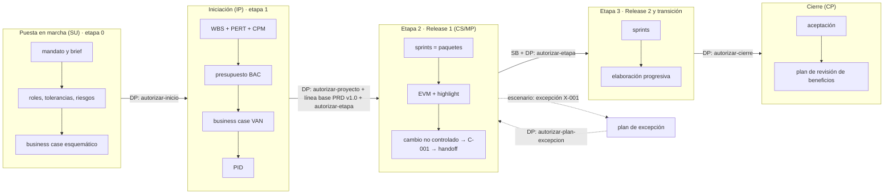

# Caso maestro · PRINCE2 como método, PMBOK como "cómo"

Este documento recorre un proyecto completo con pm-method 2.1.0, desde el mandato hasta la revisión de beneficios. Cada paso muestra **qué momento de PRINCE2 se está viviendo**, **qué técnica del PMBOK se usa para resolverlo**, quién decide, el comando real que se ejecutó y lo que devolvió.

La regla de fondo es la de `SPEC.md` §0: **PRINCE2 define qué se hace, cuándo y quién decide** (procesos, etapas, puertas, tolerancias). **El PMBOK solo aporta técnicas** (EVM, CPM, PERT, P×I, EMV, VAN…), que siempre se aplican dentro de un proceso, una práctica o un producto de PRINCE2. **BMAD**, cuando existe, es la capa que especifica el producto (PRD, arquitectura, épicas e historias) y pm-method la lee sin escribirla.

> **Origen de las cifras.** Todo lo que sigue sale de una corrida real del 2026-10-17 con los scripts vigentes del paquete, sobre una copia del fixture `scripts/pruebas/fixtures/bmad-v6`. Las decisiones humanas están **simuladas** y se marcan así: `[simulado]`. Las fechas del caso (2026-10 → 2027-05) se pasan con `--fecha`. Algunos scripts no aceptan `--fecha` (`bmad.py linea-base` y `bmad.py handoff`), por eso esas filas quedan con la fecha de la corrida (ver *Lecciones del caso*).

---

## 1. Escenario

| Dato | Valor |
|---|---|
| Proyecto | Portal de autoservicio para socios de una cooperativa |
| Mandato | 7 meses, hasta USD 180.000, desarrollo tercerizado |
| Enfoque de entrega | híbrido: etapas PRINCE2 con sprints de 14 días como paquetes de trabajo |
| Especificación | BMAD v6 (brief, PRD con FR-1..FR-4, NFR-1, UJ-1, SM-1, arquitectura con AD-1/AD-2, épicas, `sprint-status.yaml`) |
| Ejecutivo | Laura Méndez |
| Usuario sénior · product owner · autoridad de cambio | Sofía Ramírez |
| Proveedor sénior | Diego Ferreira |
| Gestor del proyecto | Martín Suárez |
| Jefa de equipo (proveedor) | Lucía Benítez |
| Aseguramiento | Andrea Costa |

Las personas son ficticias. La carpeta del proyecto es `repo/gestion/`, fuera de `_bmad/` y `_bmad-output/` (si estuviera adentro, el puente se niega a escribir y la sanidad da `ESP-08`).

### Convenciones de los comandos

Todos los comandos se ejecutan desde la raíz del repositorio (`repo/`). Para acortar:

```bash
EST=<pm-estado-proyecto>/scripts     # plugin: ${CLAUDE_PLUGIN_ROOT}/skills/pm-estado-proyecto/scripts
BMAD=<pm-bmad-puente>/scripts/bmad.py
PAQ=<pm-exportar>/scripts/paquete.py
```

En Claude Code los agentes resuelven estas rutas solos (SPEC §1.10.1). En Hermes las rutas quedan bajo `~/.hermes/skills/`.

### Cómo leer cada bloque

| Campo | Qué dice |
|---|---|
| **Momento PRINCE2** | proceso (SU, DP, IP, CS, MP, SB, CP), práctica (business case, organización, planes, calidad, riesgo, issues, progreso) y principio que se está aplicando |
| **Técnica PMBOK** | la técnica usada y por qué es solo el *cómo* dentro de ese momento PRINCE2 |
| **Agente / skill** | quién prepara el trabajo en pm-method |
| **Rol humano y decisión** | qué decide una persona y con qué autoridad |
| **Comando** | el comando real |
| **Artefacto** | ruta dentro de `gestion/` |
| **Resultado** | cifras de la corrida |

---

## 2. Mapa del ciclo de vida recorrido



---

## 3. Preparación

### Paso 0 · Verificar el paquete y preparar el repositorio

| Campo | Contenido |
|---|---|
| Momento PRINCE2 | antes del proyecto; no es una etapa |
| Técnica PMBOK | ninguna |
| Agente / skill | mantenedor |
| Rol humano y decisión | ninguna |
| Artefacto | `repo/` = copia de `scripts/pruebas/fixtures/bmad-v6` |
| Resultado | `Skills: 37 (31 invocables por el modelo, listado 6289 caracteres) · Agentes: 6` → `OK` |

```bash
python3 <pm-method>/scripts/validar_paquete.py
```

---

## 4. Puesta en marcha (SU, etapa 0)

### Paso 1 · Crear la carpeta del proyecto

| Campo | Contenido |
|---|---|
| Momento PRINCE2 | SU · organización · *roles definidos*: el ejecutivo existe desde el primer día |
| Técnica PMBOK | ninguna (persistencia) |
| Agente / skill | pm-inicio → `pm-estado-proyecto` |
| Rol humano y decisión | la capa de negocio nombra al ejecutivo y este al gestor |
| Artefacto | `estado.json`, 9 registros CSV, `03-control/registros/diario.md` |
| Resultado | fase `pre-proyecto`, proceso SU, etapa 0, enfoque `hibrido` |

```bash
python3 $EST/nuevo_proyecto.py --ruta gestion --nombre "Portal de autoservicio para socios" \
  --idioma es --enfoque hibrido --ejecutivo "Laura Méndez" --gestor "Martín Suárez"
```

### Paso 2 · Conectar la capa de especificación (BMAD)

| Campo | Contenido |
|---|---|
| Momento PRINCE2 | SU · planes (insumos) · *foco en productos*: el brief y el PRD de BMAD son productos especialistas, no documentos de gestión |
| Técnica PMBOK | inventario de información del proyecto |
| Agente / skill | pm-inicio → `pm-bmad-puente` |
| Rol humano y decisión | ninguna; el puente solo lee |
| Artefacto | `estado.json.integraciones.bmad`, `02-planificacion/especificacion/inventario-bmad.json`, `requisitos-bmad.csv` (derivados) |
| Resultado | layout v6; soporte `version-no-visible` → aviso de modo degradado. Inventario: brief `final` sha 42fc69b23dbb · PRD `final` sha ea90ca87952b (1 versión anterior) · arquitectura sha 0317cc4551ca · épicas sha 8b1dd8acdc57 · `sprint-status.yaml` · 1 historia. **9 ids**: FR 4, NFR 1, UJ 1, SM 1, AD 2 |

```bash
python3 $BMAD --proyecto gestion detectar
python3 $BMAD --proyecto gestion inventario
python3 $BMAD --proyecto gestion requisitos
```

```text
AVISO: versión de BMAD version-no-visible; el puente está probado con v4 · v6.11–v6.12. Se usa descubrimiento por patrones (modo degradado).
9 identificadores · {'FR': 4, 'NFR': 1, 'UJ': 1, 'SM': 1, 'AD': 2} → gestion/02-planificacion/especificacion/requisitos-bmad.csv (derivado: no editar)
```

### Paso 3 · Leer la especificación por la fachada única

| Campo | Contenido |
|---|---|
| Momento PRINCE2 | SU · planes · *foco en productos* |
| Técnica PMBOK | matriz de trazabilidad de requisitos (en su forma de consulta) |
| Agente / skill | cualquier skill; aquí `pm-mandato-y-brief` vía `especificacion.py` |
| Rol humano y decisión | ninguna |
| Artefacto | `02-planificacion/especificacion/spec-index.json` (caché `pm-spec-index/1`) |
| Resultado | proveedor `bmad`; 9 requisitos; `sin_cobertura: ['FR-4']`; 4 historias (1 backlog, 1 ready-for-dev, 1 review, 1 done). `consultar FR3` normaliza el id a FR-3 y devuelve la historia `2-2-descargar-constancias`, cobertura `planificado`. La segunda consulta dice `índice vigente`: no se reconstruye si las fuentes no cambiaron |

```bash
python3 $EST/especificacion.py --proyecto gestion fuente
python3 $EST/especificacion.py --proyecto gestion resumen
python3 $EST/especificacion.py --proyecto gestion consultar FR3
```

```text
Proveedor de especificación: bmad · índice reconstruido ahora (2026-10-17T08:40:47)
  dueño de requisitos, épicas, historias, estado de desarrollo: BMAD (solo lectura)
  dueño de gobierno (prioridad, moscow, estimacion, iteracion, release, producto_pbs): pm-method backlog.csv
  dueño de paquetes_wbs: pm-method wbs.csv (columna ref)
```

Ninguna skill abre archivos de BMAD por su cuenta. El modelo completo está en [sincronizacion.md](sincronizacion.md).

### Paso 4 · Mandato, project brief y lecciones previas

| Campo | Contenido |
|---|---|
| Momento PRINCE2 | SU · business case y organización · *aprender de la experiencia* (lecciones previas antes de planificar) |
| Técnica PMBOK | juicio de expertos; análisis de documentos |
| Agente / skill | pm-inicio → `pm-mandato-y-brief`, `pm-registros` |
| Rol humano y decisión | gestor: perfil de formalidad mínimo (**D-001**, nivel `gestor`). Ejecutivo: enfoque híbrido con BMAD (**D-002**, nivel `junta`) `[simulado]` |
| Artefacto | `00-direccion/mandato.md`, `01-inicio/project-brief.md` (cita el brief BMAD por ruta y sha, sin copiarlo), `lecciones.csv` L-001, `supuestos.csv` S-001 |
| Resultado | L-001 "la API del padrón no tenía documentación"; S-001 "4.000 llamadas/mes a USD 5" (validado = pendiente) |

```bash
python3 $EST/registro.py --proyecto gestion agregar lecciones --campo etapa=0 --campo categoria=tecnico \
  --campo "situacion=Proyecto previo de la cooperativa: la API del padrón no tenía documentación" \
  --campo "recomendacion=Spike de integración al inicio" --campo prioridad=alta
python3 $EST/registro.py --proyecto gestion agregar decisiones --campo fecha=2026-10-17 \
  --campo "decision=Enfoque híbrido: etapas PRINCE2 con sprints de 14 días como paquetes de trabajo; especificación con BMAD" \
  --campo "decidido_por=Ejecutivo: Laura Méndez" --campo nivel=junta
```

### Paso 5 · Estructura de la junta, roles y tolerancias de proyecto

| Campo | Contenido |
|---|---|
| Momento PRINCE2 | SU · organización · *roles, responsabilidades y relaciones definidos*; *gestión por excepción* (las tolerancias de proyecto las fija la capa de negocio) |
| Técnica PMBOK | ninguna para los roles; las tolerancias son el umbral contra el que luego mide el EVM |
| Agente / skill | pm-inicio → `pm-organizacion-roles`, `pm-estado-proyecto` |
| Rol humano y decisión | capa de negocio y ejecutivo fijan las tolerancias `[simulado]` |
| Artefacto | `estado.json.roles`, `estado.json.tolerancias.proyecto`, `00-direccion/estructura-organizativa.md` |
| Resultado | tiempo ±3 semanas · costo ±8 % · alcance "Must sin tolerancia; FR-4 Should" · beneficios −10 % · riesgo "ningún riesgo alto sin respuesta"; cadencia de iteración 14 días, velocidad de referencia 30 |

```bash
python3 $EST/estado.py --proyecto gestion rol usuario_senior="Sofía Ramírez" proveedor_senior="Diego Ferreira" \
  product_owner="Sofía Ramírez" autoridad_cambio="Sofía Ramírez" aseguramiento="Andrea Costa" jefes_equipo="Lucía Benítez"
python3 $EST/estado.py --proyecto gestion agil cadencia_iteracion_dias=14 velocidad_referencia=30
python3 $EST/estado.py --proyecto gestion tolerancia --nivel proyecto "tiempo=±3 semanas" "costo=±8 %" \
  "alcance=Must sin tolerancia; FR-4 Should" "beneficios=-10 %" "riesgo=ningún riesgo alto sin respuesta"
```

### Paso 6 · Interesados

| Campo | Contenido |
|---|---|
| Momento PRINCE2 | SU · organización (compromiso de interesados) |
| Técnica PMBOK | matriz poder/interés y matriz de evaluación del compromiso (actual → deseado) |
| Agente / skill | pm-inicio → `pm-organizacion-roles` |
| Rol humano y decisión | el gestor valida las valoraciones; las sensibles quedan con `confidencial=si` |
| Artefacto | `stakeholders.csv` ST-001..ST-006, `01-inicio/analisis-stakeholders.md`, `02-planificacion/plan-compromiso-stakeholders.md` |
| Resultado | 6 interesados; el sindicato de operadores (ST-006) figura como `resistente → neutral` y confidencial |

```bash
python3 $EST/registro.py --proyecto gestion agregar stakeholders --campo "nombre=Sindicato de operadores" \
  --campo poder=medio --campo interes=alto --campo actitud=resistente --campo nivel_compromiso_actual=resistente \
  --campo nivel_compromiso_deseado=neutral --campo confidencial=si
```

### Paso 7 · Riesgos con P×I y valor esperado

| Campo | Contenido |
|---|---|
| Momento PRINCE2 | SU · práctica de riesgo |
| Técnica PMBOK | evaluación cualitativa P×I (escala 1–5) y **EMV** = impacto monetario × probabilidad (1–5 → 10/30/50/70/90 %, SPEC §1.10.9). Es un *cómo*: PRINCE2 pide identificar, evaluar y responder; el PMBOK da la fórmula |
| Agente / skill | pm-inicio → `pm-riesgos` |
| Rol humano y decisión | cada riesgo tiene propietario con nombre |
| Artefacto | `03-control/registros/riesgos.csv` |
| Resultado | ver tabla; `resumen`: 1 alto abierto, 0 sin respuesta, 0 sin propietario |

| Id | Evento (cita ids de la especificación) | P×I | Impacto USD | EMV | Respuesta |
|---|---|---|---|---|---|
| R-001 | integración con el padrón demora (AD-2) | 4×4 = **16 (alto)** | 30.000 | 21.000 | reducir: spike en el sprint 1 |
| R-002 | el proveedor rota desarrolladores | 3×3 = 9 | 18.000 | 9.000 | transferir: cláusula contractual |
| R-003 | adopción baja (SM-1) | 3×4 = 12 | 40.000 | 20.000 | reducir: campaña y asistencia |
| R-004 | operadores resisten la bandeja (FR-4) | 3×3 = 9 | 10.000 | 5.000 | reducir: taller |
| R-005 | oportunidad: reutilizar generador PDF (FR-3) | 2×3 = 6 | 8.000 | 2.400 | explotar |

```bash
python3 $EST/registro.py --proyecto gestion agregar riesgos --campo categoria=tecnico \
  --campo "evento=La integración con el padrón demora más de lo previsto (AD-2)" --campo tipo=amenaza \
  --campo probabilidad=4 --campo impacto=4 --campo impacto_monetario=30000 --campo respuesta=reducir \
  --campo propietario="Laura Méndez" --campo ejecutor="Lucía Benítez"
python3 $EST/registro.py --proyecto gestion resumen
```

`registro.py` calcula solo la puntuación y el EMV, y valida tipo, categoría, respuesta y estado contra `esquema.py`.

### Paso 8 · Business case esquemático y plan de la etapa de iniciación

| Campo | Contenido |
|---|---|
| Momento PRINCE2 | SU · business case · *justificación continua del negocio* (primera versión) y *gestión por etapas* (se planifica solo la etapa 1) |
| Técnica PMBOK | análisis de opciones (incluye "no hacer nada distinto") |
| Agente / skill | pm-inicio → `pm-caso-de-negocio`, `pm-plan-etapa-y-limites` |
| Rol humano y decisión | ninguna todavía; queda `en-revision` |
| Artefacto | `00-direccion/business-case.md` v0.1, `02-planificacion/plan-etapa-1.md`, `02-planificacion/productos/descripcion-producto-proyecto.md`, `00-direccion/decisiones/2026-10-17-solicitud-autorizar-inicio.md` |
| Resultado | opción 3 (portal a medida) frente a "no hacer nada distinto" y "mínimo"; B-01 cita SM-1 por id |

```bash
python3 $EST/estado.py --proyecto gestion artefacto business-case-esquematico --ruta 00-direccion/business-case.md --estado en-revision
python3 $EST/estado.py --proyecto gestion artefacto plan-etapa-1 --ruta 02-planificacion/plan-etapa-1.md --estado en-revision
```

### Paso 9 · Puerta `autorizar-inicio`

| Campo | Contenido |
|---|---|
| Momento PRINCE2 | DP (dirigir el proyecto) · progreso · *gestión por etapas* y *gestión por excepción* |
| Técnica PMBOK | ninguna (decisión de gobierno) |
| Agente / skill | `pm-puerta` → `pm-director` (único que registra puertas) |
| Rol humano y decisión | **Ejecutivo: aprueba** `[simulado]` |
| Artefacto | `estado.json.puertas`, `decisiones.csv` D-003 (puerta) y D-004..D-008 (aprobaciones de documentos) |
| Resultado | sanidad 0 ERROR · 3 AVISO (ESP-03 FR-4 sin cobertura, aceptable en pre-proyecto; ESP-07 versión de BMAD; INS-05 presupuesto del listado de skills del entorno). El paquete de puerta primero salió `BORRADOR` porque los documentos estaban en `borrador`; después de pasarlos a `en-revision`, `COMPLETO PARA LA PUERTA`. Tras la puerta: fase `inicio`, IP, etapa 1 "Iniciación". Una puerta fuera de orden se rechaza |

```bash
python3 $PAQ --proyecto gestion listar puerta autorizar-inicio
python3 $BMAD --proyecto gestion verificar
python3 $EST/sanidad.py --proyecto gestion
python3 $EST/estado.py --proyecto gestion puerta autorizar-inicio --decision aprobado \
  --por "Ejecutivo: Laura Méndez" --fecha 2026-10-17 --fin 2026-11-06
python3 $EST/estado.py --proyecto gestion aprobar project-brief --por "Ejecutivo: Laura Méndez" --version 1.0 --fecha 2026-10-17
python3 $EST/estado.py --proyecto gestion puerta autorizar-cierre --decision aprobado --por "Ejecutivo: Laura Méndez"
```

```text
La puerta autorizar-cierre no corresponde al estado actual (inicio/IP). Revisar 'siguiente' o usar --forzar.
```

---

## 5. Iniciación (IP, etapa 1)

### Paso 10 · Estructura de productos y WBS

| Campo | Contenido |
|---|---|
| Momento PRINCE2 | IP · planes · *foco en productos* (primero los productos, después las actividades) |
| Técnica PMBOK | **EDT/WBS** con regla del 100 % y consolidación ascendente. Es un *cómo*: PRINCE2 pide planificación basada en productos; la WBS es la forma de descomponer y sumar |
| Agente / skill | pm-planificacion → `pm-planificacion-por-productos` |
| Rol humano y decisión | la jefa de equipo valida esfuerzos |
| Artefacto | `02-planificacion/wbs.csv` (columna `ref` con FR/NFR/UJ/AD e historias), `02-planificacion/visuales/wbs.md`, `02-planificacion/diccionario-wbs-esqueleto.md` |
| Resultado | **15 elementos, 11 hojas, 2.760 h, USD 138.000**. Con la WBS, FR-4 pasa de `sin-cobertura` a `planificado` (paquetes 2.1 y 3.5) y el aviso ESP-03 desaparece |

```bash
python3 $EST/wbs.py gestion/02-planificacion/wbs.csv --titulo "Portal de autoservicio para socios" \
  --mermaid gestion/02-planificacion/visuales/wbs.md --diccionario gestion/02-planificacion/diccionario-wbs-esqueleto.md
python3 $EST/especificacion.py --proyecto gestion listar requisitos
```

```text
id=FR-4 | tipo=FR | titulo=El operador responde consultas desde una bandeja. | paquetes_wbs=['2.1', '3.5'] | cobertura=planificado
```

El diagrama final, con el paquete 3.7 agregado más tarde por C-001, está en [ejemplos/wbs-mermaid.md](ejemplos/wbs-mermaid.md).

### Paso 11 · Estimación PERT

| Campo | Contenido |
|---|---|
| Momento PRINCE2 | IP · planes (estimar es un paso del procedimiento de planificación) |
| Técnica PMBOK | **PERT de tres puntos**: tE = (O + 4M + P) / 6, σ = (P − O) / 6. Es un *cómo*: PRINCE2 exige estimar, pero no dice con qué fórmula |
| Agente / skill | pm-planificacion → `pm-cronograma-estimacion` |
| Rol humano y decisión | Lucía Benítez, que hará el trabajo, valida O/M/P |
| Artefacto | `02-planificacion/estimacion-pert.csv`, `02-planificacion/hoja-estimacion.md` |
| Resultado | tE: A00 10 · A01 10 · A02 30 · A03 20 · A04 30 · A06 25 · A07 35 · A08 15 · A09 10 días. σ del camino crítico = √(0,67² + 2,67² + 2,67² + 3,00² + 1,67²) ≈ **5,1 días** → reserva de cronograma a 2σ ≈ 10 días laborables, dentro de la tolerancia de ±3 semanas |

### Paso 12 · Camino crítico y exportación a MS Project

| Campo | Contenido |
|---|---|
| Momento PRINCE2 | IP · planes (plan del proyecto) |
| Técnica PMBOK | **método de la ruta crítica (CPM)** con holgura total y libre; exportación MSPDI |
| Agente / skill | pm-planificacion → `pm-cronograma-estimacion` |
| Rol humano y decisión | ninguna en este paso |
| Artefacto | `02-planificacion/actividades.csv` (columna `wbs`), `cronograma.md` (Gantt Mermaid), `cronograma.xml` (MSPDI) |
| Resultado | **120 días laborables, fin 2027-04-26**; camino crítico A00 → A02 → A04 → A05 → A07 → A08 → A10; holguras: A01 y A03 40 días, A06 10, A09 5; carga del proveedor 150 días. El XML se parsea bien: 14 tareas, 3 de resumen por WBS |

```bash
python3 $EST/cpm.py gestion/02-planificacion/actividades.csv --inicio 2026-11-09 \
  --mermaid gestion/02-planificacion/cronograma.md --mspdi gestion/02-planificacion/cronograma.xml \
  --titulo "Portal de autoservicio para socios" --wbs gestion/02-planificacion/wbs.csv
```

```text
Duración total (días laborables): 120  · Fin previsto: 2027-04-26
Camino crítico: A00 -> A02 -> A04 -> A05 -> A07 -> A08 -> A10
```

### Paso 13 · Presupuesto: BAC, contingencia y reserva de gestión

| Campo | Contenido |
|---|---|
| Momento PRINCE2 | IP · planes y business case · *gestión por excepción* (la reserva de gestión solo la libera la junta) |
| Técnica PMBOK | estimación ascendente de costos y **reservas**: contingencia ligada a riesgos identificados (suma de EMV) dentro del BAC; reserva de gestión fuera del BAC (SPEC §1.10.6) |
| Agente / skill | pm-planificacion → `pm-costos-presupuesto` |
| Rol humano y decisión | ninguna en este paso; lo decide la junta en `autorizar-proyecto` |
| Artefacto | `02-planificacion/presupuesto.md`, `02-planificacion/linea-base-costo.csv` |
| Resultado | Σ paquetes 138.000 + contingencia 27.000 (≈ EMV R-001 21.000 + R-002 9.000 − R-005 2.400) = **BAC 165.000** (etapa 2: 95.000; etapa 3: 70.000) + reserva de gestión 15.000 = **presupuesto autorizado 180.000**, igual al mandato |

### Paso 14 · Business case detallado (VAN, TIR, payback) y OKR

| Campo | Contenido |
|---|---|
| Momento PRINCE2 | IP · business case · *justificación continua del negocio* |
| Técnica PMBOK | **VAN**, TIR y periodo de recuperación (selección y justificación económica). PRINCE2 pide que el proyecto sea deseable, viable y alcanzable; estas fórmulas sostienen el "viable". Los OKR son un instrumento de la capa de negocio que **cita** los beneficios del business case por id |
| Agente / skill | pm-inicio → `pm-caso-de-negocio`, `pm-okr` |
| Rol humano y decisión | el Usuario sénior es dueño de los beneficios; los supuestos de costo unitario quedan `[por confirmar]` |
| Artefacto | `00-direccion/business-case.md` v0.9, `00-direccion/okr.csv`, `03-control/reportes/2026-11-02-okr.md` |
| Resultado | flujos netos: año 1 36.000 (rampa al 50 %), años 2–5 84.000 (96.000 de ahorro − 12.000 de des-beneficio DB-01). Inversión: 180.000 (escenario prudente). **VAN (12 %, 5 años) = USD 79.944 · TIR ≈ 26,8 % · payback ≈ 2,7 años.** OKR: O-1 con KR-1.1 (vínculo B-01; SM-1), KR-1.2 (B-02), KR-1.3 (B-01); puntuación 0,00 en los tres porque no hay mediciones antes de la producción |

```text
VAN = −180.000 + 36.000/1,12 + 84.000/1,12² + 84.000/1,12³ + 84.000/1,12⁴ + 84.000/1,12⁵ = 79.944
Payback: −144.000 (año 1) → −60.000 (año 2) → +24.000 (año 3) ⇒ 2 + 60.000/84.000 ≈ 2,7 años
```

```bash
python3 <pm-okr>/scripts/okr.py gestion/00-direccion/okr.csv --corte 2026-11-02 \
  --markdown gestion/03-control/reportes/2026-11-02-okr.md
```

### Paso 15 · Enfoques, RACI, estrategia de adquisiciones y PID

| Campo | Contenido |
|---|---|
| Momento PRINCE2 | IP · organización, calidad, riesgo, issues, progreso · *adaptar al contexto* (enfoques en una página, perfil híbrido) |
| Técnica PMBOK | **matriz RACI** (una sola A por fila); análisis hacer o comprar y tipo de contrato (precio fijo por release + T&M para cambios) |
| Agente / skill | pm-inicio → `pm-organizacion-roles`, `pm-enfoques-gestion`, `pm-adquisiciones`, `pm-acta-constitucion` |
| Rol humano y decisión | el enfoque de cambios fija la autoridad de cambio (Usuario sénior hasta USD 5.000 dentro de la tolerancia de etapa) |
| Artefacto | `00-direccion/matriz-raci.md`, `02-planificacion/enfoques/enfoques-gestion.md`, `02-planificacion/adquisiciones/estrategia-adquisiciones.md`, `02-planificacion/plan-proyecto.md`, `02-planificacion/plan-etapa-2.md`, `00-direccion/pid.md` |
| Resultado | RACI: "Uso de la reserva de gestión" A = Ejecutivo; "Solicitudes de cambio ≤ USD 5.000" A = Usuario sénior; "PRD y épicas (BMAD)" A = Usuario sénior, R = jefa de equipo. En la corrida la RACI se registró al final (`aprobar … --fecha 2026-11-06`) y por eso su decisión es D-048 |

### Paso 16 · Sanidad antes de la puerta: un aviso real y su corrección

| Campo | Contenido |
|---|---|
| Momento PRINCE2 | IP → DP · progreso (calidad de la información que va a la junta) |
| Técnica PMBOK | auditoría de la información del proyecto |
| Agente / skill | `pm-sanidad` |
| Rol humano y decisión | el gestor corrige antes de presentar |
| Artefacto | `00-direccion/historial/business-case-esquematico-v1.0.md` |
| Resultado | `ART-03 business-case-esquematico: estado.json dice 'aprobado' y el documento 'en-revision'`. Causa: el esquemático aprobado y el business case de IP apuntaban al **mismo archivo**. Corrección: congelar el esquemático en `historial/` y apuntar la clave a esa copia. Sanidad: 0 ERROR · 2 AVISO |

```bash
python3 $EST/sanidad.py --proyecto gestion
# (copia del esquemático aprobado a 00-direccion/historial/business-case-esquematico-v1.0.md)
python3 $EST/estado.py --proyecto gestion artefacto business-case-esquematico \
  --ruta 00-direccion/historial/business-case-esquematico-v1.0.md --estado aprobado --version 1.0
```

### Paso 17 · Puerta `autorizar-proyecto` y línea base del PRD

| Campo | Contenido |
|---|---|
| Momento PRINCE2 | DP · business case, planes · *justificación continua* (la junta compromete el presupuesto completo) |
| Técnica PMBOK | **línea base** del alcance (el PRD congelado con huella sha256) |
| Agente / skill | `pm-director` → `pm-direccion-decisiones`, `pm-bmad-puente` |
| Rol humano y decisión | **Junta: aprueba el proyecto (BAC 165.000, reserva 15.000)** `[simulado]` |
| Artefacto | D-009 (puerta), D-010..D-020 (aprobaciones), `00-direccion/historial/pid-v1.0.md`, `business-case-v1.0.md`, `00-direccion/historial/bmad-prd-v1.0/`, `bmad-arquitectura-v1.0/`, `bmad-epicas-v1.0/` (D-021..D-023) |
| Resultado | `paquete.py listar puerta autorizar-proyecto` → `COMPLETO PARA LA PUERTA` (incluye cronograma, presupuesto, WBS y estrategia de adquisiciones como opcionales). PRD sha ea90ca87952b · arquitectura 0317cc4551ca · épicas 8b1dd8acdc57. `estado.py aprobar bmad-prd` se rechaza: una especificación externa solo se aprueba con `linea-base` |

```bash
python3 $EST/estado.py --proyecto gestion puerta autorizar-proyecto --decision aprobado \
  --por "Ejecutivo: Laura Méndez" --fecha 2026-11-06
python3 $BMAD --proyecto gestion linea-base prd --version 1.0 --por "Ejecutivo: Laura Méndez"
python3 $EST/estado.py --proyecto gestion aprobar bmad-prd --por "Ejecutivo: Laura Méndez"
```

```text
Línea base bmad-prd v1.0 registrada · sha ea90ca87952b · copia congelada en gestion/00-direccion/historial/bmad-prd-v1.0
bmad-prd es una especificación externa (BMAD): su aprobación se registra con bmad.py linea-base / external spec: use bmad.py linea-base
```

### Paso 18 · Puerta `autorizar-etapa` (etapa 2) y tolerancias de etapa

| Campo | Contenido |
|---|---|
| Momento PRINCE2 | DP · progreso · *gestión por etapas* y *por excepción* (la junta delega al gestor dentro de tolerancias de etapa) |
| Técnica PMBOK | ninguna |
| Agente / skill | `pm-director` |
| Rol humano y decisión | **Junta: autoriza la etapa 2 "Release 1" hasta 2027-02-15** `[simulado]` |
| Artefacto | D-024; `00-direccion/decisiones/2026-11-06-acta-junta-autorizar-proyecto.md` |
| Resultado | fase `entrega`, CS, etapa 2. Tolerancias de etapa: tiempo +2 semanas · costo ±10 % · alcance "PO intercambia Should/Could" · riesgo "ningún riesgo alto sin respuesta" |

```bash
python3 $EST/estado.py --proyecto gestion puerta autorizar-etapa --decision aprobado --por "Ejecutivo: Laura Méndez" \
  --fecha 2026-11-06 --etapa-nombre "Release 1" --fin 2027-02-15
python3 $EST/estado.py --proyecto gestion tolerancia --nivel etapa "tiempo=+2 semanas" "costo=±10 %" \
  "alcance=PO intercambia Should/Could" "riesgo=ningún riesgo alto sin respuesta"
```

---

## 6. Etapa de entrega 2 · Release 1 (CS + MP)

### Paso 19 · Trazabilidad y backlog con columnas de gobierno

| Campo | Contenido |
|---|---|
| Momento PRINCE2 | CS · planes y calidad · *foco en productos* |
| Técnica PMBOK | **matriz de trazabilidad de requisitos**; priorización **MoSCoW**; estimación en puntos de historia |
| Agente / skill | pm-planificacion / pm-control → `pm-bmad-puente`, `pm-agil-hibrido` |
| Rol humano y decisión | **product owner: prioridades y releases (D-025, nivel `product-owner`)** `[simulado]` |
| Artefacto | `02-planificacion/especificacion/matriz-trazabilidad-bmad.csv`, `02-planificacion/backlog.csv` |
| Resultado | FR-4 sin historia (cubierto por la WBS 3.5); `1-2-recuperar-contrasena` sin requisito; 0 referencias rotas. Funciona igual desde otra carpeta (`cd /tmp` con `--proyecto` absoluto). Backlog: 4 historias nuevas; el PO carga prioridad, MoSCoW, estimación, iteración, release y producto; una segunda sincronización **no toca** las columnas de gobierno (comparación por `diff`: idénticas) |

```bash
python3 $BMAD --proyecto gestion trazabilidad --wbs 02-planificacion/wbs.csv
python3 $BMAD --proyecto gestion backlog
python3 $EST/especificacion.py --proyecto gestion consultar 2-1-consultar-tramites
```

```text
gobierno: {'prioridad': '3', 'moscow': 'must', 'estimacion': '8', 'iteracion': 'S3', 'release': 'R1', 'producto_pbs': '3.3'}
```

### Paso 20 · Traspaso de prioridades al equipo BMAD

| Campo | Contenido |
|---|---|
| Momento PRINCE2 | CS/MP · planes · interfaz gestor ↔ jefa de equipo |
| Técnica PMBOK | ninguna (comunicación de decisiones) |
| Agente / skill | `pm-agil-hibrido` → `bmad.py handoff` |
| Rol humano y decisión | el equipo BMAD aplica las prioridades en su sprint planning y confirma `[simulado]` |
| Artefacto | `02-planificacion/especificacion/handoff-bmad-2026-10-17-prioridades.md` |
| Resultado | `Traspaso emitido … (4 prioridades cambiadas)`; un segundo intento: `Nada que traspasar`. Mientras el documento no dice `estado: aplicado`, la sanidad da `ESP-13 Traspaso a BMAD sin confirmar`; al marcarlo, desaparece |

```bash
python3 $BMAD --proyecto gestion handoff
```

### Paso 21 · Paquete de trabajo = sprint

| Campo | Contenido |
|---|---|
| Momento PRINCE2 | CS (autorizar paquete) ↔ MP (aceptarlo y entregarlo) · *gestión por excepción* en el nivel del equipo |
| Técnica PMBOK | iteración con timebox; definición de hecho como criterio de aceptación |
| Agente / skill | pm-control → `pm-paquetes-trabajo` |
| Rol humano y decisión | **gestor autoriza WP-003 (D-026, nivel `gestor`)**; el PO acepta las historias en la review |
| Artefacto | `03-control/paquetes-trabajo/WP-003-sprint-3.md` |
| Resultado | alcance por ids leídos de la fachada (`listar historias --epica E-2`): `2-1-consultar-tramites` y cierre de `1-2-recuperar-contrasena`; tolerancias del paquete: tiempo 0 días, costo ±5 % de USD 15.000 |

```bash
python3 $EST/especificacion.py --proyecto gestion listar historias --epica E-2
python3 $EST/estado.py --proyecto gestion artefacto WP-003 --ruta 03-control/paquetes-trabajo/WP-003-sprint-3.md --estado aprobado --version 1.0
python3 $EST/estado.py --proyecto gestion aprobar WP-003 --por "Gestor: Martín Suárez" --nivel gestor --fecha 2026-11-30
```

### Paso 22 · Avance del desarrollo desde BMAD

| Campo | Contenido |
|---|---|
| Momento PRINCE2 | CS · progreso (checkpoint) |
| Técnica PMBOK | burn-up por puntos |
| Agente / skill | `pm-bmad-puente` (`avance`) |
| Rol humano y decisión | ninguna |
| Artefacto | `03-control/reportes/avance-bmad.csv` |
| Resultado | corte 2026-12-10: 4 historias · 2 done · 1 review · 1 backlog · **13/21 puntos = 61,9 %**. Repetir el mismo corte deja una sola fila |

```bash
python3 $BMAD --proyecto gestion avance --corte 2026-12-10
```

### Paso 23 · Reunión de checkpoint → acta → decisiones, acciones, riesgos e issues

| Campo | Contenido |
|---|---|
| Momento PRINCE2 | CS/MP · progreso (checkpoint), riesgo e issues |
| Técnica PMBOK | gestión de las comunicaciones: minuta con compromisos; registro de incidentes |
| Agente / skill | pm-control → `pm-reuniones` |
| Rol humano y decisión | **PO: recuperación por SMS en release 1, sin cambio de alcance de etapa (D-027, nivel `product-owner`)**; el gestor confirma el acta (D-028) `[simulado]` |
| Artefacto | `03-control/reuniones/2026-12-03-checkpoint-sprint3-transcripcion.md`, `…-acta-checkpoint-sprint3.md`; A-001, A-002, R-006, I-001 |
| Resultado | transcripción VTT: 9 intervenciones de 3 hablantes. A-001 (Lucía Benítez, 2026-12-11), A-002 (Sofía Ramírez, 2026-12-09), **R-006** congelamiento de TI en enero, P4×I3 = 12, EMV 8.400; **I-001** `problema-preocupacion` "30 % de socios sin correo" |

```bash
python3 <pm-reuniones>/scripts/transcripcion.py gestion/03-control/reuniones/2026-12-03-checkpoint-sprint3-original.vtt \
  --salida gestion/03-control/reuniones/2026-12-03-checkpoint-sprint3-transcripcion.md
python3 $EST/registro.py --proyecto gestion agregar acciones --campo origen=acta-2026-12-03-checkpoint-sprint3 \
  --campo "descripcion=Obtener de TI el calendario del congelamiento de cambios del padrón (enero)" \
  --campo "responsable=Sofía Ramírez" --campo fecha_compromiso=2026-12-09 --campo prioridad=media
```

Una acción es un compromiso de una persona, no un issue (SPEC §1.10.8).

### Paso 24 · Valor ganado contra tolerancias (y lectura ágil)

| Campo | Contenido |
|---|---|
| Momento PRINCE2 | CS · progreso · *gestión por excepción*: el semáforo compara el **pronóstico** con la tolerancia |
| Técnica PMBOK | **EVM** (SPI, CPI, EAC, VAC, TCPI); en modo ágil, el desvío se lee como alcance que no entra (SPEC §1.10.7). Es un *cómo*: PRINCE2 pide medir contra tolerancias; EVM da la medida |
| Agente / skill | pm-control → `pm-progreso-reportes` |
| Rol humano y decisión | ninguna: todo dentro de tolerancia, el gestor sigue |
| Artefacto | `03-control/reportes/progreso.csv` |
| Resultado | ver tabla |

| Corte | Nivel | SPI | CPI | EAC | VAC | Semáforo | ¿Excepción? |
|---|---|---|---|---|---|---|---|
| 2026-12 | etapa (BAC 95.000, ±10 % costo, 14 % plazo) | 0,904 | 0,940 | 101.064 | −6.064 (−6,4 %) | ámbar / ámbar | no |
| 2026-12 | proyecto (BAC 165.000, ±8 %) | 0,904 | 0,940 | 175.532 | −10.532 (−6,4 %) | ámbar / ámbar | no |
| 2026-12 | etapa, modo ágil (14 % del alcance es Should/Could) | — | — | — | alcance no entregable 6 % | alcance verde | no |

```bash
python3 $EST/evm.py --csv gestion/03-control/reportes/progreso.csv --bac 95000 --tol-costo 10 --tol-plazo 14 --proyecto gestion
python3 $EST/evm.py --pv 52000 --ev 47000 --ac 50000 --bac 95000 --modo agil --pct-no-must 14
```

### Paso 25 · Highlight report y tablero por actor

| Campo | Contenido |
|---|---|
| Momento PRINCE2 | CS → DP · progreso (informe periódico a la junta) |
| Técnica PMBOK | informes de desempeño del trabajo |
| Agente / skill | pm-control → `pm-progreso-reportes`, `pm-visuales` |
| Rol humano y decisión | el gestor revisa antes de enviar |
| Artefacto | `03-control/reportes/2026-12-10-highlight-report.md`, `03-control/reportes/2026-12-10-tablero-avance.html` |
| Resultado | `registro.py resumen --corte 2026-12-10`: 6 riesgos abiertos (1 alto), 1 issue abierto, **A-002 vencida**. Tablero: 2 acciones, 6 riesgos, 1 issue; con `?actor=<nombre>` muestra solo los compromisos de esa persona |

```bash
python3 $EST/registro.py --proyecto gestion resumen --corte 2026-12-10
```

### Paso 26 · Escenario de excepción (sobre una copia del proyecto)

Para mostrar la gestión por excepción sin alterar la línea principal, este paso se corrió sobre una copia (`repo-excepcion/`) con un AC de diciembre de 53.000 en lugar de 50.000.

| Campo | Contenido |
|---|---|
| Momento PRINCE2 | CS → DP → SB → DP · progreso e issues · *gestión por excepción*: el gestor no absorbe el desvío, lo escala |
| Técnica PMBOK | EVM (pronóstico EAC) y análisis de opciones |
| Agente / skill | pm-control (`pm-progreso-reportes`, `pm-issues-cambios`) → `pm-director` → pm-planificacion (`pm-plan-etapa-y-limites`) |
| Rol humano y decisión | **Junta: pide plan de excepción (opción 2: diferir FR-4)** y luego **lo autoriza** `[simulado]` |
| Artefacto | `03-control/reportes/2026-12-10-informe-excepcion-X-001.md`, `02-planificacion/plan-excepcion-X-001.md` |
| Resultado | CPI 0,887 · EAC 107.128 · VAC −12,8 % frente a ±10 % → **semáforo de costo rojo, `excepcion_prevista True`**. `limite-etapa --excepcion X-001` → SB; la sanidad avisa `EST-14 Excepción abierta X-001`; `paquete.py listar puerta autorizar-plan-excepcion` → completo; `autorizar-plan-excepcion` → vuelve a CS con tolerancias nuevas (costo ±5 %, tiempo +1 semana) |

```bash
python3 $EST/evm.py --pv 52000 --ev 47000 --ac 53000 --bac 95000 --tol-costo 10 --tol-plazo 14 --proyecto gestion
python3 $EST/estado.py --proyecto gestion puerta decision-ad-hoc --decision aprobado --por "Ejecutivo: Laura Méndez" \
  --fecha 2026-12-12 --condiciones "preparar plan de excepción X-001 (opción 2: diferir FR-4)"
python3 $EST/estado.py --proyecto gestion limite-etapa --excepcion X-001
python3 $EST/estado.py --proyecto gestion puerta autorizar-plan-excepcion --decision aprobado \
  --por "Ejecutivo: Laura Méndez" --fecha 2026-12-16
```

```text
semaforo_costo         rojo
excepcion_prevista     True
→ Pronóstico fuera de tolerancia: preparar informe de excepción (pm-progreso-reportes) y escalar a pm-director.
```

Como el pronóstico también superaba la tolerancia de costo del **proyecto** (±8 %), el informe indica que la junta debe avisar a la capa de negocio: la junta solo decide dentro de las tolerancias que le fijaron.

### Paso 27 · Cambio de especificación no controlado → issue → cambio → traspaso → línea base v1.1

Este es el ciclo completo de fuente única. Empieza con un error real: el equipo BMAD agrega **FR-5** (notificaciones SMS) al PRD sin pasar por control de cambios.

| Campo | Contenido |
|---|---|
| Momento PRINCE2 | CS · issues y cambios · DP (decisión) · *justificación continua* (el cambio tiene costo) y *gestión por excepción* (usa reserva de gestión) |
| Técnica PMBOK | **control integrado de cambios**: análisis de impacto en alcance, tiempo, costo, calidad, riesgo y beneficios |
| Agente / skill | `pm-sanidad` → pm-control (`pm-issues-cambios`) → `pm-director` → `pm-bmad-puente` (`handoff`, `linea-base`) → pm-planificacion (WBS) |
| Rol humano y decisión | **Junta: aprueba C-001 como Should en R2 con USD 4.500 de la reserva de gestión (D-030)**; el equipo BMAD aplica el traspaso y lo confirma `[simulado]` |
| Artefacto | I-002, C-001, `03-control/reportes/2027-01-13-solicitud-cambio-C-001.md`, `02-planificacion/especificacion/handoff-bmad-2026-10-17-C-001.md`, `00-direccion/historial/bmad-prd-v1.1/`, `bmad-epicas-v1.1/`, WBS 3.7 |
| Resultado | ver secuencia |

**a. Detección.** La sanidad termina con código 1 y el hook de inicio de sesión lo repite al abrir la próxima sesión:

```bash
python3 $EST/sanidad.py --proyecto gestion --informe
python3 $BMAD --proyecto gestion verificar
```

```text
Sanidad de 'Portal de autoservicio para socios' (entrega/CS): 2 ERROR · 3 AVISO · 1 INFO
  ERROR ESP-03 Requisitos sin cobertura (ni historia ni paquete de la WBS): FR-5.
  ERROR ESP-10 Cambio no controlado: bmad-prd difiere de la línea base v1.0 (ids FR-5) y ningún issue/cambio abierto lo cita.
  AVISO ESP-14 requisitos-bmad.csv no coincide con el PRD vigente (desactualizado o editado).
- [desvio] bmad-prd: contenido distinto de la línea base aprobada → … · agregados ['FR-5'] · retirados []
```

El informe completo está en [ejemplos/informe-sanidad-cambio-no-controlado.md](ejemplos/informe-sanidad-cambio-no-controlado.md).

**b. Issue.** Con I-002 (`solicitud-cambio`, cita `bmad-prd` y FR-5), ESP-10 pasa de ERROR a AVISO ("hay un issue/cambio abierto que lo trata"). ESP-03 sigue en ERROR hasta que FR-5 tenga cobertura.

**c. Decisión.** C-001: +5 puntos, +USD 4.500 (2,7 % del BAC), 0 días en el camino crítico (A06 tiene 10 días de holgura). Como usa reserva de gestión, decide la junta y no la autoridad de cambio. Un traspaso antes de la decisión se rechaza:

```text
C-001 no está aprobado (decision=vacía): solo se traspasan decisiones tomadas
```

**d. Traspaso.** Con C-001 aprobado, `handoff --cambio C-001` emite el documento ([ejemplos/handoff-bmad-C-001.md](ejemplos/handoff-bmad-C-001.md)). El equipo BMAD aplica con sus propios flujos: confirma FR-5 sin renumerar, agrega la historia 2.3 en `epics.md` y en `sprint-status.yaml`, y marca `estado: aplicado`.

**e. Verificación y nueva línea base.** `verificar` muestra que solo cambiaron los ids traspasados (FR-5 en el PRD y en las épicas). pm-director fija las versiones 1.1:

```bash
python3 $BMAD --proyecto gestion linea-base prd --version 1.1 --por "Ejecutivo: Laura Méndez"
python3 $BMAD --proyecto gestion linea-base epicas --version 1.1 --por "Ejecutivo: Laura Méndez"
python3 $BMAD --proyecto gestion verificar
```

```text
Línea base bmad-prd v1.1 registrada · sha f30884de4f47 · copia congelada en gestion/00-direccion/historial/bmad-prd-v1.1
Línea base bmad-epicas v1.1 registrada · sha a2fa51a7b9f7 · copia congelada en gestion/00-direccion/historial/bmad-epicas-v1.1
Sin desvíos: la especificación coincide con las líneas base registradas.
```

**f. Plan y presupuesto.** WBS 3.7 "Notificaciones SMS (C-001)" (90 h, 4.500, `ref` FR-5 y la historia 2.3) → **16 elementos, 12 hojas, 2.850 h, USD 142.500**; BAC 169.500; reserva de gestión remanente 10.500; presupuesto autorizado sin cambio (180.000). El PO prioriza 2-3 como Should en R2 (D-035) y se traspasa con `handoff`. Se cierra I-002 y C-001 pasa a `implementado`. Sanidad: **0 ERROR**. `consultar FR-5` → historia `2-3-notificaciones-sms`, paquete 3.7, cobertura `planificado`.

### Paso 28 · Lo que impiden los hooks (Claude Code)

| Campo | Contenido |
|---|---|
| Momento PRINCE2 | transversal · calidad de los datos de gobierno |
| Técnica PMBOK | ninguna |
| Agente / skill | hooks `guardian.py` (PreToolUse) e `inicio.py` (SessionStart) |
| Rol humano y decisión | ninguna: el hook niega y explica qué hacer |
| Artefacto | — |
| Resultado | negados: editar `estado.json`; escribir `riesgos.csv` con Write; un subagente `pm-method:pm-control` que edita el PRD; un subagente que redirige con `>>` dentro de `_bmad-output`; editar `spec-index.json`; editar `00-direccion/historial/…`. Permitidos: el hilo principal editando el PRD (así trabajan los flujos de BMAD) y un documento normal del proyecto |

```bash
echo '{"tool_name":"Edit","agent_type":"pm-method:pm-control","tool_input":{"file_path":"<repo>/_bmad-output/planning-artifacts/prds/prd-portal-2026-10-01/prd.md"}}' \
  | python3 <pm-method>/hooks/guardian.py
```

```json
{"hookSpecificOutput": {"hookEventName": "PreToolUse", "permissionDecision": "deny", "permissionDecisionReason": "pm-method: los agentes de gestión no escriben en carpetas de BMAD. Usar bmad.py handoff para traspasar la decisión al equipo BMAD."}}
```

Con el cambio no controlado todavía abierto, `inicio.py` agregó al contexto: `fase entrega/CS, etapa 2; sanidad rápida 2 ERROR / 2 AVISO. Errores: ESP-03 …; ESP-10 Cambio no controlado …`. Más detalle en [SANIDAD.md](SANIDAD.md).

---

## 7. Límite de etapa (SB) y etapa 3

### Paso 29 · Informe de fin de etapa, lecciones y plan de la etapa 3

| Campo | Contenido |
|---|---|
| Momento PRINCE2 | SB · progreso, planes, business case · *aprender de la experiencia* y *justificación continua* (se revisa el business case en cada límite) |
| Técnica PMBOK | EVM a nivel proyecto; lecciones aprendidas |
| Agente / skill | pm-control y pm-planificacion → `pm-plan-etapa-y-limites`, `pm-lecciones-aprendidas`, `pm-okr`, `pm-bmad-puente` |
| Rol humano y decisión | ninguna hasta la puerta |
| Artefacto | `03-control/reportes/2027-02-12-informe-fin-etapa-2.md`, `02-planificacion/plan-etapa-3.md`, L-002, `00-direccion/decisiones/2027-02-12-solicitud-autorizar-etapa.md` |
| Resultado | avance 2027-02-12: 5 historias, 3 done, **16/26 puntos = 61,5 %** (el total creció por C-001), épica 1 terminada. EVM de proyecto (BAC 169.500): CPI 0,958 · SPI 0,963 · EAC 176.905 · VAC −4,4 % · costo ámbar, plazo verde. L-002: "todo cambio de PRD empieza con un issue; sanidad en cada checkpoint". `verificar` limpio; sanidad 0 ERROR; paquete `COMPLETO` |

```bash
python3 $EST/estado.py --proyecto gestion limite-etapa
python3 $BMAD --proyecto gestion avance --corte 2027-02-12
python3 $EST/evm.py --pv 107000 --ev 103000 --ac 107500 --bac 169500 --tol-costo 8 --tol-plazo 10
python3 $PAQ --proyecto gestion listar puerta autorizar-etapa
```

### Paso 30 · Puerta `autorizar-etapa` (etapa 3)

| Campo | Contenido |
|---|---|
| Momento PRINCE2 | DP · *gestión por etapas* |
| Técnica PMBOK | ninguna |
| Agente / skill | `pm-director` |
| Rol humano y decisión | **Junta: autoriza "Release 2 y transición" hasta 2027-04-26 (D-036)** `[simulado]` |
| Artefacto | `estado.json.puertas`, D-036..D-038 |
| Resultado | CS, etapa 3; tolerancias de etapa: tiempo +2 semanas, costo ±8 % |

### Paso 31 · Elaboración progresiva en las épicas

| Campo | Contenido |
|---|---|
| Momento PRINCE2 | CS · issues · *adaptar al contexto* (el enfoque de cambios distingue detalle de alcance nuevo) |
| Técnica PMBOK | elaboración progresiva del alcance |
| Agente / skill | `pm-bmad-puente` → `pm-issues-cambios` → `pm-director` |
| Rol humano y decisión | **Autoridad de cambio: es elaboración progresiva, sin cambio de alcance (D-039, nivel `autoridad-cambio`)** `[simulado]` |
| Artefacto | I-003, `00-direccion/historial/bmad-epicas-v1.2/` |
| Resultado | el equipo BMAD agrega la historia 3.1 para FR-4 (que ya estaba en el PRD). `verificar` → `desvio bmad-epicas · agregados ['FR-4']`; sanidad → `ERROR ESP-10` hasta registrar I-003. Línea base de épicas v1.2 (sha 2d73fdf006ec) |

### Paso 32 · Entrega completa

| Campo | Contenido |
|---|---|
| Momento PRINCE2 | MP → CS · calidad y progreso |
| Técnica PMBOK | EVM final; verificación de alcance por trazabilidad |
| Agente / skill | `pm-bmad-puente`, `pm-progreso-reportes` |
| Rol humano y decisión | ninguna |
| Artefacto | `avance-bmad.csv`, `matriz-trazabilidad-bmad.csv` |
| Resultado | **6/6 historias done, 3/3 épicas, 100 %**. FR-1..FR-5 y NFR-1 con cobertura `terminado`; `1-2-recuperar-contrasena` sigue sin requisito (se informa, no se inventa uno). EVM abril: EV 169.500 · AC 171.000 · **CPI 0,991 · SPI 1,000 · VAC −1.500 (−0,9 %) · verde/verde** |

```bash
python3 $EST/especificacion.py --proyecto gestion listar requisitos --cobertura terminado
python3 $EST/evm.py --pv 169500 --ev 169500 --ac 171000 --bac 169500 --tol-costo 8 --tol-plazo 10
```

---

## 8. Cierre (CP) y revisión de beneficios

### Paso 33 · Aceptación, traspaso a operaciones y lecciones

| Campo | Contenido |
|---|---|
| Momento PRINCE2 | CP · calidad, progreso, business case · *aprender de la experiencia* |
| Técnica PMBOK | aceptación formal por requisito; cierre de registros |
| Agente / skill | pm-cierre → `pm-cierre-proyecto`, `pm-calidad`, `pm-lecciones-aprendidas` |
| Rol humano y decisión | **Usuario sénior acepta y Ejecutivo confirma (D-041)** `[simulado]`; NFR-1 con concesión |
| Artefacto | `04-cierre/registro-aceptacion.md`, `handover.md`, `recomendaciones-seguimiento.md`, `informe-lecciones.md` (L-001..L-004), `informe-fin-proyecto.md`, `notificacion-cierre.md` |
| Resultado | al corte 2027-04-30: 0 riesgos, 0 issues, 0 cambios, 0 acciones y 0 supuestos abiertos |

```bash
python3 $EST/estado.py --proyecto gestion cierre
python3 $EST/estado.py --proyecto gestion aprobar registro-aceptacion \
  --por "Usuario sénior: Sofía Ramírez; Ejecutivo: Laura Méndez" --version 1.0 --fecha 2027-04-30
```

### Paso 34 · Plan de revisión de beneficios

| Campo | Contenido |
|---|---|
| Momento PRINCE2 | CP · business case · *justificación continua* más allá del proyecto |
| Técnica PMBOK | gestión de la realización de beneficios |
| Agente / skill | `pm-caso-de-negocio`, `pm-okr` |
| Rol humano y decisión | la dueña de beneficios (Sofía Ramírez) asume las mediciones después del cierre |
| Artefacto | `04-cierre/plan-revision-beneficios.md` |
| Resultado | B-01 (SM-1, KR-1.1, KR-1.3): mediciones 2027-07-26 y 2027-10-26, trimestral. B-02 (KR-1.2): 2027-11-30. DB-01: costo de soporte con umbral USD 12.000. Desvío mayor a −10 % → informe a la capa de negocio. Medición con `okr.py` y lectura de SM-1 |

### Paso 35 · Puerta `autorizar-cierre`

| Campo | Contenido |
|---|---|
| Momento PRINCE2 | DP · progreso |
| Técnica PMBOK | ninguna |
| Agente / skill | `pm-director` → `pm-exportar` |
| Rol humano y decisión | **Ejecutivo: autoriza el cierre (D-042)** `[simulado]` |
| Artefacto | `exportados/2026-10-17-paquete-cierre-v1.zip`, `exportados/2026-10-17-registros.xlsx` |
| Resultado | `verificar` limpio; sanidad 0 ERROR · 2 AVISO; paquete de cierre `COMPLETO` (incluye el business case original v1.0 y el vigente, y el PID original). **Fase `cerrado`**. ZIP de 22 archivos con manifiesto; Excel con 9 hojas (una por registro). 47 decisiones en total |

```bash
python3 $PAQ --proyecto gestion listar cierre
python3 $EST/estado.py --proyecto gestion puerta autorizar-cierre --decision aprobado \
  --por "Ejecutivo: Laura Méndez" --fecha 2027-05-07
python3 $PAQ --proyecto gestion cierre
python3 $EST/exportar.py xlsx --proyecto gestion
python3 $EST/estado.py --proyecto gestion siguiente
```

```text
Fase: cerrado · Proceso: CP · Etapa 3: Release 2 y transición · Enfoque: hibrido
Proyecto cerrado. Pendiente fuera del proyecto: revisiones de beneficios según el plan (responsable: usuario sénior / capa de negocio).
```

### Integridad al final

- **BMAD:** al comparar las huellas sha256 del principio y del final, solo cambiaron los tres archivos que editó el "equipo BMAD": `prd.md`, `epics.md` y `sprint-status.yaml`. Ningún script de pm-method escribió en `_bmad*`.
- **Regresión:** `scripts/probar_paquete.py` → **80 OK · 0 FALLO** (BMAD v6, v6.12.4 real, v4, sin BMAD, hook guardian, ciclo de puertas y regresiones).

---

## 9. Lecciones del caso

1. **La sanidad encontró el problema que importaba.** Un requisito agregado al PRD sin decisión (FR-5) salió como `ERROR ESP-10` en el primer chequeo. Ese error no se borra corrigiendo un archivo: solo cambia cuando existe un issue que lo cita, y desaparece cuando hay una línea base nueva.
2. **El ciclo de fuente única es corto si se respeta el orden:** detectar → issue → decisión → `handoff` → el equipo BMAD aplica → `verificar` → `linea-base`. Saltar un paso deja huella: `ESP-10` sin issue, `ESP-13` sin confirmación, o un `handoff` rechazado si el cambio no está aprobado.
3. **No conviene que dos claves de artefacto apunten al mismo archivo.** Eso produjo el `ART-03` del paso 16. Las versiones aprobadas que se reemplazan van a `00-direccion/historial/`.
4. **El EVM decide la excepción, no la intuición.** Con AC 50.000 el semáforo quedó ámbar y el gestor siguió. Con AC 53.000 quedó rojo, y el flujo pasó a la junta y al plan de excepción. El modo ágil evitó una falsa excepción: con fecha y costo fijos, el desvío se mide como alcance que no entra.
5. **La autoridad depende del costo, no del tamaño del cambio.** FR-5 era chico (5 puntos), pero usaba reserva de gestión y por eso lo decidió la junta. FR-4 en las épicas era detalle de un requisito existente y lo resolvió la autoridad de cambio como elaboración progresiva.
6. **Las columnas de gobierno sobreviven a la sincronización.** MoSCoW, estimación, iteración y release no se tocaron en ninguna de las seis corridas de `bmad.py backlog`.
7. **Defectos de scripts observados en esta corrida** (no se corrigieron, porque el paquete no se modificó):
   - `bmad.py detectar` (línea 303) reemplaza todo `integraciones.bmad` y pierde `handoffs`, `propuestas_vistas` y `ultimo_handoff_prioridades`. Si se vuelve a detectar después de actualizar BMAD, desaparecen los avisos ESP-13 y vuelven a aparecer propuestas ya tratadas.
   - `bmad.py handoff` (línea 568) nombra el archivo solo con la fecha: dos traspasos de prioridades el mismo día se pisan, y `estado.json` lista el mismo archivo dos veces.
   - `registro.py` (línea 120) crea el registro y sus carpetas aunque `--proyecto` no tenga `estado.json`. Una ruta mal escrita deja carpetas sueltas.
   - `especificacion.py` (línea 39) incluye la ruta tal como se escribió en la huella del caché. Alternar `gestion` y una ruta absoluta (skill y hook) reconstruye el índice y genera un `ESP-02` INFO de más.
   - `bmad.py linea-base` y `handoff` no aceptan `--fecha`, y la decisión de línea base siempre queda con `nivel=junta` (línea 446), aunque la firme la autoridad de cambio (D-040).
   - Siguen las observaciones menores ya conocidas: `verificar` sin líneas base dice "coincide con las líneas base registradas"; `evm.py` al 100 % imprime `TCPI_bac -0.000`; `okr.py` marca rojo un KR sin mediciones.

---

## 10. Dónde apareció cada principio de PRINCE2

| Principio | Dónde se aplicó en el caso | Evidencia |
|---|---|---|
| Justificación continua del negocio | business case esquemático (paso 8), VAN/TIR/payback (14), revisión en el límite de etapa (29), análisis de impacto de C-001 (27), plan de revisión de beneficios (34) | `business-case.md` v0.1 → v1.0, solicitudes de puerta con VAN 79.944 |
| Aprender de la experiencia | L-001 antes de planificar (4), spike para R-001 (7), L-002 tras el cambio no controlado (29), informe de lecciones (33) | `lecciones.csv` L-001..L-004 |
| Roles, responsabilidades y relaciones definidos | ejecutivo desde la creación (1), roles y autoridad de cambio (5), RACI (15), decisiones por nivel (`gestor`, `product-owner`, `autoridad-cambio`, `junta`) | `estado.json.roles`, `matriz-raci.md`, columna `nivel` de `decisiones.csv` |
| Gestión por etapas | etapa 0 → 1 → 2 → 3 con puerta en cada paso (9, 17–18, 30, 35); solo se planifica en detalle la etapa siguiente | `estado.json.puertas` (6 puertas en la línea principal) |
| Gestión por excepción | tolerancias de proyecto y de etapa (5, 18, 30), semáforos EVM (24), escenario X-001 (26), reserva de gestión decidida por la junta (27) | `evm.py` rojo → `limite-etapa --excepcion` → `autorizar-plan-excepcion` |
| Foco en productos | WBS antes del cronograma (10–12), artefactos BMAD como productos especialistas (2, 17), paquetes de trabajo con alcance por ids (21), aceptación por requisito (33) | `wbs.csv` con `ref`, `spec-index.json`, `registro-aceptacion.md` |
| Adaptar al contexto | perfil de formalidad mínimo (4), enfoque híbrido con sprints como paquetes (21), enfoques en una página (15), modo ágil del EVM (24), elaboración progresiva (31) | D-001, D-002, `enfoques-gestion.md`, `evm.py --modo agil` |
