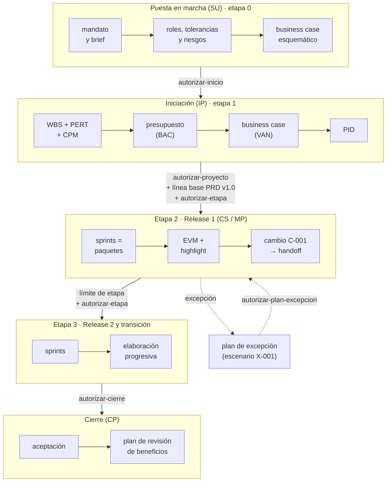

# Caso maestro · PRINCE2 como método, PMBOK como "cómo"

Este documento recorre un proyecto completo con pm-method 2.1.0, desde el mandato hasta la revisión de beneficios. Cada paso muestra **qué momento de PRINCE2 se está viviendo**, **qué técnica del PMBOK se usa para resolverlo**, quién decide, el comando real que se ejecutó y lo que devolvió.

La regla de fondo es la de `SPEC.md` §0: **PRINCE2 define qué se hace, cuándo y quién decide** (procesos, etapas, puertas, tolerancias). **El PMBOK solo aporta técnicas** (EVM, CPM, PERT, P×I, EMV, VAN…), que siempre se aplican dentro de un proceso, una práctica o un producto de PRINCE2. **BMAD**, cuando existe, es la capa que especifica el producto (PRD, arquitectura, épicas e historias) y pm-method la lee sin escribirla.

> **Origen de las cifras.** Todo lo que sigue sale de una corrida real del 2026-10-17 con los scripts vigentes del paquete, sobre una copia del fixture `scripts/pruebas/fixtures/bmad-v6`. Las decisiones humanas están **simuladas** y se marcan así: `[simulado]`. Las fechas del caso (2026-10 → 2027-05) se pasan con `--fecha`. Algunos scripts no aceptan `--fecha` (`bmad.py linea-base` y `bmad.py handoff`), por eso esas filas quedan con la fecha de la corrida (ver *Lecciones del caso*).
>
> **Versión 2.2.0.** La corrida se hizo con la 2.1.0 y sus cifras no cambian. En la 2.2 los interesados y la RACI pasan a la skill `pm-interesados` (maestro de interesados) y los comunicados pueden enviarse por la capa de canales; los pasos 6, 15 y 25 lo indican con una nota «En 2.2». El recorrido completo de esas capacidades, con salidas reales, está en la guía [E2E-3](guias/E2E-3-interesados-okr-avance.md).

---

## 1. Escenario

| Dato | Valor |
|---|---|
| Proyecto | Portal de autoservicio para socios de una cooperativa |
| Mandato | 7 meses, hasta USD 180.000, desarrollo tercerizado |
| Enfoque de entrega | híbrido: etapas PRINCE2 con sprints de 14 días como paquetes de trabajo |
| Especificación | BMAD v6 (brief, PRD con FR-1..FR-4, NFR-1, UJ-1, SM-1, arquitectura con AD-1/AD-2, épicas, `sprint-status.yaml`) |
| Ejecutivo | Laura Méndez |
| Usuario sénior · product owner · autoridad de cambio | Sofía Ramírez |
| Proveedor sénior | Diego Ferreira |
| Gestor del proyecto | Martín Suárez |
| Jefa de equipo (proveedor) | Lucía Benítez |
| Aseguramiento | Andrea Costa |

Las personas son ficticias. La carpeta del proyecto es `repo/gestion/`, fuera de `_bmad/` y `_bmad-output/` (si estuviera adentro, el puente se niega a escribir y la sanidad da `ESP-08`).

### Convenciones de los comandos

Todos los comandos se ejecutan desde la raíz del repositorio (`repo/`). Para acortar:

```bash
EST=<pm-estado-proyecto>/scripts     # plugin: ${CLAUDE_PLUGIN_ROOT}/skills/pm-estado-proyecto/scripts
BMAD=<pm-bmad-puente>/scripts/bmad.py
PAQ=<pm-exportar>/scripts/paquete.py
```

En Claude Code los agentes resuelven estas rutas solos (SPEC §1.10.1). En Hermes las rutas quedan bajo `~/.hermes/skills/`.

### Cómo leer cada bloque

| Campo | Qué dice |
|---|---|
| **Prompt del usuario** | el o los mensajes en lenguaje natural que la persona escribe en Claude Code para lograr el paso, con los datos concretos del caso; si existe, el comando de barra equivalente ("Atajo") |
| **Momento PRINCE2** | proceso (SU, DP, IP, CS, MP, SB, CP), práctica (business case, organización, planes, calidad, riesgo, issues, progreso) y principio que se está aplicando |
| **Técnica PMBOK** | la técnica usada y por qué es solo el *cómo* dentro de ese momento PRINCE2 |
| **Agente / skill** | quién prepara el trabajo en pm-method |
| **Rol humano y decisión** | qué decide una persona y con qué autoridad |
| **Respuestas del usuario** | solo en los pasos con decisión o pregunta humana: lo que responde la persona cuando el orquestador pregunta o presenta opciones, con nombre y rol |
| **Entradas (cómo las aporta el usuario)** | qué información usa el paso y cómo llega: escrita en el prompt, como respuesta a una pregunta del orquestador, como archivo que el usuario deja en una ruta concreta, leída de BMAD por la fachada (solo lectura) o generada por un paso anterior |
| **Salidas y dónde verificarlas** | qué queda, con ruta dentro de `gestion/` e ids (R-001, D-003…), y cómo comprobarlo: abrir el archivo, abrir el CSV de `gestion/03-control/registros/` en un editor o Excel, mirar un campo de `estado.json` o escribir un prompt de verificación (`/pm-method:pm-estado`, «Mostrame…») |
| **Resultado** | cifras de la corrida |
| **Comandos** (bloques debajo de la tabla) | lo que el sistema ejecuta por detrás, como referencia; salvo en el paso 0, el usuario no los escribe |

Para recorrer el caso como usuario: escribí en Claude Code los prompts de cada paso en orden; las respuestas del usuario son las que da la persona con el rol indicado; los comandos son la referencia de lo que el sistema ejecuta.

---

## 2. Mapa del ciclo de vida recorrido



---

## 3. Preparación

### Paso 0 · Verificar el paquete y preparar el repositorio

| Campo | Contenido |
|---|---|
| Prompt del usuario | ninguno en Claude Code: la preparación se hace en la terminal (ver comandos). Para orientarse antes de empezar: «¿Qué necesito para gestionar un proyecto con pm-method si la especificación ya está en BMAD?» Atajo: `/pm-method:pm-ayuda` |
| Momento PRINCE2 | antes del proyecto; no es una etapa |
| Técnica PMBOK | ninguna |
| Agente / skill | mantenedor |
| Rol humano y decisión | ninguna |
| Entradas (cómo las aporta el usuario) | el paquete pm-method instalado y el repositorio del producto con BMAD. En el caso, `repo/` es una copia de `scripts/pruebas/fixtures/bmad-v6` que el usuario prepara en su terminal |
| Salidas y dónde verificarlas | ninguna dentro de `gestion/` (todavía no existe). Se verifica en la salida de `validar_paquete.py`: `Skills: 38 … · Agentes: 6` → `OK` |
| Resultado | `Skills: 38 (32 invocables por el modelo, listado 6546 caracteres) · Agentes: 6` → `OK` (versión 2.2.0) |

*Comandos que escribe el usuario en su terminal:*

```bash
python3 <pm-method>/scripts/validar_paquete.py
```

---

## 4. Puesta en marcha (SU, etapa 0)

### Paso 1 · Crear la carpeta del proyecto

| Campo | Contenido |
|---|---|
| Prompt del usuario | «Creá el proyecto "Portal de autoservicio para socios" en `gestion/`, en español y con enfoque híbrido. La ejecutiva es Laura Méndez y el gestor, Martín Suárez.» Atajo: `/pm-method:pm-nuevo "Portal de autoservicio para socios" ./gestion es hibrido` y, en el mismo mensaje, los nombres de la ejecutiva y del gestor |
| Momento PRINCE2 | SU · organización · *roles definidos*: el ejecutivo existe desde el primer día |
| Técnica PMBOK | ninguna (persistencia) |
| Agente / skill | pm-inicio → `pm-estado-proyecto` |
| Rol humano y decisión | la capa de negocio nombra al ejecutivo y este al gestor |
| Respuestas del usuario | no hay preguntas si los nombres van en el prompt: el usuario trae los nombramientos ya decididos (la capa de negocio nombró a Laura Méndez como ejecutiva y ella, a Martín Suárez como gestor) |
| Entradas (cómo las aporta el usuario) | escritas en el prompt: nombre, carpeta, idioma, enfoque, ejecutiva y gestor |
| Salidas y dónde verificarlas | `gestion/estado.json` (fase `pre-proyecto`, proceso SU, etapa 0, enfoque `hibrido`); los 9 registros CSV vacíos en `gestion/03-control/registros/` (`riesgos`, `issues`, `cambios`, `decisiones`, `supuestos`, `lecciones`, `stakeholders`, `calidad`, `acciones`); `gestion/03-control/registros/diario.md`. Verificar: `/pm-method:pm-estado` (fase, proceso y etapa) o abrir la carpeta `gestion/03-control/registros/` |
| Resultado | fase `pre-proyecto`, proceso SU, etapa 0, enfoque `hibrido` |

*Comandos que ejecuta el sistema por detrás (referencia; el usuario no los escribe):*

```bash
python3 $EST/nuevo_proyecto.py --ruta gestion --nombre "Portal de autoservicio para socios" \
  --idioma es --enfoque hibrido --ejecutivo "Laura Méndez" --gestor "Martín Suárez"
```

### Paso 2 · Conectar la capa de especificación (BMAD)

| Campo | Contenido |
|---|---|
| Prompt del usuario | «El repositorio tiene la especificación en BMAD: conectala al proyecto y decime qué encontraste.» (Si el proyecto se creó con `/pm-method:pm-nuevo`, la detección de BMAD ya corrió en el paso 1) |
| Momento PRINCE2 | SU · planes (insumos) · *foco en productos*: el brief y el PRD de BMAD son productos especialistas, no documentos de gestión |
| Técnica PMBOK | inventario de información del proyecto |
| Agente / skill | pm-inicio → `pm-bmad-puente` |
| Rol humano y decisión | ninguna; el puente solo lee |
| Entradas (cómo las aporta el usuario) | leída de BMAD por el puente (solo lectura): brief, PRD, arquitectura, épicas y `sprint-status.yaml` del repositorio. El usuario no copia ni pega nada |
| Salidas y dónde verificarlas | `gestion/estado.json` → campo `integraciones.bmad` (layout v6, soporte `version-no-visible`); `gestion/02-planificacion/especificacion/inventario-bmad.json` y `gestion/02-planificacion/especificacion/requisitos-bmad.csv` (derivados: no editar), con 9 ids. Verificar: abrir `requisitos-bmad.csv` en un editor o Excel, o «Mostrame los requisitos que leíste de BMAD» |
| Resultado | layout v6; soporte `version-no-visible` → aviso de modo degradado. Inventario: brief `final` sha 42fc69b23dbb · PRD `final` sha ea90ca87952b (1 versión anterior) · arquitectura sha 0317cc4551ca · épicas sha 8b1dd8acdc57 · `sprint-status.yaml` · 1 historia. **9 ids**: FR 4, NFR 1, UJ 1, SM 1, AD 2 |

*Comandos que ejecuta el sistema por detrás (referencia; el usuario no los escribe):*

```bash
python3 $BMAD --proyecto gestion detectar
python3 $BMAD --proyecto gestion inventario
python3 $BMAD --proyecto gestion requisitos
```

```text
AVISO: versión de BMAD version-no-visible; el puente está probado con v4 · v6.11–v6.12. Se usa descubrimiento por patrones (modo degradado).
9 identificadores · {'FR': 4, 'NFR': 1, 'UJ': 1, 'SM': 1, 'AD': 2} → gestion/02-planificacion/especificacion/requisitos-bmad.csv (derivado: no editar)
```

### Paso 3 · Leer la especificación por la fachada única

| Campo | Contenido |
|---|---|
| Prompt del usuario | «¿Qué requisitos tiene el PRD, cuáles no tienen historia todavía y qué historia cubre el FR3?» |
| Momento PRINCE2 | SU · planes · *foco en productos* |
| Técnica PMBOK | matriz de trazabilidad de requisitos (en su forma de consulta) |
| Agente / skill | cualquier skill; aquí `pm-mandato-y-brief` vía `especificacion.py` |
| Rol humano y decisión | ninguna |
| Entradas (cómo las aporta el usuario) | generadas por el paso 2 (inventario y requisitos); la fachada lee BMAD en solo lectura |
| Salidas y dónde verificarlas | `gestion/02-planificacion/especificacion/spec-index.json` (caché `pm-spec-index/1`; se reconstruye solo si cambian las fuentes; no editar). Verificar: la respuesta en pantalla (proveedor `bmad`, 9 requisitos, `sin_cobertura: ['FR-4']`) o «¿Qué historia cubre FR-3?» |
| Resultado | proveedor `bmad`; 9 requisitos; `sin_cobertura: ['FR-4']`; 4 historias (1 backlog, 1 ready-for-dev, 1 review, 1 done). `consultar FR3` normaliza el id a FR-3 y devuelve la historia `2-2-descargar-constancias`, cobertura `planificado`. La segunda consulta dice `índice vigente`: no se reconstruye si las fuentes no cambiaron |

*Comandos que ejecuta el sistema por detrás (referencia; el usuario no los escribe):*

```bash
python3 $EST/especificacion.py --proyecto gestion fuente
python3 $EST/especificacion.py --proyecto gestion resumen
python3 $EST/especificacion.py --proyecto gestion consultar FR3
```

```text
Proveedor de especificación: bmad · índice reconstruido ahora (2026-10-17T08:40:47)
  dueño de requisitos, épicas, historias, estado de desarrollo: BMAD (solo lectura)
  dueño de gobierno (prioridad, moscow, estimacion, iteracion, release, producto_pbs): pm-method backlog.csv
  dueño de paquetes_wbs: pm-method wbs.csv (columna ref)
```

Ninguna skill abre archivos de BMAD por su cuenta. El modelo completo está en [sincronizacion.md](sincronizacion.md).

### Paso 4 · Mandato, project brief y lecciones previas

| Campo | Contenido |
|---|---|
| Prompt del usuario | 1. «Armá el mandato con el pedido del consejo: portal de autoservicio para socios, 7 meses, hasta USD 180.000, desarrollo tercerizado. El brief de producto ya está en BMAD: usalo sin copiarlo.»<br>2. «Registrá como lección previa que en el proyecto anterior de la cooperativa la API del padrón no tenía documentación; recomendación: spike de integración al inicio, prioridad alta.»<br>3. «Registrá el supuesto: 4.000 llamadas por mes a USD 5, todavía sin validar.» |
| Momento PRINCE2 | SU · business case y organización · *aprender de la experiencia* (lecciones previas antes de planificar) |
| Técnica PMBOK | juicio de expertos; análisis de documentos |
| Agente / skill | pm-inicio → `pm-mandato-y-brief`, `pm-registros` |
| Rol humano y decisión | gestor: perfil de formalidad mínimo (**D-001**, nivel `gestor`). Ejecutivo: enfoque híbrido con BMAD (**D-002**, nivel `junta`) `[simulado]` |
| Respuestas del usuario | Martín Suárez (gestor): «Perfil de formalidad mínimo.» → D-001. Laura Méndez (ejecutiva): «Enfoque híbrido: etapas PRINCE2 con sprints de 14 días como paquetes de trabajo; especificación con BMAD.» → D-002 `[simulado]` |
| Entradas (cómo las aporta el usuario) | escritas en el prompt (pedido del consejo, lección previa, supuesto); respuestas a dos preguntas del orquestador (formalidad y enfoque); brief de producto leído de BMAD por la fachada (ruta y sha, sin copiarlo) |
| Salidas y dónde verificarlas | `gestion/00-direccion/mandato.md`; `gestion/01-inicio/project-brief.md` (cita el brief BMAD por ruta y sha, sin copiarlo); L-001 en `lecciones.csv`; S-001 en `supuestos.csv` (validado = pendiente); D-001 (nivel `gestor`) y D-002 (nivel `junta`) en `decisiones.csv`, todos en `gestion/03-control/registros/`. Verificar: abrir los dos `.md`; abrir los CSV en un editor o Excel y buscar L-001, S-001, D-001 y D-002 |
| Resultado | L-001 "la API del padrón no tenía documentación"; S-001 "4.000 llamadas/mes a USD 5" (validado = pendiente) |

*Comandos que ejecuta el sistema por detrás (referencia; el usuario no los escribe):*

```bash
python3 $EST/registro.py --proyecto gestion agregar lecciones --campo etapa=0 --campo categoria=tecnico \
  --campo "situacion=Proyecto previo de la cooperativa: la API del padrón no tenía documentación" \
  --campo "recomendacion=Spike de integración al inicio" --campo prioridad=alta
python3 $EST/registro.py --proyecto gestion agregar decisiones --campo fecha=2026-10-17 \
  --campo "decision=Enfoque híbrido: etapas PRINCE2 con sprints de 14 días como paquetes de trabajo; especificación con BMAD" \
  --campo "decidido_por=Ejecutivo: Laura Méndez" --campo nivel=junta
```

### Paso 5 · Estructura de la junta, roles y tolerancias de proyecto

| Campo | Contenido |
|---|---|
| Prompt del usuario | 1. «Armá la junta: Laura Méndez es la ejecutiva; Sofía Ramírez es usuaria sénior, product owner y autoridad de cambio; Diego Ferreira es proveedor sénior; Andrea Costa hace aseguramiento y Lucía Benítez es la jefa de equipo del proveedor. Sprints de 14 días, velocidad de referencia 30.»<br>2. «Fijá las tolerancias de proyecto que acordamos con la capa de negocio: tiempo ±3 semanas; costo ±8 %; alcance: Must sin tolerancia y FR-4 Should; beneficios −10 %; riesgo: ningún riesgo alto sin respuesta.» |
| Momento PRINCE2 | SU · organización · *roles, responsabilidades y relaciones definidos*; *gestión por excepción* (las tolerancias de proyecto las fija la capa de negocio) |
| Técnica PMBOK | ninguna para los roles; las tolerancias son el umbral contra el que luego mide el EVM |
| Agente / skill | pm-inicio → `pm-organizacion-roles`, `pm-estado-proyecto` |
| Rol humano y decisión | capa de negocio y ejecutivo fijan las tolerancias `[simulado]` |
| Respuestas del usuario | Laura Méndez (ejecutiva) confirma la junta, los nombramientos y las tolerancias de proyecto fijadas con la capa de negocio: «Confirmo.» `[simulado]` |
| Entradas (cómo las aporta el usuario) | escritas en el prompt (nombres, roles, cadencia, velocidad y tolerancias) y la confirmación de la ejecutiva |
| Salidas y dónde verificarlas | `gestion/estado.json` → campos `roles`, `agil` y `tolerancias.proyecto`; `gestion/00-direccion/estructura-organizativa.md`. Verificar: `/pm-method:pm-estado` (muestra las tolerancias) o «Mostrame los roles y las tolerancias de proyecto»; abrir `estructura-organizativa.md` |
| Resultado | tiempo ±3 semanas · costo ±8 % · alcance "Must sin tolerancia; FR-4 Should" · beneficios −10 % · riesgo "ningún riesgo alto sin respuesta"; cadencia de iteración 14 días, velocidad de referencia 30 |

*Comandos que ejecuta el sistema por detrás (referencia; el usuario no los escribe):*

```bash
python3 $EST/estado.py --proyecto gestion rol usuario_senior="Sofía Ramírez" proveedor_senior="Diego Ferreira" \
  product_owner="Sofía Ramírez" autoridad_cambio="Sofía Ramírez" aseguramiento="Andrea Costa" jefes_equipo="Lucía Benítez"
python3 $EST/estado.py --proyecto gestion agil cadencia_iteracion_dias=14 velocidad_referencia=30
python3 $EST/estado.py --proyecto gestion tolerancia --nivel proyecto "tiempo=±3 semanas" "costo=±8 %" \
  "alcance=Must sin tolerancia; FR-4 Should" "beneficios=-10 %" "riesgo=ningún riesgo alto sin respuesta"
```

### Paso 6 · Interesados

| Campo | Contenido |
|---|---|
| Prompt del usuario | «Registrá los interesados del portal. Entre ellos, el sindicato de operadores: poder medio, interés alto, hoy resistente y queremos llevarlo a neutral; esa valoración es confidencial.» |
| Momento PRINCE2 | SU · organización (compromiso de interesados) |
| Técnica PMBOK | matriz poder/interés con estrategia por cuadrante y matriz de evaluación del compromiso (actual → deseado) |
| Agente / skill | pm-inicio → `pm-interesados` (en la corrida 2.1, `pm-organizacion-roles`) |
| Rol humano y decisión | el gestor valida las valoraciones; las sensibles quedan con `confidencial=si` |
| Respuestas del usuario | Martín Suárez (gestor) revisa las valoraciones antes de guardarlas: «Están bien; la del sindicato va confidencial.» `[simulado]` |
| Entradas (cómo las aporta el usuario) | escritas en el prompt (interesados y valoraciones); la confirmación del gestor |
| Salidas y dónde verificarlas | ST-001..ST-006 en `gestion/03-control/registros/stakeholders.csv` (ST-006 con `confidencial=si`); `gestion/01-inicio/analisis-stakeholders.md`; `gestion/02-planificacion/plan-compromiso-stakeholders.md`. Verificar: abrir `stakeholders.csv` en un editor o Excel (circulación restringida); abrir los dos `.md` |
| Resultado | 6 interesados; el sindicato de operadores (ST-006) figura como `resistente → neutral` y confidencial |

*Comandos que ejecuta el sistema por detrás (referencia; el usuario no los escribe):*

```bash
python3 $EST/registro.py --proyecto gestion agregar stakeholders --campo "nombre=Sindicato de operadores" \
  --campo poder=medio --campo interes=alto --campo actitud=resistente --campo nivel_compromiso_actual=resistente \
  --campo nivel_compromiso_deseado=neutral --campo confidencial=si
```

*En 2.2:* después del alta, `pm-interesados` corre `interesados.py --proyecto gestion matriz`, que ubica a cada interesado en su cuadrante (gestionar de cerca, mantener satisfecho, mantener informado, monitorear) con la estrategia que le corresponde y marca como frontera los valores «medio» (el sindicato, con poder medio e interés alto, queda en «gestionar de cerca» como frontera). Esta corrida es anterior y no lo ejecutó; la salida real con diez interesados está en la guía E2E-3, paso 3, y en [CASOS-DE-USO](CASOS-DE-USO.md) caso 38.

### Paso 7 · Riesgos con P×I y valor esperado

| Campo | Contenido |
|---|---|
| Prompt del usuario | 1. «Cargá los riesgos iniciales: la integración con el padrón puede demorar más de lo previsto (AD-2), P4, I4, USD 30.000, reducir con un spike en el sprint 1, propietaria Laura Méndez y ejecutora Lucía Benítez; el proveedor puede rotar desarrolladores, P3, I3, USD 18.000, transferir con cláusula contractual; adopción baja (SM-1), P3, I4, USD 40.000, reducir con campaña y asistencia; los operadores resisten la bandeja (FR-4), P3, I3, USD 10.000, reducir con un taller; y la oportunidad de reutilizar el generador de PDF (FR-3), P2, I3, USD 8.000, explotar.»<br>2. «Dame el resumen de riesgos.» |
| Momento PRINCE2 | SU · práctica de riesgo |
| Técnica PMBOK | evaluación cualitativa P×I (escala 1–5) y **EMV** = impacto monetario × probabilidad (1–5 → 10/30/50/70/90 %, SPEC §1.10.9). Es un *cómo*: PRINCE2 pide identificar, evaluar y responder; el PMBOK da la fórmula |
| Agente / skill | pm-inicio → `pm-riesgos` |
| Rol humano y decisión | cada riesgo tiene propietario con nombre |
| Entradas (cómo las aporta el usuario) | escritas en el prompt (evento, P, I, impacto monetario, respuesta y propietario de cada riesgo); ids AD-2, SM-1, FR-3 y FR-4 de la especificación (paso 3) |
| Salidas y dónde verificarlas | R-001..R-005 en `gestion/03-control/registros/riesgos.csv`, con `puntuacion` y `valor_esperado` calculados por `registro.py`. Verificar: abrir `riesgos.csv` en un editor o Excel (columnas `puntuacion` y `valor_esperado`), o «Mostrame los riesgos altos abiertos»; `/pm-method:pm-estado` incluye los riesgos altos sin respuesta |
| Resultado | ver tabla; `resumen`: 1 alto abierto, 0 sin respuesta, 0 sin propietario |

| Id | Evento (cita ids de la especificación) | P×I | Impacto USD | EMV | Respuesta |
|---|---|---|---|---|---|
| R-001 | integración con el padrón demora (AD-2) | 4×4 = **16 (alto)** | 30.000 | 21.000 | reducir: spike en el sprint 1 |
| R-002 | el proveedor rota desarrolladores | 3×3 = 9 | 18.000 | 9.000 | transferir: cláusula contractual |
| R-003 | adopción baja (SM-1) | 3×4 = 12 | 40.000 | 20.000 | reducir: campaña y asistencia |
| R-004 | operadores resisten la bandeja (FR-4) | 3×3 = 9 | 10.000 | 5.000 | reducir: taller |
| R-005 | oportunidad: reutilizar generador PDF (FR-3) | 2×3 = 6 | 8.000 | 2.400 | explotar |

*Comandos que ejecuta el sistema por detrás (referencia; el usuario no los escribe):*

```bash
python3 $EST/registro.py --proyecto gestion agregar riesgos --campo categoria=tecnico \
  --campo "evento=La integración con el padrón demora más de lo previsto (AD-2)" --campo tipo=amenaza \
  --campo probabilidad=4 --campo impacto=4 --campo impacto_monetario=30000 --campo respuesta=reducir \
  --campo propietario="Laura Méndez" --campo ejecutor="Lucía Benítez"
python3 $EST/registro.py --proyecto gestion resumen
```

`registro.py` calcula solo la puntuación y el EMV, y valida tipo, categoría, respuesta y estado contra `esquema.py`.

### Paso 8 · Business case esquemático y plan de la etapa de iniciación

| Campo | Contenido |
|---|---|
| Prompt del usuario | 1. «Armá el business case esquemático a partir del mandato, comparando "no hacer nada distinto", la opción mínima y el portal a medida; el beneficio B-01 tiene que citar SM-1.»<br>2. «Prepará el plan de la etapa de iniciación y la descripción del producto del proyecto, y dejá todo en revisión para la puerta.» |
| Momento PRINCE2 | SU · business case · *justificación continua del negocio* (primera versión) y *gestión por etapas* (se planifica solo la etapa 1) |
| Técnica PMBOK | análisis de opciones (incluye "no hacer nada distinto") |
| Agente / skill | pm-inicio → `pm-caso-de-negocio`, `pm-plan-etapa-y-limites` |
| Rol humano y decisión | ninguna todavía; queda `en-revision` |
| Entradas (cómo las aporta el usuario) | generadas por los pasos 4–7 (mandato, brief, roles, tolerancias, riesgos); SM-1 leído por la fachada |
| Salidas y dónde verificarlas | `gestion/00-direccion/business-case.md` v0.1, `gestion/02-planificacion/plan-etapa-1.md`, `gestion/02-planificacion/productos/descripcion-producto-proyecto.md`, `gestion/00-direccion/decisiones/2026-10-17-solicitud-autorizar-inicio.md`; en `gestion/estado.json` → `artefactos.business-case-esquematico` y `artefactos.plan-etapa-1` en `en-revision`. Verificar: abrir los archivos y mirar `estado:` en el frontmatter, o «¿En qué estado están los documentos de la puerta?» |
| Resultado | opción 3 (portal a medida) frente a "no hacer nada distinto" y "mínimo"; B-01 cita SM-1 por id |

*Comandos que ejecuta el sistema por detrás (referencia; el usuario no los escribe):*

```bash
python3 $EST/estado.py --proyecto gestion artefacto business-case-esquematico --ruta 00-direccion/business-case.md --estado en-revision
python3 $EST/estado.py --proyecto gestion artefacto plan-etapa-1 --ruta 02-planificacion/plan-etapa-1.md --estado en-revision
```

### Paso 9 · Puerta `autorizar-inicio`

| Campo | Contenido |
|---|---|
| Prompt del usuario | 1. «Prepará la puerta para autorizar el inicio.»<br>2. Después de la reunión: «Laura Méndez, ejecutiva, aprobó autorizar el inicio el 2026-10-17; la etapa de iniciación termina el 2026-11-06. Registralo y aprobá el project brief v1.0.» Atajo para 1: `/pm-method:pm-puerta autorizar-inicio` |
| Momento PRINCE2 | DP (dirigir el proyecto) · progreso · *gestión por etapas* y *gestión por excepción* |
| Técnica PMBOK | ninguna (decisión de gobierno) |
| Agente / skill | `pm-puerta` → `pm-director` (único que registra puertas) |
| Rol humano y decisión | **Ejecutivo: aprueba** `[simulado]` |
| Respuestas del usuario | Laura Méndez (ejecutiva), ante las opciones aprobar, condicionar, rechazar, pedir información o cierre prematuro: «Apruebo.» `[simulado]` |
| Entradas (cómo las aporta el usuario) | generadas por los pasos 4–8 (documentos en `en-revision`); BMAD verificado por el puente en solo lectura; la decisión, como respuesta del usuario |
| Salidas y dónde verificarlas | `gestion/estado.json` → `puertas` (autorizar-inicio aprobada), fase `inicio`, IP, etapa 1 "Iniciación"; D-003 (puerta) y D-004..D-008 (aprobaciones de documentos) en `gestion/03-control/registros/decisiones.csv`. Verificar: `/pm-method:pm-estado`; abrir `decisiones.csv` y buscar D-003 |
| Resultado | sanidad 0 ERROR · 3 AVISO (ESP-03 FR-4 sin cobertura, aceptable en pre-proyecto; ESP-07 versión de BMAD; INS-05 presupuesto del listado de skills del entorno). El paquete de puerta primero salió `BORRADOR` porque los documentos estaban en `borrador`; después de pasarlos a `en-revision`, `COMPLETO PARA LA PUERTA`. Tras la puerta: fase `inicio`, IP, etapa 1 "Iniciación". Una puerta fuera de orden se rechaza |

*Comandos que ejecuta el sistema por detrás (referencia; el usuario no los escribe):*

```bash
python3 $PAQ --proyecto gestion listar puerta autorizar-inicio
python3 $BMAD --proyecto gestion verificar
python3 $EST/sanidad.py --proyecto gestion
python3 $EST/estado.py --proyecto gestion puerta autorizar-inicio --decision aprobado \
  --por "Ejecutivo: Laura Méndez" --fecha 2026-10-17 --fin 2026-11-06
python3 $EST/estado.py --proyecto gestion aprobar project-brief --por "Ejecutivo: Laura Méndez" --version 1.0 --fecha 2026-10-17
python3 $EST/estado.py --proyecto gestion puerta autorizar-cierre --decision aprobado --por "Ejecutivo: Laura Méndez"
```

```text
La puerta autorizar-cierre no corresponde al estado actual (inicio/IP). Revisar 'siguiente' o usar --forzar.
```

---

## 5. Iniciación (IP, etapa 1)

### Paso 10 · Estructura de productos y WBS

| Campo | Contenido |
|---|---|
| Prompt del usuario | 1. «Armá la estructura de productos y la WBS del portal; en la columna `ref` citá los FR, NFR, UJ, AD y las historias de BMAD, y generá el diagrama y el diccionario.»<br>2. «¿Qué requisitos quedan sin cobertura?» |
| Momento PRINCE2 | IP · planes · *foco en productos* (primero los productos, después las actividades) |
| Técnica PMBOK | **EDT/WBS** con regla del 100 % y consolidación ascendente. Es un *cómo*: PRINCE2 pide planificación basada en productos; la WBS es la forma de descomponer y sumar |
| Agente / skill | pm-planificacion → `pm-planificacion-por-productos` |
| Rol humano y decisión | la jefa de equipo valida esfuerzos |
| Respuestas del usuario | Lucía Benítez (jefa de equipo) valida los esfuerzos por paquete: «Los esfuerzos están bien.» `[simulado]` |
| Entradas (cómo las aporta el usuario) | esfuerzos por paquete validados por la jefa de equipo (respuesta a una pregunta del orquestador); ids de requisitos e historias leídos por la fachada (paso 3); productos del brief y del business case (pasos 4 y 8) |
| Salidas y dónde verificarlas | `gestion/02-planificacion/wbs.csv` (15 elementos, 11 hojas, 2.760 h, USD 138.000; columna `ref`), `gestion/02-planificacion/visuales/wbs.md`, `gestion/02-planificacion/diccionario-wbs-esqueleto.md`. Verificar: abrir `wbs.csv` en Excel; abrir `wbs.md` (diagrama Mermaid); «¿Qué cubre FR-4?» → paquetes 2.1 y 3.5, cobertura `planificado` |
| Resultado | **15 elementos, 11 hojas, 2.760 h, USD 138.000**. Con la WBS, FR-4 pasa de `sin-cobertura` a `planificado` (paquetes 2.1 y 3.5) y el aviso ESP-03 desaparece |

*Comandos que ejecuta el sistema por detrás (referencia; el usuario no los escribe):*

```bash
python3 $EST/wbs.py gestion/02-planificacion/wbs.csv --titulo "Portal de autoservicio para socios" \
  --mermaid gestion/02-planificacion/visuales/wbs.md --diccionario gestion/02-planificacion/diccionario-wbs-esqueleto.md
python3 $EST/especificacion.py --proyecto gestion listar requisitos
```

```text
id=FR-4 | tipo=FR | titulo=El operador responde consultas desde una bandeja. | paquetes_wbs=['2.1', '3.5'] | cobertura=planificado
```

El diagrama final, con el paquete 3.7 agregado más tarde por C-001, está en [ejemplos/wbs-mermaid.md](ejemplos/wbs-mermaid.md).

### Paso 11 · Estimación PERT

| Campo | Contenido |
|---|---|
| Prompt del usuario | «Estimá con PERT de tres puntos (optimista, más probable y pesimista) las actividades del plan y calculá la reserva de cronograma con la σ del camino crítico.» |
| Momento PRINCE2 | IP · planes (estimar es un paso del procedimiento de planificación) |
| Técnica PMBOK | **PERT de tres puntos**: tE = (O + 4M + P) / 6, σ = (P − O) / 6. Es un *cómo*: PRINCE2 exige estimar, pero no dice con qué fórmula |
| Agente / skill | pm-planificacion → `pm-cronograma-estimacion` |
| Rol humano y decisión | Lucía Benítez, que hará el trabajo, valida O/M/P |
| Respuestas del usuario | Lucía Benítez (jefa de equipo, que hará el trabajo) da o valida O/M/P de cada actividad `[simulado]` |
| Entradas (cómo las aporta el usuario) | valores O/M/P: respuestas de Lucía Benítez a la pregunta del orquestador; paquetes de la WBS (paso 10) |
| Salidas y dónde verificarlas | `gestion/02-planificacion/estimacion-pert.csv`, `gestion/02-planificacion/hoja-estimacion.md`. Verificar: abrir el CSV en Excel; abrir la hoja (σ del camino crítico ≈ 5,1 días; reserva ≈ 10 días laborables) |
| Resultado | tE: A00 10 · A01 10 · A02 30 · A03 20 · A04 30 · A06 25 · A07 35 · A08 15 · A09 10 días. σ del camino crítico = √(0,67² + 2,67² + 2,67² + 3,00² + 1,67²) ≈ **5,1 días** → reserva de cronograma a 2σ ≈ 10 días laborables, dentro de la tolerancia de ±3 semanas |

### Paso 12 · Camino crítico y exportación a MS Project

| Campo | Contenido |
|---|---|
| Prompt del usuario | «Calculá el camino crítico con inicio el 2026-11-09 y exportalo para abrirlo en MS Project.» |
| Momento PRINCE2 | IP · planes (plan del proyecto) |
| Técnica PMBOK | **método de la ruta crítica (CPM)** con holgura total y libre; exportación MSPDI |
| Agente / skill | pm-planificacion → `pm-cronograma-estimacion` |
| Rol humano y decisión | ninguna en este paso |
| Entradas (cómo las aporta el usuario) | generadas por los pasos 10–11 (WBS, actividades con dependencias y duraciones PERT); la fecha de inicio, escrita en el prompt |
| Salidas y dónde verificarlas | `gestion/02-planificacion/actividades.csv` (columna `wbs`), `gestion/02-planificacion/cronograma.md` (Gantt Mermaid), `gestion/02-planificacion/cronograma.xml` (MSPDI). Verificar: abrir `cronograma.md`; abrir `cronograma.xml` en MS Project o ProjectLibre (14 tareas, 3 de resumen por WBS) |
| Resultado | **120 días laborables, fin 2027-04-26**; camino crítico A00 → A02 → A04 → A05 → A07 → A08 → A10; holguras: A01 y A03 40 días, A06 10, A09 5; carga del proveedor 150 días. El XML se parsea bien: 14 tareas, 3 de resumen por WBS |

*Comandos que ejecuta el sistema por detrás (referencia; el usuario no los escribe):*

```bash
python3 $EST/cpm.py gestion/02-planificacion/actividades.csv --inicio 2026-11-09 \
  --mermaid gestion/02-planificacion/cronograma.md --mspdi gestion/02-planificacion/cronograma.xml \
  --titulo "Portal de autoservicio para socios" --wbs gestion/02-planificacion/wbs.csv
```

```text
Duración total (días laborables): 120  · Fin previsto: 2027-04-26
Camino crítico: A00 -> A02 -> A04 -> A05 -> A07 -> A08 -> A10
```

### Paso 13 · Presupuesto: BAC, contingencia y reserva de gestión

| Campo | Contenido |
|---|---|
| Prompt del usuario | «Armá el presupuesto: sumá los paquetes, calculá la contingencia desde el valor esperado de los riesgos sin duplicarla y dejá la reserva de gestión fuera del BAC. El mandato dice hasta USD 180.000.» |
| Momento PRINCE2 | IP · planes y business case · *gestión por excepción* (la reserva de gestión solo la libera la junta) |
| Técnica PMBOK | estimación ascendente de costos y **reservas**: contingencia ligada a riesgos identificados (suma de EMV) dentro del BAC; reserva de gestión fuera del BAC (SPEC §1.10.6) |
| Agente / skill | pm-planificacion → `pm-costos-presupuesto` |
| Rol humano y decisión | ninguna en este paso; lo decide la junta en `autorizar-proyecto` |
| Entradas (cómo las aporta el usuario) | generadas por pasos anteriores: WBS costeada (paso 10), EMV de `riesgos.csv` (paso 7) y tope del mandato (paso 4) |
| Salidas y dónde verificarlas | `gestion/02-planificacion/presupuesto.md` (BAC 165.000, reserva de gestión 15.000, presupuesto autorizado 180.000), `gestion/02-planificacion/linea-base-costo.csv`. Verificar: abrir `presupuesto.md`; abrir `linea-base-costo.csv` en Excel (Σ `pv_periodo` = BAC) |
| Resultado | Σ paquetes 138.000 + contingencia 27.000 (≈ EMV R-001 21.000 + R-002 9.000 − R-005 2.400) = **BAC 165.000** (etapa 2: 95.000; etapa 3: 70.000) + reserva de gestión 15.000 = **presupuesto autorizado 180.000**, igual al mandato |

### Paso 14 · Business case detallado (VAN, TIR, payback) y OKR

| Campo | Contenido |
|---|---|
| Prompt del usuario | 1. «Pasá el business case a detallado: inversión 180.000, flujos netos de 36.000 el año 1 y 84.000 los años 2 a 5, tasa 12 %; calculá VAN, TIR y payback.»<br>2. «Armá los OKR del proyecto a partir de los beneficios B-01 y B-02 y puntualos al 2026-11-02.» |
| Momento PRINCE2 | IP · business case · *justificación continua del negocio* |
| Técnica PMBOK | **VAN**, TIR y periodo de recuperación (selección y justificación económica). PRINCE2 pide que el proyecto sea deseable, viable y alcanzable; estas fórmulas sostienen el "viable". Los OKR son un instrumento de la capa de negocio que **cita** los beneficios del business case por id |
| Agente / skill | pm-inicio → `pm-caso-de-negocio`, `pm-okr` |
| Rol humano y decisión | el Usuario sénior es dueño de los beneficios; los supuestos de costo unitario quedan `[por confirmar]` |
| Respuestas del usuario | Sofía Ramírez (usuaria sénior) acepta ser dueña de los beneficios; los supuestos de costo unitario quedan `[por confirmar]` `[simulado]` |
| Entradas (cómo las aporta el usuario) | cifras escritas en el prompt; presupuesto (paso 13); business case esquemático (paso 8); SM-1 leído por la fachada |
| Salidas y dónde verificarlas | `gestion/00-direccion/business-case.md` v0.9 (VAN 79.944, TIR ≈ 26,8 %, payback ≈ 2,7 años); `gestion/00-direccion/okr.csv` (O-1 con KR-1.1..KR-1.3); `gestion/03-control/reportes/2026-11-02-okr.md`. Verificar: abrir el business case y la tabla de OKR; abrir `okr.csv` en Excel |
| Resultado | flujos netos: año 1 36.000 (rampa al 50 %), años 2–5 84.000 (96.000 de ahorro − 12.000 de des-beneficio DB-01). Inversión: 180.000 (escenario prudente). **VAN (12 %, 5 años) = USD 79.944 · TIR ≈ 26,8 % · payback ≈ 2,7 años.** OKR: O-1 con KR-1.1 (vínculo B-01; SM-1), KR-1.2 (B-02), KR-1.3 (B-01); puntuación 0,00 en los tres porque no hay mediciones antes de la producción |

```text
VAN = −180.000 + 36.000/1,12 + 84.000/1,12² + 84.000/1,12³ + 84.000/1,12⁴ + 84.000/1,12⁵ = 79.944
Payback: −144.000 (año 1) → −60.000 (año 2) → +24.000 (año 3) ⇒ 2 + 60.000/84.000 ≈ 2,7 años
```

*Comandos que ejecuta el sistema por detrás (referencia; el usuario no los escribe):*

```bash
python3 <pm-okr>/scripts/okr.py gestion/00-direccion/okr.csv --corte 2026-11-02 \
  --markdown gestion/03-control/reportes/2026-11-02-okr.md
```

### Paso 15 · Enfoques, RACI, estrategia de adquisiciones y PID

| Campo | Contenido |
|---|---|
| Prompt del usuario | 1. «Armá la RACI con una sola A por fila, los enfoques de gestión en una página y la estrategia de adquisiciones: precio fijo por release y T&M para cambios.»<br>2. «Con todo eso armá el plan de proyecto, el plan de la etapa 2 y el PID por referencia.» |
| Momento PRINCE2 | IP · organización, calidad, riesgo, issues, progreso · *adaptar al contexto* (enfoques en una página, perfil híbrido) |
| Técnica PMBOK | **matriz RACI** (una sola A por fila); análisis hacer o comprar y tipo de contrato (precio fijo por release + T&M para cambios) |
| Agente / skill | pm-inicio → `pm-interesados` (RACI; en la corrida 2.1, `pm-organizacion-roles`), `pm-enfoques-gestion`, `pm-adquisiciones`, `pm-acta-constitucion` |
| Rol humano y decisión | el enfoque de cambios fija la autoridad de cambio (Usuario sénior hasta USD 5.000 dentro de la tolerancia de etapa) |
| Respuestas del usuario | Martín Suárez (gestor) confirma el umbral que va en el enfoque de cambios: «Sofía Ramírez decide cambios hasta USD 5.000 dentro de la tolerancia de etapa; la reserva de gestión la libera la junta.» (la junta lo aprueba con el PID en el paso 17) `[simulado]` |
| Entradas (cómo las aporta el usuario) | roles (paso 5), planes y presupuesto (pasos 10–14); condiciones de contrato escritas en el prompt |
| Salidas y dónde verificarlas | `gestion/00-direccion/matriz-raci.md`, `gestion/02-planificacion/enfoques/enfoques-gestion.md`, `gestion/02-planificacion/adquisiciones/estrategia-adquisiciones.md`, `gestion/02-planificacion/plan-proyecto.md`, `gestion/02-planificacion/plan-etapa-2.md`, `gestion/00-direccion/pid.md`; la aprobación de la RACI quedó como D-048 en `decisiones.csv`. Verificar: abrir cada archivo; en la RACI, filas "Uso de la reserva de gestión" (A = Ejecutivo) y "Solicitudes de cambio ≤ USD 5.000" (A = Usuario sénior) |
| Resultado | RACI: "Uso de la reserva de gestión" A = Ejecutivo; "Solicitudes de cambio ≤ USD 5.000" A = Usuario sénior; "PRD y épicas (BMAD)" A = Usuario sénior, R = jefa de equipo. En la corrida la RACI se registró al final (`aprobar … --fecha 2026-11-06`) y por eso su decisión es D-048 |

*En 2.2:* la RACI además puede cargarse en el registro `raci.csv` (una fila por elemento × interesado, con `registro.py agregar raci`), que la valida al escribir: exactamente un A por elemento (un segundo A se rechaza), interesados existentes en el maestro y sin filas duplicadas. `interesados.py raci --markdown …` genera la matriz desde ese registro, con los títulos tomados de su fuente (épicas y requisitos de BMAD por la fachada, paquetes de la WBS, KR de `okr.csv`); las filas de autoridad de este caso, como «Uso de la reserva de gestión», quedan como elementos de texto libre, que no se validan contra una fuente. Ejemplo real en la guía E2E-3, paso 7, y en [CASOS-DE-USO](CASOS-DE-USO.md) caso 42.

### Paso 16 · Sanidad antes de la puerta: un aviso real y su corrección

| Campo | Contenido |
|---|---|
| Prompt del usuario | 1. «Revisá la sanidad del proyecto antes de la junta.»<br>2. «Corregí el ART-03: congelá el business case esquemático aprobado en el historial y apuntá la clave a esa copia.» Atajo para 1: `/pm-method:pm-sanidad` |
| Momento PRINCE2 | IP → DP · progreso (calidad de la información que va a la junta) |
| Técnica PMBOK | auditoría de la información del proyecto |
| Agente / skill | `pm-sanidad` |
| Rol humano y decisión | el gestor corrige antes de presentar |
| Respuestas del usuario | Martín Suárez (gestor) autoriza la corrección antes de presentar: «Sí, congelalo en el historial.» `[simulado]` |
| Entradas (cómo las aporta el usuario) | ninguna nueva: usa el estado del proyecto (`estado.json` y frontmatter de los documentos); la autorización del gestor |
| Salidas y dónde verificarlas | `gestion/00-direccion/historial/business-case-esquematico-v1.0.md`; en `gestion/estado.json` → `artefactos.business-case-esquematico` apunta a esa copia (`aprobado`, v1.0). Verificar: «Revisá la sanidad de nuevo» → 0 ERROR · 2 AVISO; abrir la copia en `historial/` |
| Resultado | `ART-03 business-case-esquematico: estado.json dice 'aprobado' y el documento 'en-revision'`. Causa: el esquemático aprobado y el business case de IP apuntaban al **mismo archivo**. Corrección: congelar el esquemático en `historial/` y apuntar la clave a esa copia. Sanidad: 0 ERROR · 2 AVISO |

*Comandos que ejecuta el sistema por detrás (referencia; el usuario no los escribe):*

```bash
python3 $EST/sanidad.py --proyecto gestion
# (copia del esquemático aprobado a 00-direccion/historial/business-case-esquematico-v1.0.md)
python3 $EST/estado.py --proyecto gestion artefacto business-case-esquematico \
  --ruta 00-direccion/historial/business-case-esquematico-v1.0.md --estado aprobado --version 1.0
```

### Paso 17 · Puerta `autorizar-proyecto` y línea base del PRD

| Campo | Contenido |
|---|---|
| Prompt del usuario | 1. «Prepará la puerta para autorizar el proyecto.»<br>2. Después de la junta: «La junta aprobó el proyecto el 2026-11-06 con BAC 165.000 y reserva de gestión 15.000; decidió Laura Méndez como ejecutiva. Registralo y fijá la línea base 1.0 del PRD, la arquitectura y las épicas.» Atajo para 1: `/pm-method:pm-puerta autorizar-proyecto` |
| Momento PRINCE2 | DP · business case, planes · *justificación continua* (la junta compromete el presupuesto completo) |
| Técnica PMBOK | **línea base** del alcance (el PRD congelado con huella sha256) |
| Agente / skill | `pm-director` → `pm-direccion-decisiones`, `pm-bmad-puente` |
| Rol humano y decisión | **Junta: aprueba el proyecto (BAC 165.000, reserva 15.000)** `[simulado]` |
| Respuestas del usuario | Laura Méndez (ejecutiva, por la junta): «Aprobado: BAC 165.000 y reserva de gestión 15.000.» `[simulado]` |
| Entradas (cómo las aporta el usuario) | productos de IP generados por los pasos 10–16; PRD, arquitectura y épicas leídos de BMAD por el puente (solo lectura) para la huella sha256; la decisión, como respuesta |
| Salidas y dónde verificarlas | D-009 (puerta), D-010..D-020 (aprobaciones) y D-021..D-023 (líneas base) en `gestion/03-control/registros/decisiones.csv`; `gestion/00-direccion/historial/pid-v1.0.md`, `gestion/00-direccion/historial/business-case-v1.0.md`; copias congeladas `gestion/00-direccion/historial/bmad-prd-v1.0/`, `bmad-arquitectura-v1.0/` y `bmad-epicas-v1.0/`. Verificar: abrir `decisiones.csv`; abrir la carpeta `00-direccion/historial/`; «¿Hay desvíos de BMAD contra la línea base?» |
| Resultado | `paquete.py listar puerta autorizar-proyecto` → `COMPLETO PARA LA PUERTA` (incluye cronograma, presupuesto, WBS y estrategia de adquisiciones como opcionales). PRD sha ea90ca87952b · arquitectura 0317cc4551ca · épicas 8b1dd8acdc57. `estado.py aprobar bmad-prd` se rechaza: una especificación externa solo se aprueba con `linea-base` |

*Comandos que ejecuta el sistema por detrás (referencia; el usuario no los escribe):*

```bash
python3 $EST/estado.py --proyecto gestion puerta autorizar-proyecto --decision aprobado \
  --por "Ejecutivo: Laura Méndez" --fecha 2026-11-06
python3 $BMAD --proyecto gestion linea-base prd --version 1.0 --por "Ejecutivo: Laura Méndez"
python3 $EST/estado.py --proyecto gestion aprobar bmad-prd --por "Ejecutivo: Laura Méndez"
```

```text
Línea base bmad-prd v1.0 registrada · sha ea90ca87952b · copia congelada en gestion/00-direccion/historial/bmad-prd-v1.0
bmad-prd es una especificación externa (BMAD): su aprobación se registra con bmad.py linea-base / external spec: use bmad.py linea-base
```

### Paso 18 · Puerta `autorizar-etapa` (etapa 2) y tolerancias de etapa

| Campo | Contenido |
|---|---|
| Prompt del usuario | «La junta autorizó la etapa 2 "Release 1" hasta el 2027-02-15 con estas tolerancias: tiempo +2 semanas; costo ±10 %; alcance: la PO intercambia Should/Could; riesgo: ningún riesgo alto sin respuesta. Registralo.» Atajo para preparar la puerta: `/pm-method:pm-puerta autorizar-etapa` |
| Momento PRINCE2 | DP · progreso · *gestión por etapas* y *por excepción* (la junta delega al gestor dentro de tolerancias de etapa) |
| Técnica PMBOK | ninguna |
| Agente / skill | `pm-director` |
| Rol humano y decisión | **Junta: autoriza la etapa 2 "Release 1" hasta 2027-02-15** `[simulado]` |
| Respuestas del usuario | Laura Méndez (ejecutiva, por la junta): «Autorizo la etapa 2 "Release 1" hasta el 2027-02-15 con esas tolerancias.» `[simulado]` |
| Entradas (cómo las aporta el usuario) | la decisión y las tolerancias, escritas en el prompt; plan de la etapa 2 (paso 15) |
| Salidas y dónde verificarlas | D-024 en `gestion/03-control/registros/decisiones.csv`; `gestion/00-direccion/decisiones/2026-11-06-acta-junta-autorizar-proyecto.md`; en `gestion/estado.json` → fase `entrega`, CS, etapa 2 y `tolerancias.etapa`. Verificar: `/pm-method:pm-estado`; buscar D-024 en `decisiones.csv` |
| Resultado | fase `entrega`, CS, etapa 2. Tolerancias de etapa: tiempo +2 semanas · costo ±10 % · alcance "PO intercambia Should/Could" · riesgo "ningún riesgo alto sin respuesta" |

*Comandos que ejecuta el sistema por detrás (referencia; el usuario no los escribe):*

```bash
python3 $EST/estado.py --proyecto gestion puerta autorizar-etapa --decision aprobado --por "Ejecutivo: Laura Méndez" \
  --fecha 2026-11-06 --etapa-nombre "Release 1" --fin 2027-02-15
python3 $EST/estado.py --proyecto gestion tolerancia --nivel etapa "tiempo=+2 semanas" "costo=±10 %" \
  "alcance=PO intercambia Should/Could" "riesgo=ningún riesgo alto sin respuesta"
```

---

## 6. Etapa de entrega 2 · Release 1 (CS + MP)

### Paso 19 · Trazabilidad y backlog con columnas de gobierno

| Campo | Contenido |
|---|---|
| Prompt del usuario | 1. «Trazá los requisitos del PRD contra la WBS y las historias, y decime qué quedó sin cubrir.»<br>2. «Sincronizá el backlog desde BMAD.»<br>3. «Cargá las prioridades de gobierno: 2-1-consultar-tramites es Must, prioridad 3, 8 puntos, sprint S3, release R1, producto 3.3.» Atajo para 2: `/pm-method:pm-sync bmad` |
| Momento PRINCE2 | CS · planes y calidad · *foco en productos* |
| Técnica PMBOK | **matriz de trazabilidad de requisitos**; priorización **MoSCoW**; estimación en puntos de historia |
| Agente / skill | pm-planificacion / pm-control → `pm-bmad-puente`, `pm-agil-hibrido` |
| Rol humano y decisión | **product owner: prioridades y releases (D-025, nivel `product-owner`)** `[simulado]` |
| Respuestas del usuario | Sofía Ramírez (product owner) fija prioridad, MoSCoW, estimación, iteración, release y producto de las 4 historias → D-025 (nivel `product-owner`) `[simulado]` |
| Entradas (cómo las aporta el usuario) | historias y estados leídos de BMAD por el puente (solo lectura); WBS (paso 10); columnas de gobierno: respuestas de la PO |
| Salidas y dónde verificarlas | `gestion/02-planificacion/especificacion/matriz-trazabilidad-bmad.csv` (derivado: no editar); `gestion/02-planificacion/backlog.csv` (columnas de gobierno de pm-method); D-025 en `decisiones.csv`. Verificar: abrir ambos CSV en Excel; «¿Qué tiene la historia 2-1-consultar-tramites?» → bloque `gobierno` |
| Resultado | FR-4 sin historia (cubierto por la WBS 3.5); `1-2-recuperar-contrasena` sin requisito; 0 referencias rotas. Funciona igual desde otra carpeta (`cd /tmp` con `--proyecto` absoluto). Backlog: 4 historias nuevas; el PO carga prioridad, MoSCoW, estimación, iteración, release y producto; una segunda sincronización **no toca** las columnas de gobierno (comparación por `diff`: idénticas) |

*Comandos que ejecuta el sistema por detrás (referencia; el usuario no los escribe):*

```bash
python3 $BMAD --proyecto gestion trazabilidad --wbs 02-planificacion/wbs.csv
python3 $BMAD --proyecto gestion backlog
python3 $EST/especificacion.py --proyecto gestion consultar 2-1-consultar-tramites
```

```text
gobierno: {'prioridad': '3', 'moscow': 'must', 'estimacion': '8', 'iteracion': 'S3', 'release': 'R1', 'producto_pbs': '3.3'}
```

### Paso 20 · Traspaso de prioridades al equipo BMAD

| Campo | Contenido |
|---|---|
| Prompt del usuario | 1. «Pasale al equipo BMAD las prioridades que decidió la PO.»<br>2. Cuando el equipo avisa: «El equipo BMAD marcó el traspaso de prioridades como aplicado: revisá la sanidad.» |
| Momento PRINCE2 | CS/MP · planes · interfaz gestor ↔ jefa de equipo |
| Técnica PMBOK | ninguna (comunicación de decisiones) |
| Agente / skill | `pm-agil-hibrido` → `bmad.py handoff` |
| Rol humano y decisión | el equipo BMAD aplica las prioridades en su sprint planning y confirma `[simulado]` |
| Respuestas del usuario | Lucía Benítez (jefa de equipo, equipo BMAD) aplica las prioridades en el sprint planning y marca `estado: aplicado` en el documento de traspaso `[simulado]` |
| Entradas (cómo las aporta el usuario) | generadas por el paso 19 (`backlog.csv` y D-025) |
| Salidas y dónde verificarlas | `gestion/02-planificacion/especificacion/handoff-bmad-2026-10-17-prioridades.md`, anotado en `gestion/estado.json` → `integraciones.bmad.handoffs`. Verificar: abrir el documento y mirar `estado:`; «Revisá la sanidad» → sin `ESP-13` una vez aplicado |
| Resultado | `Traspaso emitido … (4 prioridades cambiadas)`; un segundo intento: `Nada que traspasar`. Mientras el documento no dice `estado: aplicado`, la sanidad da `ESP-13 Traspaso a BMAD sin confirmar`; al marcarlo, desaparece |

*Comandos que ejecuta el sistema por detrás (referencia; el usuario no los escribe):*

```bash
python3 $BMAD --proyecto gestion handoff
```

### Paso 21 · Paquete de trabajo = sprint

| Campo | Contenido |
|---|---|
| Prompt del usuario | «Autorizá el sprint 3 como paquete de trabajo WP-003 para el equipo de Lucía: la historia 2-1-consultar-tramites de la épica E-2 y el cierre de 1-2-recuperar-contrasena; tolerancias: tiempo 0 días, costo ±5 % de USD 15.000.» |
| Momento PRINCE2 | CS (autorizar paquete) ↔ MP (aceptarlo y entregarlo) · *gestión por excepción* en el nivel del equipo |
| Técnica PMBOK | iteración con timebox; definición de hecho como criterio de aceptación |
| Agente / skill | pm-control → `pm-paquetes-trabajo` |
| Rol humano y decisión | **gestor autoriza WP-003 (D-026, nivel `gestor`)**; el PO acepta las historias en la review |
| Respuestas del usuario | Martín Suárez (gestor): «Autorizo WP-003.» → D-026 (nivel `gestor`, 2026-11-30); Sofía Ramírez (PO) acepta las historias en la review `[simulado]` |
| Entradas (cómo las aporta el usuario) | alcance y tolerancias escritos en el prompt; ids de historias leídos por la fachada; tolerancias de etapa (paso 18) |
| Salidas y dónde verificarlas | `gestion/03-control/paquetes-trabajo/WP-003-sprint-3.md`; en `gestion/estado.json` → `artefactos.WP-003` (`aprobado`, v1.0); D-026 en `decisiones.csv`. Verificar: abrir el documento del paquete; buscar D-026 en `decisiones.csv` |
| Resultado | alcance por ids leídos de la fachada (`listar historias --epica E-2`): `2-1-consultar-tramites` y cierre de `1-2-recuperar-contrasena`; tolerancias del paquete: tiempo 0 días, costo ±5 % de USD 15.000 |

*Comandos que ejecuta el sistema por detrás (referencia; el usuario no los escribe):*

```bash
python3 $EST/especificacion.py --proyecto gestion listar historias --epica E-2
python3 $EST/estado.py --proyecto gestion artefacto WP-003 --ruta 03-control/paquetes-trabajo/WP-003-sprint-3.md --estado aprobado --version 1.0
python3 $EST/estado.py --proyecto gestion aprobar WP-003 --por "Gestor: Martín Suárez" --nivel gestor --fecha 2026-11-30
```

### Paso 22 · Avance del desarrollo desde BMAD

| Campo | Contenido |
|---|---|
| Prompt del usuario | «¿Cómo viene el desarrollo en BMAD al 2026-12-10?» Atajo: `/pm-method:pm-sync bmad` (incluye el avance) |
| Momento PRINCE2 | CS · progreso (checkpoint) |
| Técnica PMBOK | burn-up por puntos |
| Agente / skill | `pm-bmad-puente` (`avance`) |
| Rol humano y decisión | ninguna |
| Entradas (cómo las aporta el usuario) | `sprint-status.yaml` y épicas leídos de BMAD por el puente (solo lectura); estimaciones de `backlog.csv` (paso 19) |
| Salidas y dónde verificarlas | una fila por corte en `gestion/03-control/reportes/avance-bmad.csv` (2026-12-10: 13/21 puntos = 61,9 %). Verificar: abrir el CSV en Excel; repetir el mismo corte no duplica la fila |
| Resultado | corte 2026-12-10: 4 historias · 2 done · 1 review · 1 backlog · **13/21 puntos = 61,9 %**. Repetir el mismo corte deja una sola fila |

*Comandos que ejecuta el sistema por detrás (referencia; el usuario no los escribe):*

```bash
python3 $BMAD --proyecto gestion avance --corte 2026-12-10
```

### Paso 23 · Reunión de checkpoint → acta → decisiones, acciones, riesgos e issues

| Campo | Contenido |
|---|---|
| Prompt del usuario | 1. Dejar el archivo VTT de la reunión en `gestion/03-control/reuniones/2026-12-03-checkpoint-sprint3-original.vtt` y escribir: «Te dejé en reuniones el VTT del checkpoint del sprint 3 del 2026-12-03: armá el acta y proponé acciones, riesgos e issues.»<br>2. «Cargá lo que confirmé.» |
| Momento PRINCE2 | CS/MP · progreso (checkpoint), riesgo e issues |
| Técnica PMBOK | gestión de las comunicaciones: minuta con compromisos; registro de incidentes |
| Agente / skill | pm-control → `pm-reuniones` |
| Rol humano y decisión | **PO: recuperación por SMS en release 1, sin cambio de alcance de etapa (D-027, nivel `product-owner`)**; el gestor confirma el acta (D-028) `[simulado]` |
| Respuestas del usuario | Sofía Ramírez (PO): «Recuperación por SMS en release 1, sin cambio de alcance de etapa.» → D-027 (nivel `product-owner`). Martín Suárez (gestor, presidió): «Confirmo el acta y las cargas.» → D-028 `[simulado]` |
| Entradas (cómo las aporta el usuario) | archivo que el usuario deja en `gestion/03-control/reuniones/2026-12-03-checkpoint-sprint3-original.vtt` (si la transcripción viniera de una herramienta conectada, entraría como instantánea fechada en `gestion/03-control/fuentes/`, SPEC §1.12); las confirmaciones de la PO y del gestor |
| Salidas y dónde verificarlas | `gestion/03-control/reuniones/2026-12-03-checkpoint-sprint3-transcripcion.md` (9 intervenciones, 3 hablantes), `gestion/03-control/reuniones/2026-12-03-acta-checkpoint-sprint3.md`; A-001 y A-002 en `acciones.csv`, R-006 en `riesgos.csv`, I-001 en `issues.csv`, D-027 y D-028 en `decisiones.csv`, todos en `gestion/03-control/registros/`. Verificar: abrir el acta; abrir `acciones.csv` y filtrar `origen=acta-2026-12-03-checkpoint-sprint3` |
| Resultado | transcripción VTT: 9 intervenciones de 3 hablantes. A-001 (Lucía Benítez, 2026-12-11), A-002 (Sofía Ramírez, 2026-12-09), **R-006** congelamiento de TI en enero, P4×I3 = 12, EMV 8.400; **I-001** `problema-preocupacion` "30 % de socios sin correo" |

*Comandos que ejecuta el sistema por detrás (referencia; el usuario no los escribe):*

```bash
python3 <pm-reuniones>/scripts/transcripcion.py gestion/03-control/reuniones/2026-12-03-checkpoint-sprint3-original.vtt \
  --salida gestion/03-control/reuniones/2026-12-03-checkpoint-sprint3-transcripcion.md
python3 $EST/registro.py --proyecto gestion agregar acciones --campo origen=acta-2026-12-03-checkpoint-sprint3 \
  --campo "descripcion=Obtener de TI el calendario del congelamiento de cambios del padrón (enero)" \
  --campo "responsable=Sofía Ramírez" --campo fecha_compromiso=2026-12-09 --campo prioridad=media
```

Una acción es un compromiso de una persona, no un issue (SPEC §1.10.8).

### Paso 24 · Valor ganado contra tolerancias (y lectura ágil)

| Campo | Contenido |
|---|---|
| Prompt del usuario | 1. «Calculá el valor ganado de la etapa al corte de diciembre: PV 52.000, EV 47.000, AC 50.000, BAC 95.000, tolerancia de costo ±10 % y de plazo 14 %.»<br>2. «¿Y contra la tolerancia de proyecto?»<br>3. «Leelo también en modo ágil: el 14 % del alcance es Should/Could.» |
| Momento PRINCE2 | CS · progreso · *gestión por excepción*: el semáforo compara el **pronóstico** con la tolerancia |
| Técnica PMBOK | **EVM** (SPI, CPI, EAC, VAC, TCPI); en modo ágil, el desvío se lee como alcance que no entra (SPEC §1.10.7). Es un *cómo*: PRINCE2 pide medir contra tolerancias; EVM da la medida |
| Agente / skill | pm-control → `pm-progreso-reportes` |
| Rol humano y decisión | ninguna: todo dentro de tolerancia, el gestor sigue |
| Entradas (cómo las aporta el usuario) | PV, EV y AC del corte, escritos en el prompt por el gestor; BAC y tolerancias de etapa y de proyecto (pasos 5, 13 y 18) |
| Salidas y dónde verificarlas | `gestion/03-control/reportes/progreso.csv` (serie EVM) y los semáforos en pantalla (ver tabla). Verificar: abrir `progreso.csv` en Excel; «¿Estamos dentro de tolerancia?» |
| Resultado | ver tabla |

| Corte | Nivel | SPI | CPI | EAC | VAC | Semáforo | ¿Excepción? |
|---|---|---|---|---|---|---|---|
| 2026-12 | etapa (BAC 95.000, ±10 % costo, 14 % plazo) | 0,904 | 0,940 | 101.064 | −6.064 (−6,4 %) | ámbar / ámbar | no |
| 2026-12 | proyecto (BAC 165.000, ±8 %) | 0,904 | 0,940 | 175.532 | −10.532 (−6,4 %) | ámbar / ámbar | no |
| 2026-12 | etapa, modo ágil (14 % del alcance es Should/Could) | — | — | — | alcance no entregable 6 % | alcance verde | no |

*Comandos que ejecuta el sistema por detrás (referencia; el usuario no los escribe):*

```bash
python3 $EST/evm.py --csv gestion/03-control/reportes/progreso.csv --bac 95000 --tol-costo 10 --tol-plazo 14 --proyecto gestion
python3 $EST/evm.py --pv 52000 --ev 47000 --ac 50000 --bac 95000 --modo agil --pct-no-must 14
```

### Paso 25 · Highlight report y tablero por actor

| Campo | Contenido |
|---|---|
| Prompt del usuario | 1. «Armá el highlight report al 2026-12-10 para la junta.»<br>2. «Generá el tablero de avance con la vista por actor.» Atajo para 1: `/pm-method:pm-reporte highlight` |
| Momento PRINCE2 | CS → DP · progreso (informe periódico a la junta) |
| Técnica PMBOK | informes de desempeño del trabajo |
| Agente / skill | pm-control → `pm-progreso-reportes`, `pm-visuales` |
| Rol humano y decisión | el gestor revisa antes de enviar |
| Respuestas del usuario | Martín Suárez (gestor) revisa antes de enviar: «Revisado, se puede mandar.» `[simulado]` |
| Entradas (cómo las aporta el usuario) | generadas por pasos anteriores: registros de riesgos, issues y acciones (pasos 7 y 23), EVM (paso 24) y avance BMAD (paso 22) |
| Salidas y dónde verificarlas | `gestion/03-control/reportes/2026-12-10-highlight-report.md`, `gestion/03-control/reportes/2026-12-10-tablero-avance.html`. Verificar: abrir el highlight; abrir el HTML en el navegador y agregar `?actor=<nombre>` para ver solo los compromisos de esa persona; «¿Qué acciones están vencidas?» → A-002 |
| Resultado | `registro.py resumen --corte 2026-12-10`: 6 riesgos abiertos (1 alto), 1 issue abierto, **A-002 vencida**. Tablero: 2 acciones, 6 riesgos, 1 issue; con `?actor=<nombre>` muestra solo los compromisos de esa persona |

*Comandos que ejecuta el sistema por detrás (referencia; el usuario no los escribe):*

```bash
python3 $EST/registro.py --proyecto gestion resumen --corte 2026-12-10
```

*En 2.2:* una vez revisado, el highlight puede llegar a cada miembro de la junta adaptado a su perfil de comunicación por la capa de canales: `envios.py nuevo --origen 03-control/reportes/2026-12-10-highlight-report.md --audiencia … --proposito informe` (o `interesados.py plan-envio`) crea un borrador por destinatario; el gestor los aprueba (`envios.py aprobar … --por "Gestor: Martín Suárez"`), `envios.py enviar` simula y solo con `--confirmar` envía por correo, Teams, Slack o `.eml`, con registro en `envios.csv` y `diario.md`. Esta corrida es anterior y no lo ejecutó; ver [CASOS-DE-USO](CASOS-DE-USO.md) caso 44.

### Paso 26 · Escenario de excepción (sobre una copia del proyecto)

Para mostrar la gestión por excepción sin alterar la línea principal, este paso se corrió sobre una copia (`repo-excepcion/`) con un AC de diciembre de 53.000 en lugar de 50.000.

| Campo | Contenido |
|---|---|
| Prompt del usuario | 1. «El AC de diciembre es 53.000: calculá el EVM contra las tolerancias de la etapa.»<br>2. «Prepará el informe de excepción X-001 para la junta.»<br>3. Tras la junta: «La junta pidió un plan de excepción con la opción 2: diferir FR-4; decidió Laura Méndez el 2026-12-12. Registralo.»<br>4. «Prepará el plan de excepción X-001.»<br>5. «La junta autorizó el plan de excepción el 2026-12-16 con tolerancias nuevas: costo ±5 %, tiempo +1 semana.» Atajos: `/pm-method:pm-reporte excepcion` (2) y `/pm-method:pm-puerta autorizar-plan-excepcion` (5) |
| Momento PRINCE2 | CS → DP → SB → DP · progreso e issues · *gestión por excepción*: el gestor no absorbe el desvío, lo escala |
| Técnica PMBOK | EVM (pronóstico EAC) y análisis de opciones |
| Agente / skill | pm-control (`pm-progreso-reportes`, `pm-issues-cambios`) → `pm-director` → pm-planificacion (`pm-plan-etapa-y-limites`) |
| Rol humano y decisión | **Junta: pide plan de excepción (opción 2: diferir FR-4)** y luego **lo autoriza** `[simulado]` |
| Respuestas del usuario | Laura Méndez (ejecutiva, por la junta), 2026-12-12: «Preparen el plan de excepción X-001 con la opción 2: diferir FR-4.» 2026-12-16: «Autorizo el plan de excepción.» `[simulado]` |
| Entradas (cómo las aporta el usuario) | AC 53.000 escrito en el prompt (sobre la copia `repo-excepcion/`); BAC y tolerancias de etapa y de proyecto (pasos 5, 13 y 18); las decisiones de la junta, como respuestas |
| Salidas y dónde verificarlas | en la copia `repo-excepcion/gestion/`: `03-control/reportes/2026-12-10-informe-excepcion-X-001.md` y `02-planificacion/plan-excepcion-X-001.md`; en `estado.json` → `excepcion_abierta` (X-001) y `puertas` con `decision-ad-hoc` y `autorizar-plan-excepcion`, con sus filas en `03-control/registros/decisiones.csv`. Verificar: `/pm-method:pm-estado` en la copia; «Revisá la sanidad» → `EST-14 Excepción abierta X-001` mientras el plan no está autorizado |
| Resultado | CPI 0,887 · EAC 107.128 · VAC −12,8 % frente a ±10 % → **semáforo de costo rojo, `excepcion_prevista True`**. `limite-etapa --excepcion X-001` → SB; la sanidad avisa `EST-14 Excepción abierta X-001`; `paquete.py listar puerta autorizar-plan-excepcion` → completo; `autorizar-plan-excepcion` → vuelve a CS con tolerancias nuevas (costo ±5 %, tiempo +1 semana) |

*Comandos que ejecuta el sistema por detrás (referencia; el usuario no los escribe):*

```bash
python3 $EST/evm.py --pv 52000 --ev 47000 --ac 53000 --bac 95000 --tol-costo 10 --tol-plazo 14 --proyecto gestion
python3 $EST/estado.py --proyecto gestion puerta decision-ad-hoc --decision aprobado --por "Ejecutivo: Laura Méndez" \
  --fecha 2026-12-12 --condiciones "preparar plan de excepción X-001 (opción 2: diferir FR-4)"
python3 $EST/estado.py --proyecto gestion limite-etapa --excepcion X-001
python3 $EST/estado.py --proyecto gestion puerta autorizar-plan-excepcion --decision aprobado \
  --por "Ejecutivo: Laura Méndez" --fecha 2026-12-16
```

```text
semaforo_costo         rojo
excepcion_prevista     True
→ Pronóstico fuera de tolerancia: preparar informe de excepción (pm-progreso-reportes) y escalar a pm-director.
```

Como el pronóstico también superaba la tolerancia de costo del **proyecto** (±8 %), el informe indica que la junta debe avisar a la capa de negocio: la junta solo decide dentro de las tolerancias que le fijaron.

### Paso 27 · Cambio de especificación no controlado → issue → cambio → traspaso → línea base v1.1

Este es el ciclo completo de fuente única. Empieza con un error real: el equipo BMAD agrega **FR-5** (notificaciones SMS) al PRD sin pasar por control de cambios.

| Campo | Contenido |
|---|---|
| Prompt del usuario | 1. «Algo no cuadra: el equipo dice que hay un requisito nuevo. Revisá la sanidad.»<br>2. «Registrá el issue por FR-5 y armá la solicitud de cambio con el análisis de impacto; decime quién la aprueba.»<br>3. Tras la junta: «La junta aprobó C-001 como Should en R2 con USD 4.500 de la reserva de gestión; decidió Laura Méndez. Registralo y pasale el cambio al equipo BMAD.»<br>4. Cuando el equipo confirma: «El equipo BMAD aplicó el traspaso de C-001: verificá y fijá la línea base 1.1 del PRD y de las épicas.»<br>5. «Agregá a la WBS el paquete 3.7 "Notificaciones SMS (C-001)" con 90 h y USD 4.500, traspasá la prioridad de la historia 2-3 y cerrá I-002.» Atajos para 1: `/pm-method:pm-sanidad` o `/pm-method:pm-sync bmad` |
| Momento PRINCE2 | CS · issues y cambios · DP (decisión) · *justificación continua* (el cambio tiene costo) y *gestión por excepción* (usa reserva de gestión) |
| Técnica PMBOK | **control integrado de cambios**: análisis de impacto en alcance, tiempo, costo, calidad, riesgo y beneficios |
| Agente / skill | `pm-sanidad` → pm-control (`pm-issues-cambios`) → `pm-director` → `pm-bmad-puente` (`handoff`, `linea-base`) → pm-planificacion (WBS) |
| Rol humano y decisión | **Junta: aprueba C-001 como Should en R2 con USD 4.500 de la reserva de gestión (D-030)**; el equipo BMAD aplica el traspaso y lo confirma `[simulado]` |
| Respuestas del usuario | Laura Méndez (ejecutiva, por la junta): «Apruebo C-001 como Should en R2 con USD 4.500 de la reserva de gestión.» → D-030. Lucía Benítez (equipo BMAD) aplica el traspaso y marca `estado: aplicado`. Sofía Ramírez (PO): «2-3 es Should en R2.» → D-035 `[simulado]` |
| Entradas (cómo las aporta el usuario) | cambio en el PRD hecho por el equipo BMAD, detectado por el puente (solo lectura); impacto (+5 puntos, +USD 4.500, 0 días en el camino crítico) calculado con la WBS, el CPM y el presupuesto (pasos 10–13); datos del paquete 3.7 escritos en el prompt; decisiones, como respuestas |
| Salidas y dónde verificarlas | I-002 en `issues.csv` y C-001 en `cambios.csv` (al final, `implementado`); D-030 y D-035 en `decisiones.csv`, todos en `gestion/03-control/registros/`; `gestion/03-control/reportes/2027-01-13-solicitud-cambio-C-001.md`; `gestion/02-planificacion/especificacion/handoff-bmad-2026-10-17-C-001.md`; `gestion/00-direccion/historial/bmad-prd-v1.1/` y `bmad-epicas-v1.1/`; paquete 3.7 en `gestion/02-planificacion/wbs.csv`; informe de sanidad en `gestion/03-control/reportes/<fecha>-sanidad.md`. Verificar: «Revisá la sanidad» → 0 ERROR; «¿Qué cubre FR-5?» → historia `2-3-notificaciones-sms`, paquete 3.7, `planificado`; abrir `cambios.csv` y ver C-001 |
| Resultado | ver secuencia |

**a. Detección.** La sanidad termina con código 1 y el hook de inicio de sesión lo repite al abrir la próxima sesión:

*Comandos que ejecuta el sistema por detrás (referencia; el usuario no los escribe):*

```bash
python3 $EST/sanidad.py --proyecto gestion --informe
python3 $BMAD --proyecto gestion verificar
```

```text
Sanidad de 'Portal de autoservicio para socios' (entrega/CS): 2 ERROR · 3 AVISO · 1 INFO
  ERROR ESP-03 Requisitos sin cobertura (ni historia ni paquete de la WBS): FR-5.
  ERROR ESP-10 Cambio no controlado: bmad-prd difiere de la línea base v1.0 (ids FR-5) y ningún issue/cambio abierto lo cita.
  AVISO ESP-14 requisitos-bmad.csv no coincide con el PRD vigente (desactualizado o editado).
- [desvio] bmad-prd: contenido distinto de la línea base aprobada → … · agregados ['FR-5'] · retirados []
```

El informe completo está en [ejemplos/informe-sanidad-cambio-no-controlado.md](ejemplos/informe-sanidad-cambio-no-controlado.md).

**b. Issue.** Con I-002 (`solicitud-cambio`, cita `bmad-prd` y FR-5), ESP-10 pasa de ERROR a AVISO ("hay un issue/cambio abierto que lo trata"). ESP-03 sigue en ERROR hasta que FR-5 tenga cobertura.

**c. Decisión.** C-001: +5 puntos, +USD 4.500 (2,7 % del BAC), 0 días en el camino crítico (A06 tiene 10 días de holgura). Como usa reserva de gestión, decide la junta y no la autoridad de cambio. Un traspaso antes de la decisión se rechaza:

```text
C-001 no está aprobado (decision=vacía): solo se traspasan decisiones tomadas
```

**d. Traspaso.** Con C-001 aprobado, `handoff --cambio C-001` emite el documento ([ejemplos/handoff-bmad-C-001.md](ejemplos/handoff-bmad-C-001.md)). El equipo BMAD aplica con sus propios flujos: confirma FR-5 sin renumerar, agrega la historia 2.3 en `epics.md` y en `sprint-status.yaml`, y marca `estado: aplicado`.

**e. Verificación y nueva línea base.** `verificar` muestra que solo cambiaron los ids traspasados (FR-5 en el PRD y en las épicas). pm-director fija las versiones 1.1:

```bash
python3 $BMAD --proyecto gestion linea-base prd --version 1.1 --por "Ejecutivo: Laura Méndez"
python3 $BMAD --proyecto gestion linea-base epicas --version 1.1 --por "Ejecutivo: Laura Méndez"
python3 $BMAD --proyecto gestion verificar
```

```text
Línea base bmad-prd v1.1 registrada · sha f30884de4f47 · copia congelada en gestion/00-direccion/historial/bmad-prd-v1.1
Línea base bmad-epicas v1.1 registrada · sha a2fa51a7b9f7 · copia congelada en gestion/00-direccion/historial/bmad-epicas-v1.1
Sin desvíos: la especificación coincide con las líneas base registradas.
```

**f. Plan y presupuesto.** WBS 3.7 "Notificaciones SMS (C-001)" (90 h, 4.500, `ref` FR-5 y la historia 2.3) → **16 elementos, 12 hojas, 2.850 h, USD 142.500**; BAC 169.500; reserva de gestión remanente 10.500; presupuesto autorizado sin cambio (180.000). El PO prioriza 2-3 como Should en R2 (D-035) y se traspasa con `handoff`. Se cierra I-002 y C-001 pasa a `implementado`. Sanidad: **0 ERROR**. `consultar FR-5` → historia `2-3-notificaciones-sms`, paquete 3.7, cobertura `planificado`.

### Paso 28 · Lo que impiden los hooks (Claude Code)

| Campo | Contenido |
|---|---|
| Prompt del usuario | ninguno: los hooks actúan solos. Ejemplos de pedidos que el hook niega: «Editá `estado.json` y cambiá la fase.» · «Escribí el riesgo directamente en `riesgos.csv`.» · «Corregí `spec-index.json` a mano.» El usuario ve la negación con la indicación de qué usar |
| Momento PRINCE2 | transversal · calidad de los datos de gobierno |
| Técnica PMBOK | ninguna |
| Agente / skill | hooks `guardian.py` (PreToolUse) e `inicio.py` (SessionStart) |
| Rol humano y decisión | ninguna: el hook niega y explica qué hacer |
| Entradas (cómo las aporta el usuario) | ninguna: el hook `PreToolUse` evalúa cada Write, Edit o Bash y el de inicio de sesión lee el estado del proyecto |
| Salidas y dónde verificarlas | ninguna en `gestion/` (el hook niega y explica qué hacer; no escribe). Verificar: el mensaje de negación en la conversación y, al abrir una sesión, el resumen de `inicio.py` (fase, etapa y sanidad rápida) |
| Resultado | negados: editar `estado.json`; escribir `riesgos.csv` con Write; un subagente `pm-method:pm-control` que edita el PRD; un subagente que redirige con `>>` dentro de `_bmad-output`; editar `spec-index.json`; editar `00-direccion/historial/…`. Permitidos: el hilo principal editando el PRD (así trabajan los flujos de BMAD) y un documento normal del proyecto |

*Comandos que ejecuta el sistema por detrás (referencia; el usuario no los escribe):*

```bash
echo '{"tool_name":"Edit","agent_type":"pm-method:pm-control","tool_input":{"file_path":"<repo>/_bmad-output/planning-artifacts/prds/prd-portal-2026-10-01/prd.md"}}' \
  | python3 <pm-method>/hooks/guardian.py
```

```json
{"hookSpecificOutput": {"hookEventName": "PreToolUse", "permissionDecision": "deny", "permissionDecisionReason": "pm-method: los agentes de gestión no escriben en carpetas de BMAD. Usar bmad.py handoff para traspasar la decisión al equipo BMAD."}}
```

Con el cambio no controlado todavía abierto, `inicio.py` agregó al contexto: `fase entrega/CS, etapa 2; sanidad rápida 2 ERROR / 2 AVISO. Errores: ESP-03 …; ESP-10 Cambio no controlado …`. Más detalle en [SANIDAD.md](SANIDAD.md).

---

## 7. Límite de etapa (SB) y etapa 3

### Paso 29 · Informe de fin de etapa, lecciones y plan de la etapa 3

| Campo | Contenido |
|---|---|
| Prompt del usuario | 1. «Cerrá la etapa 2: informe de fin de etapa al 2027-02-12 con PV 107.000, EV 103.000 y AC 107.500 sobre el BAC de 169.500, plan de la etapa 3, y verificá si cambió el PRD.»<br>2. «Registrá la lección: todo cambio de PRD empieza con un issue; sanidad en cada checkpoint.»<br>3. «Prepará la puerta para autorizar la etapa 3.» Atajo para 3: `/pm-method:pm-puerta autorizar-etapa` |
| Momento PRINCE2 | SB · progreso, planes, business case · *aprender de la experiencia* y *justificación continua* (se revisa el business case en cada límite) |
| Técnica PMBOK | EVM a nivel proyecto; lecciones aprendidas |
| Agente / skill | pm-control y pm-planificacion → `pm-plan-etapa-y-limites`, `pm-lecciones-aprendidas`, `pm-okr`, `pm-bmad-puente` |
| Rol humano y decisión | ninguna hasta la puerta |
| Entradas (cómo las aporta el usuario) | valores EVM del corte, escritos en el prompt; avance leído de BMAD por el puente; registros, business case y plan de los pasos anteriores |
| Salidas y dónde verificarlas | `gestion/03-control/reportes/2027-02-12-informe-fin-etapa-2.md`, `gestion/02-planificacion/plan-etapa-3.md`, L-002 en `gestion/03-control/registros/lecciones.csv`, `gestion/00-direccion/decisiones/2027-02-12-solicitud-autorizar-etapa.md`; fila del 2027-02-12 en `gestion/03-control/reportes/avance-bmad.csv`; en `estado.json` → proceso SB. Verificar: abrir el informe y la solicitud; `/pm-method:pm-estado` |
| Resultado | avance 2027-02-12: 5 historias, 3 done, **16/26 puntos = 61,5 %** (el total creció por C-001), épica 1 terminada. EVM de proyecto (BAC 169.500): CPI 0,958 · SPI 0,963 · EAC 176.905 · VAC −4,4 % · costo ámbar, plazo verde. L-002: "todo cambio de PRD empieza con un issue; sanidad en cada checkpoint". `verificar` limpio; sanidad 0 ERROR; paquete `COMPLETO` |

*Comandos que ejecuta el sistema por detrás (referencia; el usuario no los escribe):*

```bash
python3 $EST/estado.py --proyecto gestion limite-etapa
python3 $BMAD --proyecto gestion avance --corte 2027-02-12
python3 $EST/evm.py --pv 107000 --ev 103000 --ac 107500 --bac 169500 --tol-costo 8 --tol-plazo 10
python3 $PAQ --proyecto gestion listar puerta autorizar-etapa
```

### Paso 30 · Puerta `autorizar-etapa` (etapa 3)

| Campo | Contenido |
|---|---|
| Prompt del usuario | «La junta autorizó la etapa 3 "Release 2 y transición" hasta el 2027-04-26 con tolerancias de tiempo +2 semanas y de costo ±8 %. Registralo.» Atajo para preparar la puerta: `/pm-method:pm-puerta autorizar-etapa` |
| Momento PRINCE2 | DP · *gestión por etapas* |
| Técnica PMBOK | ninguna |
| Agente / skill | `pm-director` |
| Rol humano y decisión | **Junta: autoriza "Release 2 y transición" hasta 2027-04-26 (D-036)** `[simulado]` |
| Respuestas del usuario | Laura Méndez (ejecutiva, por la junta): «Autorizo la etapa 3 "Release 2 y transición" hasta el 2027-04-26.» → D-036 `[simulado]` |
| Entradas (cómo las aporta el usuario) | solicitud y plan de la etapa 3 (paso 29); la decisión y las tolerancias, como respuesta |
| Salidas y dónde verificarlas | `gestion/estado.json` → `puertas`, CS, etapa 3 y `tolerancias.etapa`; D-036..D-038 en `gestion/03-control/registros/decisiones.csv`. Verificar: `/pm-method:pm-estado`; abrir `decisiones.csv` |
| Resultado | CS, etapa 3; tolerancias de etapa: tiempo +2 semanas, costo ±8 % |

### Paso 31 · Elaboración progresiva en las épicas

| Campo | Contenido |
|---|---|
| Prompt del usuario | 1. «Revisá si cambió la especificación.»<br>2. «El equipo agregó la historia 3.1 para FR-4, que ya estaba en el PRD: registrá el issue y preguntale a la autoridad de cambio si es elaboración progresiva.»<br>3. «Fijá la línea base 1.2 de las épicas.» Atajo para 1: `/pm-method:pm-sync bmad` |
| Momento PRINCE2 | CS · issues · *adaptar al contexto* (el enfoque de cambios distingue detalle de alcance nuevo) |
| Técnica PMBOK | elaboración progresiva del alcance |
| Agente / skill | `pm-bmad-puente` → `pm-issues-cambios` → `pm-director` |
| Rol humano y decisión | **Autoridad de cambio: es elaboración progresiva, sin cambio de alcance (D-039, nivel `autoridad-cambio`)** `[simulado]` |
| Respuestas del usuario | Sofía Ramírez (autoridad de cambio): «Es elaboración progresiva, sin cambio de alcance.» → D-039 (nivel `autoridad-cambio`) `[simulado]` |
| Entradas (cómo las aporta el usuario) | épicas leídas de BMAD por el puente (solo lectura); la decisión de la autoridad de cambio, como respuesta |
| Salidas y dónde verificarlas | I-003 en `issues.csv`; D-039 en `decisiones.csv` (la línea base queda como D-040; ver *Lecciones del caso*); `gestion/00-direccion/historial/bmad-epicas-v1.2/` (sha 2d73fdf006ec). Verificar: «¿Hay desvíos de BMAD?» → ninguno tras la línea base; «Revisá la sanidad» → sin `ESP-10` |
| Resultado | el equipo BMAD agrega la historia 3.1 para FR-4 (que ya estaba en el PRD). `verificar` → `desvio bmad-epicas · agregados ['FR-4']`; sanidad → `ERROR ESP-10` hasta registrar I-003. Línea base de épicas v1.2 (sha 2d73fdf006ec) |

### Paso 32 · Entrega completa

| Campo | Contenido |
|---|---|
| Prompt del usuario | 1. «¿Qué requisitos ya están terminados?»<br>2. «Calculá el EVM de abril: PV 169.500, EV 169.500, AC 171.000, BAC 169.500, tolerancia de costo 8 % y de plazo 10 %.» |
| Momento PRINCE2 | MP → CS · calidad y progreso |
| Técnica PMBOK | EVM final; verificación de alcance por trazabilidad |
| Agente / skill | `pm-bmad-puente`, `pm-progreso-reportes` |
| Rol humano y decisión | ninguna |
| Entradas (cómo las aporta el usuario) | estado de las historias leído de BMAD por la fachada; valores EVM escritos en el prompt |
| Salidas y dónde verificarlas | `gestion/03-control/reportes/avance-bmad.csv` (6/6 historias, 100 %) y `gestion/02-planificacion/especificacion/matriz-trazabilidad-bmad.csv` (cobertura `terminado`). Verificar: abrir los CSV en Excel; «¿Qué requisito no tiene cobertura terminada?» |
| Resultado | **6/6 historias done, 3/3 épicas, 100 %**. FR-1..FR-5 y NFR-1 con cobertura `terminado`; `1-2-recuperar-contrasena` sigue sin requisito (se informa, no se inventa uno). EVM abril: EV 169.500 · AC 171.000 · **CPI 0,991 · SPI 1,000 · VAC −1.500 (−0,9 %) · verde/verde** |

*Comandos que ejecuta el sistema por detrás (referencia; el usuario no los escribe):*

```bash
python3 $EST/especificacion.py --proyecto gestion listar requisitos --cobertura terminado
python3 $EST/evm.py --pv 169500 --ev 169500 --ac 171000 --bac 169500 --tol-costo 8 --tol-plazo 10
```

---

## 8. Cierre (CP) y revisión de beneficios

### Paso 33 · Aceptación, traspaso a operaciones y lecciones

| Campo | Contenido |
|---|---|
| Prompt del usuario | 1. «Estamos terminando la etapa 3: prepará el cierre y decime qué falta aceptar.»<br>2. «Sofía Ramírez aceptó como usuaria sénior, con concesión en NFR-1, y Laura Méndez lo confirmó el 2027-04-30: registrá la aceptación.»<br>3. «Armá el handover, las recomendaciones de seguimiento, el informe de lecciones y el informe de fin de proyecto.» |
| Momento PRINCE2 | CP · calidad, progreso, business case · *aprender de la experiencia* |
| Técnica PMBOK | aceptación formal por requisito; cierre de registros |
| Agente / skill | pm-cierre → `pm-cierre-proyecto`, `pm-calidad`, `pm-lecciones-aprendidas` |
| Rol humano y decisión | **Usuario sénior acepta y Ejecutivo confirma (D-041)** `[simulado]`; NFR-1 con concesión |
| Respuestas del usuario | Sofía Ramírez (usuaria sénior): «Acepto; NFR-1 con concesión.» Laura Méndez (ejecutiva): «Confirmo.» → D-041 `[simulado]` |
| Entradas (cómo las aporta el usuario) | trazabilidad y avance (paso 32), registros abiertos y lecciones (L-001, L-002 y las que se agreguen); las decisiones, como respuestas |
| Salidas y dónde verificarlas | en `gestion/04-cierre/`: `registro-aceptacion.md`, `handover.md`, `recomendaciones-seguimiento.md`, `informe-lecciones.md` (L-001..L-004), `informe-fin-proyecto.md`, `notificacion-cierre.md`; D-041 en `decisiones.csv`; en `estado.json` → proceso CP. Verificar: abrir la carpeta `04-cierre/`; «¿Qué registros quedan abiertos?» → 0 riesgos, issues, cambios, acciones y supuestos |
| Resultado | al corte 2027-04-30: 0 riesgos, 0 issues, 0 cambios, 0 acciones y 0 supuestos abiertos |

*Comandos que ejecuta el sistema por detrás (referencia; el usuario no los escribe):*

```bash
python3 $EST/estado.py --proyecto gestion cierre
python3 $EST/estado.py --proyecto gestion aprobar registro-aceptacion \
  --por "Usuario sénior: Sofía Ramírez; Ejecutivo: Laura Méndez" --version 1.0 --fecha 2027-04-30
```

### Paso 34 · Plan de revisión de beneficios

| Campo | Contenido |
|---|---|
| Prompt del usuario | «Armá el plan de revisión de beneficios: B-01 con SM-1, KR-1.1 y KR-1.3, mediciones el 2027-07-26 y el 2027-10-26 y después trimestral; B-02 con KR-1.2, el 2027-11-30; DB-01 con umbral de costo de soporte de USD 12.000.» |
| Momento PRINCE2 | CP · business case · *justificación continua* más allá del proyecto |
| Técnica PMBOK | gestión de la realización de beneficios |
| Agente / skill | `pm-caso-de-negocio`, `pm-okr` |
| Rol humano y decisión | la dueña de beneficios (Sofía Ramírez) asume las mediciones después del cierre |
| Respuestas del usuario | Sofía Ramírez (dueña de beneficios): «Asumo las mediciones después del cierre.» `[simulado]` |
| Entradas (cómo las aporta el usuario) | business case (pasos 14 y 29), `okr.csv` (paso 14) y SM-1 por la fachada; fechas y umbral escritos en el prompt |
| Salidas y dónde verificarlas | `gestion/04-cierre/plan-revision-beneficios.md`. Verificar: abrir el archivo |
| Resultado | B-01 (SM-1, KR-1.1, KR-1.3): mediciones 2027-07-26 y 2027-10-26, trimestral. B-02 (KR-1.2): 2027-11-30. DB-01: costo de soporte con umbral USD 12.000. Desvío mayor a −10 % → informe a la capa de negocio. Medición con `okr.py` y lectura de SM-1 |

### Paso 35 · Puerta `autorizar-cierre`

| Campo | Contenido |
|---|---|
| Prompt del usuario | 1. «Prepará la puerta de cierre.»<br>2. «Laura Méndez autorizó el cierre el 2027-05-07: registralo, armá el paquete de cierre y exportá los registros a Excel.»<br>3. «¿Qué sigue?» Atajos: `/pm-method:pm-puerta autorizar-cierre` (1) y `/pm-method:pm-estado` (3) |
| Momento PRINCE2 | DP · progreso |
| Técnica PMBOK | ninguna |
| Agente / skill | `pm-director` → `pm-exportar` |
| Rol humano y decisión | **Ejecutivo: autoriza el cierre (D-042)** `[simulado]` |
| Respuestas del usuario | Laura Méndez (ejecutiva): «Autorizo el cierre.» → D-042 `[simulado]` |
| Entradas (cómo las aporta el usuario) | productos de cierre (pasos 33–34) y registros; la decisión, como respuesta |
| Salidas y dónde verificarlas | `gestion/exportados/2026-10-17-paquete-cierre-v1.zip` (22 archivos con manifiesto), `gestion/exportados/2026-10-17-registros.xlsx` (9 hojas, una por registro); D-042 en `decisiones.csv`; en `estado.json` → fase `cerrado`. Verificar: abrir el ZIP y su `MANIFIESTO.md`; abrir el Excel; `/pm-method:pm-estado` → `Proyecto cerrado` |
| Resultado | `verificar` limpio; sanidad 0 ERROR · 2 AVISO; paquete de cierre `COMPLETO` (incluye el business case original v1.0 y el vigente, y el PID original). **Fase `cerrado`**. ZIP de 22 archivos con manifiesto; Excel con 9 hojas (una por registro). 47 decisiones en total |

*Comandos que ejecuta el sistema por detrás (referencia; el usuario no los escribe):*

```bash
python3 $PAQ --proyecto gestion listar cierre
python3 $EST/estado.py --proyecto gestion puerta autorizar-cierre --decision aprobado \
  --por "Ejecutivo: Laura Méndez" --fecha 2027-05-07
python3 $PAQ --proyecto gestion cierre
python3 $EST/exportar.py xlsx --proyecto gestion
python3 $EST/estado.py --proyecto gestion siguiente
```

```text
Fase: cerrado · Proceso: CP · Etapa 3: Release 2 y transición · Enfoque: hibrido
Proyecto cerrado. Pendiente fuera del proyecto: revisiones de beneficios según el plan (responsable: usuario sénior / capa de negocio).
```

### Integridad al final

- **BMAD:** al comparar las huellas sha256 del principio y del final, solo cambiaron los tres archivos que editó el "equipo BMAD": `prd.md`, `epics.md` y `sprint-status.yaml`. Ningún script de pm-method escribió en `_bmad*`.
- **Regresión:** `scripts/probar_paquete.py` → **138 OK · 0 FALLO** en la versión 2.2.0 (BMAD v6, v6.12.4 real, v4, sin BMAD, hook guardian, ciclo de puertas, regresiones, maestro de interesados y canales, riesgos desde cuatro fuentes y controles permanentes; 80 OK cuando se recorrió este caso con 2.1.0).

---

## 9. Lecciones del caso

1. **La sanidad encontró el problema que importaba.** Un requisito agregado al PRD sin decisión (FR-5) salió como `ERROR ESP-10` en el primer chequeo. Ese error no se borra corrigiendo un archivo: solo cambia cuando existe un issue que lo cita, y desaparece cuando hay una línea base nueva.
2. **El ciclo de fuente única es corto si se respeta el orden:** detectar → issue → decisión → `handoff` → el equipo BMAD aplica → `verificar` → `linea-base`. Saltar un paso deja huella: `ESP-10` sin issue, `ESP-13` sin confirmación, o un `handoff` rechazado si el cambio no está aprobado.
3. **No conviene que dos claves de artefacto apunten al mismo archivo.** Eso produjo el `ART-03` del paso 16. Las versiones aprobadas que se reemplazan van a `00-direccion/historial/`.
4. **El EVM decide la excepción, no la intuición.** Con AC 50.000 el semáforo quedó ámbar y el gestor siguió. Con AC 53.000 quedó rojo, y el flujo pasó a la junta y al plan de excepción. El modo ágil evitó una falsa excepción: con fecha y costo fijos, el desvío se mide como alcance que no entra.
5. **La autoridad depende del costo, no del tamaño del cambio.** FR-5 era chico (5 puntos), pero usaba reserva de gestión y por eso lo decidió la junta. FR-4 en las épicas era detalle de un requisito existente y lo resolvió la autoridad de cambio como elaboración progresiva.
6. **Las columnas de gobierno sobreviven a la sincronización.** MoSCoW, estimación, iteración y release no se tocaron en ninguna de las seis corridas de `bmad.py backlog`.
7. **Defectos de scripts observados en esta corrida** (no se corrigieron, porque el paquete no se modificó):
   - `bmad.py detectar` (línea 303) reemplaza todo `integraciones.bmad` y pierde `handoffs`, `propuestas_vistas` y `ultimo_handoff_prioridades`. Si se vuelve a detectar después de actualizar BMAD, desaparecen los avisos ESP-13 y vuelven a aparecer propuestas ya tratadas.
   - `bmad.py handoff` (línea 568) nombra el archivo solo con la fecha: dos traspasos de prioridades el mismo día se pisan, y `estado.json` lista el mismo archivo dos veces.
   - `registro.py` (línea 120) crea el registro y sus carpetas aunque `--proyecto` no tenga `estado.json`. Una ruta mal escrita deja carpetas sueltas.
   - `especificacion.py` (línea 39) incluye la ruta tal como se escribió en la huella del caché. Alternar `gestion` y una ruta absoluta (skill y hook) reconstruye el índice y genera un `ESP-02` INFO de más.
   - `bmad.py linea-base` y `handoff` no aceptan `--fecha`, y la decisión de línea base siempre queda con `nivel=junta` (línea 446), aunque la firme la autoridad de cambio (D-040).
   - Siguen las observaciones menores ya conocidas: `verificar` sin líneas base dice "coincide con las líneas base registradas"; `evm.py` al 100 % imprime `TCPI_bac -0.000`; `okr.py` marca rojo un KR sin mediciones.

---

## 10. Dónde apareció cada principio de PRINCE2

| Principio | Dónde se aplicó en el caso | Evidencia |
|---|---|---|
| Justificación continua del negocio | business case esquemático (paso 8), VAN/TIR/payback (14), revisión en el límite de etapa (29), análisis de impacto de C-001 (27), plan de revisión de beneficios (34) | `business-case.md` v0.1 → v1.0, solicitudes de puerta con VAN 79.944 |
| Aprender de la experiencia | L-001 antes de planificar (4), spike para R-001 (7), L-002 tras el cambio no controlado (29), informe de lecciones (33) | `lecciones.csv` L-001..L-004 |
| Roles, responsabilidades y relaciones definidos | ejecutivo desde la creación (1), roles y autoridad de cambio (5), RACI (15), decisiones por nivel (`gestor`, `product-owner`, `autoridad-cambio`, `junta`) | `estado.json.roles`, `matriz-raci.md`, columna `nivel` de `decisiones.csv` |
| Gestión por etapas | etapa 0 → 1 → 2 → 3 con puerta en cada paso (9, 17–18, 30, 35); solo se planifica en detalle la etapa siguiente | `estado.json.puertas` (6 puertas en la línea principal) |
| Gestión por excepción | tolerancias de proyecto y de etapa (5, 18, 30), semáforos EVM (24), escenario X-001 (26), reserva de gestión decidida por la junta (27) | `evm.py` rojo → `limite-etapa --excepcion` → `autorizar-plan-excepcion` |
| Foco en productos | WBS antes del cronograma (10–12), artefactos BMAD como productos especialistas (2, 17), paquetes de trabajo con alcance por ids (21), aceptación por requisito (33) | `wbs.csv` con `ref`, `spec-index.json`, `registro-aceptacion.md` |
| Adaptar al contexto | perfil de formalidad mínimo (4), enfoque híbrido con sprints como paquetes (21), enfoques en una página (15), modo ágil del EVM (24), elaboración progresiva (31) | D-001, D-002, `enfoques-gestion.md`, `evm.py --modo agil` |
