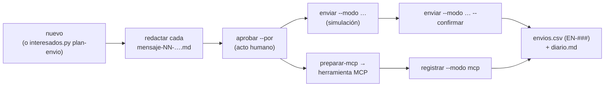

# Integraciones · pm-method 2.6.0

Qué necesita pm-method para funcionar, con qué herramientas externas puede integrarse, qué se decidió incorporar (y
qué no) y cómo agregar una integración nueva sin romper el ecosistema.

Principio rector: **el núcleo funciona sin nada externo.** Cada integración es un contrato de insumo/salida con un
**respaldo interno** (Mermaid, CSV, scripts propios). Si la herramienta externa no está o falla, la skill sigue con el
respaldo y lo anota.

---

## 1. Dependencias

Fuente: `compatibilidad.json`.

| Tipo | Dependencia | Uso | Si falta |
|---|---|---|---|
| Obligatoria | Python ≥ 3.9 | todos los scripts | no hay ejecución |
| Obligatoria | — (`dependencias.obligatorias` vacío) | el núcleo usa solo la biblioteca estándar; también la capa de canales (`smtplib`, `email`, `urllib`) | — |
| Recomendada | `pyyaml` | leer la configuración de BMAD y `sprint-status.yaml` | el puente BMAD no funciona; sanidad INS-01 |
| Recomendada | `python-docx` | exportar `.docx`, leer actas `.docx` | sin exportación Word; INS-01 |
| Recomendada | `openpyxl` | exportar `.xlsx` | sin exportación Excel; INS-01 |
| Opcional | `@mermaid-js/mermaid-cli` (`mmdc`) | Mermaid como imagen en Word | los diagramas quedan como código Mermaid |
| Opcional | Java + `mpxj` | validar o convertir MSPDI / `.mpp` | `cpm.py --mspdi` genera igual el XML |
| Opcional (marco) | BMAD Method (instalado por el equipo con `npx bmad-method@6.12.4 install …`, ver INSTALACION §4) | capa de especificación | el proveedor de la especificación es pm-method (`requisitos.md`, `backlog.csv`, `wbs.csv`) |

---

## 2. Decisiones de integración

Los candidatos provienen de un informe previo de relevamiento; la valoración en estrellas es la de ese informe.

| Candidato | Valoración | Decisión v2 | Dónde | Justificación |
|---|---|---|---|---|
| BMAD Method | — (marco) | **Integrado** como capa de especificación de solo lectura, con contrato por patrones y fachada | `pm-bmad-puente`, `especificacion.py` | Aporta lo que PRINCE2 no detalla (qué debe hacer el producto). Como sus formatos cambian en casi cada versión menor 6.x, se aísla detrás de un único lector (`bmad.py`) y una fachada (`pm-spec-index/1`): las demás skills no dependen de BMAD |
| archify (`tt-a1i/archify`, MIT, carpeta de skill; Node ≥ 18 + Chrome) | ★★★★★ | **Opcional, delegación obligatoria si está configurada**; respaldo Mermaid | `pm-visuales` | HTML interactivo validado por su propio `finalize` (esquema, entrega, navegador). Tipos útiles: `tree` (organigrama, WBS), `workflow`, `timeline`. Verificado en vivo |
| diagram-design (`cathrynlavery/diagram-design`, MIT, plugin con marketplace) | ★★★★★ | **Opcional**, igual que archify; reevaluado el 2026-10-27 (2.6.133): complementa, no sustituye | `pm-visuales` | HTML/SVG editorial con `self_check.py --offline` (fuentes del sistema, sin red); importa solo los respaldos `flowchart` (mapa poder/interés y roadmap, desde la tabla intermedia); estilo por defecto si no hay usuario. No reemplaza a los generadores deterministas (`wbs.py`, `cpm.py`, `mapas.py`, `interesados.py`, tablero, `visuales.py`): el modelo coloca el dibujo a mano. Verificado en vivo |
| visual-explainer (`nicobailon/visual-explainer`, MIT, plugin con marketplace) | ★★★★ | **Opcional** (one-pagers, roadmap comentado), igual | `pm-visuales` | Página HTML renderizada con su `kit/render.mjs`; se fuerza la ruta del proyecto (su defecto es `~/.agent/diagrams/`) |
| drawio-mcp oficial de draw.io (`jgraph/drawio-mcp`, npm `@drawio/mcp`, Apache-2.0; no confundir con el paquete npm `drawio-mcp` de otro autor) | ★★★★ | **Opcional** vía MCP | `pm-visuales` / `pm-integraciones` | Diagramas editables por el usuario; entra como capacidad MCP, no como dependencia |
| Skills oficiales docx/xlsx/pptx (`anthropics/skills`, licencia propietaria source-available; plugin `document-skills`) | ★★★★ | **Opcional, delegación obligatoria con `export=skills-office`**; respaldo `exportar.py` | `pm-exportar` | Mejor acabado Office (fórmulas recalculadas, marca BORRADOR, portada); se aceptan los nombres `docx`, `document-skills:docx` y `anthropic-skills:docx`. Sin ellas, `exportar.py` cubre `.docx`/`.xlsx` (solo CSV) y, sin `pptx`, guion Markdown. Verificado en vivo |
| Atlassian Rovo MCP, Slack MCP, Teams/Work IQ | ★★★★ | **Capacidades genéricas**, sin conector predefinido | `pm-integraciones` | Las organizaciones usan herramientas distintas; atar el paquete a un conector lo haría frágil. Se describen capacidades (tracker, docs, chat) y se resuelven con lo que haya en la sesión |
| Granola / Fireflies / Zoom / minutes (MCP) + transcripciones VTT/SRT | ★★★★ | **Fuente de transcripciones** vía MCP o archivo | `pm-reuniones` (`transcripcion.py`) | La transcripción es un insumo; el valor está en el acta y en los registros. Archivo local siempre disponible como respaldo. Zoom MCP: obtención de transcripciones **no confirmada** |
| meeting-analyzer | ★★★★ | **No incorporado** | `pm-reuniones` | Se aplican reglas de privacidad propias: clima del equipo solo agregado, con consentimiento y anonimizado; sin perfiles emocionales individuales |
| Tability MCP | ★★★ | **Opcional** para OKR | `pm-okr` | Lectura de progreso a instantánea; escritura solo con confirmación. No existe un formato estándar de OKR, por eso el registro propio es `okr.csv` |
| Perdoo MCP | — (no estaba en el informe) | **Opcional** para OKR, igual que Tability | `pm-okr` (vía `pm-integraciones`) | Servidor MCP oficial (`https://mcp.perdoo.com`, OAuth o clave de API) con `update_goal_progress`; `okr.py --propuesta-sync perdoo` prepara los check-ins sin publicar y `--marcar-publicado` registra el id externo |
| Capa de canales propia: SMTP, webhooks de Slack y Teams, `.eml` | — (decisión propia) | **Integrada** en `pm-integraciones` (`envios.py`), sin dependencias nuevas | `pm-integraciones`; la usan `pm-comunicacion-stakeholders`, `pm-reuniones`, `pm-okr` y `pm-interesados` (`plan-envio`) | Una sola vía de salida para cualquier comunicación a interesados, con aprobación humana, destinos tomados del maestro de interesados y registro de cada envío (`envios.csv`). Funciona sin conectores (SMTP, webhooks, `.eml`) y también con un conector MCP de correo o chat (`preparar-mcp` + `registrar`) |
| Operately / okr-writer | ★★★★ | **No incorporados** | `pm-okr` (`okr.py`) | Operately es una aplicación sin MCP; okr-writer, una skill externa. Se optó por OKR propio en CSV con vínculo a beneficios (B-n) y métricas de éxito (SM-n) |
| utf8proj + MPXJ | ★★★★ | utf8proj **descartado**; exportador MSPDI **propio**, validado con MPXJ; MPXJ **opcional** para `.mpp` | `pm-cronograma-estimacion` (`cpm.py --mspdi`) | utf8proj es inmaduro (v0.10.0, pre-1.0, 6 estrellas). MSPDI es un formato XML abierto (solo `UID` obligatorio en Task); el exportador propio evita la dependencia y se validó leyéndolo con MPXJ (PyPI `mpxj` 16.10.0, LGPL, requiere Java) |
| knowledge-work-plugins status-report / dashboards | ★★★★ | **No incorporado** | — | Duplica `pm-progreso-reportes` y `pm-visuales`, y generaría dos dueños para el mismo informe |
| cost-core / Monte Carlo | ★★★ | **No incorporado en v2** | — | Madurez insuficiente; candidato futuro para contingencia P50/P80 |
| gonzalezpazmonica/pm-workspace | — | **Excluido** | — | A pedido del usuario (pesado, riesgoso) |
| ShowAI (`Renaissance-Mind/ShowAI`, MIT; aplicación Electron + servidor MCP + 9 skills) | — (evaluado el 2026-10-27) | **No incorporado** | — | Requiere la aplicación de escritorio (macOS sin notarizar) o compilarla con Node 22 y 40 dependencias, y su MCP; guarda las páginas en `~/.showai`, fuera del proyecto; ofrece nube y lector por CDN. Duplicaría el dueño del tablero y del reporte, y sus diagramas son copias de diagram-design y archify, que ya se delegan. Inmaduro (pre-1.0, un autor, < 1 mes de historia) |

Referencias consultadas al 2026-10-17 que condicionan las decisiones: el servidor "Teams (preview)" de Microsoft está
marcado como legado (se recomienda Work IQ); el Slack MCP oficial (`https://mcp.slack.com/mcp`) está restringido a apps
publicadas o internas; Atlassian Rovo MCP Server requiere obtener el `cloudId` con `getAccessibleAtlassianResources`
antes de usar herramientas como `searchJiraIssuesUsingJql` o `createJiraIssue`; Operately es Apache-2.0 sin MCP;
minutes es MIT (`minutes-mcp`); phuryn/pm-skills (MIT, brainstorm-okrs) se relevó como referencia. Para OKR:
Tability (`https://mcp.tability.app/mcp`) y Perdoo (`https://mcp.perdoo.com`) tienen MCP oficial; Viva Goals se
retiró el 31/12/2025; Atlassian Goals y Asana Goals no estaban expuestos por sus MCP oficiales **[verificar]**. Fuentes en
[DEPENDENCIAS.md §7.5](DEPENDENCIAS.md).

---

## 3. Contrato de cada integración

Cada integración se declara en `estado.json.integraciones` (`estado.py integracion clave=valor`) y cumple tres reglas:
**insumo** preparado por la skill dueña, **salida** guardada en la carpeta del proyecto y **respaldo** interno.

| Integración | Clave y valor | Skill dueña | Insumo | Salida | Respaldo |
|---|---|---|---|---|---|
| BMAD | `especificacion=bmad` (+ `bmad.raiz`, `layout`, `soporte`) | `pm-bmad-puente` | artefactos de `_bmad-output/` o `docs/` (solo lectura) | derivados en `02-planificacion/especificacion/` (`inventario-bmad.json`, `requisitos-bmad.csv`, `matriz-trazabilidad-bmad.csv`, `spec-index.json`), columnas derivadas de `backlog.csv`, `03-control/reportes/avance-bmad.csv`, líneas base en `00-direccion/historial/bmad-<art>-v<ver>/`, traspasos `handoff-bmad-<fecha>-<…>.md` | `especificacion=ninguna`: `requisitos.md`, `backlog.csv`, `wbs.csv` con el mismo contrato `pm-spec-index/1` |
| Diagramas externos | `diagramas=archify\|diagram-design\|visual-explainer` (o lista por prioridad, `archify,visual-explainer`) | `pm-visuales` (invoca la skill por su nombre real: `archify`, `diagram-design[:diagram-design]`, `visual-explainer[:visual-explainer]`) | tabla intermedia + Mermaid de respaldo; candidato JSON (archify), importación del Mermaid `flowchart` o tabla intermedia, con fuentes del sistema (diagram-design), `.src.html` (visual-explainer) | `02-planificacion/visuales/<nombre>.html` (one-pager `one-pager-<fuente>.html`) o `03-control/reportes/AAAA-MM-DD-<nombre>.html`, con los subproductos del motor al lado | Mermaid, siempre conservado; nota en `diario.md` si la externa falta, no cubre el tipo o falla |
| draw.io | `diagramas=drawio` | `pm-visuales` / `pm-integraciones` | igual que el anterior, por MCP | igual | Mermaid |
| Office | `export=skills-office` | `pm-exportar` (invoca `docx`/`xlsx`/`pptx` con cualquier prefijo instalado) | contenido limpio, metadatos de portada, ruta final, marca BORRADOR | `exportados/AAAA-MM-DD-<tipo>-v<n>[-BORRADOR].<ext>` (nunca fuente de verdad) | `export=scripts`: `exportar.py` (docx/xlsx desde CSV), `paquete.py` (ZIP); sin `pptx`, guion Markdown; nota en `diario.md` |
| Cronograma MS Project | `cronograma=mspdi` | `pm-cronograma-estimacion` | `actividades.csv` (+ `wbs.csv`) | `02-planificacion/cronograma.xml` (MSPDI; copia en `exportados/`) | `cronograma=cpm`: CPM y Gantt Mermaid de `cpm.py` |
| Tracker | `tracker=jira\|linear\|github\|azure-devops` | `pm-integraciones` | consultas de lectura; vista previa para escrituras | instantánea `03-control/fuentes/<sistema>-AAAA-MM-DD.<ext>`; propuestas de cambio a registros | registros CSV (`backlog.csv`, `acciones.csv`) |
| Documentación | `docs=confluence\|notion\|sharepoint` | `pm-integraciones` | lectura de páginas; publicación con confirmación | instantánea o página publicada (id anotado) | Markdown local |
| Chat | `chat=slack\|teams` | `pm-integraciones`, `pm-comunicacion-stakeholders` | mensaje con vista previa; para interesados, mensajes aprobados de la capa de canales (§3.2) | id externo en `envios.csv` (columna `referencia`) y `diario.md` | webhook de Slack o Teams (`envios.py`); si no hay, borrador para copiar |
| Correo | `correo=ninguno\|smtp\|gmail\|outlook\|eml` (`gmail`/`outlook` = conector MCP de la organización; `smtp`/`eml` = capa de canales sin conector) | `pm-integraciones` (capa de canales), `pm-comunicacion-stakeholders` | mensajes `.md` aprobados en `03-control/comunicaciones/<fecha>-<tema>/` | `03-control/registros/envios.csv` (EN-###) y `diario.md` | `.eml` para enviar desde el cliente de correo; o borrador para copiar |
| Reuniones | `reuniones=manual\|archivo\|granola\|fireflies\|zoom\|minutes\|teams` | `pm-reuniones` | transcripción por MCP o archivo `.vtt`/`.srt`/`.txt`/`.docx` | `03-control/reuniones/` (transcripción normalizada y acta); registros solo tras confirmación de quien presidió | texto pegado o archivo |
| OKR | `okr=archivo\|tability\|perdoo` | `pm-okr` | progreso leído vía `pm-integraciones`; check-ins sin publicar de `okr.py --propuesta-sync tability\|perdoo` | `03-control/fuentes/<tability\|perdoo>-AAAA-MM-DD.csv`; check-ins en `00-direccion/okr_checkins.csv` (solo se agregan) con `publicado_en` y `ref_externa` tras `okr.py --marcar-publicado KR@FECHA --destino … --ref …` | `okr.csv` y `okr_checkins.csv` mantenidos con `okr.py --checkin` |

Reglas comunes:
- Lectura libre; **escritura externa solo con vista previa y confirmación explícita**, una vez por lote. En un
  subagente se devuelve como "decisión humana requerida".
- Instantáneas **fechadas e inmutables**; una nueva lectura crea un archivo nuevo. Se citan como fuente en los informes.
- Las diferencias entre una fuente externa y los registros se **proponen**, no se aplican en silencio; los cambios de
  alcance van a `pm-issues-cambios`.
- Nunca credenciales en la carpeta del proyecto ni en el paquete.

### 3.1 Verificación en vivo de las skills externas (2026-10-17)

Sesiones reales de Claude Code 2.1.302 (`claude -p … --plugin-dir pm-method`, harness `scripts/pruebas_vivo/vivo.py`)
sobre un proyecto de prueba con `wbs.csv`, roles, brief, presupuesto y highlight. Instalación según `INSTALACION.md` §6.1.

| Integración | Instalación probada | Pedido | Resultado |
|---|---|---|---|
| archify 3.1 | `npx skills add … -s archify` (skill del proyecto) | "Hacé el organigrama del proyecto y el diagrama de la WBS" | **Funciona.** pm-visuales → Skill `archify`; `finalize` con `validate`, `deliver`, `check` y `browser-check` en `pass`; `organigrama.html` y `wbs.html` en `02-planificacion/visuales/` con los ids de la WBS, recibos al lado y su `.md` Mermaid |
| diagram-design 2.6 | `--plugin-dir <clon>` y plugin instalado (`claude plugin install … --scope project`) | ídem / "Hacé el organigrama del proyecto" | **Funciona.** pm-visuales → Skill `diagram-design:diagram-design`; estilo por defecto sin preguntar; `self_check.py` OK; WBS de 11 nodos conservada (supera su tope sugerido de 9) |
| visual-explainer 0.12 | plugin instalado y copia del proyecto | "Hacé un one-pager visual del brief" | **Funciona.** pm-visuales → Skill `visual-explainer[:visual-explainer]`; `one-pager-project-brief.src.html` + `.html` renderizado con `kit/render.mjs` en `02-planificacion/visuales/`; nada en `~/.agent/diagrams/`. `check.mjs` no corre sin `playwright-core` |
| docx/xlsx/pptx | `npx skills add anthropics/skills -s docx xlsx pptx` | "Exportá el presupuesto a Excel y el highlight a Word"; "Exportá el highlight a PowerPoint" | **Funciona.** pm-exportar → Skills `xlsx` y `docx` (`.xlsx` con fórmulas recalculadas sin errores y hoja Notas; `.docx` con encabezado BORRADOR); para `.pptx` siguió la skill leyendo su `SKILL.md` (pptxgenjs, 5 diapositivas con BORRADOR). Todo en `exportados/` |
| Respaldo (sin ninguna skill externa; `HOME` aislado) | ninguna | los mismos pedidos | **Funciona.** Mermaid (`organigrama.md`, `wbs.md`) o plantilla `canvas-arranque.html` para el one-pager; `exportar.py` (Excel desde `linea-base-costo.csv`, Word con banda BORRADOR); nota en `diario.md` con la causa |

Reverificación del 2026-10-27 (Claude Code 2.1.311, diagram-design 2.6.133 con `--plugin-dir`): "Hacé el organigrama del
proyecto" → pm-visuales → Skill `diagram-design:diagram-design`; `organigrama.html` sin enlace a Google Fonts, `self_check.py
--offline` OK, roles vacíos como `[por confirmar]`, BORRADOR y registro `organigrama` en `borrador`, con su `.md` Mermaid.

En una primera corrida con el contrato solo declarativo, la delegación fue errática: archify sí, diagram-design y
visual-explainer no (Mermaid o HTML a mano), y las skills de Office tampoco (scripts y planilla improvisada).

### 3.2 Capa de canales: envío a interesados (`envios.py`)

Una sola vía de salida para **cualquier** comunicación a interesados: comunicados personalizados, informes (highlight,
fin de etapa), actas y recordatorios de acciones, convocatorias, decisiones de puerta y check-ins de OKR. Script:
`skills/pm-integraciones/scripts/envios.py --proyecto <dir> <comando>`; dueña `pm-integraciones`. Solo biblioteca
estándar de Python.

**Modos**

| Modo (`--modo`) | Canal del mensaje | Variables de entorno | Qué hace | Referencia que registra |
|---|---|---|---|---|
| `smtp` | `correo` | `PM_SMTP_HOST`, `PM_SMTP_REMITENTE` (obligatorias); `PM_SMTP_PUERTO` (587), `PM_SMTP_TLS` (`starttls` defecto, `ssl`, `ninguno`), `PM_SMTP_USUARIO`, `PM_SMTP_CLAVE` | un correo por destinatario | Message-ID |
| `slack-webhook` | `slack` | `PM_SLACK_WEBHOOK_URL` | publica `{"text": …}` en el canal del webhook; menciona `<@ID>` si `usuario_chat` es un id de Slack (U…/W…) | `slack-webhook HTTP <código>` |
| `teams-webhook` | `teams` | `PM_TEAMS_WEBHOOK_URL` | publica una tarjeta adaptable en el canal del flujo de Workflows; rechaza mensajes de más de 28 KB | `teams-webhook HTTP <código>` |
| `eml` | `correo` | ninguna | escribe `.eml` (`X-Unsent: 1`) en `<carpeta>/eml/`; quedan `pendiente` hasta `registrar --modo eml` | ruta del `.eml` |
| conector MCP (Gmail, Outlook, Slack, Teams conectados en la sesión) | según el conector | las del conector, en el cliente | `preparar-mcp` entrega un JSON; el agente envía con la herramienta MCP tras vista previa y confirmación; luego `registrar --modo mcp` | id que devuelva la herramienta |

Configuración de las variables y creación de los webhooks: [INSTALACION.md §0.7](INSTALACION.md).

**Flujo**

| Paso | Comando | Regla |
|---|---|---|
| 1 · Crear | `envios.py nuevo --origen <archivo> --audiencia … --asunto … [--proposito comunicado\|informe\|recordatorio\|convocatoria\|puerta\|okr\|acta\|otro] [--agrupar] [--fecha]` o `interesados.py plan-envio --tema … --audiencia …` | carpeta `03-control/comunicaciones/<fecha>-<tema>/` con un `mensaje-NN-<canal>-<st>.md` por destinatario (o grupo con `--agrupar`), con el perfil resuelto en el frontmatter, y `plan-envio.csv`; estado inicial `borrador`; audiencia inválida = no se crea nada |
| 2 · Redactar | (el agente o la persona edita el cuerpo de cada mensaje) | adaptar el contenido base al perfil de cada destinatario |
| 3 · Revisar | `envios.py estado <carpeta> [--json]` | marca los mensajes sin redactar |
| 4 · Aprobar | `envios.py aprobar <carpeta> [--mensaje <archivo> …] --por "Rol: Nombre"` | acto humano; rechaza borradores sin redactar y mensajes con destinatarios que ya no están en el maestro |
| 5 · Simular | `envios.py enviar <carpeta> --modo …` | por defecto (sin `--confirmar`): muestra destinatarios, asunto y comienzo del texto, y avisa variables faltantes; no registra nada |
| 6 · Enviar | `envios.py enviar <carpeta> --modo … --confirmar [--mensaje <archivo> …] [--fecha]` | solo mensajes aprobados cuyo canal corresponde al modo; destinos tomados del maestro en ese momento; registra `envios.csv` y `diario.md`; código de salida 2 si hubo fallos; un reintento solo alcanza a quienes no tienen fila `enviado` |
| 6b · Vía MCP | `envios.py preparar-mcp <carpeta> [--canal correo\|slack\|teams]` → herramienta conectada → `envios.py registrar <carpeta> --mensaje <archivo> --modo mcp --referencia <id> [--estado enviado\|fallido] [--nota]` | vista previa y confirmación explícita antes de usar la herramienta |
| 7 · Consultar | `envios.py historial [--stakeholder ST-…] [--json]` | — |

Comprobación de variables sin red: `envios.py verificar --modo smtp|slack-webhook|teams-webhook|eml`.

**Respaldo interno si no hay conector ni credenciales:** `--modo eml` (archivos para enviar desde el cliente de correo
habitual, luego `registrar --modo eml`) o, para chat, el texto aprobado como borrador para copiar y
`registrar --modo manual`. En todos los casos el registro en `envios.csv` es el mismo, así que la sanidad (STK-07) y
el reporte de interesados ven el historial completo.

Integridad: los destinos (`correo`, `usuario_chat`) se toman siempre de `stakeholders.csv` vigente, no del texto del
mensaje; nada sale sin mensaje `aprobado` con `aprobado_por` y sin `--confirmar`; las credenciales viven solo en
variables de entorno.

---

## 4. Control de consistencia

La sanidad (`sanidad.py`, skill `pm-sanidad`) vigila las integraciones; los hallazgos INS no bloquean puertas, pero se
informan.

| Código | Severidad | Qué controla |
|---|---|---|
| INS-01 | AVISO | módulos Python recomendados (`pyyaml`, `python-docx`, `openpyxl`) |
| INS-03 | AVISO / INFO | las skills externas declaradas (`diagramas`: archify, diagram-design, visual-explainer, también en lista; `export=skills-office`: docx, xlsx, pptx) están instaladas como skill del proyecto (en la carpeta o sus superiores), del usuario, sincronizada de claude.ai o plugin instalado (`installed_plugins.json`, respetando el alcance de proyecto); informa con qué nombre invocarlas y avisa si falta Node (o Chrome para archify). Un plugin cargado solo con `--plugin-dir` no es detectable |
| INS-05 | AVISO | presupuesto del listado de skills, incluidas las de BMAD y otros repos (umbral ≈8.000 caracteres) |
| INS-06 | AVISO | posible colisión de activación entre una skill externa y una pm-* (tres o más disparadores compartidos) |
| INT-01 | AVISO | valores de `integraciones` conocidos para `tracker`, `chat`, `correo`, `docs`, `reuniones`, `okr` y `especificacion` |
| INT-02 | AVISO | tracker declarado sin instantáneas en `03-control/fuentes/` durante la fase de entrega |
| INT-03 | AVISO | última instantánea del tracker con más de 14 días |
| INT-04 | AVISO | instantánea sin fecha en el nombre (`<sistema>-AAAA-MM-DD.<ext>`) |
| ESP-01…15 | ERROR / AVISO | especificación legible, cobertura, ids, versión de BMAD probada, carpeta fuera de BMAD, líneas base vs especificación (cambio no controlado), traspasos pendientes, derivados desactualizados |
| STK-07 | AVISO | envío de la capa de canales en estado `fallido` o `pendiente` (por ejemplo, `.eml` generado sin registrar) |
| STK-00…16 | ERROR / AVISO / INFO | integridad del maestro de interesados, cadencia de contacto y personas de usuario (detalle en [SANIDAD.md §2.1](SANIDAD.md)) |

Controles adicionales:
- **Hook `PreToolUse`** (plugin de Claude Code): impide editar a mano los derivados de la especificación y que los
  subagentes pm-* escriban en carpetas de BMAD.
- **`pm-puerta` / `pm-director`**: ninguna puerta con ERROR sin decisión humana registrada como condición.
- **`compatibilidad.json`**: declara versiones probadas de BMAD (4.x, 6.11, 6.12), integraciones externas opcionales y
  comportamiento por cliente.
- **`scripts/probar_paquete.py`**: regresión de punta a punta (372 pruebas: BMAD v6, v6.12.4 real, v4, nativo, hook guardian, ciclo de puertas, regresiones, el caso H con maestro de interesados, capa de canales contra servidores SMTP y HTTP locales y OKR, el caso I con candidatos de riesgo desde BMAD, transcripciones, una instantánea de Jira y artefactos, el caso J con los controles permanentes y el caso X con la integración cruzada; detalle en [PRUEBAS §2](PRUEBAS.md)).

Observación: INT-01 valida también `diagramas` (acepta listas de valores conocidos), `cronograma` y `export`; la instalación de las skills externas la controla INS-03.

---

## 5. Cómo agregar una integración nueva

Lista de verificación para incorporar una herramienta sin romper el ecosistema:

**Decisión**
- [ ] La necesidad no está cubierta por una skill existente (revisar `docs/colisiones.md` y `docs/CATALOGO.md`); si
      duplicaría un dueño, no se incorpora.
- [ ] Madurez y licencia evaluadas y anotadas en la tabla de §2 con su justificación.
- [ ] Se define como **capacidad** (qué hace), no como conector concreto, salvo que sea un formato de archivo.

**Contrato**
- [ ] Una sola skill dueña de la integración; las demás la consumen a través de ella.
- [ ] Insumo, salida y **respaldo interno** definidos; el flujo funciona igual si la herramienta falta.
- [ ] Salidas en la carpeta del proyecto (`03-control/fuentes/` con nombre fechado si son datos externos); nunca
      reemplazan un registro de gobierno.
- [ ] Escrituras externas solo con vista previa y confirmación; en subagentes, como decisión humana requerida.
- [ ] Sin credenciales ni `.mcp.json` en el paquete.

**Estado y validación**
- [ ] Valor nuevo en `estado.json.integraciones` documentado en `SPEC.md` §1.6 y en la tabla de capacidades de
      `pm-integraciones/references/guia.md`.
- [ ] Valor agregado a la lista de conocidos de `sanidad.py` (INT-01) y, si es una skill externa, a la comprobación de
      instalación (como INS-03).
- [ ] Si genera archivos derivados, agregarlos a la protección de `hooks/guardian.py`.
- [ ] Entrada en `compatibilidad.json` (`integraciones_externas_opcionales`).

**Activación y contexto**
- [ ] La descripción de la skill dueña sigue el formato `Objeto. Usar: … No: …→…`, ≤ 240 caracteres, y el listado
      total del paquete sigue ≤ 7.500 caracteres.
- [ ] Si se agregan disparadores, actualizar `docs/colisiones.md` y repetir la evaluación de enrutamiento
      (`docs/evaluacion/frases-enrutamiento.tsv`) con frases nuevas.
- [ ] El cuerpo de `SKILL.md` sigue dentro de ≤ 12.000 caracteres y ≤ 200 líneas; el detalle va a `references/guia.md`.

**Pruebas**
- [ ] `python3 scripts/validar_paquete.py` termina en `OK`.
- [ ] `python3 scripts/probar_paquete.py` sin fallos; si la integración tiene lógica en scripts, agregar un caso.
- [ ] `sanidad.py --informe` sobre un proyecto de prueba sin ERROR nuevos.
- [ ] Documentación actualizada: este archivo, `INSTALACION.md` §6 y `README.md`.
