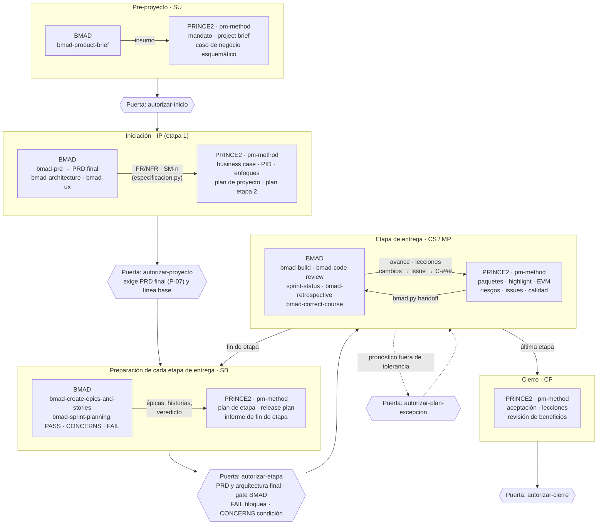
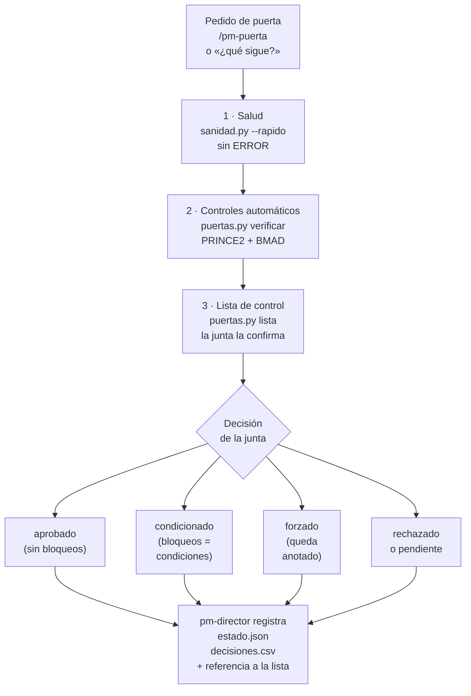

# Puertas de la junta: verificación y registro · pm-method 2.1.0

Qué se verifica en cada puerta PRINCE2, cómo se integran los controles propios de BMAD y cómo queda registrada la
decisión. EN: *board gates — health, automatic PRINCE2/BMAD checks, board checklist and decision record.*

---

## 1. Ciclo de vida integrado: PRINCE2 (gobierno) y BMAD (especificación)



| Componente | Dónde actúa en el ciclo | Cómo entra en pm-method |
|---|---|---|
| BMAD (brief, PRD, arquitectura, UX, épicas, sprint planning, build, retrospectiva, correct-course) | especificación y desarrollo del producto | solo lectura: `especificacion.py` / `bmad.py`; decisiones de vuelta con `bmad.py handoff` |
| archify · diagram-design · visual-explainer | IP y CS: organigrama, WBS, roadmap, tableros | `pm-visuales` (respaldo Mermaid) |
| Skills de Office (docx, xlsx, pptx) | puertas y cierre: documentos para la junta | `pm-exportar` (respaldo `exportar.py`, `paquete.py`) |
| MCP: Jira, Confluence, Slack, Teams, transcripciones, Tability | CS: avance, actas, comunicaciones, OKR | `pm-integraciones`, `pm-reuniones`, `pm-okr` (instantáneas en `03-control/fuentes/`) |

## 2. Cómo se verifica una puerta



Tres capas, para toda puerta de la junta salvo `decision-ad-hoc`:

1. **Salud del proyecto:** `sanidad.py --rapido` sin ERROR (estado, artefactos, registros, especificación).
2. **Controles automáticos** de la puerta (`puertas.py verificar <puerta>`): lo que PRINCE2 exige para decidir y, con
   BMAD, los controles de calidad del propio BMAD.
3. **Lista de control de la junta** (`puertas.py lista <puerta>`): preguntas de juicio (viabilidad, criterios de éxito,
   riesgos, lecciones) que confirma una persona con rol (`puertas.py confirmar <puerta> --por "Rol: Nombre"`, ítems que
   no se cumplen con `--no`, no aplicables con `--na`). Nunca la marca el modelo por su cuenta.

Severidades: **bloqueo** (impide registrar `aprobado`), **condición** (queda como observación de la puerta) y
**aviso**. Con bloqueos la junta puede corregir y volver, registrar `condicionado` (los bloqueos pasan a condiciones) o
forzar con constancia (`--forzar`). Toda decisión queda en `estado.json` (con el resultado de la verificación) y en
`decisiones.csv` (con la referencia a la lista y las observaciones). Solo `pm-director` ejecuta `estado.py puerta`,
`puertas.py confirmar` y `puertas.py preparacion-bmad`; el hook `guardian.py` lo hace cumplir.

## 3. Controles automáticos por puerta

| Puerta | Id | Control | Severidad |
|---|---|---|---|
| todas | S-… | `sanidad.py --rapido` sin ERROR | bloqueo |
| todas | — | lista de control de la junta generada y confirmada, sin ítems "no cumple" | bloqueo |
| autorizar-inicio | I-01 · I-02 | project brief registrado · ejecutivo designado | bloqueo |
| autorizar-inicio | I-03 | plan de la etapa de iniciación | condición |
| autorizar-proyecto | P-01 · P-02 | PID y business case registrados (con archivo) | bloqueo |
| autorizar-proyecto | P-03 | tolerancias de proyecto de tiempo y costo | bloqueo |
| autorizar-proyecto | P-04 | criterios de éxito definidos (beneficios B-n, métricas SM-n, enfoque de beneficios u OKR) | condición |
| autorizar-proyecto | P-05 · P-06 | junta completa (usuario y proveedor sénior) · plan de proyecto | condición |
| autorizar-proyecto | P-07 | **BMAD:** PRD en `status: final` | bloqueo |
| autorizar-proyecto | P-08 | **BMAD:** arquitectura en `final` (en iniciación alcanza con que permita estimar) | condición |
| autorizar-etapa | E-01 · E-02 | plan de la etapa a autorizar · tolerancias de etapa | bloqueo |
| autorizar-etapa | E-03 · E-04 | sin excepción abierta · informe de fin de la etapa que termina | bloqueo |
| autorizar-etapa | E-05 · E-06 | revisiones de calidad abiertas · riesgos altos sin respuesta | condición |
| autorizar-etapa | E-07 · E-08 · E-09 | **BMAD:** línea base del PRD · PRD `final` · arquitectura existente y `final` | bloqueo |
| autorizar-etapa | E-10 | **BMAD:** gate de preparación del sprint planning: FAIL bloquea, CONCERNS es condición, sin veredicto es aviso | según veredicto |
| autorizar-plan-excepcion | X-01 · X-02 | plan de excepción (bloqueo) · informe de excepción (condición) | — |
| autorizar-cierre | C-01 · C-02 | informe de fin de proyecto · registro de aceptación | bloqueo |
| autorizar-cierre | C-03 · C-04 | issues/riesgos abiertos sin recomendaciones de seguimiento · revisiones de calidad abiertas | bloqueo |
| autorizar-cierre | C-05 · C-06 | informe de lecciones · plan de revisión de beneficios | condición |

Los criterios de éxito se tratan en dos momentos: en `autorizar-proyecto` se verifica que estén **definidos** (P-04 y
la lista de control); en `autorizar-etapa` y `autorizar-cierre` la lista de control pide confirmar que se **cumplieron**
(revisiones de calidad, aceptación, beneficios logrados hasta el momento).

## 4. Controles de BMAD que pm-method lee (verificado con BMAD 6.12.4, 2026-10-17)

| Control de BMAD | Qué hace BMAD | Qué hace pm-method |
|---|---|---|
| PRD terminado (`bmad-prd`) | al cerrar el PRD pone `status: final` en su frontmatter; el modo "Validate" produce un informe con nota, sin bloquear | P-07 y E-08 leen `status` del PRD |
| Prerrequisitos de épicas (`bmad-create-epics-and-stories`, paso 1) | exige PRD y arquitectura completos (y UX si hay interfaz) antes de crear épicas | E-09 exige arquitectura `final` para autorizar la etapa |
| Gate de preparación (`bmad-sprint-planning`, intent "readiness") | responde PASS, CONCERNS o FAIL. En las tres corridas reales de verificación (dos CONCERNS y un FAIL provocado) **no escribió ningún archivo**: el veredicto queda en la conversación (y, sin interacción, en un JSON con `gate` y `findings`). Ante FAIL ofrece guardar los hallazgos en `{planning_artifacts}/implementation-readiness.md`; con PASS, en el flujo completo, genera `sprint-status.yaml` | `puertas.py preparacion-bmad --resultado PASS\|CONCERNS\|FAIL --por "Rol: Nombre" [--nota …]` registra el veredicto (lo hace pm-director con lo que informa el equipo); si existe `implementation-readiness.md` más reciente que `sprint-status.yaml` y que el último veredicto registrado, se toma como FAIL |
| Cambios de rumbo (`bmad-correct-course`, Sprint Change Proposal) | propone cambios a la especificación | `bmad.py verificar` → ESP-10/ESP-12 → issue `solicitud-cambio` → C-### → `bmad.py handoff` |

Para pedir el veredicto a BMAD: en el repositorio del producto, "Run bmad-sprint-planning with intent readiness only"
(o `/bmad-sprint-planning` y elegir verificación de preparación). Costo observado: USD 0,15–0,24 por corrida.

## 5. Insumo para los informes de avance y estado

Los controles y decisiones de las puertas alimentan el seguimiento:

| Informe | Qué toma de las puertas | Cómo |
|---|---|---|
| Highlight report (`pm-progreso-reportes`) | decisiones registradas, condiciones abiertas, observaciones de la verificación (p. ej. gate de BMAD en CONCERNS), puertas forzadas y bloqueos de la próxima puerta | `puertas.py estado --markdown` → §6 de la plantilla |
| Informe de fin de etapa (`pm-plan-etapa-y-limites`) | verificación de la próxima puerta y condiciones de las anteriores | `puertas.py verificar <puerta>` y `estado --markdown` → §6 |
| "¿Cómo venimos?" / `/pm-estado` (`pm-orquestador`) | última puerta y próxima puerta con su cantidad de bloqueos | `estado.py resumen` |
| Riesgos e issues | una condición abierta vencida o una puerta forzada se registra como riesgo o issue | `pm-riesgos` / `pm-issues-cambios` |
| Informe de fin de proyecto | historial completo de puertas y sus condiciones | `puertas.py estado --json` |

## 6. Comandos

```bash
P=--proyecto ./gestion; S=<ruta a pm-estado-proyecto/scripts>
python3 $S/puertas.py $P verificar autorizar-etapa            # bloqueos, condiciones y avisos (no escribe nada)
python3 $S/puertas.py $P estado --markdown                    # insumo de informes: puertas, condiciones, próxima puerta
python3 $S/puertas.py $P lista autorizar-etapa                # genera 00-direccion/decisiones/<fecha>-verificacion-autorizar-etapa.md
python3 $S/puertas.py $P preparacion-bmad --resultado CONCERNS --por "Arquitecto: Luis" --nota "falta UX de la bandeja"   # pm-director
python3 $S/puertas.py $P confirmar autorizar-etapa --por "Ejecutiva: Marta" --na V-06="primera etapa: sin lecciones previas"  # pm-director
python3 $S/estado.py  $P puerta autorizar-etapa --decision aprobado --por "Ejecutiva: Marta" --tol costo=10% tiempo=2sem          # pm-director
```
