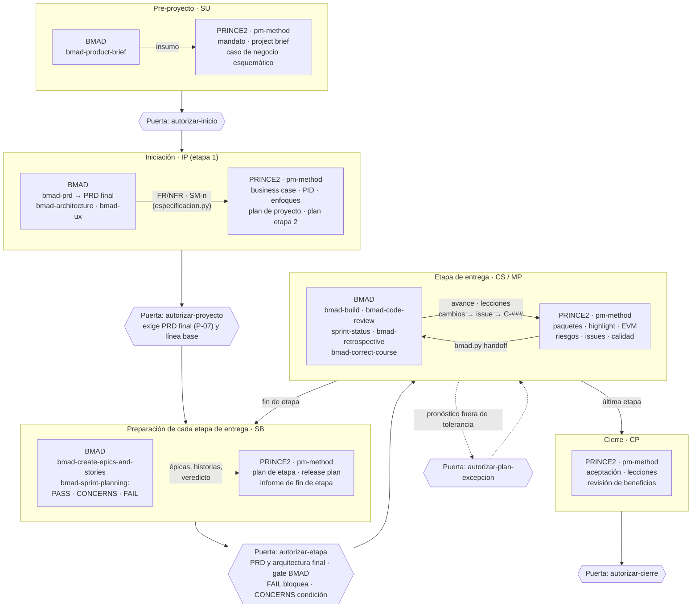
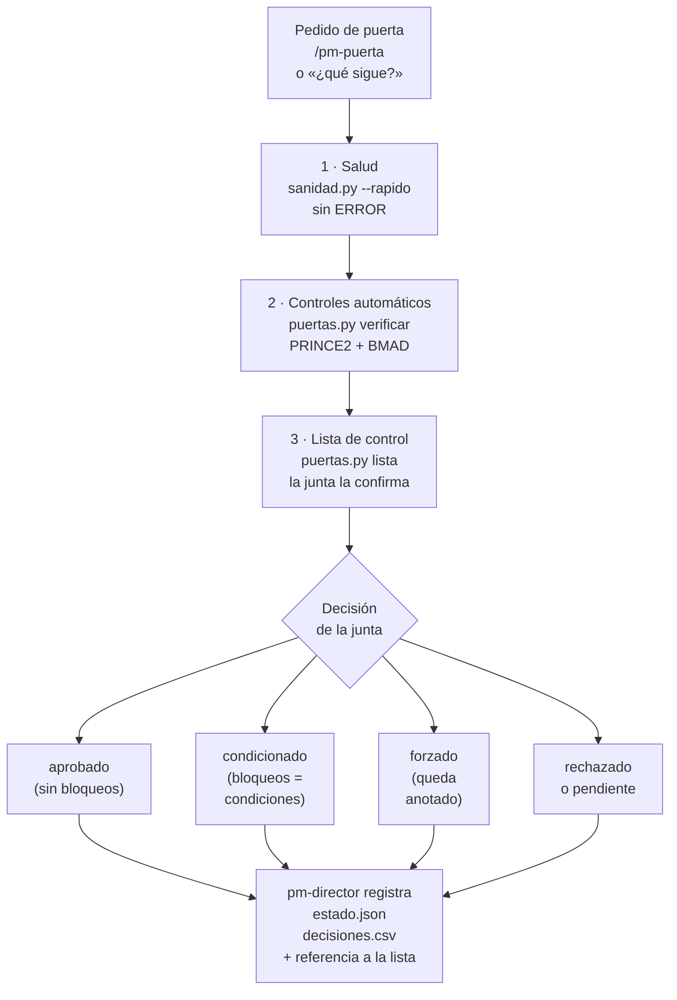

# Puertas de la junta: verificación y registro · pm-method 2.7.0

Qué se verifica en cada puerta PRINCE2, cómo se integran los controles propios de BMAD y cómo queda registrada la
decisión. EN: *board gates — health, automatic PRINCE2/BMAD checks, board checklist and decision record.*

---

## 1. Ciclo de vida integrado: PRINCE2 (gobierno) y BMAD (especificación)



| Componente | Dónde actúa en el ciclo | Cómo entra en pm-method |
|---|---|---|
| BMAD (brief, PRD, arquitectura, UX, épicas, sprint planning, build, retrospectiva, correct-course) | especificación y desarrollo del producto | solo lectura: `especificacion.py` / `bmad.py`; decisiones de vuelta con `bmad.py handoff` |
| archify · diagram-design · visual-explainer | IP y CS: organigrama, WBS, roadmap, tableros | `pm-visuales` (respaldo Mermaid) |
| Skills de Office (docx, xlsx, pptx) | puertas y cierre: documentos para la junta | `pm-exportar` (respaldo `exportar.py`, `paquete.py`) |
| MCP: Jira, Confluence, Slack, Teams, transcripciones, Tability | CS: avance, actas, comunicaciones, OKR | `pm-integraciones`, `pm-reuniones`, `pm-okr` (instantáneas en `03-control/fuentes/`) |

## 2. Cómo se verifica una puerta



Tres capas, para toda puerta de la junta salvo `decision-ad-hoc`:

1. **Salud del proyecto:** `sanidad.py --rapido` sin ERROR (estado, artefactos, registros, especificación).
2. **Controles automáticos** de la puerta (`puertas.py verificar <puerta>`): lo que PRINCE2 exige para decidir y, con
   BMAD, los controles de calidad del propio BMAD.
3. **Lista de control de la junta** (`puertas.py lista <puerta>`): preguntas de juicio (viabilidad, criterios de éxito,
   riesgos, lecciones) que confirma una persona con rol (`puertas.py confirmar <puerta> --por "Rol: Nombre"`, ítems que
   no se cumplen con `--no`, no aplicables con `--na`). Nunca la marca el modelo por su cuenta.

`puertas.py verificar <puerta>` muestra cada hallazgo con su severidad y su código de control
(`condición P-11 supuestos críticos sin validar: S-001…`); con `--json` devuelve las listas de mensajes `bloqueos`,
`condiciones` y `avisos` (sin cambios para los consumidores existentes) y además `hallazgos`, una lista de
`{severidad, id, mensaje}`. Los mensajes, la lista de control de la junta y el texto de `verificar`, `estado` y `lista`
salen en el idioma de `estado.json` (`es` o `en`); los ids de control, las severidades y las claves del JSON son los
mismos en los dos idiomas. EN: gate findings and the board checklist follow the project language; ids and JSON keys do not change.

Severidades: **bloqueo** (impide registrar `aprobado`), **condición** (queda como observación de la puerta; con
`condicionado`, pasa a condición formal) y **aviso**. Con bloqueos la junta puede corregir y volver, registrar
`condicionado` (los bloqueos pasan a condiciones) o forzar con constancia (`--forzar`). Toda decisión queda en `estado.json` (con el resultado de la verificación) y en
`decisiones.csv` (con la referencia a la lista y las observaciones). Solo `pm-director` ejecuta `estado.py puerta`,
`puertas.py confirmar` y `puertas.py preparacion-bmad`; el hook `guardian.py` lo hace cumplir.

### 2.1 Tablero congelado en cada puerta

Cada decisión de puerta (`aprobado`, `condicionado` o `rechazado`, también `decision-ad-hoc`; no `pendiente`) congela el
tablero del proyecto tal como estaba **antes** de la decisión, más la decisión misma: `estado.py puerta` calcula el
tablero (`tablero.py`, formato `pm-tablero/1`, SPEC §1.10.17) antes de aplicar la decisión y, ya registrada, escribe
`03-control/reportes/tableros/<fecha>-<puerta>-etapa-<n>.json` y su `.html` estático, con la decisión en el bloque
`instantanea` (`puerta`, `etapa`, `decision`, `decision_id`, `motivo`, `por`). El cierre prematuro (`estado.py cierre
--prematuro`, §3.2) hace lo mismo con la etiqueta «cierre prematuro». Las instantáneas se escriben con el mecanismo común
(bitácora con huella), son inmutables (el guardián impide editarlas; un cambio fuera de los scripts es BIT-02) y forman
el historial del ciclo: `tablero.py listar` y `tablero.py comparar <id> <id>|actual`. Si el congelado falla, la decisión
queda registrada igual y el script avisa: el tablero nunca frena la gobernanza. EN: every gate decision freezes the
project board as it was right before the decision, plus the decision, in `03-control/reportes/tableros/`.

## 3. Controles automáticos por puerta

| Puerta | Id | Control | Severidad |
|---|---|---|---|
| todas | S-… | `sanidad.py --rapido` sin ERROR (el id es `S-` + el código de sanidad, p. ej. `S-CAM-03`; como `registro.py` no deja aprobar un cambio sin saldo ni fuera de la autoridad delegada, S-CAM-03 aparece con cambios aprobados antes de que la junta fijara el presupuesto o con un presupuesto reducido después: [SANIDAD §1](SANIDAD.md)) | bloqueo |
| todas | L-01 · L-02 · L-03 | lista de control de la junta generada (L-01), sin ítems "no cumple" (L-02) y confirmada (L-03) | bloqueo |
| todas, con BMAD declarado | B-00 | la especificación de BMAD declarada en `integraciones.especificacion` se puede leer (si no, los controles BMAD de la puerta no se evalúan) | bloqueo |
| autorizar-proyecto · autorizar-etapa · autorizar-plan-excepcion · autorizar-cierre | G-01 | condiciones abiertas de puertas anteriores (de `condicionado`, o de `aprobado` con `--condiciones`, p. ej. `decision-ad-hoc`) | condición; **bloqueo en autorizar-cierre** |
| autorizar-inicio | I-01 · I-02 | project brief registrado · ejecutivo designado | bloqueo |
| autorizar-inicio | I-03 | plan de la etapa de iniciación | condición |
| autorizar-proyecto | P-01 · P-02 | PID y business case registrados (con archivo) | bloqueo |
| autorizar-proyecto | P-03 | tolerancias de proyecto de tiempo y costo | bloqueo |
| autorizar-proyecto | P-04 | criterios de éxito definidos: sin ninguno (beneficios B-n, métricas SM-n, enfoque de beneficios u OKR) es condición; **solo en OKR** (hay artefacto `okr`, pero el business case no menciona beneficios —ni B-n, ni SM-n, ni la palabra «beneficio»— y no hay artefacto `enfoque-beneficios*`) también es condición; con beneficios en el business case pero sin enfoque de beneficios, aviso | condición / aviso |
| autorizar-proyecto | P-05 · P-06 | junta completa (usuario y proveedor sénior) · plan de proyecto | condición |
| autorizar-proyecto | P-09 · P-10 | interesados ubicados en la matriz poder/interés · matriz RACI (`raci.csv` o artefacto `matriz-raci`) | aviso |
| autorizar-proyecto | P-11 | supuestos críticos (`criticidad=alta`) abiertos y sin validar; el que la junta acepta sin validar con una decisión de nivel `junta`, `ejecutivo` o `capa-negocio` que cita su id y dice que lo acepta ("aceptar"/"accept"; "aceptación" no cuenta) pasa a aviso y cita la D-### | condición / aviso |
| autorizar-proyecto | P-07 | **BMAD:** PRD en `status: final` | bloqueo |
| autorizar-proyecto | P-08 | **BMAD:** arquitectura en `final` (en iniciación alcanza con que permita estimar) | condición |
| autorizar-etapa | E-01 · E-02 | plan de la etapa a autorizar · tolerancias de etapa | bloqueo |
| autorizar-etapa | E-03 · E-04 | sin excepción abierta · informe de fin de la etapa que termina | bloqueo |
| autorizar-etapa | E-05 · E-06 | revisiones de calidad abiertas · riesgos altos sin respuesta | condición |
| autorizar-etapa | E-07 · E-08 · E-09 | **BMAD:** línea base del PRD · PRD `final` · arquitectura existente y `final` | bloqueo |
| autorizar-etapa | E-10 | **BMAD:** gate de preparación del sprint planning: FAIL bloquea, CONCERNS es condición (aviso si ese mismo veredicto ya fue condición de una puerta posterior a él y la condición se cumplió), sin veredicto es aviso | según veredicto |
| autorizar-etapa | E-11 | lecciones con `planificacion` en `aplicar_en` en `registrada` o `revisada` sin `accion`: el plan de la etapa no las consideró (PRINCE2 SB, revisar el registro de lecciones; lecciones incorporadas del plan). Se resuelve con `lecciones.py accionar` (cita en el plan) o `descartar` con motivo | aviso |
| autorizar-plan-excepcion | X-01 · X-02 | plan de excepción (bloqueo) · informe de excepción (condición) | — |
| autorizar-cierre | C-01 · C-02 | informe de fin de proyecto · registro de aceptación | bloqueo |
| autorizar-cierre | C-03 | cada issue y riesgo abierto **por id** en `recomendaciones-seguimiento`, en una fila de tabla con la columna Responsable o Destinatario llena (o en una línea "… Responsable: <nombre>"); lista los faltantes ("R-001 (no citado)", "I-004 (citado sin responsable)"). Sin el artefacto, lista todos los abiertos; si es un enlace externo, aviso para comprobarlo a mano (PRINCE2 CP, actividad 3: recomendaciones de seguimiento con trabajo incompleto, issues y riesgos) | bloqueo (aviso si es externo) |
| autorizar-cierre | C-04 | revisiones de calidad abiertas (en un cierre prematuro también: se completan o se cancelan) | bloqueo |
| autorizar-cierre | C-05 · C-06 | informe de lecciones · plan de revisión de beneficios | condición |
| autorizar-cierre | C-07 | **Must sin aceptar**: requisitos Must (prioridad propia o la más alta de sus historias) y historias Must cuyo estado derivado (`estado.py productos`: revisiones de `calidad.csv`, `aceptacion-<producto>`, `registro-aceptacion`, issues fuera de especificación) no es aceptado ni con concesión. `registro-aceptacion` aprobado acepta solo los productos con revisión aprobada a esa fecha (PRINCE2 CP, actividad 3, confirmar la aceptación; registro de productos A13). Regla completa: guía de `pm-paquetes-trabajo` §5 | condición; **aviso en un cierre prematuro** (§3.2) |
| autorizar-cierre, solo en un cierre prematuro | C-08 | artefacto `inventario-cierre-prematuro`: productos por estado (aprobados, en desarrollo, con concesión, no iniciados, a dejar en estado seguro, útiles para otros; guía de `pm-cierre-proyecto` §3) | bloqueo |
| autorizar-cierre, solo en un cierre prematuro con plan de excepción | C-09 | plan de excepción aprobado durante el cierre prematuro (`cierre_prematuro.plan_excepcion`, §3.2) sin completar ni cerrar: `estado.py cierre --plan-excepcion completado\|cerrado --por "<rol: nombre>"` (pm-director) | bloqueo |

Los criterios de éxito se tratan en dos momentos: en `autorizar-proyecto` se verifica que estén **definidos** (P-04 y
la lista de control); en `autorizar-etapa` y `autorizar-cierre` la lista de control pide confirmar que se **cumplieron**
(revisiones de calidad, aceptación, beneficios logrados hasta el momento). Los OKR complementan, pero no reemplazan,
los beneficios del business case: por eso P-04 pide B-n o un enfoque de beneficios con dueño y fecha de medición, que
siga vigente después del cierre (`estado.py artefacto enfoque-beneficios --ruta 00-direccion/enfoque-beneficios.md`,
plantilla de `pm-caso-de-negocio`).

### 3.1 Condiciones formales y su seguimiento (control permanente)

En la práctica, las condiciones de una puerta quedan en el acta y nadie vuelve a mirarlas. En pm-method tienen
seguimiento automático hasta que alguien con rol verifica que se cumplieron:

1. **Origen.** Al registrar `estado.py puerta <tipo> --decision condicionado`, los bloqueos y también los hallazgos de
   tipo condición de la verificación (por ejemplo, el CONCERNS del gate de preparación de BMAD, P-04 o P-06) se suman
   solos a `condiciones` de la puerta ("Condiciones agregadas desde la verificación: …"). La junta puede agregar las
   suyas con `--condiciones`; una decisión `aprobado` con `--condiciones` (p. ej. `decision-ad-hoc`) también queda con
   condiciones abiertas.
2. **Seguimiento.** Mientras estén abiertas: sanidad `EST-12` (AVISO en cada corrida, también en el hook de inicio),
   `estado.py resumen` ("Condiciones abiertas: …"), el resumen de contexto del inicio de sesión (`estado.py contexto`), `puertas.py estado` y **G-01** en la verificación de la puerta
   siguiente (condición; en `autorizar-cierre`, **bloqueo**: no se cierra un proyecto con condiciones sin verificar; o
   se cumplen o se traspasan como recomendación de seguimiento). G-01 no se vuelve a copiar como condición nueva.
3. **Cierre.** pm-director registra el cumplimiento:
   `estado.py cumplir-condiciones <tipo> --fecha AAAA-MM-DD --por "Rol: Nombre" --nota "evidencia"`. Guarda en la puerta
   `condiciones_cumplidas` (fecha), `condiciones_verificadas_por` y `condiciones_nota`; con `--por`, lo anota en
   `decisiones.csv`. Si no hay condiciones abiertas de ese tipo, falla con "No hay condiciones abiertas de <tipo>".

Ejemplo real (guía [E2E-4](guias/E2E-4-producto-bmad.md), pasos 8 y 13): el gate de preparación de BMAD en CONCERNS
("NFR-3 sin prueba de carga planificada") pasa a condición de `autorizar-etapa` el 2026-11-27; la sanidad muestra
`AVISO EST-12` en cada corte hasta que, con la prueba de carga Q-001 aprobada y el gate en PASS, la ejecutiva registra
`cumplir-condiciones autorizar-etapa --fecha 2027-03-05` y la verificación de la etapa siguiente deja de mostrar G-01.

### 3.2 Cierre prematuro (puerta autorizar-cierre por otra ruta)

PRINCE2 7 lo trata como una ruta propia del proceso de cierre: la junta lo ordena (aviso de cierre prematuro, DP → CP)
cuando no autoriza el proyecto ("si no se autoriza, el proyecto debe cerrarse prematuramente"), cuando rechaza una etapa
o un plan de excepción, o al dar dirección (p. ej. la justificación de negocio dejó de ser válida); el gestor prepara el
cierre prematuro (inventario de productos por estado, rescate de lo que tiene valor, estado seguro, brechas elevadas al
negocio) y el resto del cierre se ejecuta igual (pm-knowledge, `prince2-principios-personas-procesos.md` §4.5 y §5.7).

1. **Decisión de la junta.** pm-director la registra antes: el rechazo de la puerta (`estado.py puerta
   autorizar-proyecto|autorizar-etapa|autorizar-plan-excepcion --decision rechazado --por "<rol: nombre>" [--motivo ".."]`)
   o, fuera de una puerta, `estado.py puerta decision-ad-hoc --decision aprobado --por "<rol: nombre>" --motivo "cierre
   prematuro: <razón>"` (el motivo no deja condiciones abiertas, que G-01 bloquearía en el cierre). El aviso del rechazo
   muestra el comando con la D-### recién anotada.
2. **Entrada a CP.** `estado.py cierre --prematuro --decision D-### [--motivo ".."] [--fecha AAAA-MM-DD]`, desde la
   iniciación (IP) o una etapa de entrega (CS o SB). La D-### debe existir en `decisiones.csv` con nivel `junta`,
   `ejecutivo` o `capa-negocio`. Deja en `estado.json` `cierre_prematuro` = `{fecha, decision, motivo, desde, etapa}`
   (por defecto, la fecha y el texto de la decisión) y, si había una excepción abierta, la pasa a `cierre_prematuro.excepcion`
   y la cierra: la decisión de cerrar deja sin efecto el plan de excepción pendiente. **En el pre-proyecto no hay
   cierre**: el proyecto no existe hasta que se autoriza la iniciación (PRINCE2: autorizar la iniciación "o no iniciar";
   el proceso de dirección empieza al completarse la puesta en marcha), así que la junta registra `autorizar-inicio
   rechazado` y `cierre --prematuro` lo indica.
3. **Verificación de `autorizar-cierre`.** Con `cierre_prematuro`: **C-08** (bloqueo) exige el inventario
   `inventario-cierre-prematuro` (criterio de completitud del cierre prematuro); **C-07** pasa a **aviso**, porque
   transferir los Must sin aceptar es legítimo (se declaran en el inventario y en las recomendaciones de seguimiento);
   **C-04** sigue siendo bloqueo (cada revisión abierta se completa o se cancela con `estado=cancelada`). El resto no
   cambia: C-01 (informe de fin de proyecto, que evalúa también las razones del cierre), C-02 (registro de aceptación de
   lo entregado o transferido), C-03 (recomendaciones de seguimiento, objetivo explícito de PRINCE2 en ambas rutas),
   C-05 y C-06 (condiciones) y G-01 (bloqueo). La lista de control de la junta suma el ítem V-07 (rescate, estado seguro
   y brechas elevadas al negocio).
4. **Coherencia.** La próxima puerta es `autorizar-cierre` (`puertas.py estado`, que además devuelve `cierre_prematuro`
   y en Markdown una línea "Cierre prematuro"; `estado.py contexto`, `radar` con RAD-07 y `siguiente`, que pide el
   inventario). La sanidad no marca EST-03 para un cierre prematuro desde la iniciación (llega a CP sin
   `autorizar-proyecto` ni `autorizar-etapa`).

5. **Plan de excepción durante el cierre prematuro.** Preparar el cierre prematuro incluye acordar cómo rescatar
   productos o dejarlos en estado seguro, lo que "puede implicar trabajo adicional … que a veces requiere un plan de
   excepción"; la matriz de procesos × productos lo registra como producto posible de CP en un cierre prematuro, que
   aprueba la junta (DP), y entre los criterios de completitud está que lo que debe quedar seguro esté planificado
   (pm-knowledge, `prince2-principios-personas-procesos.md` §5.7, actividad 2 y criterios de completitud, y §5.8). Ese
   plan sirve al cierre y no reabre la entrega, así que el proyecto sigue en CP:
   - con `fase=cierre` y `cierre_prematuro`, `estado.py puerta autorizar-plan-excepcion` corresponde sin `--forzar`
     y se verifica como cualquier puerta (X-01 plan de excepción registrado, X-02, G-01 y la lista de control de la
     junta); la decisión queda en `decisiones.csv` (D-###, nivel junta);
   - aprobado o condicionado, el proyecto **sigue en `cierre`/CP**; el plan queda en
     `cierre_prematuro.plan_excepcion` = `{artefacto, decision, fecha, estado: aprobado}` (el último
     `plan-excepcion-*` registrado que no se asoció antes a un cierre) y su artefacto lleva
     `cierre_prematuro: {decision, fecha}`; rechazado, el cierre sigue y la junta puede pedir otro plan o cerrar sin él;
   - `autorizar-cierre` lo bloquea con **C-09** hasta que pm-director registra el fin del plan:
     `estado.py cierre --plan-excepcion completado|cerrado --por "<rol: nombre>" [--nota ".."] [--fecha AAAA-MM-DD]`
     (`completado`: el trabajo de rescate o de estado seguro terminó; `cerrado`: la junta lo da por terminado sin
     completarlo). Queda como decisión de nivel junta y en `plan_excepcion` (`estado`, `fecha_fin`, `por_fin`,
     `decision_fin`, `nota`); el guardián lo reserva a pm-director;
   - `siguiente` y `puertas.py estado` (Markdown: "Plan de excepción del cierre: …") muestran el plan mientras está abierto.

   Fuera de un cierre prematuro nada cambia: en un cierre planificado `autorizar-plan-excepcion` no corresponde (exige
   `--forzar`) y, aprobada así, devuelve el proyecto a entrega/CS.

## 4. Controles de BMAD que pm-method lee (verificado con BMAD 6.12.4, 2026-10-17)

| Control de BMAD | Qué hace BMAD | Qué hace pm-method |
|---|---|---|
| PRD terminado (`bmad-prd`) | al cerrar el PRD pone `status: final` en su frontmatter; el modo "Validate" produce un informe con nota, sin bloquear | P-07 y E-08 leen `status` del PRD |
| Prerrequisitos de épicas (`bmad-create-epics-and-stories`, paso 1) | exige PRD y arquitectura completos (y UX si hay interfaz) antes de crear épicas | E-09 exige arquitectura `final` para autorizar la etapa |
| Gate de preparación (`bmad-sprint-planning`, intent "readiness") | responde PASS, CONCERNS o FAIL. En las tres corridas reales de verificación (dos CONCERNS y un FAIL provocado) **no escribió ningún archivo**: el veredicto queda en la conversación (y, sin interacción, en un JSON con `gate` y `findings`). Ante FAIL ofrece guardar los hallazgos en `{planning_artifacts}/implementation-readiness.md`; con PASS, en el flujo completo, genera `sprint-status.yaml` | `puertas.py preparacion-bmad --resultado PASS\|CONCERNS\|FAIL --por "Rol: Nombre" [--nota …]` registra el veredicto (lo hace pm-director con lo que informa el equipo); si existe `implementation-readiness.md` más reciente que `sprint-status.yaml` y que el último veredicto registrado, se toma como FAIL |
| Cambios de rumbo (`bmad-correct-course`, Sprint Change Proposal) | propone cambios a la especificación | `bmad.py verificar` → ESP-10/ESP-12 → issue `solicitud-cambio` → C-### → `bmad.py handoff` |

Para pedir el veredicto a BMAD: en el repositorio del producto, "Run bmad-sprint-planning with intent readiness only"
(o `/bmad-sprint-planning` y elegir verificación de preparación). Costo observado: USD 0,15–0,24 por corrida.

## 5. Insumo para los informes de avance y estado

Los controles y decisiones de las puertas alimentan el seguimiento:

| Informe | Qué toma de las puertas | Cómo |
|---|---|---|
| Highlight report (`pm-progreso-reportes`) | decisiones registradas, condiciones abiertas (y cumplidas, con fecha), observaciones de la verificación (p. ej. gate de BMAD en CONCERNS), puertas forzadas y bloqueos, condiciones y avisos de la próxima puerta, cada uno con su código de control | `puertas.py estado --markdown` → §6 de la plantilla |
| Informe de fin de etapa (`pm-plan-etapa-y-limites`) | verificación de la próxima puerta y condiciones de las anteriores | `puertas.py verificar <puerta>` y `estado --markdown` → §6 |
| "¿Cómo venimos?" / `/pm-estado` (`pm-orquestador`) | última puerta y próxima puerta con su cantidad de bloqueos | `estado.py resumen` |
| Riesgos e issues | una condición abierta vencida o una puerta forzada se registra como riesgo o issue | `pm-riesgos` / `pm-issues-cambios` |
| Informe de fin de proyecto | historial completo de puertas y sus condiciones | `puertas.py estado --json` |
| Tablero del proyecto e historial (`pm-visuales`, portal de pm-kb) | el estado del ciclo antes de cada decisión | `tablero.py listar` y `comparar` sobre `03-control/reportes/tableros/` (§2.1) |

## 6. Comandos

```bash
P=--proyecto ./gestion; S=<ruta a pm-estado-proyecto/scripts>
python3 $S/puertas.py $P verificar autorizar-etapa            # bloqueos, condiciones y avisos con su código (no escribe nada; --json agrega hallazgos)
python3 $S/puertas.py $P estado --markdown                    # insumo de informes: puertas, condiciones, próxima puerta
python3 $S/puertas.py $P lista autorizar-etapa                # genera 00-direccion/decisiones/<fecha>-verificacion-autorizar-etapa.md
python3 $S/puertas.py $P preparacion-bmad --resultado CONCERNS --por "Arquitecto: Luis" --fecha 2026-11-26 --nota "falta UX de la bandeja"   # pm-director; --fecha también fecha la decisión
python3 $S/puertas.py $P confirmar autorizar-etapa --por "Ejecutiva: Marta" --na V-06="primera etapa: sin lecciones previas"  # pm-director
python3 $S/estado.py  $P puerta autorizar-etapa --decision aprobado --por "Ejecutiva: Marta" --tol costo=10% tiempo=2sem          # pm-director
python3 $S/estado.py  $P cumplir-condiciones autorizar-etapa --fecha 2027-03-05 --por "Ejecutiva: Marta" --nota "prueba de carga aprobada"   # pm-director
python3 $S/estado.py  $P puerta autorizar-etapa --decision rechazado --por "Ejecutiva: Marta" --motivo "la etapa 3 ya no se justifica"   # pm-director; el aviso muestra la D-###
python3 $S/estado.py  $P cierre --prematuro --decision D-012                                       # → CP con cierre_prematuro (§3.2); C-08 pide el inventario
python3 $S/estado.py  $P puerta autorizar-plan-excepcion --decision aprobado --por "Ejecutiva: Marta"   # pm-director; en el cierre prematuro sigue en CP (§3.2)
python3 $S/tablero.py $P listar                                    # instantáneas congeladas en cada puerta (§2.1)
python3 $S/tablero.py $P comparar 2026-11-27-autorizar-etapa-etapa-2 actual   # qué cambió desde esa puerta
python3 $S/estado.py  $P cierre --plan-excepcion completado --por "Ejecutiva: Marta" --nota "módulo en estado seguro"   # pm-director; levanta C-09
```
