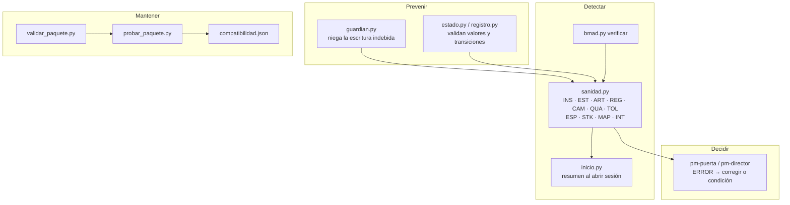

# Sanidad y controles permanentes

pm-method trabaja con datos repartidos en varios lugares: `estado.json`, nueve registros CSV base (más cinco opcionales del maestro de interesados, que se crean al primer uso), documentos Markdown, derivados de la especificación, copias congeladas y, opcionalmente, las carpetas de BMAD. Los controles de este documento evitan que esos datos se contradigan y, cuando igual pasa, lo detectan antes de que llegue a una decisión de la junta.

La referencia normativa es `SPEC.md` §1.17. Las salidas citadas son reales y salen de la corrida del [caso maestro](CASO-MAESTRO.md) del 2026-10-17.

---

## 1. Resumen de los controles

| Control | Cuándo actúa | Qué asegura | Cliente |
|---|---|---|---|
| `sanidad.py` (skill `pm-sanidad`) | al abrir sesión (modo rápido), antes de cada puerta, después de sincronizar, al actualizar pm-method o BMAD | coherencia de estado y puertas, roles, artefactos, registros, controles permanentes (cambios contra presupuestos, calidad a volumen, pronóstico contra tolerancias, supuestos críticos, revisión de riesgos vencida, cadencia de contacto con interesados), maestro de interesados, mapas de Wardley y de recorrido, ids entre capas, cobertura, líneas base frente a la especificación, traspasos pendientes, integraciones, instalación | todos |
| Hook `PreToolUse` (`hooks/guardian.py`) | en cada Write/Edit/MultiEdit/NotebookEdit y Bash | `estado.json` solo por script; registros solo por `registro.py`; derivados, copias congeladas e instantáneas no editables; subagentes pm-* sin escritura en BMAD ni comandos reservados a pm-director; confirmación de una persona para aprobar y enviar comunicaciones | Claude Code (plugin) |
| Hook `SessionStart` (`hooks/inicio.py`) | al abrir, retomar, limpiar o compactar la sesión | agrega al contexto la fase, la etapa, los ERROR de sanidad y el resumen derivado de `estado.json` y los registros (`estado.py contexto`), que prevalece sobre las notas de memoria | Claude Code (plugin) |
| Control de cambios (`registro.py`) | al dejar aprobado un cambio con `costo` > 0 (`decision=aprobado` o `estado` aprobado, implementado o cerrado), o al cambiar `costo`, `cargo` o `decidido_por` de uno aprobado | PRINCE2: si `decidido_por` no es la junta ni el ejecutivo (mismo criterio que CAM-04/CAM-05), rechaza el cambio que supera `limite_autoridad_cambio`, el que carga `presupuesto-cambio` más allá de `presupuestos.cambio` (lo ya cargado + `costo`) y el que usa `reserva-gestion` o `plan-excepcion`: queda `pendiente-decision` y se escala a pm-director. La junta o el ejecutivo aprueban sobre el límite, pero sin saldo deben indicar la fuente (`reserva-gestion`, `plan-excepcion`) o ampliar antes el presupuesto (`estado.py presupuesto cambio=… --por …`). Sin presupuesto de cambio fijado, registra con aviso. No se omite con `--forzar` | todos |
| Regla de puerta (`pm-puerta`, `pm-director`) | antes de presentar una puerta | ninguna puerta con ERROR abierto, salvo que la junta lo acepte como condición registrada | todos |
| Esquemas versionados | al leer | `estado.json` y registros migran solos; contrato `pm-spec-index/1`; `compatibilidad.json` | todos |
| `scripts/validar_paquete.py` | después de cualquier cambio del paquete | estructura, tamaños, descripciones, referencias, agentes, orquestación, hooks, versiones, compilación | mantenedor |
| `scripts/probar_paquete.py` | después de cambios del paquete o de BMAD | regresión de punta a punta: BMAD v6, BMAD v4 y sin BMAD, con sanidad sobre casos sanos y con defectos sembrados | mantenedor |



---

## 2. `sanidad.py`

```bash
python3 <pm-estado-proyecto>/scripts/sanidad.py --proyecto <dir>              # completo
python3 <pm-estado-proyecto>/scripts/sanidad.py --proyecto <dir> --rapido     # subconjunto (lo usa el hook de inicio)
python3 <pm-estado-proyecto>/scripts/sanidad.py --proyecto <dir> --informe    # además escribe 03-control/reportes/<fecha>-sanidad.md
python3 <pm-estado-proyecto>/scripts/sanidad.py --proyecto <dir> --reparar    # arreglos seguros
python3 <pm-estado-proyecto>/scripts/sanidad.py --proyecto <dir> --json
python3 <pm-estado-proyecto>/scripts/sanidad.py --proyecto <dir> --rapido --corte 2027-02-19   # controles con vencimiento a esa fecha
```

- **Salida:** una línea de resumen y una lista de hallazgos `ERROR`, `AVISO` o `INFO`, cada uno con su código, el mensaje y cómo corregirlo (`→`). **Código de salida 1 si hay algún ERROR**; eso permite usarlo en scripts y en la regla de puerta.
- **`--rapido`:** omite el inventario de skills instaladas (INS-03…06) y las integraciones (INT). Sin BMAD, también omite las comprobaciones de especificación después del índice.
- **`--corte AAAA-MM-DD`:** fecha de corte de los controles con vencimiento (por defecto, hoy): acciones vencidas (REG-07), riesgos con la revisión vencida (REG-09), revisiones de calidad vencidas (QUA-02), cortes de EVM que se toman en cuenta (TOL, solo los de fecha ≤ corte) y cadencia de contacto (STK-12). Usar la misma fecha que el informe o el tablero, para que el resultado sea reproducible.
- **`--reparar`:** solo hace dos cosas: crea o completa las columnas de los registros según el esquema v2 y reconstruye el índice de especificación. **Nunca** copia datos de negocio de un lado a otro: señala al dueño (SPEC §1.16).

### 2.1 Familias y códigos

| Código | Severidad | Qué comprueba | Corrige |
|---|---|---|---|
| **INS · instalación** | | | |
| INS-01 | AVISO | módulos Python `yaml`, `docx`, `openpyxl` | usuario: `pip install …` |
| INS-02 | AVISO | versión de pm-method con que se creó el proyecto frente a la instalada | leer notas de versión; `estado.json` migra solo |
| INS-03 | AVISO / INFO | skill externa declarada en `integraciones.diagramas` (archify, diagram-design, visual-explainer) o `export=skills-office` (docx, xlsx, pptx) instalada como skill del proyecto, del usuario, sincronizada o plugin; informa el nombre con que invocarla y avisa si falta Node (o Chrome para archify). Un plugin cargado con `--plugin-dir` no es detectable | instalarla (INSTALACION §6.1), ignorar el aviso si usa `--plugin-dir`, o volver a `mermaid` / `export=scripts` |
| INS-04 | AVISO | una skill pm-* instalada más de una vez (plugin + copia manual) | dejar una sola |
| INS-05 | AVISO | las descripciones de todas las skills visibles (incluidas BMAD y otros repositorios) superan ≈8.000 caracteres | `"skillListingBudgetFraction": 0.02` en `settings.json`, o `skillOverrides` (no aplica a skills de plugins) |
| INS-06 | AVISO | colisión de activación: una skill externa comparte ≥3 disparadores con una pm-* | ajustar descripciones u ocultar la externa |
| **EST · estado, roles y puertas** | | | |
| EST-01 | ERROR | combinación fase/proceso válida | rehacer la transición |
| EST-02…04 | ERROR | puertas que habilitan la fase (autorizar-inicio, autorizar-proyecto + autorizar-etapa, autorizar-cierre) | registrar la decisión (pm-director) |
| EST-05 | AVISO | número de etapa coherente con las puertas | `estado.py etapa` |
| EST-06 | ERROR | proyecto autorizado sin tolerancias de tiempo y costo | `estado.py tolerancia --nivel proyecto` |
| EST-07 | AVISO | etapa de entrega sin tolerancias de etapa | `estado.py tolerancia --nivel etapa` |
| EST-08…10 | ERROR | hay ejecutivo; ejecutivo ≠ gestor; el gestor no figura en aseguramiento | `pm-organizacion-roles` |
| EST-11…14 | AVISO | puertas pendientes, condiciones abiertas (EST-12: de puertas `condicionado` y también de decisiones `aprobado` con `--condiciones`, p. ej. `decision-ad-hoc`), puertas forzadas, excepción abierta | `pm-direccion-decisiones`; EST-12 → `estado.py cumplir-condiciones <tipo> --fecha … --por … --nota …` (pm-director) |
| **ART · artefactos** | | | |
| ART-01 | ERROR | el archivo registrado existe | restaurar o corregir la ruta |
| ART-02 | AVISO | aprobado con `aprobado_por` | `estado.py aprobar … --por …` |
| ART-03 | AVISO | estado en `estado.json` = estado en el frontmatter | `estado.py artefacto/aprobar` |
| ART-04 | AVISO | especificación externa registrada con huella | `bmad.py linea-base` |
| **REG · registros** | | | |
| REG-01 | ERROR | existen los 9 registros base. No aplica a los registros opcionales (`estereotipos`, `preferencias`, `raci`, `envios` y `personas`): se crean al primer uso y su ausencia no es hallazgo | `--reparar` |
| REG-02 | AVISO | columnas del esquema v2 | `--reparar` o cualquier `registro.py` |
| REG-03…05 | ERROR | ids `<prefijo>-###` válidos y únicos; valores dentro del esquema; P e I entre 1 y 5 | `registro.py` |
| REG-06 | AVISO | riesgo alto abierto sin respuesta o sin propietario | `pm-riesgos` |
| REG-07 | AVISO | acción vencida | recordatorio o replanificación |
| REG-08 | AVISO | referencias entre registros (R-, I-, C-, D-, S-, L-, ST-, Q-, A-, ET-, PF-, RC-, EN-, PU-) que existen; no revisa las lecciones con `origen` (lecciones previas de otro proyecto, que citan ids de ese proyecto) | corregir el id |
| REG-09 | AVISO | riesgo abierto (`abierto`, `en-seguimiento`, `escalado`) con `fecha_revision` anterior a la fecha de corte (`--corte`, por defecto hoy) | revisarlo con el propietario (`pm-riesgos`) y actualizar estado, evaluación y `fecha_revision` |
| REG-10 | AVISO | amenaza abierta con P×I ≥ umbral alto (`umbrales_riesgo.alto`): (a) con respuesta elegida (salvo `escalar`) y menos de dos opciones evaluadas (evaluar es comparar) en `03-control/registros/opciones-riesgo/R-###.csv`; (b) con respuesta `aceptar` o `contingencia` sin `disparador` o sin plan de contingencia (`03-control/registros/R-###-plan-contingencia.md` o una ruta `…plan-contingencia….md` citada en `notas`). PRINCE2 2.c.4 y R-10/R-12 | `pm-riesgos`: `riesgos.py opciones --riesgo R-### --proponer`, decide el propietario (`--elegir O# --por …`); `templates/plan-contingencia.md` y disparador medible |
| REG-11 | AVISO | lección de impacto alto (`impacto=alto`) en `registrada` o `revisada` sin `accion`: ni acción ni decisión de descartarla (PRINCE2 §2.2: una lección solo se aprende cuando cambia la forma de trabajar) | `pm-lecciones-aprendidas`: `lecciones.py accionar L-### --accion <A-###\|R-###\|plan-etapa-n> --verificar-en AAAA-MM-DD --por …` o `descartar --motivo` |
| REG-12 | AVISO | lección `accionada-proyecto` o `accionada-organizacion` con `verificar_en` anterior al corte, o de impacto alto accionada sin `verificar_en` | `lecciones.py verificar L-### --resultado efectiva\|no-efectiva --evidencia … --por …` o reprogramar `verificar_en` |
| **CAM · cambios contra presupuestos (control permanente)** | | se evalúa sobre los cambios con `estado` aprobado, implementado o cerrado, o con `decision=aprobado`; los presupuestos los fija la junta con `estado.py presupuesto` (`estado.json` → `presupuestos`) | |
| CAM-01 | AVISO | cambio con impacto de costo (cifra en `impacto_costo`) sin `costo` ni `cargo`, o con `costo` > 0 sin `cargo` | `registro.py actualizar cambios C-… --campo costo=<monto> --campo cargo=presupuesto-cambio\|reserva-riesgo\|reserva-gestion\|plan-excepcion` |
| CAM-02 | AVISO | `cargo=reserva-riesgo` sin citar un R-### en `descripcion`, `justificacion`, `impacto_riesgo` o `notas` | citar el riesgo que responde; si no responde a un riesgo, presupuesto de cambio o junta |
| CAM-03 | INFO / AVISO / **ERROR** | consumo del presupuesto de cambio (`cargo=presupuesto-cambio` contra `presupuestos.cambio`) y de la reserva de riesgo (`reserva-riesgo` contra `presupuestos.riesgo`): INFO < 80 %, AVISO ≥ 80 %, **ERROR > 100 %** (bloquea puertas como S-CAM-03); AVISO si se cargó sin presupuesto fijado | avisar a la junta; excedido: informe de excepción o ampliación (`estado.py presupuesto … --por`, pm-director) |
| CAM-04 | AVISO | `costo` > `limite_autoridad_cambio` y `decidido_por` no es la junta ni el ejecutivo (se reconoce por "ejecutiv", "junta", "board", "executive" o el nombre del ejecutivo) | escalar a la junta y registrar su decisión (`decision-ad-hoc`), o ajustar el límite delegado |
| CAM-05 | AVISO | `cargo=reserva-gestion` no decidido por la junta o el ejecutivo | solo la junta libera la reserva de gestión (pm-director) |
| | | **Al registrar (`registro.py`):** la autoridad delegada no puede dejar aprobado un cambio que CAM-03 (ERROR), CAM-04 o CAM-05 marcarían, ni uno con `plan-excepcion`; la junta o el ejecutivo, sin saldo, deben indicar la fuente. Regla completa en §1 | |
| **QUA · calidad a volumen (control permanente)** | | | |
| QUA-01 | AVISO | cada elemento de `02-planificacion/backlog.csv` en estado terminado (`done`, terminado, hecho, completado, cerrado, aceptado) sin una revisión de `calidad.csv` que lo cite (por id completo o por la clave corta `N-M`, p. ej. "historia 1-3") en estado `completada` con resultado `aprobado` o `aprobado-con-observaciones` | `pm-calidad`: registrar la revisión (también en lote) o reabrir el elemento |
| QUA-02 | AVISO | revisión `planificada` o `en-curso` con `fecha_prevista` anterior al corte | realizarla o replanificarla |
| QUA-03 | AVISO | revisión con resultado `rechazado` sin issue, acción o cambio que cite su Q-### | `pm-issues-cambios` (fuera de especificación) o acción correctiva |
| QUA-04 | AVISO | solo con `02-planificacion/wbs.csv` (proyectos predictivos): hoja de la WBS que no es hito aceptada (`aceptacion-<código>` aprobada) o con su paquete de trabajo recibido (decisión `nivel=gestor` "WP-### recibido\|aceptado" y descripción del WP que cita el código) sin una revisión completada y aprobada que la cite ("producto 3.1", "paquete 3.1" o "WBS 3.1"). Misma derivación que `estado.py productos` (guía de `pm-paquetes-trabajo` §5) | `pm-calidad`: registrar la revisión o revisar la aceptación o la recepción |
| **TOL · pronóstico contra tolerancias (control permanente)** | | lee el último corte guardado con `evm.py … --proyecto <dir> --guardar --corte AAAA-MM-DD` (`03-control/reportes/evm-<corte>.json`, fecha ≤ corte) | |
| TOL-01 | AVISO | el último corte pronostica excepción (`excepcion_prevista`) y no hay `excepcion_abierta` ni puerta `autorizar-plan-excepcion` posterior a ese corte | `pm-progreso-reportes`: informe de excepción; pm-director: `estado.py limite-etapa --excepcion X-###` y puerta `autorizar-plan-excepcion` |
| TOL-02 | INFO | el último corte está en ámbar (50–100 % de la tolerancia) | anticipar acciones correctivas y reportarlo en el highlight |
| TOL-03 | INFO | etapa de entrega sin corte de EVM guardado, o con el último de más de 31 días | `evm.py … --guardar --corte …` en cada período de informe |
| **SUP · supuestos críticos (control permanente)** | | se evalúa sobre `supuestos.csv` (columnas `criticidad`, `certeza`, `experimento`, `criterio`, `fecha_limite`, `evidencia`); método en la guía de `pm-mandato-y-brief` §9 | |
| SUP-01 | AVISO | supuesto abierto y sin validar, de criticidad alta, sin `experimento` o sin `fecha_limite` para validarlo | definir el experimento, el criterio para seguir y la fecha límite (`registro.py actualizar supuestos S-…`) |
| SUP-02 | AVISO | supuesto abierto y sin validar con `fecha_limite` anterior al corte | registrar la evidencia y el resultado (`validado=si\|no`) o replanificar con la junta |
| SUP-03 | AVISO | supuesto invalidado (`validado=no` o estado `invalidado`) que ningún issue, cambio, riesgo o decisión cita | revisar el business case y registrar la decisión (`pm-caso-de-negocio`, `pm-direccion-decisiones`) |
| **ESP · especificación y BMAD** | | | |
| ESP-01 | ERROR | la especificación se puede leer | `bmad.py detectar` |
| ESP-02 | INFO | índice vigente | `especificacion.py indice` o `--reparar` |
| ESP-03 | AVISO (pre-proyecto, inicio) → ERROR (entrega) | requisitos sin historia ni paquete de la WBS | planificar o retirar por control de cambios |
| ESP-04 | ERROR | ids citados en WBS, riesgos, issues, calidad, supuestos y OKR existen | corregir o tramitar cambio |
| ESP-05 | AVISO | beneficios citados por OKR existen en el business case | `pm-caso-de-negocio` / `pm-okr` |
| ESP-06 | ERROR | BMAD declarado y detectado | `bmad.py detectar --raiz` |
| ESP-07 | AVISO | versión de BMAD dentro del rango probado | `probar_paquete.py` con un fixture nuevo |
| ESP-08 | ERROR | carpeta del proyecto fuera de las carpetas de BMAD | moverla |
| ESP-09 | ERROR | el artefacto con línea base sigue existiendo | investigar y tramitar |
| **ESP-10** | **ERROR** / AVISO | especificación distinta de su línea base: **ERROR si ningún issue o cambio abierto la cita** (cambio no controlado); AVISO si ya hay uno | `pm-issues-cambios` → `handoff` → línea base nueva |
| ESP-11 | ERROR | línea base del PRD antes de las etapas de entrega | `bmad.py linea-base prd` |
| ESP-12 | AVISO | Sprint Change Proposals sin tratar | `verificar` + issue |
| ESP-13 | AVISO | traspasos a BMAD sin `estado: aplicado` | el equipo BMAD confirma |
| ESP-14 | AVISO | `requisitos-bmad.csv` coincide con el PRD vigente | `bmad.py requisitos` |
| ESP-15 | AVISO | estado de las historias en `backlog.csv` = BMAD | `bmad.py backlog` |
| **INT · integraciones MCP** | | | |
| INT-01 | AVISO | valores conocidos en `integraciones.*` | corregir o mapear en `pm-integraciones` |
| INT-02 / 03 | AVISO | tracker declarado con instantáneas en `03-control/fuentes/`, de menos de 14 días | `pm-integraciones` |
| INT-04 | AVISO | instantáneas con fecha en el nombre (`<sistema>-AAAA-MM-DD.<ext>`) | renombrar |
| **STK · maestro de interesados** | | se evalúa solo si existe alguno de `estereotipos.csv`, `preferencias.csv`, `raci.csv`, `envios.csv` o `personas.csv` (sin ellos, nada que verificar); también en `--rapido`. Lo calcula `interesados.py integridad` | |
| STK-00 | AVISO | no se pudo verificar el maestro (por ejemplo, falta `pm-interesados` junto a `pm-estado-proyecto`) | reinstalar el paquete completo |
| STK-01 | AVISO | interesado sin poder o interés: no se puede ubicar en la matriz | `registro.py actualizar stakeholders ST-… --campo poder=… --campo interes=…` |
| STK-02 | AVISO | RACI: elemento sin A, con más de un A, o la misma persona dos veces en el elemento | `registro.py actualizar raci RC-… --campo rol=…` |
| STK-03 | ERROR / AVISO | ERROR: referencia a un interesado o estereotipo inexistente (`raci`, `preferencias`, `envios`, `personas`, `stakeholders.estereotipo`) o preferencia sin `stakeholder_id`; AVISO: estereotipo retirado o correo con formato inválido | corregir la referencia o crear el interesado o estereotipo |
| STK-04 | AVISO | preferencia confirmada vencida (`vigencia_hasta`) o confirmada sin `confirmado_por` | `interesados.py confirmar PF-… --por …` o `rechazar` |
| STK-05 | INFO | preferencia propuesta sin tratar hace más de 30 días | `interesados.py confirmar` \| `rechazar` |
| STK-06 | AVISO | actor "gestionar de cerca" sin ningún rol en la RACI | asignarle A, R o C en los elementos clave |
| STK-07 | AVISO | envío en estado `fallido` o `pendiente` en `envios.csv` | `envios.py enviar` (reintento) o `registrar --estado enviado\|fallido` |
| STK-08 | AVISO | responsable de un OKR que no está en el maestro | usar el id ST-… o el nombre exacto en `okr.csv` |
| STK-09 | AVISO | elemento RACI que no existe en su fuente (especificación, OKR, WBS, actividades, decisiones); id que cita una persona de usuario y no existe en la especificación, el backlog ni la WBS, o beneficio que no figura como `B-##`/`DB-##` en el business case ni en el enfoque de beneficios | corregir el id o `tipo_elemento` |
| STK-10 | AVISO | nombre repetido en el maestro | unificar o diferenciar |
| STK-11 | AVISO / INFO | AVISO: elemento RACI sin R; INFO: sobre-consulta (más de 3 C), concentración (una persona es A en más del 40 % de los elementos, con al menos 5), A con poder bajo | revisar la RACI |
| STK-12 | AVISO | compromiso sostenido (control permanente): interesado de los cuadrantes gestionar de cerca, mantener satisfecho o mantener informado cuyo último envío `enviado` en `envios.csv` (correo, chat, reunión o llamada registrada) supera 1,5 × la frecuencia de su perfil (diaria 1, semanal 7, quincenal 14, mensual 31, trimestral 92 días); sin envío propio, cuenta desde el primer envío del proyecto. Solo corre si el proyecto registra envíos; usa la fecha de `--corte` | contactarlo según su perfil (`envios.py`, o registrar la reunión o llamada con `registro.py agregar envios --campo canal=reunion\|llamada --campo modo=manual --campo estado=enviado …`) o revisar la frecuencia acordada |
| STK-13 | AVISO | personas de usuario (solo si existe `personas.csv`): requisito o épica de prioridad Must (MoSCoW de `requisitos.md` o, sin ella, la más alta de sus historias en `backlog.csv`) que ninguna persona activa pide, usa ni aprovecha, ni directamente ni por su épica o por la épica o historia que lo contiene | mapearlo a su persona (`registro.py actualizar personas PU-… --campo usa=…`) o revisar la prioridad |
| STK-14 | AVISO | persona activa sin capacidades (`solicita`, `usa` y `beneficia` vacíos) | mapearla o retirarla (`--campo estado=retirada`) |
| STK-15 | AVISO | persona activa sin `fuente`, o con fuente distinta de `supuesto` y sin `evidencia` | declarar la fuente (entrevista, bmad-uj, encuesta, observacion, documento o supuesto) y la evidencia |
| STK-16 | AVISO | recorrido de `pm-mapas-estrategicos` cuya persona no está en `personas.csv`: `persona_id` inexistente o retirado, o, sin `persona_id`, un texto de persona que no contiene el nombre de ninguna persona registrada | registrar la persona (`interesados.py personas candidatos`) o nombrarla en el mapa (`persona_id` o su nombre) |
| **MAP · mapas de Wardley y de recorrido (solo AVISO)** | | corre si hay JSON en `02-planificacion/mapas/` (`pm-mapas-estrategicos`, `mapas.py controles`); los mapas son apoyo, no productos obligatorios, y no entran en la verificación de puertas | |
| MAP-00 | AVISO | mapa ilegible o con errores de validación (posiciones o emociones sin completar, rangos, ids, ciclos) | `mapas.py … validar` |
| MAP-01 | AVISO | componente en producto o commodity marcado `construir` sin una decisión `D-…` registrada y citada | registrar la decisión y vincularla, o cambiar a comprar o tercerizar (`pm-adquisiciones`) |
| MAP-02 | AVISO | componente con inercia sin un riesgo abierto `R-…` citado | registrar el riesgo (`pm-riesgos`) y `mapas.py … vincular <mapa> <id> --refs R-…` |
| MAP-03 | AVISO | dolor del recorrido sin tratamiento: ningún requisito (REQ, FR, NFR), historia del backlog, riesgo, issue, decisión, supuesto, cambio o revisión de calidad (Q) existente citado | tratarlo (candidatos: `mapas.py … recorrido candidatos`) y vincular el id |
| MAP-04 | AVISO | posición de un componente sin evidencia o emoción de un paso sin fuente (`[por confirmar]` o vacía) | citar la fuente o declarar el supuesto |
| MAP-05 | AVISO | id citado en un mapa que no existe en los registros o en la especificación (incluye ids retirados del PRD) | corregir la referencia o crear el elemento |

Dueños de la corrección por familia: INS → usuario o mantenedor; EST y ART → pm-director; REG → `pm-registros`, `pm-riesgos`, `pm-issues-cambios`; CAM → `pm-issues-cambios` (presupuestos, CAM-03 excedido, CAM-04 y CAM-05 → pm-director); QUA → `pm-calidad`; TOL → `pm-progreso-reportes` (excepción → pm-director); ESP → `pm-bmad-puente`, `pm-planificacion-por-productos`, `pm-issues-cambios`; STK → `pm-interesados` (STK-07 → `pm-integraciones`; STK-08 → `pm-okr`); MAP → `pm-mapas-estrategicos` (MAP-01 → `pm-adquisiciones`; MAP-02 → `pm-riesgos`); INT → `pm-integraciones`. El detalle de causas típicas está en `skills/pm-sanidad/references/guia.md`.

### 2.2 Ejemplos reales

**Proyecto sano en una etapa de entrega** (los dos avisos vienen del entorno: BMAD sin versión visible y 50 skills instaladas en la máquina):

```text
Sanidad de 'Portal de autoservicio para socios' (entrega/CS): 0 ERROR · 2 AVISO · 0 INFO
  AVISO ESP-07 Versión de BMAD version-no-visible (probadas: v4 · v6.11–v6.12).
        → Correr scripts/probar_paquete.py del paquete y revisar el inventario.
  AVISO INS-05 Las descripciones de las 50 skills visibles suman ≈13787 caracteres; el listado de Claude Code usa ≈1 % del contexto y puede recortarlas.
        → En settings.json: "skillListingBudgetFraction": 0.02, o marcar skills poco usadas como "name-only" en skillOverrides (no aplica a skills de plugins).
```

**Cambio no controlado** (el equipo BMAD agregó FR-5 al PRD después de la línea base v1.0; código de salida 1):

```text
Sanidad de 'Portal de autoservicio para socios' (entrega/CS): 2 ERROR · 3 AVISO · 1 INFO
  ERROR ESP-03 Requisitos sin cobertura (ni historia ni paquete de la WBS): FR-5.
        → Planificarlos (pm-planificacion-por-productos / pm-agil-hibrido) o retirarlos mediante control de cambios.
  ERROR ESP-10 Cambio no controlado: bmad-prd difiere de la línea base v1.0 (ids FR-5) y ningún issue/cambio abierto lo cita.
        → pm-issues-cambios: registrar solicitud-cambio (o declarar elaboración progresiva y fijar nueva línea base).
  AVISO ESP-14 requisitos-bmad.csv no coincide con el PRD vigente (desactualizado o editado).
        → bmad.py requisitos (es derivado: no se edita).
```

Informe completo generado con `--informe`: [ejemplos/informe-sanidad-cambio-no-controlado.md](ejemplos/informe-sanidad-cambio-no-controlado.md).

**Cómo evolucionó ese ERROR** a medida que se aplicó el procedimiento:

| Momento | Resultado de sanidad |
|---|---|
| FR-5 aparece en el PRD | 2 ERROR (ESP-03, ESP-10) |
| Se registra I-002 `solicitud-cambio` que cita `bmad-prd` y FR-5 | 1 ERROR (ESP-03); ESP-10 pasa a AVISO |
| Junta aprueba C-001 → `handoff` → el equipo BMAD aplica → línea base PRD y épicas v1.1 → WBS 3.7 cubre FR-5 | **0 ERROR** |

**Otros hallazgos de la misma corrida:**

```text
AVISO ART-03 business-case-esquematico: estado.json dice 'aprobado' y el documento 'en-revision'.
AVISO ESP-13 Traspaso a BMAD sin confirmar: 02-planificacion/especificacion/handoff-bmad-2026-10-17-prioridades.md.
AVISO EST-14 Excepción abierta X-001 esperando plan de excepción.
AVISO ART-02 acta-junta-2026-11-06 aprobado sin aprobado_por.
ERROR ESP-10 Cambio no controlado: bmad-epicas difiere de la línea base v1.1 (ids FR-4) y ningún issue/cambio abierto lo cita.
```

- `ART-03` apareció porque dos claves apuntaban al mismo archivo. Se corrigió congelando el esquemático en `historial/`.
- `ART-02` apareció porque un acta se registró como aprobada con `artefacto --estado aprobado` en lugar de `aprobar`. Se corrigió con `estado.py aprobar … --por`.
- El último `ESP-10` era elaboración progresiva. Lo resolvió la autoridad de cambio con I-003 y la línea base de épicas v1.2.

**Controles permanentes (corridas de referencia de las guías E2E).** Gestión por excepción en la guía
[E2E-2](guias/E2E-2-alcance-roadmap.md), paso 10 ([salida-g2.md](guias/evidencia/salida-g2.md)): la autoridad de cambio
quiere aprobar un cambio regulatorio de 15.000, con el presupuesto de cambio en 12.000 (9.000 ya cargados) y su límite
en 10.000, y un corte de EVM ágil guardado pronostica salir de la tolerancia de alcance. `registro.py` no registra la
aprobación (C-002 queda `pendiente-decision`) y la sanidad marca la excepción prevista:

```text
$ registro.py --proyecto gestion actualizar cambios C-002 --campo "decision=aprobado" --campo "estado=aprobado" --campo "decidido_por=Autoridad de cambio: Sofía Ramírez" …
Control de cambios (PRINCE2, autoridad y presupuesto de cambio; no se omite con --forzar):
  - C-002: costo 15.000 supera el límite de la autoridad de cambio (10.000).
  - C-002: el presupuesto de cambio no alcanza: 9.000 ya cargados + 15.000 = 24.000 de 12.000 fijados por la junta.
  → 'Autoridad de cambio: Sofía Ramírez' no es la junta ni el ejecutivo. Dejar estado=pendiente-decision (sin decision=aprobado) y escalar a pm-director: decide la junta o el ejecutivo.
$ sanidad.py --proyecto gestion --rapido --corte 2027-02-19
Sanidad de 'Portal de autoservicio para socios' (entrega/CS): 0 ERROR · 1 AVISO · 1 INFO
  AVISO TOL-01 El EVM del 2027-02-19 pronostica salir de la tolerancia (costo=n/a-agil, cronograma=n/a-agil, alcance=rojo) y no hay excepción abierta.
  INFO  CAM-03 Presupuesto de cambio: 9.000 de 12.000 (75 %).
```

Tras el informe de excepción, la ampliación del presupuesto de cambio a 32.000 por la ejecutiva, la aprobación de
C-002 por la junta (con saldo, después de la ampliación) y la puerta `autorizar-plan-excepcion`, la sanidad del
2027-02-26 queda en `0 ERROR` con `INFO CAM-03 Presupuesto de cambio: 24.000 de 32.000 (75 %)`. CAM-03 ERROR y CAM-04
siguen siendo necesarios para los datos que `registro.py` no controla: cambios aprobados antes de que la junta fijara el
presupuesto o el límite, o un presupuesto que la junta reduce después (caso J de `probar_paquete.py`; la regla al registrar, caso J2). En la guía [E2E-4](guias/E2E-4-producto-bmad.md), paso 12,
la sanidad del 2027-02-26 da cinco `AVISO QUA-01` (historias `done` sin revisión de calidad) y un `AVISO QUA-02` (la
prueba de carga NFR-3 que era condición de la puerta, vencida); en la [E2E-3](guias/E2E-3-interesados-okr-avance.md),
paso 13, tres `AVISO STK-12` al 2027-02-05 (por ejemplo, TI del núcleo: último contacto hace 18 días, máximo 10).

---

## 3. Hooks (Claude Code)

`hooks/hooks.json` declara los tres hooks del plugin (PreToolUse, SessionStart y UserPromptSubmit) con `${CLAUDE_PLUGIN_ROOT}`. Los hooks de plugin también se ejecutan cuando trabaja un subagente; la entrada trae `agent_type`, y así el guardián distingue a un subagente pm-* del hilo principal.

### 3.1 `guardian.py` (PreToolUse)

| Regla | Herramientas | Sobre qué | Motivo |
|---|---|---|---|
| `estado.json` no se edita | Write/Edit/MultiEdit/NotebookEdit y Bash (`sed -i`, `>`/`>>`, `tee`, `cp`/`mv`/`rm`, `open(...,'w')`, `json.dump`) | `<proyecto>/estado.json` | solo `estado.py`, `nuevo_proyecto.py` o `bmad.py`; mantiene puertas, migración y decisiones |
| Registros solo por script | ídem | los CSV de `03-control/registros/`: los 9 base y los opcionales `estereotipos.csv`, `preferencias.csv`, `raci.csv`, `envios.csv` y `personas.csv` | `registro.py` valida ids, valores y referencias (incluidas claves foráneas, RACI única y un solo A por elemento); `interesados.py` y `envios.py` también están permitidos |
| Derivados no editables | ídem | `spec-index.json`, `requisitos-bmad.csv`, `matriz-trazabilidad-bmad.csv`, `inventario-bmad.json`, `avance-bmad.csv` | se regeneran |
| Copias congeladas | ídem | `00-direccion/historial/` | se crea una versión nueva |
| Instantáneas inmutables | ídem (solo si el archivo ya existe) | `03-control/fuentes/` | se crea una instantánea nueva con fecha |
| Subagentes pm-* sin escritura en BMAD | ídem | `_bmad/`, `_bmad-output/`, `.bmad-core/` | BMAD es solo lectura; se usa `bmad.py handoff` |
| Comandos reservados a pm-director | Bash desde el hilo principal o cualquier subagente salvo pm-director | `estado.py puerta\|rol\|tolerancia\|agil\|umbrales-riesgo\|cumplir-condiciones`, `limite-etapa --excepcion`, `set --forzar`, `aprobar` sin `--nivel gestor\|product-owner\|equipo` | la junta decide y pm-director registra |

Los comandos que invocan los scripts del paquete (`estado.py`, `registro.py`, `bmad.py`, …) quedan permitidos aunque
redirijan su salida. El hilo principal **sí** puede escribir en BMAD, porque así trabajan los flujos del propio BMAD. El guardián nunca bloquea por un error propio: ante una entrada que no entiende, no decide.

Prueba manual (como en `probar_paquete.py`):

```bash
echo '{"tool_name":"Edit","tool_input":{"file_path":"<repo>/gestion/estado.json"}}' | sh <pm-method>/hooks/py.sh <pm-method>/hooks/guardian.py
```

```json
{"hookSpecificOutput": {"hookEventName": "PreToolUse", "permissionDecision": "deny", "permissionDecisionReason": "pm-method: estado.json se actualiza solo con estado.py (o nuevo_proyecto.py / bmad.py) para mantener puertas, migración y decisiones coherentes."}}
```

Resultados de la corrida:

| Entrada | Decisión |
|---|---|
| Edit de `estado.json` | deny |
| Write de `riesgos.csv` | deny ("se modifica con registro.py…") |
| Edit del PRD por `pm-method:pm-control` | deny ("los agentes de gestión no escriben en carpetas de BMAD…") |
| Bash de `pm-method:pm-planificacion`: `echo FR-6 >> _bmad-output/…/prd.md` | deny |
| Edit de `spec-index.json` | deny ("es un derivado regenerable…") |
| Edit de `00-direccion/historial/bmad-prd-v1.0/prd.md` | deny ("guarda versiones congeladas…") |
| Edit del PRD desde el hilo principal | sin decisión (permitido) |
| Write de `03-control/reportes/2027-01-13-solicitud-cambio-C-001.md` | sin decisión (permitido) |

**Límites:** los registros solo se protegen ante Write/Edit, no ante Bash del hilo principal. Las escrituras de un subagente en BMAD mediante otros intérpretes (por ejemplo, `python -c`) no coinciden con los patrones de Bash. En los dos casos, la sanidad lo detecta después (`REG-*`, `ESP-10`, `ESP-14`).

### 3.2 `inicio.py` (SessionStart)

Busca `estado.json` hasta dos niveles debajo de la carpeta de trabajo, corre `sanidad.py --rapido --json` y agrega una línea por proyecto al contexto. Si no hay proyecto, no imprime nada. Salida real con el cambio no controlado abierto:

```text
pm-method · proyecto 'Portal de autoservicio para socios' en gestion: fase entrega/CS, etapa 2; sanidad rápida 2 ERROR / 2 AVISO. Errores: ESP-03 Requisitos sin cobertura (ni historia ni paquete de la WBS): FR-5.; ESP-10 Cambio no controlado: bmad-prd difiere de la línea base v1.0 (ids FR-5) y ningún issue/cambio abierto lo cita. Antes de producir artefactos o preparar una puerta, usar pm-orquestador / pm-sanidad.
```

---

## 4. Regla de puerta

`pm-puerta` y `pm-director`, antes de presentar cualquier puerta:

1. `paquete.py listar puerta <tipo>`: productos obligatorios presentes y en `en-revision` o `aprobado`.
2. `especificacion.py resumen` y, con BMAD, `bmad.py verificar`. Si hay traspasos sin confirmar, no se propone una línea base nueva.
3. `sanidad.py`: **con un ERROR abierto, la puerta no se presenta**. Si la junta decide seguir igual, el ERROR queda como condición de la decisión y en `decisiones.csv`:

```bash
python3 <pm-estado-proyecto>/scripts/estado.py --proyecto <dir> puerta autorizar-etapa --decision condicionado \
  --por "Ejecutivo: …" --condiciones "ESP-03: FR-x sin cobertura; planificar antes del sprint 2"
```

`condicionado` avanza como aprobado y deja `EST-12` abierto hasta `estado.py cumplir-condiciones <tipo> [--fecha] [--por] [--nota]`. Con `condicionado`, los hallazgos de tipo condición de la verificación (por ejemplo, el CONCERNS del gate de preparación de BMAD, P-04 o P-06) pasan solos a condiciones formales de la puerta; mientras sigan abiertas, la verificación de las puertas siguientes muestra **G-01** (condición; **bloqueo** en `autorizar-cierre`). Detalle en [PUERTAS.md](PUERTAS.md). Un `CAM-03` excedido es ERROR y bloquea la puerta como cualquier otro. Los hallazgos `INS` no bloquean puertas, pero se informan. Un `STK-03` de severidad ERROR sí bloquea, como cualquier ERROR.

La verificación de puerta (`puertas.py`) distingue `bloqueo`, `condicion` y `aviso`, cada uno con su código de control. Sobre interesados, `autorizar-proyecto` suma dos **avisos que no bloquean**:

| Código | Cuándo | Qué hacer |
|---|---|---|
| P-09 | registro de interesados vacío, o interesados sin poder o interés (sin ubicar en la matriz poder/interés) | completar el maestro con `pm-interesados` |
| P-10 | no hay `raci.csv` ni artefacto `matriz-raci` | armar la RACI de productos y decisiones clave con `pm-interesados` |

En el caso maestro, todas las puertas se presentaron con 0 ERROR. El cambio no controlado de FR-5 llegó a dar 2 ERROR, pero se resolvió durante la etapa, antes del límite.

---

## 5. Esquemas versionados y manifiesto de compatibilidad

- **`estado.json` v2:** los proyectos creados con versiones anteriores se migran solos al leerse (`esquema.cargar_estado`). `version_paquete` queda registrada y `INS-02` avisa si difiere de la instalada.
- **Registros (`esquema.py`, 14 registros: 9 base + 5 opcionales que se crean al primer uso):** columnas, prefijos, valores permitidos, claves foráneas (`refs`), unicidad (`unico`) y un solo A por elemento RACI (`uno_por`) en un solo lugar, documentados igual en `pm-registros/templates/guia-registros.md`. Cualquier `registro.py` o `sanidad.py --reparar` agrega las columnas faltantes.
- **Contrato `pm-spec-index/1`:** lo producen el proveedor BMAD y el nativo; si cambia el esquema, la fachada reconstruye el índice (ver [sincronizacion.md](sincronizacion.md) §4.2).
- **`compatibilidad.json`:** versión del paquete (2.4.0, alineada con `.claude-plugin/plugin.json` y `esquema.py`; `validar_paquete.py` lo comprueba), esquemas, **versiones de BMAD probadas** (4.x con `docs/` y `.bmad-core`, 6.11, 6.12; relevado bmad-method 6.12.4 del 2026-10-14), conducta fuera de rango (modo degradado con aviso: correr `probar_paquete.py` y revisar el inventario antes de la siguiente puerta), Python ≥ 3.9, dependencias recomendadas y opcionales, y la conducta por cliente (Claude Code con hooks; Cowork como plugin; Hermes sin hooks).

---

## 6. Validador del paquete

```bash
python3 <pm-method>/scripts/validar_paquete.py [--estricto]
```

Comprueba:

- **skills:** frontmatter parseable; `name` igual a la carpeta; `description` de hasta 240 caracteres con "Usar:" y "No:"; encabezados obligatorios en orden; tamaño de SKILL.md (tope de 12.500 bytes y 200 líneas); referencias a `templates/`, `scripts/` y `references/` que existen; plantillas con frontmatter y `idioma` parametrizado;
- **agentes:** sin `tools` (heredan), con `disallowedTools: Agent` salvo el orquestador, frontmatter completo y referencias válidas;
- **orquestación:** toda skill invocable por el modelo figura en la tabla de enrutamiento de `pm-orquestador`;
- **hooks:** los scripts que cita `hooks.json` existen;
- **versiones:** `plugin.json` = `compatibilidad.json` = `esquema.py`;
- **compilación:** todos los `.py` compilan;
- **listado:** las descripciones de las skills invocables por el modelo suman ≤ 7.500 caracteres.

Con `--estricto`, los avisos también hacen fallar la validación. Salida actual:

```text
Skills: 39 (33 invocables por el modelo, listado 6817 caracteres) · Agentes: 6
OK
```

---

## 7. Pruebas de regresión

```bash
python3 <pm-method>/scripts/probar_paquete.py [--conservar]
```

Crea proyectos temporales y recorre los casos con los scripts reales (principales):

- **Caso A, BMAD v6 + híbrido:**
  - fachada y cobertura, WBS, CPM con MSPDI bien formado, puertas (y una fuera de orden rechazada), línea base PRD v1.0, backlog con columnas de gobierno preservadas, avance;
  - sanidad sana; cambio no controlado sembrado (ESP-10); issue que lo convierte en AVISO; `handoff`; línea base v1.1 sin ESP-10 ni ESP-03; ESP-13 por traspaso sin confirmar; id inexistente sembrado (ESP-04);
  - cinco casos del guardián; hook de inicio; límite de etapa, cierre y paquete de cierre.
- **Caso B, BMAD v4:** detección del layout `docs/` y `.bmad-core`, fachada (3 ids, 2 historias) y avance.
- **Caso C, sin BMAD:** fachada nativa (REQ-002 sin cobertura), sanidad con REQ-099 inexistente (ESP-04), EVM en modo ágil sin falsa excepción.
- **Caso H, maestro de interesados, capa de canales y OKR:** registros opcionales que no se crean en un proyecto nuevo; rechazos de `registro.py` (RACI con interesado inexistente, segundo A, fila duplicada, estereotipo inexistente); STK-09/STK-11 desde el maestro; STK-04 y ERROR STK-03 que hace fallar la sanidad; aviso P-09 de puerta sin bloquear (detalle en [PRUEBAS.md §2](PRUEBAS.md)).
- **Caso J, controles permanentes:** presupuestos de la junta (monto no numérico rechazado, comando reservado a pm-director por el hook), `costo` numérico en `cambios.csv`, CAM-01…04 con el ERROR CAM-03 al 110 % que bloquea la puerta, P-04 con criterios solo en OKR, condiciones formales desde la verificación, G-01 y `cumplir-condiciones`, QUA-01…03 a una fecha de corte, `evm.py --guardar` con TOL-01 sobre el último corte y STK-12 por cuadrante y frecuencia.
- **Caso K, validar antes de invertir:** SUP-01, SUP-02 y SUP-03 a una fecha de corte, P-11 como condición de `autorizar-proyecto` y su desaparición al validar o tratar los supuestos.
- **Caso I2, opciones de respuesta:** umbral alto de `estado.json`, plantilla que no pisa una existente, valor neto con contingencia ponderada y secundario, recomendada bajo la línea, opción inválida (código 1), PUERTA HUMANA de `--elegir` (sin `--por` o sin `--motivo` no registra), registro con `registro.py` en riesgos y decisiones, y REG-10 que aparece y desaparece con plan, disparador y opciones evaluadas.
- **Caso M, mapas estratégicos:** `bmad.py recorridos` y `capacidades` sobre el fixture real (solo lectura, BMAD sin cambios), semillas con y sin BMAD, errores de `validar` (rangos, ids, ciclos, movimiento hacia la izquierda, etapa incoherente, emoción y dos acciones en un paso), MAP-01…05 que aparecen y desaparecen al registrar y vincular, REG-09 a una fecha de corte, HTML escapado ante un nombre con `<script>`, Mermaid que pasa el lint y `mmdc` dibuja, aprobación conservada al regenerar y `bmad.py linea-base --fecha`.

- **Caso P, salidas de los scripts:** contexto de sesión sin los registros de catálogo y con REG-09, agrupación «… y 1 hallazgo más» de la sanidad, códigos de control en `puertas.py estado --markdown`, estado de una copia congelada sin front matter en `paquete.py` y MAP-03 con una historia o una revisión Q-###.
- **Caso PU, personas de usuario:** candidatas sin BMAD (recorrido) y con BMAD real (UJ-1…3, solo lectura), validación del registro opcional `personas.csv`, STK-09, STK-13…16 que aparecen y se resuelven al mapear, priorización por MoSCoW y beneficios, y `recorrido semilla --persona PU-###`.
- **Caso RD, inteligencia de reuniones:** `extraccion.py candidatos` sobre un VTT con decisión tomada (nivel gestor por el rol del hablante), dos pendientes (junta nombrada y sin indicio), dos compromisos (primera persona con «el viernes» → fecha resuelta; «Diego se encarga» → Diego Ferreira), un supuesto, un riesgo vía `riesgos.py` y una instrucción incrustada (IN); nada registrado al proponer; `registrar` rechaza todo si se confirma la IN, una acción sin fecha o una decisión de junta; registra lo confirmado con origen `[hh:mm:ss]` y quién confirmó, no duplica al repetir, marca el riesgo como posible duplicado en la segunda pasada, pide volver a proponer si la transcripción cambió; marcadores en inglés con resumen en inglés.
- **Caso IM, análisis de impacto:** `impacto.py analizar` reproduce las cifras de la guía E2E-2 (C-001: 112 → 123 días, reserva 13,0 → 2,0, 9.000 de 12.000, VAN 39.776 → 45.939, decide la autoridad de cambio; C-002: 200 % del presupuesto, sobre el límite, etapa fuera de ±10 %, Must en peligro, VAN 30.939, decide la junta y se recomienda plan de excepción), con los mismos motivos con que `registro.py` rechaza la aprobación delegada; borrador de solicitud sin escribir registros.
- **Caso LC, ciclo de las lecciones:** retrospectiva (tipo por el nombre) con lecciones candidatas y acciones de mejora y sin decisiones de gobierno, reunión de seguimiento que solo propone la lección marcada, registro rechazado sin recomendación, `aplicar_en` validado y normalizado (REG-05 ante un valor forzado), REG-11 en la sanidad y en Decidir del radar, E-11 en `autorizar-etapa`, REG-12 al vencer `verificar_en` y en Vigilar, verificación efectiva y no efectiva, descarte con motivo, informe de lecciones con exportación al índice y `buscar --para descubrimiento` desde el proyecto siguiente.
- **Caso PS, estado de productos y cierre por id:** `estado.py productos` sobre una WBS sin backlog (hojas sin hitos, conteos que suman el total, estado con su Q-###, `--corte` que deja afuera la revisión posterior), QUA-04 por un elemento aceptado sin revisión aprobada, issue fuera de especificación que trata el rechazo, C-03 por id (sin recomendaciones, con destinatario o «Responsable:», citado sin responsable y no citado), C-07 con requisitos Must de `requisitos.md`; con backlog, alcance por WP-### y por release, paquete recibido sin revisión, `registro-aceptacion` que acepta solo lo aprobado y el borrador del product status account (`--markdown`).
- **Caso AU, expediente de auditoría:** `paquete.py auditoria` con índice MD y HTML escapado, cronología (puerta con su D-### y lista confirmada, aprobación, envío por id de interesado), línea base idéntica, sanidad al corte y paquetes de puerta citados por huella; `verificar` OK y con un registro alterado o un archivo agregado (código 1); período que omite filas y archivos fuera de rango, `--externo` sin `stakeholders.csv` ni destinos y ruta externa excluida.

Resultado al 2026-10-22: **353 OK · 0 FALLO** con Python 3.13 (352 con 3.9); todos los casos figuran en [PRUEBAS.md §2](PRUEBAS.md).

Para adoptar una versión nueva de BMAD, se agrega un fixture con artefactos reales de esa versión en `scripts/pruebas/fixtures/`, se ajusta el caso correspondiente y, si pasa, se actualiza `compatibilidad.json.bmad.probado`.

---

## 8. Hermes Agent (sin hooks)

Hermes no tiene un equivalente documentado de PreToolUse ni de SessionStart, así que la prevención automática no existe y todo descansa en la detección:

- `pm-orquestador` ejecuta `sanidad.py --rapido` al empezar a trabajar sobre un proyecto (cumple el papel de `inicio.py`).
- `pm-puerta` ejecuta la sanidad completa y aplica la regla de puerta.
- Lo que en Claude Code niega el guardián aparece después como hallazgo: edición manual de registros (`REG-02…05`, `REG-08`), derivados editados (`ESP-14`), estado del frontmatter distinto de `estado.json` (`ART-03`), cambios en BMAD sin issue (`ESP-10`).
- La sanidad semanal puede programarse con el planificador de tareas de Hermes (verificar la sintaxis vigente en su documentación).

---

## 9. Rutina de mantenimiento

### 9.1 Después de actualizar BMAD (`npx bmad-method@<versión> install`; probado con 6.12.4)

1. Leer las notas de versión de BMAD: cambios de carpetas, nombres de archivo, formato de ids o de `sprint-status.yaml`.
2. En cada proyecto, **antes** de volver a detectar, anotar los traspasos pendientes (`estado.json.integraciones.bmad.handoffs` sin `aplicado`). `bmad.py detectar` reemplaza ese bloque y los pierde (defecto conocido, `bmad.py` línea 303).
3. `python3 <pm-bmad-puente>/scripts/bmad.py --proyecto <dir> detectar`: revisar `layout` y `soporte`.
4. `bmad.py inventario` y `bmad.py verificar`: el inventario debe encontrar los mismos artefactos; un `desvio` sin cambio real de contenido indica que cambió el formato, no el alcance (se trata con el equipo antes de fijar una línea base nueva).
5. `sanidad.py --proyecto <dir> --informe`: sin ESP-01, ESP-06 ni ESP-09; ESP-07 si la versión queda fuera del rango probado.
6. Mantenedor: fixture nuevo en `scripts/pruebas/fixtures/`, `probar_paquete.py` en verde y `compatibilidad.json` actualizado.

### 9.2 Después de cambiar el paquete pm-method

1. `python3 <pm-method>/scripts/validar_paquete.py --estricto` → `OK`.
2. `python3 <pm-method>/scripts/probar_paquete.py` → 0 FALLO.
3. Si cambió `esquema.py`: actualizar `pm-registros/templates/guia-registros.md` en el mismo acto y comprobar que `sanidad.py --reparar` migra un proyecto existente.
4. Si cambió el contrato del índice: subir la versión de `pm-spec-index` y la de `compatibilidad.json`.
5. Alinear la versión en `plugin.json`, `compatibilidad.json` y `esquema.py`; reinstalar o actualizar el plugin (`claude plugin install …`) y abrir una sesión sobre un proyecto para ver el resumen de `inicio.py`.
6. Revisar `INS-04` (duplicados plugin + copia manual) en las máquinas de los usuarios.

### 9.3 Semanal, en cada proyecto activo

| Paso | Comando | Qué mirar |
|---|---|---|
| 1 | `sanidad.py --proyecto <dir> --informe --corte <fecha>` | 0 ERROR; avisos con dueño; controles permanentes CAM, QUA, TOL y STK-12 |
| 2 | `bmad.py --proyecto <dir> verificar` (con BMAD) | sin desvíos no tratados; propuestas de cambio convertidas en issues |
| 3 | `bmad.py backlog` y `bmad.py avance --corte <fecha>` | ESP-15 en cero; una fila por fecha en `avance-bmad.csv` |
| 4 | `registro.py resumen --corte <fecha>` | acciones vencidas (REG-07), riesgos altos sin respuesta (REG-06) |
| 4b | `evm.py … --proyecto <dir> --guardar --corte <fecha>` (en cada período de informe) | corte guardado: TOL-01/02 vigilan el pronóstico; sin corte, TOL-03 |
| 5 | traspasos en `integraciones.bmad.handoffs` | ninguno sin `aplicado` por más de un período (ESP-13) → acción en `acciones.csv` |
| 6 | instantáneas en `03-control/fuentes/` | menos de 14 días (INT-03) si hay tracker |
| 7 | convertir cada ERROR que requiere trabajo en acción | `registro.py agregar acciones … --campo responsable=…` |

---

## 10. Limitaciones conocidas de esta versión

Observadas al correr el caso maestro el 2026-10-17. No se corrigieron porque el paquete no se modificó.

| Archivo:línea | Efecto | Mitigación |
|---|---|---|
| `skills/pm-bmad-puente/scripts/bmad.py:303` | `detectar` reemplaza `integraciones.bmad` completo: se pierden `handoffs`, `propuestas_vistas` y `ultimo_handoff_prioridades`, y ESP-13 y ESP-12 dejan de reflejar la realidad | anotar traspasos pendientes antes de re-detectar (§9.1) |
| `skills/pm-bmad-puente/scripts/bmad.py:568` | dos `handoff` de prioridades el mismo día escriben el mismo archivo | confirmar el primero antes de emitir el segundo |
| `skills/pm-estado-proyecto/scripts/registro.py:120` | con un `--proyecto` sin `estado.json`, crea `03-control/registros/<registro>.csv` y sus carpetas en esa ruta | comprobar la ruta; la sanidad del proyecto real no lo ve |
| `skills/pm-estado-proyecto/scripts/especificacion.py:39` | la huella incluye la ruta tal como se escribió: reconstrucciones extra y `ESP-02` INFO de más | usar siempre la misma forma de ruta |
| `skills/pm-bmad-puente/scripts/bmad.py:446` | la decisión de línea base siempre queda con `nivel=junta` y la fecha de ejecución (no hay `--fecha`) | aclarar en el acta quién decidió y cuándo |
| `bmad.py:468`, `evm.py`, `okr.py` | `verificar` sin líneas base dice "coincide con las líneas base registradas"; `TCPI_bac -0.000` al 100 %; un KR sin mediciones sale rojo | leer con criterio |
