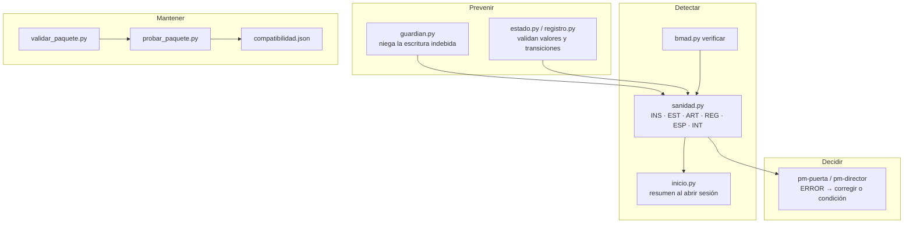

# Sanidad y controles permanentes

pm-method trabaja con datos repartidos en varios lugares: `estado.json`, nueve registros CSV, documentos Markdown, derivados de la especificación, copias congeladas y, opcionalmente, las carpetas de BMAD. Los controles de este documento evitan que esos datos se contradigan y, cuando igual pasa, lo detectan antes de que llegue a una decisión de la junta.

La referencia normativa es `SPEC.md` §1.17. Las salidas citadas son reales y salen de la corrida del [caso maestro](CASO-MAESTRO.md) del 2026-10-17.

---

## 1. Resumen de los controles

| Control | Cuándo actúa | Qué asegura | Cliente |
|---|---|---|---|
| `sanidad.py` (skill `pm-sanidad`) | al abrir sesión (modo rápido), antes de cada puerta, después de sincronizar, al actualizar pm-method o BMAD | coherencia de estado y puertas, roles, artefactos, registros, ids entre capas, cobertura, líneas base frente a la especificación, traspasos pendientes, integraciones, instalación | todos |
| Hook `PreToolUse` (`hooks/guardian.py`) | en cada Write/Edit/MultiEdit/NotebookEdit y Bash | `estado.json` solo por script; registros solo por `registro.py`; derivados y copias congeladas no editables; subagentes pm-* sin escritura en BMAD | Claude Code (plugin) |
| Hook `SessionStart` (`hooks/inicio.py`) | al abrir, retomar, limpiar o compactar la sesión | agrega al contexto la fase, la etapa y los ERROR de sanidad | Claude Code (plugin) |
| Regla de puerta (`pm-puerta`, `pm-director`) | antes de presentar una puerta | ninguna puerta con ERROR abierto, salvo que la junta lo acepte como condición registrada | todos |
| Esquemas versionados | al leer | `estado.json` y registros migran solos; contrato `pm-spec-index/1`; `compatibilidad.json` | todos |
| `scripts/validar_paquete.py` | después de cualquier cambio del paquete | estructura, tamaños, descripciones, referencias, agentes, orquestación, hooks, versiones, compilación | mantenedor |
| `scripts/probar_paquete.py` | después de cambios del paquete o de BMAD | regresión de punta a punta: BMAD v6, BMAD v4 y sin BMAD, con sanidad sobre casos sanos y con defectos sembrados | mantenedor |



---

## 2. `sanidad.py`

```bash
python3 <pm-estado-proyecto>/scripts/sanidad.py --proyecto <dir>              # completo
python3 <pm-estado-proyecto>/scripts/sanidad.py --proyecto <dir> --rapido     # subconjunto (lo usa el hook de inicio)
python3 <pm-estado-proyecto>/scripts/sanidad.py --proyecto <dir> --informe    # además escribe 03-control/reportes/<fecha>-sanidad.md
python3 <pm-estado-proyecto>/scripts/sanidad.py --proyecto <dir> --reparar    # arreglos seguros
python3 <pm-estado-proyecto>/scripts/sanidad.py --proyecto <dir> --json
```

- **Salida:** una línea de resumen y una lista de hallazgos `ERROR`, `AVISO` o `INFO`, cada uno con su código, el mensaje y cómo corregirlo (`→`). **Código de salida 1 si hay algún ERROR**; eso permite usarlo en scripts y en la regla de puerta.
- **`--rapido`:** omite el inventario de skills instaladas (INS-03…06) y las integraciones (INT). Sin BMAD, también omite las comprobaciones de especificación después del índice.
- **`--reparar`:** solo hace dos cosas: crea o completa las columnas de los registros según el esquema v2 y reconstruye el índice de especificación. **Nunca** copia datos de negocio de un lado a otro: señala al dueño (SPEC §1.16).

### 2.1 Familias y códigos

| Código | Severidad | Qué comprueba | Corrige |
|---|---|---|---|
| **INS · instalación** | | | |
| INS-01 | AVISO | módulos Python `yaml`, `docx`, `openpyxl` | usuario: `pip install …` |
| INS-02 | AVISO | versión de pm-method con que se creó el proyecto frente a la instalada | leer notas de versión; `estado.json` migra solo |
| INS-03 | AVISO / INFO | skill externa declarada en `integraciones.diagramas` (archify, diagram-design, visual-explainer) instalada | instalarla o volver a `mermaid` |
| INS-04 | AVISO | una skill pm-* instalada más de una vez (plugin + copia manual) | dejar una sola |
| INS-05 | AVISO | las descripciones de todas las skills visibles (incluidas BMAD y otros repositorios) superan ≈8.000 caracteres | `"skillListingBudgetFraction": 0.02` en `settings.json`, o `skillOverrides` (no aplica a skills de plugins) |
| INS-06 | AVISO | colisión de activación: una skill externa comparte ≥3 disparadores con una pm-* | ajustar descripciones u ocultar la externa |
| **EST · estado, roles y puertas** | | | |
| EST-01 | ERROR | combinación fase/proceso válida | rehacer la transición |
| EST-02…04 | ERROR | puertas que habilitan la fase (autorizar-inicio, autorizar-proyecto + autorizar-etapa, autorizar-cierre) | registrar la decisión (pm-director) |
| EST-05 | AVISO | número de etapa coherente con las puertas | `estado.py etapa` |
| EST-06 | ERROR | proyecto autorizado sin tolerancias de tiempo y costo | `estado.py tolerancia --nivel proyecto` |
| EST-07 | AVISO | etapa de entrega sin tolerancias de etapa | `estado.py tolerancia --nivel etapa` |
| EST-08…10 | ERROR | hay ejecutivo; ejecutivo ≠ gestor; el gestor no figura en aseguramiento | `pm-organizacion-roles` |
| EST-11…14 | AVISO | puertas pendientes, condiciones abiertas, puertas forzadas, excepción abierta | `pm-direccion-decisiones` |
| **ART · artefactos** | | | |
| ART-01 | ERROR | el archivo registrado existe | restaurar o corregir la ruta |
| ART-02 | AVISO | aprobado con `aprobado_por` | `estado.py aprobar … --por …` |
| ART-03 | AVISO | estado en `estado.json` = estado en el frontmatter | `estado.py artefacto/aprobar` |
| ART-04 | AVISO | especificación externa registrada con huella | `bmad.py linea-base` |
| **REG · registros** | | | |
| REG-01 | ERROR | existen los 9 registros | `--reparar` |
| REG-02 | AVISO | columnas del esquema v2 | `--reparar` o cualquier `registro.py` |
| REG-03…05 | ERROR | ids `<prefijo>-###` válidos y únicos; valores dentro del esquema; P e I entre 1 y 5 | `registro.py` |
| REG-06 | AVISO | riesgo alto abierto sin respuesta o sin propietario | `pm-riesgos` |
| REG-07 | AVISO | acción vencida | recordatorio o replanificación |
| REG-08 | AVISO | referencias entre registros (R-, I-, C-, D-, S-, L-, ST-, Q-, A-) que existen | corregir el id |
| **ESP · especificación y BMAD** | | | |
| ESP-01 | ERROR | la especificación se puede leer | `bmad.py detectar` |
| ESP-02 | INFO | índice vigente | `especificacion.py indice` o `--reparar` |
| ESP-03 | AVISO (pre-proyecto, inicio) → ERROR (entrega) | requisitos sin historia ni paquete de la WBS | planificar o retirar por control de cambios |
| ESP-04 | ERROR | ids citados en WBS, riesgos, issues, calidad, supuestos y OKR existen | corregir o tramitar cambio |
| ESP-05 | AVISO | beneficios citados por OKR existen en el business case | `pm-caso-de-negocio` / `pm-okr` |
| ESP-06 | ERROR | BMAD declarado y detectado | `bmad.py detectar --raiz` |
| ESP-07 | AVISO | versión de BMAD dentro del rango probado | `probar_paquete.py` con un fixture nuevo |
| ESP-08 | ERROR | carpeta del proyecto fuera de las carpetas de BMAD | moverla |
| ESP-09 | ERROR | el artefacto con línea base sigue existiendo | investigar y tramitar |
| **ESP-10** | **ERROR** / AVISO | especificación distinta de su línea base: **ERROR si ningún issue o cambio abierto la cita** (cambio no controlado); AVISO si ya hay uno | `pm-issues-cambios` → `handoff` → línea base nueva |
| ESP-11 | ERROR | línea base del PRD antes de las etapas de entrega | `bmad.py linea-base prd` |
| ESP-12 | AVISO | Sprint Change Proposals sin tratar | `verificar` + issue |
| ESP-13 | AVISO | traspasos a BMAD sin `estado: aplicado` | el equipo BMAD confirma |
| ESP-14 | AVISO | `requisitos-bmad.csv` coincide con el PRD vigente | `bmad.py requisitos` |
| ESP-15 | AVISO | estado de las historias en `backlog.csv` = BMAD | `bmad.py backlog` |
| **INT · integraciones MCP** | | | |
| INT-01 | AVISO | valores conocidos en `integraciones.*` | corregir o mapear en `pm-integraciones` |
| INT-02 / 03 | AVISO | tracker declarado con instantáneas en `03-control/fuentes/`, de menos de 14 días | `pm-integraciones` |
| INT-04 | AVISO | instantáneas con fecha en el nombre (`<sistema>-AAAA-MM-DD.<ext>`) | renombrar |

Dueños de la corrección por familia: INS → usuario o mantenedor; EST y ART → pm-director; REG → `pm-registros`, `pm-riesgos`, `pm-issues-cambios`; ESP → `pm-bmad-puente`, `pm-planificacion-por-productos`, `pm-issues-cambios`; INT → `pm-integraciones`. El detalle de causas típicas está en `skills/pm-sanidad/references/guia.md`.

### 2.2 Ejemplos reales

**Proyecto sano en una etapa de entrega** (los dos avisos vienen del entorno: BMAD sin versión visible y 50 skills instaladas en la máquina):

```text
Sanidad de 'Portal de autoservicio para socios' (entrega/CS): 0 ERROR · 2 AVISO · 0 INFO
  AVISO ESP-07 Versión de BMAD version-no-visible (probadas: v4 · v6.11–v6.12).
        → Correr scripts/probar_paquete.py del paquete y revisar el inventario.
  AVISO INS-05 Las descripciones de las 50 skills visibles suman ≈13787 caracteres; el listado de Claude Code usa ≈1 % del contexto y puede recortarlas.
        → En settings.json: "skillListingBudgetFraction": 0.02, o marcar skills poco usadas como "name-only" en skillOverrides (no aplica a skills de plugins).
```

**Cambio no controlado** (el equipo BMAD agregó FR-5 al PRD después de la línea base v1.0; código de salida 1):

```text
Sanidad de 'Portal de autoservicio para socios' (entrega/CS): 2 ERROR · 3 AVISO · 1 INFO
  ERROR ESP-03 Requisitos sin cobertura (ni historia ni paquete de la WBS): FR-5.
        → Planificarlos (pm-planificacion-por-productos / pm-agil-hibrido) o retirarlos mediante control de cambios.
  ERROR ESP-10 Cambio no controlado: bmad-prd difiere de la línea base v1.0 (ids FR-5) y ningún issue/cambio abierto lo cita.
        → pm-issues-cambios: registrar solicitud-cambio (o declarar elaboración progresiva y fijar nueva línea base).
  AVISO ESP-14 requisitos-bmad.csv no coincide con el PRD vigente (desactualizado o editado).
        → bmad.py requisitos (es derivado: no se edita).
```

Informe completo generado con `--informe`: [ejemplos/informe-sanidad-cambio-no-controlado.md](ejemplos/informe-sanidad-cambio-no-controlado.md).

**Cómo evolucionó ese ERROR** a medida que se aplicó el procedimiento:

| Momento | Resultado de sanidad |
|---|---|
| FR-5 aparece en el PRD | 2 ERROR (ESP-03, ESP-10) |
| Se registra I-002 `solicitud-cambio` que cita `bmad-prd` y FR-5 | 1 ERROR (ESP-03); ESP-10 pasa a AVISO |
| Junta aprueba C-001 → `handoff` → el equipo BMAD aplica → línea base PRD y épicas v1.1 → WBS 3.7 cubre FR-5 | **0 ERROR** |

**Otros hallazgos de la misma corrida:**

```text
AVISO ART-03 business-case-esquematico: estado.json dice 'aprobado' y el documento 'en-revision'.
AVISO ESP-13 Traspaso a BMAD sin confirmar: 02-planificacion/especificacion/handoff-bmad-2026-10-17-prioridades.md.
AVISO EST-14 Excepción abierta X-001 esperando plan de excepción.
AVISO ART-02 acta-junta-2026-11-06 aprobado sin aprobado_por.
ERROR ESP-10 Cambio no controlado: bmad-epicas difiere de la línea base v1.1 (ids FR-4) y ningún issue/cambio abierto lo cita.
```

- `ART-03` apareció porque dos claves apuntaban al mismo archivo. Se corrigió congelando el esquemático en `historial/`.
- `ART-02` apareció porque un acta se registró como aprobada con `artefacto --estado aprobado` en lugar de `aprobar`. Se corrigió con `estado.py aprobar … --por`.
- El último `ESP-10` era elaboración progresiva. Lo resolvió la autoridad de cambio con I-003 y la línea base de épicas v1.2.

---

## 3. Hooks (Claude Code)

`hooks/hooks.json` declara los dos hooks del plugin con `${CLAUDE_PLUGIN_ROOT}`. Los hooks de plugin también se ejecutan cuando trabaja un subagente; la entrada trae `agent_type`, y así el guardián distingue a un subagente pm-* del hilo principal.

### 3.1 `guardian.py` (PreToolUse)

| Regla | Herramientas | Sobre qué | Motivo |
|---|---|---|---|
| `estado.json` no se edita | Write/Edit/MultiEdit/NotebookEdit | `<proyecto>/estado.json` | solo `estado.py`, `nuevo_proyecto.py` o `bmad.py`; mantiene puertas, migración y decisiones |
| Registros solo por script | Write/Edit/MultiEdit | los 9 CSV de `03-control/registros/` | `registro.py` valida ids, valores y referencias |
| Derivados no editables | Write/Edit… | `spec-index.json`, `requisitos-bmad.csv`, `matriz-trazabilidad-bmad.csv`, `inventario-bmad.json`, `avance-bmad.csv` | se regeneran |
| Copias congeladas | Write/Edit… | `00-direccion/historial/` | se crea una versión nueva |
| Subagentes pm-* sin escritura en BMAD | Write/Edit… y Bash (redirección, `tee`, `sed -i`, `rm`, `mv`, `cp`) | `_bmad/`, `_bmad-output/`, `.bmad-core/` | BMAD es solo lectura; se usa `bmad.py handoff` |

El hilo principal **sí** puede escribir en BMAD, porque así trabajan los flujos del propio BMAD. El guardián nunca bloquea por un error propio: ante una entrada que no entiende, no decide.

Prueba manual (como en `probar_paquete.py`):

```bash
echo '{"tool_name":"Edit","tool_input":{"file_path":"<repo>/gestion/estado.json"}}' | python3 <pm-method>/hooks/guardian.py
```

```json
{"hookSpecificOutput": {"hookEventName": "PreToolUse", "permissionDecision": "deny", "permissionDecisionReason": "pm-method: estado.json se actualiza solo con estado.py (o nuevo_proyecto.py / bmad.py) para mantener puertas, migración y decisiones coherentes."}}
```

Resultados de la corrida:

| Entrada | Decisión |
|---|---|
| Edit de `estado.json` | deny |
| Write de `riesgos.csv` | deny ("se modifica con registro.py…") |
| Edit del PRD por `pm-method:pm-control` | deny ("los agentes de gestión no escriben en carpetas de BMAD…") |
| Bash de `pm-method:pm-planificacion`: `echo FR-6 >> _bmad-output/…/prd.md` | deny |
| Edit de `spec-index.json` | deny ("es un derivado regenerable…") |
| Edit de `00-direccion/historial/bmad-prd-v1.0/prd.md` | deny ("guarda versiones congeladas…") |
| Edit del PRD desde el hilo principal | sin decisión (permitido) |
| Write de `03-control/reportes/2027-01-13-solicitud-cambio-C-001.md` | sin decisión (permitido) |

**Límites:** los registros solo se protegen ante Write/Edit, no ante Bash del hilo principal. Las escrituras de un subagente en BMAD mediante otros intérpretes (por ejemplo, `python -c`) no coinciden con los patrones de Bash. En los dos casos, la sanidad lo detecta después (`REG-*`, `ESP-10`, `ESP-14`).

### 3.2 `inicio.py` (SessionStart)

Busca `estado.json` hasta dos niveles debajo de la carpeta de trabajo, corre `sanidad.py --rapido --json` y agrega una línea por proyecto al contexto. Si no hay proyecto, no imprime nada. Salida real con el cambio no controlado abierto:

```text
pm-method · proyecto 'Portal de autoservicio para socios' en gestion: fase entrega/CS, etapa 2; sanidad rápida 2 ERROR / 2 AVISO. Errores: ESP-03 Requisitos sin cobertura (ni historia ni paquete de la WBS): FR-5.; ESP-10 Cambio no controlado: bmad-prd difiere de la línea base v1.0 (ids FR-5) y ningún issue/cambio abierto lo cita. Antes de producir artefactos o preparar una puerta, usar pm-orquestador / pm-sanidad.
```

---

## 4. Regla de puerta

`pm-puerta` y `pm-director`, antes de presentar cualquier puerta:

1. `paquete.py listar puerta <tipo>`: productos obligatorios presentes y en `en-revision` o `aprobado`.
2. `especificacion.py resumen` y, con BMAD, `bmad.py verificar`. Si hay traspasos sin confirmar, no se propone una línea base nueva.
3. `sanidad.py`: **con un ERROR abierto, la puerta no se presenta**. Si la junta decide seguir igual, el ERROR queda como condición de la decisión y en `decisiones.csv`:

```bash
python3 <pm-estado-proyecto>/scripts/estado.py --proyecto <dir> puerta autorizar-etapa --decision condicionado \
  --por "Ejecutivo: …" --condiciones "ESP-03: FR-x sin cobertura; planificar antes del sprint 2"
```

`condicionado` avanza como aprobado y deja `EST-12` abierto hasta `estado.py cumplir-condiciones <tipo>`. Los hallazgos `INS` no bloquean puertas, pero se informan.

En el caso maestro, todas las puertas se presentaron con 0 ERROR. El cambio no controlado de FR-5 llegó a dar 2 ERROR, pero se resolvió durante la etapa, antes del límite.

---

## 5. Esquemas versionados y manifiesto de compatibilidad

- **`estado.json` v2:** los proyectos creados con versiones anteriores se migran solos al leerse (`esquema.cargar_estado`). `version_paquete` queda registrada y `INS-02` avisa si difiere de la instalada.
- **Registros (`esquema.py` v2):** columnas, prefijos y valores permitidos en un solo lugar, documentados igual en `pm-registros/templates/guia-registros.md`. Cualquier `registro.py` o `sanidad.py --reparar` agrega las columnas faltantes.
- **Contrato `pm-spec-index/1`:** lo producen el proveedor BMAD y el nativo; si cambia el esquema, la fachada reconstruye el índice (ver [sincronizacion.md](sincronizacion.md) §4.2).
- **`compatibilidad.json`:** versión del paquete (2.0.0, alineada con `.claude-plugin/plugin.json` y `esquema.py`; `validar_paquete.py` lo comprueba), esquemas, **versiones de BMAD probadas** (4.x con `docs/` y `.bmad-core`, 6.11, 6.12; relevado bmad-method 6.12.4 del 2026-10-14), conducta fuera de rango (modo degradado con aviso: correr `probar_paquete.py` y revisar el inventario antes de la siguiente puerta), Python ≥ 3.9, dependencias recomendadas y opcionales, y la conducta por cliente (Claude Code con hooks; Cowork como plugin; Hermes sin hooks).

---

## 6. Validador del paquete

```bash
python3 <pm-method>/scripts/validar_paquete.py [--estricto]
```

Comprueba:

- **skills:** frontmatter parseable; `name` igual a la carpeta; `description` de hasta 240 caracteres con "Usar:" y "No:"; encabezados obligatorios en orden; tamaño de SKILL.md (tope de 12.500 bytes y 200 líneas); referencias a `templates/`, `scripts/` y `references/` que existen; plantillas con frontmatter y `idioma` parametrizado;
- **agentes:** sin `tools` (heredan), con `disallowedTools: Agent` salvo el orquestador, frontmatter completo y referencias válidas;
- **orquestación:** toda skill invocable por el modelo figura en la tabla de enrutamiento de `pm-orquestador`;
- **hooks:** los scripts que cita `hooks.json` existen;
- **versiones:** `plugin.json` = `compatibilidad.json` = `esquema.py`;
- **compilación:** todos los `.py` compilan;
- **listado:** las descripciones de las skills invocables por el modelo suman ≤ 7.500 caracteres.

Con `--estricto`, los avisos también hacen fallar la validación. Salida actual:

```text
Skills: 37 (31 invocables por el modelo, listado 6160 caracteres) · Agentes: 6
OK
```

---

## 7. Pruebas de regresión

```bash
python3 <pm-method>/scripts/probar_paquete.py [--conservar]
```

Crea proyectos temporales y recorre tres casos con los scripts reales:

- **Caso A, BMAD v6 + híbrido:**
  - fachada y cobertura, WBS, CPM con MSPDI bien formado, puertas (y una fuera de orden rechazada), línea base PRD v1.0, backlog con columnas de gobierno preservadas, avance;
  - sanidad sana; cambio no controlado sembrado (ESP-10); issue que lo convierte en AVISO; `handoff`; línea base v1.1 sin ESP-10 ni ESP-03; ESP-13 por traspaso sin confirmar; id inexistente sembrado (ESP-04);
  - cinco casos del guardián; hook de inicio; límite de etapa, cierre y paquete de cierre.
- **Caso B, BMAD v4:** detección del layout `docs/` y `.bmad-core`, fachada (3 ids, 2 historias) y avance.
- **Caso C, sin BMAD:** fachada nativa (REQ-002 sin cobertura), sanidad con REQ-099 inexistente (ESP-04), EVM en modo ágil sin falsa excepción.

Resultado actual: **35 OK · 0 FALLO**.

Para adoptar una versión nueva de BMAD, se agrega un fixture con artefactos reales de esa versión en `scripts/pruebas/fixtures/`, se ajusta el caso correspondiente y, si pasa, se actualiza `compatibilidad.json.bmad.probado`.

---

## 8. Hermes Agent (sin hooks)

Hermes no tiene un equivalente documentado de PreToolUse ni de SessionStart, así que la prevención automática no existe y todo descansa en la detección:

- `pm-orquestador` ejecuta `sanidad.py --rapido` al empezar a trabajar sobre un proyecto (cumple el papel de `inicio.py`).
- `pm-puerta` ejecuta la sanidad completa y aplica la regla de puerta.
- Lo que en Claude Code niega el guardián aparece después como hallazgo: edición manual de registros (`REG-02…05`, `REG-08`), derivados editados (`ESP-14`), estado del frontmatter distinto de `estado.json` (`ART-03`), cambios en BMAD sin issue (`ESP-10`).
- La sanidad semanal puede programarse con el planificador de tareas de Hermes (verificar la sintaxis vigente en su documentación).

---

## 9. Rutina de mantenimiento

### 9.1 Después de actualizar BMAD (`npx bmad-method install` u otra versión)

1. Leer las notas de versión de BMAD: cambios de carpetas, nombres de archivo, formato de ids o de `sprint-status.yaml`.
2. En cada proyecto, **antes** de volver a detectar, anotar los traspasos pendientes (`estado.json.integraciones.bmad.handoffs` sin `aplicado`). `bmad.py detectar` reemplaza ese bloque y los pierde (defecto conocido, `bmad.py` línea 303).
3. `python3 <pm-bmad-puente>/scripts/bmad.py --proyecto <dir> detectar`: revisar `layout` y `soporte`.
4. `bmad.py inventario` y `bmad.py verificar`: el inventario debe encontrar los mismos artefactos; un `desvio` sin cambio real de contenido indica que cambió el formato, no el alcance (se trata con el equipo antes de fijar una línea base nueva).
5. `sanidad.py --proyecto <dir> --informe`: sin ESP-01, ESP-06 ni ESP-09; ESP-07 si la versión queda fuera del rango probado.
6. Mantenedor: fixture nuevo en `scripts/pruebas/fixtures/`, `probar_paquete.py` en verde y `compatibilidad.json` actualizado.

### 9.2 Después de cambiar el paquete pm-method

1. `python3 <pm-method>/scripts/validar_paquete.py --estricto` → `OK`.
2. `python3 <pm-method>/scripts/probar_paquete.py` → 0 FALLO.
3. Si cambió `esquema.py`: actualizar `pm-registros/templates/guia-registros.md` en el mismo acto y comprobar que `sanidad.py --reparar` migra un proyecto existente.
4. Si cambió el contrato del índice: subir la versión de `pm-spec-index` y la de `compatibilidad.json`.
5. Alinear la versión en `plugin.json`, `compatibilidad.json` y `esquema.py`; reinstalar o actualizar el plugin (`claude plugin install …`) y abrir una sesión sobre un proyecto para ver el resumen de `inicio.py`.
6. Revisar `INS-04` (duplicados plugin + copia manual) en las máquinas de los usuarios.

### 9.3 Semanal, en cada proyecto activo

| Paso | Comando | Qué mirar |
|---|---|---|
| 1 | `sanidad.py --proyecto <dir> --informe` | 0 ERROR; avisos con dueño |
| 2 | `bmad.py --proyecto <dir> verificar` (con BMAD) | sin desvíos no tratados; propuestas de cambio convertidas en issues |
| 3 | `bmad.py backlog` y `bmad.py avance --corte <fecha>` | ESP-15 en cero; una fila por fecha en `avance-bmad.csv` |
| 4 | `registro.py resumen --corte <fecha>` | acciones vencidas (REG-07), riesgos altos sin respuesta (REG-06) |
| 5 | traspasos en `integraciones.bmad.handoffs` | ninguno sin `aplicado` por más de un período (ESP-13) → acción en `acciones.csv` |
| 6 | instantáneas en `03-control/fuentes/` | menos de 14 días (INT-03) si hay tracker |
| 7 | convertir cada ERROR que requiere trabajo en acción | `registro.py agregar acciones … --campo responsable=…` |

---

## 10. Limitaciones conocidas de esta versión

Observadas al correr el caso maestro el 2026-10-17. No se corrigieron porque el paquete no se modificó.

| Archivo:línea | Efecto | Mitigación |
|---|---|---|
| `skills/pm-bmad-puente/scripts/bmad.py:303` | `detectar` reemplaza `integraciones.bmad` completo: se pierden `handoffs`, `propuestas_vistas` y `ultimo_handoff_prioridades`, y ESP-13 y ESP-12 dejan de reflejar la realidad | anotar traspasos pendientes antes de re-detectar (§9.1) |
| `skills/pm-bmad-puente/scripts/bmad.py:568` | dos `handoff` de prioridades el mismo día escriben el mismo archivo | confirmar el primero antes de emitir el segundo |
| `skills/pm-estado-proyecto/scripts/registro.py:120` | con un `--proyecto` sin `estado.json`, crea `03-control/registros/<registro>.csv` y sus carpetas en esa ruta | comprobar la ruta; la sanidad del proyecto real no lo ve |
| `skills/pm-estado-proyecto/scripts/especificacion.py:39` | la huella incluye la ruta tal como se escribió: reconstrucciones extra y `ESP-02` INFO de más | usar siempre la misma forma de ruta |
| `skills/pm-bmad-puente/scripts/bmad.py:446` | la decisión de línea base siempre queda con `nivel=junta` y la fecha de ejecución (no hay `--fecha`) | aclarar en el acta quién decidió y cuándo |
| `bmad.py:468`, `evm.py`, `okr.py` | `verificar` sin líneas base dice "coincide con las líneas base registradas"; `TCPI_bac -0.000` al 100 %; un KR sin mediciones sale rojo | leer con criterio |
