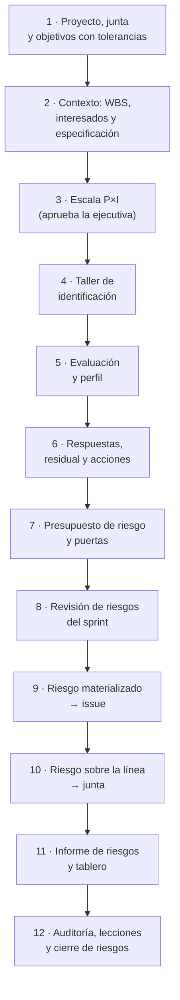
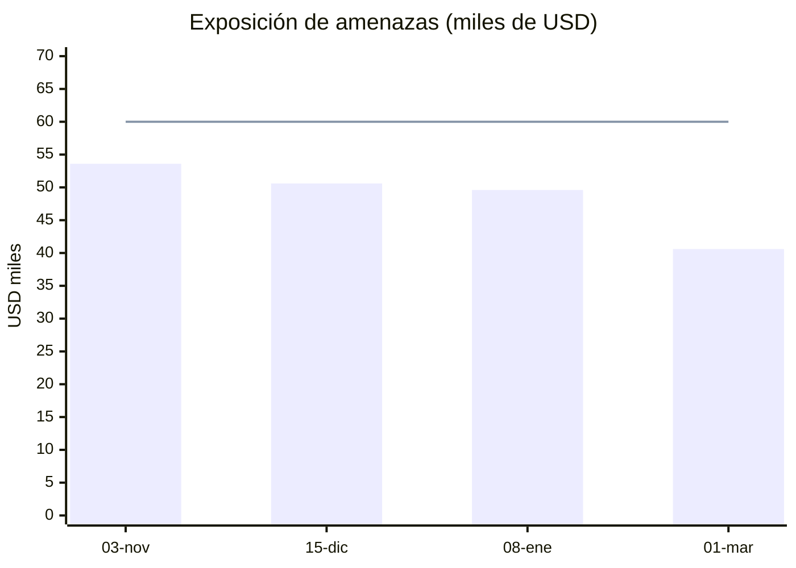
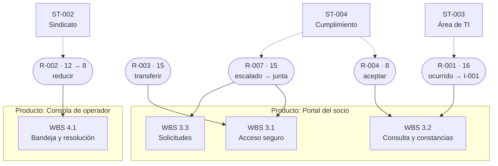

# Guía E2E-1 · Ciclo completo de gestión de riesgos

**Qué vas a probar:** el ciclo de riesgos de PRINCE2 7 (identificar, evaluar, planificar, implementar, comunicar) con
las técnicas del PMBOK 8 (P×I, valor monetario esperado), con cada riesgo **ligado a un producto, a un paquete de la
WBS, a un interesado y a requisitos o decisiones de arquitectura de BMAD**; el presupuesto de riesgo; el seguimiento
por sprint; un riesgo que se materializa en issue; un escalamiento a la junta; el informe, la auditoría y las lecciones.

**Skills y agentes:** pm-orquestador · pm-inicio y pm-control → `pm-riesgos`, `pm-registros`, `pm-issues-cambios`,
`pm-planificacion-por-productos`, `pm-organizacion-roles`, `pm-progreso-reportes`, `pm-visuales`,
`pm-lecciones-aprendidas`, `pm-exportar` · `pm-director` (decisiones de la junta).

**Duración:** 60–90 minutos. **Preparación:** [README de las guías](README.md#cómo-usar-las-guías) (copia del fixture en
`~/proyectos-prueba/portal-e2e-1` y `claude` abierto allí). Evidencia de referencia: [salida-g1.md](evidencia/salida-g1.md).



---

## Paso 1 · Proyecto, junta y objetivos con tolerancias

**Prompt**
```text
Creá el proyecto "Portal de autoservicio para socios" en ./gestion, en español y con enfoque híbrido.
La ejecutiva es Laura Méndez y el gestor Martín Suárez. Junta: usuaria sénior y product owner Sofía Ramírez,
proveedor sénior Diego Ferreira, aseguramiento Andrea Costa, jefa de equipo Lucía Benítez; Sofía es además la
autoridad de cambio. Sprints de 14 días y velocidad de referencia de 12 puntos.
Tolerancias de proyecto: tiempo ±3 semanas, costo ±8 %, alcance "Must sin tolerancia", beneficios -10 % y riesgo
"ningún riesgo alto sin respuesta; exposición total ≤ USD 60.000".
```
Atajo para el primer paso: `/pm-method:pm-nuevo "Portal de autoservicio para socios" ./gestion es hibrido`.

**Si te pregunta** por las tolerancias: son de la junta → "Las fija Laura Méndez, ejecutiva".

**Qué hace el sistema:** pm-orquestador → `pm-nuevo` (crea la carpeta y detecta BMAD 6.12.4) → `pm-organizacion-roles`
(roles) → `pm-director` (tolerancias: es decisión de la junta). Comandos de referencia: `nuevo_proyecto.py`,
`bmad.py detectar`, `estado.py rol …`, `estado.py agil …`, `estado.py tolerancia --nivel proyecto …`.

**Qué deberías ver:** `estado.py resumen` con los roles y las tolerancias, entre ellas
`riesgo=ningún riesgo alto sin respuesta; exposición total ≤ USD 60.000`.

**Dónde verificar:** `gestion/estado.json` (`roles`, `tolerancias.proyecto`) · prompt: `/pm-method:pm-estado`.

---

## Paso 2 · Contexto del riesgo: productos y WBS, interesados y especificación

Los riesgos se identifican **contra algo**: objetivos, productos, paquetes de trabajo, interesados y requisitos.

**Prompt**
```text
Cargá la WBS por productos del portal con estos paquetes y costos (USD 50 por hora):
1.1 Gestión de etapas 400 h · 2.1 Brief, PRD, UX y arquitectura (BMAD) 240 h · 3.1 Acceso seguro 420 h (FR-1, FR-2, FR-11)
· 3.2 Consulta y constancias 380 h (FR-3, FR-4, FR-5) · 3.3 Solicitudes del socio 440 h (FR-6, FR-7, FR-8, FR-12)
· 4.1 Bandeja y resolución 400 h (FR-9, FR-10) · 5.1 UAT, prueba de carga y capacitación 200 h · 5.2 Puesta en producción (hito).
Registrá estos interesados: Laura Méndez (ejecutiva; poder alto, interés alto, líder); Sindicato de operadores
(poder medio, interés alto, resistente; queremos neutral); Área de TI del núcleo operativo (poder alto, interés medio,
neutral; queremos partidaria); Unidad de cumplimiento (protección de datos; poder alto, interés medio, neutral;
queremos partidaria).
Después mostrame las decisiones de arquitectura de BMAD que más riesgo pueden traer.
```

**Qué hace el sistema:** pm-planificacion → `pm-planificacion-por-productos` (`wbs.csv` + `wbs.py`); pm-inicio →
`pm-organizacion-roles` (`registro.py agregar stakeholders` × 4); lectura de la especificación **solo por la fachada**
(`especificacion.py listar requisitos`, `consultar AD-5`).

**Qué deberías ver:** "13 elementos, 8 hojas · esfuerzo 2480 h · costo 124,000"; interesados **ST-001…ST-004**; 42
identificadores de la especificación (12 FR, 6 NFR, 8 SM, 13 AD, 3 UJ) y el detalle de AD-5 (autenticación detrás de
`IdentityPort`, segundo factor obligatorio).

**Dónde verificar:** `gestion/02-planificacion/wbs.csv` · `gestion/03-control/registros/stakeholders.csv` · prompt:
"Mostrame la WBS con costos" / "Listá los interesados con poder e interés".

---

## Paso 3 · Escala de probabilidad e impacto

**Prompt**
```text
Proponé la escala de probabilidad e impacto del proyecto (1 a 5) con los umbrales del paquete y la conversión de
probabilidad a porcentaje para el valor esperado. Después se la llevo a Laura para aprobarla.
```
**Si te pregunta** quién aprueba: "Laura Méndez, ejecutiva, la aprueba hoy (2026-10-28)".

**Qué hace el sistema:** `pm-riesgos` redacta `evaluacion-probabilidad-impacto.md` (plantilla del paquete: alto ≥ 15,
medio 6–12, bajo ≤ 5; P1…P5 → 10/30/50/70/90 %) y la deja como **propuesta**; con tu respuesta, `pm-director` registra
`estado.py umbrales-riesgo alto=15 medio=6` y `estado.py aprobar evaluacion-probabilidad-impacto --por "Ejecutivo:
Laura Méndez" --version 1.0`.

**Qué deberías ver:** "Copia congelada … 00-direccion/historial/evaluacion-probabilidad-impacto-v1.0.md".

**Dónde verificar:** `gestion/02-planificacion/enfoques/evaluacion-probabilidad-impacto.md` ·
`estado.json` → `artefactos.evaluacion-probabilidad-impacto.estado = aprobado` · fila nueva en `decisiones.csv`.

---

## Paso 4 · Identificación: taller de riesgos ligado a productos, WBS e interesados

**Prompt** (es el resultado del taller; pegalo tal cual o usá tus propios riesgos)
```text
Registrá los riesgos del taller del 29/10, con causa → evento → efecto, y ligá cada uno al paquete de la WBS, al
producto y al interesado que corresponda, citando los ids de BMAD:
1. El padrón del núcleo operativo no tiene entorno de pruebas (AD-1) → la integración de consulta se prueba tarde →
   atraso del Release 1 y defectos en FR-3/FR-4. P4, I4, USD 30.000, corto plazo. WBS 3.2; interesado Área de TI.
   Propietario Diego Ferreira, ejecutora Lucía Benítez.
2. Los operadores temen perder tareas con la bandeja única (FR-9) → resistencia a usar la consola → adopción baja.
   P3, I4, USD 15.000. WBS 4.1 y 5.1; interesado Sindicato. Propietaria Sofía Ramírez, ejecutor Martín Suárez.
3. El segundo factor depende de un proveedor de SMS nuevo (AD-5) → no cumple la disponibilidad → socios sin poder
   ingresar (FR-1, NFR-2). P3, I5, USD 25.000. WBS 3.1. Propietario Diego Ferreira, ejecutora Lucía Benítez.
4. La interpretación de la Ley 18.331 sobre constancias no está cerrada (NFR-1) → cumplimiento exige cambios en FR-5.
   P2, I4, USD 12.000. WBS 3.2; interesado Unidad de cumplimiento. Propietaria Laura Méndez, ejecutora Andrea Costa.
5. El proveedor rota desarrolladores → pérdida de conocimiento → baja de velocidad. P3, I3, USD 18.000, largo plazo.
   WBS 1.1. Propietario Diego Ferreira.
6. Oportunidad: reutilizar el generador de PDF del sistema de cartera para constancias (FR-5) → ahorro en WBS 3.2.
   P3, I3, USD 8.000. Propietaria Sofía Ramírez.
```

**Qué hace el sistema:** pm-inicio → `pm-riesgos` → `registro.py agregar riesgos` por cada uno (el script calcula
`puntuacion = P × I` y `valor_esperado = impacto × probabilidad convertida`). Los vínculos van en `notas` ("WBS 3.2 ·
producto Portal del socio · interesado ST-003") y los ids de BMAD en el texto, donde la sanidad los valida (ESP-04: un id
inexistente es ERROR; REG-08: un ST-/R-/A- inexistente es AVISO).

**Qué deberías ver:** **R-001 … R-006**; cinco amenazas y una oportunidad.

**Dónde verificar:** `gestion/03-control/registros/riesgos.csv` (columnas `puntuacion`, `valor_esperado`, `notas`) ·
prompt: "Mostrame los riesgos abiertos con su paquete de la WBS y su interesado".

---

## Paso 5 · Evaluación y perfil de riesgo

**Prompt**
```text
¿Cómo queda el perfil de riesgo? Quiero los altos, la exposición total contra la tolerancia y qué falta para cumplir
la regla de "ningún riesgo alto sin respuesta".
```

**Qué hace el sistema:** `pm-riesgos` → `registro.py resumen --json --corte 2026-11-03` y `listar riesgos --abiertos`;
`sanidad.py --rapido` (REG-06 avisa los altos sin respuesta).

**Qué deberías ver** (corrida de referencia):

| Id | Evento | P×I | Nivel | Impacto USD | EMV USD | WBS · interesado |
|---|---|---|---|---|---|---|
| R-001 | la integración de consulta se prueba tarde | 4×4 = 16 | alto | 30.000 | 21.000 | 3.2 · ST-003 |
| R-003 | el proveedor de SMS no cumple la disponibilidad | 3×5 = 15 | alto | 25.000 | 12.500 | 3.1 |
| R-002 | resistencia a usar la consola | 3×4 = 12 | medio | 15.000 | 7.500 | 4.1, 5.1 · ST-002 |
| R-005 | pérdida de conocimiento en el equipo | 3×3 = 9 | medio | 18.000 | 9.000 | 1.1 |
| R-006 | oportunidad: reutilizar el generador de PDF | 3×3 = 9 | medio | 8.000 | 4.000 | 3.2 |
| R-004 | cumplimiento exige cambios en FR-5 | 2×4 = 8 | medio | 12.000 | 3.600 | 3.2 · ST-004 |

`altos_abiertos: 2`, `sin_respuesta: [R-001 … R-006]`; sanidad: `AVISO REG-06 Riesgo alto R-001 sin respuesta o
propietario` y lo mismo para R-003. **Exposición de amenazas: USD 53.600** (bajo la tolerancia de 60.000, pero dos altos
sin respuesta incumplen la regla).

**Dónde verificar:** prompt `/pm-method:pm-sanidad` · `riesgos.csv`.

---

## Paso 6 · Respuestas, riesgo residual, disparadores y acciones en el plan

**Prompt**
```text
Proponé respuestas para todos los riesgos con su residual y su disparador, y cargá las acciones con responsable y
fecha. Mi propuesta: R-001 reducir con un spike de integración con datos sintéticos en el sprint 1 (residual P2 I4,
disparador "spike sin datos del padrón al día 5"); R-002 reducir con un taller con operadores (P2 I3); R-003 transferir
con un SLA de 99,9 % con penalidad (P2 I4); R-004 aceptar con seguimiento mensual (P2 I4); R-005 reducir con cláusula de
permanencia (P2 I3); R-006 explotar con un spike de reutilización (P4 I3).
Acciones: spike del padrón (Lucía, 11/12), taller con operadores y delegado sindical (Martín, 20/11), SLA con el proveedor
de SMS (Diego, 25/11).
```
**Si te pregunta** si los propietarios aceptan: "Diego Ferreira, proveedor sénior, acepta las respuestas de R-001, R-003
y R-005".

**Qué hace el sistema:** `pm-riesgos` → `registro.py actualizar riesgos R-00n --campo respuesta=… probabilidad_residual=…
impacto_residual=… disparador=… estado=en-seguimiento`; `registro.py agregar acciones --campo origen=R-001 …` (A-001,
A-002, A-003); la aceptación de cada propietario → `registro.py agregar decisiones` (nivel `gestor`).

**Qué deberías ver:** `sin_respuesta: []`; **A-001…A-003** con `origen` = id del riesgo; **exposición residual
planificada USD 30.000** (R-001 9.000 · R-002 4.500 · R-003 7.500 · R-004 3.600 · R-005 5.400).

**Dónde verificar:** `riesgos.csv` (`respuesta`, `probabilidad_residual`, `impacto_residual`, `disparador`) ·
`acciones.csv` · `decisiones.csv` · prompt: "¿Qué acciones de riesgo vencen este mes?".

---

## Paso 7 · Presupuesto de riesgo y puertas

**Prompt**
```text
Calculá el presupuesto de riesgo de la etapa a partir del valor esperado residual y proponé el monto. Después preparame
las puertas de inicio, de proyecto y de la etapa 2 para la junta.
```
**Si te pregunta:** "Laura Méndez, ejecutiva, aprueba un presupuesto de riesgo de USD 23.000 dentro del BAC; su uso lo
autoriza ella" · en cada puerta: "Confirmo la lista de control; decisión aprobado. Laura Méndez, ejecutiva".

**Qué hace el sistema:** `pm-riesgos` (presupuesto = EMV residual 30.000 − 7.500 de R-003 transferido = 22.500 ≈
23.000) → `pm-director` registra la decisión (`nivel=ejecutivo`). Para cada puerta: `puertas.py verificar` (salud,
controles, lista de control) → `puertas.py lista` → `confirmar --por` → `estado.py puerta … --decision aprobado`.
`autorizar-etapa` revisa el control **E-06** (riesgos altos sin respuesta): aquí ya no aparece porque el paso 6 les dio
respuesta.

**Qué deberías ver:** decisión **D-005**; las tres puertas registradas; fase `entrega`, etapa 2 "Release 1".

**Dónde verificar:** `decisiones.csv` · `00-direccion/decisiones/<fecha>-verificacion-autorizar-*.md` · prompt:
"¿Qué puertas están registradas y con qué condiciones?" (usa `puertas.py estado`).

---

## Paso 8 · Revisión de riesgos del sprint

**Prompt**
```text
Revisión de riesgos del sprint 2, corte 15/12: el taller con operadores se hizo el 19/11 y la actitud mejoró (bajá R-002
a P2); el SLA con el proveedor de SMS se firmó el 24/11; aprovechamos el generador de PDF y ahorramos 60 h, cerrá R-006.
El spike del padrón (A-001) todavía no terminó. Actualizá todo y armá el tablero de riesgos.
```

**Qué hace el sistema:** pm-control → `pm-riesgos` (reevalúa, cierra acciones y la oportunidad), `registro.py resumen
--corte 2026-12-15` (detecta acciones vencidas a esa fecha) → `pm-visuales` arma el tablero con la receta de su guía §3.

**Qué deberías ver:** R-002 baja de 12 a **8**; R-006 `cerrado`; **acción vencida A-001** (Lucía Benítez, 2026-12-11);
exposición de amenazas **USD 50.600**; el tablero con el mapa de calor:


**Dónde verificar:** `gestion/03-control/reportes/2026-12-15-tablero-avance.html` (abrilo en el navegador) ·
`riesgos.csv` · `acciones.csv`.

---

## Paso 9 · Un riesgo se materializa: de riesgo a issue

**Prompt**
```text
El spike confirmó que TI no nos da entorno de pruebas del padrón hasta febrero: R-001 ocurrió. Registralo como issue
con su impacto (dos semanas en el paquete 3.2) y cerrá la acción del spike.
```

**Qué hace el sistema:** `pm-riesgos` marca `R-001 estado=ocurrido` (lo ocurrido ya no es riesgo) → `pm-issues-cambios`
registra **I-001** `problema-preocupacion`, prioridad alta, severidad mayor, que cita R-001.

**Qué deberías ver:** `I-001` abierto; R-001 fuera de los abiertos.

**Dónde verificar:** `gestion/03-control/registros/issues.csv` · prompt: "Mostrame los issues abiertos".

---

## Paso 10 · Riesgo nuevo sobre la línea: escalamiento a la junta

**Prompt**
```text
Riesgo nuevo, 8/1: el regulador anunció una norma que puede exigir biometría para operaciones de préstamo (FR-6).
P3, I5, USD 40.000, afecta los paquetes 3.1 y 3.3 y el business case. Propietaria Laura Méndez. Esto lo tiene que decidir
la junta: escalalo.
```
**Si te pregunta** la decisión: "Laura Méndez, ejecutiva: aprobado usar USD 10.000 del presupuesto de riesgo para un
análisis normativo; revisar el riesgo en la próxima junta".

**Qué hace el sistema:** `pm-riesgos` registra **R-007** con `respuesta=escalar`, `estado=escalado` → pm-orquestador te
presenta la decisión con opciones → `pm-director` registra `estado.py puerta decision-ad-hoc --decision aprobado
--condiciones "…"` → R-007 pasa a `reducir`, residual P2 I4.

**Qué deberías ver:** R-007 (15, alto, EMV 20.000); la puerta `decision-ad-hoc` con sus condiciones **abiertas** en
`puertas.py estado`.

**Dónde verificar:** `estado.json` → `puertas` · `decisiones.csv` · prompt: "¿Qué condiciones de la junta siguen
abiertas?".

---

## Paso 11 · Informe de riesgos y sección de riesgos del highlight

**Prompt**
```text
Armá el informe de riesgos al 15/01 para la junta, con tendencia, matriz, presupuesto de riesgo usado y decisiones
pedidas. Dejá también la sección de riesgos lista para el highlight.
```

**Qué hace el sistema:** `pm-riesgos` con `templates/informe-riesgos.md` (10 secciones) → `registro.py resumen --corte
2027-01-15`, `puertas.py estado --markdown`; registra `informe-riesgos-2027-01-15`. La sección del highlight la toma
`pm-progreso-reportes`.

**Qué deberías ver:** el informe (ejemplo abajo, §Reporte).

**Dónde verificar:** `gestion/03-control/reportes/2027-01-15-informe-riesgos.md` · `estado.json` → `artefactos`.

---

## Paso 12 · Límite de etapa: auditoría, lecciones y cierre de riesgos

**Prompt**
```text
Cerramos la etapa 2. El entorno de pruebas se habilitó el 8/2: resolvé I-001. R-005 no se dio, retiralo. Hacé la
auditoría de riesgos de la etapa y registrá la lección de R-001. ¿Qué le falta a la puerta de la etapa 3?
Exportame los registros a Excel para la junta.
```

**Qué hace el sistema:** `estado.py limite-etapa` (SB); `pm-issues-cambios` (I-001 resuelto); `pm-riesgos` (R-005
retirado, `templates/auditoria-riesgos.md`); `pm-lecciones-aprendidas` (**L-001**: "exigir el entorno de pruebas como
condición de la puerta autorizar-etapa"); `puertas.py verificar autorizar-etapa`; `pm-exportar` → `exportar.py xlsx`.

**Qué deberías ver:** exposición final de amenazas abiertas **USD 40.600**; la puerta con dos bloqueos (falta
`plan-etapa-3` y el informe de fin de etapa 2); `exportados/<fecha>-registros.xlsx`.

**Dónde verificar:** `03-control/reportes/2027-03-01-auditoria-riesgos.md` · `lecciones.csv` · el Excel exportado.

---

## Reporte: informe de riesgos al 2027-01-15 (ejemplo)

> Estructura de `pm-riesgos/templates/informe-riesgos.md`; cifras de la corrida de referencia. El texto lo redacta el
> modelo y varía; las cifras salen de `riesgos.csv`.

**1. Resumen ejecutivo.** Exposición de amenazas abiertas USD 49.600 (tolerancia ≤ 60.000). Un riesgo se materializó
(R-001 → I-001, dos semanas en WBS 3.2) y uno nuevo se escaló a la junta (R-007, norma de biometría), que asignó USD
10.000 del presupuesto de riesgo a un análisis normativo. Ningún riesgo alto queda sin respuesta.

**2. Tendencia.** 53.600 (3/11) → 50.600 (15/12) → 49.600 (8/1): baja por las respuestas a R-002 y el cierre de la
oportunidad R-006, compensada por R-007.

**3. Matriz del período** (probabilidad × impacto actuales de los abiertos):

| P \ I | 1 | 2 | 3 | 4 | 5 |
|---|---|---|---|---|---|
| **5** | | | | | |
| **4** | | | | | |
| **3** | | | R-005 | | R-003 · R-007 |
| **2** | | | | R-002 · R-004 | |
| **1** | | | | | |

**4. Métricas.** 7 riesgos registrados (6 amenazas, 1 oportunidad) · 1 ocurrido · 1 cerrado · altos abiertos 2 (R-003,
R-007) con respuesta y propietario · acciones vencidas: 0 al corte.

**5. Riesgos principales.** R-007 (15) reducir: análisis normativo y autenticación reforzada detrás de `IdentityPort`
(AD-5) · R-003 (15) transferido con SLA · R-005 (9) reducir.

**6. Presupuesto de riesgo.** Total 23.000 · comprometido 10.000 (análisis normativo, decisión de la junta del 12/1) ·
remanente 13.000.

**8. Decisiones solicitadas.** Revisar R-007 en la próxima junta (condición abierta de la `decision-ad-hoc`).

**9. Lecciones.** El entorno de pruebas de un tercero debe ser condición de la puerta de la etapa (L-001).

## Representaciones gráficas

**Matriz P×I al identificarlos (3/11)** · zona alta (≥ 15) en **negrita**, oportunidad en *cursiva*:

| P \ I | 1 | 2 | 3 | 4 | 5 |
|---|---|---|---|---|---|
| **5** | | | | | |
| **4** | | | | **R-001 (16)** | |
| **3** | | | R-005 (9) · *R-006 (9)* | R-002 (12) | **R-003 (15)** |
| **2** | | | | R-004 (8) | |
| **1** | | | | | |

**Exposición de amenazas abiertas (EMV, miles de USD) contra la tolerancia:**


**Riesgos ligados a productos, paquetes de la WBS e interesados:**


El **tablero de avance** del paso 8 (HTML autocontenido) agrega el mapa de calor interactivo, la tabla de riesgos que
requieren atención y la vista por actor.

## Lista de comprobación de capacidades

- [ ] Riesgos con causa → evento → efecto, propietario y ejecutor, ligados a WBS, producto, interesado e ids de BMAD.
- [ ] Escala P×I propuesta por el sistema y **aprobada por una persona** (copia congelada en `historial/`).
- [ ] Puntuación y EMV calculados por script (no por el modelo).
- [ ] Sanidad: REG-06 con altos sin respuesta; ESP-04/REG-08 si se cita un id inexistente.
- [ ] Respuestas con residual, disparador y acciones con fecha en `acciones.csv`.
- [ ] Presupuesto de riesgo decidido por la ejecutiva y registrado en `decisiones.csv`.
- [ ] Acción vencida detectada a la fecha de corte y visible en el tablero.
- [ ] Riesgo materializado → issue; riesgo sobre la línea → decisión de la junta registrada por pm-director.
- [ ] Informe de riesgos, auditoría, lección y exportación a Excel.
