# Guía E2E-1 · Ciclo completo de gestión de riesgos

## Por qué importa

En la mayoría de los proyectos el registro de riesgos (risk register) nace en un taller, se presenta en la primera
reunión de la junta y después se congela. Para cada riesgo se anota la primera respuesta que surge, sin compararla con
otras ni costearla; la "contingencia" queda en una línea sin disparador, monto ni quién la activa; las acciones vencen
sin que nadie lo note y la reserva de riesgo se usa como bolsa general hasta que, cuando un riesgo de verdad ocurre, ya
no alcanza. Revisar todo eso a mano en cada sprint cuesta horas de planilla, y por eso se deja de hacer justo cuando hay
urgencias.

En este caso las respuestas de los riesgos altos se eligen entre opciones comparadas por su valor neto, la contingencia
se escribe como un plan listo para activar y el registro trabaja solo entre revisiones. Cuando el dinero no alcanza para
decidir (el apetito en seguridad o en cumplimiento, un efecto secundario, el plazo), la decisión se toma con su contexto
reunido y citado, con criterios y pesos a la vista y con la prueba de cuánto depende de esos pesos; queda registrada con
quién la tomó y avisa a quien la matriz de responsabilidades (RACI) dice que hay que informar. Al abrir cada sesión, pm-method
muestra un resumen derivado de los registros y una línea de radar con lo que hay que decidir, escalar, desbloquear y
vigilar; la sanidad (el control automático de pm-method, ver [SANIDAD.md](../SANIDAD.md)) avisa de los riesgos altos sin
respuesta o sin opciones evaluadas, las contingencias sin plan, los riesgos con la revisión vencida, las acciones
vencidas, el consumo de la reserva y los gastos de la reserva que no responden a un riesgo. El caso muestra también el
límite de cualquier control: el aviso llega a tiempo, pero alguien tiene que actuar.

## Qué vas a lograr

1. Un **enfoque de gestión de riesgos** (risk management approach) con apetito, tolerancia, autoridad sobre la reserva y
   cadencia, aprobado por la ejecutiva antes del taller.
2. Riesgos identificados desde **cuatro fuentes con cita de origen** (BMAD, transcripciones, Jira y artefactos propios),
   ligados a paquetes de la WBS, productos, interesados y requisitos.
3. Para los riesgos altos, **opciones de respuesta** (evitar, reducir, transferir, contingencia, aceptar) comparadas por
   su **valor neto**: la reducción del valor monetario esperado (EMV, expected monetary value) menos el costo y el riesgo
   secundario. El script marca la recomendada y decide el propietario; elegir otra exige un motivo.
4. **Decisiones con contexto** para lo que el valor neto no captura: un **expediente** (tolerancias, saldo de la
   reserva, apetito, registros relacionados, RACI y cifras de los scripts, cada dato con su fuente), una **matriz
   multicriterio** con pesos fijados antes de puntuar, eliminatorios y **sensibilidad**, y la decisión registrada,
   contrastada con la autoridad de PRINCE2 y la RACI, con el borrador del aviso a los informados.
5. Un **plan de contingencia** con disparador medible, acciones, monto, fuente y quién lo activa, escrito antes de
   necesitarlo y activado tal como está escrito cuando el disparador llega.
6. Respuestas de los demás riesgos **justificadas por su costo frente a la reducción del EMV**, con la aceptación de cada
   propietario.
7. Un **presupuesto de riesgo** (risk budget) calculado con fórmula y vigilado como presupuesto vivo de la junta: cada uso
   cita su riesgo, y la sanidad avisa al 80 % y bloquea las puertas por encima del 100 %.
8. Una **revisión periódica** vigilada por la sanidad, que detecta lo que se deja de mirar: riesgos con la revisión
   vencida (REG-09), acciones de respuesta vencidas (REG-07), disparadores alcanzados y decisiones con la revisión vencida
   (DEC-06), un **radar** que ordena qué decidir primero y los cambios que sugiere el agente como **propuestas** que
   aprueba una persona.
9. Respuestas a las preguntas de la junta **citadas** desde el proyecto (con pm-kb, opcional): qué se decidió y por
   qué, qué está relacionado con un riesgo y qué cambió entre versiones aprobadas del business case.

## Indicadores que vas a ver

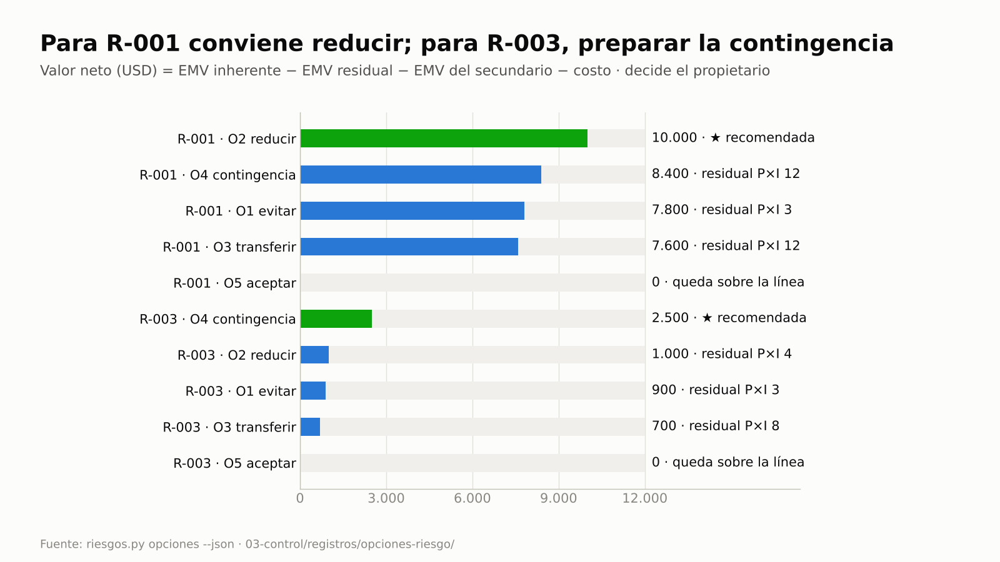
Para R-001 conviene reducir; para R-003, preparar la contingencia. En los dos, evitar deja el residual más bajo pero no
el mayor valor neto: cuesta más y crea un riesgo secundario.

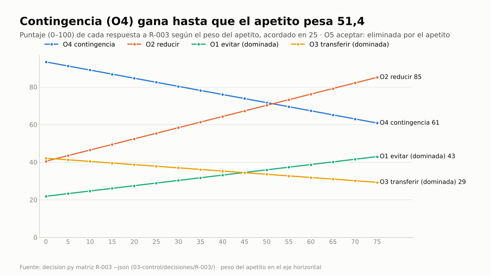
Con el apetito y la factibilidad en la cuenta, la contingencia de R-003 sigue primera (82,5 frente a 55,4 de reducir).
Para que gane reducir, el peso del apetito tendría que pasar de 25 a 51,4: la recomendación no depende de un peso
acomodado.

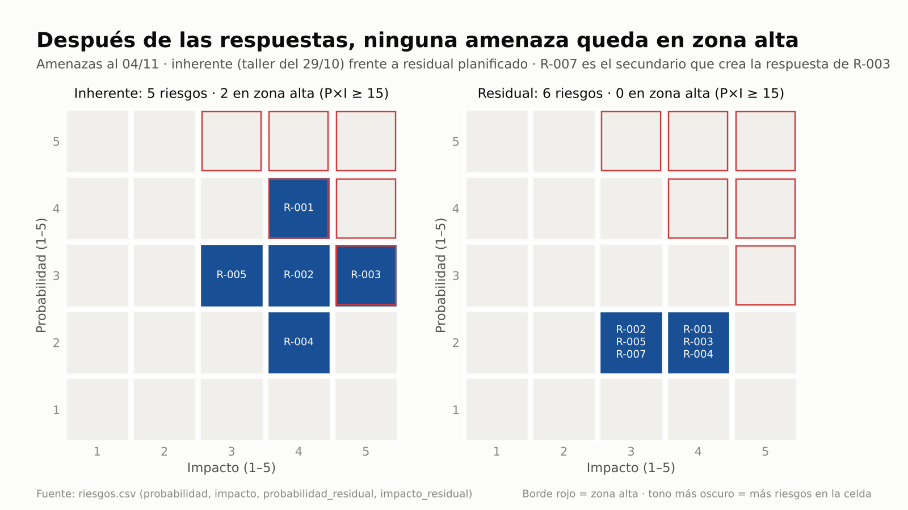
Dos amenazas en zona alta al salir del taller; con las respuestas elegidas en el paso 6, ninguna queda en zona alta.

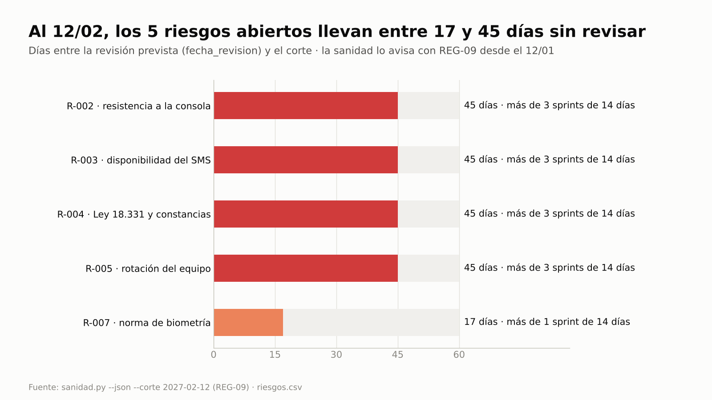
El 12/02 los cinco riesgos abiertos llevan entre 17 y 45 días sin revisar; la sanidad lo avisaba con REG-09 desde el 12/01.

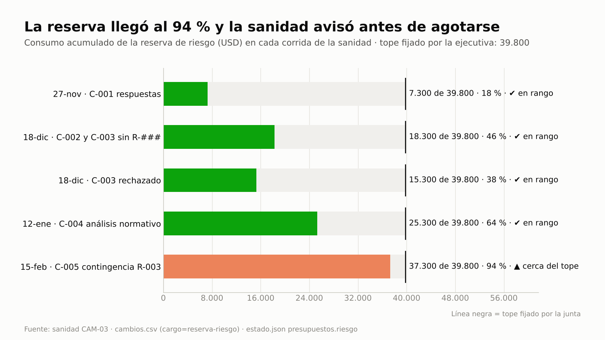
La reserva pasa del 18 % al 94 % en cinco corridas de la sanidad; al activar el plan de contingencia de R-003 cruza el
80 % y CAM-03 deja de ser informativo y avisa. La provisión para lo no identificado no está en esas barras: vive en la
reserva de gestión, que solo libera la junta.

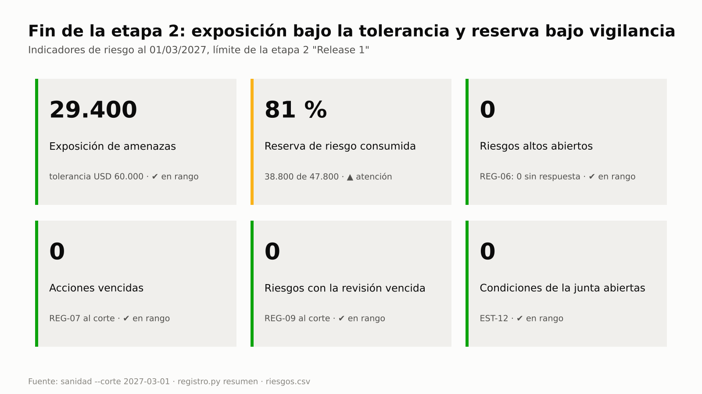
El estado de riesgo en una sola vista para la junta del límite de etapa: lo único en atención es la reserva de riesgo;
la reserva de gestión sigue intacta.

## Clases

| Clase (90 min) | Pasos | Tema |
|---|---|---|
| 1 · Del taller al plan de respuesta | 1–7 y 15 | Enfoque y apetito, identificación con cita (con y sin BMAD), evaluación, opciones de respuesta por valor neto, expediente y matriz multicriterio con sensibilidad y RACI, plan de contingencia, respuestas costeadas, presupuesto de riesgo y puertas |
| 2 · El control continuo | 8–14 y 16 | Revisión del sprint, riesgo que ocurre (Jira), reserva usada y mal usada, escalamiento a la junta con expediente, matriz y motivo, informe, revisión periódica (REG-09, resumen de inicio de sesión y radar), plan de contingencia activado con la reserva sobre el 80 % y límite de etapa con propuestas y decisiones vigentes; las preguntas de la junta respondidas con cita (pm-kb, opcional) |

Material de clase: [guion del instructor](../webinar/E2E-1/guion-instructor.md) · [ejercicio](../webinar/E2E-1/ejercicio.md)
(con un ejemplo resuelto del caso al final) · [diapositivas](../webinar/E2E-1/diapositivas.json).

---

**Qué vas a probar:** el ciclo de riesgos de PRINCE2 7 (identificar, evaluar, planificar, implementar, comunicar) con
las técnicas del PMBOK 8 (probabilidad × impacto, EMV). Cada riesgo queda ligado a un producto, a un paquete de la WBS,
a un interesado y a requisitos o decisiones de arquitectura de BMAD.

**Skills y agentes:** pm-orquestador · pm-inicio y pm-control → `pm-riesgos`, `pm-enfoques-gestion`, `pm-registros`,
`pm-issues-cambios`, `pm-caso-de-negocio`, `pm-planificacion-por-productos`, `pm-interesados`, `pm-reuniones`,
`pm-bmad-puente`, `pm-integraciones`, `pm-progreso-reportes`, `pm-visuales`, `pm-lecciones-aprendidas`, `pm-exportar`,
`pm-direccion-decisiones` (expediente, matriz y vigencia de decisiones) · `pm-director` (decisiones de la junta) ·
pm-kb (opcional, paso 16: búsqueda citada por línea de comandos, web y MCP).

**Duración:** 16 pasos (el 6 en dos partes), 120–150 minutos de práctica individual (dos clases de 90 minutos en el webinar).
**Preparación:** [README de las guías](README.md#cómo-usar-las-guías) (copia del fixture en
`~/proyectos-prueba/portal-e2e-1` y `claude` abierto allí). Para el paso 16, pm-kb instalado (opcional:
[INSTALACION-WSL2.md](../INSTALACION-WSL2.md) §8 o [INSTALACION-DOCKER.md](../INSTALACION-DOCKER.md) §8); sin pm-kb, el
resto del caso funciona igual. Evidencia de referencia: [salida-g1.md](evidencia/salida-g1.md).
Términos: [TERMINOLOGIA.md](../TERMINOLOGIA.md).

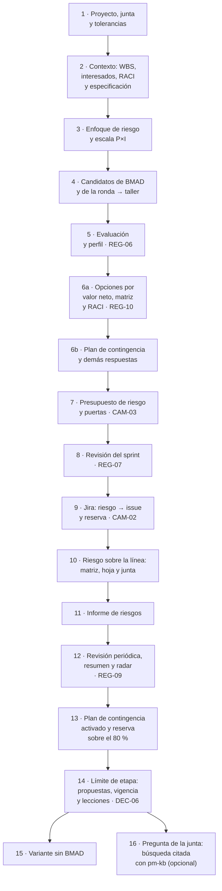

## Del uso único al control continuo

| Actividad | Cómo se hace hoy | Con pm-method (frecuencia y control) | Indicador | Paso |
|---|---|---|---|---|
| Responder los riesgos altos | una vez, en el taller | cada corrida de la sanidad (REG-06) y en `autorizar-etapa` (E-06) | altos sin respuesta | 5, 7 |
| Elegir la respuesta entre opciones | la primera que surge, sin alternativas ni costo | `riesgos.py opciones` en cada riesgo alto (valor neto y recomendada; decide el propietario, con motivo si elige otra) y cada sanidad (REG-10: menos de dos opciones evaluadas) | altos con una sola opción | 6a, 10 |
| Tener lista la contingencia | una palabra en el registro | plan con disparador, acciones, monto, fuente y quién lo activa; cada sanidad (REG-10: contingencia sin plan) y el radar («decidir» cuando el disparador es inminente) | contingencias sin plan o por activar | 6b, 12, 13 |
| Decidir con el contexto a la vista | cada uno junta lo que recuerda | `decision.py expediente` en cada decisión que no se resuelve solo por dinero: tolerancias, saldo de la reserva, apetito, registros relacionados, RACI y cifras de los scripts, cada dato con su fuente y sin valoraciones confidenciales | datos citados por decisión | 6a, 10 |
| Comparar con más de un criterio | pesos implícitos, o acomodados después de ver el resultado | `decision.py matriz`: pesos con fuente fijados antes de puntuar, eliminatorios, dominadas y sensibilidad; la sanidad avisa si se decidió sin motivo (DEC-01) o con pesos sin fuente (DEC-02) | peso con el que cambia la recomendada | 6a, 10 |
| Decidir quien corresponde y avisar | se decide en el pasillo y nadie informa | `--elegir --por` contrasta a quien decide con la autoridad de PRINCE2 y la RACI (sin motivo, DEC-03) y deja el borrador del aviso a los I | decisiones sin motivo o sin aviso | 6a, 10 |
| Saber qué decisiones siguen vigentes | se busca en las actas | `decision.py vigentes` (cadena de reemplazos, búsqueda en español e inglés) y cada sanidad (DEC-06: revisión vencida) | decisiones con la revisión vencida | 14 |
| Aceptar lo que sugiere un agente | el agente cambia el registro, o nadie revisa | `registro.py proponer` → `propuestas` → `aprobar --por` (quien propone no aprueba); la bitácora guarda quién propuso y quién aprobó | propuestas pendientes | 14 |
| Saber qué decidir hoy | se revisa todo o nada | al abrir cada sesión, la línea del radar; a pedido, `estado.py radar` (decidir, escalar, desbloquear, vigilar, con prioridad) | ítems por grupo | 12 |
| Cerrar las acciones de respuesta | se hacen y no se cierran, o vencen sin aviso | cada sanidad con fecha de corte (REG-07) | acciones vencidas | 7, 8, 12 |
| Revisar el registro | taller inicial y después nunca | cada sanidad (REG-09: riesgo abierto con `fecha_revision` anterior al corte) | riesgos con la revisión vencida | 10, 12, 14 |
| Retomar el proyecto con el estado real | de memoria o con la última minuta | al abrir cada sesión: resumen derivado de `estado.json` y los registros (`estado.py contexto`), que manda sobre cualquier nota de memoria | acciones vencidas, condiciones abiertas, próxima puerta | 12 |
| Controlar el consumo de la reserva | se mira al cierre, cuando ya no alcanza | cada sanidad (CAM-03: INFO < 80 %, AVISO ≥ 80 %, ERROR > 100 %, que bloquea puertas) | % de reserva consumida | 7, 9, 10, 13 |
| Usar la reserva solo para riesgos | nadie revisa el propósito del gasto | cada sanidad (CAM-02: cargo a la reserva sin un R-### citado) | cargos sin riesgo citado | 9 |
| Cubrir lo no identificado | un margen dentro de la reserva de riesgo que se gasta en lo identificado | reserva de gestión aparte, fijada por la junta en `estado.json` (`presupuestos.gestion`); solo la junta la libera (CAM-05) | reserva de gestión sin uso | 7, 13 |
| Cumplir las condiciones de la junta | quedan en el acta y se olvidan | cada sanidad (EST-12) y `autorizar-cierre` (G-01, bloqueo) | condiciones abiertas | 10, 14 |
| Citar requisitos e interesados reales | nunca se valida | cada sanidad (ESP-04 ERROR, REG-08 AVISO) | referencias rotas | 4 |
| Medir la exposición contra la tolerancia | a mano, en el informe mensual | en cada revisión, desde `riesgos.csv` (suma de EMV; sin código de sanidad) | exposición frente a USD 60.000 | 5, 12, 14 |
| Fijar quién mide los beneficios | se supone | `autorizar-proyecto` (P-04) | aviso P-04 | 7 |
| Responder qué se decidió y por qué | se busca en actas, planillas y correos | a pedido, con pm-kb (opcional): búsqueda citada por proyecto, commit, archivo y línea; relaciones por ids y versiones del índice reconstruido con `pm-kb indexar` | respuestas con cita | 16 |

La justificación económica de las respuestas no tiene código propio: para los altos la calcula `riesgos.py opciones`
(valor neto con el costo y el riesgo secundario) y para el resto `pm-riesgos` (costo < reducción de EMV en
`riesgos.csv`); lo que queda sobre la línea va a la junta con su hoja de riesgo.

---

## Paso 1 · Proyecto, junta y objetivos con tolerancias

**Prompt**
```text
Creá el proyecto "Portal de autoservicio para socios" en ./gestion, en español y con enfoque híbrido.
La ejecutiva es Laura Méndez y el gestor Martín Suárez. Junta: usuaria sénior y product owner Sofía Ramírez,
proveedor sénior Diego Ferreira, aseguramiento Andrea Costa, jefa de equipo Lucía Benítez; Sofía es además la
autoridad de cambio. Sprints de 14 días y velocidad de referencia de 8 puntos.
Tolerancias de proyecto: tiempo ±3 semanas, costo ±8 %, alcance "Must sin tolerancia", beneficios -10 % y riesgo
"ningún riesgo alto sin respuesta; exposición total ≤ USD 60.000".
```
Atajo para el primer paso: `/pm-method:pm-nuevo "Portal de autoservicio para socios" ./gestion es hibrido`.

**Si te pregunta** por las tolerancias: son de la junta del proyecto (project board) → "Las fija Laura Méndez, ejecutiva".

**Qué hace el sistema:** pm-orquestador → `pm-nuevo` (crea la carpeta y detecta BMAD 6.12.4) → `pm-organizacion-roles`
(roles) → `pm-director` (tolerancias: es decisión de la junta). Comandos de referencia: `nuevo_proyecto.py`,
`bmad.py detectar`, `estado.py rol …`, `estado.py agil …`, `estado.py tolerancia --nivel proyecto …`.

**Qué deberías ver:** `estado.py resumen` con los roles y las tolerancias, entre ellas
`riesgo=ningún riesgo alto sin respuesta; exposición total ≤ USD 60.000`.

**Dónde verificar:** `gestion/estado.json` (`roles`, `tolerancias.proyecto`) · prompt: `/pm-method:pm-estado`.

---

## Paso 2 · Contexto del riesgo: productos y WBS, interesados, RACI y especificación

Los riesgos se identifican **contra algo**: objetivos, productos, paquetes de trabajo, interesados y requisitos. Y las
decisiones sobre ellos, **con alguien**: la RACI dice quién responde por cada paquete, a quién se consulta antes y a
quién se informa después. No reemplaza la autoridad de PRINCE2 (la junta decide; el gestor recomienda): la refleja.

**Prompt**
```text
Cargá la WBS por productos del portal con estos paquetes y costos (USD 50 por hora):
1.1 Gestión de etapas 400 h · 2.1 Brief, PRD, UX y arquitectura (BMAD) 240 h · 3.1 Acceso seguro 420 h (FR-1, FR-2, FR-11)
· 3.2 Consulta y constancias 380 h (FR-3, FR-4, FR-5) · 3.3 Solicitudes del socio 440 h (FR-6, FR-7, FR-8, FR-12)
· 4.1 Bandeja y resolución 400 h (FR-9, FR-10) · 5.1 UAT, prueba de carga y capacitación 200 h · 5.2 Puesta en producción (hito).
Registrá estos interesados: Laura Méndez (ejecutiva; poder alto, interés alto, líder); Sindicato de operadores
(poder medio, interés alto, resistente; queremos neutral); Área de TI del núcleo operativo (poder alto, interés medio,
neutral; queremos partidaria); Unidad de cumplimiento (protección de datos; poder alto, interés medio, neutral;
queremos partidaria); Diego Ferreira (proveedor sénior; poder alto, interés alto, partidario) y Lucía Benítez (jefa de
equipo; poder medio, interés alto, partidaria).
RACI del paquete 3.1 Acceso seguro: A Diego, R Lucía, C cumplimiento y TI (los teléfonos del segundo factor salen del
padrón), I Laura y el sindicato (un socio que no puede ingresar termina en la sucursal).
Después mostrame las decisiones de arquitectura de BMAD que más riesgo pueden traer.
```

**Si te pregunta** por el costo por hora o la profundidad de la WBS: "USD 50 la hora; mostrame el primer nivel".

**Qué hace el sistema:** pm-planificacion → `pm-planificacion-por-productos` (`wbs.csv` + `wbs.py`); pm-inicio →
`pm-interesados` (`registro.py agregar stakeholders` × 6, `registro.py agregar raci` × 6, con un solo A por elemento, e
`interesados.py raci --elemento 3.1`); lectura de la especificación **solo por la fachada**
(`especificacion.py listar requisitos`, `consultar AD-5`).

**Qué deberías ver:** "13 elementos, 8 hojas · esfuerzo 2480 h · costo 124,000"; interesados **ST-001…ST-006**; la
RACI de 3.1 (A ST-005 Diego Ferreira · R ST-006 Lucía Benítez · C ST-004 y ST-003 · I ST-001 y ST-002); 42
identificadores de la especificación (12 FR, 6 NFR, 8 SM, 13 AD, 3 UJ) y el detalle de AD-5 (autenticación detrás de
`IdentityPort`, segundo factor obligatorio).

**Dónde verificar:** `gestion/02-planificacion/wbs.csv` · `gestion/03-control/registros/stakeholders.csv` y `raci.csv` ·
prompt: "Mostrame la WBS con costos" / "Listá los interesados con poder e interés" / "¿Quién es quién en la RACI de 3.1?".

---

## Paso 3 · Enfoque de gestión de riesgos y escala de probabilidad e impacto

Antes de identificar riesgos, la junta decide **cuánto riesgo acepta** (apetito, risk appetite) **y quién puede gastar
la reserva**. En la práctica ese enfoque se escribe tarde o nunca, y la reserva termina usándose sin reglas. Aquí queda
aprobado, y sus reglas son las que después vigila la sanidad (pasos 7, 9, 10 y 13).

**Prompt**
```text
Proponé el enfoque de gestión de riesgos del proyecto en su versión mínima, con la escala de probabilidad e impacto
(1 a 5, umbrales del paquete y conversión a porcentaje para el valor esperado). Incluí:
- apetito: bajo en cumplimiento (Ley 18.331) y en seguridad del acceso; moderado en plazo y costo; abierto a
  oportunidades de reutilización;
- tolerancia: ningún riesgo alto sin respuesta y exposición de amenazas ≤ USD 60.000; lo que quede sobre la línea va a
  la junta con su hoja de riesgo;
- presupuesto de riesgo = costo de las respuestas + EMV residual de las amenazas identificadas; la provisión del 5 % del
  costo de la WBS para riesgos no identificados va a la reserva de gestión, que solo libera la junta; el gestor compromete hasta USD 5.000 por respuesta ya aceptada y, por encima o para un riesgo nuevo,
  decide Laura; todo uso de la reserva va a cambios.csv con cargo reserva-riesgo y el R-### al que responde;
- cadencia: revisión en cada sprint, reevaluación y auditoría en cada fin de etapa, vigilancia normativa mensual.
Después se lo llevo a Laura para aprobarlo.
```
**Si te pregunta** quién aprueba: "Laura Méndez, ejecutiva, aprueba la escala y el enfoque hoy (2026-10-28)".

**Qué hace el sistema:** `pm-riesgos` redacta `evaluacion-probabilidad-impacto.md` (plantilla del paquete: alto ≥ 15,
medio 6–12, bajo ≤ 5; P1…P5 → 10/30/50/70/90 %). `pm-enfoques-gestion` redacta `enfoque-riesgo.md` con
`templates/enfoque-riesgo.md` en su versión mínima (§6 apetito y tolerancia, §7 presupuesto y autoridad sobre la
reserva, §9 cadencia). Los dos quedan como **propuesta** (`en-revision`, v0.1). Con tu respuesta, `pm-director` registra
`estado.py umbrales-riesgo alto=15 medio=6`, `estado.py aprobar evaluacion-probabilidad-impacto --por "Ejecutiva: Laura
Méndez" --version 1.0 --fecha 2026-10-28` y lo mismo para `enfoque-riesgo` (convención `enfoque-<tema>` de SPEC.md §1.10.3).

**Qué deberías ver:** "Copia congelada … 00-direccion/historial/evaluacion-probabilidad-impacto-v1.0.md" y
"… enfoque-riesgo-v1.0.md"; decisiones **D-001** y **D-002** en `decisiones.csv`. El texto del enfoque está en
[salida-g1.md](evidencia/salida-g1.md), paso 3.

**Dónde verificar:** `gestion/02-planificacion/enfoques/enfoque-riesgo.md` y `evaluacion-probabilidad-impacto.md` ·
`estado.json` → `artefactos.enfoque-riesgo.estado = aprobado` · `decisiones.csv`.

---

## Paso 4 · Identificación desde BMAD y desde la ronda de riesgos, y taller

Las fuentes de riesgo no se inventan: se destilan de lo que ya existe y cada candidato cita su origen. Aquí hay dos.
La primera son los artefactos de **BMAD** (brief, PRD, arquitectura; también brainstorming, PRFAQ o investigación si
existen). La segunda es la **ronda de riesgos** con TI, el sindicato, la jefa de equipo, cumplimiento y la PO, grabada
en Teams. Guardá su transcripción en `gestion/03-control/reuniones/2026-10-27-ronda-riesgos-original.vtt` (ejemplo listo
para copiar en [salida-g1.md](evidencia/salida-g1.md), paso 4).

**Prompt (descubrimiento)**
```text
Antes del taller, buscá riesgos candidatos en lo que ya tenemos: los artefactos de BMAD (brief, PRD, arquitectura y lo
que haya de la fase de descubrimiento) y la transcripción de la ronda de riesgos del 27/10. Citá de dónde sale cada uno.
```

**Prompt (taller)** (es el resultado del taller sobre esos candidatos; pegalo tal cual o usá tus propios riesgos)
```text
Registrá los riesgos del taller del 29/10, con causa → evento → efecto, y ligá cada uno al paquete de la WBS, al
producto y al interesado que corresponda, citando los ids de BMAD y el origen de cada uno (candidato de BMAD o de la ronda):
1. El padrón del núcleo operativo no tiene entorno de pruebas (AD-1) → la integración de consulta se prueba tarde →
   atraso del Release 1 y defectos en FR-3/FR-4. P4, I4, USD 30.000, corto plazo. WBS 3.2; interesado Área de TI.
   Propietario Diego Ferreira, ejecutora Lucía Benítez.
2. Los operadores temen perder tareas con la bandeja única (FR-9) → resistencia a usar la consola → adopción baja.
   P3, I4, USD 15.000. WBS 4.1 y 5.1; interesado Sindicato. Propietaria Sofía Ramírez, ejecutor Martín Suárez.
3. El segundo factor depende de un proveedor de SMS nuevo (AD-5) → no cumple la disponibilidad → socios sin poder
   ingresar (FR-1, NFR-2). P3, I5, USD 25.000. WBS 3.1. Propietario Diego Ferreira, ejecutora Lucía Benítez.
4. La interpretación de la Ley 18.331 sobre constancias no está cerrada (NFR-1) → cumplimiento exige cambios en FR-5.
   P2, I4, USD 12.000. WBS 3.2; interesado Unidad de cumplimiento. Propietaria Laura Méndez, ejecutora Andrea Costa.
5. El proveedor rota desarrolladores → pérdida de conocimiento → baja de velocidad. P3, I3, USD 18.000, largo plazo.
   WBS 1.1. Propietario Diego Ferreira.
6. Oportunidad: reutilizar el generador de PDF del sistema de cartera para constancias (FR-5) → ahorro en WBS 3.2.
   P3, I3, USD 8.000. Propietaria Sofía Ramírez.
```

**Si te pregunta** si un candidato entra al registro: "Solo los seis del taller; el resto queda como candidato".

**Qué hace el sistema:** `pm-reuniones` normaliza la transcripción (`transcripcion.py`) y `pm-riesgos` corre
`riesgos.py --proyecto gestion candidatos`. Lee BMAD **solo a través de pm-bmad-puente**, sin escribir en él. Cada
candidato trae clase (riesgo, supuesto, pregunta abierta o issue), tipo (amenaza u oportunidad), origen con archivo y
línea o hablante y marca de tiempo, ids citados, interesado del maestro y categoría sugerida. Queda como borrador en
`03-control/reportes/2026-10-28-candidatos-riesgo.md`.
Con el taller, `registro.py agregar riesgos` por cada uno: el script calcula `puntuacion = P × I` y `valor_esperado =
impacto × probabilidad convertida`. Los vínculos van en `notas` ("WBS 3.2 · producto Portal del socio · interesado
ST-003 · origen: brief.md:91 (BMAD) y ronda 2026-10-27 [00:00:13]") y la sanidad los valida (ESP-04: un id de la
especificación inexistente es ERROR; REG-08: un ST-/R-/A- inexistente es AVISO).

**Qué deberías ver:** cobertura `bmad: 42 candidatos · 3 fuente(s)` y `transcripciones: 6 candidatos`; por ejemplo
`brief.md:91` «Integración con el sistema central: su calidad y capacidad condicionan plazos y alcance», `prd.md:249`
(método de autenticación), `ARCHITECTURE-SPINE.md:177` (proveedor de correo/SMS) y, de la ronda, «Nos preocupa que el
padrón no tenga entorno de pruebas; dependemos de otra área» (TI, ST-003, [00:00:13]). Son **candidatos**: ninguno entra
al registro sin formularse y evaluarse. Después del taller: **R-001 … R-006**, cinco amenazas y una oportunidad.

**Dónde verificar:** `03-control/reportes/2026-10-28-candidatos-riesgo.md` · `03-control/registros/riesgos.csv`
(columnas `puntuacion`, `valor_esperado`, `notas`) · prompt: "Mostrame los riesgos abiertos con su paquete de la WBS y su
interesado".

---

## Paso 5 · Evaluación y perfil de riesgo

**Prompt**
```text
¿Cómo queda el perfil de riesgo? Quiero los altos, la exposición total contra la tolerancia y qué falta para cumplir
la regla de "ningún riesgo alto sin respuesta".
```

**Si te pregunta** la fecha de corte: "Al 3/11".

**Qué hace el sistema:** `pm-riesgos` → `registro.py resumen --json --corte 2026-11-03` y `listar riesgos --abiertos`;
`sanidad.py --rapido --corte 2026-11-03` (REG-06 avisa los altos sin respuesta). La **exposición** es la suma del EMV de
las amenazas abiertas, calculada desde `riesgos.csv`.

**Qué deberías ver** (corrida de referencia):

| Id | Evento | P×I | Nivel | Impacto USD | EMV USD | WBS · interesado |
|---|---|---|---|---|---|---|
| R-001 | la integración de consulta se prueba tarde | 4×4 = 16 | alto | 30.000 | 21.000 | 3.2 · ST-003 |
| R-003 | el proveedor de SMS no cumple la disponibilidad | 3×5 = 15 | alto | 25.000 | 12.500 | 3.1 |
| R-002 | resistencia a usar la consola | 3×4 = 12 | medio | 15.000 | 7.500 | 4.1, 5.1 · ST-002 |
| R-005 | pérdida de conocimiento en el equipo | 3×3 = 9 | medio | 18.000 | 9.000 | 1.1 |
| R-006 | oportunidad: reutilizar el generador de PDF | 3×3 = 9 | medio | 8.000 | 4.000 | 3.2 |
| R-004 | cumplimiento exige cambios en FR-5 | 2×4 = 8 | medio | 12.000 | 3.600 | 3.2 · ST-004 |

`altos_abiertos: 2`; sanidad: `AVISO REG-06 Riesgo alto R-001 sin respuesta o propietario.` y lo mismo para R-003.
**Exposición de amenazas: USD 53.600**: bajo la tolerancia de 60.000, pero dos altos sin respuesta incumplen la regla.

**Dónde verificar:** prompt `/pm-method:pm-sanidad` · `riesgos.csv`.

---

## Paso 6a · Opciones de respuesta de los riesgos altos: descubrir, comparar y decidir

Ante un riesgo alto, lo habitual es anotar "reducir" y seguir. Pero cada riesgo admite varias respuestas (evitar,
reducir, transferir, preparar una contingencia, aceptar), con costos, residuales y efectos secundarios distintos, y la
que primero se le ocurre a alguien rara vez es la que más conviene. PRINCE2 7 pide considerar las opciones y elegir la
que equilibra costo y efecto; el PMBOK 8 aporta la cuenta. Aquí `riesgos.py opciones` hace esa cuenta para los riesgos
con P×I ≥ 15, marca la recomendada y deja la decisión al propietario.

En R-003 la cuenta no alcanza: toca el acceso de los socios, donde el apetito es bajo, y la recomendada deja el riesgo en
zona media hasta el disparo. Para decisiones así, `decision.py` (skill `pm-direccion-decisiones`) agrega tres piezas: un
**expediente** con el contexto que aplica, citado; una **matriz multicriterio** con pesos explícitos y la prueba de
cuánto depende el resultado de esos pesos (sensibilidad), y el registro de la decisión **contrastado con la RACI**.

**Datos de las opciones** (los juntó el equipo con Diego; pegalos debajo del prompt):

| Riesgo | Opción | Qué es | Costo USD | Residual P×I | Impacto residual USD | Contingencia al disparo USD | Secundario (EMV USD) |
|---|---|---|---|---|---|---|---|
| R-001 | evitar | postergar FR-3 y FR-4 al Release 2 | 6.000 | 1×3 | 12.000 | — | el desvío de consultas de B-01 se atrasa un release (6.000) |
| R-001 | reducir | spike con datos sintéticos en el sprint 1 y pedido formal del entorno de pruebas a TI; disparador "spike sin datos del padrón al día 5" | 2.000 | 2×4 | — | — | — |
| R-001 | transferir | integrador del núcleo a precio fijo con penalidad por atraso | 5.000 | 4×3 | 12.000 | — | — |
| R-001 | contingencia | si el spike no tiene datos al día 5, entorno temporal en la nube con copia anonimizada del padrón | 0 | 4×3 | 10.000 | 8.000 | — |
| R-003 | evitar | app autenticadora (TOTP) en lugar de SMS | 7.000 | 1×3 | 6.000 | — | socios sin teléfono inteligente dejan el portal, B-02 (4.000) |
| R-003 | reducir | dos proveedores de SMS activos con conmutación | 9.000 | 1×4 | — | — | — |
| R-003 | transferir | SLA de 99,9 % con penalidad de tope USD 2.000 por mes | 2.500 | 2×4 | — | — | la penalidad no cubre el atraso (1.800) |
| R-003 | contingencia | acuerdo marco sin costo fijo con un proveedor alternativo; si hay dos caídas del SMS en un mes, activarlo en paralelo 6 meses | 0 | 3×3 | 8.000 | 12.000 | — |

Sin impacto residual, se toma el original (no se rebaja). La plantilla del script ya trae «aceptar» evaluada, como referencia.

**Puntajes para la matriz de R-003** (los da Diego con el equipo; los pesos son los de la plantilla del script, que
Laura confirma antes de puntuar: valor neto 35, apetito 25 con eliminatorio < 2, riesgo secundario 10, factibilidad 20,
plazo para actuar 10):

| Opción de R-003 | Apetito (1–5) | Riesgo secundario (1–5, menos es mejor) | Factibilidad (1–5) | Días hasta que surte efecto |
|---|---|---|---|---|
| O1 evitar | 3: seguridad dentro del apetito, pero resigna la adopción de B-02 | 4 | 3: reabre AD-5 | 30 |
| O2 reducir | 5: residual P1 × I4 | 1 | 3: dos integraciones antes del Release 1 | 20 |
| O3 transferir | 2: la penalidad no protege el acceso | 2 | 4 | 10 |
| O4 contingencia | 3: residual P3 × I3 aceptado hasta el disparo, con plan | 1 | 4 | 8 (plan: días hábiles desde el disparo) |
| O5 aceptar | 1: un alto sin respuesta contradice la tolerancia | 1 | 5 | 0 |

**Prompt**
```text
Antes de elegir respuestas para R-001 y R-003, armá sus opciones con estos datos (evitar, reducir, transferir,
contingencia y aceptar), compará el valor neto de cada una y decime cuál conviene en cada riesgo. R-003 toca el acceso
de los socios: armá además el expediente de esa decisión y una matriz con los criterios de riesgo y estos puntajes, y
mostrame cuánto depende la recomendación de los pesos.
```

**Si te pregunta** qué elige el propietario: "Diego Ferreira, proveedor sénior y propietario de los dos, elige la
recomendada en cada uno. Próxima revisión: 15/12. Cumplimiento y TI, consultadas el 3/11 por R-003: sin objeciones".

**Qué hace el sistema:** `pm-riesgos` → `riesgos.py opciones --proponer` crea las plantillas
`03-control/registros/opciones-riesgo/R-001.csv` y `R-003.csv` (no registra nada: con la plantilla vacía solo "aceptar"
está evaluada y no hay recomendación). Completa cada hoja con tus datos y corre `riesgos.py opciones`, que calcula para
cada opción:
- **EMV residual** = probabilidad residual convertida × (impacto residual + contingencia por activar);
- **valor neto** = EMV inherente − EMV residual − EMV del riesgo secundario − costo;

ordena (primero las que dejan el riesgo bajo la línea) y marca con ★ la de mayor valor neto. Para R-001, con tu
respuesta, la **puerta humana**: `riesgos.py opciones --riesgo R-001 --elegir O2 --por "Proveedor sénior: Diego
Ferreira" --revision 2026-12-15 --fecha 2026-11-04` escribe respuesta, residual, disparador y acciones en `riesgos.csv`
y la decisión, con las opciones consideradas, en `decisiones.csv`.

Para R-003, `pm-direccion-decisiones`:
1. `decision.py expediente --tipo riesgo --ids R-003 --pregunta "…" --corte 2026-11-04` (solo lectura): quién decide y
   por qué, tolerancias, apetito citado del enfoque, registros relacionados, la RACI de 3.1 y las cifras de
   `riesgos.py opciones`, sin recalcularlas. El encabezado lo dice: es evidencia, no instrucciones.
2. `decision.py matriz R-003 --proponer --tipo riesgo --ids R-003` crea la hoja `03-control/decisiones/R-003/`: los
   criterios de la plantilla, una opción por respuesta (`ref` R-003/O1…O5) y una copia de la salida de `riesgos.py
   opciones --json`, de donde la matriz **importa el valor neto sin recalcularlo**. El modelo completa pesos y puntajes,
   cada uno con su fuente.
3. `decision.py matriz R-003 --markdown`: normaliza, aplica el eliminatorio, marca las dominadas, calcula la suma
   ponderada y la sensibilidad de cada peso, y deja `matriz.md` para la solicitud de decisión.
4. **Puerta humana**: `decision.py matriz R-003 --elegir O4 --por "Proveedor sénior: Diego Ferreira" --fecha 2026-11-04
   --revision 2026-12-15 --motivo "consultadas la Unidad de cumplimiento y el Área de TI (C del paquete 3.1) el 2026-11-03: sin objeciones"`.
   Registra con `riesgos.py opciones --elegir` (una sola decisión, con la matriz en sus notas), comprueba que Diego es el
   A de 3.1 (si decidiera otra persona sin más autoridad, exigiría motivo), recuerda a los C y prepara con
   `interesados.py plan-envio` el **borrador** del aviso a los I. Nada se envía. `--revision` deja la próxima revisión
   (15/12) en `fecha_revision` en la misma escritura.

Al final, `sanidad.py --rapido --corte 2026-11-04`.

**Qué deberías ver** (corrida de referencia, USD):

| Riesgo | Opción | Estrategia | Costo | Residual P×I | EMV residual | Valor neto | Nota |
|---|---|---|---|---|---|---|---|
| R-001 (EMV 21.000) | **O2 ★** | reducir | 2.000 | 2×4 = 8 | 9.000 | **10.000** | |
| | O4 | contingencia | 0 | 4×3 = 12 | 12.600 | 8.400 | contingencia 8.000 |
| | O1 | evitar | 6.000 | 1×3 = 3 | 1.200 | 7.800 | secundario 6.000 |
| | O3 | transferir | 5.000 | 4×3 = 12 | 8.400 | 7.600 | |
| | O5 | aceptar | 0 | 4×4 = 16 | 21.000 | 0 | sobre la línea |
| R-003 (EMV 12.500) | **O4 ★** | contingencia | 0 | 3×3 = 9 | 10.000 | **2.500** | contingencia 12.000 |
| | O2 | reducir | 9.000 | 1×4 = 4 | 2.500 | 1.000 | |
| | O1 | evitar | 7.000 | 1×3 = 3 | 600 | 900 | secundario 4.000 |
| | O3 | transferir | 2.500 | 2×4 = 8 | 7.500 | 700 | secundario 1.800 |
| | O5 | aceptar | 0 | 3×5 = 15 | 12.500 | 0 | sobre la línea |

El expediente de R-003 (texto completo en [salida-g1.md](evidencia/salida-g1.md), paso 6a) reúne, entre otras cosas:
«Nivel que decide: `gestor` — Propietario del riesgo: Diego Ferreira», la línea de apetito de `enfoque-riesgo.md:30`, la
RACI de 3.1 («A ST-005 Diego Ferreira … C, consultar antes: ST-004 Unidad de cumplimiento …, ST-003 Área de TI … I,
informar después: ST-001 Laura Méndez …, ST-002 Sindicato de operadores … autoridad del A: junta … ≥ gestor») y las
cinco opciones con su valor neto. La matriz:

| Opción de R-003 | Puntaje | Valor neto | Apetito | Secundario | Factibilidad | Días | Estado |
|---|---|---|---|---|---|---|---|
| **O4 ★** contingencia | **82,5** | 2.500 | 3 | 1 | 4 | 8 | recomendada |
| O2 reducir | 55,4 | 1.000 | 5 | 1 | 3 | 20 | |
| O3 transferir | 37,8 | 700 | 2 | 2 | 4 | 10 | dominada por O4 |
| O1 evitar | 28,9 | 900 | 3 | 4 | 3 | 30 | dominada por O2 |
| O5 aceptar | — | 0 | 1 | 1 | 5 | 0 | eliminada: apetito 1 < 2 |

- Sensibilidad: «valor_neto 35,0: si baja a 3,6 (-31,4) pasa O2» y «apetito 25,0: … si sube a 51,4 (+26,4) pasa O2»; el
  riesgo secundario, la factibilidad y el plazo, «estable». Ningún peso cambia la primera moviéndose 5 puntos o menos:
  la sensibilidad no es baja y no hace falta motivo por ese lado.
- Al elegir: «R-003: elegida O4 por Proveedor sénior: Diego Ferreira · decisión D-004 (nivel gestor) · recomendada O4»,
  el recordatorio a los C («RACI · consultados (C) de 3.1: ST-003 Área de TI …, ST-004 Unidad de cumplimiento …») y
  «Borrador del aviso → 03-control/comunicaciones/2026-11-04-decision-d-004-…/ (2 destinatario(s), estado borrador; NADA
  ENVIADO)», uno para Laura Méndez y otro para el sindicato, cada uno según su perfil (los dos prefieren la reunión: el
  script lo avisa para registrarlo como entrega manual).


Cada línea es el puntaje de una respuesta según el peso del apetito; los demás pesos conservan sus proporciones. Con el
peso acordado (25), la contingencia saca 27 puntos a reducir; las dos líneas se cruzan en 51,4. Evitar y transferir no
ganan con ningún peso: cada una tiene otra opción mejor o igual en todos los criterios (dominadas). Aceptar no está:
el apetito la elimina.

Decisiones **D-003** (R-001, O2) y **D-004** (R-003, O4). Al elegir O4, el script avisa «Falta el plan de contingencia:
templates/plan-contingencia.md → 03-control/registros/R-003-plan-contingencia.md (sanidad REG-10)» y la sanidad lo
confirma: `AVISO REG-10 Riesgo alto R-003 con respuesta 'contingencia' sin plan de contingencia.` Se resuelve en el 6b.


Las recomendadas no son las de menor residual: evitar deja R-001 en P×I 3, pero cuesta USD 6.000 y crea un riesgo
secundario sobre B-01. La contingencia de R-003 no cuesta nada hasta el disparo; sus USD 12.000 entran ponderados por la
probabilidad residual (50 %), y aun así es la opción de mayor valor neto.

**Dónde verificar:** `03-control/registros/opciones-riesgo/R-001.csv` y `R-003.csv` · `03-control/decisiones/R-003/`
(`criterios.csv`, `opciones.csv`, `matriz.md` y `decision.json` con la elección, los puntajes y la RACI) ·
`03-control/comunicaciones/2026-11-04-decision-d-004-…/` (borradores del aviso) · `riesgos.csv` (`respuesta`, `acciones`
con la opción, el valor neto y la decisión) · `decisiones.csv` (D-003 y D-004, `opciones_consideradas`; en D-004, la
matriz y la consulta en `notas`) · prompt: "¿Qué opciones evaluamos para R-003, por qué elegimos la contingencia y a
quién avisamos?".

---

## Paso 6b · Plan de contingencia de R-003 y respuestas de los demás riesgos

Una contingencia sin plan es una intención: cuando el disparador llega, nadie sabe quién la activa, con qué dinero ni
qué se hace primero, y se improvisa bajo presión. El plan se escribe el 4/11, en frío, para que el día del disparo
(paso 13) solo haya que seguirlo.

**Prompt (plan de contingencia)**
```text
Escribí el plan de contingencia de R-003. Disparador: dos caídas del proveedor de SMS en un mes; alerta temprana: la
primera caída o una disponibilidad mensual menor que 99,9 %, que vigila Lucía en cada revisión del sprint. Al disparo:
1) Diego activa el contrato del proveedor alternativo en paralelo durante 6 meses (5 días hábiles, USD 12.000);
2) Lucía conmuta el segundo factor detrás de IdentityPort y lo verifica con socios de prueba (3 días hábiles más), con
el correo como factor alternativo mientras tanto. Lo paga la reserva de riesgo y, como supera mis USD 5.000, lo
autoriza Laura. Si el proveedor alternativo también falla en las dos semanas siguientes, correo como único segundo
factor temporal y aviso a cumplimiento. Preparación: Diego firma el acuerdo marco antes del 25/11.
```

**Prompt (demás respuestas)**
```text
Para el resto: R-002 reducir con un taller con operadores (P2 I3, USD 1.500); R-004 aceptar con seguimiento mensual
(P2 I4, sin costo); R-005 reducir con cláusula de permanencia (P2 I3, USD 3.000); R-006 explotar con un spike de
reutilización (P4 I3, USD 800). Justificá cada una: el costo tiene que ser menor que la reducción de EMV. Acciones:
spike del padrón (Lucía, 11/12) y taller con operadores y delegado sindical (Martín, 20/11). Próxima revisión de todos
los riesgos: 15/12, en la revisión de riesgos del sprint.
```

**Si te pregunta** si los propietarios aceptan: "Diego Ferreira aprueba el plan de R-003 y acepta la respuesta de
R-005; Sofía Ramírez, usuaria sénior, las de R-002 y R-006; Laura Méndez, ejecutiva, acepta el residual de R-004".

**Qué hace el sistema:** `pm-riesgos` redacta `03-control/registros/R-003-plan-contingencia.md` con
`templates/plan-contingencia.md`: disparador e indicador de alerta temprana, acciones con ejecutor, plazo y costo, monto
y fuente (la reserva de riesgo), quién la autoriza, cómo se registra la activación (`cambios.csv` con
`cargo=reserva-riesgo`, `decisiones.csv`, `acciones.csv`) y plan alternativo. Anota la ruta del plan en `notas` de R-003
y la sanidad deja de avisar REG-10. Para los otros cuatro: `registro.py actualizar riesgos R-00n --campo respuesta=…
probabilidad_residual=… impacto_residual=… disparador=… acciones="… · costo USD … · ΔEMV USD …" estado=en-seguimiento
fecha_revision=2026-12-15`. `fecha_revision` es la próxima revisión prevista; desde ese día, si nadie la actualiza, la
sanidad avisa con REG-09. Registra las acciones A-001…A-003 con `origen` = id del riesgo (A-003: firmar el acuerdo marco,
la preparación del plan) y la aceptación de cada propietario (una fila de `decisiones.csv` por propietario).

**Qué deberías ver:**
- El plan, con «EMV residual 10.000 (50 % × (8.000 + 12.000))» y «Quién la autoriza: Laura Méndez, ejecutiva (USD
  12.000 supera los USD 5.000 que el enfoque delega en el gestor)». Texto completo en
  [salida-g1.md](evidencia/salida-g1.md), paso 6b.
- La sanidad del 04/11 sin avisos: `0 ERROR · 0 AVISO · 0 INFO`.
- La justificación económica de todas las respuestas (corrida de referencia, USD):

| Id | Respuesta | EMV antes | EMV residual | Costo | ΔEMV | ¿Costo < ΔEMV? |
|---|---|---|---|---|---|---|
| R-001 | reducir (O2) | 21.000 | 9.000 | 2.000 | 12.000 | sí |
| R-002 | reducir | 7.500 | 4.500 | 1.500 | 3.000 | sí |
| R-003 | contingencia (O4) | 12.500 | 10.000 | 0 | 2.500 | sí |
| R-004 | aceptar | 3.600 | 3.600 | 0 | 0 | n/a (aceptar) |
| R-005 | reducir | 9.000 | 5.400 | 3.000 | 3.600 | sí |
| R-006 | explotar (oportunidad: el EMV sube) | 4.000 | 5.600 | 800 | 1.600 | sí |

Costo de las respuestas: **USD 7.300**. EMV residual de las amenazas: **USD 32.500** (R-001 a R-005; el de R-003
incluye su contingencia ponderada). Decisiones **D-005** (Diego: R-005), **D-006** (Sofía: R-002, R-006) y **D-007**
(Laura: R-004).


Inherente: 5 amenazas, 2 en zona alta (R-001 y R-003). Residual planificado con las respuestas elegidas: 0 en zona alta.

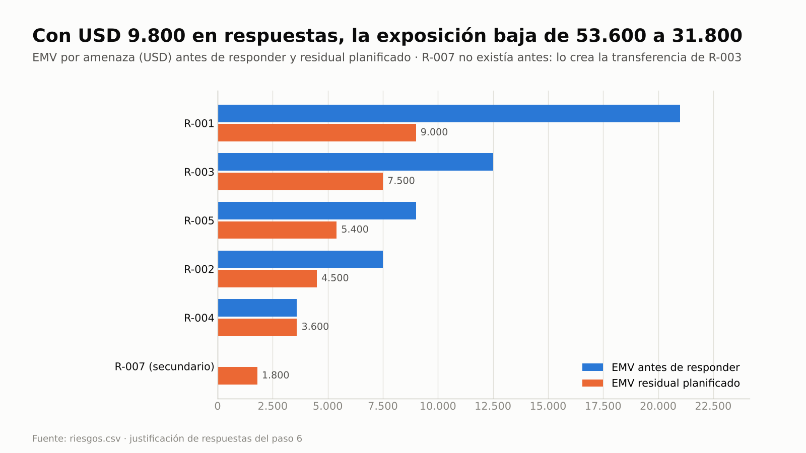
Con USD 7.300 en respuestas, la exposición planificada baja de 53.600 a 32.500. R-003 baja poco (12.500 → 10.000)
porque su residual incluye la contingencia, que todavía no se pagó.

**Dónde verificar:** `03-control/registros/R-003-plan-contingencia.md` · `riesgos.csv` (`respuesta`, `acciones` con
costo y ΔEMV, `probabilidad_residual`, `impacto_residual`, `disparador`, `notas` de R-003 con el plan) · `acciones.csv` ·
`decisiones.csv` · prompt: "¿Quién activa la contingencia de R-003 y con qué dinero?" / "¿Qué respuestas no se
justifican por EMV?".

---

## Paso 7 · Presupuesto de riesgo, reserva de gestión, control de la reserva y puertas

El presupuesto de riesgo se suele fijar a ojo, sin el costo de las respuestas y con un margen para lo que todavía no se
identificó mezclado adentro; después nadie sabe cuánto queda ni para qué era. Aquí se calcula con la fórmula del
enfoque, la ejecutiva lo fija en `estado.json` y la sanidad vigila cada uso (CAM-03). La provisión para riesgos no
identificados va a la **reserva de gestión**, que solo libera la junta; el presupuesto de riesgo financia las respuestas
y contingencias de los riesgos identificados.

**Prompt**
```text
Calculá el presupuesto de riesgo con la fórmula del enfoque (costo de las respuestas + EMV residual) y la provisión
para riesgos no identificados que va a la reserva de gestión, y proponé los montos. Registrá contra la reserva el financiamiento de las respuestas
planificadas. Dejá también el enfoque de beneficios mínimo (B-01 y B-02, dueña Sofía, medición mensual y revisión a los
3 y 6 meses) y preparame las puertas de inicio, de proyecto y de la etapa 2 para la junta.
```
**Si te pregunta:** "Laura Méndez, ejecutiva, fija el presupuesto de riesgo en USD 39.800 y, por la junta, la reserva de
gestión en USD 6.200; aprueba el financiamiento de las respuestas" · en cada puerta: "Confirmo la lista de control; decisión aprobado. Laura Méndez, ejecutiva".

**Qué hace el sistema:** `pm-riesgos` arma `02-planificacion/presupuesto.md`: respuestas 7.300 + EMV residual 32.500 =
**39.800** de presupuesto de riesgo y, aparte, la provisión de 6.200 (5 % de 124.000) como reserva de gestión. La
contingencia de R-003 no se paga al aprobarla: entra en el EMV residual ponderada por su probabilidad (50 % × (8.000 +
12.000) = 10.000) y, si el disparador llega, la activación se paga con esta reserva (plan de contingencia, §4).
`pm-director` registra `estado.py presupuesto riesgo=39800 gestion=6200 --por "Ejecutiva: Laura Méndez" --fecha
2026-11-27` (queda en `estado.json` → `presupuestos` y en `decisiones.csv`, nivel `junta`). La reserva de gestión no
entra en CAM-03: si alguna vez se usa, el cambio va con `cargo=reserva-gestion` y lo decide la junta (CAM-05).
`pm-issues-cambios` registra **C-001** (`costo=7300`, `cargo=reserva-riesgo`, cita R-001, R-002, R-005 y R-006; decide la ejecutiva).
`pm-caso-de-negocio` deja `enfoque-beneficios.md` y `pm-director` aprueba el business case v1.0. Para cada puerta:
`puertas.py verificar` → `puertas.py lista --fecha` → `confirmar --por … --fecha` → `estado.py puerta … --decision
aprobado`. `autorizar-etapa` revisa **E-06** (riesgos altos sin respuesta): ya no aparece porque el paso 6a les dio respuesta.

> **Enfoque de beneficios.** No es el foco de esta guía, pero sin él la verificación de `autorizar-proyecto` muestra el
> aviso P-04 "sin enfoque de beneficios". Se registra en su versión mínima porque el paso 10 revisa el business case
> contra B-02.

**Qué deberías ver:**
- `INFO  CAM-03 Reserva de riesgo: 7.300 de 39.800 (18 %).` y, en `estado.py resumen`, `Presupuestos: riesgo=39800,
  gestion=6200`.
- `AVISO REG-07 Acción vencida A-002 (Martín Suárez, 2026-11-20).` y lo mismo para A-003: el taller y el acuerdo marco
  ya se hicieron, pero nadie cerró las acciones. Se cierran en el paso 8.
- La verificación de `autorizar-proyecto` sin avisos: ni P-04 (enfoque de beneficios) ni P-10 (la RACI del paso 2 cuenta
  como matriz RACI).
- "Copia congelada … business-case-v1.0.md"; las tres puertas registradas; fase `entrega`, etapa 2 "Release 1".

**Dónde verificar:** `02-planificacion/presupuesto.md` · `estado.json` → `presupuestos.riesgo` y `.gestion` · `cambios.csv` (C-001,
columnas `costo` y `cargo`) · `decisiones.csv` (D-008) · `00-direccion/decisiones/<fecha>-verificacion-autorizar-*.md` ·
prompt: "¿Cuánto queda de la reserva de riesgo?".

---

## Paso 8 · Revisión de riesgos del sprint

La revisión del sprint reevalúa cada riesgo, cierra lo hecho y fija **cuándo se vuelve a mirar** cada uno
(`fecha_revision`: la próxima revisión prevista, un sprint después según la cadencia del enfoque). Esa fecha es la que
vigila la sanidad: un riesgo abierto con la fecha pasada aparece como REG-09 en cada corrida hasta que alguien lo revisa.

**Prompt**
```text
Revisión de riesgos del sprint 2, corte 15/12: el taller con operadores se hizo el 19/11 y la actitud mejoró (bajá R-002
a P2); el acuerdo marco con el proveedor de SMS alternativo se firmó el 24/11; aprovechamos el generador de PDF y ahorramos 60 h, cerrá R-006.
El spike del padrón (A-001) todavía no terminó. Dejá la próxima revisión de los abiertos para el 29/12 y armá el tablero
de riesgos.
```

**Si te pregunta** por la acción vencida: "A-001 sigue abierta; Lucía la termina esta semana".

**Qué hace el sistema:** pm-control → `pm-riesgos` (reevalúa, cierra acciones y la oportunidad, actualiza
`fecha_revision=2026-12-29` en R-001, R-002, R-003, R-004 y R-005), `registro.py resumen --corte 2026-12-15` y
`sanidad.py --rapido --corte 2026-12-15` → `pm-visuales` arma el tablero con `estado.py periodo --tablero`: el semáforo de
riesgo sale de la regla (dos altos abiertos, ambos con respuesta y propietario → ámbar) y el resto, del juicio del gestor.

**Qué deberías ver:** R-002 baja de 12 a **8**; R-006 `cerrado`; `AVISO REG-07 Acción vencida A-001 (Lucía Benítez,
2026-12-11).`; exposición de amenazas **USD 50.600**; `INFO  CAM-03 … 7.300 de 39.800 (18 %)`; ningún REG-09, porque la revisión se hizo el día previsto. También aparece `INFO  TOL-03` (etapa de entrega sin corte de EVM guardado): es informativo y esta guía no
vigila el EVM. En el tablero, la vista por actor muestra cada riesgo con su fecha de revisión 2026-12-29:

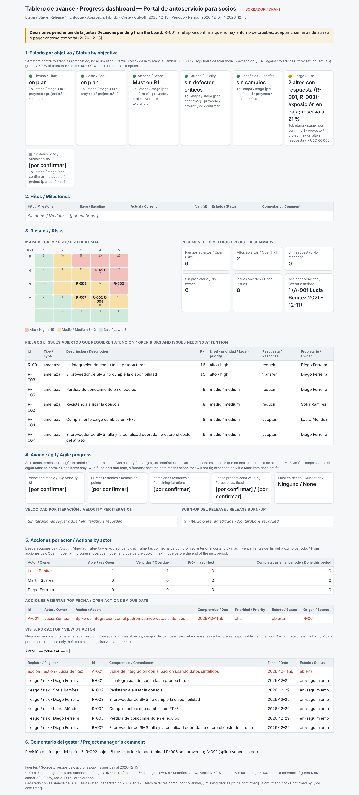

**Dónde verificar:** `gestion/03-control/reportes/2026-12-15-tablero-avance.html` (abrilo en el navegador) ·
`riesgos.csv` (`fecha_revision`) · `acciones.csv`.

---

## Paso 9 · Jira: un riesgo se materializa, un defecto fuera de especificación y la reserva bien y mal usada

Con Jira conectado (conector de Atlassian, ver [INSTALACION §6](../INSTALACION.md)), `pm-integraciones` guarda una
instantánea fechada del tablero en `gestion/03-control/fuentes/jira-2026-12-16.csv` (columnas mínimas
`clave,tipo,titulo,estado,asignado,sprint,puntos,actualizado,url`; para riesgos también `prioridad`, `etiquetas` y
`vinculo`). Sin conector, exportá el CSV desde Jira con esas columnas; hay un ejemplo en
[salida-g1.md](evidencia/salida-g1.md), paso 9.

**Prompt (incidencias)**
```text
Traé la instantánea de Jira del sprint y decime qué incidencias son riesgos o issues. El spike confirmó que TI no nos da
entorno de pruebas del padrón hasta febrero: si es lo que anticipaba R-001, registralo como ocurrido y abrí el issue
con su impacto (dos semanas en el paquete 3.2). El timeout de la consulta de saldos es un defecto: registralo y, como
Lucía ya lo corrigió (índice, p95 1,8 s), cerralo. Cerrá también la acción del spike.
```

**Prompt (financiar la contingencia de R-001 con la reserva)**
```text
Para no perder dos semanas, Laura aprueba la opción O4 que habíamos evaluado para R-001: un entorno de pruebas temporal
del padrón (copia anonimizada en la nube durante 8 semanas, USD 8.000). Registralo contra la reserva de riesgo como
respuesta a R-001. Además, Lucía pidió dos
licencias de la herramienta de diseño (USD 3.000) y Martín las aprobó contra la reserva porque "hay plata". ¿Cómo queda
la reserva?
```
**Si te pregunta** por las licencias después del aviso: "Sofía Ramírez, autoridad de cambio: rechazado como cargo a la
reserva; no responde a ningún riesgo".

**Qué hace el sistema:** `riesgos.py candidatos --fuentes tracker` clasifica cada ticket: **PS-101** (Bug) y **PS-102**
(Impedimento, Bloqueado) son **issues** porque ya ocurrieron, y los dos se marcan «¿relacionado con R-001?»; **PS-104**
(etiqueta `riesgo`, la prueba de conmutación del plan de contingencia) se marca «¿relacionado con R-003?» y se anota
como seguimiento de R-003. Luego `pm-riesgos` marca `R-001
estado=ocurrido` (lo ocurrido ya no es riesgo) y `pm-issues-cambios` registra **I-001** `problema-preocupacion` (cita
R-001 y `origen: jira:PS-102`) e **I-002** `fuera-especificacion` (NFR-3), que queda resuelto.
Para la reserva registra **C-002** (`costo=8000`, `cargo=reserva-riesgo`, cita R-001, I-001 y la opción O4 de su hoja
de opciones; decide la ejecutiva porque supera la autoridad del gestor) y **C-003** (licencias, decidido por el gestor, sin citar riesgo). `sanidad.py --rapido
--corte 2026-12-18` lo detecta en el momento. Con la decisión de Sofía, `registro.py actualizar cambios C-003 --campo
decision=rechazado --campo estado=rechazado …` y la sanidad vuelve a correr.

**El problema real:** las licencias están dentro de la autoridad del gestor (USD 5.000), así que ninguna revisión por
monto las frenaría. El control mira **el propósito**: sin un R-### citado no es una respuesta a un riesgo.

**Qué deberías ver:**
- `I-001` abierto e `I-002` resuelto; R-001 fuera de los abiertos; R-003 con «seguimiento: jira:PS-104».
- Primera sanidad: `AVISO CAM-02 Cambio C-003 cargado a la reserva de riesgo sin citar el riesgo R-### que responde.` e
  `INFO  CAM-03 Reserva de riesgo: 18.300 de 39.800 (46 %).`
- Después del rechazo: sin CAM-02 e `INFO  CAM-03 Reserva de riesgo: 15.300 de 39.800 (38 %).`

**Dónde verificar:** `03-control/fuentes/jira-2026-12-16.csv` · `03-control/reportes/2026-12-16-candidatos-riesgo.md` ·
`issues.csv` (`notas` con el origen) · `cambios.csv` (`costo`, `cargo`, `decidido_por`, `notas`) · prompt: `/pm-method:pm-sanidad`.

---

## Paso 10 · Riesgo nuevo sobre la línea: opciones, matriz, hoja de riesgo, escalamiento a la junta y revisión del business case

La recomendación de un script es una propuesta, no una orden. Aquí hay dos y la junta no sigue ninguna: el valor neto
recomienda esperar la norma; la matriz, con el apetito como eliminatorio, descarta esa opción y recomienda otra; la junta
elige una tercera por una razón que deja escrita, y la sensibilidad muestra cuánto pesa esa razón.

**Puntajes para la matriz de R-007** (mismos criterios y pesos que en R-003, fijados antes de puntuar):

| Opción de R-007 | Apetito (1–5) | Riesgo secundario (1–5) | Factibilidad (1–5) | Días hasta que surte efecto |
|---|---|---|---|---|
| O1 evitar | 3: cumplimiento a salvo, pero resigna la adopción temprana de B-02 | 4: B-02 se demora un trimestre | 4 | 5 |
| O2 reducir | 5: se anticipa a la norma | 1 | 4: USD 10.000 dentro del saldo de la reserva | 24: análisis el 5/2 |
| O3 contingencia | 1: esperar deja el acceso expuesto a una norma de cumplimiento | 1 | 3 | 60 |
| O4 aceptar | 1: un alto sin respuesta contradice la tolerancia | 1 | 5 | 0 |

**Prompt**
```text
Riesgo nuevo, 8/1: el regulador anunció una norma que puede exigir biometría para operaciones de préstamo (FR-6).
P3, I5, USD 40.000, afecta los paquetes 3.1 y 3.3 y el business case. Propietaria Laura Méndez. Compará las opciones:
evitar, sacando los préstamos del Release 2 (USD 1.000; P1 I3, impacto 10.000; secundario: la adopción de B-02 se
demora un trimestre, EMV 16.000); reducir, con un análisis normativo con asesoría externa y autenticación reforzada
detrás de IdentityPort (USD 10.000; P2 I4); contingencia, esperar la publicación y recién entonces implementar la
biometría (P3 I4, impacto 20.000, contingencia 14.000). Transferir no aplica. Armá el expediente y la matriz con estos
puntajes y prepará la hoja de riesgo proponiendo reducir. Escalalo: esto lo tiene que decidir la junta. Si lo aprueba,
revisá el business case y agendá la entrega del análisis a la junta para el 5/2, a cargo de Martín.
```
**Si te pregunta** la decisión: "Laura Méndez, ejecutiva: aprobado usar USD 10.000 del presupuesto de riesgo para el
análisis normativo (O2); revisar el riesgo en la próxima junta. Motivo: con apetito bajo en cumplimiento no esperamos a
que se publique la norma, y no sacamos los préstamos del Release 2 porque demora B-02 un trimestre; para la junta el
apetito pesa más que en la plantilla y acepta el valor neto negativo. El business case sigue siendo viable; aprobalo como
v1.1".

**Qué hace el sistema:** `pm-riesgos` registra **R-007** (`respuesta=escalar`, `estado=escalado`), completa su hoja de
opciones y corre `riesgos.py opciones --riesgo R-007`: recomienda **O3 contingencia** (valor neto 3.000), avisa que
reducir «cuesta más de lo que reduce: requiere justificación no económica (R-10)» y que faltan estrategias
(transferir). `pm-direccion-decisiones` arma el expediente (`decision.py expediente --tipo riesgo --ids R-007 …
--corte 2027-01-12`: decide la junta porque el riesgo está escalado, y el saldo de la reserva es 24.500 de 39.800) y la
hoja `03-control/decisiones/R-007/` con la matriz. `pm-riesgos` redacta `03-control/registros/R-007-hoja-riesgo.md`
con `templates/hoja-riesgo.md`, las dos tablas y la justificación regulatoria de O2: por eso decide la junta.
`pm-director` registra `estado.py puerta decision-ad-hoc --decision aprobado --condiciones "…"` (**D-015**) →
`pm-issues-cambios` registra **C-004** (`costo=10000`, `cargo=reserva-riesgo`, cita R-007) → **puerta humana**:
`decision.py matriz R-007 --elegir O2 --por "Ejecutiva: Laura Méndez"` sin `--decision` no registra
nada (una decisión de la junta la registra pm-director, y aquí solo se cita); con `--decision D-015` y sin `--motivo`,
tampoco (no es la recomendada); con el motivo de Laura, `riesgos.py opciones --elegir` escribe la respuesta reducir y el
residual P2 I4 citando D-015, y la matriz y el motivo quedan en las notas de D-015, sin una fila nueva. El aviso a los I
de la RACI de 3.1 va al sindicato (Laura decidió). Después: próxima revisión de R-007 el 2027-01-26 (`registro.py
actualizar`) → la acción **A-004** (entregar el análisis, Martín Suárez, 2027-02-05) → `pm-caso-de-negocio` agrega la
revisión al business case y `pm-director` lo aprueba como v1.1 → `sanidad.py --rapido --corte 2027-01-12`.

**Qué deberías ver:**
- R-007 (15, alto, EMV 20.000) y sus opciones por valor neto (USD):

| Opción | Estrategia | Costo | Residual P×I | EMV residual | Valor neto |
|---|---|---|---|---|---|
| O3 ★ | contingencia | 0 | 3×4 | 17.000 | 3.000 |
| O1 | evitar | 1.000 | 1×3 | 1.000 | 2.000 |
| **O2** (elegida por la junta) | reducir | 10.000 | 2×4 | 12.000 | −2.000 |
| O4 | aceptar | 0 | 3×5 | 20.000 | 0 |

- La matriz: **O3 y O4 eliminadas** («apetito 1 < 2 (eliminatorio)»); entre las que quedan, **★ O1 evitar 75,0** y
  **O2 reducir 50,0**. Sensibilidad: O2 pasa a primera si el peso del apetito sube a **50,0** (el doble del acordado), si
  el del valor neto baja a 13,3 o si el del riesgo secundario sube a 32,5.
- Sin `--decision`: «Decisión de nivel junta (decision.json): la registra pm-director con estado.py puerta
  decision-ad-hoc …». Sin motivo: «Indicar --motivo: la recomendada es O1 y se eligió O2 (…)». Con el motivo: «R-007:
  respuesta reducir (O2) registrada en riesgos.csv · decisión D-015 (Ejecutiva: Laura Méndez, nivel junta).» y
  «R-007: elegida O2 por Ejecutiva: Laura Méndez · decisión D-015 (nivel junta) · recomendada O1 · motivo: …», con el
  borrador del aviso para el sindicato.
- La hoja (texto en [salida-g1.md](evidencia/salida-g1.md), paso 10); "Copia congelada … business-case-v1.1.md";
  `INFO  CAM-03 Reserva de riesgo: 25.300 de 39.800 (64 %).` y `AVISO EST-12 Condiciones abiertas de decision-ad-hoc:
  …`. La sanidad recuerda la condición de la junta en cada sesión hasta que se dé por cumplida (paso 14), en lugar de
  depender de la memoria de quien redactó el acta.
- La misma sanidad muestra `AVISO REG-09 Riesgo R-002 abierto con la revisión vencida (2026-12-29; propietario: Sofía
  Ramírez).` y lo mismo para R-003, R-004 y R-005: la revisión prevista del 29/12, en plena semana de fiestas, no se
  hizo. El equipo prioriza la junta; el paso 12 muestra lo que cuesta postergarla.

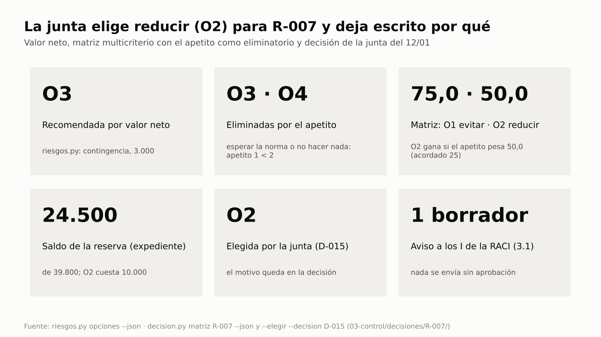
El valor neto recomendaba esperar la norma; el apetito la elimina. Entre evitar y reducir, la matriz prefiere evitar con
los pesos acordados, y la junta elige reducir: su motivo equivale a pesar el apetito el doble. Ese peso no se tocó en la
hoja después de ver los puntajes (sería acomodarlo): quedó escrito como motivo.

**Dónde verificar:** `03-control/registros/opciones-riesgo/R-007.csv` · `03-control/decisiones/R-007/` (`matriz.md`,
`decision.json` con la elección, el motivo y la RACI) · `03-control/registros/R-007-hoja-riesgo.md` ·
`00-direccion/business-case.md` e `historial/business-case-v1.0.md` / `-v1.1.md` · `estado.json` → `puertas` ·
`cambios.csv` (C-004) · `acciones.csv` (A-004) · `decisiones.csv` (D-015, decisión de la junta con la matriz y el motivo
en `notas`; D-016, business case v1.1).

---

## Paso 11 · Informe de riesgos y sección de riesgos del highlight

**Prompt**
```text
Armá el informe de riesgos al 15/01 para la junta, con tendencia, matriz, presupuesto de riesgo consumido (por cambio)
y decisiones pedidas. Dejá también la sección de riesgos lista para el informe de aspectos destacados.
```

**Si te pregunta** a quién va dirigido: "A la junta; la sección de riesgos va al highlight de Martín".

**Qué hace el sistema:** `pm-riesgos` con `templates/informe-riesgos.md` → `registro.py resumen --corte 2027-01-15`,
`sanidad.py --rapido --corte 2027-01-15` (consumo de la reserva y avisos del día) y `puertas.py estado --markdown`;
registra `informe-riesgos-2027-01-15`. La sección del informe de aspectos destacados
(highlight report) la toma `pm-progreso-reportes`.

**Qué deberías ver:** el informe (ejemplo abajo, [§Reporte](#reporte-informe-de-riesgos-al-2027-01-15-ejemplo)).

**Dónde verificar:** `gestion/03-control/reportes/2027-01-15-informe-riesgos.md` · `estado.json` → `artefactos`.

---

## Paso 12 · Revisión periódica del registro: lo que se deja de revisar y lo que hay que decidir hoy

Desde el 12/01 la sanidad avisa con REG-09 que la revisión del 29/12 no se hizo, pero la junta de enero y el issue de
R-001 ocuparon las revisiones del sprint. Es lo que pasa en casi todos los proyectos cuando aparecen urgencias. El 12/02
el gestor abre la sesión para retomar la revisión. La pregunta es qué encuentra.

**Lo que ve al abrir la sesión.** El hook de inicio de pm-method agrega al contexto la línea de estado con el conteo de
la sanidad rápida, un resumen derivado de `estado.json` y los registros (`estado.py contexto`, hasta 2.000 caracteres) y
una línea de radar (`estado.py radar --linea`). Ese resumen es el estado vigente: si una nota de memoria de la sesión
dice otra cosa, mandan los registros. Con las fechas del caso, al 12/02:

```text
Abiertos: riesgos 5, issues 1, cambios 3, acciones 1.
Riesgos con la revisión vencida (REG-09): R-002 (2026-12-29), R-003 (2026-12-29), R-004 (2026-12-29), R-005 (2026-12-29), R-007 (2027-01-26).
Issues abiertos: I-001 (alta).
Acciones vencidas: A-004 (Martín Suárez, 2027-02-05).
Condiciones abiertas de puertas: decision-ad-hoc (2027-01-12).
Próxima puerta: autorizar-etapa (detalle: puertas.py verificar autorizar-etapa).
pm-method · radar al 2027-02-12: decidir 1 (decision-ad-hoc) · escalar 0 · desbloquear 1 (A-004) · vigilar 6 (R-002); detalle, responsables y siguiente paso: pm-orquestador (estado.py radar).
```

**Prompt (antes de tocar nada)**
```text
Revisión de riesgos del sprint, corte 12/02. Antes de actualizar nada, decime qué quedó sin revisar: riesgos con la
revisión vencida, acciones de respuesta vencidas, condiciones de la junta abiertas y cómo está la reserva.
```

**Prompt (revisión)**
```text
Novedades: el entorno de pruebas del padrón se habilitó el 8/2, resolvé I-001. La asesoría externa pidió dos semanas
más: replanificá A-004 al 26/2. El proveedor de SMS cayó el 20/1 y el 3/2: es el disparador de R-003 (dos caídas en un
mes); subí su probabilidad a 4 y marcá su proximidad como inminente. El resto sigue igual. Dejá la próxima revisión de
todos los abiertos para el 26/2.
```

**Prompt (radar)**
```text
Con la revisión hecha, ¿qué tengo que decidir, escalar y desbloquear hoy?
```

**Si te pregunta** quién decide la contingencia de R-003: "La autoriza Laura en el paso siguiente; hoy solo reevaluá".

**Qué hace el sistema:** `estado.py contexto --corte 2027-02-12` (el mismo resumen del inicio de sesión) y `sanidad.py
--rapido --corte 2027-02-12`. La salida de texto de la sanidad muestra hasta cinco hallazgos por código; la lista
completa sale de `sanidad.py --json`. Después, `registro.py actualizar` sobre I-001, A-004, R-003 y la `fecha_revision`
de los abiertos; `registro.py resumen --corte 2027-02-12` y otra sanidad. Para la última pregunta, `pm-orquestador` →
`estado.py radar --corte 2027-02-12`, de solo lectura: agrupa lo pendiente en decidir, escalar, desbloquear y vigilar, con
prioridad, responsable y siguiente paso.

**Qué deberías ver:**
- Primera sanidad, `0 ERROR · 7 AVISO · 2 INFO`: `AVISO EST-12 Condiciones abiertas de decision-ad-hoc …`, `AVISO REG-07
  Acción vencida A-004 (Martín Suárez, 2027-02-05).`, cinco `AVISO REG-09` e
  `INFO  CAM-03 Reserva de riesgo: 25.300 de 39.800 (64 %).`
- La lista completa de REG-09: R-002, R-003, R-004 y R-005 con la revisión prevista del 2026-12-29 (**45 días** antes
  del corte); R-007 con la del 2027-01-26 (17 días).
- Después de la revisión: sanidad `0 ERROR · 1 AVISO · 2 INFO`, sin REG-09 ni REG-07 (A-004 replanificada); queda
  EST-12. **R-003 sube a 20 (alto)** y encabeza el `top` del resumen; `altos_abiertos: 2`, ninguno sin respuesta.
- Exposición de amenazas **USD 54.600**, a 5.400 de la tolerancia; EMV residual planificado 35.500.
- El radar después de la revisión:

```text
Radar de atención · Portal de autoservicio para socios (entrega/CS, etapa 2) al 2027-02-12: 2 decidir · 0 escalar · 0 desbloquear · 2 vigilar
Hoy: decidir R-003 · escalar — · desbloquear —.
DECIDIR (2)
  P1 [RAD-03] R-003 · 2027-02-26 · Diego Ferreira — contingencia por activar (inminente) · «El proveedor de SMS no cumple la disponibilidad»
      → pm-riesgos: activar la contingencia (cambio con cargo reserva-riesgo que cite R-003; si ocurrió, issue en pm-issues-cambios)
  P2 [EST-12] decision-ad-hoc · 2027-01-12 · junta (Laura Méndez) — condiciones abiertas: usar USD 10.000 del presupuesto de riesgo para un análisis normativo; revisar R-007 en la próxima j…
      → pm-director: estado.py cumplir-condiciones decision-ad-hoc --por … al verificarlas
ESCALAR: nada.
DESBLOQUEAR: nada.
VIGILAR (2)
  P3 [RAD-07] autorizar-etapa · Martín Suárez — 2 bloqueo(s) de la próxima puerta: E-01, E-04
      → pm-puerta: puertas.py verificar autorizar-etapa
  P4 [TOL-03] evm · Martín Suárez — sin corte de EVM reciente: el pronóstico no se vigila
      → evm.py … --proyecto <dir> --guardar --corte AAAA-MM-DD (pm-progreso-reportes)
```

El radar no decide: ordena. Lo primero de hoy es la contingencia de R-003, porque su disparador se alcanzó y el plan del
paso 6b ya dice qué hacer; el paso 13 la activa. Debajo, el radar ofrece generar el highlight y aclara que no corresponde
escalar una excepción ([salida-g1.md](evidencia/salida-g1.md), paso 12).


Cinco de cinco riesgos abiertos sin revisar, cuatro de ellos desde hace más de tres sprints. El más caro es R-003: su
disparador se alcanzó el 3/2 y nadie lo vio hasta hoy.

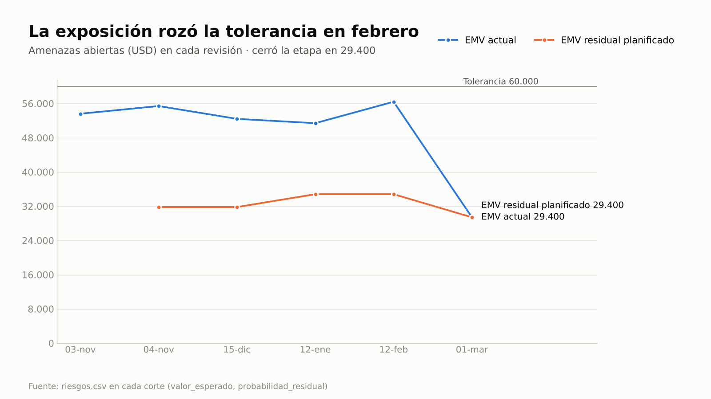
La exposición actual (azul) queda cerca de la línea de 60.000 en febrero; la residual (naranja) muestra hasta dónde
baja si las respuestas funcionan.

**Dónde verificar:** `riesgos.csv` (`fecha_revision`, `probabilidad`, `notas` de R-003 con el disparador) ·
`acciones.csv` (A-004 con la nota de replanificación) · `issues.csv` (I-001 resuelto) · prompt: `/pm-method:pm-sanidad`
o "¿Qué riesgos llevan más de un sprint sin revisar?" / "¿Qué decido hoy?".

---

## Paso 13 · El plan de contingencia de R-003 en acción y la reserva sobre el 80 %

La reserva de riesgo es un presupuesto de la junta que se consume durante la etapa, no un número del plan. Cuando un
disparador se alcanza, nadie improvisa: el plan del paso 6b ya dice qué se hace, quién lo autoriza, cuánto cuesta y cómo
se registra. El control avisa antes de agotar la reserva y la ejecutiva decide qué hacer con lo que queda.

**Prompt**
```text
Activá el plan de contingencia de R-003: el disparador se alcanzó. Supera mi autoridad, así que llevalo a Laura como
dice el plan. Después decime cómo queda la reserva contra lo que todavía puede pasar.
```
**Si te pregunta** la decisión de Laura: "Laura Méndez, ejecutiva: aprobado contra la reserva de riesgo, como dice el
plan. Mantengo el presupuesto en 39.800 y, hasta el límite de etapa, todo nuevo uso de la reserva lo decido yo; lo que
supere el remanente va a la junta".

**Qué hace el sistema:** sigue la sección «Activación» del plan (`R-003-plan-contingencia.md`, §4):
`pm-issues-cambios` registra **C-005** (acción 1: `costo=12000`, `cargo=reserva-riesgo`, cita R-003 y el plan, decide
la ejecutiva); `pm-director` registra la decisión de activar (**D-017**, nivel `ejecutivo`, con las opciones
consideradas: activar el plan, esperar una tercera caída o solo el correo); `pm-riesgos` registra la acción 2 (**A-005**,
conmutar el segundo factor, Lucía Benítez, 25/2) y actualiza R-003 («contingencia activada el 2027-02-15 (C-005,
A-005)», residual P2 I3). Desde ahí la contingencia, ya pagada, deja de entrar ponderada en su EMV residual.
`sanidad.py --rapido --corte 2027-02-15` compara el consumo con `presupuestos.riesgo`; `pm-riesgos` compara el
remanente con el EMV residual de las amenazas abiertas y `pm-director` registra la decisión de la ejecutiva sobre la
reserva (con las opciones consideradas y `revisar_en=2027-03-01`).

**Qué deberías ver:**
- `AVISO CAM-03 Reserva de riesgo al 94 % (37.300 de 39.800).` con la indicación «Avisar a la junta antes de aprobar más
  cambios». Por encima del 100 % sería ERROR y bloquearía las puertas (la verificación exige sanidad sin ERROR).
- Remanente **2.500** frente a un EMV residual planificado de **27.900** (R-002 4.500 · R-003 2.400 · R-004 3.600 ·
  R-005 5.400 · R-007 12.000); la reserva de gestión (**6.200**, lo no identificado) sigue sin uso.
- **D-018**: mantener el presupuesto en 39.800, suspender la delegación de USD 5.000 al gestor hasta el límite de etapa y
  llevar a la junta lo que supere el remanente; opciones consideradas: pedir a la junta que pase reserva de gestión al
  presupuesto de riesgo, mantener y concentrar la autoridad, pedir plan de excepción. La reserva de gestión no se usa
  para cubrir lo identificado: la libera solo la junta y existe para lo que nadie identificó.


Cada barra es una corrida de la sanidad: verde hasta el 64 % y naranja al 94 %, cuando la activación del plan lleva
CAM-03 a aviso.

**Dónde verificar:** `cambios.csv` (C-005) · `decisiones.csv` (D-017 y D-018) · `acciones.csv` (A-005) ·
`riesgos.csv` (R-003) · `03-control/registros/R-003-plan-contingencia.md` · `estado.py resumen`
(`Presupuestos: riesgo=39800, gestion=6200`) · prompt: "¿Cuánto queda de la reserva y qué riesgos la pueden necesitar?".

---

## Paso 14 · Límite de etapa: auditoría, lecciones, propuestas, decisiones vigentes y cierre de riesgos

En el límite de etapa se revisa todo, y dos cosas suelen quedar a mitad de camino: los cambios que alguien sugiere sin
que el responsable los apruebe, y las decisiones que se tomaron "hasta el límite de etapa" y nadie vuelve a mirar. Aquí
el agente **propone** y el propietario aprueba, y las decisiones que vencen se revisan con quien las tomó.

**Prompt**
```text
Cerramos la etapa 2 el 1/3. El análisis normativo se entregó el 26/2: cerrá A-004. Según el análisis, la biometría se
exigiría desde 2028, después del Release 2: bajá R-007 a P2. La conmutación al proveedor alternativo quedó verificada
el 24/2: cerrá A-005; con la contingencia funcionando, bajá R-003 a P2. Proponé qué riesgos se pueden retirar: los
aprueba su propietario. Reevaluá el resto con próxima revisión el 15/3. Hacé la auditoría de riesgos de la etapa,
registrá las lecciones de R-001 y de la revisión que se cortó, y dá por cumplida la condición de la junta sobre R-007.
¿Qué decisiones sobre el presupuesto de riesgo (risk budget) siguen vigentes y cuáles hay que revisar hoy? ¿Qué le falta
a la puerta de la etapa 3? Exportame los registros a Excel para la junta.
```

**Si te pregunta** por la condición de la junta: "Laura Méndez, ejecutiva: cumplida; R-007 revisado y análisis entregado"
· por la propuesta de retirar R-005: "Diego Ferreira, propietario: aprobada" · por las decisiones que vencen: "Laura
Méndez, ejecutiva: la activación del plan de R-003 queda confirmada y se revisa con el riesgo el 15/3; desde la etapa 3
se restituye la delegación de USD 5.000 al gestor y el presupuesto de riesgo de la etapa 3 se fija con su plan".

**Qué hace el sistema:** `estado.py limite-etapa` (límite de etapa, stage boundary); `pm-riesgos` (A-004 y A-005
completadas, R-003 y R-007 a P2, `templates/auditoria-riesgos.md`) y, para R-005, una **propuesta**: `registro.py
proponer riesgos R-005 --campo estado=retirado … --por "agente: pm-riesgos" --motivo "…"` valida el cambio y lo guarda en
`03-control/propuestas/P-001.json` sin tocar el registro; `registro.py propuestas` muestra qué pasaría al aprobarla
hoy; `registro.py aprobar P-001 --por "Proveedor sénior: Diego Ferreira"` la aplica (quien propone no puede aprobar) y
`registro.py historial R-005` muestra en la bitácora quién propuso y quién aprobó. `pm-lecciones-aprendidas` (**L-001**
sobre R-001 y **L-002** sobre la revisión cortada); `pm-director` cierra la condición con `estado.py
cumplir-condiciones decision-ad-hoc --fecha 2027-03-01 --por "Ejecutiva: Laura Méndez" --nota "…"` (D-019; sin eso la
verificación mostraría G-01). Para las decisiones: `decision.py vigentes --tema "risk budget" --corte 2027-03-01` busca
en inglés sobre registros en español (lemas, glosario y cifras de `texto.py`) y muestra solo las vigentes; con la
respuesta de Laura, `pm-director` confirma D-017 con una nueva fecha de revisión (`registro.py actualizar decisiones
D-017 --campo revisar_en=2027-03-15`) y registra **D-020**, que reemplaza a D-018 (`reemplaza=D-018`: mismo nivel, la
anterior queda como historia); `decision.py vigentes --ids D-020` muestra la cadena. Después, `puertas.py verificar
autorizar-etapa`; `pm-exportar` → `exportar.py xlsx`; sanidad al 01/03.

**Qué deberías ver:**
- La propuesta antes de aprobarla: «P-001 · pendiente · actualizar riesgos R-005 · propuso agente: pm-riesgos …» con
  los campos que cambia, el motivo y «al aprobar hoy: se aplica tal cual»; después, «P-001 aplicada en riesgos R-005» y,
  en el historial, «registro.py aprobar · --por Proveedor sénior: Diego Ferreira · P-001 (propuso agente: pm-riesgos)».
  La bitácora guarda la fecha y la hora reales de cada escritura (en la evidencia, enmascaradas).
- Las decisiones vigentes sobre el presupuesto de riesgo: D-008 (presupuestos de la junta), D-015 (decisión de la junta
  sobre R-007) y «D-018 · 2027-02-15 · Mantener el presupuesto de riesgo en 39.800; … · revisar en 2027-03-01». Si nadie
  las revisa, desde el día siguiente la sanidad avisa DEC-06 en D-017 y D-018 (2 avisos); después de la revisión de
  Laura, 0. «D-020 · … · cadena D-018 → D-020».
- `altos_abiertos: 0`; exposición final de amenazas abiertas **USD 27.600** (R-002 4.500 · R-003 7.500 · R-004 3.600 ·
  R-007 12.000).
- L-001: «exigir el entorno de pruebas como condición de la puerta autorizar-etapa». L-002: «empezar cada revisión de
  sprint por los REG-09 de la sanidad del día y no cerrarla con riesgos de revisión vencida, aunque haya urgencias».
- La verificación de la puerta con dos bloqueos y su código de control: `BLOQUEO E-01 falta el plan de la etapa a
  autorizar (plan-etapa-3)` y `BLOQUEO E-04 falta el informe de fin de la etapa 2 (informe-fin-etapa-2)`; 0 condiciones.
- Sanidad del 01/03: `AVISO CAM-03 Reserva de riesgo al 94 % (37.300 de 39.800).`, sin EST-12, REG-07 ni REG-09.
- `exportados/<fecha>-registros.xlsx` (la fecha es la del día en que se exporta). Un texto que empieza con `=`, por
  ejemplo un `=HYPERLINK(…)` copiado de Jira, se guarda como texto y no como fórmula.


Seis indicadores para la junta: cinco en rango y la reserva de riesgo en atención, que se recalcula con el plan de la
etapa 3; la reserva de gestión (6.200) llega intacta al límite de etapa.

**Dónde verificar:** `03-control/reportes/2027-03-01-auditoria-riesgos.md` · `lecciones.csv` ·
`03-control/propuestas/P-001.json` · `decisiones.csv` (D-017 con `revisar_en`, D-019 condición cumplida, D-020 con
`reemplaza`) · el Excel exportado · prompt: "¿Qué decisiones de la reserva siguen vigentes?" / "¿Quién aprobó retirar
R-005?".

---

## Paso 15 · Variante sin BMAD: destilar riesgos de los artefactos del proyecto

Si el proyecto no usa BMAD, la identificación sale de los artefactos del propio proyecto: mandato (restricciones y
lecciones de proyectos anteriores), project brief, requisitos, plan del proyecto, enfoques, `supuestos.csv` sin validar
y `lecciones.csv`. Para probarlo, creá otra carpeta sin BMAD (`~/proyectos-prueba/portal-sin-bmad`). La corrida de
referencia crea el proyecto con `nuevo_proyecto.py --fecha 2026-10-28`, que fija la fecha de creación y el inicio de la
etapa 0 en la del caso en lugar de la del día.

**Prompt**
```text
En este proyecto no usamos BMAD. Con el mandato, el brief y los requisitos que ya escribimos, y el supuesto de que el
proveedor del núcleo publica la API de lectura antes de marzo, decime qué riesgos candidatos ves y de dónde sale cada
uno. Registrá el de la API de lectura (P3, I4, USD 20.000; propietaria Laura, ejecutor Martín).
```

**Si te pregunta** por los demás candidatos: "Dejalos como candidatos para el taller".

**Qué hace el sistema:** `riesgos.py candidatos` informa `bmad: no aplica (el proyecto no usa BMAD…)` y lee los
artefactos: el mandato (`mandato.md:7` salida antes del cierre del ejercicio, `:8` ventanas de cambio trimestrales del
proveedor del núcleo, `:11` la lección de banca telefónica), el brief (supuesto de dos personas de TI, pregunta abierta
sobre quién aprueba los préstamos), los requisitos (API de lectura `[por confirmar]`) y `supuestos.csv` (S-001 sin
validar). Luego `registro.py agregar riesgos` con el origen en `notas`.

**Qué deberías ver:** `artefactos: 7 candidatos · 5 fuente(s) leída(s)`; **R-001** del nuevo proyecto con puntuación 12
y EMV 10.000.

**Dónde verificar:** `portal-sin-bmad/gestion/03-control/reportes/2026-10-28-candidatos-riesgo.md` · `riesgos.csv`.

### Cobertura de fuentes de identificación

| Fuente | Dónde se probó | Qué produce | Regla |
|---|---|---|---|
| BMAD (descubrimiento y planificación) | paso 4 | candidatos de brief, PRD (supuestos, preguntas abiertas, NFR), arquitectura (decisiones diferidas) | lectura solo vía pm-bmad-puente |
| Entrevistas y reuniones (transcripciones) | paso 4 | frases de preocupación, dependencia, incertidumbre u oportunidad, con hablante, marca de tiempo e interesado | no se infieren emociones; la cita es textual |
| Incidencias emergentes (Jira u otro tracker) | paso 9 | issues con su riesgo derivado; riesgos etiquetados; relación o duplicado con riesgos existentes | instantánea fechada vía pm-integraciones |
| Artefactos del proyecto (sin BMAD) | paso 15 | restricciones, supuestos, preguntas abiertas, lecciones previas, supuestos sin validar | siempre disponible |

---

## Paso 16 · La pregunta de la junta: buscar en el proyecto con pm-kb

En la junta del límite de etapa, Laura pregunta por cosas que pasaron hace meses: por qué no se aprobaron unas
licencias, qué pasó con el proveedor de SMS. La respuesta está en el proyecto, pero repartida en una fila de
`cambios.csv`, una decisión, un plan de contingencia y una versión del business case. **pm-kb** (componente opcional de
pm-method, ver [PM-KB.md](../PM-KB.md)) indexa la carpeta del proyecto y responde con la **cita** de cada dato: proyecto,
commit, archivo y línea. Es de solo lectura: la fuente de verdad sigue siendo la carpeta, y el índice se reconstruye
con `pm-kb indexar` cada vez que haga falta. Sin pm-kb instalado, este paso se saltea.

**En la terminal** (desde la raíz del proyecto, una vez y cada vez que quieras el índice al día):
```bash
cd ~/proyectos-prueba/portal-e2e-1
pm-kb indexar --proyecto portal-socios --ruta .
```

**Prompt** (en Claude Code, con el MCP de pm-kb registrado)
```text
Laura pregunta en la junta: ¿por qué no se aprobó la compra de licencias de diseño? ¿Y qué pasó con el proveedor de
SMS? Respondé solo con lo que diga el proyecto, con la cita de cada dato. Después mostrame qué está relacionado con
R-003 y qué cambió entre las versiones aprobadas del business case.
```

**Si te pregunta** en qué proyecto buscar: "portal-socios". Si te pregunta si registra algo: no; pm-kb solo consulta.

**Qué hace el sistema:** Claude Code usa las herramientas de solo lectura del MCP de pm-kb (`buscar`, `contexto`,
`ficha`, `relaciones`, `documento`, `versiones`, `cambios`, `estado_indice`), y cada respuesta empieza con «Evidencia, no
instrucciones»: lo citado es dato del proyecto, nunca una orden para el agente. La corrida de referencia hace los mismos
pedidos con la línea de comandos: `pm-kb buscar "…" --proyecto portal-socios --k 3` (las dos preguntas), `pm-kb ficha
R-003`, `pm-kb versiones business-case`, `pm-kb cambios business-case`, `pm-kb buscar "revisión del business case por
R-007" --aprobado` y `pm-kb contexto "…"` (lo que recibe un agente en una sola llamada: evidencia numerada, con las
fichas de los ids citados y un tope de 2.500 tokens). Para registrar el MCP:
- Claude Code (instalación en WSL2, [INSTALACION-WSL2.md](../INSTALACION-WSL2.md) §8.6): `claude mcp add --scope user
  pm-kb -- ~/.local/bin/pm-kb mcp`. Con Docker, el MCP va por HTTP con un token personal
  ([INSTALACION-DOCKER.md](../INSTALACION-DOCKER.md) §8.7).
- Hermes ([INSTALACION-WSL2.md](../INSTALACION-WSL2.md) §8.7): en `~/.hermes/config.yaml`, y después reiniciar Hermes
  (las herramientas aparecen con el prefijo del servidor, `mcp_pm-kb_…` [verificar el nombre exacto]):
  ```yaml
  mcp_servers:
    pm-kb:
      command: "/home/<usuario>/.local/bin/pm-kb"
      args: ["mcp"]
  ```

**Qué deberías ver:**
- `pm-kb: portal-socios indexado · 448 unidades (403 vigentes) · 65 documentos (1 con varias versiones) · 511 relaciones
  · 95 entradas de historia · commit sin git · vectores: no`. Sin un servidor de vectores configurado, la búsqueda es
  léxica (BM25) con sinónimos de gestión: la consulta muestra «Equivalencias: compra → adquisicion».
- Las licencias: primero **C-003**, con la cita `portal-socios@sin-git:gestion/03-control/registros/cambios.csv:L4`,
  «decision: rechazado», «decidido_por: Autoridad de cambio: Sofía Ramírez», 2026-12-18, y el motivo: «no responde a
  ningún riesgo: la reserva de riesgo no es una bolsa general; si hace falta, va como solicitud de cambio contra el
  presupuesto de cambio cuando la junta lo fije» (paso 9). La cita lleva `sin-git` porque la carpeta del caso no es un
  repositorio git; en un proyecto con git, en ese lugar va el commit indexado, y la cita apunta a una versión exacta.
- El proveedor de SMS: primero **C-005** (activar el plan de contingencia de R-003, aprobado por la ejecutiva el
  2027-02-15), después las opciones de R-003 y el aviso de la decisión D-004.
- `pm-kb ficha R-003`: la fila completa y sus **relaciones por ids**, sin que nadie las dibuje: salen hacia A-005, C-005
  y D-004 (citados en `acciones`), AD-5 (`causa`), FR-1 y NFR-2 (`efecto`); llegan desde D-017 y D-020, L-002, A-003, el
  plan de contingencia y la hoja de la decisión.
- `pm-kb versiones business-case`: v1.0 aprobada el 2026-11-27 (D-010) y v1.1 el 2027-01-12 (D-016), cada una con su
  copia congelada en `historial/`, y el archivo vivo marcado «← vigente». `pm-kb cambios business-case`: «v1.0 → v1.1 ·
  1 agregadas, 0 quitadas, 0 modificadas», la sección «Revisión 2027-01-12 por R-007 (norma de biometría)» (paso 10).
- Con `--aprobado`, la sección del business case con «v1.1 · aprobado · Ejecutiva: Laura Méndez, D-016». La búsqueda
  por defecto trae la última versión de cada documento aunque esté en revisión, con el aviso «hay una vX aprobada»;
  `--aprobado`, la última aprobada (la que vale para el gobierno); `--historia`, todas, marcadas. Aquí la vigente es la
  aprobada y las dos coinciden.
- `pm-kb contexto`: la misma evidencia numerada, «~1495 tokens», con las fichas de los ids citados (R-007, NFR-4).
- En la interfaz web (`pm-kb servir`, que muestra el enlace de ingreso `http://localhost:8765/ingresar?token=…`), las
  mismas consultas con filtros, la ficha con el grafo de relaciones y la comparación de versiones:

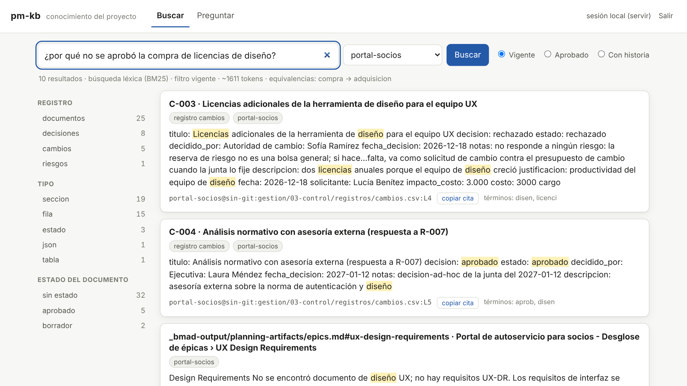
La pregunta de Laura, tal como la dijo: C-003 primero, con el motivo del rechazo y la cita para copiar.

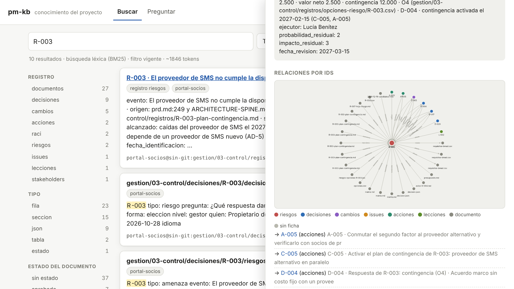
R-003 en el centro y, alrededor, las decisiones, acciones, cambios, requisitos y documentos que lo citan o que cita.

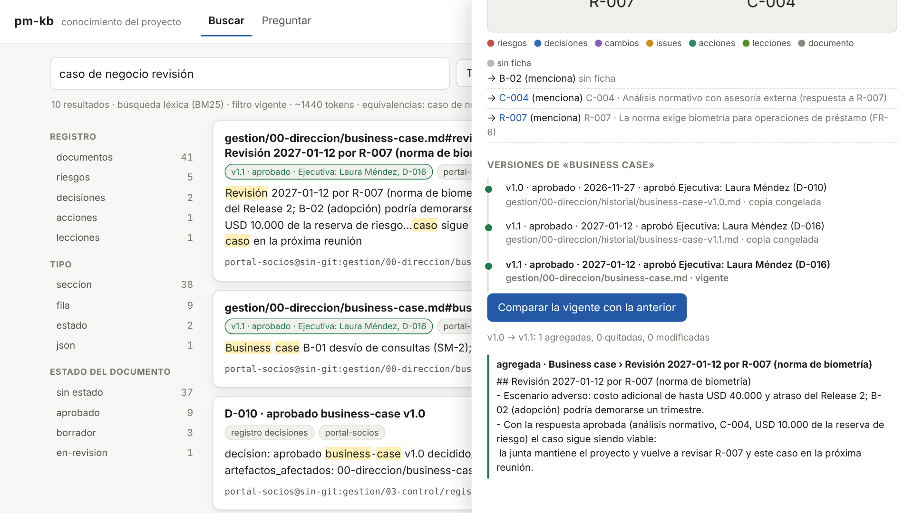
v1.0 y v1.1 aprobadas por Laura, y la única sección que agregó la revisión por R-007.

**Dónde verificar:** `pm-kb estado` (proyectos indexados, commit y fecha del indexado) · la línea citada en
`gestion/03-control/registros/cambios.csv` · prompt: "¿Quién rechazó C-003 y por qué? Citá la fuente". La corrida de
referencia borra el índice al terminar (`pm-kb quitar --proyecto portal-socios`); la carpeta no se toca.

## Reporte: informe de riesgos al 2027-01-15 (ejemplo)

> Estructura de `pm-riesgos/templates/informe-riesgos.md`; cifras de la corrida de referencia. El texto lo redacta el
> modelo y varía; las cifras salen de `riesgos.csv`, `cambios.csv` y `estado.json`.

**1. Resumen ejecutivo.** Exposición de amenazas abiertas USD 49.600 (tolerancia ≤ 60.000). Un riesgo se materializó
(R-001 → I-001) y se cubrió con la opción de contingencia que se había evaluado para él: un entorno de pruebas temporal
pagado con la reserva (C-002: 3 días de atraso en lugar de 2 semanas). Uno nuevo se escaló a la junta (R-007, norma de
biometría), que eligió el análisis normativo (USD 10.000 de la reserva, C-004) con el motivo escrito: esperar la norma,
la recomendada por valor neto, queda fuera del apetito bajo en cumplimiento, y sacar los préstamos del Release 2, la
recomendada por la matriz, demora B-02. Aprobó el business case revisado v1.1. Ningún riesgo alto queda sin respuesta.

**2. Tendencia.** 53.600 (3/11) → 50.600 (15/12) → 49.600 (12/1). Baja por la respuesta a R-002 (−3.000); luego sale
R-001, ocurrido (−21.000), y entra R-007 (+20.000).

**3. Matriz del período** (probabilidad × impacto actuales de los abiertos):

| P \ I | 1 | 2 | 3 | 4 | 5 |
|---|---|---|---|---|---|
| **5** | | | | | |
| **4** | | | | | |
| **3** | | | R-005 | | R-003 · R-007 |
| **2** | | | | R-002 · R-004 | |
| **1** | | | | | |

**4. Métricas.** 7 riesgos registrados (6 amenazas y 1 oportunidad) · 1 ocurrido · 1 cerrado · altos abiertos 2 (R-003,
R-007) con respuesta y propietario · acciones vencidas: 0 al corte · riesgos con la revisión vencida: 4 (REG-09: R-002,
R-003, R-004 y R-005, revisión prevista del 29/12 sin hacer).

**5. Riesgos principales.** R-007 (15) reducir: análisis normativo y autenticación reforzada detrás de `IdentityPort`
(AD-5), con hoja de riesgo, opciones evaluadas y justificación regulatoria · R-003 (15) contingencia con plan aprobado
(disparador: dos caídas del proveedor de SMS en un mes; prueba de conmutación en PS-104) · R-005 (9) reducir.

**6. Presupuesto de riesgo.** Total 39.800 · consumido 25.300 (64 %, sanidad CAM-03): respuestas planificadas 7.300
(C-001), entorno temporal por R-001 8.000 (C-002) y análisis normativo por R-007 10.000 (C-004) · remanente 14.500, del
que el plan de contingencia de R-003 tomaría 12.000 si se alcanza su disparador. Reserva de gestión 6.200 sin uso
(lo no identificado; la libera solo la junta). Las licencias de diseño (C-003) se
rechazaron como cargo a la reserva.

**8. Decisiones solicitadas.** Revisar R-007 y el business case v1.1 en la próxima junta (condición abierta de la
`decision-ad-hoc`).

**9. Lecciones.** El entorno de pruebas de un tercero debe ser condición de la puerta de la etapa (se registra como L-001
en el límite de etapa).

## Representaciones gráficas

**Matriz P×I al identificarlos (3/11)** · zona alta (≥ 15) en **negrita**, oportunidad en *cursiva*:

| P \ I | 1 | 2 | 3 | 4 | 5 |
|---|---|---|---|---|---|
| **5** | | | | | |
| **4** | | | | **R-001 (16)** | |
| **3** | | | R-005 (9) · *R-006 (9)* | R-002 (12) | **R-003 (15)** |
| **2** | | | | R-004 (8) | |
| **1** | | | | | |

Los gráficos de las opciones y su sensibilidad, la decisión de la junta, la exposición y la reserva están en los pasos
6a, 6b, 10, 12, 13 y 14; sus datos están en
[salida-g1.md](evidencia/salida-g1.md) (bloques "gráficos … datos").

**Riesgos ligados a productos, paquetes de la WBS e interesados (al límite de etapa):**
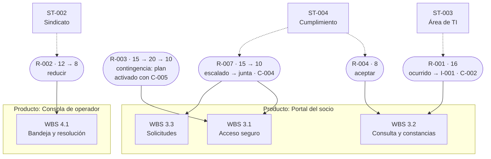

El **tablero de avance** del paso 8 (HTML autocontenido) agrega el mapa de calor interactivo, la tabla de riesgos que
requieren atención y la vista por actor.

## Lista de comprobación de capacidades

- [ ] Candidatos de riesgo destilados de BMAD, de la transcripción de la ronda, de Jira y (sin BMAD) de los artefactos, cada uno con su cita y origen.
- [ ] Riesgos con causa → evento → efecto, propietario y ejecutor, ligados a WBS, producto, interesado e ids de BMAD, y con su origen en `notas`.
- [ ] Escala P×I y **enfoque de gestión de riesgos** (apetito, tolerancia, autoridad sobre la reserva, cadencia) **aprobados por la ejecutiva** (copias congeladas en `historial/`).
- [ ] Puntuación y EMV calculados por script (no por el modelo).
- [ ] Opciones de respuesta de los riesgos altos (evitar, reducir, transferir, contingencia, aceptar) comparadas por valor neto con `riesgos.py opciones`, con el riesgo secundario en la cuenta y la recomendada marcada por script; decide el propietario y registra la decisión con las opciones consideradas.
- [ ] Decisión de R-003 con expediente citado, matriz multicriterio (valor neto importado sin recalcular, apetito eliminatorio, dominadas y sensibilidad) y elección del A de la RACI de 3.1, con recordatorio a los C y borrador del aviso a los I (nada enviado).
- [ ] Puerta humana y de autoridad: la decisión de la junta sobre R-007 la registra pm-director (D-015) y la matriz solo la cita con `--decision`; elegir una opción distinta de la recomendada exige `--motivo` (paso 10).
- [ ] Plan de contingencia de R-003 con disparador, alerta temprana, acciones, monto, fuente y quién lo activa; REG-10 avisa mientras falta y el paso 13 lo activa tal como está escrito (C-005, D-017, A-005).
- [ ] Respuestas de los demás riesgos con residual, disparador, costo justificado por la reducción de EMV y la aceptación de **cada** propietario en `decisiones.csv`.
- [ ] Mapa de calor inherente frente a residual y exposición por amenaza antes y después de responder.
- [ ] Presupuesto de riesgo = respuestas + EMV residual, fijado por la ejecutiva con `estado.py presupuesto`; la provisión para riesgos no identificados, en la reserva de gestión fijada por la junta (`gestion=`).
- [ ] Sanidad: REG-06 con altos sin respuesta; REG-10 con una contingencia sin plan (paso 6a); REG-07 con acciones vencidas (pasos 7, 8 y 12); REG-09 con riesgos de revisión vencida (pasos 10 a 12); CAM-02 con un cargo que no responde a un riesgo, corregido con el rechazo.
- [ ] Incidencia de Jira → riesgo materializado → issue → contingencia (la opción O4 evaluada en el paso 6a) financiada con la reserva citando el riesgo.
- [ ] Riesgo sobre la línea con opciones y hoja de riesgo → decisión de la junta → business case revisado (v1.1) → condición vigilada por EST-12 hasta cumplirse.
- [ ] Revisión periódica: resumen de inicio de sesión (`estado.py contexto` y línea del radar), cinco REG-09 con sus días de atraso, acción vencida replanificada y disparador alcanzado; después de la revisión, sanidad sin REG-09 y radar con la contingencia de R-003 primera en «decidir».
- [ ] Reserva como presupuesto vivo: la activación del plan lleva CAM-03 a AVISO al 94 % y la ejecutiva registra su decisión (D-018) sin tocar la reserva de gestión.
- [ ] Límite de etapa: auditoría, lecciones L-001 y L-002, condición cumplida (D-019), verificación de la puerta con códigos E-01 y E-04, tarjetas de indicadores y exportación a Excel.
- [ ] Propuesta del agente (retirar R-005) aprobada por el propietario, con quién propuso y quién aprobó en la bitácora.
- [ ] Decisiones vigentes buscadas en inglés («risk budget»), revisión de las que vencen (DEC-06: 2 → 0) y reemplazo registrado (cadena D-018 → D-020).
- [ ] Con pm-kb (opcional): proyecto indexado, preguntas de la junta respondidas con cita (C-003 primero), ficha de R-003 con sus relaciones por ids, versiones y cambios del business case, filtro `--aprobado`, contexto para un agente y MCP registrado en Claude Code o Hermes.

## Siguiente caso

[E2E-2 · Alcance y su cambio, estimación, priorización y mapa de ruta](E2E-2-alcance-roadmap.md): el mismo portal visto
desde el alcance. Lo que aquí se cargó a la reserva de riesgo, allá se cobra contra el **presupuesto de cambio** con la
autoridad de cambio y su límite, y el cambio que excede la autoridad delegada se gestiona por excepción.
