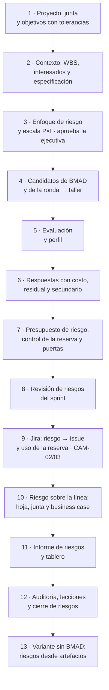
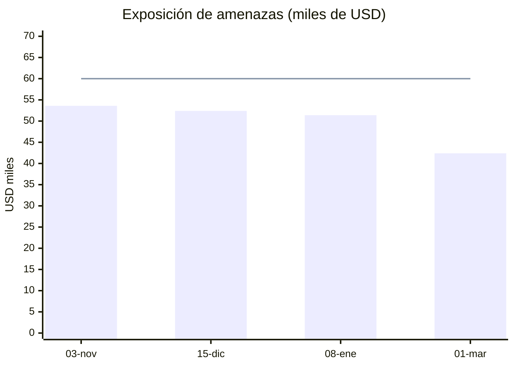
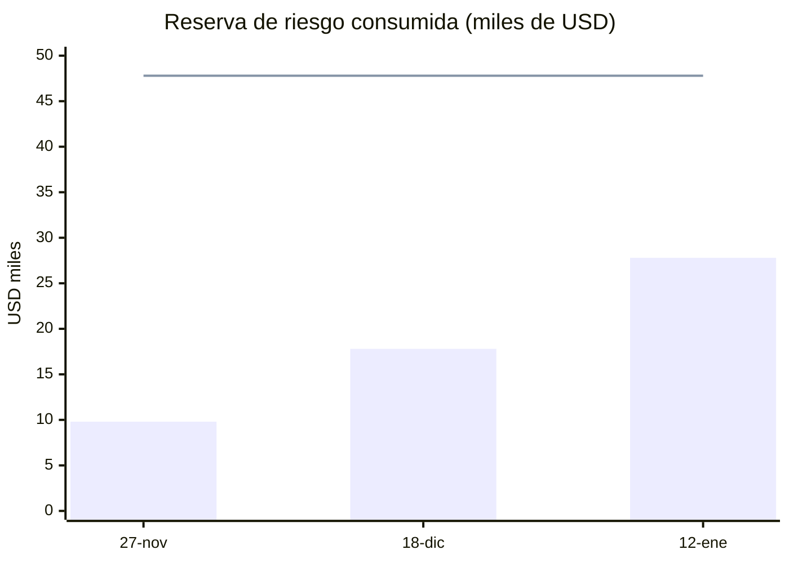
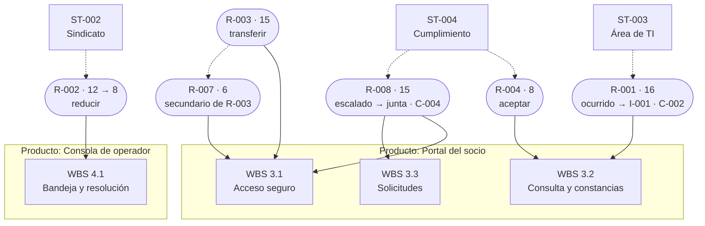

# Guía E2E-1 · Ciclo completo de gestión de riesgos

**Qué vas a probar:** el ciclo de riesgos de PRINCE2 7 (identificar, evaluar, planificar, implementar, comunicar) con
las técnicas del PMBOK 8 (P×I, valor monetario esperado), con cada riesgo **ligado a un producto, a un paquete de la
WBS, a un interesado y a requisitos o decisiones de arquitectura de BMAD**; la **identificación desde cuatro fuentes**
(los artefactos de descubrimiento y planificación de BMAD, las entrevistas y reuniones a partir de sus transcripciones,
las incidencias emergentes de Jira y, si no se usa BMAD, los artefactos del propio proyecto), cada candidato con su cita
y su origen; el **enfoque de gestión de riesgos** con apetito, tolerancia, autoridad sobre la reserva y cadencia,
aprobado por la ejecutiva; respuestas **justificadas por su costo frente a la reducción de EMV**, con un riesgo
secundario y la aceptación de cada propietario; el presupuesto de riesgo (respuestas + EMV residual + provisión para
riesgos no identificados) y el **control permanente de su consumo**; el seguimiento por sprint; un riesgo que se
materializa en issue y se financia con la reserva; un escalamiento a la junta con hoja de riesgo y revisión del business
case; el informe, la auditoría y las lecciones.

**Skills y agentes:** pm-orquestador · pm-inicio y pm-control → `pm-riesgos`, `pm-enfoques-gestion`, `pm-registros`,
`pm-issues-cambios`, `pm-caso-de-negocio`, `pm-planificacion-por-productos`, `pm-interesados`, `pm-reuniones`,
`pm-bmad-puente`, `pm-integraciones`, `pm-progreso-reportes`, `pm-visuales`, `pm-lecciones-aprendidas`, `pm-exportar` ·
`pm-director` (decisiones de la junta).

**Duración:** 90–115 minutos (13 pasos). **Preparación:** [README de las guías](README.md#cómo-usar-las-guías) (copia del fixture en
`~/proyectos-prueba/portal-e2e-1` y `claude` abierto allí). Evidencia de referencia: [salida-g1.md](evidencia/salida-g1.md).



---

## Paso 1 · Proyecto, junta y objetivos con tolerancias

**Prompt**
```text
Creá el proyecto "Portal de autoservicio para socios" en ./gestion, en español y con enfoque híbrido.
La ejecutiva es Laura Méndez y el gestor Martín Suárez. Junta: usuaria sénior y product owner Sofía Ramírez,
proveedor sénior Diego Ferreira, aseguramiento Andrea Costa, jefa de equipo Lucía Benítez; Sofía es además la
autoridad de cambio. Sprints de 14 días y velocidad de referencia de 8 puntos.
Tolerancias de proyecto: tiempo ±3 semanas, costo ±8 %, alcance "Must sin tolerancia", beneficios -10 % y riesgo
"ningún riesgo alto sin respuesta; exposición total ≤ USD 60.000".
```
Atajo para el primer paso: `/pm-method:pm-nuevo "Portal de autoservicio para socios" ./gestion es hibrido`.

**Si te pregunta** por las tolerancias: son de la junta → "Las fija Laura Méndez, ejecutiva".

**Qué hace el sistema:** pm-orquestador → `pm-nuevo` (crea la carpeta y detecta BMAD 6.12.4) → `pm-organizacion-roles`
(roles) → `pm-director` (tolerancias: es decisión de la junta). Comandos de referencia: `nuevo_proyecto.py`,
`bmad.py detectar`, `estado.py rol …`, `estado.py agil …`, `estado.py tolerancia --nivel proyecto …`.

**Qué deberías ver:** `estado.py resumen` con los roles y las tolerancias, entre ellas
`riesgo=ningún riesgo alto sin respuesta; exposición total ≤ USD 60.000`.

**Dónde verificar:** `gestion/estado.json` (`roles`, `tolerancias.proyecto`) · prompt: `/pm-method:pm-estado`.

---

## Paso 2 · Contexto del riesgo: productos y WBS, interesados y especificación

Los riesgos se identifican **contra algo**: objetivos, productos, paquetes de trabajo, interesados y requisitos.

**Prompt**
```text
Cargá la WBS por productos del portal con estos paquetes y costos (USD 50 por hora):
1.1 Gestión de etapas 400 h · 2.1 Brief, PRD, UX y arquitectura (BMAD) 240 h · 3.1 Acceso seguro 420 h (FR-1, FR-2, FR-11)
· 3.2 Consulta y constancias 380 h (FR-3, FR-4, FR-5) · 3.3 Solicitudes del socio 440 h (FR-6, FR-7, FR-8, FR-12)
· 4.1 Bandeja y resolución 400 h (FR-9, FR-10) · 5.1 UAT, prueba de carga y capacitación 200 h · 5.2 Puesta en producción (hito).
Registrá estos interesados: Laura Méndez (ejecutiva; poder alto, interés alto, líder); Sindicato de operadores
(poder medio, interés alto, resistente; queremos neutral); Área de TI del núcleo operativo (poder alto, interés medio,
neutral; queremos partidaria); Unidad de cumplimiento (protección de datos; poder alto, interés medio, neutral;
queremos partidaria).
Después mostrame las decisiones de arquitectura de BMAD que más riesgo pueden traer.
```

**Qué hace el sistema:** pm-planificacion → `pm-planificacion-por-productos` (`wbs.csv` + `wbs.py`); pm-inicio →
`pm-interesados` (`registro.py agregar stakeholders` × 4); lectura de la especificación **solo por la fachada**
(`especificacion.py listar requisitos`, `consultar AD-5`).

**Qué deberías ver:** "13 elementos, 8 hojas · esfuerzo 2480 h · costo 124,000"; interesados **ST-001…ST-004**; 42
identificadores de la especificación (12 FR, 6 NFR, 8 SM, 13 AD, 3 UJ) y el detalle de AD-5 (autenticación detrás de
`IdentityPort`, segundo factor obligatorio).

**Dónde verificar:** `gestion/02-planificacion/wbs.csv` · `gestion/03-control/registros/stakeholders.csv` · prompt:
"Mostrame la WBS con costos" / "Listá los interesados con poder e interés".

---

## Paso 3 · Enfoque de gestión de riesgos y escala de probabilidad e impacto

Antes de identificar riesgos, la junta decide **cuánto riesgo acepta y quién puede gastar la reserva**. En la práctica
ese enfoque se escribe tarde o nunca, y la reserva termina usándose sin reglas. Aquí queda aprobado, y sus reglas son
las que después vigila la sanidad (pasos 7, 9 y 10).

**Prompt**
```text
Proponé el enfoque de gestión de riesgos del proyecto en su versión mínima, con la escala de probabilidad e impacto
(1 a 5, umbrales del paquete y conversión a porcentaje para el valor esperado). Incluí:
- apetito: bajo en cumplimiento (Ley 18.331) y en seguridad del acceso; moderado en plazo y costo; abierto a
  oportunidades de reutilización;
- tolerancia: ningún riesgo alto sin respuesta y exposición de amenazas ≤ USD 60.000; lo que quede sobre la línea va a
  la junta con su hoja de riesgo;
- presupuesto de riesgo = costo de las respuestas + EMV residual + provisión del 5 % del costo de la WBS para riesgos no
  identificados; el gestor compromete hasta USD 5.000 por respuesta ya aceptada y, por encima o para un riesgo nuevo,
  decide Laura; todo uso de la reserva va a cambios.csv con cargo reserva-riesgo y el R-### al que responde;
- cadencia: revisión en cada sprint, reevaluación y auditoría en cada fin de etapa, vigilancia normativa mensual.
Después se lo llevo a Laura para aprobarlo.
```
**Si te pregunta** quién aprueba: "Laura Méndez, ejecutiva, aprueba la escala y el enfoque hoy (2026-10-28)".

**Qué hace el sistema:** `pm-riesgos` redacta `evaluacion-probabilidad-impacto.md` (plantilla del paquete: alto ≥ 15,
medio 6–12, bajo ≤ 5; P1…P5 → 10/30/50/70/90 %) y `pm-enfoques-gestion` redacta `enfoque-riesgo.md` con
`templates/enfoque-riesgo.md` en su versión mínima (§6 apetito y tolerancia, §7 presupuesto y autoridad sobre la
reserva, §9 cadencia). Los dos quedan como **propuesta** (`en-revision`, v0.1). Con tu respuesta, `pm-director` registra
`estado.py umbrales-riesgo alto=15 medio=6`, `estado.py aprobar evaluacion-probabilidad-impacto --por "Ejecutiva: Laura
Méndez" --version 1.0 --fecha 2026-10-28` y lo mismo para `enfoque-riesgo` (la clave sigue la convención
`enfoque-<tema>` de SPEC.md §1.10.3).

**Qué deberías ver:** "Copia congelada … 00-direccion/historial/evaluacion-probabilidad-impacto-v1.0.md" y
"… enfoque-riesgo-v1.0.md"; decisiones **D-001** y **D-002** en `decisiones.csv`. El texto del enfoque está en
[salida-g1.md](evidencia/salida-g1.md), paso 3.

**Dónde verificar:** `gestion/02-planificacion/enfoques/enfoque-riesgo.md` y `evaluacion-probabilidad-impacto.md` ·
`estado.json` → `artefactos.enfoque-riesgo.estado = aprobado` · `decisiones.csv`.

---

## Paso 4 · Identificación desde BMAD y desde la ronda de riesgos, y taller

Las fuentes de riesgo no se inventan: se destilan de lo que ya existe y cada candidato cita su origen. En este paso hay
dos: los artefactos de **BMAD** (fase de descubrimiento y planificación: brief, PRD, arquitectura; también brainstorming,
PRFAQ o investigación si existen) y la **ronda de riesgos** con TI, el sindicato, la jefa de equipo, cumplimiento y la PO,
grabada en Teams. Guardá su transcripción en `gestion/03-control/reuniones/2026-10-27-ronda-riesgos-original.vtt` (ejemplo
listo para copiar en [salida-g1.md](evidencia/salida-g1.md), paso 4).

**Prompt (descubrimiento)**
```text
Antes del taller, buscá riesgos candidatos en lo que ya tenemos: los artefactos de BMAD (brief, PRD, arquitectura y lo
que haya de la fase de descubrimiento) y la transcripción de la ronda de riesgos del 27/10. Citá de dónde sale cada uno.
```

**Qué hace el sistema:** `pm-reuniones` normaliza la transcripción (`transcripcion.py`) y `pm-riesgos` corre
`riesgos.py --proyecto gestion candidatos` (lee BMAD **solo a través de pm-bmad-puente**,
sin escribir en él; los artefactos del proyecto son la fuente de la variante sin BMAD, paso 13). Cada
candidato trae clase (riesgo, supuesto, pregunta abierta o issue), tipo (amenaza u oportunidad), origen con archivo y
línea o hablante y marca de tiempo, ids citados (FR, NFR, AD, historias), interesado del maestro y categoría sugerida.
Queda en `03-control/reportes/2026-10-28-candidatos-riesgo.md` como borrador.

**Qué deberías ver:** cobertura `bmad: 42 candidatos · 3 fuente(s)` y `transcripciones: 6 candidatos`; por ejemplo
`brief.md:91` «Integración con el sistema central: su calidad y capacidad condicionan plazos y alcance», las preguntas
abiertas del PRD (`prd.md:249` método de autenticación), las decisiones diferidas de la arquitectura
(`ARCHITECTURE-SPINE.md:177` proveedor de correo/SMS) y de la ronda: «Nos preocupa que el padrón no tenga entorno de
pruebas; dependemos de otra área» (TI, ST-003, [00:00:13]), «Los operadores temen perder tareas con la bandeja única»
(sindicato, ST-002), «Si no llega el contrato del proveedor de SMS, el segundo factor se atrasa» y la oportunidad
«Podríamos aprovechar el generador de PDF del sistema de cartera». Son **candidatos**: ninguno entra al registro sin
formularse y evaluarse.

**Prompt (taller)** (es el resultado del taller sobre esos candidatos; pegalo tal cual o usá tus propios riesgos)
```text
Registrá los riesgos del taller del 29/10, con causa → evento → efecto, y ligá cada uno al paquete de la WBS, al
producto y al interesado que corresponda, citando los ids de BMAD y el origen de cada uno (candidato de BMAD o de la ronda):
1. El padrón del núcleo operativo no tiene entorno de pruebas (AD-1) → la integración de consulta se prueba tarde →
   atraso del Release 1 y defectos en FR-3/FR-4. P4, I4, USD 30.000, corto plazo. WBS 3.2; interesado Área de TI.
   Propietario Diego Ferreira, ejecutora Lucía Benítez.
2. Los operadores temen perder tareas con la bandeja única (FR-9) → resistencia a usar la consola → adopción baja.
   P3, I4, USD 15.000. WBS 4.1 y 5.1; interesado Sindicato. Propietaria Sofía Ramírez, ejecutor Martín Suárez.
3. El segundo factor depende de un proveedor de SMS nuevo (AD-5) → no cumple la disponibilidad → socios sin poder
   ingresar (FR-1, NFR-2). P3, I5, USD 25.000. WBS 3.1. Propietario Diego Ferreira, ejecutora Lucía Benítez.
4. La interpretación de la Ley 18.331 sobre constancias no está cerrada (NFR-1) → cumplimiento exige cambios en FR-5.
   P2, I4, USD 12.000. WBS 3.2; interesado Unidad de cumplimiento. Propietaria Laura Méndez, ejecutora Andrea Costa.
5. El proveedor rota desarrolladores → pérdida de conocimiento → baja de velocidad. P3, I3, USD 18.000, largo plazo.
   WBS 1.1. Propietario Diego Ferreira.
6. Oportunidad: reutilizar el generador de PDF del sistema de cartera para constancias (FR-5) → ahorro en WBS 3.2.
   P3, I3, USD 8.000. Propietaria Sofía Ramírez.
```

**Qué hace el sistema:** pm-inicio → `pm-riesgos` → `registro.py agregar riesgos` por cada uno (el script calcula
`puntuacion = P × I` y `valor_esperado = impacto × probabilidad convertida`). Los vínculos van en `notas` ("WBS 3.2 ·
producto Portal del socio · interesado ST-003 · origen: brief.md:91 (BMAD) y ronda 2026-10-27 [00:00:13]") y los ids de
BMAD en el texto, donde la sanidad los valida (ESP-04: un id
inexistente es ERROR; REG-08: un ST-/R-/A- inexistente es AVISO).

**Qué deberías ver:** **R-001 … R-006**; cinco amenazas y una oportunidad.

**Dónde verificar:** `gestion/03-control/registros/riesgos.csv` (columnas `puntuacion`, `valor_esperado`, `notas`) ·
prompt: "Mostrame los riesgos abiertos con su paquete de la WBS y su interesado".

---

## Paso 5 · Evaluación y perfil de riesgo

**Prompt**
```text
¿Cómo queda el perfil de riesgo? Quiero los altos, la exposición total contra la tolerancia y qué falta para cumplir
la regla de "ningún riesgo alto sin respuesta".
```

**Qué hace el sistema:** `pm-riesgos` → `registro.py resumen --json --corte 2026-11-03` y `listar riesgos --abiertos`;
`sanidad.py --rapido --corte 2026-11-03` (REG-06 avisa los altos sin respuesta).

**Qué deberías ver** (corrida de referencia):

| Id | Evento | P×I | Nivel | Impacto USD | EMV USD | WBS · interesado |
|---|---|---|---|---|---|---|
| R-001 | la integración de consulta se prueba tarde | 4×4 = 16 | alto | 30.000 | 21.000 | 3.2 · ST-003 |
| R-003 | el proveedor de SMS no cumple la disponibilidad | 3×5 = 15 | alto | 25.000 | 12.500 | 3.1 |
| R-002 | resistencia a usar la consola | 3×4 = 12 | medio | 15.000 | 7.500 | 4.1, 5.1 · ST-002 |
| R-005 | pérdida de conocimiento en el equipo | 3×3 = 9 | medio | 18.000 | 9.000 | 1.1 |
| R-006 | oportunidad: reutilizar el generador de PDF | 3×3 = 9 | medio | 8.000 | 4.000 | 3.2 |
| R-004 | cumplimiento exige cambios en FR-5 | 2×4 = 8 | medio | 12.000 | 3.600 | 3.2 · ST-004 |

`altos_abiertos: 2`, `sin_respuesta: [R-001 … R-006]`; sanidad: `AVISO REG-06 Riesgo alto R-001 sin respuesta o
propietario` y lo mismo para R-003. **Exposición de amenazas: USD 53.600** (bajo la tolerancia de 60.000, pero dos altos
sin respuesta incumplen la regla).

**Dónde verificar:** prompt `/pm-method:pm-sanidad` · `riesgos.csv`.

---

## Paso 6 · Respuestas con costo justificado, residual, riesgo secundario y acciones en el plan

Una respuesta que cuesta más de lo que reduce la exposición no se justifica por los números, y toda respuesta puede
crear riesgos nuevos. En la práctica las dos cosas se omiten: se elige "reducir" sin costear, y nadie registra lo que la
respuesta deja abierto. Aquí cada respuesta lleva su costo frente a la reducción de EMV, el riesgo secundario queda en
el registro y **cada propietario** acepta la respuesta de su riesgo.

**Prompt**
```text
Proponé respuestas para todos los riesgos con su residual, su disparador y su costo, y justificá cada una: el costo de
la respuesta tiene que ser menor que la reducción de EMV que logra. Mi propuesta: R-001 reducir con un spike de
integración con datos sintéticos en el sprint 1 (residual P2 I4, disparador "spike sin datos del padrón al día 5",
USD 2.000); R-002 reducir con un taller con operadores (P2 I3, USD 1.500); R-003 transferir con un SLA de 99,9 % con
penalidad (P2 I4, USD 2.500); R-004 aceptar con seguimiento mensual (P2 I4, sin costo); R-005 reducir con cláusula de
permanencia (P2 I3, USD 3.000); R-006 explotar con un spike de reutilización (P4 I3, USD 800).
Ojo con R-003: la penalidad del SLA tiene un tope de USD 2.000 por mes y no cubre el costo del atraso. Registralo como
riesgo secundario (P2, I3, USD 6.000, aceptar; propietario Diego).
Acciones: spike del padrón (Lucía, 11/12), taller con operadores y delegado sindical (Martín, 20/11), SLA con el proveedor
de SMS (Diego, 25/11).
```
**Si te pregunta** si los propietarios aceptan: "Diego Ferreira, proveedor sénior, acepta las respuestas de R-001,
R-003, R-005 y la del secundario; Sofía Ramírez, usuaria sénior, las de R-002 y R-006; Laura Méndez, ejecutiva, acepta
el residual de R-004".

**Qué hace el sistema:** `pm-riesgos` → `registro.py actualizar riesgos R-00n --campo respuesta=…
probabilidad_residual=… impacto_residual=… disparador=… acciones="… · costo USD … · ΔEMV USD …" estado=en-seguimiento`.
Calcula la justificación desde `riesgos.csv` (EMV residual = impacto monetario × probabilidad residual convertida;
criterio conservador: el impacto monetario no se rebaja). Registra el secundario **R-007** con «riesgo secundario de
R-003» en `notas`, agrega las acciones con `registro.py agregar acciones --campo origen=R-001 …` (A-001, A-002, A-003) y
registra la aceptación de cada propietario con `registro.py agregar decisiones` (una fila por propietario).

**Qué deberías ver** (corrida de referencia, USD):

| Id | Respuesta | EMV antes | EMV residual | Costo | ΔEMV | ¿Costo < ΔEMV? |
|---|---|---|---|---|---|---|
| R-001 | reducir | 21.000 | 9.000 | 2.000 | 12.000 | sí |
| R-002 | reducir | 7.500 | 4.500 | 1.500 | 3.000 | sí |
| R-003 | transferir | 12.500 | 7.500 | 2.500 | 5.000 | sí |
| R-004 | aceptar | 3.600 | 3.600 | 0 | 0 | n/a (aceptar) |
| R-005 | reducir | 9.000 | 5.400 | 3.000 | 3.600 | sí |
| R-006 | explotar (oportunidad: el EMV sube) | 4.000 | 5.600 | 800 | 1.600 | sí |
| R-007 | aceptar (secundario de R-003) | 1.800 | 1.800 | 0 | 0 | n/a (aceptar) |

Total del costo de las respuestas: **USD 9.800**. **EMV residual de las amenazas: USD 31.800** (R-001 a R-005 más el
secundario R-007). **A-001…A-003** con `origen` = id del riesgo; decisiones **D-003** (Diego: R-001, R-003, R-005,
R-007), **D-004** (Sofía: R-002, R-006) y **D-005** (Laura: R-004).

**Dónde verificar:** `riesgos.csv` (`respuesta`, `acciones` con costo y ΔEMV, `probabilidad_residual`,
`impacto_residual`, `disparador`; R-007 con su origen en R-003) · `acciones.csv` · `decisiones.csv` · prompt: "¿Qué
respuestas no se justifican por EMV?" / "¿Qué acciones de riesgo vencen este mes?".

---

## Paso 7 · Presupuesto de riesgo, control de la reserva y puertas

El presupuesto de riesgo se suele fijar a ojo, o como el EMV menos lo transferido, sin el costo de las respuestas ni un
margen para lo que todavía no se identificó; después nadie sabe cuánto queda. Aquí se calcula con la fórmula del
enfoque, la ejecutiva lo fija en `estado.json` y la sanidad vigila cada uso de forma continua (CAM-03).

**Prompt**
```text
Calculá el presupuesto de riesgo con la fórmula del enfoque (costo de las respuestas + EMV residual + provisión para
riesgos no identificados) y proponé el monto. Registrá contra la reserva el financiamiento de las respuestas
planificadas. Dejá también el enfoque de beneficios mínimo (B-01 y B-02, dueña Sofía, medición mensual y revisión a los
3 y 6 meses) y preparame las puertas de inicio, de proyecto y de la etapa 2 para la junta.
```
**Si te pregunta:** "Laura Méndez, ejecutiva, fija el presupuesto de riesgo en USD 47.800 y aprueba el financiamiento de
las respuestas" · en cada puerta: "Confirmo la lista de control; decisión aprobado. Laura Méndez, ejecutiva".

**Qué hace el sistema:** `pm-riesgos` arma `02-planificacion/presupuesto.md`: respuestas 9.800 + EMV residual 31.800 +
provisión 6.200 (5 % de 124.000) = **47.800**. El cálculo corrige el criterio anterior de la guía (EMV residual menos lo
transferido): la transferencia de R-003 **no** descuenta su EMV residual, porque la penalidad no cubre el atraso
(R-007). `pm-director` registra `estado.py presupuesto riesgo=47800 --por "Ejecutiva: Laura Méndez"` (queda en
`estado.json` → `presupuestos` y en `decisiones.csv`). `pm-issues-cambios` registra **C-001** en `cambios.csv`
(`costo=9800`, `cargo=reserva-riesgo`, cita R-001, R-002, R-003, R-005 y R-006; decide la ejecutiva) y
`sanidad.py --rapido --corte 2026-11-27` muestra el consumo. Luego `pm-caso-de-negocio` deja `enfoque-beneficios.md`
y `pm-director` aprueba el business case v1.0 (`estado.py aprobar business-case --version 1.0 --fecha 2026-11-27`), que
el paso 10 revisa. Para cada puerta: `puertas.py verificar` (salud, controles, lista de control) → `puertas.py lista
--fecha` → `confirmar --por … --fecha` → `estado.py puerta … --decision aprobado`. `autorizar-etapa` revisa el control
**E-06** (riesgos altos sin respuesta): aquí ya no aparece porque el paso 6 les dio respuesta.

> **Enfoque de beneficios.** No es el foco de esta guía, pero sin él la verificación de `autorizar-proyecto` muestra el
> aviso P-04 "sin enfoque de beneficios" (no bloquea). Se registra en su versión mínima porque el paso 10 revisa el
> business case contra B-02 y necesita saber quién mide cada beneficio y cuándo.

**Qué deberías ver:**
- `INFO  CAM-03 Reserva de riesgo: 9.800 de 47.800 (21 %).` y, en `estado.py resumen`, `Presupuestos: riesgo=47800`.
- `AVISO REG-07 Acción vencida A-002 (Martín Suárez, 2026-11-20).` y lo mismo para A-003: el taller y el SLA ya se
  hicieron, pero nadie cerró las acciones. La sanidad lo detecta a la fecha de corte; se cierran en el paso 8.
- La verificación de `autorizar-proyecto` sin P-04; queda solo el aviso P-10 (sin matriz RACI), que no es el foco.
- "Copia congelada … business-case-v1.0.md"; las tres puertas registradas; fase `entrega`, etapa 2 "Release 1".

**Dónde verificar:** `02-planificacion/presupuesto.md` · `estado.json` → `presupuestos.riesgo` · `cambios.csv` (C-001,
columnas `costo` y `cargo`) · `decisiones.csv` · `00-direccion/decisiones/<fecha>-verificacion-autorizar-*.md` ·
prompt: "¿Cuánto queda de la reserva de riesgo?" / "¿Qué puertas están registradas y con qué condiciones?".

---

## Paso 8 · Revisión de riesgos del sprint

**Prompt**
```text
Revisión de riesgos del sprint 2, corte 15/12: el taller con operadores se hizo el 19/11 y la actitud mejoró (bajá R-002
a P2); el SLA con el proveedor de SMS se firmó el 24/11; aprovechamos el generador de PDF y ahorramos 60 h, cerrá R-006.
El spike del padrón (A-001) todavía no terminó. Actualizá todo y armá el tablero de riesgos.
```

**Qué hace el sistema:** pm-control → `pm-riesgos` (reevalúa, cierra acciones y la oportunidad), `registro.py resumen
--corte 2026-12-15` y `sanidad.py --rapido --corte 2026-12-15` (detectan acciones vencidas a esa fecha) → `pm-visuales`
arma el tablero con la receta de su guía §3.

**Qué deberías ver:** R-002 baja de 12 a **8**; R-006 `cerrado`; **acción vencida A-001** (Lucía Benítez, 2026-12-11)
en el resumen y como `AVISO REG-07`; exposición de amenazas **USD 52.400** (incluye el secundario R-007); la reserva
sigue en `INFO  CAM-03 … 9.800 de 47.800 (21 %)`. También aparece `INFO  TOL-03` (etapa de entrega sin corte de EVM
guardado): es informativo y esta guía no vigila el EVM. El tablero con el mapa de calor:


**Dónde verificar:** `gestion/03-control/reportes/2026-12-15-tablero-avance.html` (abrilo en el navegador) ·
`riesgos.csv` · `acciones.csv`.

---

## Paso 9 · Incidencias emergentes desde Jira: un riesgo se materializa y un defecto fuera de especificación, y la contingencia se paga con la reserva

Con Jira conectado (conector de Atlassian, ver [INSTALACION §6](../INSTALACION.md)), `pm-integraciones` guarda una
instantánea fechada del tablero en `gestion/03-control/fuentes/jira-2026-12-16.csv` (columnas mínimas
`clave,tipo,titulo,estado,asignado,sprint,puntos,actualizado,url`; para riesgos también `prioridad`, `etiquetas` y
`vinculo`). Sin conector, exportá el CSV desde Jira con esas columnas; un ejemplo está en
[salida-g1.md](evidencia/salida-g1.md), paso 9.

**Prompt**
```text
Traé la instantánea de Jira del sprint y decime qué incidencias son riesgos o issues. El spike confirmó que TI no nos da
entorno de pruebas del padrón hasta febrero: si es lo que anticipaba R-001, registralo como ocurrido y abrí el issue
con su impacto (dos semanas en el paquete 3.2). El timeout de la consulta de saldos es un defecto: registralo y, como
Lucía ya lo corrigió (índice, p95 1,8 s), cerralo. Cerrá también la acción del spike.
```

**Qué hace el sistema:** `riesgos.py candidatos --fuentes tracker` clasifica cada ticket: **PS-101** (Bug, prioridad
Highest) y **PS-102** (Impedimento, Bloqueado) son **issues** porque ya ocurrieron —«evaluar el riesgo derivado»—,
y el sistema señala que PS-102 está **relacionado con R-001**; **PS-104** (etiqueta `riesgo`) es un riesgo y se marca como
**posible duplicado de R-003** (se anota como seguimiento, no se duplica); PS-103 (historia normal) no aparece. Luego
`pm-riesgos` marca `R-001 estado=ocurrido` (lo ocurrido ya no es riesgo) y `pm-issues-cambios` registra **I-001**
`problema-preocupacion` (cita R-001 y `origen: jira:PS-102`) e **I-002** `fuera-especificacion` (NFR-3, `origen:
jira:PS-101`), que queda resuelto.

**Qué deberías ver:** `I-001` abierto e `I-002` resuelto; R-001 fuera de los abiertos; R-003 con «seguimiento:
jira:PS-104».

**Dónde verificar:** `gestion/03-control/fuentes/jira-2026-12-16.csv` · `03-control/reportes/2026-12-16-candidatos-riesgo.md`
· `issues.csv` (columna `notas` con el origen) · prompt: "Mostrame los issues abiertos".

**Prompt (financiar la contingencia de R-001 con la reserva)**
```text
Para no perder dos semanas, Laura aprueba pagar un entorno de pruebas temporal del padrón (copia anonimizada en la nube
durante 8 semanas, USD 8.000): registralo contra la reserva de riesgo como respuesta a R-001. Además, Lucía pidió dos
licencias de la herramienta de diseño (USD 3.000) y Martín las aprobó contra la reserva porque "hay plata". ¿Cómo queda
la reserva?
```
**Si te pregunta** por las licencias después del aviso: "Sofía Ramírez, autoridad de cambio: rechazado como cargo a la
reserva; no responde a ningún riesgo".

**El problema real:** la reserva de riesgo se usa como bolsa general para lo que no entró en el presupuesto, y nadie lo
controla hasta el cierre, cuando ya no alcanza para el riesgo que sí ocurre. Las licencias están dentro de la autoridad
del gestor (USD 5.000 según el enfoque), así que ninguna revisión por monto las frenaría. El control mira **el
propósito**: sin un R-### citado no es una respuesta a un riesgo.

**Qué hace el sistema:** `pm-issues-cambios` registra **C-002** (`costo=8000`, `cargo=reserva-riesgo`, cita R-001 e
I-001; decide la ejecutiva porque supera la autoridad del gestor) y **C-003** (licencias, `cargo=reserva-riesgo`,
decidido por el gestor, sin citar ningún riesgo). `sanidad.py --rapido --corte 2026-12-18` lo detecta en el momento.
Con la decisión de Sofía, `registro.py actualizar cambios C-003 --campo decision=rechazado --campo estado=rechazado …`
(con el motivo en `notas`) y la sanidad vuelve a correr.

**Qué deberías ver:**
- Primera corrida: `AVISO CAM-02 Cambio C-003 cargado a la reserva de riesgo sin citar el riesgo R-### que responde.` e
  `INFO  CAM-03 Reserva de riesgo: 20.800 de 47.800 (44 %).`
- Después del rechazo: sin CAM-02 e `INFO  CAM-03 Reserva de riesgo: 17.800 de 47.800 (37 %).` Desde el 80 % de
  consumo, CAM-03 pasa a AVISO; por encima del 100 % es ERROR y bloquea las puertas (la verificación exige sanidad sin
  ERROR).

**Dónde verificar:** `cambios.csv` (`costo`, `cargo`, `decidido_por`, `notas`) · prompt: `/pm-method:pm-sanidad`.

---

## Paso 10 · Riesgo nuevo sobre la línea: hoja de riesgo, escalamiento a la junta y revisión del business case

**Prompt**
```text
Riesgo nuevo, 8/1: el regulador anunció una norma que puede exigir biometría para operaciones de préstamo (FR-6).
P3, I5, USD 40.000, afecta los paquetes 3.1 y 3.3 y el business case. Propietaria Laura Méndez. Prepará la hoja de
riesgo con la respuesta propuesta (análisis normativo con asesoría externa, USD 10.000; residual P2 I4) y su
justificación, y escalalo: esto lo tiene que decidir la junta. Si lo aprueba, revisá el business case.
```
**Si te pregunta** la decisión: "Laura Méndez, ejecutiva: aprobado usar USD 10.000 del presupuesto de riesgo para un
análisis normativo; revisar el riesgo en la próxima junta. El business case sigue siendo viable; aprobalo como v1.1".

**Qué hace el sistema:** `pm-riesgos` registra **R-008** con `respuesta=escalar` y `estado=escalado`, y redacta
`03-control/registros/R-008-hoja-riesgo.md` con `templates/hoja-riesgo.md` (ruta y referencia en `notas` según la tabla
de artefactos de pm-riesgos; la hoja no es un artefacto de `estado.json`). La hoja muestra que la respuesta **no se
justifica solo por EMV** (costo 10.000 > reducción 8.000) y la sostiene con el apetito bajo en cumplimiento del enfoque
§6: por eso decide la junta. pm-orquestador te presenta la decisión → `pm-director` registra `estado.py puerta
decision-ad-hoc --decision aprobado --condiciones "…"` → `pm-issues-cambios` registra **C-004** (`costo=10000`,
`cargo=reserva-riesgo`, cita R-008) → R-008 pasa a `reducir`, residual P2 I4, con la ruta de la hoja en `notas` →
`pm-caso-de-negocio` agrega la revisión al business case (escenario adverso, efecto en B-02 y viabilidad) y
`pm-director` la registra con `estado.py artefacto business-case --version 1.1` y `estado.py aprobar business-case --por
"Ejecutiva: Laura Méndez" --version 1.1 --fecha 2027-01-12` → `sanidad.py --rapido --corte 2027-01-12`.

**Qué deberías ver:** R-008 (15, alto, EMV 20.000); la hoja (texto en [salida-g1.md](evidencia/salida-g1.md), paso 10);
la puerta `decision-ad-hoc` con sus condiciones **abiertas** en `puertas.py estado`; "Copia congelada …
business-case-v1.1.md" (la v1.0 queda en `historial/` para comparar); `INFO  CAM-03 Reserva de riesgo: 27.800 de 47.800
(58 %).` y `AVISO EST-12 Condiciones abiertas de decision-ad-hoc: …`: la sanidad recuerda la condición de la junta en
cada sesión hasta que se dé por cumplida (paso 12), en lugar de depender de la memoria de quien redactó el acta.

**Dónde verificar:** `03-control/registros/R-008-hoja-riesgo.md` · `00-direccion/business-case.md` e
`historial/business-case-v1.0.md` / `-v1.1.md` · `estado.json` → `puertas` · `cambios.csv` (C-004) · `decisiones.csv`
(D-013 decisión de la junta, D-014 business case v1.1) · prompt: "¿Qué condiciones de la junta siguen abiertas?".

---

## Paso 11 · Informe de riesgos y sección de riesgos del highlight

**Prompt**
```text
Armá el informe de riesgos al 15/01 para la junta, con tendencia, matriz, presupuesto de riesgo consumido (por cambio)
y decisiones pedidas. Dejá también la sección de riesgos lista para el highlight.
```

**Qué hace el sistema:** `pm-riesgos` con `templates/informe-riesgos.md` (10 secciones) → `registro.py resumen --corte
2027-01-15`, `puertas.py estado --markdown`; registra `informe-riesgos-2027-01-15`. La sección del highlight la toma
`pm-progreso-reportes`.

**Qué deberías ver:** el informe (ejemplo abajo, §Reporte).

**Dónde verificar:** `gestion/03-control/reportes/2027-01-15-informe-riesgos.md` · `estado.json` → `artefactos`.

---

## Paso 12 · Límite de etapa: auditoría, lecciones y cierre de riesgos

**Prompt**
```text
Cerramos la etapa 2. El entorno de pruebas se habilitó el 8/2: resolvé I-001. R-005 no se dio, retiralo. Hacé la
auditoría de riesgos de la etapa y registrá la lección de R-001. La junta revisó R-008 y recibió el análisis normativo:
dá por cumplida su condición. ¿Qué le falta a la puerta de la etapa 3?
Exportame los registros a Excel para la junta.
```

**Qué hace el sistema:** `estado.py limite-etapa` (SB); `pm-issues-cambios` (I-001 resuelto); `pm-riesgos` (R-005
retirado, `templates/auditoria-riesgos.md`); `pm-lecciones-aprendidas` (**L-001**: efecto "USD 8.000 de la reserva de riesgo (C-002) y 3 días de
atraso en WBS 3.2", recomendación "exigir el entorno de pruebas como condición de la puerta autorizar-etapa"); `pm-director`
cierra la condición de la junta con `estado.py cumplir-condiciones decision-ad-hoc --fecha 2027-03-01 --por "Ejecutiva:
Laura Méndez" --nota "…"` (queda en `decisiones.csv`; sin eso la verificación mostraría G-01); `puertas.py verificar autorizar-etapa`; `pm-exportar` → `exportar.py xlsx`.

**Qué deberías ver:** exposición final de amenazas abiertas **USD 42.400**; la puerta con dos bloqueos (falta
`plan-etapa-3` y el informe de fin de etapa 2); `exportados/<fecha>-registros.xlsx`.

**Dónde verificar:** `03-control/reportes/2027-03-01-auditoria-riesgos.md` · `lecciones.csv` · el Excel exportado.

---

## Paso 13 · Variante sin BMAD: destilar riesgos de los artefactos del proyecto

Si el proyecto no usa BMAD, la identificación sale de los artefactos del propio proyecto: mandato (restricciones y
lecciones de proyectos anteriores), project brief, requisitos (`requisitos.md`, supuestos y dependencias), plan del
proyecto, enfoques, `supuestos.csv` sin validar y `lecciones.csv`. Para probarlo, creá otra carpeta sin BMAD
(`~/proyectos-prueba/portal-sin-bmad`).

**Prompt**
```text
En este proyecto no usamos BMAD. Con el mandato, el brief y los requisitos que ya escribimos, y el supuesto de que el
proveedor del núcleo publica la API de lectura antes de marzo, decime qué riesgos candidatos ves y de dónde sale cada
uno. Registrá el de la API de lectura (P3, I4, USD 20.000; propietaria Laura, ejecutor Martín).
```

**Qué hace el sistema:** `riesgos.py candidatos` informa `bmad: no aplica (el proyecto no usa BMAD…)` y lee los
artefactos: candidatos del mandato (`mandato.md:7` salida antes del cierre del ejercicio, `:8` ventanas de cambio
trimestrales del proveedor del núcleo, `:11` la lección de banca telefónica), del brief (supuesto de dos personas de TI,
pregunta abierta sobre quién aprueba los préstamos), de los requisitos (API de lectura `[por confirmar]`) y de
`supuestos.csv` (S-001 sin validar). Luego `registro.py agregar riesgos` con `notas="origen: mandato.md (restricciones
y lecciones), requisitos.md (supuestos) y supuestos.csv S-001"`.

**Qué deberías ver:** 7 candidatos de artefactos; **R-001** del nuevo proyecto con puntuación 12 y EMV 10.000.

**Dónde verificar:** `portal-sin-bmad/gestion/03-control/reportes/2026-10-28-candidatos-riesgo.md` · `riesgos.csv`.

### Cobertura de fuentes de identificación

| Fuente | Dónde se probó | Qué produce | Regla |
|---|---|---|---|
| BMAD (descubrimiento y planificación) | paso 4 | candidatos de brief, PRD (supuestos, preguntas abiertas, NFR), arquitectura (decisiones diferidas); brainstorming, PRFAQ o investigación si existen | lectura solo vía pm-bmad-puente |
| Entrevistas y reuniones (transcripciones) | paso 4 | frases de preocupación, dependencia, incertidumbre u oportunidad, con hablante, marca de tiempo e interesado | no se infieren emociones; la cita es textual |
| Incidencias emergentes (Jira u otro tracker) | paso 9 | issues (ya ocurrió) con su riesgo derivado; riesgos etiquetados; relación o duplicado con riesgos existentes | instantánea fechada vía pm-integraciones |
| Artefactos del proyecto (sin BMAD) | paso 13 | restricciones, supuestos, preguntas abiertas, lecciones previas, supuestos sin validar | siempre disponible |

## Controles permanentes que muestra esta guía

Lo que en la práctica se revisa a mano, tarde o nunca, y que aquí detecta un control automático cada vez que corre la
sanidad o se verifica una puerta:

| Problema habitual | Control | Código | Paso |
|---|---|---|---|
| Riesgos altos sin respuesta ni propietario que nadie persigue | sanidad; verificación de `autorizar-etapa` | REG-06 · E-06 | 5, 7 |
| Acciones de respuesta vencidas, o hechas pero sin cerrar | sanidad y `registro.py resumen --corte` | REG-07 | 7, 8 |
| Riesgos que citan requisitos, decisiones o interesados inexistentes | sanidad | ESP-04 · REG-08 | 4 |
| Nadie sabe cuánto queda de la reserva de riesgo hasta el cierre | sanidad: consumo de `cambios.csv` contra `presupuestos.riesgo` | CAM-03 (INFO < 80 %, AVISO ≥ 80 %, ERROR > 100 %, que bloquea puertas) | 7, 9, 10 |
| La reserva de riesgo se usa como bolsa general | sanidad: cargo a la reserva sin un R-### citado | CAM-02 | 9 |
| Se gasta reserva sin que la junta haya fijado el presupuesto | sanidad | CAM-03 (AVISO) | 7 |
| Criterios de éxito sin quién ni cuándo medirlos | verificación de `autorizar-proyecto` | P-04 | 7 |
| Condiciones de la junta que quedan olvidadas | `puertas.py estado` (condiciones abiertas) | — | 10, 11 |

Las respuestas sin costear y los riesgos secundarios no tienen un código de sanidad: los cubre el método de
`pm-riesgos` (justificación costo < ΔEMV en `riesgos.csv` y hoja de riesgo para los que quedan sobre la línea).

## Reporte: informe de riesgos al 2027-01-15 (ejemplo)

> Estructura de `pm-riesgos/templates/informe-riesgos.md`; cifras de la corrida de referencia. El texto lo redacta el
> modelo y varía; las cifras salen de `riesgos.csv`, `cambios.csv` y `estado.json`.

**1. Resumen ejecutivo.** Exposición de amenazas abiertas USD 51.400 (tolerancia ≤ 60.000). Un riesgo se materializó
(R-001 → I-001) y se cubrió con un entorno de pruebas temporal pagado con la reserva (C-002: 3 días de atraso en lugar
de 2 semanas). Uno nuevo se escaló a la junta (R-008, norma de biometría), que asignó USD 10.000 de la reserva a un
análisis normativo (C-004) y aprobó el business case revisado v1.1. Ningún riesgo alto queda sin respuesta.

**2. Tendencia.** 53.600 (3/11) → 52.400 (15/12) → 51.400 (8/1). Baja por la respuesta a R-002 (−3.000) y sube por el
secundario R-007 (+1.800); luego sale R-001, ocurrido (−21.000), y entra R-008 (+20.000).

**3. Matriz del período** (probabilidad × impacto actuales de los abiertos):

| P \ I | 1 | 2 | 3 | 4 | 5 |
|---|---|---|---|---|---|
| **5** | | | | | |
| **4** | | | | | |
| **3** | | | R-005 | | R-003 · R-008 |
| **2** | | | R-007 | R-002 · R-004 | |
| **1** | | | | | |

**4. Métricas.** 8 riesgos registrados (7 amenazas, una de ellas secundaria; 1 oportunidad) · 1 ocurrido · 1 cerrado ·
altos abiertos 2 (R-003, R-008) con respuesta y propietario · acciones vencidas: 0 al corte.

**5. Riesgos principales.** R-008 (15) reducir: análisis normativo y autenticación reforzada detrás de `IdentityPort`
(AD-5), con hoja de riesgo y justificación regulatoria · R-003 (15) transferido con SLA; su secundario R-007 (6),
aceptado · R-005 (9) reducir.

**6. Presupuesto de riesgo.** Total 47.800 · consumido 27.800 (58 %, sanidad CAM-03): respuestas planificadas 9.800
(C-001), entorno temporal por R-001 8.000 (C-002) y análisis normativo por R-008 10.000 (C-004) · remanente 20.000. Las
licencias de diseño (C-003) se rechazaron como cargo a la reserva. Cobertura = remanente ÷ EMV de los riesgos aceptados
(R-004 3.600 + R-007 1.800) = 3,7.

**8. Decisiones solicitadas.** Revisar R-008 y el business case v1.1 en la próxima junta (condición abierta de la
`decision-ad-hoc`).

**9. Lecciones.** El entorno de pruebas de un tercero debe ser condición de la puerta de la etapa (L-001).

## Representaciones gráficas

**Matriz P×I al identificarlos (3/11)** · zona alta (≥ 15) en **negrita**, oportunidad en *cursiva*:

| P \ I | 1 | 2 | 3 | 4 | 5 |
|---|---|---|---|---|---|
| **5** | | | | | |
| **4** | | | | **R-001 (16)** | |
| **3** | | | R-005 (9) · *R-006 (9)* | R-002 (12) | **R-003 (15)** |
| **2** | | | | R-004 (8) | |
| **1** | | | | | |

**Exposición de amenazas abiertas (EMV, miles de USD) contra la tolerancia:**


**Consumo de la reserva de riesgo (miles de USD, presupuesto 47,8):**


**Riesgos ligados a productos, paquetes de la WBS e interesados:**


El **tablero de avance** del paso 8 (HTML autocontenido) agrega el mapa de calor interactivo, la tabla de riesgos que
requieren atención y la vista por actor.

## Lista de comprobación de capacidades

- [ ] Candidatos de riesgo destilados de BMAD, de la transcripción de la ronda, de Jira y (sin BMAD) de los artefactos, cada uno con su cita y origen.
- [ ] Riesgos con causa → evento → efecto, propietario y ejecutor, ligados a WBS, producto, interesado e ids de BMAD, y con su origen en `notas`.
- [ ] Escala P×I y **enfoque de gestión de riesgos** (apetito, tolerancia, autoridad sobre la reserva, cadencia) propuestos por el sistema y **aprobados por la ejecutiva** (copias congeladas en `historial/`).
- [ ] Puntuación y EMV calculados por script (no por el modelo).
- [ ] Sanidad: REG-06 con altos sin respuesta; REG-07 con acciones vencidas; ESP-04/REG-08 si se cita un id inexistente.
- [ ] Respuestas con residual, disparador, costo justificado por la reducción de EMV, un riesgo secundario registrado y la aceptación de **cada** propietario en `decisiones.csv`.
- [ ] Presupuesto de riesgo = respuestas + EMV residual + provisión para no identificados, fijado por la ejecutiva con `estado.py presupuesto`.
- [ ] Consumo de la reserva vigilado por la sanidad: CAM-03 con el % consumido y CAM-02 cuando se carga algo que no responde a un riesgo (corregido con el rechazo).
- [ ] Acción vencida detectada a la fecha de corte y visible en el tablero.
- [ ] Incidencia de Jira → riesgo materializado → issue (y un defecto como fuera de especificación) → contingencia financiada con la reserva citando el riesgo.
- [ ] Riesgo sobre la línea con hoja de riesgo → decisión de la junta registrada por pm-director → business case revisado (v1.1).
- [ ] Informe de riesgos con el presupuesto consumido, auditoría, lección y exportación a Excel.
