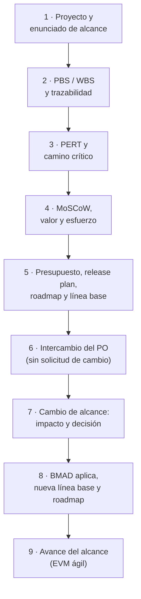
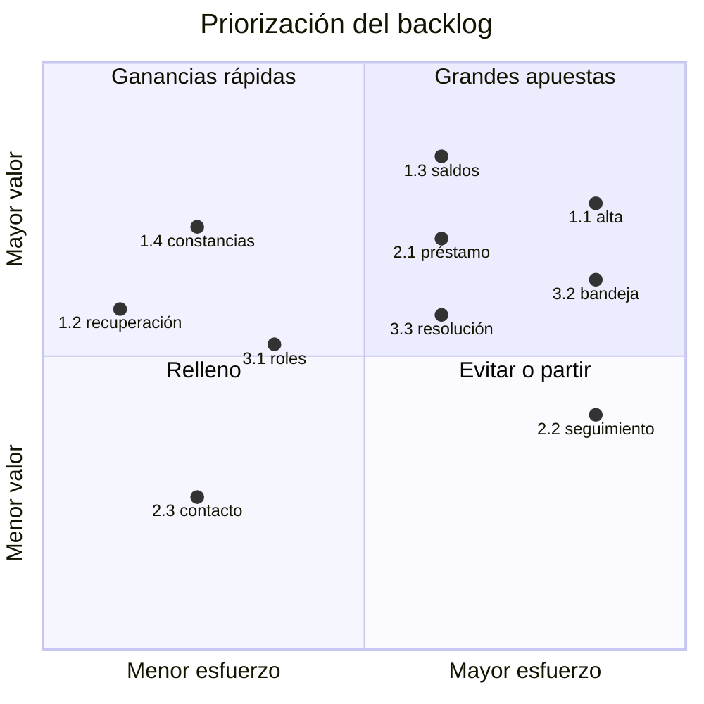
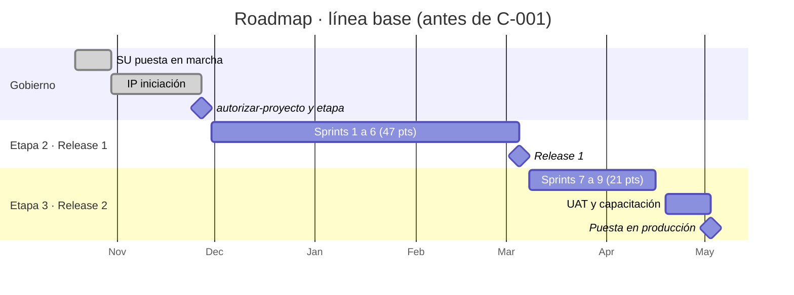
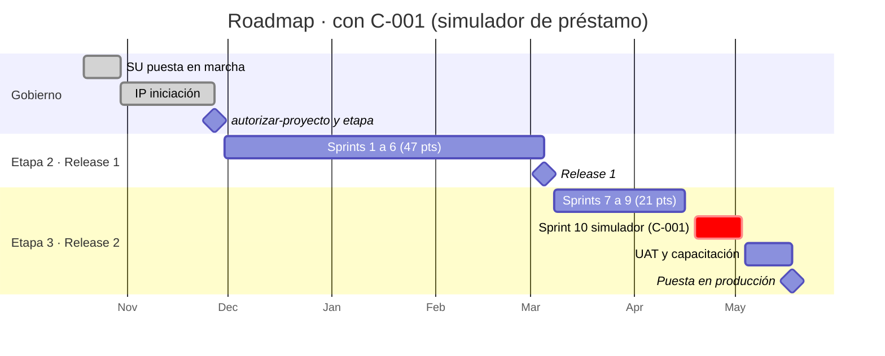
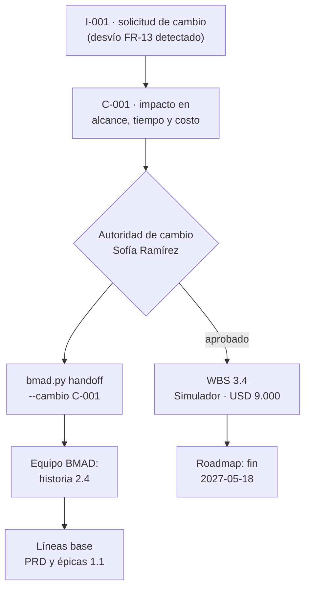

# Guía E2E-2 · Alcance y su cambio, estimación de esfuerzo, priorización y mapa de ruta

**Qué vas a probar:** cómo se define el alcance por productos (PRINCE2: planificación basada en productos), se traza a
los requisitos de BMAD, se estima el esfuerzo (PERT de tres puntos) y se programa (camino crítico), se prioriza el
backlog (MoSCoW y valor/esfuerzo) contra la capacidad, se arma el release plan y el **mapa de ruta**, se fija la línea
base y se gestionan dos tipos de cambio: el **intercambio** que decide el product owner sin solicitud de cambio, y el
**cambio de alcance** que pasa por la autoridad de cambio con análisis de impacto y vuelve a BMAD por traspaso.

**Skills y agentes:** pm-orquestador · pm-planificacion → `pm-planificacion-por-productos`,
`pm-cronograma-estimacion`, `pm-costos-presupuesto`, `pm-agil-hibrido`, `pm-enfoques-gestion` · pm-control →
`pm-issues-cambios`, `pm-progreso-reportes` · `pm-bmad-puente` · `pm-visuales` · `pm-director`.

**Duración:** 60–90 minutos. **Preparación:** [README de las guías](README.md#cómo-usar-las-guías) (copia del fixture en
`~/proyectos-prueba/portal-e2e-2`). Evidencia de referencia: [salida-g2.md](evidencia/salida-g2.md).



---

## Paso 1 · Proyecto, especificación y enunciado de alcance

**Prompt**
```text
Creá el proyecto "Portal de autoservicio para socios" en ./gestion, español, híbrido. Ejecutiva Laura Méndez, gestor
Martín Suárez, usuaria sénior, PO y autoridad de cambio Sofía Ramírez, proveedor sénior Diego Ferreira, aseguramiento
Andrea Costa, jefa de equipo Lucía Benítez. Sprints de 14 días y velocidad de referencia de 8 puntos.
Mostrame qué especificó el equipo de producto en BMAD y armá el enunciado de alcance y el plan de gestión del alcance y
los requisitos.
```

**Qué hace el sistema:** `pm-nuevo` + `bmad.py detectar`; lectura por la fachada (`especificacion.py resumen`,
`listar epicas`); `pm-planificacion-por-productos` (enunciado de alcance: QUÉ) y `pm-enfoques-gestion` (plan de gestión
del alcance y requisitos: CÓMO).

**Qué deberías ver:** 42 requisitos, 10 historias, 3 épicas (E-1 acceso y consulta, E-2 solicitudes, E-3 consola).

**Dónde verificar:** `gestion/01-inicio/enunciado-alcance.md` · `gestion/02-planificacion/enfoques/plan-gestion-alcance-requisitos.md`.

---

## Paso 2 · Estructura de productos (PBS) y WBS, trazada a requisitos e historias

**Prompt**
```text
Armá la WBS por productos con estos paquetes y su referencia a la especificación (USD 50 la hora):
1.1 Gestión de etapas 400 h · 2.1 Brief, PRD, UX y arquitectura (BMAD) 240 h (UJ-1, UJ-2, UJ-3)
· 3.1 Acceso seguro 420 h (FR-1, FR-2, FR-11, historias 1.1 y 1.2) · 3.2 Consulta y constancias 380 h (FR-3, FR-4, FR-5,
historias 1.3 y 1.4) · 3.3 Solicitudes del socio 440 h (FR-6, FR-7, FR-8, FR-12, historias 2.1 a 2.3)
· 4.1 Bandeja y resolución 400 h (FR-9, FR-10, historias 3.1 a 3.3) · 5.1 UAT, prueba de carga y capacitación 200 h
(NFR-2, NFR-3) · 5.2 Puesta en producción (hito).
Generá el diagrama, el diccionario y la matriz de trazabilidad, y decime si queda algún requisito sin cubrir.
```

**Qué hace el sistema:** `pm-planificacion-por-productos` escribe `wbs.csv` (columna `ref` con ids de BMAD) → `wbs.py …
--mermaid … --diccionario …`; `pm-bmad-puente` → `bmad.py trazabilidad --wbs 02-planificacion/wbs.csv`;
`especificacion.py listar requisitos --cobertura sin-cobertura`; `sanidad.py --rapido`.

**Qué deberías ver:** "13 elementos, 8 hojas · esfuerzo 2480 h · costo 124,000"; trazabilidad: "Requisitos funcionales
sin historia: ninguno · Historias sin requisito: ninguna · Referencias de la WBS a ids inexistentes: ninguna"; ningún
requisito sin cobertura.

**Dónde verificar:** `02-planificacion/wbs.csv` · `02-planificacion/visuales/wbs.md` (diagrama) ·
`02-planificacion/diccionario-wbs.md` · `02-planificacion/especificacion/matriz-trazabilidad-bmad.csv`.

---

## Paso 3 · Estimación de esfuerzo (PERT) y camino crítico

**Prompt**
```text
Estimá con PERT de tres puntos las actividades y armá el cronograma con camino crítico desde el 30/11, con exportación a
MS Project. Lucía va a validar los valores. Calculá la reserva de cronograma a 2σ del camino crítico.
```
**Si te pregunta** por O/M/P (días): Lucía Benítez, jefa de equipo, responde:

| Actividad | O | M | P | Predecesoras |
|---|---|---|---|---|
| A01 Brief, PRD, UX y arquitectura | 8 | 10 | 15 | — |
| A02 Spike de integración con el núcleo | 5 | 8 | 14 | — |
| A03 Sprints acceso seguro | 20 | 28 | 40 | A01 |
| A04 Sprints consulta y constancias | 18 | 25 | 38 | A02, A03 |
| A05 Sprints consola de operador | 20 | 28 | 42 | A03 |
| A06 Release 1 aceptada (hito) | 0 | 0 | 0 | A04, A05 |
| A07 Sprints solicitudes del socio | 22 | 30 | 45 | A06 |
| A08 UAT, prueba de carga y capacitación | 8 | 10 | 16 | A07 |
| A09 Puesta en producción (hito) | 0 | 0 | 0 | A08 |

**Qué hace el sistema:** `pm-cronograma-estimacion` calcula tE = (O + 4M + P)/6 y σ = (P − O)/6 en
`estimacion-pert.csv`, escribe `actividades.csv` con tE redondeado y corre `cpm.py … --inicio 2026-11-30 --mermaid …
--mspdi cronograma.xml --wbs wbs.csv`.

**Qué deberías ver:** "Duración total (días laborables): 110 · Fin previsto: 2027-05-03 · Camino crítico: A01 → A03 →
A05 → A06 → A07 → A08 → A09"; A04 con 3 días de holgura y A02 con 34. σ del camino crítico =
√(1,17² + 3,33² + 3,67² + 3,83² + 1,33²) ≈ **6,5 días** → reserva a 2σ ≈ **13 días laborables**, dentro de la
tolerancia de ±3 semanas.

**Dónde verificar:** `02-planificacion/estimacion-pert.csv` · `02-planificacion/cronograma.md` (Gantt) ·
`02-planificacion/cronograma.xml` (abrir en MS Project o ProjectLibre).

---

## Paso 4 · Priorización del backlog: MoSCoW, valor y esfuerzo

**Prompt**
```text
Sincronizá el backlog con BMAD y priorizalo con MoSCoW y valor/esfuerzo. Sofía, como PO, da el valor (1-10) y el equipo
los puntos. Ordená: primero MoSCoW y dentro de cada grupo por valor/puntos. Repartí en dos releases (R1: sprints 1-6;
R2: sprints 7-9) y verificá que los Must y Should entran en la capacidad.
```
**Si te pregunta** valores y puntos: Sofía Ramírez (PO) y Lucía Benítez (equipo) responden:

| Historia | MoSCoW | Valor | Puntos |
|---|---|---|---|
| 1.1 Alta y acceso con segundo factor | Must | 9 | 8 |
| 1.2 Recuperación de acceso | Must | 6 | 5 |
| 1.3 Consulta de saldos y préstamos | Must | 10 | 8 |
| 1.4 Constancias en PDF | Should | 7 | 5 |
| 2.1 Solicitud guiada de préstamo | Must | 9 | 8 |
| 2.2 Seguimiento de solicitudes | Should | 6 | 8 |
| 2.3 Actualización de contacto | Could | 4 | 5 |
| 3.1 Acceso y roles de la consola | Must | 6 | 5 |
| 3.2 Bandeja única | Must | 8 | 8 |
| 3.3 Resolución de solicitudes | Must | 8 | 8 |

**Qué hace el sistema:** `bmad.py backlog` crea `backlog.csv` con las columnas **derivadas** de BMAD; `pm-agil-hibrido`
completa solo las columnas de **gobierno** (`prioridad`, `moscow`, `estimacion`, `iteracion`, `release`, `producto_pbs`),
que el puente nunca sobrescribe; vuelve a correr `bmad.py backlog` ("0 nuevas, 10 actualizadas").

**Qué deberías ver:** orden 1.3 (1,25) · 1.2 (1,20) · 3.1 (1,20) · 1.1 (1,12) · 2.1 (1,12) · 3.2 (1,00) · 3.3 (1,00)
· 1.4 Should · 2.2 Should · 2.3 Could. Capacidad: **R1** 6 sprints × 8 = 48 puntos para Must 42 + Should 5 = 47 ✓;
**R2** 3 sprints × 8 = 24 para Must 8 + Should 8 + Could 5 = 21 ✓.

**Dónde verificar:** `02-planificacion/backlog.csv` (abrilo en Excel) · prompt: "Mostrame el backlog ordenado con
MoSCoW, puntos y release".

---

## Paso 5 · Presupuesto, release plan, roadmap y línea base

**Prompt**
```text
Calculá el presupuesto desde la WBS, armá el release plan y el roadmap por etapas con las puertas, y preparame las
puertas de inicio, proyecto y etapa 2. En la de proyecto fijá la línea base del PRD y de las épicas, y que Sofía apruebe
el backlog como línea base.
```
**Si te pregunta:** "Laura Méndez, ejecutiva: aprobado, confirmo las listas de control" · "Sofía Ramírez, PO: apruebo el
backlog v1.0".

**Qué hace el sistema:** `pm-costos-presupuesto` (`wbs.py --json`: BAC 124.000); `pm-agil-hibrido` (release plan:
cadencia, DoD/DoR y línea base); `pm-visuales` (roadmap); `pm-director`: puertas con `puertas.py` (tres capas),
`bmad.py linea-base prd|epicas --version 1.0`, `estado.py aprobar backlog --nivel product-owner`.

**Qué deberías ver:** "Línea base bmad-prd v1.0 registrada · sha bc048f7f59a3"; "bmad-epicas v1.0 · sha 3ff846d6f8d9";
"Copia congelada … 00-direccion/historial/backlog-v1.0.csv"; fase `entrega`, etapa 2 "Release 1".

**Dónde verificar:** `00-direccion/historial/` (copias congeladas) · `02-planificacion/release-plan.md` ·
`02-planificacion/visuales/roadmap.md` · `decisiones.csv`.

---

## Paso 6 · Cambio menor: intercambio de Should/Could por el PO

**Prompt**
```text
Cumplimiento pide adelantar la actualización de contacto. Sofía decide: la 2.3 (Could) pasa a R1 y la 1.4 constancias
(Should) a R2, sin tocar Must, fecha ni costo. Registralo y avisale al equipo BMAD.
```

**Qué hace el sistema:** `pm-agil-hibrido` verifica que es un intercambio permitido al PO (regla del método: Should/Could
equivalentes, sin Must, fecha ni costo) → `registro.py agregar decisiones --campo nivel=product-owner` (**no** hay
solicitud de cambio) → `bmad.py handoff` (sin `--cambio`: prioridades para el sprint planning de BMAD).

**Qué deberías ver:** **D-008**; "Traspaso emitido → …/handoff-bmad-<fecha>-prioridades.md". R1 queda con 47 puntos y R2
con 21.

**Dónde verificar:** `decisiones.csv` · `02-planificacion/especificacion/handoff-bmad-<fecha>-prioridades.md`.

---

## Paso 7 · Cambio de alcance: análisis de impacto y decisión

En BMAD, el PM de producto agrega **FR-13 "Simulador de préstamo"** al PRD por pedido del Consejo, sin pasar por la
autoridad de cambio (para simularlo en tu copia, pedíselo a BMAD con `bmad-prd` en modo edición, o editá el PRD).

**Prompt**
```text
Verificá la especificación contra la línea base. Si hay algo nuevo, registralo como solicitud de cambio y analizá el
impacto: paquete de la WBS nuevo, esfuerzo, camino crítico, costo, capacidad del release y beneficios. Estimá el
simulador en O 8, M 10, P 16 días después de los sprints de solicitudes.
```
**Si te pregunta** la decisión: "Sofía Ramírez, autoridad de cambio: aprobado; costo contra la contingencia".

**Qué hace el sistema:** `bmad.py verificar` → desvío; sanidad lo marcaría **ESP-10** (cambio no controlado) hasta que
haya issue → `pm-issues-cambios`: **I-001** `solicitud-cambio`; `pm-cronograma-estimacion` corre `cpm.py` sobre un
**escenario** (`02-planificacion/escenarios/actividades-C-001.csv`) sin tocar la línea base; **C-001** con el impacto en
los siete objetivos y la recomendación; decisión de la autoridad de cambio; `wbs.py` con el paquete **3.4**;
`bmad.py handoff --cambio C-001`.

**Qué deberías ver:** "agregados ['FR-13']"; escenario: "Duración total 121 · Fin previsto 2027-05-18" (+11 días
laborables, dentro de ±3 semanas); WBS "14 elementos, 9 hojas · 2660 h · 133,000"; C-001 aprobado; el traspaso
`handoff-bmad-<fecha>-C-001.md`.

**Dónde verificar:** `issues.csv` · `cambios.csv` (columnas `impacto_*`, `decision`, `decidido_por`) ·
`02-planificacion/escenarios/` · prompt: "¿Qué impacto tiene C-001 en fecha, costo y capacidad?".

---

## Paso 8 · BMAD aplica el cambio, nuevas líneas base y roadmap actualizado

El equipo BMAD aplica el traspaso con sus flujos (`bmad-prd`, `bmad-create-epics-and-stories`) y agrega la historia 2.4.

**Prompt**
```text
El equipo BMAD aplicó el traspaso de C-001 (historia 2.4 Simulador). Resincronizá requisitos, trazabilidad y backlog,
poné la 2.4 como Should de 8 puntos en el sprint 10 del R2, fijá las nuevas líneas base y actualizá el roadmap.
```
**Si te pregunta:** "Laura Méndez, ejecutiva: apruebo las líneas base 1.1".

**Qué hace el sistema:** `bmad.py requisitos` (43 ids) · `trazabilidad` · `backlog` ("1 nuevas, 10 actualizadas") ·
`pm-agil-hibrido` completa el gobierno de 2.4 · `pm-director`: `bmad.py linea-base prd|epicas --version 1.1` · C-001
`implementado` e I-001 `cerrado` · `bmad.py verificar` → "Sin desvíos" · sanidad sin ERROR · `pm-visuales` (roadmap).

**Qué deberías ver:** R2 pasa a **29 puntos** con 24 de capacidad en tres sprints: se agrega el sprint 10 (los +11
días del paso 7) y la capacidad sube a 32. El roadmap cambia de fin 2027-05-03 a 2027-05-18.

**Dónde verificar:** `00-direccion/historial/bmad-prd-v1.1` · `backlog.csv` · prompt: `/pm-method:pm-sync bmad`.

---

## Paso 9 · Avance del alcance (EVM ágil)

**Prompt**
```text
Corte del 8/1: ¿cuánto alcance llevamos y entra todo con el presupuesto? PV 60.000, EV 52.000, AC 58.000, BAC 133.000.
Leelo como ágil: costo y fecha fijos, el 20 % del alcance es Should/Could.
```

**Qué hace el sistema:** `bmad.py avance` (estados de BMAD → `avance-bmad.csv`); `pm-progreso-reportes` → `evm.py --pv
60000 --ev 52000 --ac 58000 --bac 133000 --modo agil --pct-no-must 20`; `puertas.py estado --markdown` para el highlight.

**Qué deberías ver:** "Historias 11 · done 4 · 34.2 % (puntos)"; SPI 0,867 · CPI 0,897 · EAC 148.346 →
`alcance_no_entregable_pct 10.345` · `semaforo_alcance ambar` · `excepcion_prevista False`: al ritmo actual no entra
≈ 10 % del alcance, que es menor que el 20 % de Should/Could: **los Must no peligran** y el PO decide qué Should/Could
salen; no hay excepción.

**Dónde verificar:** `03-control/reportes/avance-bmad.csv` · el highlight en `03-control/reportes/`.

---

## Reporte: informe de alcance y cambio (ejemplo para el highlight)

> Cifras de la corrida de referencia; el texto lo redacta el modelo.

| Tema | Línea base (27/11) | Actual (8/1) |
|---|---|---|
| Alcance | 10 historias · 68 puntos · 12 FR · WBS 124.000 | 11 historias · 76 puntos · 13 FR (C-001) · WBS 133.000 |
| Releases | R1 47 pts / 48 · R2 21 pts / 24 | R1 47 pts (swap D-008) · R2 29 pts / 32 (sprint 10 agregado) |
| Cronograma | fin 2027-05-03 · reserva 2σ ≈ 13 días | fin 2027-05-18 (+11 días) · reserva remanente ≈ 2 días |
| Avance | — | 34,2 % de puntos · SPI 0,87 · CPI 0,90 · alcance no entregable ≈ 10 % (ámbar) |
| Cambios | — | D-008 intercambio (PO) · C-001 simulador (autoridad de cambio) · líneas base PRD/épicas 1.1 |

**Decisión que se pide a la junta:** ninguna; ámbar en alcance gestionable por el PO (Should/Could). Riesgo nuevo
sugerido: la reserva de cronograma quedó en ≈ 2 días.

## Representaciones gráficas

**Valor contra esfuerzo** (izquierda 5 puntos, derecha 8 puntos; altura según el valor de 1 a 10, con un pequeño
desplazamiento para que no se superpongan las etiquetas):


**Mapa de ruta por etapas con puertas: antes y después de C-001**



**Trazabilidad del cambio:**


Los diagramas que genera el sistema están en `02-planificacion/visuales/wbs.md` (WBS) y `02-planificacion/cronograma.md`
(Gantt con el camino crítico).

## Lista de comprobación de capacidades

- [ ] WBS por productos con `ref` a FR, historias y UJ; trazabilidad sin huecos ni ids inexistentes.
- [ ] PERT de tres puntos y camino crítico calculados por script; exportación MSPDI.
- [ ] Backlog con columnas derivadas de BMAD y de gobierno separadas; MoSCoW y valor/esfuerzo; capacidad verificada.
- [ ] Línea base de PRD, épicas y backlog con copia congelada.
- [ ] Intercambio Should/Could decidido por el PO sin solicitud de cambio, traspasado a BMAD.
- [ ] Cambio de alcance detectado por `bmad.py verificar`, con escenario de cronograma, decisión de la autoridad de
      cambio, traspaso, nuevas líneas base y roadmap actualizado.
- [ ] EVM ágil que separa alcance no entregable de sobrecosto.
