# Guía E2E-2 · Alcance y su cambio, estimación de esfuerzo, priorización y mapa de ruta

**Qué vas a probar:** cómo se define el alcance por productos, se traza a los requisitos de BMAD, se estima y se
programa, se prioriza contra la capacidad del equipo y contra las personas de usuario a las que sirve, y se fija como
línea base con tolerancias, una autoridad de cambio con presupuesto propio y un business case con su VAN. Después, cómo
se gestionan tres tipos de cambio: el **intercambio** que decide el product owner, el **cambio de alcance** que decide
la autoridad de cambio dentro de su límite y el cambio que **excede la autoridad delegada**, que se gestiona por
excepción. Cada cambio pasa antes por un **análisis de impacto** que dice quién tiene que decidirlo, y las dos
decisiones con alternativas (qué épica va en el primer release y qué hacer con el cambio que excede la autoridad) se
toman con su **contexto citado, pesos explícitos y la sensibilidad de esos pesos**.

**Skills y agentes:** pm-orquestador · pm-planificacion → `pm-planificacion-por-productos`,
`pm-cronograma-estimacion`, `pm-costos-presupuesto`, `pm-agil-hibrido`, `pm-enfoques-gestion`, `pm-plan-etapa-y-limites`
· pm-control → `pm-issues-cambios`, `pm-riesgos`, `pm-progreso-reportes`, `pm-calidad` · pm-inicio → `pm-caso-de-negocio`,
`pm-interesados` · `pm-bmad-puente` · `pm-visuales` · `pm-director` (`pm-direccion-decisiones`).

**Duración:** 10 pasos, 85–115 minutos de recorrido; en el webinar, dos clases de 90 minutos.
**Preparación:** [README de las guías](README.md#cómo-usar-las-guías) (copia del fixture en
`~/proyectos-prueba/portal-e2e-2`). **Evidencia de referencia:** [salida-g2.md](evidencia/salida-g2.md). **Material de
clase:** [guion](../webinar/E2E-2/guion-instructor.md) · [ejercicio](../webinar/E2E-2/ejercicio.md) ·
[diapositivas](../webinar/E2E-2/diapositivas.json). **Términos:** [TERMINOLOGIA.md](../TERMINOLOGIA.md).

---

## Por qué importa

En la mayoría de los proyectos el alcance se define bien una vez y se controla mal después. La matriz de trazabilidad
se arma en la planificación y se desactualiza con el primer cambio. Los cambios se aprueban "porque son razonables" u
"obligatorios", sin mirar qué le hacen al camino crítico, a la capacidad del equipo, al presupuesto ni al business case.
Y nadie suma lo que ya se comprometió: el desvío aparece al cerrar la etapa, cuando ya no quedan opciones baratas.

El escenario de esta guía lo muestra con cifras. Un cambio razonable (C-001, 9.000) corre 11 días la puesta en
producción y deja la reserva de cronograma en 2 días, aunque suma valor: el VAN pasa de 39.776 a 45.939. Un segundo
cambio "obligatorio" (C-002, 15.000) llega aprobado de palabra, sin análisis, por quien tenía un límite de 10.000:
llevaría el presupuesto de cambio al 200 %, saca la etapa de su tolerancia y resta 15.000 de VAN. Con pm-method esa
aprobación **no se puede registrar**, y el análisis de impacto de ese mismo día dice por qué: supera cinco límites, así
que decide la junta y lo que corresponde es pedir un plan de excepción.

Las decisiones con alternativas sufren lo mismo: se eligen en una reunión con pesos que nadie escribe, y a los tres
meses nadie recuerda por qué ganó una opción ni cuál de dos decisiones parecidas sigue valiendo. Acá la consola de
operador entra en el primer release aunque deja 1 punto de holgura, y queda escrito cuánto tendría que pesar la holgura
para que ganara la otra alternativa: 31 en lugar de 25.

## Qué vas a lograr

1. Un alcance por productos con criterios de calidad medibles, trazado a requisitos e historias, y una cobertura de
   trazabilidad que se **recalcula en cada sincronización** con BMAD.
2. Un cronograma con camino crítico y reserva calculados por script, y un backlog priorizado que entra en la capacidad
   y en el que **cada Must sirve a una persona de usuario**.
3. Una línea base con tolerancias, autoridad de cambio, **presupuesto de cambio** y business case registrados, que
   sanidad vigila.
4. Un **análisis de impacto antes de cada decisión** (`impacto.py`): tiempo, reserva, capacidad, costo, presupuesto,
   autoridad y VAN, con el borrador de la solicitud de cambio y **quién decide**.
5. Una **excepción completa**: detectada el mismo día, informada, replanificada con el business case actualizado y
   autorizada por la junta.
6. **Decisiones con contexto** (`decision.py`): expediente con cada dato citado, matriz con pesos y puntajes con su
   fuente, eliminatorios, dominadas y sensibilidad, pregunta cerrada para la junta y la elección registrada junto con
   la hoja; y la lista de decisiones vigentes con su cadena de reemplazos.

## Indicadores que vas a ver

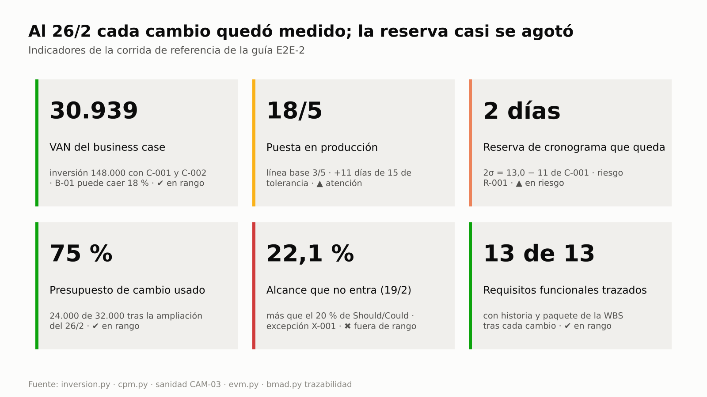
Resumen al 26/2: VAN de 30.939 con los dos cambios, puesta en producción el 20/5, 2 días de reserva, presupuesto de
cambio al 75 % tras la ampliación, 22,1 % del alcance en riesgo en el corte del 19/2 y 13 de 13 requisitos trazados.

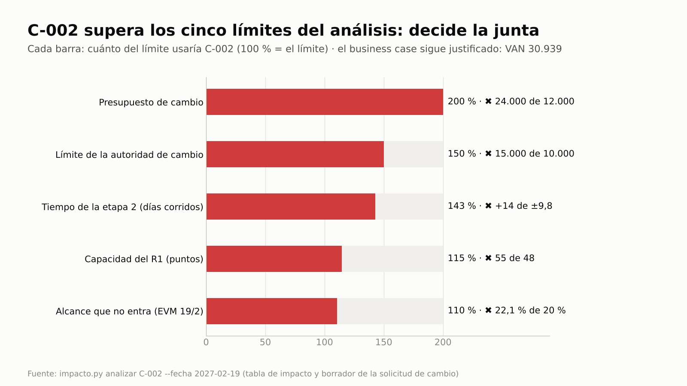
C-002 usaría el 200 % del presupuesto de cambio, el 150 % del límite de quien lo aprobó de palabra y el 143 % de la
tolerancia de tiempo de la etapa: no lo puede decidir la autoridad de cambio, lo decide la junta (paso 10).

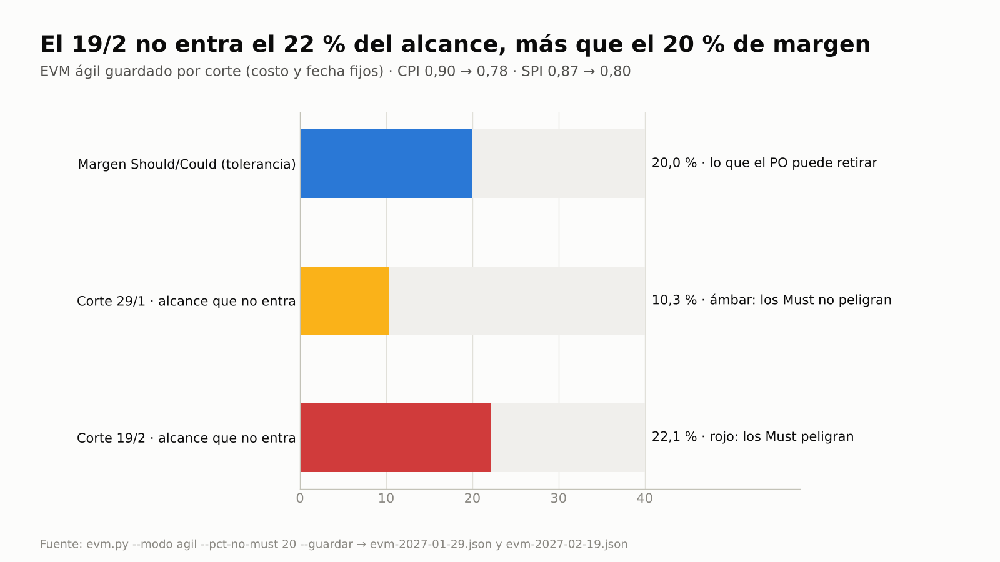
El 29/1 no entra el 10,3 % del alcance (ámbar, lo gestiona el PO); el 19/2 no entra el 22,1 %, más que el 20 % de
margen: los Must peligran y hay excepción (pasos 9 y 10).

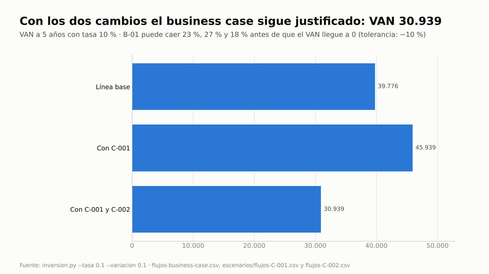
C-001 suma 6.163 de VAN y C-002 resta 15.000; con los dos, el VAN sigue en 30.939 y el beneficio principal puede caer
18 % antes de llegar a 0 (pasos 5, 7 y 10).

## Clases

| Clase (90 min) | Pasos | Pregunta que responde |
|---|---|---|
| **1 · Del alcance a la línea base** | 1 a 5: alcance por productos, trazabilidad, tres valores y camino crítico, MoSCoW, capacidad del release y personas de usuario, presupuesto, business case, tolerancias y autoridad de cambio, decisión del R1 con matriz | ¿Contra qué vamos a medir cada cambio? |
| **2 · El cambio bajo control** | 6 a 10: intercambio del PO, cambio con análisis de impacto, nuevas líneas base y trazabilidad, EVM guardado, excepción con la matriz de la junta | ¿Quién decide cada cambio y cómo nos enteramos a tiempo? |

Son dos clases porque la segunda solo tiene sentido con la línea base de la primera: sin presupuesto de cambio, límite
delegado, tolerancias y VAN registrados, no hay contra qué medir el impacto. El guion las detalla minuto a minuto.

## Del uso único al control continuo

| Actividad | Cómo se hace hoy | Con pm-method (frecuencia · control) | Indicador |
|---|---|---|---|
| Trazabilidad requisito → historia → paquete | Una matriz armada una vez, que se desactualiza con el primer cambio | Se recalcula en cada sincronización con BMAD (pasos 2 y 8) · `bmad.py trazabilidad`, ESP-03 | Cobertura: 13 de 13 requisitos con historia y paquete |
| Priorizar para usuarios reales | MoSCoW por opinión; nadie pregunta a quién sirve cada Must | Personas de usuario desde los recorridos de BMAD y mapa capacidad × persona en cada priorización · STK-13 | Must sin persona: 2 → 0 (paso 4) |
| Estimar y reservar tiempo para la incertidumbre | Un número por actividad y un colchón sin cálculo | Tres valores por actividad en `actividades.csv`; `cpm.py --estimacion` calcula tE, σ del camino crítico y la reserva a 2σ con la fórmula declarada, y `impacto.py --pert` mide cuánto consume cada cambio (pasos 3 y 7) | Reserva 13,0 días → 2,0 tras C-001 |
| Capacidad del release | Una suma de puntos en una planilla, al planificar | `release.py capacidad` por MoSCoW contra velocidad × iteraciones en cada replanificación; la misma regla mide cada cambio en `impacto.py` (pasos 4, 7 y 10) | R1: 47 de 48 con 88 % de Must (vigilar) |
| Detectar cambios en la especificación | Se descubren en la demo o en la UAT | `bmad.py verificar` contra la línea base en cada sincronización · ESP-10 | FR-13 detectado como desvío (paso 7) |
| Análisis de impacto de un cambio | A ojo, o nunca si "es obligatorio" | `impacto.py analizar` antes de cada decisión: escenario de `cpm.py`, capacidad, presupuesto, autoridad, VAN, borrador de la solicitud y nivel que decide (pasos 7 y 10) | C-001: decide la autoridad de cambio · C-002: decide la junta |
| Elegir entre alternativas | En una reunión, con pesos implícitos y sin dejar por qué | Expediente citado y matriz con pesos, eliminatorios y sensibilidad en cada decisión con alternativas; las cifras de `release.py` e `impacto.py` entran sin recalcular y la elección queda en `decisiones.csv` con la hoja (pasos 5 y 10) · DEC-01, DEC-02 | R1: A 56,2 contra B 47,5 (la B gana si la capacidad pesa 31) · C-002: rechazar eliminada, plan de excepción 30,0 |
| Saber qué decisión vale hoy | Se busca en actas; la versión vieja y la nueva conviven sin marca | `decision.py vigentes` con la cadena de reemplazos y búsqueda en español e inglés; la línea base nueva reemplaza sola a la anterior (pasos 8 y 10) · DEC-05, DEC-06 | D-005 → D-011 y D-006 → D-012 · presupuesto de cambio: D-002 y D-015 vigentes |
| Justificación del negocio | El VAN se calcula una vez, para aprobar el proyecto | VAN antes y después de cada cambio con `inversion.py`; la junta lo revisa en la puerta del plan de excepción (pasos 5, 7 y 10) | VAN 39.776 → 45.939 → 30.939 |
| Consumo del presupuesto de cambio | Nadie lo suma hasta el cierre de la etapa | Al registrar cada aprobación (`registro.py` no la acepta sin saldo) y en cada corrida de sanidad · CAM-03: INFO < 80 %, AVISO ≥ 80 %, ERROR > 100 % | 75 % → 75 % (con C-002 sería 200 %) → 75 % |
| Respetar la autoridad delegada | Se "aprueba lo razonable", sin tope escrito | Límite en `estado.json`: `registro.py` rechaza la aprobación de quien no tiene autoridad; CAM-04 vigila los datos anteriores al límite | C-002: 15.000 sobre un límite de 10.000, no registrado como aprobado |
| Cargar cada cambio a un presupuesto | Se paga "con la contingencia" | Monto y cargo obligatorios en `cambios.csv` · CAM-01 | Cambios aprobados sin cargo: 0 |
| Pronóstico contra tolerancia | EVM en una planilla, mirado al fin de la etapa | Corte guardado en cada período · TOL-03, TOL-02, TOL-01 | Alcance que no entra: 10,3 % → 22,1 % |
| Gestión por excepción | Se explica el desvío al cierre | Informe, plan de excepción y puerta; la puerta queda bloqueada mientras haya un ERROR · bloqueo por sanidad, X-01, X-02 | `autorizar-plan-excepcion` aprobada el 26/2 |
| Revisar los riesgos que deja un cambio | Se registran al aprobar y no se vuelven a mirar | Fecha de revisión de cada riesgo abierto comparada con el corte · REG-09 | R-001 con revisión vencida el 26/2, revisada ese día |
| Calidad de lo terminado | Se discute en la UAT | Sanidad a volumen sobre `backlog.csv` · QUA-01 | Historias terminadas sin revisión: 0 |
| Traspasos a BMAD | Se pierden en el correo | Aviso hasta que el equipo marca `aplicado` · ESP-13 | Traspaso de C-002 sin confirmar al 26/2 |

En esta guía, sanidad corre con `--corte` en la fecha de cada paso, así el resultado es reproducible. En uso real,
pm-control la corre con la fecha de cada checkpoint y highlight, junto con el corte de EVM.

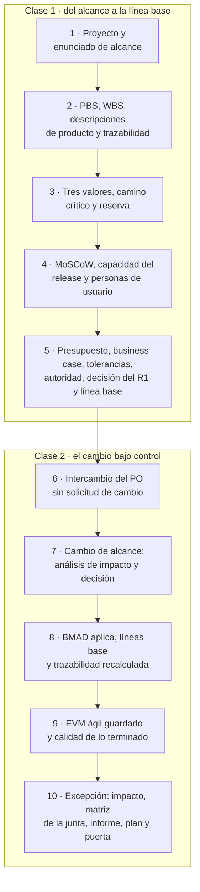

---

## Paso 1 · Proyecto, especificación y enunciado de alcance

**Prompt**
```text
Creá el proyecto "Portal de autoservicio para socios" en ./gestion, español, híbrido. Ejecutiva Laura Méndez, gestor
Martín Suárez, usuaria sénior, PO y autoridad de cambio Sofía Ramírez, proveedor sénior Diego Ferreira, aseguramiento
Andrea Costa, jefa de equipo Lucía Benítez. Sprints de 14 días y velocidad de referencia de 8 puntos.
Mostrame qué especificó el equipo de producto en BMAD y armá el enunciado de alcance y el plan de gestión del alcance y
los requisitos.
```

**Si te pregunta:** nada; los roles y la cadencia están en el prompt.

**Qué hace el sistema:** `pm-nuevo` y `bmad.py detectar`; lee la especificación por la fachada (`especificacion.py
resumen`, `listar epicas`). `pm-planificacion-por-productos` redacta el enunciado de alcance (el **qué**) y
`pm-enfoques-gestion`, el plan de gestión del alcance y los requisitos (el **cómo**).

**Qué deberías ver:** "requisitos: 42 · historias: 10" y tres épicas: E-1 acceso seguro y consulta, E-2 solicitudes del
socio, E-3 consola de operador.

**Dónde verificar:** `gestion/01-inicio/enunciado-alcance.md` · `gestion/02-planificacion/enfoques/plan-gestion-alcance-requisitos.md`.

---

## Paso 2 · Productos (PBS), descripciones de producto y WBS trazada a requisitos e historias

La **PBS** (estructura de productos, *product breakdown structure*) descompone lo que se entrega; la **WBS** (estructura
de desglose del trabajo) le agrega el trabajo y el costo de cada paquete. Una **descripción de producto** (*product
description*) fija qué significa "terminado" para cada producto, con medidas y quién acepta.

**Prompt**
```text
Armá la WBS por productos con estos paquetes y su referencia a la especificación (USD 50 la hora):
1.1 Gestión de etapas 400 h · 2.1 Brief, PRD, UX y arquitectura (BMAD) 240 h (UJ-1, UJ-2, UJ-3)
· 3.1 Acceso seguro 420 h (FR-1, FR-2, FR-11, historias 1.1 y 1.2) · 3.2 Consulta y constancias 380 h (FR-3, FR-4, FR-5,
historias 1.3 y 1.4) · 3.3 Solicitudes del socio 440 h (FR-6, FR-7, FR-8, FR-12, historias 2.1 a 2.3)
· 4.1 Bandeja y resolución 400 h (FR-9, FR-10, historias 3.1 a 3.3) · 5.1 UAT, prueba de carga y capacitación 200 h
(NFR-2, NFR-3) · 5.2 Puesta en producción (hito).
Generá el diagrama, el diccionario y la matriz de trazabilidad, y decime si queda algún requisito sin cubrir.
Escribí también la descripción del producto del proyecto con los criterios de aceptación priorizados y la descripción
de producto del 3.1 Acceso seguro con sus especificaciones de calidad, métodos de calidad y quién acepta.
```

**Si te pregunta** por los criterios de calidad: Sofía Ramírez, usuaria sénior, responde: "consultas con p95 menor a
3 s (NFR-3), disponibilidad de 99,5 % (NFR-2), WCAG 2.1 AA (NFR-4); en el acceso, sesión que expira a los 10 minutos,
auditoría de todos los accesos (NFR-5) y cero vulnerabilidades altas en la prueba de penetración. Acepto yo".

**Qué hace el sistema:**
- `pm-planificacion-por-productos` escribe `wbs.csv` (columna `ref` con ids de BMAD) y corre `wbs.py … --mermaid …
  --diccionario …`.
- `pm-bmad-puente` corre `bmad.py trazabilidad --wbs 02-planificacion/wbs.csv` y `especificacion.py listar requisitos
  --cobertura sin-cobertura`.
- Redacta con sus plantillas la descripción del producto del proyecto (criterios CA-01 a CA-04 con prioridad, método y
  responsable) y la descripción de producto 3.1 (especificaciones EC-01 a EC-05 con medida y tolerancia de calidad).
  Las registra con `estado.py artefacto` en estado `en-revision`: las aprueba la usuaria sénior con el plan.
- Calcula la cobertura de trazabilidad y corre `sanidad.py --rapido --corte 2026-11-13`.

**Qué deberías ver:**
- "13 elementos, 8 hojas · esfuerzo 2480 h · costo 124,000".
- Trazabilidad: "Requisitos funcionales sin historia: ninguno · Historias sin requisito: ninguna · Referencias de la WBS a
  ids inexistentes: ninguna"; ningún requisito sin cobertura.
- Cobertura: 12 de 12 requisitos funcionales con historia y con paquete de la WBS; 6 de 6 NFR con paquete o criterio de
  calidad; 0 de 12 citados en su propia historia (BMAD los traza a nivel de épica).
- Sanidad "0 ERROR · 0 AVISO · 0 INFO".

> **Por qué importa.** Sin descripciones de producto, "terminado" significa lo que cada uno cree y la calidad se discute
> en la UAT. Con criterios medibles por producto, cada revisión de calidad (paso 9) se registra contra una
> especificación concreta, y sanidad la vigila a volumen (QUA-01).

**Dónde verificar:** `02-planificacion/wbs.csv` · `02-planificacion/visuales/wbs.md` (diagrama) ·
`02-planificacion/diccionario-wbs.md` · `02-planificacion/especificacion/matriz-trazabilidad-bmad.csv` ·
`02-planificacion/descripcion-producto-proyecto.md` · `02-planificacion/productos/3.1-acceso-seguro.md`.

---

## Paso 3 · Estimación de tres valores, camino crítico y reserva de cronograma

**Estimación de tres valores:** para cada actividad se estiman los días optimista (O), más probable (M) y pesimista
(P). La Guía PMBOK cita la distribución **triangular**, tE = (O + M + P)/3; la práctica difundida es la **beta-PERT**,
tE = (O + 4M + P)/6 con σ = (P − O)/6, que da más peso al valor más probable. La fórmula se declara al planificar (plan de
gestión del cronograma y los costos, de `pm-enfoques-gestion`); acá, beta-PERT, la que el paquete usa por defecto. El **camino crítico** es la cadena de
actividades sin holgura: si una se atrasa, se atrasa el fin. La **reserva de cronograma** a 2σ del camino crítico
(σ = √Σσ² de sus actividades) cubre su incertidumbre con una confianza aproximada del 95 %.

**Prompt**
```text
Estimá con tres valores las actividades, con la fórmula beta-PERT que fijamos para el proyecto, y armá el cronograma
con camino crítico desde el 30/11, con exportación a MS Project. Lucía va a validar los valores. Calculá la reserva de
cronograma a 2σ del camino crítico.
```

**Si te pregunta** por O, M y P (días): Lucía Benítez, jefa de equipo, responde:

| Actividad | O | M | P | Predecesoras |
|---|---|---|---|---|
| A01 Brief, PRD, UX y arquitectura | 8 | 10 | 15 | — |
| A02 Spike de integración con el núcleo | 5 | 8 | 14 | — |
| A03 Sprints acceso seguro | 20 | 28 | 40 | A01 |
| A04 Sprints consulta y constancias | 18 | 25 | 38 | A02, A03 |
| A05 Sprints consola de operador | 20 | 28 | 42 | A03 |
| A06 Release 1 aceptada (hito) | 0 | 0 | 0 | A04, A05 |
| A07 Sprints solicitudes del socio | 22 | 30 | 45 | A06 |
| A08 UAT, prueba de carga y capacitación | 8 | 10 | 16 | A07 |
| A09 Puesta en producción (hito) | 0 | 0 | 0 | A08 |

**Qué hace el sistema:** `pm-cronograma-estimacion` escribe `actividades.csv` con O, M y P de cada actividad (la
columna de duración queda vacía) y corre `cpm.py … --inicio 2026-11-30 --mermaid … --mspdi cronograma.xml --wbs wbs.csv
--estimacion estimacion-pert.csv`. El script calcula tE y σ de cada actividad con la fórmula declarada, toma como
duración tE redondeada hacia arriba (10,5 → 11 días: un cronograma por días enteros no empieza la actividad siguiente a
mitad de día), arma el camino crítico y calcula σ del camino, la reserva a 2σ y el fin con reserva. Escribe
`estimacion-pert.csv`, que `impacto.py --pert` lee en los pasos 7 y 10. El modelo no hace ninguna de estas cuentas.

**Qué deberías ver:**
- "Duración total (días laborables): 112 · Fin previsto: 2027-05-05 · Camino crítico: A01 -> A03 -> A05 -> A06 -> A07 ->
  A08 -> A09"; A04 con 3 días de holgura y A02 con 34.
- "Tres valores · beta-PERT: tE = (O + 4M + P)/6, σ = (P − O)/6 (práctica habitual; la Guía PMBOK cita la triangular)".
- "σ del camino crítico = √(1,17² + 3,33² + 3,67² + 3,83² + 1,33²) = 6,51 días" y "Reserva de cronograma a 2σ = 13,0
  días laborables (≈ 95 %) · fin con reserva 2027-05-24 (+13)", dentro de la tolerancia de ±3 semanas (15 días
  laborables) que la junta fija en el paso 5.

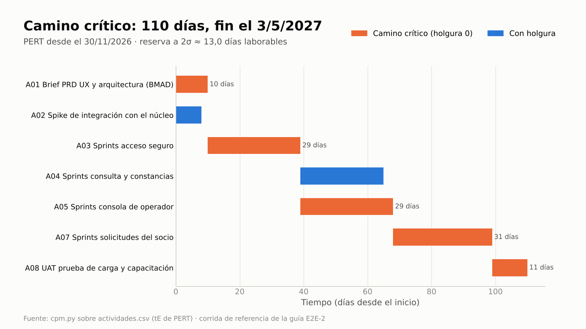
Cinco actividades sin holgura (naranja) fijan el fin del 5/5/2027; A04 y A02 pueden moverse sin atrasarlo.

> **Por qué se declara la fórmula.** La misma red con la triangular (`--distribucion triangular`) da 116 días y una
> reserva a 2σ de 16,2 días, más que la tolerancia de ±3 semanas. La fórmula cambia la línea base: por eso se declara
> en el plan de gestión y no la elige el modelo en cada estimación.

**Dónde verificar:** `02-planificacion/actividades.csv` (O, M y P) · `02-planificacion/estimacion-pert.csv` (tE, σ y
distribución) · `02-planificacion/cronograma.md` (Gantt con la reserva aparte) · `02-planificacion/cronograma.xml`
(abrilo en MS Project o ProjectLibre).

---

## Paso 4 · Priorización del backlog: MoSCoW, valor, esfuerzo y personas de usuario

**MoSCoW** clasifica cada historia en Must (sin ella no hay producto), Should, Could y Won't. En un proyecto de costo y
fecha fijos, Should y Could son el margen que el PO puede mover sin pedir permiso. Una **persona de usuario** (*user
persona*) es un arquetipo de quien va a usar el producto, con su objetivo, su contexto y sus dolores. No es un
interesado ni un miembro del equipo: la usuaria sénior representa a esos usuarios ante la junta, y las personas
muestran a quién sirve cada capacidad.

**Prompt**
```text
Sincronizá el backlog con BMAD y priorizalo con MoSCoW y valor/esfuerzo. Sofía, como PO, da el valor (1-10) y el equipo
los puntos. Ordená: primero MoSCoW y dentro de cada grupo por valor/puntos. Repartí en dos releases (R1: sprints 1-6;
R2: sprints 7-9) y verificá que los Must y Should entran en la capacidad. Proponé las personas de usuario desde los
recorridos de BMAD para que Sofía las confirme, y decime si queda algún Must que no le sirva a ninguna.
```

**Si te pregunta** valores y puntos: Sofía Ramírez (PO) y Lucía Benítez (equipo) responden (la columna de personas
sale de los recorridos de BMAD: cada épica realiza uno):

| Historia | MoSCoW | Valor | Puntos | Persona (recorrido) |
|---|---|---|---|---|
| 1.1 Alta y acceso con segundo factor | Must | 9 | 8 | Marta (UJ-1) |
| 1.2 Recuperación de acceso | Must | 6 | 5 | Marta (UJ-1) |
| 1.3 Consulta de saldos y préstamos | Must | 10 | 8 | Marta (UJ-1) |
| 1.4 Constancias en PDF | Should | 7 | 5 | Marta (UJ-1) |
| 2.1 Solicitud guiada de préstamo | Must | 9 | 8 | Diego (UJ-2) |
| 2.2 Seguimiento de solicitudes | Should | 6 | 8 | Diego (UJ-2) |
| 2.3 Actualización de contacto | Could | 4 | 5 | Diego (UJ-2) |
| 3.1 Acceso y roles de la consola | Must | 6 | 5 | Lucía (UJ-3) |
| 3.2 Bandeja única | Must | 8 | 8 | Lucía (UJ-3) |
| 3.3 Resolución de solicitudes | Must | 8 | 8 | Lucía (UJ-3) |

Sobre las personas, Sofía Ramírez, usuaria sénior, confirma las tres y agrega sus dolores con lo que dice el PRD: Marta
"ir a la sucursal o esperar un horario para conseguir una constancia"; Diego "no saber en qué estado está su
préstamo"; Lucía "transcribir pedidos que llegan por varios canales". Si te avisa de Must sin persona: "según UJ-2,
Diego entra con el contacto verificado (FR-8) y recibe la confirmación por correo (FR-12): vinculalos a él".

**Qué hace el sistema:**
- `bmad.py backlog` crea `backlog.csv` con las columnas **derivadas** de BMAD; `pm-agil-hibrido` completa solo las
  columnas de **gobierno** (`prioridad`, `moscow`, `estimacion`, `iteracion`, `release`, `producto_pbs`), que el puente
  nunca sobrescribe; vuelve a correr `bmad.py backlog` ("0 nuevas, 10 actualizadas").
- `pm-agil-hibrido` corre `release.py capacidad`: por release, puntos Must, Should y Could contra la capacidad =
  velocidad de referencia (`estado.json.agil`, 8) × iteraciones del release, con la regla del release plan
  (Must + Should ≤ capacidad), la holgura y la proporción de Must contra la regla práctica de ≤ 60 %. Es la misma
  función con la que `impacto.py` mide cada cambio en los pasos 7 y 10.
- `pm-interesados` corre `interesados.py personas candidatos --desde bmad`: propone una persona por recorrido (UJ-1 a
  UJ-3) con su arquetipo, objetivo, contexto y los requisitos que realiza; **no registra nada**. Con la confirmación de
  Sofía registra **PU-001** a **PU-003** con `registro.py agregar personas` (fuente `bmad-uj`, evidencia "UJ-n
  (prd.md:línea)"). El nombre lleva el rol, "Diego (socio que pide un préstamo)", para no confundir a la persona con
  la gente del equipo.
- `interesados.py personas priorizacion` cruza las personas con la prioridad de cada requisito y avisa de los Must sin
  persona (la regla de sanidad **STK-13**); tras la respuesta de Sofía, `registro.py actualizar personas PU-002 --campo
  usa=FR-6;FR-7;FR-8;FR-12` y otra vez `personas priorizacion`.

**Qué deberías ver:**
- Orden 1.3 (1,25) · 1.2 (1,20) · 3.1 (1,20) · 1.1 (1,12) · 2.1 (1,12) · 3.2 (1,00) · 3.3 (1,00) · 1.4 Should · 2.2
  Should · 2.3 Could.
- Capacidad: "R1 (S1, S2, S3, S4, S5, S6): entra todo (47 de 48; Must + Should 47, holgura 1)" con "vigilar: los Must
  son el 88 % de la capacidad (regla práctica ≤ 60 %)"; "R2 (S7, S8, S9): entra todo (21 de 24; Must + Should 16,
  holgura 8)".
- "3 persona(s) candidata(s) · el modelo propone, la persona confirma; nada se registra solo".
- Primera priorización por persona: "10 capacidad(es) mapeadas · Must sin persona: FR-8, FR-12". Tras vincularlos a
  Diego: Marta 5 Must, Diego 4 Must, Lucía 3 Must y "12 capacidad(es) mapeadas · Must sin persona: ninguno". La
  priorización cuenta requisitos: como BMAD los traza a nivel de épica, cada requisito toma la prioridad más alta de las
  historias de su épica.

> **Por qué importa.** Un Must sin una persona que lo necesite es una señal: o falta esa persona en el análisis o
> sobra la prioridad. Acá faltaba el vínculo, y estaba escrito en el propio recorrido UJ-2. Con las personas
> registradas, sanidad repite el control (STK-13) cada vez que cambian el backlog o las personas, y cada cambio de
> alcance puede decir a quién afecta (paso 7).

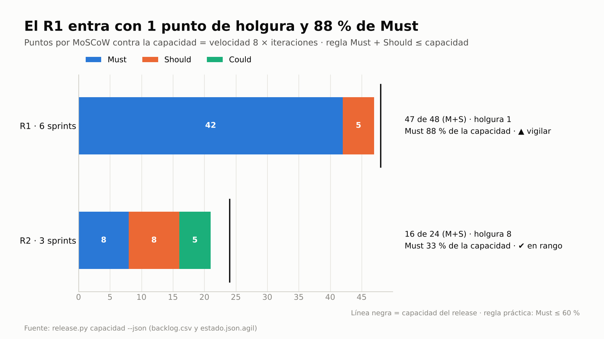
El R1 entra, pero con 1 punto de holgura y 88 % de Must: casi no queda margen de Should o Could para absorber un
cambio sin tocar un Must. El paso 5 decide si se acepta ese costo y el paso 10 muestra lo que cuesta.

**Dónde verificar:** `02-planificacion/backlog.csv` (abrilo en Excel) · `03-control/registros/personas.csv` · prompt:
"Mostrame el backlog ordenado con MoSCoW, puntos y release, la capacidad de cada release y los Must de cada persona".

---

## Paso 5 · Presupuesto, business case, tolerancias, autoridad de cambio, decisión del R1, roadmap y línea base

La **línea base** es la versión aprobada contra la que se mide todo cambio. La **tolerancia** (*tolerance*) es el
desvío que cada nivel puede absorber sin escalar. La **autoridad de cambio** (*change authority*) decide cambios
dentro de un **límite por cambio** y de un **presupuesto de cambio** (*change budget*) que fija la junta. El **business
case** justifica la inversión; su **VAN** (valor actual neto, *net present value*) suma los flujos de cada año
descontados a la tasa de la organización: si es positivo, el proyecto crea valor. Una **matriz de decisión
multicriterio** compara alternativas con pesos explícitos (puntaje = Σ peso × valor normalizado) y su **sensibilidad**
dice cuánto habría que mover un peso para que gane otra.

**Prompt**
```text
Calculá el presupuesto desde la WBS, armá el release plan y el roadmap por etapas con las puertas, y preparame las
puertas de inicio, proyecto y etapa 2. Antes de la de proyecto: documentá las tolerancias y la autoridad delegada
(Sofía decide cambios de hasta 10.000 cada uno, con un presupuesto de cambio de 12.000 que fija la junta), el enfoque
de beneficios (B-01 a B-03, quién los mide y cuándo) y el business case con su VAN a 5 años. En la de proyecto fijá la
línea base del PRD y de las épicas, y que Sofía apruebe el backlog como línea base. Sofía pide que el R1 lleve las
solicitudes del socio en lugar de la consola de operador: compará las dos alternativas con la capacidad de cada una y
armame la matriz; decido yo.
```

**Si te pregunta:**
- Por los flujos del business case: Sofía Ramírez, dueña de los beneficios, y Laura Méndez, ejecutiva, responden con
  la tasa de 10 % anual que usa la cooperativa:

| Concepto | Año 0 | Años 1 a 5 |
|---|---|---|
| Proyecto (BAC de la WBS) | −124.000 | — |
| Operación y soporte | — | −22.000 por año |
| B-01 Desvío de consultas | — | 30.000 el año 1 y 50.000 por año del 2 al 5 |
| B-03 Eficiencia de préstamos | — | 20.000 por año |

- Por las decisiones: "Laura Méndez, ejecutiva: apruebo las tolerancias, el presupuesto de cambio de 12.000 y el
  límite de 10.000 por cambio para la autoridad de cambio; aprobado, confirmo las listas de control" · "Sofía Ramírez,
  PO: apruebo el backlog v1.0".
- Por la matriz del R1: los pesos de la plantilla (valor 35, dependencias 20, capacidad 25, riesgo 20), que Martín
  Suárez y Sofía Ramírez confirman antes de puntuar. Los puntajes (1 a 5), cada uno con quien lo da: valor, Sofía (A 4:
  B-01 desde el R1 con la operación lista; B 3: préstamos antes, pero B-03 recién con la consola); dependencias, Lucía
  Benítez (A 1; B 5: la 2.1 y la 2.2 esperan la bandeja y la resolución, 3.2 y 3.3, y la consola está en el camino
  crítico); riesgo, Martín (A 3: holgura de 1 punto y Must al 88 %; B 4: sin bandeja, las solicitudes se transcriben a
  mano, el dolor de Lucía, PU-003). La capacidad no se puntúa: es la holgura de `release.py`. La decisión: "Martín
  Suárez, gestor: elijo A".

**Qué hace el sistema:**
- `pm-costos-presupuesto` calcula el BAC (presupuesto a la conclusión) con `wbs.py --json`: 124.000.
- `pm-caso-de-negocio` escribe `00-direccion/flujos-business-case.csv` y corre `inversion.py … --tasa 0.1 --variacion
  0.1` (VAN, TIR, repago y sensibilidad de ±10 %, la tolerancia de los beneficios); redacta el business case y el
  `enfoque-beneficios.md`.
- `pm-agil-hibrido` arma el release plan; `pm-visuales`, el roadmap por etapas (`02-planificacion/visuales/roadmap.md`).
- **Decisión del R1** (`pm-direccion-decisiones`, 25/11, antes de la puerta de proyecto):
  1. `pm-agil-hibrido` mide cada alternativa con `release.py capacidad --json` sobre el borrador del backlog: la B con
     sus releases **R1-B** y **R2-B** (así la hoja no confunde su R1 con el de la A) en
     `02-planificacion/escenarios/release-b.json`, y la A, con la que queda el borrador, en `release-a.json`.
  2. `decision.py expediente --tipo planificacion --ids E-2,E-3,PU-002,PU-003 --importar … --corte 2026-11-25` reúne el
     contexto aplicable, cada dato con su fuente: quién decide, tolerancias y presupuestos, líneas del business case,
     personas afectadas y las salidas de `release.py`, sin recalcular.
  3. `decision.py matriz release-1 --proponer --tipo planificacion … --importar …` crea la hoja
     `03-control/decisiones/release-1/` con los criterios de la plantilla y copia las dos salidas; el modelo y las
     personas completan `criterios.csv` y `opciones.csv` con la fuente de cada peso y de cada puntaje. `matriz
     release-1 --markdown` valida, calcula y escribe `matriz.md`, el bloque para la solicitud de decisión.
  4. `decision.py matriz release-1 --elegir O1 --por "Gestor: Martín Suárez" --fecha 2026-11-25` registra la decisión en
     `decisiones.csv` con la hoja, los criterios y las opciones consideradas.
- `pm-direccion-decisiones` redacta `00-direccion/tolerancias-y-autoridad.md` (siete objetivos con tolerancia y
  prioridad, autoridad de cambio, presupuesto de cambio y escalado).
- `pm-director`: `estado.py tolerancia --nivel proyecto …`; `estado.py presupuesto cambio=12000
  limite_autoridad_cambio=10000 --por "Ejecutiva: Laura Méndez"` (queda en `estado.json.presupuestos` y en
  `decisiones.csv`); puertas con `puertas.py`; `bmad.py linea-base prd|epicas --version 1.0`; `estado.py aprobar backlog
  --nivel product-owner`.

**Qué deberías ver:**
- Business case (fila "Línea base" de `inversion.py`): VAN 39.776, TIR 21,0 %, repago en 3,00 años. B-01 sostiene el
  caso: su punto de equilibrio es "76,8 % del valor estimado", es decir, puede caer 23,2 % antes de que el VAN llegue
  a 0.
- Verificación de autorizar-proyecto: "1 bloqueo(s) · 0 condición(es) · 2 aviso(s)". El bloqueo es L-01, la lista de
  control (se genera y la confirma Laura); los avisos son P-09 (sin matriz poder/interés) y P-10 (sin RACI), que se
  trabajan en E2E-3.
- **No aparece P-04 "sin enfoque de beneficios"**, porque el enfoque quedó registrado.
- "Línea base bmad-prd v1.0 registrada · sha bc048f7f59a3"; "bmad-epicas v1.0 · sha 3ff846d6f8d9"; "Copia congelada …
  00-direccion/historial/backlog-v1.0.csv"; fase `entrega`, etapa 2 "Release 1".
- Capacidad de la alternativa B: "R1-B (S1, S2, S3, S4, S5, S6): entra todo (47 de 48; Must + Should 42, holgura 6)" y
  "R2-B (S7, S8, S9): entra todo (21 de 24; Must + Should 21, holgura 3)", con los Must al 88 % de la capacidad del
  R2-B: la B no saca el problema de los Must, lo pasa al segundo release.
- Expediente: "Nivel que decide: `gestor` — Gestor del proyecto: Martín Suárez (dentro de las tolerancias de etapa)";
  las tolerancias de proyecto; "cambio 0 de 12.000; límite de la autoridad de cambio 10.000 por cambio"; B-01 a B-03
  con su archivo y línea; PU-002 y PU-003; y en §8 "R1: capacidad 48 · Must 42 · Should 5 · holgura 1" y "R1-B:
  capacidad 48 · Must 29 · Should 13 · holgura 6".
- Matriz: O1 recomendada (★) con 56,2 y O2 con 47,5, ninguna dominada; sensibilidad "capacidad 25,0: si baja: estable; si sube a 31,0
  (+6,0) pasa O2" y "dependencias 20,0: si baja a 12,3 (-7,7) pasa O2"; valor y riesgo, estables. El aviso "ninguna
  opción parece 'no hacer nada'" se lee y se descarta: sin release plan no hay línea base contra la cual medir.
- "release-1: elegida O1 por Gestor: Martín Suárez · decisión D-003 (nivel gestor) · recomendada O1". No pide motivo:
  la elegida es la recomendada y el menor movimiento de un peso que cambia la primera (6,0 puntos) supera el umbral
  de 5.

> **Por qué importa.** En la práctica la autoridad de cambio "aprueba lo razonable" sin un tope escrito, nadie lleva
> la cuenta de cuánto se comprometió y el VAN se calcula una sola vez, para aprobar el proyecto. Con el límite y el
> presupuesto en `estado.json`, `registro.py` no deja registrar una aprobación de la autoridad de cambio que los supere
> y sanidad compara los cambios aprobados contra ellos de forma continua (CAM-03 y CAM-04, pasos 7 y 10); con los
> flujos en un CSV, cada cambio recalcula el VAN en segundos.

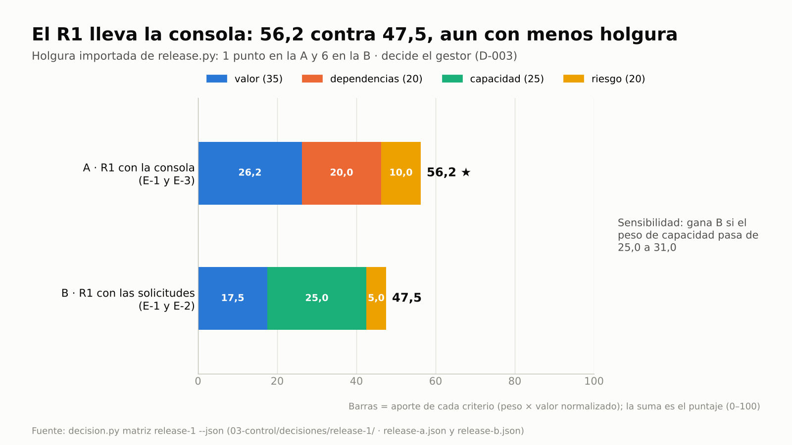
La A gana por valor y dependencias aunque la B tiene 5 puntos más de holgura. Si la capacidad pesara 31 en lugar de
25, ganaría la B: ese es el costo que se acepta al decidir, y el paso 10 lo cobra.

> **Más desarrollo: una decisión que deja escrito su costo.** La matriz no elige por el gestor: ordena lo que cada
> persona sabe (el valor lo da la PO, las dependencias el equipo, la holgura `release.py`) y muestra cuánto depende el
> resultado de los pesos. Con los pesos confirmados antes de puntuar se evita la trampa de acomodarlos para que gane la
> opción preferida (PMBOK 8, análisis de decisiones multicriterio), y la decisión queda en `decisiones.csv` con la hoja
> que la explica. Sanidad la revisa (DEC-01, DEC-02): si alguien cambia la hoja después de decidir, avisa.

**Dónde verificar:** `00-direccion/tolerancias-y-autoridad.md` · `00-direccion/business-case.md` y
`00-direccion/flujos-business-case.csv` · `00-direccion/enfoque-beneficios.md` · `00-direccion/historial/` (copias
congeladas) · `02-planificacion/release-plan.md` · `02-planificacion/visuales/roadmap.md` ·
`02-planificacion/escenarios/release-a.json` y `release-b.json` · `03-control/decisiones/release-1/` (`decision.json`,
`criterios.csv`, `opciones.csv`, `matriz.md`) · `decisiones.csv` (D-003) · prompts: "Mostrame el resumen del proyecto"
(`estado.py resumen` lista los presupuestos) y "¿Por qué el R1 lleva la consola y no las solicitudes?".

---

## Paso 6 · Cambio menor: intercambio de Should/Could por el PO

**Prompt**
```text
Cumplimiento pide adelantar la actualización de contacto. Sofía decide: la 2.3 (Could) pasa a R1 y la 1.4 constancias
(Should) a R2, sin tocar Must, fecha ni costo. Registralo y avisale al equipo BMAD.
```

**Si te pregunta:** nada; la decisión es de la PO y está en el prompt.

**Qué hace el sistema:** `pm-agil-hibrido` verifica que es un intercambio permitido al PO (Should/Could equivalentes,
sin tocar Must, fecha ni costo) → `registro.py agregar decisiones --campo nivel=product-owner` (**no** hay solicitud
de cambio) → `bmad.py handoff` (sin `--cambio`: prioridades para el sprint planning de BMAD).

**Qué deberías ver:** **D-010**; "Traspaso emitido → …/handoff-bmad-<fecha>-prioridades.md". R1 queda con 47 puntos y R2
con 21.

**Dónde verificar:** `decisiones.csv` · `02-planificacion/especificacion/handoff-bmad-<fecha>-prioridades.md`.

---

## Paso 7 · Cambio de alcance: análisis de impacto antes de decidir

En BMAD, el PM de producto agrega **FR-13 "Simulador de préstamo"** al PRD por pedido del Consejo, sin pasar por la
autoridad de cambio. Para simularlo en tu copia, pedíselo a BMAD con `bmad-prd` en modo edición, o editá el PRD.

El **análisis de impacto** (*impact assessment*) mide el cambio contra cada objetivo **antes** de decidir y dice qué
nivel tiene que decidirlo: la autoridad de cambio si entra en su límite, en el presupuesto de cambio y en las
tolerancias; la junta si no.

**Prompt**
```text
Verificá la especificación contra la línea base. Si hay algo nuevo, registralo como solicitud de cambio y analizá el
impacto antes de decidir: paquete de la WBS nuevo, esfuerzo, camino crítico, reserva de cronograma, costo, presupuesto
de cambio, autoridad, capacidad del release, business case y a qué personas de usuario afecta. Estimá el simulador en
O 8, M 10, P 16 días después de los sprints de solicitudes; Sofía estima que suma 4.000 por año al beneficio B-03. Si
la reserva de cronograma queda chica, registralo como riesgo.
```

**Si te pregunta:** a quién afecta: "Sofía Ramírez, usuaria sénior: el simulador lo usa Diego, antes de pedir el
préstamo (UJ-2)". La decisión: "Sofía Ramírez, autoridad de cambio: aprobado; se carga al presupuesto de cambio".

**Qué hace el sistema:**
1. `bmad.py verificar` → desvío. Sin un issue que lo cite, sanidad lo marcaría **ERROR ESP-10** ("Cambio no
   controlado"); con I-001 baja a AVISO hasta que se fije la nueva línea base (paso 8).
2. `pm-issues-cambios` registra **I-001** `solicitud-cambio` y **C-001** con quién lo pide, el monto y su cargo
   (`--campo solicitante=… --campo costo=9000 --campo cargo=presupuesto-cambio`).
3. `pm-cronograma-estimacion` corre `cpm.py` sobre un **escenario** (`02-planificacion/escenarios/actividades-C-001.csv`)
   y `pm-caso-de-negocio` corre `inversion.py` sobre otro (`escenarios/flujos-C-001.csv`), sin tocar las líneas base.
   `pm-interesados` vincula FR-13 a Diego (`registro.py actualizar personas PU-002 --campo usa=…;FR-13`) y muestra el
   mapa capacidad × persona (`interesados.py personas mapa`).
4. `pm-issues-cambios` corre el análisis de impacto **antes** de la decisión:
   ```bash
   impacto.py --proyecto gestion analizar C-001 --actividades 02-planificacion/escenarios/actividades-C-001.csv \
     --inicio 2026-11-30 --pert 02-planificacion/estimacion-pert.csv --flujos 02-planificacion/escenarios/flujos-C-001.csv \
     --opcion "Con C-001" --tasa 0.10 --refs FR-13 --paquetes 3.4 --puntos 8 --release R2 --fecha 2027-01-16
   ```
   Compara los dos cronogramas con `cpm.py`, toma la reserva a 2σ de `estimacion-pert.csv` (paso 3), mide la capacidad
   del R2 con la velocidad de `estado.json` (la regla de `release.py capacidad`), el BAC desde la WBS, el VAN con
   `inversion.py` y quién decide con la misma regla de autoridad y presupuesto de cambio que aplica `registro.py`. Escribe el borrador de la **solicitud de cambio**
   (`03-control/reportes/2027-01-16-solicitud-cambio-C-001.md`, estado borrador) con la tabla, las opciones aprobar,
   rechazar, diferir o pedir plan de excepción, y el nivel que decide. **No escribe registros**: el gestor deja el
   impacto y la recomendación en `cambios.csv` con `registro.py actualizar` y C-001 queda `pendiente-decision`.
5. Decide la autoridad de cambio; `pm-riesgos` registra **R-001** (probabilidad 3 × impacto 3, respuesta reducir,
   disparador SPI < 0,90, revisión el 19/2); `wbs.py` suma el paquete **3.4**; `bmad.py handoff --cambio C-001`;
   `sanidad.py --rapido --corte 2027-01-18`.

**Qué deberías ver:**
- "agregados ['FR-13']"; escenario: "Duración total (días laborables): 123 · Fin previsto: 2027-05-20" (el escenario
  muestra también su propia reserva, 13,3 días; el análisis de impacto mide cuánto consume el cambio de la reserva de la
  línea base, 13,0); en el business case, la fila "Con C-001" da VAN 45.939, TIR 21,8 % y 6.163 más que la línea base.
- Mapa capacidad × persona: "FR-13 | Simulador de préstamo | sin prioridad" con Diego como usuario (U). FR-13 todavía no
  tiene historia, por eso no tiene prioridad: la recibe en el paso 8.
- La tabla de impacto de C-001 (§3 del borrador, en la evidencia tal cual):

| Objetivo | Antes | Con C-001 | Contra qué se mide | Lectura |
|---|---|---|---|---|
| Alcance y especificación | línea base bmad-prd v1.0, bmad-epicas v1.0 | paquetes WBS 3.4; +8 pts en R2; requisitos FR-13 | Must sin tolerancia; Should/Could los intercambia el PO | afecta ids existentes: FR-13 (sin-cobertura) |
| Tiempo (camino crítico) | 112 días · fin 2027-05-05 | 123 días · fin 2027-05-20 (+11) | tolerancia del proyecto ±3 semanas = 15 días laborables | dentro: usa 11 de 15 (73 %) |
| Dependencias | camino crítico A01 → A03 → A05 → A06 → A07 → A08 → A09 | camino crítico A01 → A03 → A05 → A06 → A07 → A10 → A08 → A09 | cpm.py | actividades nuevas: A10; se corren: A08 (+11), A09 (+11) |
| Reserva de cronograma | 2σ = 13,0 días | 13,0 − 11 = 2,0 días | atraso posible del camino crítico (tres valores, beta-PERT) | queda menos de la mitad: registrar riesgo |
| Capacidad del R2 | 21 pts de 24 (3 sprints) | 29 pts | velocidad 8 pts por sprint | 4 sprints: +1 sprint (14 días corridos) |
| Costo (BAC) | 124.000 | 133.000 (+9.000, 7,3 %) | tolerancia de costo ±8 %; cargo presupuesto-cambio | se financia con presupuesto-cambio, no con la tolerancia de costo |
| Presupuesto de cambio | 0 de 12.000 | 9.000 de 12.000 (75 %) | saldo fijado por la junta (CAM-03: aviso desde 80 %, error sobre 100 %) | dentro del saldo |
| Autoridad | límite 10.000 por cambio | 9.000 en este cambio | registro.py (motivos_autoridad) · CAM-04/CAM-05 | dentro de la autoridad delegada |
| Beneficios (VAN) | 39.776 · B-01 Desvío de consultas puede caer 23 % | 45.939 (+6.163) · B-01 Desvío de consultas puede caer 27 % | inversion.py, tasa 10 % · VAN > 0 · tolerancia de beneficios −10 % | a favor: el cambio suma valor |
| Riesgo | 0 riesgo(s) abierto(s) citan lo afectado | riesgo nuevo sugerido: la reserva de cronograma queda en 2,0 días (pm-riesgos) | ningún riesgo alto sin respuesta | revisar con pm-riesgos |
| Calidad | 0 actividad(es) de calidad de lo afectado | criterios de calidad del producto nuevo o cambiado | [por confirmar] | planificar revisión o prueba (pm-calidad) |

- "Decide: Autoridad de cambio: Sofía Ramírez (autoridad-cambio)" · "Opciones: Aprobar, Rechazar, Diferir, Pedir plan de
  excepción (no aplica) · recomendación: aprobar con el cargo indicado". "FR-13 (sin-cobertura)" indica que FR-13 ya
  está en el PRD (por eso el desvío) pero todavía sin historia.
- C-001 aprobado; R-001; WBS "14 elementos, 9 hojas · esfuerzo 2660 h · costo 133,000"; el traspaso
  `handoff-bmad-<fecha>-C-001.md`.
- Sanidad "0 ERROR · 4 AVISO · 3 INFO" con **"INFO CAM-03 Presupuesto de cambio: 9.000 de 12.000 (75 %)"**. Los avisos son
  el seguimiento del cambio en curso, que se resuelve en el paso 8: ESP-10 (el PRD difiere de su línea base y hay un
  issue que lo trata), dos ESP-13 (traspasos a BMAD sin confirmar) y ESP-14 (`requisitos-bmad.csv` sin resincronizar).

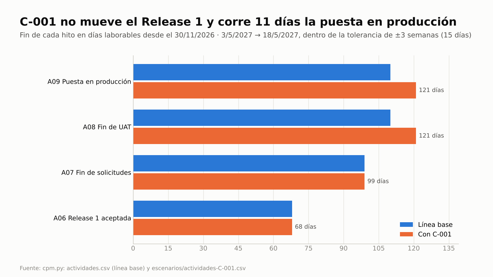
El Release 1 sigue en el día 68; UAT y puesta en producción se corren 11 días, dentro de la tolerancia de 15.

> **Más desarrollo: el impacto se mira antes, en todos los objetivos, y dice quién decide.** La pregunta habitual es
> "¿cuánto cuesta?". El análisis agrega las que se olvidan: qué le hace al camino crítico, cuánto queda de reserva, si
> entra en la capacidad del release, si está dentro del límite de quien decide, cuánto queda del presupuesto, si el
> cambio crea valor y a quién sirve (lo pide el Consejo directivo, lo usa Diego). Con esa tabla, la decisión de Sofía
> es informada y queda registrada con sus condiciones (riesgo R-001 y sprint 10).

> **Por qué no "contra la contingencia".** Este proyecto no tiene contingencia definida, y la reserva de riesgo solo
> financia respuestas a riesgos. Un cambio aprobado se paga con el **presupuesto de cambio** del paso 5: por eso el BAC
> pasa de 124.000 a 133.000 y el saldo baja a 3.000. Sin monto ni cargo, sanidad lo marcaría CAM-01.

**Dónde verificar:** `issues.csv` · `cambios.csv` (columnas `solicitante`, `impacto_*`, `decision`, `decidido_por`,
`costo`, `cargo`) · `riesgos.csv` · `personas.csv` (PU-002) · `02-planificacion/escenarios/` (cronograma y flujos de
C-001) · `03-control/reportes/2027-01-16-solicitud-cambio-C-001.md` · prompt: "¿Qué impacto tiene C-001 en fecha, costo,
capacidad y VAN, quién lo decide y cuánto queda del presupuesto de cambio?".

---

## Paso 8 · BMAD aplica el cambio, nuevas líneas base y trazabilidad recalculada

El equipo BMAD aplica el traspaso con sus flujos (`bmad-prd`, `bmad-create-epics-and-stories`) y agrega la historia 2.4.

**Prompt**
```text
El equipo BMAD aplicó el traspaso de C-001 (historia 2.4 Simulador). Resincronizá requisitos, trazabilidad y backlog,
poné la 2.4 como Should de 8 puntos en el sprint 10 del R2, mostrame la cobertura de trazabilidad, fijá las nuevas
líneas base y actualizá el roadmap.
```

**Si te pregunta:** "Laura Méndez, ejecutiva: apruebo las líneas base 1.1".

**Qué hace el sistema:** `bmad.py requisitos` · `trazabilidad` · `backlog` · `pm-agil-hibrido` completa el gobierno de
la 2.4 · recalcula la cobertura · `pm-visuales` actualiza el roadmap · `pm-director`: `bmad.py linea-base prd|epicas
--version 1.1` · `decision.py vigentes --tema "línea base" --corte 2027-01-25` · C-001 `implementado` e I-001
`cerrado` · `bmad.py verificar` · `sanidad.py --rapido --corte 2027-01-25`.

**Qué deberías ver:**
- "43 identificadores"; "backlog.csv: 1 nuevas, 10 actualizadas"; "bmad-prd v1.1 · sha 089472ba0219"; "bmad-epicas v1.1 ·
  sha acca7ef6e6b2"; "Sin desvíos: la especificación coincide con las líneas base registradas".
- Cobertura: 13 de 13 requisitos funcionales con historia y con paquete; 11 de 11 historias con producto de la PBS;
  6 de 6 NFR con paquete o criterio de calidad; 1 de 13 requisitos citados en su propia historia (FR-13).
- Sanidad "0 ERROR · 0 AVISO · 3 INFO": CAM-03 (9.000 de 12.000, 75 %), ESP-02 (índice de especificación que se
  reconstruye solo) y **TOL-03** ("Etapa de entrega sin corte de EVM guardado: el pronóstico contra tolerancias no se
  vigila"), que se corrige en el paso 9.
- R2 pasa a 29 puntos: se agrega el sprint 10 y la capacidad sube a 32. El roadmap cambia de fin 2027-05-05 a 2027-05-20.
- Decisiones vigentes sobre la línea base: "D-011 · 2027-01-25 · línea base bmad-prd v1.1 … · cadena D-005 → D-011" y
  "D-012 … · cadena D-006 → D-012". `bmad.py linea-base` marca el reemplazo (columna `reemplaza`), así que la versión
  1.0 queda como historia y deja de aparecer en los expedientes y en las búsquedas.

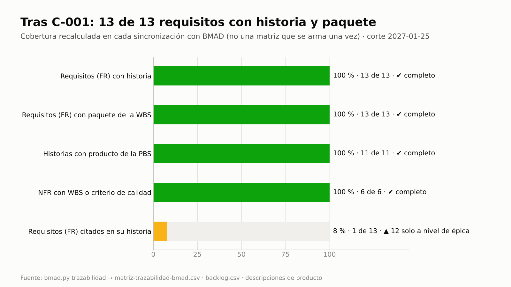
Tras el cambio, la cobertura sigue completa. La única barra en ámbar señala que BMAD traza 12 requisitos a nivel de
épica: es una mejora para el equipo de producto, no un hueco de alcance.

> **Más desarrollo: trazabilidad continua.** La matriz no se arma una vez: se regenera en cada sincronización, y la
> cobertura se compara contra la anterior (12 de 12 en el paso 2, 13 de 13 tras el cambio). Si el traspaso no se
> hubiera aplicado, FR-13 quedaría sin historia y `bmad.py trazabilidad` lo listaría como "Requisitos funcionales sin
> historia".

**Dónde verificar:** `00-direccion/historial/bmad-prd-v1.1` · `backlog.csv` ·
`02-planificacion/especificacion/matriz-trazabilidad-bmad.csv` · `02-planificacion/visuales/roadmap.md` · prompt:
`/pm-method:pm-sync bmad`.

---

## Paso 9 · Avance del alcance (EVM ágil guardado) y calidad de lo terminado

El **valor ganado** (EVM, *earned value management*) compara lo planificado (PV), lo ganado (EV) y lo gastado (AC). En
modo ágil, con costo y fecha fijos, un EAC (costo estimado a la conclusión) mayor que el BAC no se lee como sobrecosto
sino como **alcance que no va a entrar**.

**Prompt**
```text
Corte del 29/1: ¿cuánto alcance llevamos y entra todo con el presupuesto? PV 60.000, EV 52.000, AC 58.000, BAC 133.000.
Leelo como ágil: costo y fecha fijos, el 20 % del alcance es Should/Could. Guardá el corte para que quede vigilado.
Registrá la revisión de calidad del 28/1 de las historias 1-1, 1-2, 1-3 y 3-1: Sofía la aprobó contra la descripción
de producto 3.1 y los criterios de aceptación.
```

**Si te pregunta:** nada; las cifras del corte y la revisión están en el prompt.

**Qué hace el sistema:** `bmad.py avance` (estados de BMAD → `avance-bmad.csv`) y `bmad.py backlog` (el estado `done`
llega a `backlog.csv`); `pm-calidad` registra **Q-001** (revisión completada y aprobada, cita las cuatro historias y
EC-01 a EC-04); `pm-progreso-reportes` → `evm.py --pv 60000 --ev 52000 --ac 58000 --bac 133000 --modo agil
--pct-no-must 20 --proyecto gestion --guardar --corte 2027-01-29`; como el SPI quedó debajo de 0,90, `pm-riesgos` anota
que se activó el disparador de R-001 y lo pasa a `en-seguimiento`; `sanidad.py --rapido --corte 2027-01-29`;
`puertas.py estado --markdown` para el highlight.

**Qué deberías ver:**
- "Historias 11 · … done 4 · … 34.2 % (puntos)"; "Guardado: 03-control/reportes/evm-2027-01-29.json".
- SPI 0,867 · CPI 0,897 · EAC 148.346 → `alcance_no_entregable_pct 10.345` · `semaforo_alcance ambar` ·
  `excepcion_prevista False`: no entra ≈ 10 % del alcance, menos que el 20 % de Should/Could. **Los Must no peligran**
  y el PO decide qué Should/Could salen, que es la respuesta prevista en R-001 ("disparador activado el 2027-01-29 (SPI
  0,867 < 0,90)").
- Sanidad "0 ERROR · 0 AVISO · 3 INFO" con **TOL-02** ("El EVM del 2027-01-29 está en ámbar … alcance=ambar: 50–100 % de
  la tolerancia") y CAM-03 al 75 %.
- No hay **QUA-01**: las cuatro historias terminadas tienen una revisión aprobada que las cita. Sin Q-001, sanidad daría
  un aviso por cada una ("terminado sin revisión de calidad registrada").

**Dónde verificar:** `03-control/reportes/avance-bmad.csv` · `03-control/reportes/evm-2027-01-29.json` · `calidad.csv`
· `riesgos.csv` (R-001: `estado`, `notas`) · la tabla de puertas de `puertas.py estado --markdown` (en la evidencia).

---

## Paso 10 · Excepción: el cambio excede la autoridad delegada y el pronóstico sale de la tolerancia

**El problema real.** Un pedido "obligatorio" se aprueba en el momento por quien está más cerca, nadie suma lo que ya
se comprometió y el pronóstico de EVM vive en una planilla que se mira al cerrar la etapa. Acá se frena **el mismo
día**: `registro.py` no deja registrar como aprobado un cambio que supera el límite de quien lo decide o el saldo del
presupuesto de cambio (queda `pendiente-decision` y se escala a la junta), sanidad cruza cada corte guardado con la
tolerancia (TOL-01) y la verificación de puertas no deja aprobar nada mientras haya un ERROR.

**Gestión por excepción** (*management by exception*): cada nivel decide dentro de su tolerancia y, si un pronóstico la
supera, escala al nivel de arriba con un **informe de excepción**; la junta puede pedir un **plan de excepción** que
reemplaza el plan vigente y llega con el business case y los riesgos actualizados.

La revisión normativa que el PRD dejaba como supuesto (NFR-1, Ley 18.331) concluye que el socio debe dar
consentimiento informado y poder consultar el registro de sus accesos. El Consejo lo pide como obligatorio.

**Prompt 1 (19/2, gestor)**
```text
Registrá el requisito regulatorio como solicitud de cambio: paquete nuevo 3.5, 13 puntos Must en R1, +1 sprint en la
etapa 2, USD 15.000, sin beneficio propio. Sofía lo aprobó el 17/2 porque es obligatorio: registralo. Guardá el corte de EVM del
19/2 (PV 75.000, EV 60.000, AC 77.000, BAC 133.000, ágil, 20 % Should/Could), corré sanidad al 19/2 y analizá el
impacto de C-002 (refuerza NFR-1 y NFR-5; para hacerle lugar en R1 saldría la 2.3) con su efecto en el business case:
decime quién tiene que decidirlo. Si hay excepción, prepará el informe de excepción para la junta y registrá el issue.
Medí también la opción de diferirlo al R2 y armá la matriz de decisión para la junta: rechazar, diferir o pedir plan de
excepción.
```
**Prompt 2 (22/2, junta)**
```text
Laura Méndez, ejecutiva: leí el informe X-001; la junta pide un plan de excepción para la etapa 2. Prepará el plan:
C-002 entra como Must en R1, la etapa termina el 19/3, sale la 2.3 de R1 y se pide ampliar el presupuesto de cambio.
```
**Prompt 3 (26/2, junta)**
```text
Laura Méndez, ejecutiva: la junta amplía el presupuesto de cambio a 32.000 (12.000 originales + 15.000 de C-002 + 5.000
de reposición), aprueba C-002 con cargo a ese presupuesto y aprueba el plan de excepción con fin de etapa el 19/3.
Confirmo la lista de control.
```

**Si te pregunta:** las decisiones de la junta están en los prompts 2 y 3 (Laura Méndez, ejecutiva). Si al cierre te
pide revisar R-001: "Martín Suárez, gestor: sube a probabilidad 4 (SPI 0,80 al 19/2 y un sprint más en la etapa 2);
próxima revisión el 19/3, al fin de la etapa". Por la matriz de C-002, Martín Suárez usa los pesos de la plantilla de
cambio (impacto 40, tolerancias 35, autoridad 25) con el impacto como eliminatorio: menos de 2 es incumplir un
requisito obligatorio. Puntajes (impacto, tolerancias, autoridad), cada uno citando su análisis: rechazar 1, 5, 5 (sin
consentimiento el portal no puede salir a producción); diferir 2, 1, 1 (el R1 no se abre a los socios sin
consentimiento y B-01 se demora; 2 sprints más en el R2; 15.000 sobre el límite); plan de excepción 4, 1, 1 (cumple y
el VAN sigue positivo; la etapa sale de su tolerancia; decide la junta).

**Qué hace el sistema:**
- **Con el prompt 1 (19/2):**
  1. `pm-issues-cambios` registra **I-002** `solicitud-cambio` y **C-002** con `costo=15000` y
     `cargo=presupuesto-cambio`. Al registrar la aprobación de Sofía (`decision=aprobado`, `decidido_por=Autoridad de
     cambio: Sofía Ramírez`), **`registro.py` la rechaza**: supera su límite de 10.000 y el saldo del presupuesto de
     cambio (9.000 + 15.000 = 24.000 de 12.000). C-002 queda `pendiente-decision`, con la aprobación de Sofía anotada
     en `notas`, y se escala a `pm-director`.
  2. `pm-progreso-reportes`: `evm.py … --proyecto gestion --guardar --corte 2027-02-19` → `evm-2027-02-19.json`.
  3. `sanidad.py --rapido --corte 2027-02-19` detecta la excepción prevista del EVM (TOL-01); el presupuesto de cambio
     sigue en 75 % porque C-002 no se aprobó (ver abajo).
  4. `pm-caso-de-negocio` corre `inversion.py` sobre `escenarios/flujos-C-002.csv` con el plan vigente como base
     (`--base "Con C-001"`), y `pm-issues-cambios` corre el **análisis de impacto de C-002**, que muestra lo que la
     aprobación de palabra del 17/2 no miró: `impacto.py --proyecto gestion analizar C-002 --refs NFR-1,NFR-5
     --paquetes 3.5 --flujos 02-planificacion/escenarios/flujos-C-002.csv --opcion "Con C-001 y C-002" --base "Con
     C-001" --tasa 0.10 --puntos 13 --release R1 --liberar 2-3 --etapa --evm 03-control/reportes/evm-2027-02-19.json
     --fecha 2027-02-19`. `--liberar 2-3` descuenta la historia que sale del R1; `--etapa` mide el sprint de más contra
     la tolerancia de tiempo de la etapa, porque el R1 cierra la etapa 2; `--evm` suma el pronóstico del corte. El
     borrador queda en `03-control/reportes/2027-02-19-solicitud-cambio-C-002.md`.
  5. `pm-progreso-reportes` redacta el **informe de excepción X-001** (plantilla `informe-excepcion.md`, con el impacto
     en el business case) y lo registra como `informe-excepcion-X-001`; `pm-issues-cambios` registra **I-003**
     `problema-preocupacion` (severidad crítica, `escalado`) e I-002 pasa a `escalado`.
  6. **Matriz para la junta** (`pm-direccion-decisiones`): `pm-issues-cambios` repite el análisis para la opción
     **diferir al R2** (`--puntos 13 --release R2 --salida 03-control/reportes/2027-02-19-solicitud-cambio-C-002-diferir.md`,
     sin pisar el primer borrador) y guarda las dos salidas `--json` (`2027-02-19-impacto-C-002-r1.json` y `-r2.json`
     en `03-control/reportes/`). `decision.py expediente --tipo cambio --ids C-002 --importar … --corte 2027-02-19`
     toma de ellas quién decide; `decision.py matriz C-002 --proponer --tipo cambio …` crea la hoja
     `03-control/decisiones/C-002/` y se completa con las tres opciones; `matriz C-002 --markdown` calcula;
     `decision.py pregunta C-002` arma la pregunta cerrada para la junta, y la recomendación que propone el modelo se
     comprueba con `pregunta C-002 --validar -` antes de llevarla al informe.
- **Con el prompt 2 (22/2):**
  7. `pm-director`: `estado.py puerta decision-ad-hoc --decision aprobado --por "Ejecutiva: Laura Méndez" --fecha
     2027-02-22 --condiciones "X-001: la junta pide plan de excepción …"` y `estado.py limite-etapa --excepcion X-001`
     (la etapa pasa a SB, límite de etapa). La condición queda abierta y a la vista (EST-12 en sanidad, G-01 en la
     próxima verificación) hasta que alguien la dé por cumplida. Como decidió la junta, `decision.py matriz C-002
     --elegir O3 --por "Ejecutiva: Laura Méndez" --decision D-013 --fecha 2027-02-22` deja la matriz en la fila que
     registró `pm-director`, sin crear otra.
  8. `pm-plan-etapa-y-limites` redacta el **plan de excepción** (plantilla `plan-excepcion.md`) y lo registra como
     `plan-excepcion-X-001`; `pm-caso-de-negocio` actualiza el business case con el escenario de C-002; `pm-director`
     cierra la condición con `estado.py cumplir-condiciones decision-ad-hoc --fecha 2027-02-24 --por "Ejecutiva: Laura
     Méndez" --nota "…"`.
- **Con el prompt 3 (26/2):**
  9. `pm-director`: `puertas.py verificar autorizar-plan-excepcion` → bloqueada solo por la lista de control (L-01).
     La junta decide: primero `estado.py presupuesto cambio=32000 --por "Ejecutiva: Laura Méndez"` (queda en
     `decisiones.csv`) y después C-002 `aprobado` con `decidido_por=Junta: Laura Méndez (ejecutiva) · plan de excepción
     X-001` y `cargo=presupuesto-cambio`, que ya tiene saldo (24.000 de 32.000). Sin la ampliación, `registro.py`
     también rechazaría la aprobación de la junta y pediría la fuente: `reserva-gestion`, `plan-excepcion` o ampliar el
     presupuesto. Después: `verificar`, `puertas.py lista … --fecha 2027-02-26`, `confirmar … --fecha 2027-02-26` y
     `estado.py puerta autorizar-plan-excepcion --decision aprobado --por "Ejecutiva: Laura Méndez" --fecha 2027-02-26
     --fin 2027-03-19`.
  10. I-003 `cerrado`, I-002 `pendiente-cambio`; `wbs.py` suma el paquete **3.5**; `bmad.py handoff --cambio C-002`;
     `sanidad.py --rapido --corte 2027-02-26` → **REG-09**; `pm-riesgos` revisa R-001 con su propietario
     (`registro.py actualizar riesgos R-001 --campo probabilidad=4 --campo fecha_revision=2027-03-19 …`); sanidad otra
     vez; `estado.py resumen`; `registro.py listar cambios`; `decision.py vigentes --tema "change budget" --corte
     2027-02-26`.

**Qué deberías ver:**
- EVM del 19/2: SPI 0,800 · CPI 0,779 · EAC 170.683 · `alcance_no_entregable_pct 22.078` · `semaforo_alcance rojo` ·
  `excepcion_prevista True` · "→ Pronóstico fuera de tolerancia: preparar informe de excepción (pm-progreso-reportes) y
  escalar a pm-director". No entra ≈ 22 % del alcance, más que el 20 % de Should/Could: **los Must peligran**.
- Rechazo de la aprobación de Sofía: "Control de cambios (PRINCE2, autoridad y presupuesto de cambio; no se omite con
  --forzar)" con "C-002: costo 15.000 supera el límite de la autoridad de cambio (10.000)", "C-002: el presupuesto de
  cambio no alcanza: 9.000 ya cargados + 15.000 = 24.000 de 12.000 fijados por la junta" y "→ 'Autoridad de cambio:
  Sofía Ramírez' no es la junta ni el ejecutivo. Dejar estado=pendiente-decision (sin decision=aprobado) y escalar a
  pm-director: decide la junta o el ejecutivo".
- Sanidad del 19/2: "0 ERROR · 1 AVISO · 1 INFO":
  - **AVISO TOL-01** "El EVM del 2027-02-19 pronostica salir de la tolerancia (… alcance=rojo) y no hay excepción
    abierta".
  - **INFO CAM-03** "Presupuesto de cambio: 9.000 de 12.000 (75 %)": C-002 no consume presupuesto mientras esté
    pendiente, y sin CAM-04 porque ninguna aprobación quedó fuera de la autoridad.
- Business case (fila "Con C-001 y C-002"): VAN 30.939, TIR 17,3 %, repago en 3,23 años y 15.000 menos que el plan
  vigente; el punto de equilibrio de B-01 sube a "81,9 % del valor estimado".
- La tabla de impacto de C-002 (§3 del borrador, en la evidencia tal cual):

| Objetivo | Antes | Con C-002 | Contra qué se mide | Lectura |
|---|---|---|---|---|
| Alcance y especificación | línea base bmad-prd v1.1, bmad-epicas v1.1 | paquetes WBS 3.5; +13 pts en R1; requisitos NFR-1, NFR-5 | Must sin tolerancia; Should/Could los intercambia el PO | afecta ids existentes: NFR-1 (n/a), NFR-5 (n/a) |
| Capacidad del R1 | 47 pts de 48 (6 sprints) | 55 pts (sin 2-3: −5) | velocidad 8 pts por sprint | 7 sprints: +1 sprint (14 días corridos) |
| Tiempo de la etapa | fin 2027-03-05 | fin 2027-03-19 (+14) | tolerancia de etapa ±10 % = 9,8 días | fuera de tolerancia → excepción |
| Alcance (EVM) | Should/Could = 20 % del alcance | no entra 22,1 % | Must sin tolerancia | los Must peligran → excepción |
| Costo (BAC) | 133.000 | 148.000 (+15.000, 11,3 %) | tolerancia de costo ±8 %; cargo presupuesto-cambio | se financia con presupuesto-cambio, no con la tolerancia de costo |
| Presupuesto de cambio | 9.000 de 12.000 | 24.000 de 12.000 (200 %) | saldo fijado por la junta (CAM-03: aviso desde 80 %, error sobre 100 %) | no alcanza: otra fuente o ampliarlo |
| Autoridad | límite 10.000 por cambio | 15.000 en este cambio | registro.py (motivos_autoridad) · CAM-04/CAM-05 | excede la autoridad delegada |
| Beneficios (VAN) | 45.939 · B-01 Desvío de consultas puede caer 27 % | 30.939 (-15.000) · B-01 Desvío de consultas puede caer 18 % | inversion.py, tasa 10 % · VAN > 0 · tolerancia de beneficios −10 % | sigue justificado, con menos margen |
| Riesgo | 0 riesgo(s) abierto(s) citan lo afectado | sin riesgo nuevo calculado | ningún riesgo alto sin respuesta | [por confirmar] |
| Calidad | 0 actividad(es) de calidad de lo afectado | criterios de calidad del producto nuevo o cambiado | [por confirmar] | planificar revisión o prueba (pm-calidad) |

- "Decide: Junta (ejecutivo: Laura Méndez) vía pm-director (junta)", con cuatro motivos: el pronóstico sale de la
  tolerancia de tiempo de la etapa, el EVM pronostica que los Must no entran, "costo 15.000 supera el límite de la
  autoridad de cambio (10.000)" y "el presupuesto de cambio no alcanza: 9.000 ya cargados + 15.000 = 24.000 de 12.000
  fijados por la junta". "Opciones: Aprobar (no aplica), Rechazar, Diferir, Pedir plan de excepción · recomendación:
  pedir plan de excepción". Los dos últimos motivos son los mismos con los que `registro.py` rechazó la aprobación de
  Sofía.


Cada barra es cuánto del límite usaría C-002: 200 % del presupuesto de cambio, 150 % del límite de la autoridad de
cambio, 143 % de la tolerancia de tiempo de la etapa, 115 % de la capacidad del R1 y 110 % del margen de Should/Could.

- Análisis de diferir al R2: capacidad del R2 de 29 pts de 32 (4 sprints) a 42 pts, "6 sprints: +2 sprint (28 días
  corridos)", con los mismos motivos de límite y presupuesto. Diferir no evita a la junta y corre la puesta en
  producción 28 días corridos, cuando a la tolerancia de ±3 semanas del proyecto le quedan 4 días laborables (C-001 usó
  11 de 15).
- Expediente de C-002: "Nivel que decide: `junta`" con los cuatro motivos "según
  03-control/reportes/2027-02-19-impacto-C-002-r1.json (impacto.py)"; C-002, I-002 e I-003 como registros
  relacionados; el corte de EVM del 19/2 ("excepción prevista: sí") y las dos tablas de impacto, sin recalcular.
- Matriz: O1 "eliminada: impacto 1 < 2 (eliminatorio)", O2 con 10,0 y "dominada por O3", O3 recomendada (★) con
  30,0; los tres pesos, estables. Los puntajes son bajos porque ninguna opción entra en las tolerancias ni en la autoridad delegada: es una
  excepción, y la matriz lo muestra.
- Pregunta tipada: las respuestas posibles son "O2 | O3 | pedir-informacion" (la eliminada no figura). Una respuesta
  "O1" no pasa ("Respuesta inválida: O1" y "O1 está eliminada (impacto 1 < 2 (eliminatorio))"); la "O3" con evidencia
  del expediente sí ("Respuesta válida: O3"). Ninguna decide: son insumo para la junta.
- "C-002: elegida O3 por Ejecutiva: Laura Méndez · decisión D-013 (nivel junta) · recomendada O3"; la fila D-013 suma
  "opciones_consideradas: O1 eliminada · O2 10,0 · O3 30,0★" y la hoja en `artefactos_afectados`.

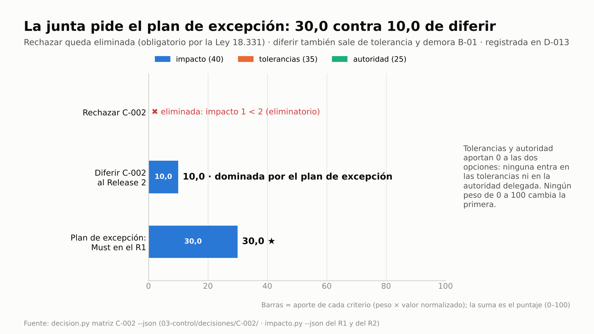
Rechazar queda fuera por el eliminatorio y diferir está dominada: tiene peor impacto y las mismas tolerancias y
autoridad que el plan de excepción. La junta decide con la matriz, no con la urgencia.

- `limite-etapa`: "Proceso: SB" y "Límite de etapa por excepción X-001: plan de excepción (reemplaza el plan vigente),
  actualizar plan de proyecto, business case y riesgos. Puerta: autorizar-plan-excepcion".
- Primera verificación: "Puerta autorizar-plan-excepcion: 1 bloqueo(s)", solo L-01, la lista de control: como C-002 no
  se registró aprobado contra un presupuesto agotado, no hay ERROR CAM-03 que bloquee (si lo hubiera, por datos
  cargados antes de que la junta fijara el presupuesto, la verificación lo convertiría en bloqueo S-CAM-03).
- Tras la decisión de la junta: "1 bloqueo(s)" (L-01 hasta confirmar la lista); "Lista creada:
  00-direccion/decisiones/2027-02-26-verificacion-autorizar-plan-excepcion.md (0 hallazgos automáticos, 3 ítems para la
  junta)"; la puerta queda aprobada y vuelve a "Proceso: CS". La WBS queda en "15 elementos, 10 hojas · esfuerzo 2960 h
  · costo 148,000".
- Sanidad del 26/2: "0 ERROR · 2 AVISO · 2 INFO" con **"AVISO REG-09 Riesgo R-001 abierto con la revisión vencida
  (2027-02-19; propietario: Martín Suárez)"**. `limite-etapa` pedía actualizar el business case y los riesgos: el
  business case se actualizó, R-001 no. Tras la revisión, sanidad final: "0 ERROR · 1 AVISO · 1 INFO": **"INFO CAM-03
  Presupuesto de cambio: 24.000 de 32.000 (75 %)"**, sin CAM-04 (la decisión es de la junta), sin TOL-01 (la puerta del
  26/2 es posterior al corte del 19/2) y sin REG-09. El aviso que queda es ESP-13: el traspaso de C-002 todavía no lo
  aplicó el equipo BMAD.
- `estado.py resumen`: "etapa 2 Release 1 (2026-11-27 → 2027-03-19)" · "Presupuestos: cambio=32000,
  limite_autoridad_cambio=10000" · "Última puerta: autorizar-plan-excepcion · aprobado · 2027-02-26 · Ejecutiva: Laura
  Méndez".
- `vigentes --tema "change budget"`: la búsqueda une inglés y español y trae D-002 ("cambio=12000,
  limite_autoridad_cambio=10000") y D-015 ("cambio=32000"). La del 26/2 fija solo el tope, así que las dos siguen
  vigentes: el límite de 10.000 por cambio no se tocó.

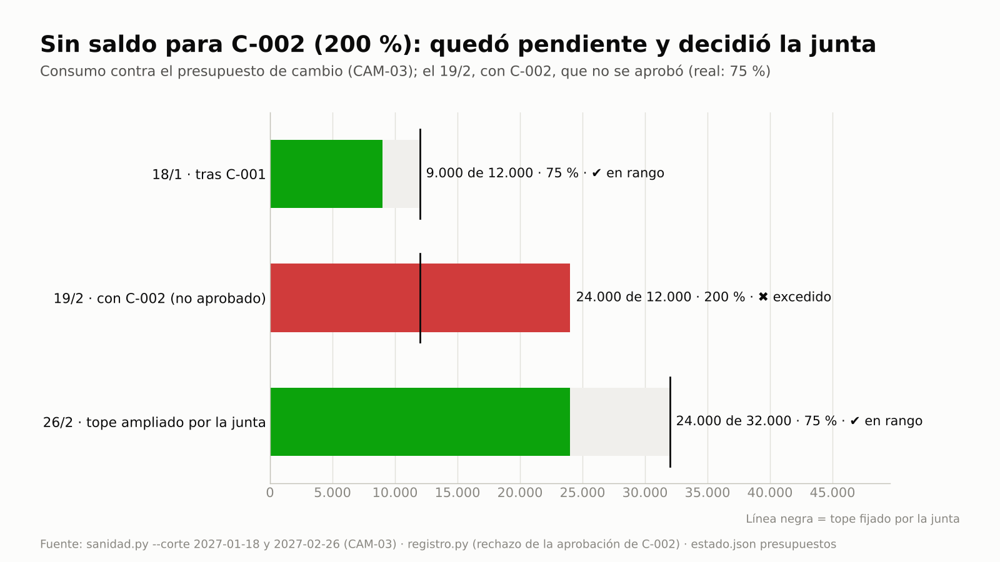
75 % tras C-001 (sanidad del 18/1); el 19/2, el 200 % que habría sumado C-002 según `registro.py` al rechazar su
aprobación (el consumo real siguió en 75 %); y 75 % con el tope que amplió la junta (sanidad del 26/2).


El mismo indicador, guardado por corte, pasa de ámbar (10,3 %) a rojo (22,1 %): el segundo corte supera el margen de
Should/Could y dispara TOL-01.


C-002 no suma beneficio propio y resta 15.000 de VAN, pero el caso sigue justificado: B-01 puede caer 18 % antes de que
el VAN llegue a 0, más que su tolerancia de −10 %.

> **Más desarrollo: excepción con impacto calculado.** El análisis de C-002 da a la junta lo que necesita para
> decidir: cuatro motivos por los que no decide la autoridad de cambio (límite, saldo del presupuesto, tolerancia de
> tiempo de la etapa y Must en riesgo), las opciones con la recomendada (pedir plan de excepción) y la respuesta a la
> pregunta que PRINCE2 hace en cada puerta, ¿sigue valiendo la pena el proyecto? Con VAN de 30.939, sí, con menos
> margen. El fin del proyecto no se recalcula en este análisis: lo debe actualizar el plan de proyecto junto con el
> plan de excepción, como pide `limite-etapa`. Si quedara fuera de ±3 semanas, la junta tampoco podría aprobarlo sola.
> La matriz responde la pregunta que el análisis deja abierta, ¿por qué no diferirlo?, con el mismo análisis aplicado a
> esa opción, y la pregunta tipada impide que una recomendación automática proponga la opción eliminada.

**Dónde verificar:** `03-control/reportes/evm-2027-02-19.json` · `03-control/reportes/2027-02-19-informe-excepcion-X-001.md`
· `03-control/reportes/2027-02-19-solicitud-cambio-C-002.md` y `…-C-002-diferir.md` ·
`03-control/decisiones/C-002/` (`matriz.md` y las dos salidas de `impacto.py`) · `02-planificacion/plan-excepcion-X-001.md` ·
`00-direccion/business-case.md` · `02-planificacion/escenarios/flujos-C-002.csv` · `00-direccion/decisiones/2027-02-26-verificacion-autorizar-plan-excepcion.md` · `cambios.csv` (C-002:
`decidido_por`, `notas`, `costo`, `cargo`) · `issues.csv` (I-002, I-003) · `riesgos.csv` (R-001) · `decisiones.csv` ·
prompts: "¿Cuánto queda del presupuesto de cambio, qué decidió la junta sobre X-001 y sigue justificado el proyecto?"
y "¿Qué decisiones vigentes hay sobre el change budget?".

---

## Reporte: informe de alcance y cambio (ejemplo para el highlight)

> Cifras de la corrida de referencia; el texto lo redacta el modelo.

| Tema | Línea base (27/11) | Corte 29/1 | Tras la excepción (26/2) |
|---|---|---|---|
| Alcance | 10 historias · 68 puntos · 12 FR · WBS 124.000 | 11 historias · 76 puntos · 13 FR (C-001) · WBS 133.000 | + C-002 regulatorio (Must, 13 puntos) aprobado por la junta · WBS 148.000; traspaso a BMAD pendiente |
| Releases | R1 47 pts / 48 · R2 21 pts / 24 (D-003: la consola en el R1) | R1 47 pts (intercambio D-010) · R2 29 pts / 32 (sprint 10 agregado) | plan de excepción X-001: C-002 en R1, sale la 2.3 |
| Cronograma | fin 2027-05-05 · reserva 2σ = 13,0 días | fin 2027-05-20 (+11 días) · reserva remanente 2,0 días (R-001, disparador activado) | fin de etapa 2: 2027-03-05 → 2027-03-19 · R-001 revisado (probabilidad 4) |
| Avance | — | 34,2 % de puntos · SPI 0,87 · CPI 0,90 · alcance que no entra 10,3 % (ámbar) | corte 19/2: SPI 0,80 · CPI 0,78 · 22,1 % que no entra (rojo) |
| Presupuesto de cambio | 12.000 · límite 10.000 por cambio | 9.000 usados (75 %) | 24.000 de 32.000 (75 %) tras la ampliación |
| Business case | VAN 39.776 · TIR 21,0 % | VAN 45.939 con C-001 | VAN 30.939 con C-001 y C-002 · B-01 puede caer 18 % |
| Trazabilidad | 12 de 12 FR con historia y paquete | 13 de 13 FR con historia y paquete | — |

**Decisión que se pidió a la junta:** en el corte del 29/1, ninguna (ámbar en alcance, gestionable por el PO; R-001
registrado por la reserva de cronograma y en seguimiento). El 19/2, la excepción X-001: la junta pidió un plan de
excepción con la matriz de C-002 a la vista (rechazar eliminada, diferir dominada), amplió el presupuesto de cambio,
verificó que el business case sigue justificado y lo autorizó el 26/2.

## Representaciones gráficas

Los PNG de esta guía (`img/g2-*.png`) los genera el driver `scripts/pruebas/guias_e2e/g2.py` con los datos de la
corrida, con `visuales.py`. Los diagramas que genera el sistema están en `02-planificacion/visuales/wbs.md` (WBS),
`02-planificacion/cronograma.md` (Gantt con el camino crítico) y `02-planificacion/visuales/roadmap.md` (roadmap antes y
después de C-001).

**Valor contra esfuerzo** (izquierda 5 puntos, derecha 8 puntos; altura según el valor de 1 a 10, con un pequeño
desplazamiento para que no se superpongan las etiquetas):
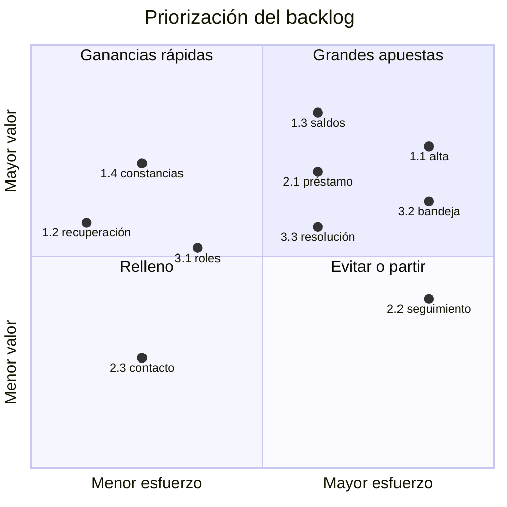

**Mapa de ruta por etapas con puertas: antes y después de C-001**
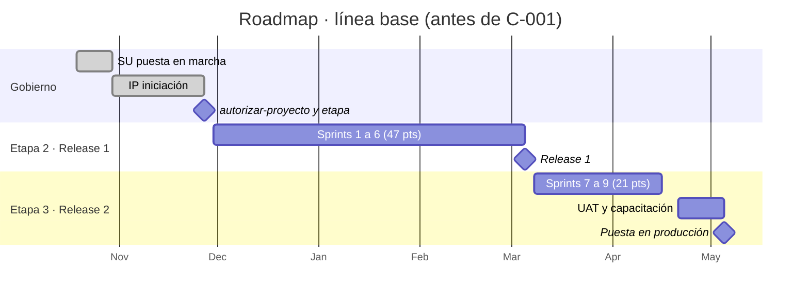
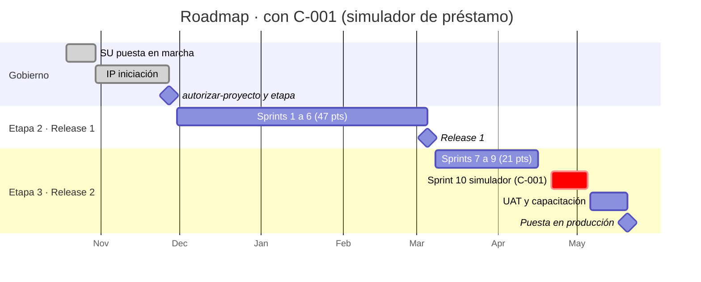

**Trazabilidad del cambio:**
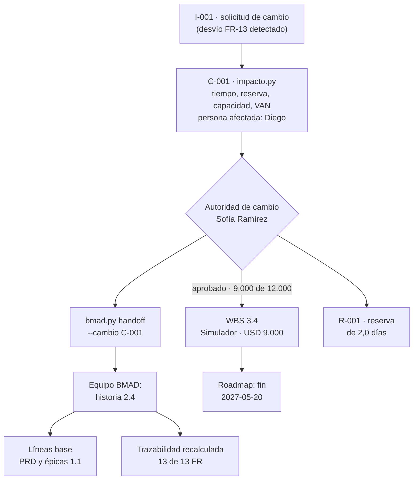

**Gestión por excepción (paso 10):**
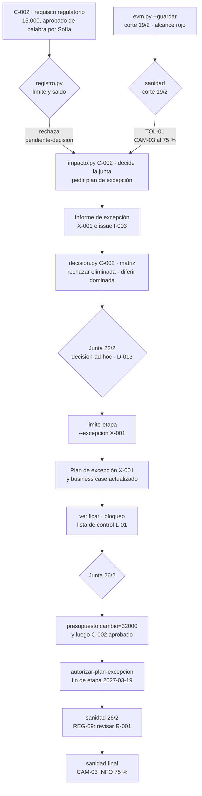

## Lista de comprobación de capacidades

- [ ] WBS por productos con `ref` a FR, historias y UJ; trazabilidad sin huecos ni ids inexistentes.
- [ ] Descripción del producto del proyecto y descripción de producto 3.1 con especificaciones de calidad, métodos y
      autoridad de aceptación, registradas como artefactos.
- [ ] Tres valores (beta-PERT declarada), camino crítico y reserva a 2σ calculados por `cpm.py --estimacion`; exportación
      MSPDI; Gantt `g2-gantt.png`.
- [ ] Backlog con columnas derivadas de BMAD y de gobierno separadas; MoSCoW y valor/esfuerzo; capacidad por release con
      `release.py capacidad` (`g2-capacidad-release.png`).
- [ ] Personas de usuario propuestas desde los recorridos de BMAD y confirmadas por la usuaria sénior; ningún Must sin
      persona (STK-13).
- [ ] Business case con flujos en CSV y VAN, TIR, repago y sensibilidad de `inversion.py`.
- [ ] Tolerancias y autoridad delegada documentadas; presupuesto de cambio y límite de la autoridad de cambio en
      `estado.json` con la decisión en `decisiones.csv`; enfoque de beneficios registrado (sin aviso P-04).
- [ ] Decisión del R1 con `decision.py`: alternativas medidas con `release.py capacidad --json`, expediente citado,
      matriz con la fuente de cada peso y puntaje, sensibilidad y elección del gestor registrada en D-003
      (`g2-decision-release.png`).
- [ ] Línea base de PRD, épicas y backlog con copia congelada; roadmap registrado.
- [ ] Intercambio Should/Could decidido por el PO sin solicitud de cambio, traspasado a BMAD.
- [ ] Cambio de alcance detectado por `bmad.py verificar`, con escenarios de cronograma y de flujos, persona afectada
      y **análisis de impacto antes de decidir** (`impacto.py analizar`: tabla, borrador de la solicitud y nivel que
      decide), monto cargado al presupuesto de cambio (CAM-03 INFO), riesgo derivado, decisión de la autoridad de
      cambio, traspaso, nuevas líneas base y roadmap actualizado (`g2-roadmap-c001.png`).
- [ ] Cobertura de trazabilidad recalculada en los pasos 2 y 8 (`g2-trazabilidad.png`); líneas base 1.1 que
      reemplazan a las 1.0 (`decision.py vigentes`).
- [ ] EVM ágil guardado por corte que separa alcance que no entra de sobrecosto (TOL-02 en ámbar) y disparador de R-001
      anotado.
- [ ] Revisión de calidad que cubre las historias terminadas (sin QUA-01).
- [ ] Excepción completa: aprobación de C-002 fuera de la autoridad rechazada por `registro.py` (queda
      `pendiente-decision`) y TOL-01 detectado el mismo día; análisis de impacto de C-002 que deriva a la junta y
      recomienda plan de excepción (`g2-impacto-c002.png`); informe e issue de la excepción; `limite-etapa
      --excepcion`; plan de excepción y business case actualizado; ampliación del presupuesto antes de que la junta
      apruebe C-002; `autorizar-plan-excepcion` aprobada; REG-09 resuelto con la
      revisión de R-001; sanidad final sin CAM-03 ERROR, CAM-04, TOL-01 ni REG-09 (`g2-consumo-cambio.png`,
      `g2-alcance-evm.png`, `g2-business-case.png`).
- [ ] Matriz de C-002 para la junta con las dos salidas de `impacto.py` (rechazar eliminada, diferir dominada), pregunta
      tipada validada y la elección citada en la fila de la junta con `--decision D-013` (`g2-decision-c002.png`);
      decisiones vigentes del presupuesto de cambio buscadas en inglés.
- [ ] Todas las llamadas a sanidad con `--corte` de la fecha del paso; dos corridas seguidas del driver con evidencia
      idéntica.

## Siguiente caso

Esta guía deja el alcance, el cronograma, el presupuesto y el business case bajo control, pero con una sola voz: la de
la junta y el equipo. El caso siguiente agrega a todos los demás: quiénes son los interesados, qué quieren saber, cómo
se les cuenta el avance y cómo se verifica que el contacto prometido se cumple. Seguí con
**[E2E-3 · Interesados, comunicaciones, OKR y reporte de avance](E2E-3-interesados-okr-avance.md)**.
