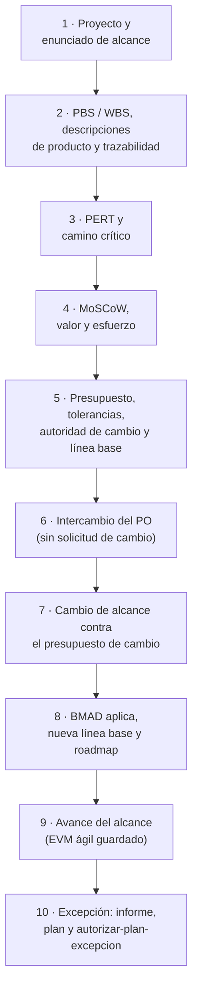
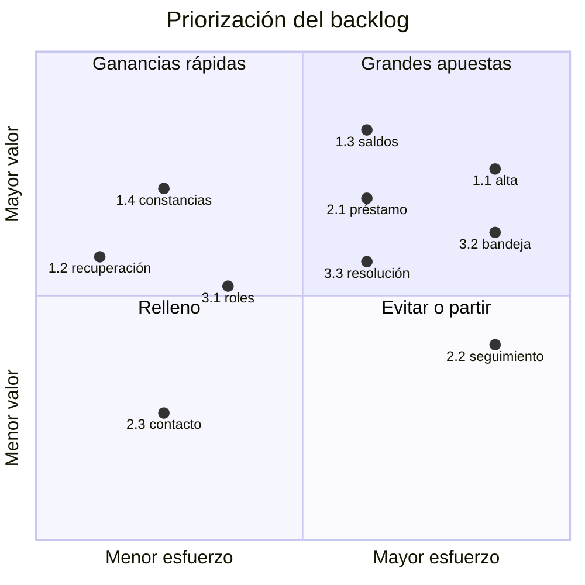
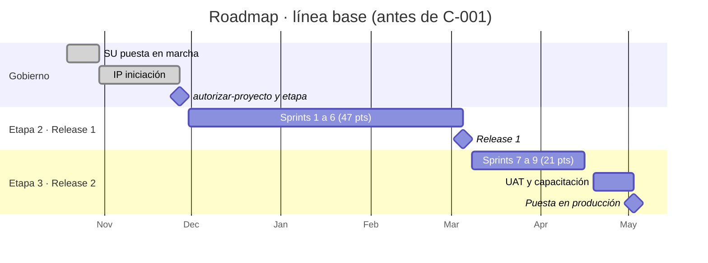
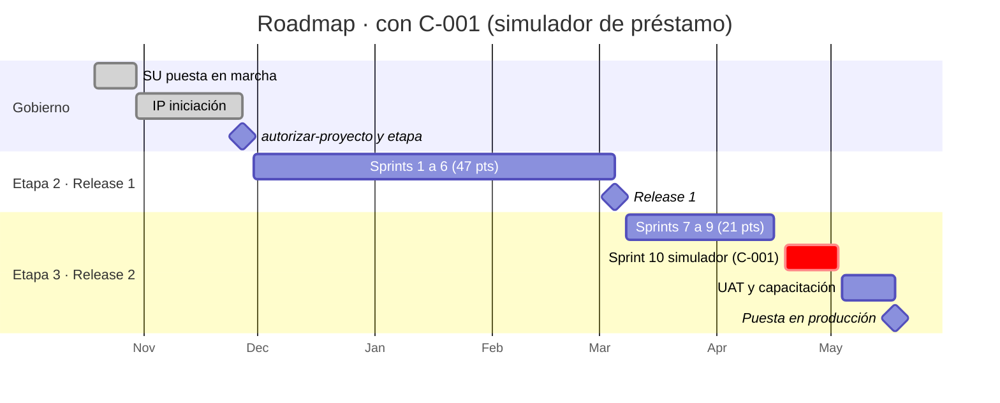
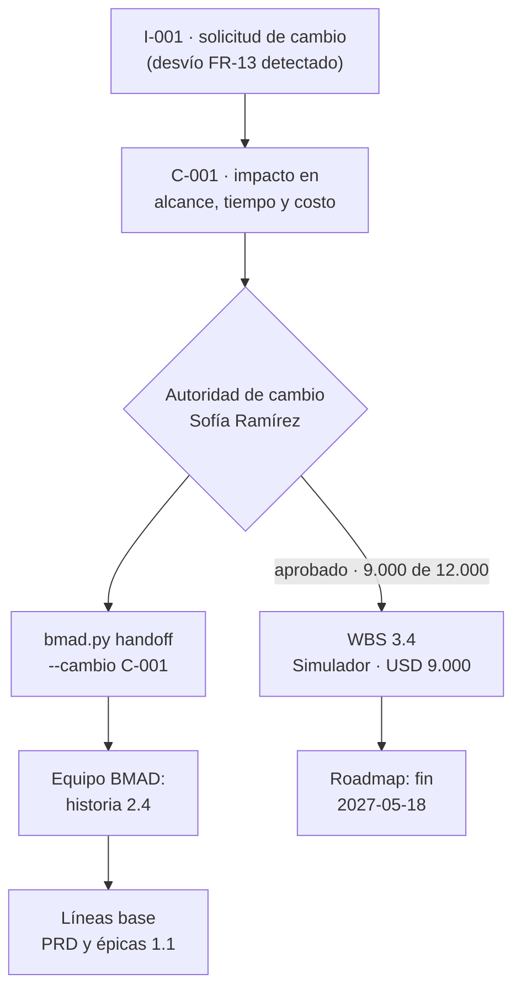
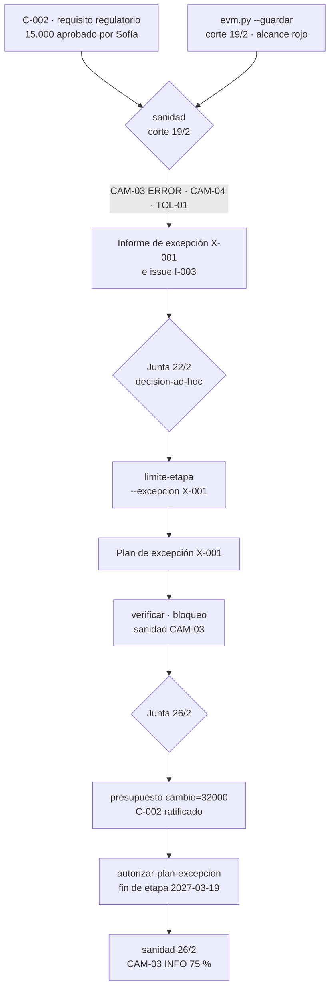

# Guía E2E-2 · Alcance y su cambio, estimación de esfuerzo, priorización y mapa de ruta

**Qué vas a probar:** cómo se define el alcance por productos (PRINCE2: planificación basada en productos), con la
descripción del producto del proyecto y descripciones de producto con criterios de calidad, se traza a los requisitos
de BMAD, se estima el esfuerzo (PERT de tres puntos) y se programa (camino crítico), se prioriza el backlog (MoSCoW y
valor/esfuerzo) contra la capacidad, se arma el release plan y el **mapa de ruta**, se fijan la línea base, las
tolerancias y la **autoridad de cambio con su presupuesto de cambio**, y se gestionan tres tipos de cambio: el
**intercambio** que decide el product owner sin solicitud de cambio, el **cambio de alcance** que pasa por la autoridad
de cambio dentro de su límite y vuelve a BMAD por traspaso, y el cambio que **excede la autoridad delegada**, que se
gestiona por excepción (informe, plan de excepción y puerta de la junta).

**Skills y agentes:** pm-orquestador · pm-planificacion → `pm-planificacion-por-productos`,
`pm-cronograma-estimacion`, `pm-costos-presupuesto`, `pm-agil-hibrido`, `pm-enfoques-gestion`, `pm-plan-etapa-y-limites`
· pm-control → `pm-issues-cambios`, `pm-riesgos`, `pm-progreso-reportes`, `pm-calidad` · pm-inicio → `pm-caso-de-negocio` ·
`pm-bmad-puente` · `pm-visuales` · `pm-director` (`pm-direccion-decisiones`).

**Duración:** 10 pasos, 80–110 minutos. **Preparación:** [README de las guías](README.md#cómo-usar-las-guías) (copia
del fixture en `~/proyectos-prueba/portal-e2e-2`). Evidencia de referencia: [salida-g2.md](evidencia/salida-g2.md).



---

## Paso 1 · Proyecto, especificación y enunciado de alcance

**Prompt**
```text
Creá el proyecto "Portal de autoservicio para socios" en ./gestion, español, híbrido. Ejecutiva Laura Méndez, gestor
Martín Suárez, usuaria sénior, PO y autoridad de cambio Sofía Ramírez, proveedor sénior Diego Ferreira, aseguramiento
Andrea Costa, jefa de equipo Lucía Benítez. Sprints de 14 días y velocidad de referencia de 8 puntos.
Mostrame qué especificó el equipo de producto en BMAD y armá el enunciado de alcance y el plan de gestión del alcance y
los requisitos.
```

**Qué hace el sistema:** `pm-nuevo` + `bmad.py detectar`; lectura por la fachada (`especificacion.py resumen`,
`listar epicas`); `pm-planificacion-por-productos` (enunciado de alcance: QUÉ) y `pm-enfoques-gestion` (plan de gestión
del alcance y requisitos: CÓMO).

**Qué deberías ver:** 42 requisitos, 10 historias, 3 épicas (E-1 acceso y consulta, E-2 solicitudes, E-3 consola).

**Dónde verificar:** `gestion/01-inicio/enunciado-alcance.md` · `gestion/02-planificacion/enfoques/plan-gestion-alcance-requisitos.md`.

---

## Paso 2 · Estructura de productos (PBS), descripciones de producto y WBS, trazada a requisitos e historias

**Prompt**
```text
Armá la WBS por productos con estos paquetes y su referencia a la especificación (USD 50 la hora):
1.1 Gestión de etapas 400 h · 2.1 Brief, PRD, UX y arquitectura (BMAD) 240 h (UJ-1, UJ-2, UJ-3)
· 3.1 Acceso seguro 420 h (FR-1, FR-2, FR-11, historias 1.1 y 1.2) · 3.2 Consulta y constancias 380 h (FR-3, FR-4, FR-5,
historias 1.3 y 1.4) · 3.3 Solicitudes del socio 440 h (FR-6, FR-7, FR-8, FR-12, historias 2.1 a 2.3)
· 4.1 Bandeja y resolución 400 h (FR-9, FR-10, historias 3.1 a 3.3) · 5.1 UAT, prueba de carga y capacitación 200 h
(NFR-2, NFR-3) · 5.2 Puesta en producción (hito).
Generá el diagrama, el diccionario y la matriz de trazabilidad, y decime si queda algún requisito sin cubrir.
Escribí también la descripción del producto del proyecto con los criterios de aceptación priorizados y la descripción
de producto del 3.1 Acceso seguro con sus especificaciones de calidad, métodos de calidad y quién acepta.
```
**Si te pregunta** por los criterios de calidad: Sofía Ramírez, usuaria sénior, responde: "consultas con p95 menor a
3 s (NFR-3), disponibilidad de 99,5 % (NFR-2), WCAG 2.1 AA (NFR-4); en el acceso, sesión que expira a los 10 minutos,
auditoría de todos los accesos (NFR-5) y cero vulnerabilidades altas en la prueba de penetración. Acepto yo".

**Qué hace el sistema:** `pm-planificacion-por-productos` escribe `wbs.csv` (columna `ref` con ids de BMAD) → `wbs.py …
--mermaid … --diccionario …`; `pm-bmad-puente` → `bmad.py trazabilidad --wbs 02-planificacion/wbs.csv`;
`especificacion.py listar requisitos --cobertura sin-cobertura`; redacta con sus plantillas la **descripción del
producto del proyecto** (propósito, productos mayores, expectativas de calidad, criterios CA-01 a CA-04 con prioridad,
método y responsable) y la **descripción de producto 3.1** (especificaciones EC-01 a EC-05 con medida y tolerancia de
calidad, métodos de calidad, productor, revisor y autoridad de aceptación), y las registra con `estado.py artefacto
descripcion-producto-proyecto` y `estado.py artefacto descripcion-producto-3.1` (estado `en-revision`: las aprueba la
usuaria sénior con el plan); `sanidad.py --rapido --corte 2026-11-13`.

**Qué deberías ver:** "13 elementos, 8 hojas · esfuerzo 2480 h · costo 124,000"; trazabilidad: "Requisitos funcionales
sin historia: ninguno · Historias sin requisito: ninguna · Referencias de la WBS a ids inexistentes: ninguna"; ningún
requisito sin cobertura; sanidad "0 ERROR · 0 AVISO · 0 INFO".

> **Por qué importa.** Sin descripciones de producto, "terminado" significa lo que cada uno cree: la calidad se discute
> en la UAT, tarde y a mano. Con criterios medibles por producto, cada revisión de calidad (paso 9) se registra contra
> una especificación concreta y sanidad puede vigilarla a volumen (QUA-01).

**Dónde verificar:** `02-planificacion/wbs.csv` · `02-planificacion/visuales/wbs.md` (diagrama) ·
`02-planificacion/diccionario-wbs.md` · `02-planificacion/especificacion/matriz-trazabilidad-bmad.csv` ·
`02-planificacion/descripcion-producto-proyecto.md` · `02-planificacion/productos/3.1-acceso-seguro.md`.

---

## Paso 3 · Estimación de esfuerzo (PERT) y camino crítico

**Prompt**
```text
Estimá con PERT de tres puntos las actividades y armá el cronograma con camino crítico desde el 30/11, con exportación a
MS Project. Lucía va a validar los valores. Calculá la reserva de cronograma a 2σ del camino crítico.
```
**Si te pregunta** por O/M/P (días): Lucía Benítez, jefa de equipo, responde:

| Actividad | O | M | P | Predecesoras |
|---|---|---|---|---|
| A01 Brief, PRD, UX y arquitectura | 8 | 10 | 15 | — |
| A02 Spike de integración con el núcleo | 5 | 8 | 14 | — |
| A03 Sprints acceso seguro | 20 | 28 | 40 | A01 |
| A04 Sprints consulta y constancias | 18 | 25 | 38 | A02, A03 |
| A05 Sprints consola de operador | 20 | 28 | 42 | A03 |
| A06 Release 1 aceptada (hito) | 0 | 0 | 0 | A04, A05 |
| A07 Sprints solicitudes del socio | 22 | 30 | 45 | A06 |
| A08 UAT, prueba de carga y capacitación | 8 | 10 | 16 | A07 |
| A09 Puesta en producción (hito) | 0 | 0 | 0 | A08 |

**Qué hace el sistema:** `pm-cronograma-estimacion` calcula tE = (O + 4M + P)/6 y σ = (P − O)/6 en
`estimacion-pert.csv`, escribe `actividades.csv` con tE redondeado y corre `cpm.py … --inicio 2026-11-30 --mermaid …
--mspdi cronograma.xml --wbs wbs.csv`.

**Qué deberías ver:** "Duración total (días laborables): 110 · Fin previsto: 2027-05-03 · Camino crítico: A01 → A03 →
A05 → A06 → A07 → A08 → A09"; A04 con 3 días de holgura y A02 con 34. σ del camino crítico =
√(1,17² + 3,33² + 3,67² + 3,83² + 1,33²) ≈ **6,5 días** → reserva a 2σ ≈ **13 días laborables**, dentro de la
tolerancia de ±3 semanas.

**Dónde verificar:** `02-planificacion/estimacion-pert.csv` · `02-planificacion/cronograma.md` (Gantt) ·
`02-planificacion/cronograma.xml` (abrir en MS Project o ProjectLibre).

---

## Paso 4 · Priorización del backlog: MoSCoW, valor y esfuerzo

**Prompt**
```text
Sincronizá el backlog con BMAD y priorizalo con MoSCoW y valor/esfuerzo. Sofía, como PO, da el valor (1-10) y el equipo
los puntos. Ordená: primero MoSCoW y dentro de cada grupo por valor/puntos. Repartí en dos releases (R1: sprints 1-6;
R2: sprints 7-9) y verificá que los Must y Should entran en la capacidad.
```
**Si te pregunta** valores y puntos: Sofía Ramírez (PO) y Lucía Benítez (equipo) responden:

| Historia | MoSCoW | Valor | Puntos |
|---|---|---|---|
| 1.1 Alta y acceso con segundo factor | Must | 9 | 8 |
| 1.2 Recuperación de acceso | Must | 6 | 5 |
| 1.3 Consulta de saldos y préstamos | Must | 10 | 8 |
| 1.4 Constancias en PDF | Should | 7 | 5 |
| 2.1 Solicitud guiada de préstamo | Must | 9 | 8 |
| 2.2 Seguimiento de solicitudes | Should | 6 | 8 |
| 2.3 Actualización de contacto | Could | 4 | 5 |
| 3.1 Acceso y roles de la consola | Must | 6 | 5 |
| 3.2 Bandeja única | Must | 8 | 8 |
| 3.3 Resolución de solicitudes | Must | 8 | 8 |

**Qué hace el sistema:** `bmad.py backlog` crea `backlog.csv` con las columnas **derivadas** de BMAD; `pm-agil-hibrido`
completa solo las columnas de **gobierno** (`prioridad`, `moscow`, `estimacion`, `iteracion`, `release`, `producto_pbs`),
que el puente nunca sobrescribe; vuelve a correr `bmad.py backlog` ("0 nuevas, 10 actualizadas").

**Qué deberías ver:** orden 1.3 (1,25) · 1.2 (1,20) · 3.1 (1,20) · 1.1 (1,12) · 2.1 (1,12) · 3.2 (1,00) · 3.3 (1,00)
· 1.4 Should · 2.2 Should · 2.3 Could. Capacidad: **R1** 6 sprints × 8 = 48 puntos para Must 42 + Should 5 = 47 ✓;
**R2** 3 sprints × 8 = 24 para Must 8 + Should 8 + Could 5 = 21 ✓.

**Dónde verificar:** `02-planificacion/backlog.csv` (abrilo en Excel) · prompt: "Mostrame el backlog ordenado con
MoSCoW, puntos y release".

---

## Paso 5 · Presupuesto, tolerancias, autoridad de cambio, release plan, roadmap y línea base

**Prompt**
```text
Calculá el presupuesto desde la WBS, armá el release plan y el roadmap por etapas con las puertas, y preparame las
puertas de inicio, proyecto y etapa 2. Antes de la de proyecto: documentá las tolerancias y la autoridad delegada
(Sofía decide cambios de hasta 10.000 cada uno, con un presupuesto de cambio de 12.000 que fija la junta) y el enfoque
de beneficios (B-01 a B-03, quién los mide y cuándo). En la de proyecto fijá la línea base del PRD y de las épicas, y que
Sofía apruebe el backlog como línea base.
```
**Si te pregunta:** "Laura Méndez, ejecutiva: apruebo las tolerancias, el presupuesto de cambio de 12.000 y el límite
de 10.000 por cambio para la autoridad de cambio; aprobado, confirmo las listas de control" · "Sofía Ramírez, PO:
apruebo el backlog v1.0".

**Qué hace el sistema:** `pm-costos-presupuesto` (`wbs.py --json`: BAC 124.000); `pm-agil-hibrido` (release plan:
cadencia, DoD/DoR y línea base); `pm-visuales` (roadmap); `pm-direccion-decisiones` redacta
`00-direccion/tolerancias-y-autoridad.md` (siete objetivos con tolerancia y prioridad; autoridad de cambio, presupuesto
de cambio y escalado) y `pm-caso-de-negocio` el `enfoque-beneficios.md` (dueño, medida, línea base, meta y fecha de
cada B-n, revisiones posteriores al proyecto); `pm-director`: `estado.py tolerancia --nivel proyecto …`,
`estado.py presupuesto cambio=12000 limite_autoridad_cambio=10000 --por "Ejecutiva: Laura Méndez"` (queda en
`estado.json.presupuestos` y en `decisiones.csv`), puertas con `puertas.py` (tres capas), `bmad.py linea-base prd|epicas
--version 1.0`, `estado.py aprobar backlog --nivel product-owner`.

**Qué deberías ver:** verificación de autorizar-proyecto "1 bloqueo(s) · 0 condición(es) · 2 aviso(s)": el bloqueo es
la lista de control (se genera y la confirma Laura) y los avisos son P-09 (sin matriz poder/interés) y P-10 (sin RACI),
que esta guía no trabaja (ver E2E-3). **No aparece P-04 "sin enfoque de beneficios"** porque el enfoque quedó registrado:
sin él, la verificación avisa que el business case tiene B-n pero nadie definió cómo, cuándo y quién los mide. Después:
"Línea base bmad-prd v1.0 registrada · sha bc048f7f59a3"; "bmad-epicas v1.0 · sha 3ff846d6f8d9"; "Copia congelada …
00-direccion/historial/backlog-v1.0.csv"; fase `entrega`, etapa 2 "Release 1".

> **Por qué importa.** En la práctica la autoridad de cambio "aprueba lo razonable" sin un tope escrito, y nadie lleva la
> cuenta de cuánto se comprometió: el exceso aparece al cerrar la etapa. Con el límite y el presupuesto registrados en
> `estado.json`, sanidad compara cada cambio aprobado contra ellos de forma continua (CAM-03 y CAM-04, pasos 7 y 10).

**Dónde verificar:** `00-direccion/tolerancias-y-autoridad.md` · `00-direccion/enfoque-beneficios.md` ·
`00-direccion/historial/` (copias congeladas) · `02-planificacion/release-plan.md` · `02-planificacion/visuales/roadmap.md`
· `decisiones.csv` · prompt: "Mostrame el resumen del proyecto" (`estado.py resumen` lista los presupuestos).

---

## Paso 6 · Cambio menor: intercambio de Should/Could por el PO

**Prompt**
```text
Cumplimiento pide adelantar la actualización de contacto. Sofía decide: la 2.3 (Could) pasa a R1 y la 1.4 constancias
(Should) a R2, sin tocar Must, fecha ni costo. Registralo y avisale al equipo BMAD.
```

**Qué hace el sistema:** `pm-agil-hibrido` verifica que es un intercambio permitido al PO (regla del método: Should/Could
equivalentes, sin Must, fecha ni costo) → `registro.py agregar decisiones --campo nivel=product-owner` (**no** hay
solicitud de cambio) → `bmad.py handoff` (sin `--cambio`: prioridades para el sprint planning de BMAD).

**Qué deberías ver:** **D-009**; "Traspaso emitido → …/handoff-bmad-<fecha>-prioridades.md". R1 queda con 47 puntos y R2
con 21.

**Dónde verificar:** `decisiones.csv` · `02-planificacion/especificacion/handoff-bmad-<fecha>-prioridades.md`.

---

## Paso 7 · Cambio de alcance: análisis de impacto y decisión contra el presupuesto de cambio

En BMAD, el PM de producto agrega **FR-13 "Simulador de préstamo"** al PRD por pedido del Consejo, sin pasar por la
autoridad de cambio (para simularlo en tu copia, pedíselo a BMAD con `bmad-prd` en modo edición, o editá el PRD).

**Prompt**
```text
Verificá la especificación contra la línea base. Si hay algo nuevo, registralo como solicitud de cambio y analizá el
impacto: paquete de la WBS nuevo, esfuerzo, camino crítico, costo, capacidad del release y beneficios. Estimá el
simulador en O 8, M 10, P 16 días después de los sprints de solicitudes. Decime contra qué presupuesto se carga y si
entra en la autoridad de Sofía. Si la reserva de cronograma queda chica, registralo como riesgo.
```
**Si te pregunta** la decisión: "Sofía Ramírez, autoridad de cambio: aprobado; se carga al presupuesto de cambio".

**Qué hace el sistema:** `bmad.py verificar` → desvío; sanidad lo marcaría **ESP-10** (cambio no controlado) hasta que
haya issue → `pm-issues-cambios`: **I-001** `solicitud-cambio`; `pm-cronograma-estimacion` corre `cpm.py` sobre un
**escenario** (`02-planificacion/escenarios/actividades-C-001.csv`) sin tocar la línea base; **C-001** con el impacto en
los siete objetivos, la recomendación y el monto con su cargo (`--campo costo=9000 --campo cargo=presupuesto-cambio`):
9.000 entra en el límite de 10.000 de Sofía y en el saldo del presupuesto de cambio; decisión de la autoridad de cambio;
`pm-riesgos` registra **R-001** (la reserva de cronograma a 2σ baja de ≈ 13 a ≈ 2 días: probabilidad 3 × impacto 3,
respuesta reducir, disparador SPI < 0,90); `wbs.py` con el paquete **3.4**; `bmad.py handoff --cambio C-001`;
`sanidad.py --rapido --corte 2027-01-18`.

**Qué deberías ver:** "agregados ['FR-13']"; escenario: "Duración total 121 · Fin previsto 2027-05-18" (+11 días
laborables, dentro de ±3 semanas); C-001 aprobado; R-001; WBS "14 elementos, 9 hojas · 2660 h · 133,000"; el traspaso
`handoff-bmad-<fecha>-C-001.md`. Sanidad "0 ERROR · 4 AVISO · 3 INFO" con **"INFO CAM-03 Presupuesto de cambio: 9.000 de
12,000 (75 %)"**. Los avisos son el seguimiento esperado del cambio en curso, que se resuelve en el paso 8: ESP-10 (el PRD
difiere de su línea base y hay un issue que lo trata), dos ESP-13 (traspasos a BMAD sin confirmar) y ESP-14
(`requisitos-bmad.csv` sin resincronizar).

> **Por qué no "contra la contingencia".** Este proyecto no tiene contingencia definida, y la reserva de riesgo solo
> financia respuestas a riesgos. Un cambio aprobado se paga con el **presupuesto de cambio** que fijó la junta en el
> paso 5; por eso el BAC pasa de 124.000 a 133.000 y el saldo del presupuesto de cambio baja a 3.000. Si C-001 se
> hubiera aprobado sin monto ni cargo, sanidad lo marcaría CAM-01; con el cargo, CAM-03 lleva la cuenta del consumo:
> INFO por debajo del 80 %, AVISO desde el 80 % y ERROR por encima del 100 %.

**Dónde verificar:** `issues.csv` · `cambios.csv` (columnas `impacto_*`, `decision`, `decidido_por`, `costo`, `cargo`)
· `riesgos.csv` · `02-planificacion/escenarios/` · prompt: "¿Qué impacto tiene C-001 en fecha, costo y capacidad, y
cuánto queda del presupuesto de cambio?".

---

## Paso 8 · BMAD aplica el cambio, nuevas líneas base y roadmap actualizado

El equipo BMAD aplica el traspaso con sus flujos (`bmad-prd`, `bmad-create-epics-and-stories`) y agrega la historia 2.4.

**Prompt**
```text
El equipo BMAD aplicó el traspaso de C-001 (historia 2.4 Simulador). Resincronizá requisitos, trazabilidad y backlog,
poné la 2.4 como Should de 8 puntos en el sprint 10 del R2, fijá las nuevas líneas base y actualizá el roadmap.
```
**Si te pregunta:** "Laura Méndez, ejecutiva: apruebo las líneas base 1.1".

**Qué hace el sistema:** `bmad.py requisitos` (43 ids) · `trazabilidad` · `backlog` ("1 nuevas, 10 actualizadas") ·
`pm-agil-hibrido` completa el gobierno de 2.4 · `pm-director`: `bmad.py linea-base prd|epicas --version 1.1` · C-001
`implementado` e I-001 `cerrado` · `bmad.py verificar` → "Sin desvíos" · `sanidad.py --rapido --corte 2027-01-25` ·
`pm-visuales` (roadmap).

**Qué deberías ver:** sanidad "0 ERROR · 0 AVISO · 3 INFO": CAM-03 (9.000 de 12,000, 75 %), ESP-02 (índice de
especificación que se reconstruye solo) y **TOL-03** ("Etapa de entrega sin corte de EVM guardado: el pronóstico contra
tolerancias no se vigila"), que se corrige en el paso 9. R2 pasa a **29 puntos** con 24 de capacidad en tres sprints:
se agrega el sprint 10 (los +11 días del paso 7) y la capacidad sube a 32. El roadmap cambia de fin 2027-05-03 a
2027-05-18.

**Dónde verificar:** `00-direccion/historial/bmad-prd-v1.1` · `backlog.csv` · prompt: `/pm-method:pm-sync bmad`.

---

## Paso 9 · Avance del alcance (EVM ágil guardado) y calidad de lo terminado

**Prompt**
```text
Corte del 29/1: ¿cuánto alcance llevamos y entra todo con el presupuesto? PV 60.000, EV 52.000, AC 58.000, BAC 133.000.
Leelo como ágil: costo y fecha fijos, el 20 % del alcance es Should/Could. Guardá el corte para que quede vigilado.
Registrá la revisión de calidad del 28/1 de las historias 1-1, 1-2, 1-3 y 3-1: Sofía la aprobó contra la descripción
de producto 3.1 y los criterios de aceptación.
```

**Qué hace el sistema:** `bmad.py avance` (estados de BMAD → `avance-bmad.csv`) y `bmad.py backlog` (el estado `done`
llega a `backlog.csv`); `pm-calidad` registra **Q-001** (revisión completada, resultado aprobado, cita las cuatro
historias y EC-01 a EC-04); `pm-progreso-reportes` → `evm.py --pv 60000 --ev 52000 --ac 58000 --bac 133000 --modo agil
--pct-no-must 20 --proyecto gestion --guardar --corte 2027-01-29` (guarda `03-control/reportes/evm-2027-01-29.json`);
`sanidad.py --rapido --corte 2027-01-29`; `puertas.py estado --markdown` para el highlight.

**Qué deberías ver:** "Historias 11 · done 4 · 34.2 % (puntos)"; "Guardado: 03-control/reportes/evm-2027-01-29.json";
SPI 0,867 · CPI 0,897 · EAC 148.346 → `alcance_no_entregable_pct 10.345` · `semaforo_alcance ambar` ·
`excepcion_prevista False`: al ritmo actual no entra ≈ 10 % del alcance, que es menor que el 20 % de Should/Could:
**los Must no peligran** y el PO decide qué Should/Could salen; no hay excepción. Sanidad "0 ERROR · 0 AVISO · 3 INFO"
con **TOL-02** ("El EVM del 2027-01-29 está en ámbar … alcance=ambar: 50–100 % de la tolerancia") y CAM-03 al 75 %.
No hay **QUA-01**: las cuatro historias terminadas tienen una revisión aprobada que las cita; sin Q-001, sanidad daría
un aviso QUA-01 por cada una ("terminado sin revisión de calidad registrada").

**Dónde verificar:** `03-control/reportes/avance-bmad.csv` · `03-control/reportes/evm-2027-01-29.json` · `calidad.csv`
· el highlight en `03-control/reportes/`.

---

## Paso 10 · Excepción: el cambio excede la autoridad delegada y el pronóstico sale de la tolerancia

**El problema real.** En la mayoría de los proyectos, un pedido "obligatorio" se aprueba en el momento por quien está
más cerca, nadie suma lo que ya se comprometió del presupuesto de cambio, y el pronóstico de EVM vive en una planilla
que se mira al cerrar la etapa. El desvío se descubre **tarde y a mano**, cuando ya no hay opciones baratas. Acá se
detecta **el mismo día en que ocurre**: sanidad cruza cada cambio aprobado con el límite delegado y con el presupuesto
(CAM-03, CAM-04) y cada corte guardado de EVM con la tolerancia (TOL-01), y la verificación de puertas no deja aprobar
nada mientras haya un ERROR.

La revisión normativa que el PRD dejaba como supuesto (NFR-1, Ley 18.331) concluye que el socio debe dar
consentimiento informado y poder consultar el registro de sus accesos. El Consejo lo pide como obligatorio.

**Prompt 1 (19/2, gestor)**
```text
Registrá el requisito regulatorio como solicitud de cambio: paquete nuevo 3.5, 13 puntos Must en R1, +1 sprint en la
etapa 2, USD 15.000. Sofía ya lo aprobó el 17/2 porque es obligatorio. Guardá el corte de EVM del 19/2 (PV 75.000,
EV 60.000, AC 77.000, BAC 133.000, ágil, 20 % Should/Could) y corré sanidad al 19/2. Si hay excepción, prepará el
informe de excepción para la junta y registrá el issue.
```
**Prompt 2 (22/2, junta)**
```text
Laura Méndez, ejecutiva: leí el informe X-001; la junta pide un plan de excepción para la etapa 2. Prepará el plan:
C-002 entra como Must en R1, la etapa termina el 19/3, sale la 2.3 de R1 y se pide ampliar el presupuesto de cambio.
```
**Prompt 3 (26/2, junta)**
```text
Laura Méndez, ejecutiva: la junta amplía el presupuesto de cambio a 32.000 (12.000 originales + 15.000 de C-002 + 5.000
de reposición), ratifica C-002 y aprueba el plan de excepción con fin de etapa el 19/3. Confirmo la lista de control.
```

**Qué hace el sistema:**
1. `pm-issues-cambios`: **I-002** `solicitud-cambio` y **C-002** con `costo=15000` y `cargo=presupuesto-cambio`; se
   registra la aprobación de Sofía tal como ocurrió (`decidido_por=Autoridad de cambio: Sofía Ramírez`).
2. `pm-progreso-reportes`: `evm.py … --proyecto gestion --guardar --corte 2027-02-19` → `evm-2027-02-19.json`.
3. `sanidad.py --rapido --corte 2027-02-19` detecta tres cosas a la vez (ver abajo).
4. `pm-progreso-reportes` redacta el **informe de excepción X-001** con la plantilla `informe-excepcion.md` (desviación
   por objetivo con la fuente de cada cifra, opciones y recomendación) y lo registra como `informe-excepcion-X-001`;
   `pm-issues-cambios` registra **I-003** `problema-preocupacion` (severidad crítica, `escalado`) e I-002 pasa a
   `escalado`.
5. `pm-director`: `estado.py puerta decision-ad-hoc --decision aprobado --por "Ejecutiva: Laura Méndez" --fecha
   2027-02-22 --condiciones "X-001: la junta pide plan de excepción …"` y `estado.py limite-etapa --excepcion X-001`
   (la etapa pasa a SB; X-001 es el id del documento de excepción, citado en I-003). La condición de la junta queda
   abierta y a la vista (`Condiciones abiertas: decision-ad-hoc` en el resumen, EST-12 en la sanidad, G-01 en la próxima
   verificación) hasta que alguien la dé por cumplida.
6. `pm-plan-etapa-y-limites` redacta el **plan de excepción** (plantilla `plan-excepcion.md`: tabla de diferencias
   contra el plan de etapa 2) y lo registra como `plan-excepcion-X-001`; con el plan presentado, `pm-director` cierra la
   condición: `estado.py cumplir-condiciones decision-ad-hoc --fecha 2027-02-24 --por "Ejecutiva: Laura Méndez" --nota
   "plan de excepción X-001 presentado; C-002 se decide con él"`.
7. `pm-director`: `puertas.py verificar autorizar-plan-excepcion` → **bloqueada por sanidad CAM-03**; la junta decide:
   `estado.py presupuesto cambio=32000 --por "Ejecutiva: Laura Méndez"` y C-002 queda con `decidido_por=Junta: Laura
   Méndez (ejecutiva) · plan de excepción X-001` (la nota conserva la aprobación original de Sofía); `verificar` otra
   vez → solo falta la lista; `puertas.py lista autorizar-plan-excepcion --fecha 2027-02-26` y `confirmar … --fecha
   2027-02-26`; `estado.py puerta autorizar-plan-excepcion --decision aprobado --por "Ejecutiva: Laura Méndez" --fecha
   2027-02-26 --fin 2027-03-19`.
8. I-003 `cerrado`, I-002 `pendiente-cambio`; `bmad.py handoff --cambio C-002`; `sanidad.py --rapido --corte
   2027-02-26`; `estado.py resumen`; `registro.py listar cambios`.

**Qué deberías ver:**
- EVM del 19/2: "Guardado: 03-control/reportes/evm-2027-02-19.json"; SPI 0,800 · CPI 0,779 · EAC 170.683 ·
  `alcance_no_entregable_pct 22.078` · `semaforo_alcance rojo` · `excepcion_prevista True` · "→ Pronóstico fuera de
  tolerancia: preparar informe de excepción (pm-progreso-reportes) y escalar a pm-director": no entra ≈ 22 % del
  alcance, más que el 20 % de Should/Could, así que **los Must peligran**.
- Sanidad del 19/2: "1 ERROR · 2 AVISO · 0 INFO":
  - **ERROR CAM-03** "Presupuesto de cambio excedido: 24.000 de 12.000 (200 %)".
  - **AVISO CAM-04** "Cambio C-002 (15.000) supera el límite de la autoridad de cambio (10.000) y lo decidió 'Autoridad
    de cambio: Sofía Ramírez'".
  - **AVISO TOL-01** "El EVM del 2027-02-19 pronostica salir de la tolerancia (… alcance=rojo) y no hay excepción
    abierta".
- `limite-etapa`: "Proceso: SB" y "Límite de etapa por excepción X-001: plan de excepción (reemplaza el plan vigente) …
  Puerta: autorizar-plan-excepcion".
- Primera verificación: "Puerta autorizar-plan-excepcion: 2 bloqueo(s)" con **"sanidad CAM-03: Presupuesto de cambio
  excedido: 24.000 de 12.000 (200 %)"** y la lista de control. Mientras la aprobación de Sofía siga cargada contra un
  presupuesto agotado, la junta no puede aprobar ninguna puerta: la capa 1 de `puertas.py` convierte el ERROR de
  sanidad en bloqueo.
- Tras la decisión de la junta: "1 bloqueo(s)" (solo la lista); "Lista creada:
  00-direccion/decisiones/2027-02-26-verificacion-autorizar-plan-excepcion.md (0 hallazgos automáticos, 3 ítems para la
  junta)"; la puerta queda aprobada y vuelve a "Proceso: CS".
- Sanidad final del 26/2: "0 ERROR · 1 AVISO · 1 INFO": **"INFO CAM-03 Presupuesto de cambio: 24.000 de 32.000 (75 %)"**,
  sin CAM-04 (la decisión es de la junta) y **sin TOL-01** (la puerta autorizar-plan-excepcion del 26/2 es posterior al
  corte del 19/2). El aviso que queda es ESP-13: el traspaso de C-002 todavía no lo aplicó el equipo BMAD (se resuelve
  igual que en el paso 8).
- `estado.py resumen`: "etapa 2 Release 1 (2026-11-27 → 2027-03-19)" · "Presupuestos: cambio=32000,
  limite_autoridad_cambio=10000" · "Última puerta: autorizar-plan-excepcion · aprobado · 2027-02-26 · Ejecutiva: Laura
  Méndez".

**Dónde verificar:** `03-control/reportes/evm-2027-02-19.json` · `03-control/reportes/2027-02-19-informe-excepcion-X-001.md`
· `02-planificacion/plan-excepcion-X-001.md` · `00-direccion/decisiones/2027-02-26-verificacion-autorizar-plan-excepcion.md`
· `cambios.csv` (C-002: `decidido_por`, `notas`, `costo`, `cargo`) · `issues.csv` (I-002, I-003) · `decisiones.csv`
(decision-ad-hoc, condición cumplida, presupuesto ampliado, autorizar-plan-excepcion) · prompt: "¿Cuánto queda del presupuesto de cambio y
qué decidió la junta sobre X-001?".

---

## Controles permanentes que muestra esta guía

| Problema habitual | Control | Código | Paso |
|---|---|---|---|
| Requisitos sin historia ni paquete, o referencias de la WBS a ids que no existen | `bmad.py trazabilidad` y sanidad | ESP-03 | 2, 8 |
| "Terminado" sin criterio medible, la calidad se discute en la UAT | descripciones de producto con especificaciones de calidad | — | 2 |
| Criterios de éxito sin dueño ni fecha de medición | verificación de autorizar-proyecto | P-04 | 5 |
| El PRD cambia sin pasar por la autoridad de cambio | `bmad.py verificar` y sanidad | ESP-10 | 7 |
| Cambio aprobado sin monto ni presupuesto que lo pague | sanidad | CAM-01 | 7 |
| Nadie suma lo que consumen los cambios aprobados | sanidad: INFO < 80 %, AVISO ≥ 80 %, ERROR > 100 % | CAM-03 | 7, 9, 10 |
| La autoridad de cambio aprueba por encima de su límite delegado | sanidad | CAM-04 | 10 |
| El pronóstico de EVM se mira al fin de etapa (o no se guarda) | `evm.py --guardar --corte` y sanidad | TOL-03, TOL-02, TOL-01 | 8, 9, 10 |
| Se aprueba una puerta con el proyecto en ERROR | verificación de puertas, capa 1 | S-CAM-03 (bloqueo) | 10 |
| Plan de excepción sin informe, o puerta sin plan | verificación de autorizar-plan-excepcion | X-01, X-02 | 10 |
| Historias terminadas sin revisión de calidad | sanidad a volumen sobre `backlog.csv` | QUA-01 | 9 |
| Traspasos a BMAD que nadie confirma | sanidad | ESP-13 | 7, 10 |

---

## Reporte: informe de alcance y cambio (ejemplo para el highlight)

> Cifras de la corrida de referencia; el texto lo redacta el modelo.

| Tema | Línea base (27/11) | Corte 29/1 | Tras la excepción (26/2) |
|---|---|---|---|
| Alcance | 10 historias · 68 puntos · 12 FR · WBS 124.000 | 11 historias · 76 puntos · 13 FR (C-001) · WBS 133.000 | + C-002 regulatorio (Must, 13 puntos) aprobado por la junta; traspaso a BMAD pendiente |
| Releases | R1 47 pts / 48 · R2 21 pts / 24 | R1 47 pts (swap D-009) · R2 29 pts / 32 (sprint 10 agregado) | plan de excepción X-001: C-002 en R1, sale la 2.3 |
| Cronograma | fin 2027-05-03 · reserva 2σ ≈ 13 días | fin 2027-05-18 (+11 días) · reserva remanente ≈ 2 días (R-001) | fin de etapa 2: 2027-03-05 → 2027-03-19 |
| Avance | — | 34,2 % de puntos · SPI 0,87 · CPI 0,90 · alcance no entregable ≈ 10 % (ámbar) | corte 19/2: SPI 0,80 · CPI 0,78 · ≈ 22 % no entregable (rojo) |
| Presupuesto de cambio | 12.000 · límite 10.000 por cambio | 9.000 usados (75 %) | 24.000 de 32.000 (75 %) tras la ampliación de la junta |
| Cambios | — | D-009 intercambio (PO) · C-001 simulador (autoridad de cambio) · líneas base PRD/épicas 1.1 | C-002 ratificado por la junta · X-001 cerrada con autorizar-plan-excepcion |

**Decisión que se pidió a la junta:** en el corte del 29/1, ninguna (ámbar en alcance gestionable por el PO; R-001
registrado por la reserva de cronograma de ≈ 2 días). El 19/2, la excepción X-001: la junta pidió un plan de excepción,
amplió el presupuesto de cambio y lo autorizó el 26/2.

## Representaciones gráficas

**Valor contra esfuerzo** (izquierda 5 puntos, derecha 8 puntos; altura según el valor de 1 a 10, con un pequeño
desplazamiento para que no se superpongan las etiquetas):


**Mapa de ruta por etapas con puertas: antes y después de C-001**



**Trazabilidad del cambio:**


**Gestión por excepción (paso 10):**


Los diagramas que genera el sistema están en `02-planificacion/visuales/wbs.md` (WBS) y `02-planificacion/cronograma.md`
(Gantt con el camino crítico).

## Lista de comprobación de capacidades

- [ ] WBS por productos con `ref` a FR, historias y UJ; trazabilidad sin huecos ni ids inexistentes.
- [ ] Descripción del producto del proyecto y descripción de producto 3.1 con especificaciones de calidad, métodos y
      autoridad de aceptación, registradas como artefactos.
- [ ] PERT de tres puntos y camino crítico calculados por script; exportación MSPDI.
- [ ] Backlog con columnas derivadas de BMAD y de gobierno separadas; MoSCoW y valor/esfuerzo; capacidad verificada.
- [ ] Tolerancias y autoridad delegada documentadas; presupuesto de cambio y límite de la autoridad de cambio en
      `estado.json` con la decisión en `decisiones.csv`; enfoque de beneficios registrado (sin aviso P-04).
- [ ] Línea base de PRD, épicas y backlog con copia congelada.
- [ ] Intercambio Should/Could decidido por el PO sin solicitud de cambio, traspasado a BMAD.
- [ ] Cambio de alcance detectado por `bmad.py verificar`, con escenario de cronograma, monto cargado al presupuesto de
      cambio (CAM-03 INFO), riesgo derivado registrado, decisión de la autoridad de cambio, traspaso, nuevas líneas base
      y roadmap actualizado.
- [ ] EVM ágil guardado por corte que separa alcance no entregable de sobrecosto (TOL-02 en ámbar).
- [ ] Revisión de calidad que cubre las historias terminadas (sin QUA-01).
- [ ] Excepción completa: CAM-03 ERROR, CAM-04 y TOL-01 detectados el mismo día; informe e issue de la excepción;
      `limite-etapa --excepcion`; plan de excepción; puerta bloqueada por sanidad hasta la decisión de la junta;
      `autorizar-plan-excepcion` aprobada; sanidad final sin CAM-03 ERROR ni TOL-01.
- [ ] Todas las llamadas a sanidad con `--corte` de la fecha del paso.
