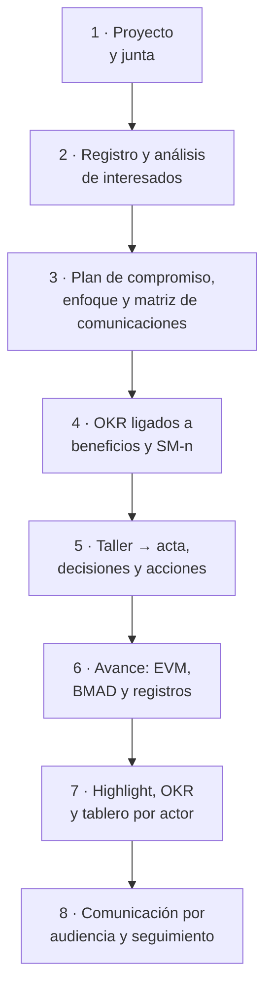
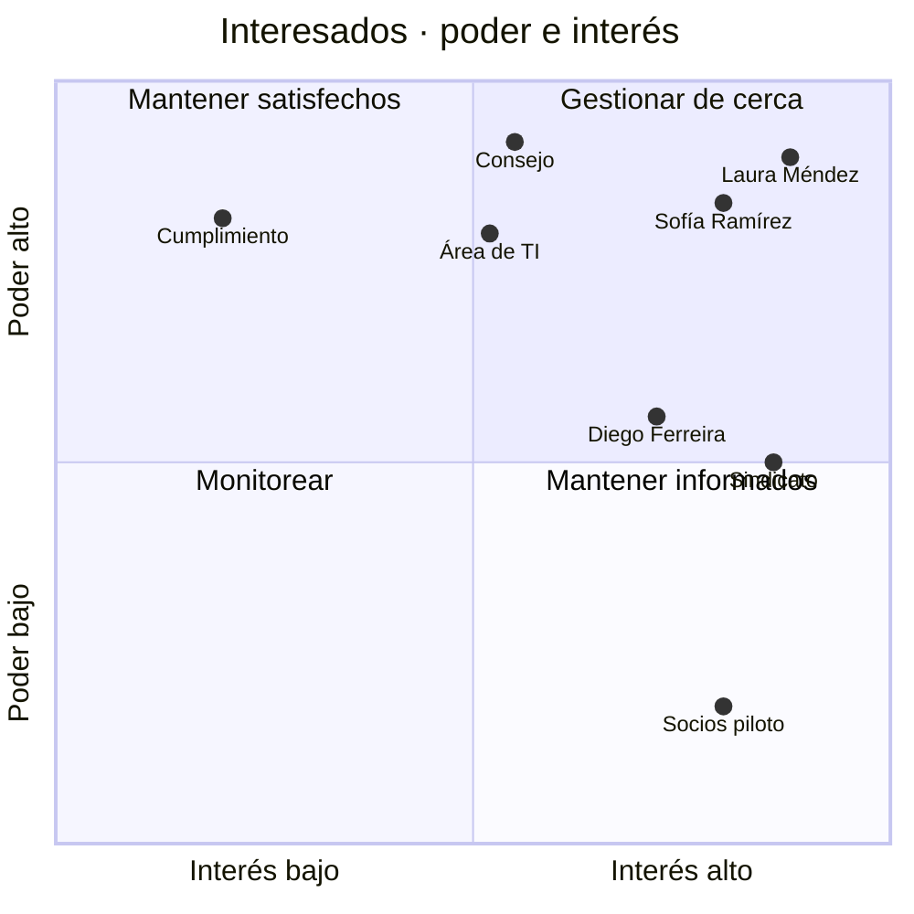
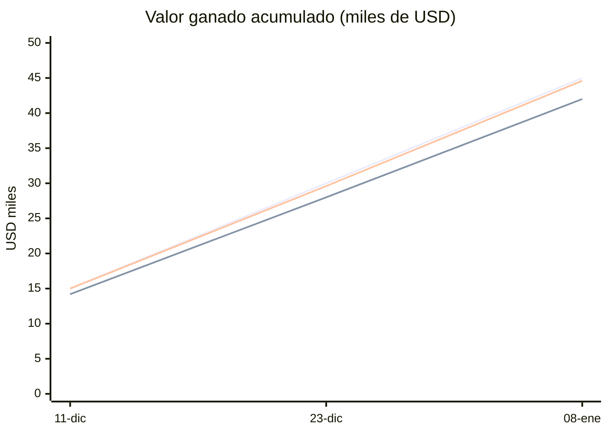
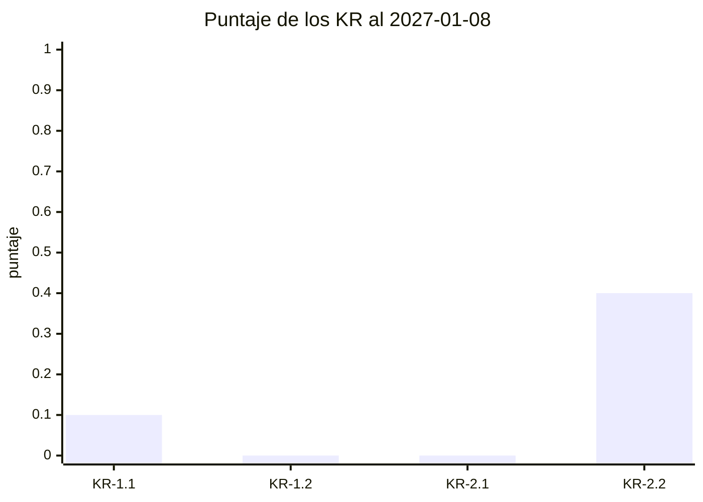

# Guía E2E-3 · Interesados, comunicaciones, OKR y reporte de avance

**Qué vas a probar:** la gestión de interesados de PRINCE2 7 (práctica de organización y enfoque de comunicación) con
las técnicas del PMBOK 8 (análisis poder/interés, matriz de evaluación del compromiso actual y deseado, plan de
comunicaciones); los **OKR ligados a los beneficios del business case y a las métricas de éxito del PRD**; una reunión
con interesados convertida en acta, decisiones y acciones; el **avance** con valor ganado y BMAD; el highlight report
con las puertas; el **tablero con vista por actor** y la comunicación del avance por audiencia.

**Skills y agentes:** pm-orquestador · pm-inicio → `pm-organizacion-roles` · `pm-enfoques-gestion` ·
`pm-comunicacion-stakeholders` · `pm-okr` · pm-control → `pm-reuniones`, `pm-progreso-reportes`, `pm-riesgos` ·
`pm-visuales` · `pm-exportar` · `pm-director`.

**Duración:** 60–90 minutos. **Preparación:** [README de las guías](README.md#cómo-usar-las-guías) (copia del fixture en
`~/proyectos-prueba/portal-e2e-3`). Evidencia de referencia: [salida-g3.md](evidencia/salida-g3.md).



---

## Paso 1 · Proyecto y junta

**Prompt**
```text
Creá el proyecto "Portal de autoservicio para socios" en ./gestion, español, híbrido. Ejecutiva Laura Méndez, gestor
Martín Suárez, usuaria sénior y PO Sofía Ramírez (también autoridad de cambio), proveedor sénior Diego Ferreira,
aseguramiento Andrea Costa, jefa de equipo Lucía Benítez. Sprints de 14 días y velocidad de 8 puntos.
```
**Dónde verificar:** `/pm-method:pm-estado` (roles).

---

## Paso 2 · Identificar y clasificar a los interesados

**Prompt**
```text
Registrá a los interesados con poder, interés, actitud, compromiso actual y deseado, canal, frecuencia y responsable de
la relación:
- Laura Méndez, gerenta de operaciones, ejecutiva: poder alto, interés alto, líder → líder; reunión 1:1 quincenal; Martín.
- Consejo directivo: alto, medio, partidario → líder; informe ejecutivo trimestral; Laura.
- Sofía Ramírez, jefa de atención al socio, usuaria sénior y PO: alto, alto, líder → líder; sprint review quincenal; Martín.
- Sindicato de operadores: medio, alto, resistente → neutral; taller presencial mensual; Sofía. Es CONFIDENCIAL.
- Socios usuarios piloto (panel de 40): bajo, alto, desconocedor → partidario; encuesta y boletín mensual; Sofía.
- Área de TI del núcleo operativo: alto, medio, neutral → partidario; reunión técnica semanal; Lucía.
- Unidad de cumplimiento: alto, bajo, neutral → partidario; correo y revisión por hito; Andrea.
- Diego Ferreira, gerente del proveedor, proveedor sénior: medio, alto, partidario → partidario; junta mensual; Martín.
Hacé el análisis de interesados y el mapa poder/interés.
```

**Qué hace el sistema:** pm-inicio → `pm-organizacion-roles` → `registro.py agregar stakeholders` (×8, con
`confidencial=si` para el sindicato) → `templates/analisis-stakeholders.md` → `pm-visuales` (mapa poder/interés,
cuadrante). El análisis y el mapa quedan marcados **restringidos** porque contienen actitudes.

**Qué deberías ver:** **ST-001…ST-008**.

**Dónde verificar:** `gestion/03-control/registros/stakeholders.csv` · `gestion/01-inicio/analisis-stakeholders.md` ·
`gestion/02-planificacion/visuales/mapa-stakeholders.md` · prompt: "Mostrame los interesados con brecha de compromiso".

---

## Paso 3 · Plan de compromiso, enfoque de comunicación y matriz de comunicaciones

**Prompt**
```text
Armá el plan de compromiso para cerrar las brechas (sindicato, consejo, socios piloto, TI y cumplimiento), el enfoque de
comunicación del PID y la matriz de comunicaciones. Cargá como acciones: taller de co-diseño de la bandeja con operadores
y el delegado sindical (Sofía, 20/11, alta); boletín 1 al panel de socios (Sofía, 1/12); informe ejecutivo trimestral al
Consejo con OKR y riesgos (Laura, 15/1).
```

**Qué hace el sistema:** `pm-organizacion-roles` (plan de compromiso: brecha actual → deseado por interesado),
`pm-enfoques-gestion` (enfoque de comunicación: políticas), `pm-comunicacion-stakeholders` (matriz operativa: qué, a
quién, canal, frecuencia, responsable) y `registro.py agregar acciones --campo origen=ST-00n`.

**Qué deberías ver:** **A-001** (origen ST-004), **A-002** (ST-005), **A-003** (ST-002).

**Dónde verificar:** `02-planificacion/plan-compromiso-stakeholders.md` · `02-planificacion/enfoques/enfoque-comunicacion.md`
· `02-planificacion/matriz-comunicaciones.md` · `acciones.csv`.

---

## Paso 4 · OKR ligados a beneficios y a las métricas de éxito del PRD

**Prompt**
```text
Definí los OKR del proyecto ligados al business case (B-01 desvío de consultas, B-02 adopción, B-03 préstamos en menos de
48 h) y a las métricas de éxito del PRD:
O-1 "Los socios resuelven sus gestiones simples sin ir a la sucursal": KR-1.1 30 % de socios activos registrados (base 0,
SM-1, B-02); KR-1.2 bajar de 5.000 a 3.500 las consultas de saldo y constancias por canales tradicionales (SM-2, B-01).
O-2 "Los préstamos simples se resuelven rápido y sin papeles": KR-2.1 respuesta en menos de 48 h hábiles (base 96, SM-3,
B-03); KR-2.2 más del 90 % de las solicitudes completas (base 60 %, SM-3, B-03). Responsable de los KR: Sofía.
Calculá el puntaje al 20/11.
```

**Qué hace el sistema:** `pm-okr` escribe `00-direccion/okr.csv` (columna `vinculo` con B-n y SM-n) y `okr.md`, y corre
`okr.py … --corte 2026-11-20`. La sanidad valida que cada SM-n exista en el PRD (ESP-04) y que cada B-n esté en el
business case (ESP-05).

**Qué deberías ver:** todos los KR en 0,00 (línea base) y sanidad sin errores.

**Dónde verificar:** `00-direccion/okr.csv` · `00-direccion/okr.md` · prompt: "¿Cómo van los OKR?".

Para seguir, el proyecto necesita estar autorizado y en la etapa 2: pedí "Preparame las puertas de inicio, de proyecto y
de la etapa 2" y respondé como Laura Méndez, ejecutiva (ver la [guía E2E-4](E2E-4-producto-bmad.md) para el detalle de
las puertas).

---

## Paso 5 · Taller con interesados → acta, decisiones y acciones

Guardá la transcripción del taller (exportada de Teams, Zoom o Meet en formato VTT) en
`gestion/03-control/reuniones/2026-11-19-taller-bandeja-original.vtt`. Un ejemplo listo para copiar está en
[salida-g3.md](evidencia/salida-g3.md) (paso 5).

**Prompt**
```text
Procesá la transcripción del taller de la bandeja del 19/11 que dejé en 03-control/reuniones: armá el acta con
decisiones y acciones. Registrá la decisión de Sofía y la acción de Lucía, cerrá la acción del taller y actualizá el
compromiso del sindicato a neutral. Prepará un comunicado breve para los operadores.
```
**Si te pregunta** si confirmás la decisión: "Sí, Sofía Ramírez, PO: el tablero de la bandeja muestra métricas del
equipo, no individuales".

**Qué hace el sistema:** `pm-reuniones` → `transcripcion.py … --salida …-transcripcion.md` (normaliza hablantes y
tiempos; con `--anonimizar` oculta nombres) → acta con `templates/acta-reunion.md` → `registro.py agregar decisiones`
(**D-006**, nivel `product-owner`) y `agregar acciones` (**A-004**, origen `acta-2026-11-19-taller-bandeja`);
`pm-comunicacion-stakeholders` escribe el comunicado por audiencia.

**Qué deberías ver:** "5 intervenciones de 4 hablantes"; D-006; A-004 (Lucía Benítez, 11/12); ST-004 con compromiso
actual `neutral`.

**Dónde verificar:** `03-control/reuniones/2026-11-19-taller-bandeja-transcripcion.md` · el acta en
`03-control/reuniones/` · `decisiones.csv` · `acciones.csv` · `stakeholders.csv` ·
`03-control/reportes/2026-11-21-comunicado-bandeja.md`.

---

## Paso 6 · Avance: valor ganado, BMAD y registros a la fecha de corte

**Prompt**
```text
Cargá el avance por sprint (PV, EV, AC en USD): 11/12 15.000, 14.200, 15.000; 23/12 30.000, 28.000, 29.600;
8/1 45.000, 42.000, 44.600. BAC 124.000, tolerancias de etapa 10 % en costo y plazo. Traé el avance de BMAD a cada corte.
Riesgo nuevo: el panel de socios casi no responde encuestas y no vamos a poder medir SM-5 (P3, I3, USD 4.000, reducir con
incentivo, propietaria Sofía).
```

**Qué hace el sistema:** `pm-progreso-reportes` escribe `03-control/reportes/progreso.csv` y corre `evm.py --csv …
--bac 124000 --tol-costo 10 --tol-plazo 10`; `bmad.py avance --corte <fecha>` en cada corte (una fila por corte en
`avance-bmad.csv`); `pm-riesgos` registra R-001; `registro.py resumen --corte 2027-01-08`.

**Qué deberías ver:**

| Corte | SPI | CPI | EAC (USD) | Sobrecosto | Semáforos | Puntos terminados (BMAD) |
|---|---|---|---|---|---|---|
| 2026-12-11 | 0,947 | 0,947 | 130.986 | 5,6 % | ámbar / ámbar | 8 de 68 (11,8 %) |
| 2026-12-23 | 0,933 | 0,946 | 131.086 | 5,7 % | ámbar / ámbar | 18 de 68 (26,5 %) |
| 2027-01-08 | 0,933 | 0,942 | 131.676 | 6,2 % | ámbar / ámbar | 26 de 68 (38,2 %) |

Dentro de la tolerancia (10 %): **no hay excepción**. Acción vencida al 8/1: **A-004** (Lucía Benítez, 2026-12-11).

**Dónde verificar:** `03-control/reportes/progreso.csv` · `03-control/reportes/avance-bmad.csv` · `riesgos.csv`.

---

## Paso 7 · Highlight report, OKR al corte y tablero con vista por actor

**Prompt**
```text
Armá el highlight report del período 24/12 al 8/1 para la junta, con las puertas y sus condiciones, los OKR al 8/1
(KR-1.1 va en 3 %, KR-2.2 en 72 %) y el tablero de avance. Decisión pendiente para la junta: aprobar USD 4.000 de
contingencia para el incentivo del panel. Mostrame también la vista de Sofía.
```

**Qué hace el sistema:** `pm-okr` → `okr.py … --corte 2027-01-08 --markdown 03-control/reportes/2027-01-08-okr.md`;
`pm-progreso-reportes` → highlight con `puertas.py estado --markdown` (§6 de la plantilla); `pm-visuales` arma el
tablero inyectando el JSON con estado, EVM, registros, acciones e iteraciones de `avance-bmad.csv`; la vista por actor
es el mismo HTML con `?actor=Sofía Ramírez`.

**Qué deberías ver:** O-1 0,05 (rojo; KR-1.1 0,10) · O-2 0,20 (rojo; KR-2.2 0,40 ámbar) — es esperable al inicio,
antes del lanzamiento; la tabla de puertas (inicio, proyecto, etapa condicionada por el gate de BMAD en CONCERNS); el
tablero:


Vista por actor (acciones, riesgos e issues de Sofía Ramírez):


**Dónde verificar:** `03-control/reportes/2027-01-08-highlight-report.md` · `03-control/reportes/2027-01-08-okr.md` ·
`03-control/reportes/2027-01-08-tablero-avance.html` (abrilo en el navegador; agregá `?actor=Lucía Benítez` a la
dirección para otra vista).

---

## Paso 8 · Comunicación del avance por audiencia y seguimiento de compromisos

**Prompt**
```text
Prepará el comunicado al Consejo con el avance, los OKR y la decisión pendiente; no lo envíes sin mi confirmación.
Marcá cumplida la acción del informe al Consejo, actualizá el compromiso del panel de socios a partidario (respondió el
78 % al boletín 2) y exportame los registros a Excel para la reunión.
```
**Si te pregunta** si envía el comunicado por correo o Teams: "No, solo dejalo listo" (las escrituras externas requieren
confirmación explícita y un conector, vía `pm-integraciones`).

**Qué hace el sistema:** `pm-comunicacion-stakeholders` (`templates/comunicado-por-audiencia.md`, tono y nivel de
detalle según el interesado) → `registro.py actualizar acciones A-003 …` y `stakeholders ST-005 …` → `exportar.py xlsx`.

**Qué deberías ver:** A-003 `completada`; ST-005 `partidario`; `exportados/<fecha>-registros.xlsx`. Antes de compartir el Excel fuera de la
junta, revisá la hoja de interesados: el sindicato está marcado como confidencial.

**Dónde verificar:** `03-control/reportes/2027-01-15-comunicado-consejo.md` · `acciones.csv` · `stakeholders.csv` · el
Excel.

---

## Reporte: highlight report del 2027-01-08 (ejemplo)

> Estructura de `pm-progreso-reportes/templates/highlight-report.md`; cifras de la corrida de referencia.

**Estado general:** ámbar. Etapa 2 "Release 1", corte 8/1, período 24/12–8/1.

| Objetivo | Pronóstico | Tolerancia | Estado |
|---|---|---|---|
| Tiempo | SPI 0,93: ≈ 1 semana de atraso | etapa ±10 % · proyecto ±3 semanas | ámbar |
| Costo | CPI 0,94: EAC ≈ USD 131.700 (+6,2 %) | etapa ±10 % · proyecto ±8 % | ámbar |
| Alcance | Must completos en R1 | Must sin tolerancia | verde |
| Beneficios | KR-2.2 72 % (meta 90 %) | -10 % | ámbar |
| Riesgo | sin altos abiertos; R-001 (9) en seguimiento | ningún alto sin respuesta | verde |

**Logros del período:** historias 1.1, 1.2, 1.3 y 3.1 terminadas (26 de 68 puntos); taller con operadores: el sindicato
pasó de resistente a neutral (D-006).
**Compromisos vencidos:** A-004, prototipo de la bandeja (Lucía Benítez, 11/12).
**Decisión que se pide a la junta:** aprobar USD 4.000 de contingencia para el incentivo del panel (R-001), antes del
22/1.
**Puertas:** autorizar-etapa condicionada por el gate de preparación de BMAD en CONCERNS (NFR-3 sin prueba de carga
planificada).

## Representaciones gráficas

**Mapa poder/interés** (lo genera `pm-visuales` en `02-planificacion/visuales/mapa-stakeholders.md`; restringido):


**Matriz de compromiso** (actual → deseado; ✔ = sin brecha):

| Interesado | Desconocedor | Resistente | Neutral | Partidario | Líder |
|---|---|---|---|---|---|
| Consejo directivo | | | | **A** | D |
| Sindicato de operadores | | A (inicio) | **A → D** (tras el taller) | | |
| Socios usuarios piloto | A (inicio) | | | **D** (boletín 2) | |
| Área de TI del núcleo | | | **A** | D | |
| Unidad de cumplimiento | | | **A** | D | |
| Laura, Sofía, Diego | | | | | ✔ |

**Valor ganado por corte:**

Líneas: PV (planificado), EV (ganado), AC (costo real).

**OKR al corte** (puntaje 0 a 1):


El **tablero** del paso 7 agrega el burn-up del release, la velocidad por iteración, los compromisos por actor y la
vista por actor.

## Lista de comprobación de capacidades

- [ ] Interesados con poder, interés, actitud, compromiso actual y deseado; confidencialidad respetada.
- [ ] Plan de compromiso, enfoque de comunicación y matriz con dueños distintos (sin duplicar).
- [ ] OKR con vínculo a B-n y SM-n validado por la sanidad; puntaje por corte con `okr.py`.
- [ ] Transcripción → acta → decisión y acción registradas con origen.
- [ ] EVM por período con semáforos contra tolerancia; avance de BMAD por corte.
- [ ] Highlight con puertas y condiciones; tablero con vista por actor y acción vencida destacada.
- [ ] Comunicación por audiencia preparada sin envío externo hasta tu confirmación.
