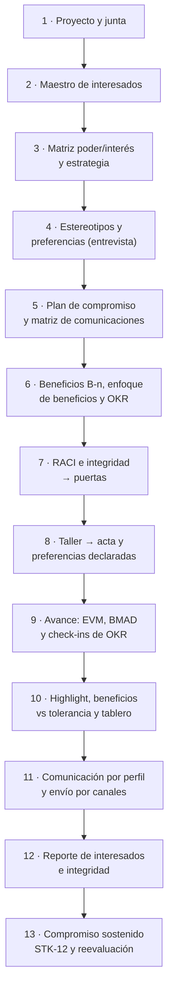
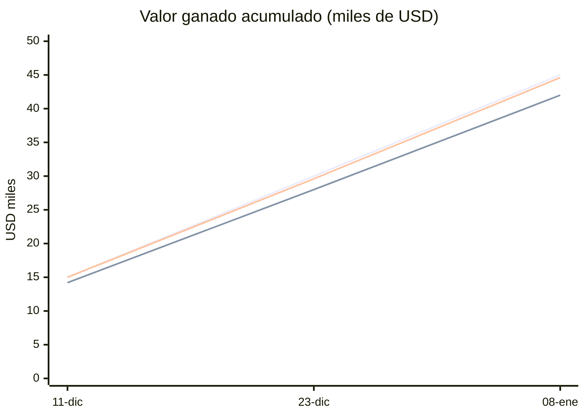
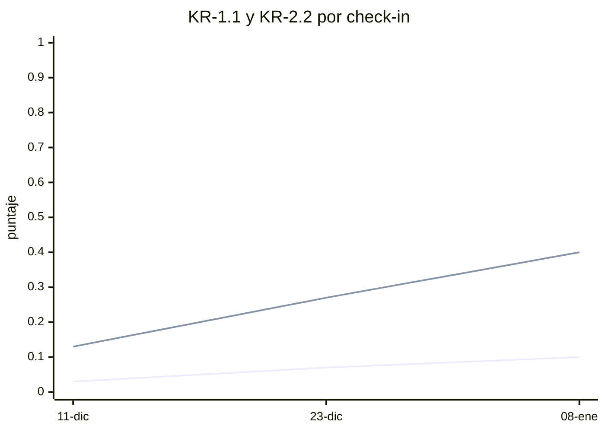
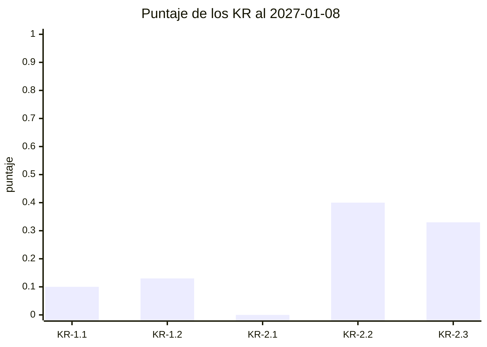

# Guía E2E-3 · Interesados, comunicaciones, OKR y reporte de avance

**Qué vas a probar:** el **maestro de interesados** de pm-method 2.2 de punta a punta: identificar y valorar a los
interesados, ubicarlos en la **matriz poder/interés** con la estrategia de cada cuadrante, tipificarlos con
**estereotipos**, capturar sus **preferencias de comunicación** desde una entrevista y desde la transcripción de una
reunión (con cita y confirmación humana), construir la **RACI** sobre épicas, requisitos, paquetes de la WBS y KR, y
usar ese mismo catálogo en todo el ecosistema: un **enfoque de beneficios** que mide cada beneficio B-n del business
case con dueño y tolerancia, **OKR** que lo complementan (tipos de KR, compromiso, peso, iniciativas, check-ins, salud y
publicación en Tability), el avance con valor ganado vigilado y BMAD, el highlight con las puertas y los beneficios
pronosticados contra su tolerancia, el tablero por actor, la **comunicación personalizada por perfil enviada por la capa
de canales** (correo SMTP, Teams y entrega en reunión), el **reporte visual de interesados** y, al final, el
**compromiso sostenido como control permanente**: la cadencia de contacto prometida a cada interesado se verifica sola
(STK-12), se corrige y se reevalúa el compromiso actual frente al deseado con la retroalimentación recibida.

Todo se apoya en PRINCE2 7 (práctica de organización, enfoque de comunicación, gestión por excepción) con técnicas del
PMBOK 8 (análisis poder/interés, matriz de evaluación del compromiso, RACI, plan de comunicaciones).

**Skills y agentes:** pm-orquestador · pm-inicio → `pm-organizacion-roles` · `pm-interesados` · `pm-enfoques-gestion` ·
`pm-comunicacion-stakeholders` · `pm-caso-de-negocio` · `pm-okr` · pm-control → `pm-reuniones`, `pm-progreso-reportes`, `pm-riesgos` ·
`pm-integraciones` (capa de canales) · `pm-visuales` · `pm-exportar` · `pm-director`.

**Pasos:** 13. **Duración:** 100–130 minutos. **Preparación:** [README de las guías](README.md#cómo-usar-las-guías) (copia del fixture en
`~/proyectos-prueba/portal-e2e-3`). Para enviar de verdad en el paso 11 necesitás **una** de estas opciones: las
variables `PM_SMTP_*` de tu servidor de correo, la URL de un flujo de Teams (`PM_TEAMS_WEBHOOK_URL`), un conector MCP
de correo, Slack o Teams conectado en Claude, o simplemente el modo `.eml` (sin configuración). Dónde va cada
credencial: [INSTALACION §0.7](../INSTALACION.md). Evidencia de referencia: [salida-g3.md](evidencia/salida-g3.md).



**Controles permanentes que muestra esta guía**

Lo que en la práctica se revisa a mano, tarde o nunca, y aquí lo detecta un control automático en cada verificación de
puerta, en cada `sanidad.py` (que también corre el hook de inicio de sesión) o en `interesados.py integridad`:

| Problema habitual | Control | Código | Paso |
|---|---|---|---|
| Los "criterios de éxito" quedan solo como OKR: nadie es dueño de medir el beneficio ni se sabe cuándo se mide | verificación de `autorizar-proyecto` | P-04 | 6 y 7 |
| Un OKR o un RACI nombra a alguien que no está en el maestro, o un elemento queda con dos aprobadores | `okr.py`, sanidad y `registro.py` (rechaza el segundo A) | STK-08 · STK-02 | 6 y 7 |
| El pronóstico de costo y plazo se calcula una vez y nadie vuelve a mirar si se acerca a la tolerancia | corte de EVM guardado y vigilado | TOL-01 · TOL-02 · TOL-03 | 9 y 12 |
| Historias "terminadas" que nadie aceptó formalmente | revisión de calidad por historia terminada | QUA-01 | 9 |
| La condición de una puerta se aprueba y se olvida | condiciones formales de puerta | G-01 · EST-12 | 10 |
| Compromisos de acción vencidos que nadie persigue | acciones con fecha a la fecha de corte | REG-07 | 9 y 11 |
| Con decenas de interesados, nadie verifica que se contacte a cada uno con la frecuencia prometida; se nota cuando alguien con poder se enoja | cadencia de contacto contra `envios.csv` | STK-12 | 13 |

---

## Paso 1 · Proyecto y junta

**Prompt**
```text
Creá el proyecto "Portal de autoservicio para socios" en ./gestion, español, híbrido. Ejecutiva Laura Méndez, gestor
Martín Suárez, usuaria sénior y PO Sofía Ramírez (también autoridad de cambio), proveedor sénior Diego Ferreira,
aseguramiento Andrea Costa, jefa de equipo Lucía Benítez. Sprints de 14 días y velocidad de 8 puntos.
```
**Qué hace el sistema:** `pm-organizacion-roles` diseña la junta y los roles; `pm-director` los registra.
**Dónde verificar:** `/pm-method:pm-estado` (roles).

---

## Paso 2 · Identificar y valorar a los interesados (maestro único)

**Prompt**
```text
Registrá a los interesados con poder, interés, actitud, compromiso actual y deseado, canal, frecuencia, responsable de
la relación y su correo (y usuario de Teams cuando lo tenga):
- Laura Méndez, gerenta de operaciones, ejecutiva: poder alto, interés alto, líder → líder; reunión 1:1 quincenal; Martín; laura.mendez@example.org.
- Consejo directivo: alto, medio, partidario → líder; informe ejecutivo por correo, trimestral; Laura; consejo@example.org.
- Sofía Ramírez, jefa de atención al socio, usuaria sénior y PO: alto, alto, líder → líder; sprint review quincenal; Martín; sofia.ramirez@example.org (también en Teams).
- Sindicato de operadores: medio, alto, resistente → neutral; taller presencial mensual; Sofía; delegado.sindical@example.org. Es CONFIDENCIAL.
- Socios usuarios piloto (panel de 40): bajo, alto, desconocedor → partidario; encuesta y boletín mensual; Sofía; panel.socios@example.org.
- Área de TI del núcleo operativo: alto, medio, neutral → partidario; reunión técnica semanal; Lucía.
- Unidad de cumplimiento: alto, bajo, neutral → partidario; correo y revisión por hito; Andrea; cumplimiento@example.org.
- Diego Ferreira, gerente del proveedor, proveedor sénior: medio, alto, partidario → partidario; junta mensual; Martín; diego.ferreira@example.org.
- Martín Suárez, gestor: medio, alto, líder; checkpoint semanal; Laura; martin.suarez@example.org (Teams).
- Lucía Benítez, jefa de equipo del proveedor: bajo, alto, partidario; daily; Martín; lucia.benitez@example.org.
```
**Si te pregunta** quién validó las valoraciones: "Las revisé con Laura; registralas".

**Qué hace el sistema:** pm-inicio → `pm-interesados` → `registro.py agregar stakeholders` (×10). El maestro
(`stakeholders.csv`) es la **única** fuente de personas para todo el ecosistema: OKR, RACI, preferencias, envíos y
registros lo citan por `ST-###` o por el nombre exacto.

**Qué deberías ver:** **ST-001…ST-010**, el sindicato con `confidencial=si`.

**Dónde verificar:** `gestion/03-control/registros/stakeholders.csv`.

---

## Paso 3 · Matriz poder/interés y estrategia por cuadrante

**Prompt**
```text
Ubicá a los interesados en la matriz poder/interés y decime la estrategia para cada cuadrante. Hacé el análisis de
interesados (restringido).
```

**Qué hace el sistema:** `interesados.py matriz` y el análisis con `templates/analisis-stakeholders.md`. Poder es la
autoridad real (aprobar presupuestos, vetar decisiones); interés, el involucramiento o impacto que el proyecto genera.

**Qué deberías ver:**

| Cuadrante | Interesados | Estrategia |
|---|---|---|
| Gestionar de cerca (7) | ST-001 Laura, ST-002 Consejo ◇, ST-003 Sofía, ST-004 Sindicato ◇, ST-006 TI ◇, ST-008 Diego ◇, ST-009 Martín ◇ | comunicación constante, participación activa en decisiones, máxima atención |
| Mantener satisfecho (1) | ST-007 Unidad de cumplimiento | sin abrumar con detalle; reportes ejecutivos sobre beneficios y avance |
| Mantener informado (2) | ST-005 Socios piloto, ST-010 Lucía | canales claros (boletines, reuniones informativas) y escucha de su retroalimentación |
| Monitorear (0) | — | esfuerzo mínimo, salvo que cambien de posición |

◇ = **frontera**: tienen un valor «medio» y, por convención del paquete, se ubican del lado alto. Pedí "¿y si los medio
cuentan como bajo?" para ver la otra convención (`--medio bajo`): el Consejo y TI pasan a mantener satisfecho, y el
sindicato, Diego y Martín a mantener informado.

**Dónde verificar:** `01-inicio/analisis-stakeholders.md` (restringido) · la matriz dibujada aparece en el reporte del
paso 12.

---

## Paso 4 · Estereotipos y preferencias declaradas en una entrevista

**Prompt**
```text
Cargá los estereotipos de audiencia y asigná: Laura y el Consejo a dirección-patrocinador, Sofía a product owner y
usuarios clave, el panel a cliente-usuario, cumplimiento a regulador-comunidad, Diego a proveedores, Martín y Lucía a
equipo. Después entrevisté a Laura (3/11): "Prefiero que el avance me llegue por correo, no por chat", "Una página, con
la conclusión y lo que tengo que decidir arriba", "Los lunes antes de las 9 lo leo con calma". Registrá sus
preferencias y mostrame su perfil de comunicación.
```
**Si te pregunta** si Laura aceptó que se registren y si las confirmás: "Sí, aceptó; confirmalas como Martín Suárez,
gestor".

**Qué hace el sistema:** `interesados.py estereotipos --semilla` (ET-001…ET-006, los seis de la guía de comunicación),
`registro.py actualizar stakeholders … estereotipo=ET-…` (se valida que el estereotipo exista), la entrevista con
`templates/entrevista-interesado.md` en `01-inicio/entrevistas/` (restringida), cuatro preferencias `declarado` con su
cita (**PF-001…PF-004**) y `interesados.py confirmar … --por "Gestor: Martín Suárez"`.

**Qué deberías ver** (perfil de ST-001, con la procedencia de cada valor):

| Dimensión | Valor | De dónde sale |
|---|---|---|
| canal | correo | PF-001 (declarado, 2026-11-03) |
| formato | conclusión primero | PF-002 |
| nivel de detalle | ejecutivo | PF-003 |
| frecuencia | quincenal | matriz de comunicaciones |
| registro · estilo de decisión | formal · datos | estereotipo ET-001 |
| horario | antes de las 9 | PF-004 |

Precedencia: cuadrante → idioma del proyecto → estereotipo → matriz de comunicaciones → preferencias **confirmadas**.

**Dónde verificar:** `estereotipos.csv` · `preferencias.csv` (cita, fuente, `vigencia_hasta`, `confirmado_por`) ·
prompt: "¿Cómo le tengo que escribir a Laura?".

---

## Paso 5 · Plan de compromiso, enfoque de comunicación y matriz de comunicaciones

**Prompt**
```text
Armá el plan de compromiso para cerrar las brechas (sindicato, consejo, socios piloto, TI y cumplimiento), el enfoque de
comunicación del PID y la matriz de comunicaciones. Cargá como acciones: taller de co-diseño de la bandeja con operadores
y el delegado sindical (Sofía, 20/11, alta); boletín 1 al panel de socios (Sofía, 1/12); informe ejecutivo trimestral al
Consejo con OKR y riesgos (Laura, 15/1).
```

**Qué hace el sistema:** `pm-interesados` (plan de compromiso: brecha actual → deseado), `pm-enfoques-gestion` (enfoque),
`pm-comunicacion-stakeholders` (matriz operativa, partiendo de la estrategia de cada cuadrante y de los estereotipos) y
`registro.py agregar acciones --campo origen=ST-00n`.

**Qué deberías ver:** **A-001** (origen ST-004), **A-002** (ST-005), **A-003** (ST-002).

**Dónde verificar:** `02-planificacion/plan-compromiso-stakeholders.md` · `02-planificacion/enfoques/enfoque-comunicacion.md`
· `02-planificacion/matriz-comunicaciones.md` · `acciones.csv`.

---

## Paso 6 · Beneficios del business case, enfoque de beneficios y OKR que los complementan

**El problema:** en muchos proyectos los "criterios de éxito" se reducen a un tablero de OKR. Los KR son metas de ciclo,
a menudo aspiracionales, y nadie queda como dueño de medir el beneficio comprometido en el business case, ni de seguir
midiéndolo después del cierre. La verificación de `autorizar-proyecto` lo controla (P-04): pone una **condición** si los
criterios de éxito están solo en OKR y un **aviso** si hay beneficios B-n sin enfoque de beneficios.

**Prompt**
```text
Registrá los beneficios del business case con su medida: B-01 desvío de consultas (SM-2), de 5.000 a 4.000 consultas
por mes por canales tradicionales (−20 %) al 31/12/2027; B-02 adopción (SM-1), 25 % de socios activos registrados al
31/12/2027; B-03 préstamos simples respondidos en menos de 48 h hábiles (SM-3), de 96 a 48 h al 30/6/2027. La tolerancia
de beneficios es −10 % por beneficio. Armá el enfoque de beneficios: dueña Sofía, método y frecuencia de medición,
revisiones (en cada highlight, fin de etapa, cierre y post-proyecto al 31/12/2027) y qué KR complementa a cada beneficio.
Después definí los OKR del proyecto ligados a esos beneficios y a las métricas de éxito del PRD. Laura es la dueña de los objetivos y Sofía de los KR. Ciclo 2027, desde el 2/11.
O-1 "Los socios resuelven sus gestiones simples sin ir a la sucursal" (aspiracional): KR-1.1 30 % de socios activos
registrados (base 0, SM-1, B-02, pesa el doble; en Tability es kr-registro-portal); KR-1.2 bajar de 5.000 a 3.500 las
consultas de saldo y constancias por canales tradicionales (SM-2, B-01).
O-2 "Los préstamos simples se resuelven rápido y sin papeles" (comprometido): KR-2.1 mantener la respuesta por debajo de
48 h hábiles (hoy 96, SM-3, B-03); KR-2.2 más del 90 % de las solicitudes completas (base 60 %); KR-2.3 la bandeja única
en producción para el 12/3, con las iniciativas de las historias 3-1, 3-2 y 3-3 (Lucía).
Calculá el puntaje al 20/11.
```

**Si te pregunta** quién aprueba el enfoque de beneficios: "Lo aprueba Laura en la puerta de autorizar el proyecto;
Sofía, como usuaria sénior, acuerda las mediciones".

**Qué hace el sistema:** `pm-caso-de-negocio` completa la sección 5 del business case y escribe
`00-direccion/enfoque-beneficios.md` con `templates/enfoque-beneficios.md` (tabla de beneficios con dueño, medida, línea
base, meta, fecha, método, frecuencia, tolerancia y referencias SM/KR; revisiones de beneficios; responsabilidades) y lo
registra con `estado.py artefacto enfoque-beneficios --ruta 00-direccion/enfoque-beneficios.md`. La tolerancia de
beneficios (−10 %) la fija la junta con las demás tolerancias de proyecto (`estado.py tolerancia --nivel proyecto …
"beneficios=-10 %"`, paso 7). Luego `pm-okr` escribe `00-direccion/okr.csv` con las columnas de v2.2 (`tipo_kr` de-a,
mantener-bajo, hito; `compromiso`; `peso`; `fecha_inicio`; `ref_externa`; iniciativas **IN-1…IN-3** ligadas a historias
de BMAD) y corre `okr.py … --corte 2026-11-20` y `sanidad.py --rapido --corte 2026-11-20`. Los responsables son `ST-001` y
`ST-003` del maestro: si escribieras un nombre que no está, `okr.py` y la sanidad (STK-08) lo avisan. La sanidad valida
además SM-n (ESP-04) y B-n (ESP-05).

**Qué deberías ver:**

| Beneficio | Meta del business case | Tolerancia (−10 %) | KR que lo complementa |
|---|---|---|---|
| B-01 desvío de consultas | 5.000 → 4.000 consultas/mes al 31/12/2027 | ≥ 900 desviadas | KR-1.2, aspiracional: 3.500 |
| B-02 adopción | 25 % de socios activos al 31/12/2027 | ≥ 22,5 % | KR-1.1, aspiracional: 30 % |
| B-03 préstamos en < 48 h | 96 h → 48 h al 30/6/2027 | ≤ 52,8 h | KR-2.1, KR-2.2 y KR-2.3 (comprometidos) |

Los OKR **complementan** los beneficios: los B-n son el compromiso del business case, con dueño, tolerancia de la junta y
revisiones que siguen después del cierre; los KR fijan metas de ciclo y se siguen con check-ins. Por eso KR-1.1 y KR-1.2
pueden apuntar más alto (30 % y 3.500) sin mover el compromiso. Puntaje de los OKR: todo en 0,00 (aún no hay
mediciones), con la **salud** ya calculada contra el avance esperado (KR-2.1 y KR-2.3 «en riesgo»: no cumplen todavía su
umbral o hito). Sanidad al 20/11: "0 ERROR · 0 AVISO · 1 INFO" (ESP-02, índice de especificación que se reconstruye solo).

**Dónde verificar:** `00-direccion/business-case.md` (sección 5) · `00-direccion/enfoque-beneficios.md` ·
`00-direccion/okr.csv` · `00-direccion/okr.md` · prompt: "¿Cómo van los OKR?".

---

## Paso 7 · RACI sobre épicas, requisitos, paquetes y KR; integridad del maestro

**Prompt**
```text
Armá la RACI: épica E-1 (A Sofía, R Lucía, C TI, I Laura); épica E-3 (A Sofía, R Lucía, C sindicato y Diego); NFR-1
protección de datos (A cumplimiento, R Lucía, C Sofía); paquete 3.1 de la WBS (A Martín, R Lucía, I Sofía); KR-1.1
(A Laura, R Sofía, C panel de socios, I Consejo) y KR-2.2 (A Laura, R Sofía, I Consejo). Después intentá poner a Laura
también como A de E-1. Mostrame quién participa en E-3 y verificá la integridad.
```

**Qué hace el sistema:** `registro.py agregar raci` (una fila por elemento × interesado). El registro **rechaza** el
segundo aprobador: «elemento E-1 ya tiene un 'A' (exactamente uno…)» y también una fila duplicada. Luego
`interesados.py raci --markdown 02-planificacion/matriz-raci.md`, `raci --elemento E-3` e `integridad`. Los títulos
salen de su fuente: la épica y el requisito de la **especificación de BMAD** (vía la fachada), el paquete de la **WBS**
y el KR de **okr.csv**.

**Qué deberías ver:**

| Elemento | Descripción | Laura | Consejo | Sofía | Sindicato | Socios | TI | Cumplimiento | Diego | Martín | Lucía |
|---|---|---|---|---|---|---|---|---|---|---|---|
| E-1 | Acceso seguro y consulta de mis productos | I | | A | | | C | | | | R |
| E-3 | Consola de operador | | | A | C | | | | C | | R |
| NFR-1 | Seguridad y privacidad (Ley 18.331) | | | C | | | | A | | | R |
| 3.1 | Acceso seguro (WBS) | | | I | | | | | | A | R |
| KR-1.1 | 30 % de socios registrados | A | I | R | | C | | | | | |
| KR-2.2 | Más del 90 % de solicitudes completas | A | I | R | | | | | | | |

"RACI válida: un A por elemento, al menos un R, referencias existentes" e "Integridad referencial y calidad del maestro:
sin hallazgos". Con la RACI cargada, la verificación de `autorizar-proyecto` ya no muestra el aviso **P-10** (sin RACI).

Para seguir, el proyecto necesita estar autorizado y en la etapa 2: pedí "Preparame las puertas de inicio, de proyecto y
de la etapa 2; las tolerancias de proyecto son ±3 semanas, ±8 % de costo, Must sin tolerancia, ningún riesgo alto sin
respuesta y −10 % en beneficios" y respondé como Laura Méndez, ejecutiva (detalle en la [guía E2E-4](E2E-4-producto-bmad.md)).
Gracias al enfoque de beneficios del paso 6, la verificación de `autorizar-proyecto` queda en "1 bloqueo(s) · 0
condición(es) · 0 aviso(s)": el único bloqueo es la lista de control de la junta, que se crea y confirma con la fecha de
la puerta (`puertas.py lista autorizar-proyecto --fecha 2026-11-27`, `confirmar … --fecha 2026-11-27`); **P-04** no
aparece. Sin el enfoque habría salido el aviso "sin enfoque de beneficios (cómo, cuándo y quién mide cada beneficio,
incluso después del proyecto)". La etapa 2 se autoriza `condicionado` por el gate de BMAD en CONCERNS, que pasa
automáticamente a condición formal ("Condiciones agregadas desde la verificación: gate de preparación de BMAD en
CONCERNS…").

**Dónde verificar:** `03-control/registros/raci.csv` · `02-planificacion/matriz-raci.md` · prompt: "¿Quién aprueba la
consola de operador?".

---

## Paso 8 · Taller con interesados → acta, decisiones, acciones y preferencias declaradas

Guardá la transcripción del taller (exportada de Teams, Zoom o Meet en VTT) en
`gestion/03-control/reuniones/2026-11-19-taller-bandeja-original.vtt`. Un ejemplo listo para copiar está en
[salida-g3.md](evidencia/salida-g3.md) (paso 8): incluye frases como «A mí mandame las novedades del proyecto por Teams»
(Sofía) y «Prefiero que las novedades nos lleguen por correo, en un resumen corto, cada dos semanas» (delegado sindical).

**Prompt**
```text
Procesá la transcripción del taller de la bandeja del 19/11: armá el acta con decisiones y acciones. Registrá la
decisión de Sofía y la acción de Lucía, cerrá la acción del taller y actualizá el compromiso del sindicato a neutral.
El "Delegado sindical" es el Sindicato de operadores. Proponé las preferencias de comunicación que cada uno pidió.
```
**Si te pregunta** si confirmás la decisión: "Sí, Sofía Ramírez, PO: el tablero de la bandeja muestra métricas del
equipo, no individuales". **Si te pregunta** si confirmás las preferencias: "Sí, las validé con Sofía y con el
delegado; confirmalas como Martín Suárez". **Si te avisa** que la frecuencia del sindicato difiere de la matriz:
"Actualizá la matriz a quincenal".

**Qué hace el sistema:** `pm-reuniones` → `transcripcion.py` (normaliza hablantes y tiempos) → acta → `registro.py`:
**D-006** (nivel product-owner) y **A-004** (Lucía, 11/12). Después `interesados.py proponer --transcripcion
<normalizada> --mapa "Delegado sindical=ST-004" --registrar`: analiza **solo frases en primera persona** y registra
como `propuesta`, con la cita y la marca de tiempo, **PF-005** (Sofía, canal teams), **PF-006…PF-008** (sindicato:
correo, ejecutivo, quincenal). Martín se asocia solo (nombre exacto) y no pidió nada. No se infieren emociones ni
rasgos: la preocupación del delegado queda en el acta, no en su perfil. El perfil del sindicato advierte que la
frecuencia confirmada (quincenal) difiere de la matriz aprobada (mensual) → se actualiza la matriz.

**Qué deberías ver:** "5 intervenciones de 4 hablantes"; D-006; A-004; PF-005…PF-008 confirmadas; ST-004 con
compromiso `neutral` y frecuencia `quincenal`.

**Dónde verificar:** `03-control/reuniones/2026-11-19-taller-bandeja-transcripcion.md` · el acta · `decisiones.csv` ·
`acciones.csv` · `preferencias.csv` (columna `evidencia`) · `stakeholders.csv`.

---

## Paso 9 · Avance: valor ganado, BMAD, check-ins de OKR y registros a la fecha de corte

**Prompt**
```text
Cargá el avance por sprint (PV, EV, AC en USD): 11/12 15.000, 14.200, 15.000; 23/12 30.000, 28.000, 29.600;
8/1 45.000, 42.000, 44.600. BAC 124.000, tolerancias de etapa 10 % en costo y plazo. Traé el avance de BMAD a cada corte.
Check-ins de Sofía: 11/12 KR-1.1 1 % (confianza 7), KR-1.2 4.950 (6), KR-2.1 92 h (4), KR-2.2 64 % (6); 23/12 2 %, 4.900,
88 h, 68 %; 8/1 3 %, 4.800, 80 h (5), 72 %. La historia 3-1 quedó terminada el 23/12.
Sofía aceptó en cada sprint review las historias terminadas: 11/12 la 1-1; 23/12 la 1-2 y la 3-1; 8/1 la 1-3.
Riesgo nuevo: el panel de socios casi no responde encuestas y no vamos a poder medir SM-5 (P3, I3, USD 4.000, reducir con
incentivo, propietaria Sofía).
```

**Qué hace el sistema:** `evm.py --csv … --bac 124000 --tol-costo 10 --tol-plazo 10 --proyecto gestion --guardar
--corte 2027-01-08` (guarda el último corte en `03-control/reportes/evm-2027-01-08.json`: desde ahí la sanidad vigila el
pronóstico contra la tolerancia en cada sesión, TOL-01 si pronostica excepción sin excepción abierta, TOL-02 en ámbar; sin
corte guardado aparecería TOL-03 "Etapa de entrega sin corte de EVM guardado"); `bmad.py avance --corte <fecha>`; una
revisión de calidad por sprint review (`registro.py agregar calidad --campo producto="Sprint review 1: historia 1-1"
--campo metodo_verificacion=demostracion --campo resultado=aprobado --campo estado=completada …`): **Q-001…Q-003**, que
citan cada historia terminada (sin ellas, la sanidad mostraría QUA-01 "terminado sin revisión de calidad registrada" por
cada una);
`okr.py … --checkin KR-… --valor … --confianza … --fecha …` (12 check-ins en `00-direccion/okr_checkins.csv`, que solo
se agregan: un segundo check-in del mismo KR y fecha se rechaza); la iniciativa IN-1 pasa a `completada`; `pm-riesgos`
registra **R-001**; `registro.py resumen --corte 2027-01-08`.

**Qué deberías ver:**

| Corte | SPI | CPI | EAC (USD) | Sobrecosto | Semáforos | Puntos terminados (BMAD) |
|---|---|---|---|---|---|---|
| 2026-12-11 | 0,947 | 0,947 | 130.986 | 5,6 % | ámbar / ámbar | 8 de 68 (11,8 %) |
| 2026-12-23 | 0,933 | 0,946 | 131.086 | 5,7 % | ámbar / ámbar | 18 de 68 (26,5 %) |
| 2027-01-08 | 0,933 | 0,942 | 131.676 | 6,2 % | ámbar / ámbar | 26 de 68 (38,2 %) |

Dentro de la tolerancia (10 %): **no hay excepción** (`excepcion_prevista False`); "Guardado:
03-control/reportes/evm-2027-01-08.json". Acción vencida al 8/1: **A-004** (Lucía Benítez, 2026-12-11), la misma que la
sanidad marca como REG-07 mientras siga abierta. Q-001, Q-002 y Q-003 completadas y aprobadas.

**Dónde verificar:** `03-control/reportes/progreso.csv` · `03-control/reportes/evm-2027-01-08.json` ·
`03-control/registros/calidad.csv` · `03-control/reportes/avance-bmad.csv` ·
`00-direccion/okr_checkins.csv` · `riesgos.csv`.

---

## Paso 10 · Highlight report, OKR al corte (salud y check-ins), Tability y tablero con vista por actor

**Prompt**
```text
Armá el highlight report del período 24/12 al 8/1 para la junta, con las puertas y sus condiciones, los OKR al 8/1 y el
tablero de avance. En la fila de beneficios pronosticá B-01…B-03 contra su meta y la tolerancia de −10 % del enfoque de
beneficios; los OKR van como complemento. Decisión pendiente para la junta: aprobar USD 4.000 de contingencia para el
incentivo del panel. Decime qué check-ins habría que publicar en Tability. Mostrame también la vista de Sofía.
```
**Si te pregunta** si publica en Tability: con el conector de Tability conectado, "Sí, publicá el del 8/1 de KR-1.1";
sin conector, "No, solo mostrame la propuesta". **Si te avisa** que la condición de la etapa sigue abierta (G-01): "Lucía
ya planificó la prueba de carga de NFR-3 en el sprint 5; Laura Méndez, ejecutiva, la da por cumplida".

**Qué hace el sistema:** `okr.py … --corte 2027-01-08 --markdown 03-control/reportes/2027-01-08-okr.md` (el `actual`
de cada KR es su último check-in); `okr.py --propuesta-sync tability` lista los check-ins sin publicar de los KR que
tienen `ref_externa` y la herramienta del MCP oficial (`tability_create_checkin`) con la confianza traducida
(7 → green); tras publicar, `--marcar-publicado KR-1.1@2027-01-08 --destino tability --ref <id>`. Highlight con
`puertas.py estado --markdown`; tablero de `pm-visuales` (vista por actor con `?actor=Sofía Ramírez`). La fila
**Beneficios** se pronostica contra los B-n del enfoque de beneficios y su tolerancia, no contra los KR: R1 llega una
semana tarde (12/3), antes de las fechas de medición de B-01 y B-02 (31/12/2027), así que siguen en meta; B-03 (48 h al
30/6) depende de la bandeja, que es justo el KR-2.3 en riesgo, y hoy, sin bandeja, la respuesta está en 80 h. Por último,
🔒 `estado.py cumplir-condiciones autorizar-etapa --fecha 2027-01-08 --por "Ejecutiva: Laura Méndez" --nota "prueba de
carga de NFR-3 planificada en el sprint 5 …"` cierra la condición de la puerta: deja de aparecer como G-01 en la próxima
verificación y como EST-12 en la sanidad.

**Qué deberías ver** (puntaje · semáforo · salud frente al avance esperado):

| OKR | Puntaje al 8/1 | Semáforo | Salud | Comentario |
|---|---|---|---|---|
| **O-1** (aspiracional) | **0,11** | rojo | — | promedio ponderado (KR-1.1 pesa 2) |
| KR-1.1 registro en el portal | 0,10 (3 de 30 %) | rojo | en camino (esperado 0,16) | confianza 7 (verde) |
| KR-1.2 consultas tradicionales | 0,13 (4.800 → 3.500) | rojo | en camino | confianza 6 (ámbar) |
| **O-2** (comprometido) | **0,24** | rojo | — | umbrales 1,0 / 0,7 por ser comprometido |
| KR-2.1 respuesta < 48 h | 0,00 (80 h) | rojo | en riesgo | mantener-bajo: 1 solo al cumplir |
| KR-2.2 solicitudes completas | 0,40 (72 %) | rojo | en camino | |
| KR-2.3 bandeja en producción | 0,33 (1 de 3 iniciativas) | rojo | **en riesgo** (esperado 0,52) | hito al 12/3 |

Los rojos son esperables antes del lanzamiento: la **salud** muestra que KR-1.1, KR-1.2 y KR-2.2 van al ritmo esperado
y que KR-2.1 y la bandeja (KR-2.3) necesitan atención. Propuesta de sincronización: los tres check-ins de KR-1.1; los
demás KR aparecen como aviso por no tener `ref_externa`.

Fila de beneficios del highlight y del tablero (ámbar):

| Beneficio | Pronóstico al 8/1 | Tolerancia | Estado |
|---|---|---|---|
| B-01 desvío de consultas | 4.000 consultas/mes al 31/12/2027: en meta (R1 +1 semana, antes de medir) | ≥ 900 desviadas | verde |
| B-02 adopción | 25 % al 31/12/2027: en meta | ≥ 22,5 % | verde |
| B-03 préstamos en < 48 h | 48 h al 30/6 solo con la bandeja (KR-2.3 en riesgo); hoy 80 h sin bandeja | ≤ 52,8 h | ámbar |

Tablas de puertas: inicio y proyecto aprobados; la etapa, condicionada por el gate de BMAD en CONCERNS, con la condición
"(abiertas)" y, en la próxima puerta, "condición: condiciones abiertas de puertas anteriores: autorizar-etapa
2026-11-27". Tras `cumplir-condiciones` queda cerrada (la sanidad del paso 12 ya no muestra EST-12). El tablero:


Vista por actor (acciones, riesgos e issues de Sofía Ramírez):


**Dónde verificar:** `03-control/reportes/2027-01-08-highlight-report.md` · `03-control/reportes/2027-01-08-okr.md`
(incluye el historial de check-ins) · `00-direccion/okr_checkins.csv` (columna `publicado_en`) ·
`03-control/reportes/2027-01-08-tablero-avance.html`.

---

## Paso 11 · Comunicación personalizada por perfil y envío por la capa de canales

**Prompt**
```text
Prepará el comunicado del avance al 8/1 para todos los de "gestionar de cerca" y "mantener satisfecho" (menos yo,
Martín), adaptado al perfil de cada uno, con la decisión pendiente para la junta. Agrupá a quienes comparten perfil.
Mostrame los borradores; si los apruebo, mandalos por correo y por Teams y registrá la entrega en la reunión técnica.
```
**Si te pregunta** si aprobás: "Sí, aprobados por Martín Suárez, gestor". **Si te pregunta** si envía: "Sí, enviá"
(con las variables de entorno de tu servidor o el conector conectado; si no tenés ninguno: "Generá los .eml").

**Qué hace el sistema:**
1. `pm-comunicacion-stakeholders` redacta el contenido base (`03-control/reportes/2027-01-15-comunicado-consejo.md`) y
   corre `interesados.py plan-envio --tema … --audiencia "cuadrante:gestionar-de-cerca,cuadrante:mantener-satisfecho,-ST-009"
   --base … --agrupar`: **7 destinatarios, 5 borradores**, cada uno con el perfil en el frontmatter.
2. El modelo adapta cada borrador a su perfil (conclusión primero y una página para el grupo ejecutivo; datos y detalle
   para Sofía; lista para Diego; resumen corto para el sindicato).
3. 🔒 `envios.py aprobar <carpeta> --por "Gestor: Martín Suárez"` (rechaza borradores sin redactar).
4. `envios.py enviar <carpeta> --modo smtp` **simula** (destinatarios, asunto, comienzo del texto y variables que faltan);
   con `--confirmar` envía: un correo por destinatario. `--modo teams-webhook --confirmar` publica la tarjeta para Sofía.
   La entrega a TI en la reunión técnica se registra con `envios.py registrar --modo manual`.

**Qué deberías ver:**

| Mensaje | Para | Canal | Perfil aplicado | Resultado |
|---|---|---|---|---|
| mensaje-01 | ST-001 Laura, ST-002 Consejo, ST-007 Cumplimiento | correo | conclusión primero · ejecutivo · formal | EN-001…EN-003 enviados |
| mensaje-02 | ST-003 Sofía | teams | datos · detallado | EN-006 enviado |
| mensaje-03 | ST-004 Sindicato | correo | conclusión primero · ejecutivo (su preferencia) | EN-004 enviado |
| mensaje-04 | ST-006 TI | reunión (no electrónico) | — | EN-007 registrado a mano |
| mensaje-05 | ST-008 Diego | correo | lista · resumen | EN-005 enviado |

En la corrida de referencia, el correo y Teams llegaron a **servidores de prueba locales** (127.0.0.1) que levanta el
script de la guía, para mostrar el envío real sin salir a la red; con tus credenciales salen a tu servidor. Los destinos
se toman **del maestro en el momento de enviar** y un reenvío solo alcanza a quien todavía no recibió. Con un conector
MCP (Gmail, Outlook, Slack, Teams): `envios.py preparar-mcp` → el agente envía tras la vista previa → `envios.py
registrar --modo mcp`. El mismo flujo sirve para informes, actas, recordatorios de acciones, convocatorias, decisiones de
puerta y OKR (`envios.py nuevo --origen <archivo> --proposito …`).

Después: A-003 `completada`; A-004 (prototipo) `completada` el 14/1, con nota de su atraso; ST-005 `partidario`
(respondió el 78 % al boletín 2).

**Dónde verificar:** `03-control/comunicaciones/2027-01-15-avance-del-portal-al-8-de-enero/` (borradores aprobados y
`plan-envio.csv`) · `03-control/registros/envios.csv` (EN-001…EN-007, con quién aprobó) · `03-control/registros/diario.md`
· prompt: "¿Qué le enviamos al sindicato y cuándo?".

---

## Paso 12 · Reporte de interesados, vínculos en el ecosistema e integridad

**Prompt**
```text
Dame el reporte de interesados al 15/1 (sin valoraciones), el perfil de comunicación de todos, dónde aparece Sofía en el
proyecto y verificá la integridad y la sanidad al 15/1. Exportame los registros a Excel.
```

**Qué hace el sistema:** `interesados.py reporte --html 03-control/reportes/2027-01-15-interesados.html --markdown …`
(matriz, estrategias, RACI, perfiles, estereotipos, vínculos, envíos e integridad), `perfil todos`, `vinculos ST-003`,
`integridad --corte 2027-01-15`, `sanidad.py --rapido --corte 2027-01-15` (la fecha de corte fija qué está vencido y
qué contacto está atrasado; sin ella se usaría la fecha de hoy) y `exportar.py xlsx --salida
gestion/exportados/2027-01-15-registros.xlsx`.

**Qué deberías ver:** "10 ubicados, 6 elementos RACI, 0 hallazgos"; los vínculos de Sofía: A en E-1 y E-3, C en NFR-1,
I en 3.1, R en KR-1.1 y KR-2.2, responsable de KR-1.1…KR-2.3, R-001, A-001, A-002, revisora de Q-001…Q-003, D-006,
PF-005 y EN-006; integridad sin hallazgos y sanidad "0 ERROR · 0 AVISO · 2 INFO": ESP-02 (índice de especificación) y
TOL-02 "El EVM del 2027-01-08 está en ámbar (costo=ambar, cronograma=ambar): 50–100 % de la tolerancia", que es el
pronóstico vigilado del paso 9. No aparecen QUA-01 (historias aceptadas), EST-12 (condición cumplida), REG-07 (A-004
cerrada) ni TOL-03 (hay corte guardado). El reporte:


Antes de compartir el reporte o el Excel fuera de la junta: el reporte no incluye actitudes (solo con `--restringido`) y
en el Excel el sindicato está marcado como confidencial.

**Dónde verificar:** `03-control/reportes/2027-01-15-interesados.html` (abrilo en el navegador) ·
`03-control/reportes/2027-01-15-interesados.md` · `exportados/2027-01-15-registros.xlsx`.

---

## Paso 13 · Compromiso sostenido: cadencia de contacto (STK-12), acción correctiva y reevaluación del compromiso

**El problema:** el plan de comunicaciones promete a cada interesado un canal y una frecuencia (reunión técnica semanal,
informe quincenal, boletín mensual…). Con decenas de interesados nadie verifica si esa cadencia se cumple: se cumple las
primeras semanas y después se diluye, y se nota recién cuando alguien con poder se enoja. Tampoco se reevalúa el
compromiso con evidencia: la matriz actual → deseado se arma al inicio y queda congelada. **STK-12** convierte el plan de
comunicaciones en un control permanente: para cada interesado de gestionar de cerca, mantener satisfecho y mantener
informado compara el último contacto `enviado` en `envios.csv` (correo, chat, reunión o llamada) con la frecuencia de
su perfil (diaria 1, semanal 7, quincenal 14, mensual 31 días, con tolerancia 1,5×). Sin contacto propio, cuenta desde
el primer envío del proyecto.

**Prompt**
```text
Es 5/2. Verificá la integridad y la sanidad al 5/2: ¿a quién no estamos contactando con la frecuencia que le
prometimos?
```

**Qué deberías ver (detección):**

```text
AVISO STK-12: ST-006 Área de TI del núcleo operativo (gestionar-de-cerca, frecuencia semanal): último contacto registrado el 2027-01-18, hace 18 días (máximo 10)
AVISO STK-12: ST-009 Martín Suárez (gestionar-de-cerca, frecuencia semanal): sin contacto registrado desde 2027-01-15 (21 días; máximo 10)
AVISO STK-12: ST-010 Lucía Benítez (mantener-informado, frecuencia diaria): sin contacto registrado desde 2027-01-15 (21 días; máximo 2)
```

La sanidad al 5/2 da "0 ERROR · 3 AVISO · 1 INFO" (los tres STK-12 y TOL-02). Son dos problemas distintos:
- **TI** (poder alto, dueña del núcleo y del padrón) tiene prometida una reunión técnica semanal y la última fue el
  18/1. Es el caso real: como la sanidad rápida corre en el hook de inicio de sesión, el aviso aparece en cada sesión
  desde el 29/1, cuando se superan los 10 días, y no recién cuando TI se queja.
- **Martín y Lucía**: el checkpoint semanal ocurre, pero no se registra. Además, la frecuencia "diaria" de Lucía era la
  daily, una ceremonia del equipo y no un compromiso de contacto con un interesado. El control obliga a revisar la
  frecuencia acordada.

Laura, Sofía y el sindicato (quincenal, último contacto el 15/1) están justo en el máximo de 21 días: el próximo
comunicado los cubre. El Consejo tiene frecuencia trimestral (máximo 138 días) y está dentro del margen; cumplimiento
tiene frecuencia por hito, que este control no vigila (se revisa en cada puerta).

**Prompt (corrección)**
```text
Hoy hicimos la reunión técnica con TI: registrala como contacto con lo que nos dijeron y abrí una acción para Lucía.
La frecuencia de Lucía es el checkpoint semanal, no la daily: corregila y registrá el checkpoint de hoy para ella y
para mí. Después reevaluá el compromiso actual frente al deseado con la retroalimentación y volvé a verificar.
```
**Si te pregunta** qué dijo TI: "Se enteraron por terceros del cambio en la consulta al padrón; sin la reunión semanal no
pudieron planificar el ambiente de carga. Piden retomarla con acta el mismo día". **Si te pregunta** cómo reevaluar a TI:
"Pasó de neutral a resistente; el deseado sigue siendo partidario".

**Qué hace el sistema:**
1. `registro.py agregar envios --campo fecha=2027-02-05 --campo stakeholder_id=ST-006 --campo canal=reunion --campo
   modo=manual --campo estado=enviado --campo asunto="Reunión técnica: …" --campo notas="retroalimentación: …"` →
   **EN-008**. Con un correo o un mensaje de Teams, el mismo contacto saldría por la capa de canales (`envios.py`, paso
   11) y quedaría registrado igual.
2. `registro.py agregar acciones --campo origen=ST-006 …` → **A-005** (reunión técnica semanal con acta el mismo día y
   aviso previo de cambios que toquen el padrón; Lucía, 12/2, alta).
3. `registro.py actualizar stakeholders ST-010 --campo canal=checkpoint --campo frecuencia=semanal` y el checkpoint del
   5/2 registrado como reunión para ST-009 y ST-010 → **EN-009** y **EN-010**.
4. Reevaluación: `registro.py actualizar stakeholders ST-006 --campo nivel_compromiso_actual=resistente --campo notas=…`
   (con la referencia a A-005) y nota en ST-004 (sin objeciones al comunicado del 15/1: neutral = deseado). La matriz de
   evaluación del compromiso se arma con `nivel_compromiso_actual` y `nivel_compromiso_deseado` del maestro.
5. `interesados.py integridad --corte 2027-02-05` y `sanidad.py --rapido --corte 2027-02-05` de nuevo; `vinculos ST-006`.

**Qué deberías ver (después):** "Integridad referencial y calidad del maestro: sin hallazgos"; sanidad "0 ERROR · 0
AVISO · 1 INFO" (solo TOL-02); los vínculos de TI: C en E-1, EN-007 (18/1) y EN-008 (5/2). La matriz de evaluación
del compromiso al 5/2 (A = actual, D = deseado):

| Interesado | Desconocedor | Resistente | Neutral | Partidario | Líder | Brecha |
|---|---|---|---|---|---|---|
| ST-002 Consejo directivo | | | | A | D | +1 |
| ST-004 Sindicato de operadores | | | A=D | | | — |
| ST-005 Socios usuarios piloto | | | | A=D | | — |
| ST-006 Área de TI del núcleo | | **A** (era neutral) | | D | | **+2** |
| ST-007 Unidad de cumplimiento | | | A | D | | +1 |
| Laura, Sofía, Diego, Martín, Lucía | | | | | | — (A=D) |

La retroalimentación cambia el plan de compromiso. TI pasa a ser la brecha más grande y a tener una acción con fecha
(A-005), sin esperar a que escale a la junta. El sindicato y el panel de socios confirman que ya están donde se quería.

**Dónde verificar:** `03-control/registros/envios.csv` (EN-008…EN-010, columna `notas` con la retroalimentación) ·
`acciones.csv` (A-005) · `stakeholders.csv` (ST-006 y ST-010) · prompt: "¿A quién tenemos descuidado?".

---

## Reporte: highlight report del 2027-01-08 (ejemplo)

> Estructura de `pm-progreso-reportes/templates/highlight-report.md`; cifras de la corrida de referencia.

**Estado general:** ámbar. Etapa 2 "Release 1", corte 8/1, período 24/12–8/1.

| Objetivo | Pronóstico | Tolerancia | Estado |
|---|---|---|---|
| Tiempo | SPI 0,93: ≈ 1 semana de atraso | etapa ±10 % · proyecto ±3 semanas | ámbar |
| Costo | CPI 0,94: EAC ≈ USD 131.700 (+6,2 %) | etapa ±10 % · proyecto ±8 % | ámbar |
| Alcance | Must completos en R1 | Must sin tolerancia | verde |
| Beneficios | B-01 4.000 y B-02 25 % en meta (R1 +1 semana, antes de medir); B-03 48 h solo con la bandeja (KR-2.3 en riesgo; hoy 80 h sin bandeja) | −10 % por beneficio (B-03 ≤ 52,8 h), enfoque de beneficios | ámbar |
| Riesgo | sin altos abiertos; R-001 (9) en seguimiento | ningún alto sin respuesta | verde |

**OKR (complementan los beneficios):** O-1 0,11 · O-2 0,24.
**Logros del período:** historias 1.1, 1.2, 1.3 y 3.1 terminadas (26 de 68 puntos); el sindicato pasó de resistente a
neutral (D-006) y su canal y frecuencia quedaron confirmados.
**Compromisos vencidos:** A-004, prototipo de la bandeja (Lucía Benítez, 11/12).
**Decisión que se pide a la junta:** aprobar USD 4.000 de contingencia para el incentivo del panel (R-001), antes del
22/1.
**Puertas:** autorizar-etapa condicionada por el gate de preparación de BMAD en CONCERNS (NFR-3 sin prueba de carga
planificada); la junta da la condición por cumplida el 8/1 con la prueba de carga planificada en el sprint 5.

## Representaciones gráficas

**Matriz poder/interés y RACI:** las capturas del paso 12 (reporte HTML de `interesados.py`, con detalle al pasar el
cursor y modo claro u oscuro).

**Matriz de evaluación del compromiso** (A = actual, D = deseado; ✔ = sin brecha; evolución hasta la reevaluación
del 5/2 del paso 13):

| Interesado | Desconocedor | Resistente | Neutral | Partidario | Líder |
|---|---|---|---|---|---|
| Consejo directivo | | | | **A** | D |
| Sindicato de operadores | | A (inicio) | **A = D** (tras el taller, confirmado el 5/2) | | |
| Socios usuarios piloto | A (inicio) | | | **A = D** (boletín 2) | |
| Área de TI del núcleo | | **A** (5/2, sin reunión semanal) | A (inicio) | D | |
| Unidad de cumplimiento | | | **A** | D | |
| Laura, Sofía, Diego, Martín, Lucía | | | | ✔ (Diego, Lucía) | ✔ (Laura, Sofía, Martín) |

**Valor ganado por corte:**

Líneas: PV (planificado), EV (ganado), AC (costo real).

**Tendencia de los KR con check-ins** (puntaje 0 a 1 en cada corte):

Líneas: KR-1.1 (registro en el portal) y KR-2.2 (solicitudes completas).

**OKR al corte** (puntaje 0 a 1):


El **tablero** del paso 10 agrega el burn-up del release, la velocidad por iteración, los compromisos por actor y la
vista por actor.

## Lista de comprobación de capacidades

- [ ] Un solo maestro de interesados citado por id en OKR, RACI, preferencias, envíos y registros.
- [ ] Matriz poder/interés con estrategia por cuadrante y fronteras marcadas; valoraciones restringidas.
- [ ] Estereotipos asignados; preferencias de entrevista y de transcripción con cita, confirmación y vigencia; nada
      inferido aplicado sin confirmar.
- [ ] RACI con un A por elemento sobre épicas, requisitos, paquetes y KR; el registro rechaza un segundo A.
- [ ] Beneficios B-n con medida, meta y tolerancia en el business case y enfoque de beneficios registrado: P-04 limpio en
      `autorizar-proyecto`.
- [ ] OKR que complementan los beneficios, con tipos de KR, compromiso, peso, iniciativas, check-ins y salud; propuesta
      de sincronización con Tability.
- [ ] Transcripción → acta → decisión, acción y preferencias propuestas.
- [ ] EVM por período con semáforos contra tolerancia y último corte guardado (`--guardar --corte`), sin TOL-03; avance
      de BMAD por corte; historias terminadas aceptadas en calidad (sin QUA-01).
- [ ] Highlight con puertas y condiciones, beneficios pronosticados contra B-n y su tolerancia; condición de puerta
      cerrada con `cumplir-condiciones`; tablero con vista por actor.
- [ ] Comunicación personalizada por perfil, aprobada y enviada por la capa de canales, con registro en `envios.csv`.
- [ ] Reporte de interesados con matriz y RACI; integridad y sanidad con `--corte`, sin errores ni avisos.
- [ ] STK-12 detecta a quien no se contacta con la frecuencia prometida; contacto registrado con retroalimentación,
      frecuencia revisada, compromiso actual frente al deseado reevaluado e integridad limpia después.
