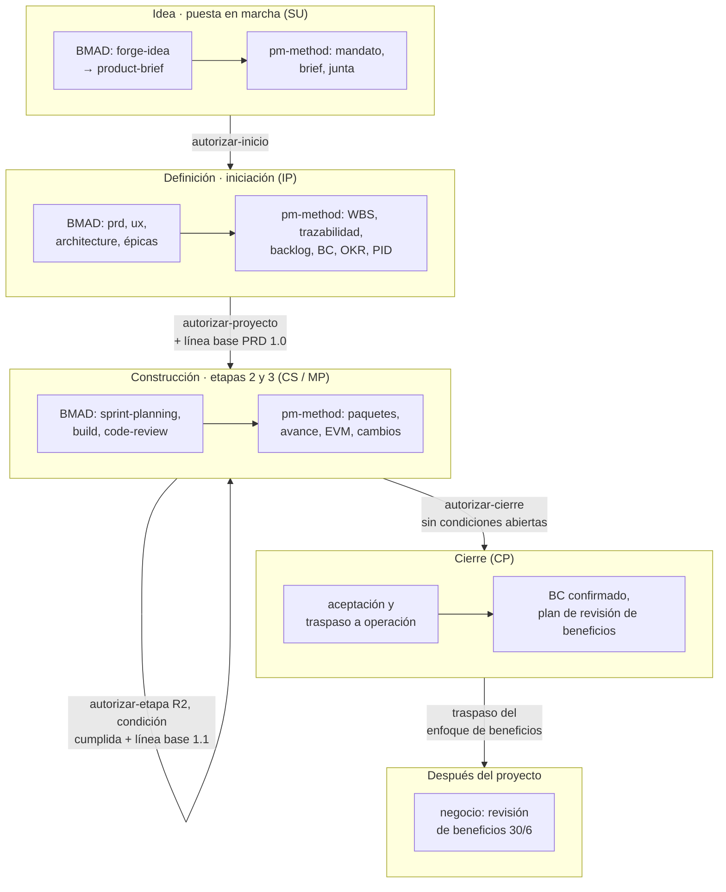
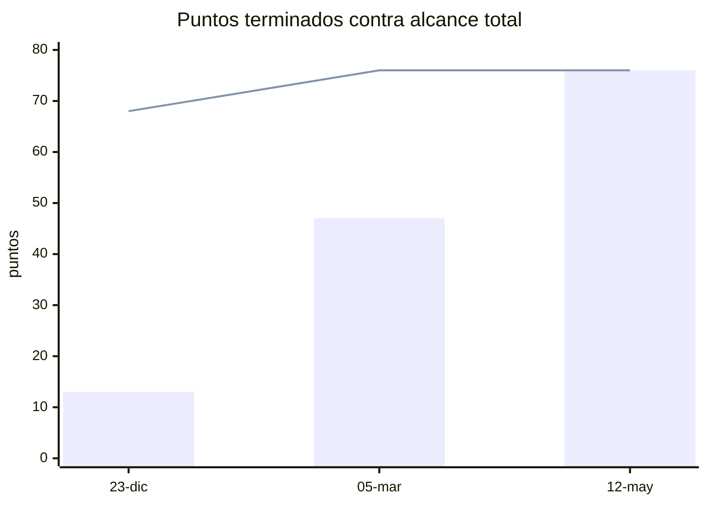
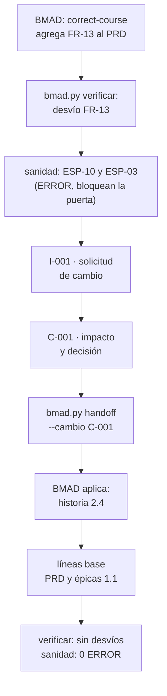
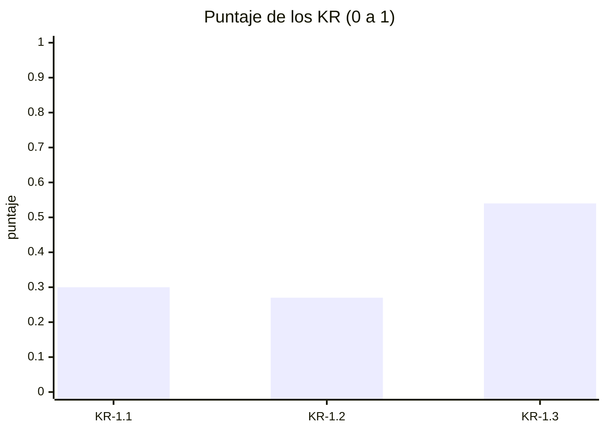

# Guía E2E-4 · Gestión del producto de la idea al producto con BMAD dentro de un proyecto PRINCE2

**Qué vas a probar:** el ciclo completo de un producto digital en el que **el equipo de producto especifica con BMAD**
(idea, brief, PRD, UX, arquitectura, épicas e historias, preparación, construcción, revisión, corrección de rumbo,
retrospectiva) y **pm-method gobierna con PRINCE2 7** (puertas con condiciones formales, líneas base, trazabilidad,
backlog con columnas de gobierno, enfoques de calidad, beneficios y sostenibilidad, paquetes de trabajo con checkpoint,
valor ganado vigilado, control de cambios con presupuesto, calidad a volumen, aceptación, traspaso a operación,
beneficios y cierre), **sin copiar la especificación**: pm-method la lee por la fachada y devuelve decisiones por
traspaso. La guía termina con un paso posterior al proyecto: la primera revisión de beneficios, que hace el negocio.

**Skills y agentes de pm-method:** pm-orquestador · pm-inicio · pm-planificacion · pm-control · pm-cierre ·
`pm-director` · `pm-bmad-puente` · `pm-mandato-y-brief` · `pm-caso-de-negocio` · `pm-okr` ·
`pm-planificacion-por-productos` · `pm-enfoques-gestion` · `pm-acta-constitucion` · `pm-agil-hibrido` · `pm-paquetes-trabajo` · `pm-progreso-reportes` ·
`pm-issues-cambios` · `pm-calidad` · `pm-lecciones-aprendidas` · `pm-cierre-proyecto` · `pm-visuales` · `pm-exportar`.
**Skills de BMAD 6.12.4** (nombres verificados en una instalación real): `bmad-forge-idea`, `bmad-brainstorming`,
`bmad-product-brief`, `bmad-prfaq`, `bmad-prd`, `bmad-ux`, `bmad-architecture`, `bmad-create-epics-and-stories`,
`bmad-sprint-planning`, `bmad-build`, `bmad-code-review`, `bmad-correct-course`, `bmad-retrospective`, `bmad-help`.

**Duración:** 15 pasos (14 dentro del proyecto y 1 posterior); 3–4 horas con el fixture; un día o más si producís los
artefactos de BMAD desde cero.
Evidencia de referencia: [salida-g4.md](evidencia/salida-g4.md).



## Controles permanentes que muestra esta guía

| Problema habitual (en la práctica se revisa a mano, tarde o nunca) | Control automático | Código | Paso |
|---|---|---|---|
| Los beneficios quedan como OKR y nadie define quién los mide después del cierre | verificación de `autorizar-proyecto` | P-04 (aviso) | 7 |
| Una puerta se aprueba "con condiciones" que quedan en el acta y nadie vuelve a mirar | condición formal en la puerta; aviso en cada sanidad; condición en la puerta siguiente y **bloqueo del cierre** | EST-12 · G-01 | 8 a 14 |
| La revisión prometida para cumplir la condición (prueba de carga NFR-3) vence sin que nadie lo note | revisión de calidad planificada con fecha | QUA-02 | 8, 12, 13 |
| Con decenas de historias `done`, nadie verifica que cada una tenga su revisión de calidad: se descubre en la aceptación o en producción | sanidad sobre `backlog.csv` contra `calidad.csv` | QUA-01 | 9, 12, 14 |
| Un rechazo de calidad queda sin tratamiento | rechazo sin issue, acción o cambio que cite el Q-### | QUA-03 (no se dispara: no hubo rechazos) | 12 |
| El cambio se paga "con la contingencia" y nadie sabe cuánto queda | costo y cargo en `cambios.csv` contra el presupuesto de cambio de la junta | CAM-01 · CAM-03 (CAM-04 si supera el límite de la autoridad) | 7, 11 |
| El valor ganado se calcula para el informe y se olvida | corte de EVM guardado y vigilado | TOL-03 (TOL-01/02 si pronostica salir de tolerancia) | 8, 10, 12, 13, 14 |
| Un cambio en el PRD entra sin control | línea base de BMAD contra el PRD vigente | ESP-10 · ESP-03 | 11 |

---

## Paso 0 · Preparación: dos caminos

**Camino rápido (recomendado para probar el gobierno):** copiá el fixture con BMAD 6.12.4 ya instalado y sus
artefactos en `status: final` (ver el [README de las guías](README.md#cómo-usar-las-guías)) en
`~/proyectos-prueba/portal-e2e-4`. Los prompts de BMAD de los pasos 2, 4 y 5 ya están "hechos": leelos para entender el
flujo y seguí con los de pm-method.

**Camino completo (producto desde cero):** en una carpeta vacía de producto, instalá BMAD y abrí Claude Code:
```bash
mkdir -p ~/proyectos-prueba/mi-producto && cd ~/proyectos-prueba/mi-producto && git init
npx bmad-method@6.12.4 install --modules bmm --tools claude-code --yes --user-name "<tu nombre>" \
    --set core.project_name=mi-producto --no-shims
claude
```
Cada skill de BMAD se invoca por su nombre (`/bmad-prd`, o "Run bmad-prd"); `/bmad-help` recomienda el paso siguiente.
El tiempo y el consumo de las sesiones de BMAD dependen del producto **[verificar en tu caso]**.

---

## Paso 1 · Proyecto y detección de BMAD

**Prompt (pm-method)**
```text
Creá el proyecto de gestión "Portal de autoservicio para socios" en ./gestion, en español y con enfoque híbrido. La
ejecutiva es Laura Méndez y el gestor Martín Suárez. La especificación del producto la lleva el equipo con BMAD en este
mismo repositorio: detectalo y usalo como fuente única.
```
Atajo: `/pm-method:pm-nuevo "Portal de autoservicio para socios" ./gestion es hibrido`.

**Qué hace el sistema:** `nuevo_proyecto.py` · `bmad.py detectar` · `estado.py integracion especificacion=bmad`.

**Qué deberías ver:** `"layout": "v6"`, `"version": "6.12.4"`, `"soporte": "soportada"`.

**Dónde verificar:** `gestion/estado.json` → `integraciones.bmad` · prompt: `/pm-method:pm-estado`.

---

## Paso 2 · De la idea al brief: BMAD y pm-method en paralelo

**Prompt (equipo de producto, BMAD)**
```text
/bmad-forge-idea
Quiero un portal para que los socios de la cooperativa consulten saldos, bajen constancias y pidan préstamos simples
sin ir a la sucursal. Ayudame a poner a prueba la idea.
```
y luego `/bmad-product-brief` para producir el brief (BMAD lo deja en `_bmad-output/planning-artifacts/briefs/…/brief.md`
con `status: final` cuando lo cerrás). Alternativa: `/bmad-prfaq` (método "working backwards").

**Prompt (pm-method)**
```text
Convertí el pedido del Consejo en mandato y armá el project brief. El brief de producto ya está en BMAD: referencialo,
no lo copies. Registrá la decisión de enfoque: etapas PRINCE2 con sprints de 14 días como paquetes de trabajo y
especificación con BMAD.
```
**Si te pregunta:** formalidad → "mínima, decide Martín Suárez (gestor)"; enfoque → "híbrido, decide Laura Méndez
(ejecutiva)".

**Qué hace el sistema:** `pm-mandato-y-brief` lee el brief **solo por la fachada** (`bmad.py inventario`,
`especificacion.py fuente`) y lo cita por ruta y sha corto; `registro.py agregar decisiones` (D-001, nivel `junta`).

**Qué deberías ver:** inventario: "brief 1 archivo · estado=final · sha 58db1efac463", PRD, arquitectura y épicas en
`final`, `sprint-status.yaml` y una historia `ready-for-dev`.

**Dónde verificar:** `00-direccion/mandato.md` · `01-inicio/project-brief.md` (cita del brief de BMAD) · `decisiones.csv`.

---

## Paso 3 · Junta, caso de negocio esquemático y puerta autorizar-inicio

**Prompt (pm-method)**
```text
Junta: usuaria sénior, PO y autoridad de cambio Sofía Ramírez; proveedor sénior Diego Ferreira; aseguramiento Andrea
Costa; jefa de equipo Lucía Benítez. Sprints de 14 días, velocidad de referencia 8 puntos. Armá el caso de negocio
esquemático y el plan de la etapa de iniciación, y preparame la puerta de inicio.
```
**Si te pregunta:** "Confirmo la lista de control; decisión aprobado. Laura Méndez, ejecutiva, 30/10, fin de la
iniciación 27/11".

**Qué hace el sistema:** `pm-organizacion-roles`, `pm-caso-de-negocio`, `pm-plan-etapa-y-limites`; `pm-director`:
`puertas.py verificar autorizar-inicio` → `lista` → `confirmar --por` → `estado.py puerta autorizar-inicio --decision
aprobado --fin 2026-11-27`.

**Qué deberías ver:** primero "1 bloqueo: falta la lista de control de la junta" (capa 3: la confirma una persona);
después de confirmarla, fase `inicio`, proceso IP, etapa 1.

**Dónde verificar:** `00-direccion/decisiones/<fecha>-verificacion-autorizar-inicio.md` (5 ítems) · `estado.json` →
`puertas`.

---

## Paso 4 · Definición del producto: PRD, UX y arquitectura (BMAD) → requisitos en la fachada

**Prompt (equipo de producto, BMAD):** `/bmad-prd` (crea el PRD con FR, NFR, UJ y SM; su modo "Validate" produce un
informe con nota), `/bmad-ux` (DESIGN.md y EXPERIENCE.md), `/bmad-architecture` (decisiones AD-n). Cerrá cada uno en
`status: final`: las puertas de pm-method lo exigen.

**Prompt (pm-method)**
```text
Traé los requisitos de BMAD y resumime la especificación. Mostrame el detalle de FR-6.
```

**Qué hace el sistema:** `bmad.py requisitos` → `requisitos-bmad.csv` (derivado: no se edita); `especificacion.py
resumen` y `consultar FR-6`.

**Qué deberías ver:** "42 identificadores · UJ 3 · FR 12 · NFR 6 · SM 8 · AD 13"; 10 historias.

**Dónde verificar:** `02-planificacion/especificacion/requisitos-bmad.csv` · prompt: "¿Qué dice FR-6?".

---

## Paso 5 · Épicas e historias (BMAD) → WBS por productos y trazabilidad

**Prompt (equipo de producto, BMAD):** `/bmad-create-epics-and-stories` (exige PRD y arquitectura completos; produce
`epics.md` con épicas e historias y criterios de aceptación).

**Prompt (pm-method)**
```text
Armá la WBS por productos con referencias a los FR y a las historias de BMAD (usá los paquetes 1.1 gestión, 2.1
especificación, 3.1 acceso, 3.2 consulta y constancias, 3.3 solicitudes, 4.1 consola, 5.1 transición, 5.2 puesta en
producción; USD 50 la hora) y verificá la trazabilidad requisito → historia → paquete.
```

**Qué hace el sistema:** `pm-planificacion-por-productos` (`wbs.csv`, `wbs.py --mermaid`); `bmad.py trazabilidad --wbs
02-planificacion/wbs.csv`; `especificacion.py listar requisitos --cobertura sin-cobertura`.

**Qué deberías ver:** "13 elementos, 8 hojas · esfuerzo 2480 h · costo 124,000"; "18 requisitos trazados · Requisitos
funcionales sin historia: ninguno · Historias sin requisito: ninguna"; aviso honesto: "Trazados solo a nivel de épica
(epics.md no cita el id en la historia): FR-1 … FR-12" (BMAD agrupa los FR por épica).

**Dónde verificar:** `02-planificacion/especificacion/matriz-trazabilidad-bmad.csv` · `02-planificacion/visuales/wbs.md`.

---

## Paso 6 · Backlog con columnas de gobierno y release plan

**Prompt (pm-method)**
```text
Sincronizá el backlog con BMAD. Sofía prioriza: Must las historias 1.1, 1.2, 1.3, 2.1, 3.1, 3.2 y 3.3; Should 1.4 y 2.2;
Could 2.3. Puntos: 8 para 1.1, 1.3, 2.1, 2.2, 3.2 y 3.3; 5 para el resto. R1 = acceso, consulta y consola (sprints 1 a
4); R2 = solicitudes (sprints 5 y 6).
```

**Qué hace el sistema:** `bmad.py backlog` (columnas derivadas) + `pm-agil-hibrido` (columnas de gobierno: `prioridad`,
`moscow`, `estimacion`, `iteracion`, `release`, `producto_pbs`) + `bmad.py backlog` otra vez ("0 nuevas, 10
actualizadas": el puente no toca las de gobierno).

**Qué deberías ver:** 68 puntos: R1 47 (Must 42 + Should 5) y R2 21.

**Dónde verificar:** `02-planificacion/backlog.csv` · `02-planificacion/release-plan.md`.

---

## Paso 7 · Caso de negocio, enfoques, PID adaptado, OKR y puerta autorizar-proyecto con línea base del PRD

**Problema que resuelve:** en la práctica los "criterios de éxito" quedan como OKR o como una frase del caso de negocio;
nadie escribe **cómo, cuándo y quién mide cada beneficio después del cierre**, ni cómo se verifica la calidad de cada
historia, ni qué metas de sostenibilidad tiene el proyecto. La puerta lo detecta (P-04) antes de autorizar.

**Prompt (pm-method)**
```text
Armá el business case con los beneficios B-01 desvío de consultas (SM-2), B-02 adopción (SM-1) y B-03 préstamos en menos
de 48 h (SM-3), los OKR ligados (KR-1.1 30 % de socios registrados, KR-1.2 consultas de 5.000 a 3.500, KR-1.3 de 96 a 48
horas), el plan de proyecto y el PID con la adaptación del método en la §8 (etapas PRINCE2 con sprints de 14 días como
paquetes, BMAD como fuente única, roles combinados de Sofía, checkpoint por sprint, una revisión de calidad por
historia). Tolerancias: tiempo ±3 semanas, costo ±8 %, alcance Must sin tolerancia, calidad "NFR sin tolerancia; cada
historia terminada con revisión aprobada", beneficios -10 %, riesgo "ningún riesgo alto sin respuesta", sostenibilidad
-10 % sobre las metas. Verificá la puerta de proyecto y decime qué falta.
```
La verificación avisa "sin enfoque de beneficios". Segundo prompt:
```text
Armá el enfoque de beneficios (Sofía mide el 30/6 y el 31/12/2027; después del cierre lo gestiona el negocio), el enfoque
de calidad (criterios de aceptación de BMAD, produce Lucía, revisa Andrea, aprueba Sofía; NFR-3 con prueba de carga) y el
enfoque de sostenibilidad mínimo (constancias sin papel, traslados evitados, nube con energía renovable). La junta fija
un presupuesto de cambio de USD 15.000 y un límite de USD 8.000 por cambio para la autoridad de cambio. Corré la sanidad
y preparame la puerta de proyecto con la línea base del PRD y de las épicas.
```
**Si te pregunta:** "Laura Méndez, ejecutiva: confirmo la lista; aprobado; congelá el business case, el PID y los tres
enfoques v1.0 y fijá las líneas base".

**Qué hace el sistema:** `pm-caso-de-negocio` (business case; `templates/enfoque-beneficios.md` → clave
`enfoque-beneficios`; `templates/enfoque-sostenibilidad.md` → clave `enfoque-sostenibilidad`), `pm-enfoques-gestion`
(`templates/enfoque-calidad.md` → clave `enfoque-calidad`), `pm-acta-constitucion` (PID con §8 "Adaptación del método"),
`pm-okr` (`okr.py --corte`); `pm-director`: `estado.py tolerancia --nivel proyecto …` (las 7 dimensiones),
`puertas.py verificar autorizar-proyecto` (P-04), `estado.py presupuesto cambio=15000 limite_autoridad_cambio=8000 --por
"Ejecutivo: Laura Méndez"`, `sanidad.py --rapido --corte 2026-11-27`, puerta `autorizar-proyecto` (P-07: PRD de BMAD
`final`), `estado.py aprobar business-case|pid|enfoque-beneficios|enfoque-calidad|enfoque-sostenibilidad --version 1.0`
(copias congeladas), `bmad.py linea-base prd|epicas --version 1.0`, `estado.py resumen`.

**Qué deberías ver:** primera verificación "1 bloqueo(s) · 0 condición(es) · 3 aviso(s)" con **"aviso sin enfoque de
beneficios (cómo, cuándo y quién mide cada beneficio, incluso después del proyecto)"**; después de registrar los
enfoques, sanidad "0 ERROR · 0 AVISO · 0 INFO" y la verificación ya sin ese aviso (quedan los de interesados y RACI,
fuera del alcance de esta guía); "Línea base bmad-prd v1.0 · sha bc048f7f59a3"; "bmad-epicas v1.0 · sha 3ff846d6f8d9";
OKR en 0,00 (línea base); el resumen con "Presupuestos: cambio=15000, limite_autoridad_cambio=8000", la tolerancia de
sostenibilidad (ya no `[por confirmar]`) y "Artefactos: 12 (7 aprobados)".

**Dónde verificar:** `00-direccion/historial/` (business case, PID, enfoques, PRD y épicas congelados) ·
`00-direccion/pid.md` §8 · `00-direccion/enfoque-*.md` · `estado.json` → `presupuestos` y `tolerancias.proyecto` ·
`decisiones.csv` (presupuestos de la junta).

---

## Paso 8 · Gate de preparación de BMAD y puerta autorizar-etapa (Release 1) con condición formal

**Problema que resuelve:** "aprobado con condiciones" suele quedar en el acta y nadie vuelve a mirarlo hasta que el
problema aparece en producción. Aquí el CONCERNS de BMAD se convierte en **condición formal de la puerta**, con
seguimiento automático hasta que alguien con rol verifica que se cumplió.

**Prompt (equipo de producto, BMAD)**
```text
/bmad-sprint-planning
Check implementation readiness only.
```
BMAD responde PASS, CONCERNS o FAIL en la conversación (en las pruebas reales no escribió archivo salvo FAIL
interactivo). Supongamos **CONCERNS: NFR-3 sin prueba de carga planificada**.

**Prompt (pm-method)**
```text
El gate de preparación de BMAD dio CONCERNS el 26/11 (lo informa Diego Ferreira, arquitecto): NFR-3 sin prueba de carga
planificada. Registralo, armá el plan de la etapa 2 con tolerancias de ±10 % en tiempo y costo y preparame la puerta.
Si se condiciona, planificá la prueba de carga como revisión de calidad para el 19/2 y mostrame cómo queda el
seguimiento.
```
**Si te pregunta:** "Laura Méndez, ejecutiva: condicionado; la prueba de carga entra en el plan de la etapa".

**Qué hace el sistema:** `pm-director`: `puertas.py preparacion-bmad --resultado CONCERNS --por "Arquitecto: Diego
Ferreira" --nota …`; `estado.py tolerancia --nivel etapa …`; `puertas.py verificar autorizar-etapa` (E-07 línea base,
E-08 PRD final, E-09 arquitectura final, **E-10 gate de preparación**) → `estado.py puerta autorizar-etapa --decision
condicionado --etapa-nombre "Release 1" --fin 2027-03-05`: el hallazgo E-10 **pasa solo a condición formal**;
`pm-calidad`: **Q-001** planificada (prueba de carga NFR-3, `fecha_prevista` 2027-02-19); `sanidad.py --rapido --corte
2026-11-27`.

**Qué deberías ver:** "Condiciones agregadas desde la verificación: gate de preparación de BMAD en CONCERNS
(2026-11-26: NFR-3 sin prueba de carga planificada)"; fase `entrega`, etapa 2, y "Condiciones abiertas: autorizar-etapa:
…"; sanidad "0 ERROR · 1 AVISO · 1 INFO": **EST-12** (condición abierta) y TOL-03 (todavía no hay corte de EVM
guardado). A partir de aquí la condición reaparece en cada sanidad (EST-12) y en la verificación de la puerta siguiente
como **G-01** (condición en `autorizar-etapa`, **bloqueo en `autorizar-cierre`**) hasta `cumplir-condiciones` (paso 13).

**Dónde verificar:** `estado.json` → `puertas` (campo `condiciones`) e `integraciones.bmad.preparacion` · `calidad.csv`
(Q-001) · prompt: "¿Con qué condiciones se autorizó la etapa?".

---

## Paso 9 · Sprint 1 como paquete de trabajo; construcción con BMAD; checkpoint y aceptación del paquete

**Problema que resuelve:** el paquete se da por terminado porque el tablero dice `done`, sin mirar si cada producto
pasó su revisión. El checkpoint solo cuenta como completados los productos con revisión aprobada, y el gestor verifica
con la sanidad (QUA-01) antes de aceptar el paquete.

**Prompt (pm-method)**
```text
Autorizá el sprint 1 como paquete de trabajo WP-001 con las historias 1.1 y 1.2 y su definición de terminado
(incluye la revisión de calidad registrada).
```
**Si te pregunta:** "Martín Suárez, gestor: apruebo WP-001".

**Prompt (equipo de producto, BMAD):** `/bmad-build` sobre cada historia (pasa de `ready-for-dev` a `review`) y
`/bmad-code-review` (revisores independientes) hasta `done`.

**Prompt (pm-method, al cierre del sprint)**
```text
Traé el avance de BMAD al 23/12 y sincronizá el backlog. Lucía (jefa de equipo) informa que la 1.1 y la 1.2 pasaron sus
pruebas el 21 y el 22/12 (revisó Andrea, aprobó Sofía): registrá las revisiones y armá su informe de punto de control.
Si la sanidad no marca historias terminadas sin revisión, aceptá el paquete.
```
**Si te pregunta:** "Martín Suárez, gestor: acepto WP-001".

**Qué hace el sistema:** `pm-paquetes-trabajo` (WP-001; `estado.py aprobar WP-001 --nivel gestor` → copia congelada);
`bmad.py avance --corte 2026-12-23` (una fila por corte en `avance-bmad.csv`) y `bmad.py backlog` (sincroniza la
columna `estado` que lee QUA-01); `pm-calidad`: **Q-002** (historia 1-1) y **Q-003** (historia 1-2), `completada`,
`aprobado`; `pm-progreso-reportes` (`templates/checkpoint-report.md` → `03-control/reportes/2026-12-23-checkpoint-WP-001.md`;
la skill no lo registra en `estado.json`); `sanidad.py --rapido --corte 2026-12-23`; aceptación como decisión del
gestor (**D-015**).

**Qué deberías ver:** "Historias 10 · done 2 · review 1 · 19.1 % (puntos)"; el checkpoint con "Productos completados
(con calidad aprobada): historia 1-1 (Q-002), historia 1-2 (Q-003)" y "Prevista: Q-001 prueba de carga NFR-3 (19/2)";
sanidad "0 ERROR · 1 AVISO · 2 INFO": **ningún QUA-01** (las dos historias terminadas tienen revisión) y **EST-12**
recordando la condición; "D-015".

**Dónde verificar:** `03-control/paquetes-trabajo/WP-001-sprint-1.md` · `03-control/reportes/2026-12-23-checkpoint-WP-001.md`
· `calidad.csv` · `decisiones.csv` (D-015).

---

## Paso 10 · Valor ganado ágil (corte guardado) y highlight con las puertas

**Prompt (pm-method)**
```text
Highlight del sprint 2 al 8/1: PV 41.000, EV 38.000, AC 40.500, BAC 124.000; leelo en modo ágil con 20 % de alcance
Should/Could y guardá el corte. Incluí las puertas y sus condiciones.
```

**Qué hace el sistema:** `evm.py --pv 41000 --ev 38000 --ac 40500 --bac 124000 --modo agil --pct-no-must 20 --proyecto
gestion --guardar --corte 2027-01-08` (el corte guardado lo vigila la sanidad: TOL-01/02/03); `puertas.py estado
--markdown` (§6 del highlight).

**Qué deberías ver:** "Guardado: 03-control/reportes/evm-2027-01-08.json"; SPI 0,927 · CPI 0,938 · EAC 132.158 ·
`alcance_no_entregable_pct 6.173` · `semaforo_alcance verde` (cabe dentro del 20 % de Should/Could); en la tabla de
puertas, `autorizar-etapa` con la condición "(abiertas)" y, para la próxima puerta, 2 bloqueos (plan de la etapa 3 e
informe de fin de etapa, normales a mitad de etapa) y 3 condiciones: **G-01** (condiciones abiertas de puertas
anteriores), E-05 (Q-001 sin cerrar) y E-10.

---

## Paso 11 · Cambio de rumbo: Sprint Change Proposal → control de cambios con presupuesto → traspaso → línea base 1.1

**Problema que resuelve:** el cambio se aprueba "contra la contingencia" sin monto ni presupuesto, y nadie sabe cuánto
queda ni si la autoridad de cambio se excedió. Aquí el cambio lleva `costo` y `cargo` contra el presupuesto de cambio
que fijó la junta en el paso 7, y la sanidad informa el consumo (CAM-03).

En BMAD se corre `/bmad-correct-course` y el PM de producto agrega **FR-13 "Pago de cuotas con débito en cuenta"** al
PRD (para simularlo en tu copia: pedíselo a `/bmad-prd` en modo edición).

**Prompt (pm-method)**
```text
Verificá la especificación contra la línea base y corré la sanidad al 12/1. Si hay cambios no controlados, registrá el
issue y la solicitud de cambio con su impacto (historia nueva de 8 puntos, un sprint más en la etapa 3, costo USD 6.000
contra el presupuesto de cambio, refuerza B-01) y pedile la decisión a Sofía. Si se aprueba, emití el traspaso para el
equipo BMAD.
```
**Si te pregunta:** "Sofía Ramírez, autoridad de cambio: aprobado para la etapa 3" (USD 6.000 está dentro de su límite
de USD 8.000; por encima, CAM-04 avisaría que debe decidir la junta).

**Prompt (equipo de producto, BMAD):** aplicar el documento de traspaso con `/bmad-prd` (edición) y
`/bmad-create-epics-and-stories` (historia 2.4), y marcar el traspaso `estado: aplicado`.

**Prompt (pm-method)**
```text
El equipo BMAD aplicó el traspaso de C-001. Resincronizá requisitos, trazabilidad y backlog (la 2.4 es Should, 8 puntos,
R2), fijá las líneas base 1.1 y verificá al 20/1 que no quede nada sin control.
```

**Qué hace el sistema:** `bmad.py verificar` → desvío "agregados ['FR-13']"; `sanidad.py --rapido --corte 2027-01-12`:
**ESP-10** (cambio no controlado) y **ESP-03** (FR-13 sin cobertura) como ERROR → `pm-issues-cambios`: **I-001** y
**C-001** con `costo=6000` y `cargo=presupuesto-cambio` → decisión → `bmad.py handoff --cambio C-001` → (BMAD aplica) →
`bmad.py requisitos` (43 ids), `trazabilidad` (19), `backlog` ("1 nuevas") → `pm-director`: `bmad.py linea-base
prd|epicas --version 1.1` → C-001 `implementado`, I-001 `cerrado` → `bmad.py verificar` "Sin desvíos" →
`sanidad.py --rapido --corte 2027-01-20`.

**Qué deberías ver:** la primera sanidad "2 ERROR · 2 AVISO · 1 INFO" (ESP-03, ESP-10, ESP-14 y EST-12): el ERROR
**bloquearía la próxima puerta** hasta tramitar el cambio; líneas base "bmad-prd v1.1 · sha 203d33cb9e51" y
"bmad-epicas v1.1 · sha 360c24ddcd9c"; la sanidad final "0 ERROR · 1 AVISO · 2 INFO" con **CAM-03 "Presupuesto de
cambio: 6.000 de 15.000 (40 %)"** (sin CAM-01: el cambio tiene costo y cargo) y EST-12 (la condición sigue abierta).

**Dónde verificar:** `issues.csv` · `cambios.csv` (columnas `costo` y `cargo`) ·
`02-planificacion/especificacion/handoff-bmad-<fecha>-C-001.md` · `00-direccion/historial/bmad-prd-v1.1`.

---

## Paso 12 · Calidad a volumen al acercarse el fin del Release 1, retrospectiva y lecciones

**Problema que resuelve:** con decenas de historias terminadas nadie verifica, una por una, que cada una tenga su
revisión de calidad registrada; se descubre en la aceptación o en producción. Tampoco nadie recuerda que la prueba
prometida para cumplir la condición ya venció. La sanidad lo detecta de forma continua (QUA-01, QUA-02) y la corrección
se hace en lote.

**Prompt (equipo de producto, BMAD):** `/bmad-retrospective` al cerrar las épicas 1 y 3 (hallazgos con evidencia y
decisión de aceptación).

**Prompt (pm-method)**
```text
Al 26/2 el equipo terminó las historias 1.3, 1.4, 3.1, 3.2 y 3.3. Sincronizá el backlog y corré la sanidad: ¿qué
historias terminadas no tienen revisión de calidad y qué revisiones vencieron?
```
**Prompt (pm-method, después de ver los avisos)**
```text
Registrá en lote las revisiones del Release 1, una por historia ("Release 1 · historia N-M"): prueba contra los
criterios de aceptación, produce Lucía, revisa Andrea, aprueba Sofía el 25/2; todas aprobadas, la 3.3 con una observación
menor de usabilidad que va al backlog. Volvé a correr la sanidad. Registrá las lecciones de la etapa: la Sprint Change
Proposal que entró sin pasar por la autoridad de cambio y las historias que llegaron a done sin revisión.
```

**Qué hace el sistema:** `bmad.py backlog`; `sanidad.py --rapido --corte 2027-02-26`; `pm-calidad`: `registro.py
agregar calidad` una vez por historia (**Q-004 a Q-008**, citando "historia N-M", la clave corta que reconoce QUA-01);
`sanidad.py --rapido --corte 2027-02-26` otra vez; `pm-lecciones-aprendidas` (**L-001** y **L-002**).

**Qué deberías ver:** la primera sanidad "0 ERROR · 7 AVISO · 3 INFO": **QUA-01** cinco veces ("1-3-consulta-de-saldos…:
terminado sin revisión de calidad registrada", y lo mismo para 1-4, 3-1, 3-2 y 3-3), **QUA-02** "Revisión de calidad
vencida Q-001 (NFR-3 prueba de carga …, prevista 2027-02-19)", EST-12, y como INFO CAM-03 y **TOL-03** ("Último corte de
EVM guardado el 2027-01-08 (más de 31 días)"). Después del lote: "0 ERROR · 2 AVISO · 2 INFO": desaparecen los QUA-01 y
quedan **QUA-02** y **EST-12**, que se resuelven con la prueba de carga (paso 13).

**Dónde verificar:** `calidad.csv` (Q-004…Q-008) · `lecciones.csv` (L-001, L-002).

---

## Paso 13 · Fin de la etapa 2 (Release 1): prueba de carga, condición cumplida, business case 1.1 y puerta de la etapa 3

**Problema que resuelve:** la condición no se cierra sola aunque la prueba esté aprobada: la verificación de la puerta
siguiente la muestra como G-01 hasta que alguien con rol verifica el cumplimiento y lo registra. El business case se
revisa en el límite de etapa con los reales y el pronóstico, no solo al inicio.

**Prompt (pm-method)**
```text
La prueba de carga de NFR-3 se hizo el 2/3: p95 2,4 s con 400 sesiones concurrentes (meta menor a 3 s); aprobada. El gate
de preparación de BMAD dio PASS el 3/3. Terminamos el Release 1: traé el avance al 5/3, abrí el límite de etapa, calculá
el valor ganado (PV 82.000, EV 80.000, AC 83.500, BAC 130.000) y guardá el corte, actualizá el business case con reales y
pronóstico, armá el informe de fin de etapa, el plan de la etapa 3 y el tablero, y preparame la puerta.
```
**Si te pregunta:** "Laura Méndez, ejecutiva: verifiqué la condición de la etapa 2 (Q-001 aprobada y gate en PASS):
dala por cumplida" · "aprobado; etapa 3 Release 2 hasta el 14/5 con ±10 % en tiempo y costo; apruebo el business case
1.1".

**Qué hace el sistema:** `pm-calidad`: Q-001 `completada`, `aprobado`; `puertas.py preparacion-bmad --resultado PASS`;
`bmad.py avance --corte 2027-03-05`; `estado.py limite-etapa` (SB); `evm.py … --proyecto gestion --guardar --corte
2027-03-05`; `pm-plan-etapa-y-limites` (informe de fin de etapa y plan de la etapa 3); `pm-caso-de-negocio` en modo
**mantener** (business case 1.1, `en-revision`); `puertas.py verificar autorizar-etapa` (**G-01**) → `pm-director`:
`estado.py cumplir-condiciones autorizar-etapa --fecha 2027-03-05 --por "Ejecutivo: Laura Méndez" --nota "Q-001 prueba
de carga NFR-3 aprobada el 2027-03-02 (p95 2,4 s); gate de preparación de BMAD en PASS el 2027-03-03"` (queda en
`decisiones.csv`); `sanidad.py --rapido --corte 2027-03-05`; `pm-visuales` (tablero); puerta `autorizar-etapa`;
`estado.py aprobar business-case --version 1.1`.

**Qué deberías ver:** "Historias 11 · done 7 · épicas terminadas 2/3 · 61.8 % (puntos)"; `limite-etapa` todavía con
"Condiciones abiertas: autorizar-etapa: …"; "Guardado: 03-control/reportes/evm-2027-03-05.json", SPI 0,976 · CPI 0,958 ·
EAC 135.688 (verde contra ±10 %); la verificación **antes** de cumplir: "0 bloqueo(s) · 1 condición(es)" con **G-01
"condiciones abiertas de puertas anteriores: autorizar-etapa 2026-11-27"**; después, sanidad limpia "0 ERROR · 0 AVISO ·
1 INFO" (solo CAM-03 al 40 %) y la verificación "0 bloqueo(s) · 0 condición(es) · 0 aviso(s)"; copia congelada
`business-case-v1.1.md`; el tablero:


**Dónde verificar:** `03-control/reportes/2027-03-05-informe-fin-etapa-2.md` · `02-planificacion/plan-etapa-3.md` ·
`03-control/reportes/2027-03-05-tablero-avance.html` · `estado.json` → `puertas` (`condiciones_cumplidas`,
`condiciones_verificadas_por`, `condiciones_nota`) · `00-direccion/historial/business-case-v1.1.md`.

---

## Paso 14 · Release 2, aceptación, traspaso a operación, business case confirmado y cierre

**Problema que resuelve:** el proyecto cierra con condiciones olvidadas, sin traspaso formal a quien opera el producto
y con los beneficios "a medir" sin dueño. Aquí la puerta de cierre bloquearía con G-01 si quedara una condición abierta
(ya no queda), y la responsabilidad de los beneficios pasa explícitamente al negocio.

**Prompt (pm-method)**
```text
Release 2 terminado. Registrá en lote las revisiones del Release 2 (historias 2.1 a 2.4, aprobadas el 11/5), guardá el
valor ganado final (PV y EV 130.000, AC 133.000, al 12/5) y corré la sanidad. Verificá que todos los requisitos estén
terminados, pasá a cierre, registrá la aceptación de Sofía y Laura, armá el traspaso a operación (recibe Sofía, servicios
al socio), el informe de fin de proyecto, las lecciones, las recomendaciones de seguimiento, el plan de revisión de
beneficios (revisiones del negocio el 30/6 y el 31/12/2027), el business case confirmado, el enfoque de beneficios
traspasado al negocio y el borrador de la notificación de cierre. Preparame la puerta de cierre y el paquete para la
junta.
```
**Si te pregunta:** "Sofía Ramírez, usuaria sénior, y Laura Méndez, ejecutiva: aceptamos el producto" · "Sofía Ramírez:
recibo el producto en operación" · "Laura Méndez: cierre aprobado el 14/5; confirmo el business case, el traspaso del
enfoque de beneficios al negocio y la notificación de cierre".

**Qué hace el sistema:** `bmad.py avance --corte 2027-05-12` y `backlog`; `pm-calidad` (**Q-009 a Q-012**);
`evm.py … --tol-costo 8 --tol-plazo 10 --proyecto gestion --guardar --corte 2027-05-12`; `sanidad.py --rapido --corte
2027-05-12`; `especificacion.py listar requisitos --cobertura sin-cobertura` (vacío); `estado.py cierre`;
`pm-cierre-proyecto` (`estado.py aprobar registro-aceptacion`; `templates/handover.md` → clave `handover`, aprobado por
la receptora; `templates/plan-revision-beneficios.md`; `templates/notificacion-cierre.md` en `borrador`);
`pm-caso-de-negocio` en modo **confirmar** (business case 1.2) y enfoque de beneficios 1.1 ("gestionado por: negocio");
`pm-director`: `puertas.py verificar autorizar-cierre` (C-01…C-06 y G-01) → `estado.py puerta autorizar-cierre` →
`estado.py aprobar business-case --version 1.2`, `aprobar enfoque-beneficios --version 1.1`, decisión de traspaso de
los beneficios (**D-027**), `aprobar notificacion-cierre`; `pm-exportar`: `paquete.py cierre`, `exportar.py xlsx`;
`estado.py resumen`.

**Qué deberías ver:** "done 11 · épicas terminadas 3/3 · 100.0 % (puntos)"; "Guardado: 03-control/reportes/evm-2027-05-12.json",
CPI 0,977 (`sobrecosto_pct 2.308`, dentro de ±8 %); sanidad "0 ERROR · 0 AVISO · 2 INFO" (sin QUA-01: las 11 historias
tienen revisión; CAM-03 al 40 %); `estado.py cierre` **ya sin** "Condiciones abiertas"; el handover con "12 revisiones
aprobadas en calidad.csv"; la verificación de cierre "1 bloqueo(s) · 0 condición(es) · 0 aviso(s)" (solo falta la lista
de la junta: **sin G-01**); fase `cerrado`; copias congeladas `business-case-v1.2.md`, `enfoque-beneficios-v1.1.md`,
`handover-v1.0.md` y `notificacion-cierre-v1.0.md`; `exportados/<fecha>-paquete-cierre-v1-BORRADOR.zip` (borrador hasta
que apruebes sus artefactos; la corrida lista "business-case-original (sin-estado)") y el Excel de registros; el resumen
con "Artefactos: 24 (11 aprobados)" y "Proyecto cerrado. Pendiente fuera del proyecto: revisiones de beneficios según el
plan (responsable: usuario sénior / capa de negocio)".

**Dónde verificar:** `04-cierre/` (handover, plan de revisión de beneficios, notificación) · `00-direccion/historial/` ·
`decisiones.csv` (D-027 y la condición cumplida) · prompt: `/pm-method:pm-estado`.

---

## Paso 15 · Después del proyecto: primera revisión de beneficios (negocio, 30/6/2027)

El proyecto ya cerró el 14/5. Esta revisión **no la hace el proyecto**: la hace el negocio (Sofía Ramírez, usuaria
sénior) según el plan de revisión de beneficios que recibió en el paso 14.

**Prompt (negocio, con pm-method)**
```text
Soy Sofía Ramírez, de servicios al socio. Primera revisión de beneficios al 30/6 según el plan: KR-1.1 9 % de socios
registrados, KR-1.2 4.600 consultas, KR-1.3 70 horas. Puntuá los OKR y dejá la tabla para la revisión.
```

**Qué hace el sistema:** `pm-okr`: actualiza `okr.csv` con las mediciones y `okr.py --corte 2027-06-30 --markdown
gestion/03-control/reportes/2027-06-30-okr.md`.

**Qué deberías ver:** O-1 0,37 (rojo): KR-1.1 0,30, KR-1.2 0,27 (rojos) y KR-1.3 0,54 (ámbar). Es la primera de dos
mediciones (la meta es a dic-2027); el plan indica qué hacer si el desvío supera la tolerancia de beneficios: informar a
la ejecutiva.

**Dónde verificar:** `03-control/reportes/2027-06-30-okr.md` · `04-cierre/plan-revision-beneficios.md`.

---

## Reporte: informe de fin de proyecto (ejemplo)

> Cifras de la corrida de referencia; el texto lo redacta `pm-cierre-proyecto` y varía. Los beneficios no forman parte
> del informe de cierre como "realizados": se miden después (paso 15).

| Dimensión | Línea base | Real | Desvío | Tolerancia |
|---|---|---|---|---|
| Alcance | 12 FR · 10 historias · 68 pts | 13 FR · 11 historias · 76 pts (C-001) | +1 FR por control de cambios | Must sin tolerancia ✓ |
| Costo | BAC 124.000 (130.000 con C-001, USD 6.000 del presupuesto de cambio) | AC 133.000 | +2,3 % | ±8 % ✓ |
| Tiempo | fin 2027-05-14 | fin 2027-05-14 | 0 | ±3 semanas ✓ |
| Calidad | una revisión por historia y prueba de carga NFR-3 | 12 revisiones aprobadas (Q-001…Q-012); 100 % de requisitos `terminado` | Q-008 con observación menor | cada historia con revisión ✓ |
| Sostenibilidad | metas S-1 a S-3 del enfoque | se miden con la operación | — | -10 % sobre metas |
| Beneficios | KR-1.1 30 %, KR-1.2 3.500, KR-1.3 48 h (a dic-2027) | se miden después del cierre (paso 15) | — | revisión según plan, a cargo del negocio |

**Gobierno:** 5 puertas (inicio, proyecto, etapa 2 condicionada por CONCERNS con la condición cumplida el 5/3, etapa 3,
cierre), líneas base PRD y épicas 1.0 y 1.1, un cambio controlado (C-001, 40 % del presupuesto de cambio) detectado por
`bmad.py verificar` y traspasado al equipo BMAD, cero desvíos al cierre. **Lecciones:** L-001 (toda Sprint Change
Proposal entra primero como issue) y L-002 (la revisión registrada es parte de la definición de terminado).

## Representaciones gráficas

**Ciclo de vida integrado PRINCE2 + BMAD:** diagrama al comienzo de esta guía y, completo, en
[PUERTAS.md §1](../PUERTAS.md).

**Burn-up del producto (puntos terminados por corte):**


**Trazabilidad del cambio de rumbo:**


**OKR en la primera revisión de beneficios (30/6/2027, paso 15, posterior al cierre):**


## Lista de comprobación de capacidades

- [ ] BMAD detectado y usado como fuente única; nada escrito en `_bmad/` ni `_bmad-output/`.
- [ ] Puertas con verificación en tres capas; P-04, P-07, E-07…E-10, G-01 y C-01…C-06 en acción.
- [ ] Trazabilidad FR → historia → paquete de la WBS y backlog con columnas de gobierno separadas.
- [ ] PID con enfoques de beneficios, calidad y sostenibilidad registrados con sus claves (`enfoque-beneficios`,
      `enfoque-calidad`, `enfoque-sostenibilidad`), la §8 de adaptación del método y las 7 tolerancias de proyecto.
- [ ] Presupuesto de cambio y límite de la autoridad de cambio fijados por la junta (`estado.py presupuesto`).
- [ ] CONCERNS de BMAD convertido en condición formal; seguido por EST-12 y G-01; cerrado con `cumplir-condiciones`.
- [ ] Checkpoint del WP-001 con productos completados solo si tienen revisión aprobada, y aceptación del paquete.
- [ ] Calidad a volumen: QUA-01 lista los terminados sin revisión, QUA-02 la revisión vencida; registro en lote por
      release y sanidad limpia después.
- [ ] Avance desde `sprint-status.yaml`; EVM ágil y predictivo con cortes guardados (`--guardar --corte`).
- [ ] Cambio de rumbo detectado, controlado con `costo` y `cargo` (CAM-03), traspasado y cerrado con nueva línea base.
- [ ] Business case 1.1 en el límite de etapa y 1.2 confirmado en el cierre.
- [ ] Aceptación, traspaso a operación, plan de revisión de beneficios, notificación de cierre y enfoque de beneficios
      traspasado al negocio; paquete de cierre y Excel.
- [ ] Todas las sanidades con `--corte` (fecha del paso).
- [ ] Revisión de beneficios posterior al proyecto (30/6), hecha por el negocio.
