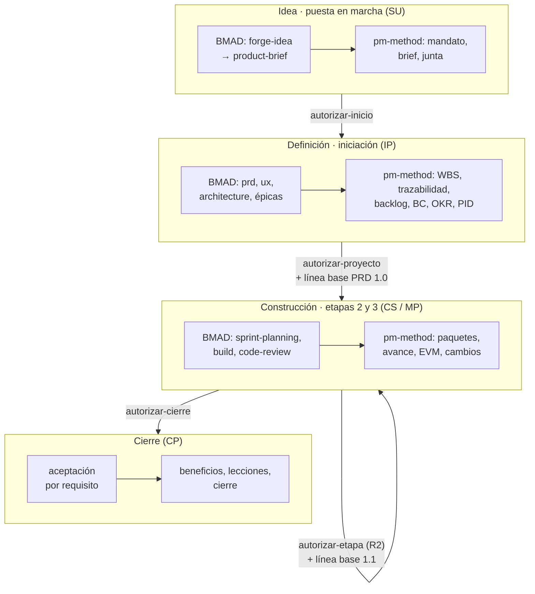
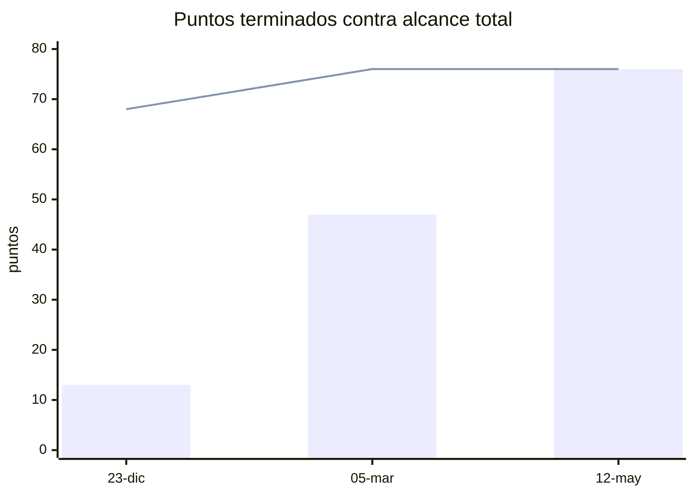
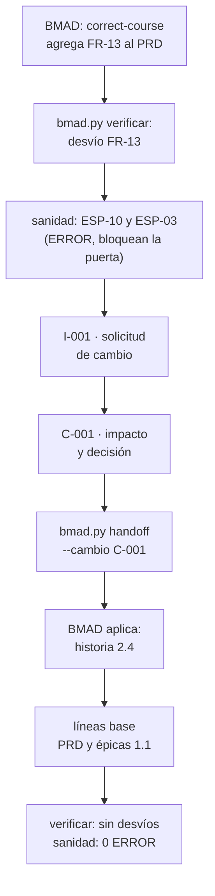
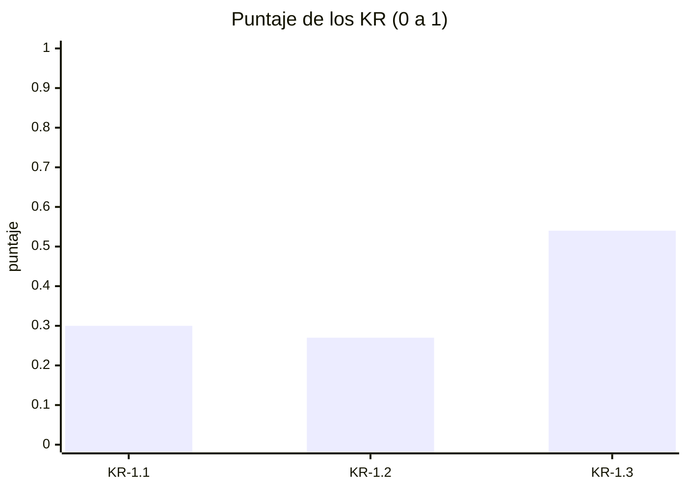

# Guía E2E-4 · Gestión del producto de la idea al producto con BMAD dentro de un proyecto PRINCE2

**Qué vas a probar:** el ciclo completo de un producto digital en el que **el equipo de producto especifica con BMAD**
(idea, brief, PRD, UX, arquitectura, épicas e historias, preparación, construcción, revisión, corrección de rumbo,
retrospectiva) y **pm-method gobierna con PRINCE2 7** (puertas, líneas base, trazabilidad, backlog con columnas de
gobierno, paquetes de trabajo, valor ganado, control de cambios, calidad, aceptación, beneficios y cierre), **sin
copiar la especificación**: pm-method la lee por la fachada y devuelve decisiones por traspaso.

**Skills y agentes de pm-method:** pm-orquestador · pm-inicio · pm-planificacion · pm-control · pm-cierre ·
`pm-director` · `pm-bmad-puente` · `pm-mandato-y-brief` · `pm-caso-de-negocio` · `pm-okr` ·
`pm-planificacion-por-productos` · `pm-agil-hibrido` · `pm-paquetes-trabajo` · `pm-progreso-reportes` ·
`pm-issues-cambios` · `pm-calidad` · `pm-lecciones-aprendidas` · `pm-cierre-proyecto` · `pm-visuales` · `pm-exportar`.
**Skills de BMAD 6.12.4** (nombres verificados en una instalación real): `bmad-forge-idea`, `bmad-brainstorming`,
`bmad-product-brief`, `bmad-prfaq`, `bmad-prd`, `bmad-ux`, `bmad-architecture`, `bmad-create-epics-and-stories`,
`bmad-sprint-planning`, `bmad-build`, `bmad-code-review`, `bmad-correct-course`, `bmad-retrospective`, `bmad-help`.

**Duración:** 2–3 horas con el fixture; un día o más si producís los artefactos de BMAD desde cero.
Evidencia de referencia: [salida-g4.md](evidencia/salida-g4.md).



---

## Paso 0 · Preparación: dos caminos

**Camino rápido (recomendado para probar el gobierno):** copiá el fixture con BMAD 6.12.4 ya instalado y sus
artefactos en `status: final` (ver el [README de las guías](README.md#cómo-usar-las-guías)) en
`~/proyectos-prueba/portal-e2e-4`. Los prompts de BMAD de los pasos 2, 4 y 5 ya están "hechos": leelos para entender el
flujo y seguí con los de pm-method.

**Camino completo (producto desde cero):** en una carpeta vacía de producto, instalá BMAD y abrí Claude Code:
```bash
mkdir -p ~/proyectos-prueba/mi-producto && cd ~/proyectos-prueba/mi-producto && git init
npx bmad-method@6.12.4 install --modules bmm --tools claude-code --yes --user-name "<tu nombre>" \
    --set core.project_name=mi-producto --no-shims
claude
```
Cada skill de BMAD se invoca por su nombre (`/bmad-prd`, o "Run bmad-prd"); `/bmad-help` recomienda el paso siguiente.
El tiempo y el consumo de las sesiones de BMAD dependen del producto **[verificar en tu caso]**.

---

## Paso 1 · Proyecto y detección de BMAD

**Prompt (pm-method)**
```text
Creá el proyecto de gestión "Portal de autoservicio para socios" en ./gestion, en español y con enfoque híbrido. La
ejecutiva es Laura Méndez y el gestor Martín Suárez. La especificación del producto la lleva el equipo con BMAD en este
mismo repositorio: detectalo y usalo como fuente única.
```
Atajo: `/pm-method:pm-nuevo "Portal de autoservicio para socios" ./gestion es hibrido`.

**Qué hace el sistema:** `nuevo_proyecto.py` · `bmad.py detectar` · `estado.py integracion especificacion=bmad`.

**Qué deberías ver:** `"layout": "v6"`, `"version": "6.12.4"`, `"soporte": "soportada"`.

**Dónde verificar:** `gestion/estado.json` → `integraciones.bmad` · prompt: `/pm-method:pm-estado`.

---

## Paso 2 · De la idea al brief: BMAD y pm-method en paralelo

**Prompt (equipo de producto, BMAD)**
```text
/bmad-forge-idea
Quiero un portal para que los socios de la cooperativa consulten saldos, bajen constancias y pidan préstamos simples
sin ir a la sucursal. Ayudame a poner a prueba la idea.
```
y luego `/bmad-product-brief` para producir el brief (BMAD lo deja en `_bmad-output/planning-artifacts/briefs/…/brief.md`
con `status: final` cuando lo cerrás). Alternativa: `/bmad-prfaq` (método "working backwards").

**Prompt (pm-method)**
```text
Convertí el pedido del Consejo en mandato y armá el project brief. El brief de producto ya está en BMAD: referencialo,
no lo copies. Registrá la decisión de enfoque: etapas PRINCE2 con sprints de 14 días como paquetes de trabajo y
especificación con BMAD.
```
**Si te pregunta:** formalidad → "mínima, decide Martín Suárez (gestor)"; enfoque → "híbrido, decide Laura Méndez
(ejecutiva)".

**Qué hace el sistema:** `pm-mandato-y-brief` lee el brief **solo por la fachada** (`bmad.py inventario`,
`especificacion.py fuente`) y lo cita por ruta y sha corto; `registro.py agregar decisiones` (D-001, nivel `junta`).

**Qué deberías ver:** inventario: "brief 1 archivo · estado=final · sha 58db1efac463", PRD, arquitectura y épicas en
`final`, `sprint-status.yaml` y una historia `ready-for-dev`.

**Dónde verificar:** `00-direccion/mandato.md` · `01-inicio/project-brief.md` (cita del brief de BMAD) · `decisiones.csv`.

---

## Paso 3 · Junta, caso de negocio esquemático y puerta autorizar-inicio

**Prompt (pm-method)**
```text
Junta: usuaria sénior, PO y autoridad de cambio Sofía Ramírez; proveedor sénior Diego Ferreira; aseguramiento Andrea
Costa; jefa de equipo Lucía Benítez. Sprints de 14 días, velocidad de referencia 8 puntos. Armá el caso de negocio
esquemático y el plan de la etapa de iniciación, y preparame la puerta de inicio.
```
**Si te pregunta:** "Confirmo la lista de control; decisión aprobado. Laura Méndez, ejecutiva, 30/10, fin de la
iniciación 27/11".

**Qué hace el sistema:** `pm-organizacion-roles`, `pm-caso-de-negocio`, `pm-plan-etapa-y-limites`; `pm-director`:
`puertas.py verificar autorizar-inicio` → `lista` → `confirmar --por` → `estado.py puerta autorizar-inicio --decision
aprobado --fin 2026-11-27`.

**Qué deberías ver:** primero "1 bloqueo: falta la lista de control de la junta" (capa 3: la confirma una persona);
después de confirmarla, fase `inicio`, proceso IP, etapa 1.

**Dónde verificar:** `00-direccion/decisiones/<fecha>-verificacion-autorizar-inicio.md` (5 ítems) · `estado.json` →
`puertas`.

---

## Paso 4 · Definición del producto: PRD, UX y arquitectura (BMAD) → requisitos en la fachada

**Prompt (equipo de producto, BMAD):** `/bmad-prd` (crea el PRD con FR, NFR, UJ y SM; su modo "Validate" produce un
informe con nota), `/bmad-ux` (DESIGN.md y EXPERIENCE.md), `/bmad-architecture` (decisiones AD-n). Cerrá cada uno en
`status: final`: las puertas de pm-method lo exigen.

**Prompt (pm-method)**
```text
Traé los requisitos de BMAD y resumime la especificación. Mostrame el detalle de FR-6.
```

**Qué hace el sistema:** `bmad.py requisitos` → `requisitos-bmad.csv` (derivado: no se edita); `especificacion.py
resumen` y `consultar FR-6`.

**Qué deberías ver:** "42 identificadores · UJ 3 · FR 12 · NFR 6 · SM 8 · AD 13"; 10 historias.

**Dónde verificar:** `02-planificacion/especificacion/requisitos-bmad.csv` · prompt: "¿Qué dice FR-6?".

---

## Paso 5 · Épicas e historias (BMAD) → WBS por productos y trazabilidad

**Prompt (equipo de producto, BMAD):** `/bmad-create-epics-and-stories` (exige PRD y arquitectura completos; produce
`epics.md` con épicas e historias y criterios de aceptación).

**Prompt (pm-method)**
```text
Armá la WBS por productos con referencias a los FR y a las historias de BMAD (usá los paquetes 1.1 gestión, 2.1
especificación, 3.1 acceso, 3.2 consulta y constancias, 3.3 solicitudes, 4.1 consola, 5.1 transición, 5.2 puesta en
producción; USD 50 la hora) y verificá la trazabilidad requisito → historia → paquete.
```

**Qué hace el sistema:** `pm-planificacion-por-productos` (`wbs.csv`, `wbs.py --mermaid`); `bmad.py trazabilidad --wbs
02-planificacion/wbs.csv`; `especificacion.py listar requisitos --cobertura sin-cobertura`.

**Qué deberías ver:** "13 elementos, 8 hojas · esfuerzo 2480 h · costo 124,000"; "18 requisitos trazados · Requisitos
funcionales sin historia: ninguno · Historias sin requisito: ninguna"; aviso honesto: "Trazados solo a nivel de épica
(epics.md no cita el id en la historia): FR-1 … FR-12" (BMAD agrupa los FR por épica).

**Dónde verificar:** `02-planificacion/especificacion/matriz-trazabilidad-bmad.csv` · `02-planificacion/visuales/wbs.md`.

---

## Paso 6 · Backlog con columnas de gobierno y release plan

**Prompt (pm-method)**
```text
Sincronizá el backlog con BMAD. Sofía prioriza: Must las historias 1.1, 1.2, 1.3, 2.1, 3.1, 3.2 y 3.3; Should 1.4 y 2.2;
Could 2.3. Puntos: 8 para 1.1, 1.3, 2.1, 2.2, 3.2 y 3.3; 5 para el resto. R1 = acceso, consulta y consola (sprints 1 a
6); R2 = solicitudes (sprints 7 a 9).
```

**Qué hace el sistema:** `bmad.py backlog` (columnas derivadas) + `pm-agil-hibrido` (columnas de gobierno: `prioridad`,
`moscow`, `estimacion`, `iteracion`, `release`, `producto_pbs`) + `bmad.py backlog` otra vez ("0 nuevas, 10
actualizadas": el puente no toca las de gobierno).

**Qué deberías ver:** 68 puntos: R1 47 (Must 42 + Should 5) y R2 21.

**Dónde verificar:** `02-planificacion/backlog.csv` · `02-planificacion/release-plan.md`.

---

## Paso 7 · Caso de negocio, OKR y puerta autorizar-proyecto con línea base del PRD

**Prompt (pm-method)**
```text
Armá el business case con los beneficios B-01 desvío de consultas (SM-2), B-02 adopción (SM-1) y B-03 préstamos en menos
de 48 h (SM-3), los OKR ligados (KR-1.1 30 % de socios registrados, KR-1.2 consultas de 5.000 a 3.500, KR-1.3 de 96 a 48
horas), el PID y el plan de proyecto. Tolerancias: tiempo ±3 semanas, costo ±8 %, alcance Must sin tolerancia,
beneficios -10 %. Corré la sanidad y preparame la puerta de proyecto con la línea base del PRD y de las épicas.
```
**Si te pregunta:** "Laura Méndez, ejecutiva: confirmo la lista; aprobado; congelá el business case y el PID v1.0 y fijá
las líneas base".

**Qué hace el sistema:** `pm-caso-de-negocio`, `pm-okr` (`okr.py --corte`), `pm-acta-constitucion`; `sanidad.py
--rapido`; `pm-director`: `puertas.py` (verifica P-07: PRD de BMAD `final`), `estado.py puerta autorizar-proyecto`,
`estado.py aprobar business-case|pid --version 1.0` (copias congeladas), `bmad.py linea-base prd|epicas --version 1.0`.

**Qué deberías ver:** sanidad "0 ERROR · 0 AVISO"; "Línea base bmad-prd v1.0 · sha bc048f7f59a3"; "bmad-epicas v1.0 · sha
3ff846d6f8d9"; OKR en 0,00 (línea base).

**Dónde verificar:** `00-direccion/historial/` (business case, PID, PRD y épicas congelados) · `00-direccion/okr.csv`.

---

## Paso 8 · Gate de preparación de BMAD y puerta autorizar-etapa (Release 1)

**Prompt (equipo de producto, BMAD)**
```text
/bmad-sprint-planning
Check implementation readiness only.
```
BMAD responde PASS, CONCERNS o FAIL en la conversación (en las pruebas reales no escribió archivo salvo FAIL
interactivo). Supongamos **CONCERNS: NFR-3 sin prueba de carga planificada**.

**Prompt (pm-method)**
```text
El gate de preparación de BMAD dio CONCERNS el 26/11 (lo informa Diego Ferreira, arquitecto): NFR-3 sin prueba de carga
planificada. Registralo, armá el plan de la etapa 2 con tolerancias de ±10 % en tiempo y costo y preparame la puerta.
```
**Si te pregunta:** "Laura Méndez, ejecutiva: condicionado; la prueba de carga entra en el plan de la etapa".

**Qué hace el sistema:** `pm-director`: `puertas.py preparacion-bmad --resultado CONCERNS --por "Arquitecto: Diego
Ferreira" --nota …`; `estado.py tolerancia --nivel etapa …`; `puertas.py verificar autorizar-etapa` (E-07 línea base,
E-08 PRD final, E-09 arquitectura final, **E-10 gate de preparación**) → `estado.py puerta autorizar-etapa --decision
condicionado --etapa-nombre "Release 1" --fin 2027-03-05`.

**Qué deberías ver:** "condición: gate de preparación de BMAD en CONCERNS (2026-11-26: NFR-3 sin prueba de carga
planificada)"; fase `entrega`, etapa 2.

**Dónde verificar:** `estado.json` → `integraciones.bmad.preparacion` y `puertas` · prompt: "¿Con qué condiciones se
autorizó la etapa?".

---

## Paso 9 · Sprint 1 como paquete de trabajo; construcción con BMAD; avance

**Prompt (pm-method)**
```text
Autorizá el sprint 1 como paquete de trabajo WP-001 con las historias 1.1 y 1.2 y su definición de terminado.
```
**Si te pregunta:** "Martín Suárez, gestor: apruebo WP-001".

**Prompt (equipo de producto, BMAD):** `/bmad-build` sobre cada historia (pasa de `ready-for-dev` a `review`) y
`/bmad-code-review` (revisores independientes) hasta `done`.

**Prompt (pm-method, al cierre del sprint)**
```text
Traé el avance de BMAD al 23/12.
```

**Qué hace el sistema:** `pm-paquetes-trabajo` (WP-001; `estado.py aprobar WP-001 --nivel gestor` → copia congelada);
`bmad.py avance --corte 2026-12-23` (lee `sprint-status.yaml`; una fila por corte en `avance-bmad.csv`).

**Qué deberías ver:** "Historias 10 · done 2 · review 1 · 19.1 % (puntos)".

**Dónde verificar:** `03-control/paquetes-trabajo/WP-001-sprint-1.md` · `03-control/reportes/avance-bmad.csv`.

---

## Paso 10 · Valor ganado ágil y highlight con las puertas

**Prompt (pm-method)**
```text
Highlight del sprint 2: PV 41.000, EV 38.000, AC 40.500, BAC 124.000; leelo en modo ágil con 20 % de alcance
Should/Could. Incluí las puertas y sus condiciones.
```

**Qué hace el sistema:** `evm.py --pv 41000 --ev 38000 --ac 40500 --bac 124000 --modo agil --pct-no-must 20`;
`puertas.py estado --markdown` (§6 del highlight).

**Qué deberías ver:** SPI 0,927 · CPI 0,938 · EAC 132.158 · `alcance_no_entregable_pct 6.173` · `semaforo_alcance
verde` (cabe dentro del 20 % de Should/Could).

---

## Paso 11 · Cambio de rumbo: Sprint Change Proposal → control de cambios → traspaso → línea base 1.1

En BMAD se corre `/bmad-correct-course` y el PM de producto agrega **FR-13 "Pago de cuotas con débito en cuenta"** al
PRD (para simularlo en tu copia: pedíselo a `/bmad-prd` en modo edición).

**Prompt (pm-method)**
```text
Verificá la especificación contra la línea base y corré la sanidad. Si hay cambios no controlados, registrá el issue y
la solicitud de cambio con su impacto (historia nueva de 8 puntos, un sprint más en la etapa 3, USD 6.000 contra la
contingencia, refuerza B-01) y pedile la decisión a Sofía. Si se aprueba, emití el traspaso para el equipo BMAD.
```
**Si te pregunta:** "Sofía Ramírez, autoridad de cambio: aprobado para la etapa 3".

**Prompt (equipo de producto, BMAD):** aplicar el documento de traspaso con `/bmad-prd` (edición) y
`/bmad-create-epics-and-stories` (historia 2.4), y marcar el traspaso `estado: aplicado`.

**Prompt (pm-method)**
```text
El equipo BMAD aplicó el traspaso de C-001. Resincronizá requisitos, trazabilidad y backlog (la 2.4 es Should, 8 puntos,
R2), fijá las líneas base 1.1 y verificá que no quede nada sin control.
```

**Qué hace el sistema:** `bmad.py verificar` → desvío "agregados ['FR-13']"; sanidad **ESP-10** (cambio no
controlado) y **ESP-03** (FR-13 sin cobertura) como ERROR → `pm-issues-cambios`: **I-001** y **C-001** → decisión →
`bmad.py handoff --cambio C-001` → (BMAD aplica) → `bmad.py requisitos` (43 ids), `trazabilidad` (19), `backlog` ("1
nuevas") → `pm-director`: `bmad.py linea-base prd|epicas --version 1.1` → C-001 `implementado`, I-001 `cerrado` →
`bmad.py verificar` "Sin desvíos" → sanidad "0 ERROR · 0 AVISO".

**Qué deberías ver:** la secuencia completa, con el ERROR de sanidad que **bloquearía la próxima puerta** hasta tramitar
el cambio.

**Dónde verificar:** `issues.csv` · `cambios.csv` · `02-planificacion/especificacion/handoff-bmad-<fecha>-C-001.md` ·
`00-direccion/historial/bmad-prd-v1.1`.

---

## Paso 12 · Calidad por requisito, retrospectiva y lecciones

**Prompt (equipo de producto, BMAD):** `/bmad-retrospective` al cerrar la épica (hallazgos con evidencia y decisión de
aceptación).

**Prompt (pm-method)**
```text
Registrá la revisión de calidad de FR-1 (historia 1.1): prueba contra los criterios de aceptación y NFR-1, la produce
Lucía, revisa Andrea, aprueba Sofía el 20/1: aprobada. Y la lección de la etapa: la Sprint Change Proposal entró sin
pasar por la autoridad de cambio.
```

**Qué hace el sistema:** `pm-calidad` (**Q-001** `completada`, `aprobado`); `pm-lecciones-aprendidas` (**L-001**:
"toda Sprint Change Proposal se presenta primero como issue").

**Dónde verificar:** `calidad.csv` · `lecciones.csv`.

---

## Paso 13 · Fin de la etapa 2 (Release 1) y puerta de la etapa 3 (Release 2)

**Prompt (pm-method)**
```text
Terminamos el Release 1 (épicas 1 y 3). Traé el avance al 5/3, abrí el límite de etapa, armá el informe de fin de etapa
y el plan de la etapa 3, y el tablero. El gate de preparación de BMAD dio PASS el 3/3. Preparame la puerta.
```
**Si te pregunta:** "Laura Méndez, ejecutiva: aprobado; etapa 3 Release 2 hasta el 14/5 con ±10 % en tiempo y costo".

**Qué hace el sistema:** `bmad.py avance --corte 2027-03-05` y `backlog`; `estado.py limite-etapa` (SB); `evm.py`;
`pm-plan-etapa-y-limites` (informe de fin de etapa y plan de la etapa 3); `pm-visuales` (tablero);
`puertas.py preparacion-bmad --resultado PASS`; `puertas.py verificar autorizar-etapa` → "0 bloqueos · aprobado
posible".

**Qué deberías ver:** "Historias 11 · done 7 · épicas terminadas 2/3 · 61.8 % (puntos)"; SPI 0,976 · CPI 0,958 · EAC
135.688; el tablero:


**Dónde verificar:** `03-control/reportes/2027-03-05-informe-fin-etapa-2.md` · `02-planificacion/plan-etapa-3.md` ·
`03-control/reportes/2027-03-05-tablero-avance.html`.

---

## Paso 14 · Release 2, aceptación, beneficios y cierre

**Prompt (pm-method)**
```text
Release 2 terminado. Verificá que todos los requisitos estén terminados, cerrá con valor ganado final (PV y EV 130.000,
AC 133.000), pasá a cierre, registrá la aceptación de Sofía y Laura, armá el informe de fin de proyecto, las lecciones,
las recomendaciones de seguimiento y el plan de revisión de beneficios con los OKR medidos al 30/6 (KR-1.1 9 %,
KR-1.2 4.600 consultas, KR-1.3 70 horas). Preparame la puerta de cierre y el paquete para la junta.
```
**Si te pregunta:** "Sofía Ramírez, usuaria sénior, y Laura Méndez, ejecutiva: aceptamos el producto" · "Laura Méndez:
cierre aprobado el 14/5".

**Qué hace el sistema:** `bmad.py avance --corte 2027-05-12`; `especificacion.py listar requisitos --cobertura
sin-cobertura` (vacío); `evm.py … --tol-costo 8 --tol-plazo 10`; `estado.py cierre`; `pm-cierre-proyecto`
(`estado.py aprobar registro-aceptacion`); `pm-okr` (`okr.py --corte 2027-06-30 --markdown …`); `pm-director`:
`puertas.py` (C-01…C-06) → `estado.py puerta autorizar-cierre`; `pm-exportar`: `paquete.py cierre`, `exportar.py xlsx`.

**Qué deberías ver:** "done 11 · épicas terminadas 3/3 · 100.0 % (puntos)"; CPI 0,977 (+2,3 %, dentro de ±8 %); OKR
O-1 0,37 (KR-1.3 0,54 ámbar): los beneficios se siguen midiendo después del proyecto según el plan de revisión;
fase `cerrado`; `exportados/<fecha>-paquete-cierre-v1-BORRADOR.zip` (borrador hasta que apruebes sus artefactos) y el
Excel de registros.

**Dónde verificar:** `04-cierre/` · `00-direccion/historial/registro-aceptacion-v1.0.md` · `03-control/reportes/2027-06-30-okr.md`
· prompt: `/pm-method:pm-estado` ("Proyecto cerrado. Pendiente fuera del proyecto: revisiones de beneficios…").

---

## Reporte: informe de fin de proyecto (ejemplo)

> Cifras de la corrida de referencia; el texto lo redacta `pm-cierre-proyecto` y varía.

| Dimensión | Línea base | Real | Desvío | Tolerancia |
|---|---|---|---|---|
| Alcance | 12 FR · 10 historias · 68 pts | 13 FR · 11 historias · 76 pts (C-001) | +1 FR por control de cambios | Must sin tolerancia ✓ |
| Costo | BAC 124.000 (130.000 con C-001) | AC 133.000 | +2,3 % | ±8 % ✓ |
| Tiempo | fin 2027-05-14 | fin 2027-05-14 | 0 | ±3 semanas ✓ |
| Calidad | criterios de aceptación por historia | Q-001 aprobada; 100 % de requisitos `terminado` | — | — |
| Beneficios | KR-1.1 30 %, KR-1.2 3.500, KR-1.3 48 h (a dic-2027) | 9 %, 4.600, 70 h al 30/6 | en curso | revisión según plan |

**Gobierno:** 5 puertas (inicio, proyecto, etapa 2 condicionada por CONCERNS, etapa 3, cierre), líneas base PRD y épicas
1.0 y 1.1, un cambio controlado (C-001) detectado por `bmad.py verificar` y traspasado al equipo BMAD, cero desvíos al
cierre. **Lecciones:** L-001 (toda Sprint Change Proposal entra primero como issue).

## Representaciones gráficas

**Ciclo de vida integrado PRINCE2 + BMAD:** diagrama al comienzo de esta guía y, completo, en
[PUERTAS.md §1](../PUERTAS.md).

**Burn-up del producto (puntos terminados por corte):**


**Trazabilidad del cambio de rumbo:**


**OKR al cierre y en la revisión de beneficios:**


## Lista de comprobación de capacidades

- [ ] BMAD detectado y usado como fuente única; nada escrito en `_bmad/` ni `_bmad-output/`.
- [ ] Puertas con verificación en tres capas; P-07, E-07…E-10 y C-01…C-06 en acción.
- [ ] Trazabilidad FR → historia → paquete de la WBS y backlog con columnas de gobierno separadas.
- [ ] Gate de preparación de BMAD registrado y reflejado como condición de la puerta.
- [ ] Avance desde `sprint-status.yaml`; EVM ágil y predictivo.
- [ ] Cambio de rumbo detectado, controlado, traspasado y cerrado con nueva línea base.
- [ ] Calidad, lecciones, aceptación, OKR y beneficios; paquete de cierre y Excel.
