# Guía E2E-4 · Gestión del producto de la idea al producto con BMAD dentro de un proyecto PRINCE2

**Qué vas a probar:** cómo pm-method **gobierna con PRINCE2 7** la construcción de un producto digital que **el equipo
especifica y construye con BMAD**. pm-method no copia la especificación: la lee por una fachada de solo lectura y le
devuelve decisiones por traspaso. El foco está en la ejecución: puertas con condiciones formales, paquetes de trabajo
con punto de control, valor ganado vigilado, cambios con presupuesto, **calidad a volumen**, el **recorrido del
cliente** sobre lo entregado, el **ciclo completo de las lecciones** (de la retrospectiva al índice de la
organización), cierre con traspaso a operación, **expediente de auditoría verificable** y **beneficios medidos después
del cierre** por el negocio.

**Escenario:** una cooperativa construye un portal de autoservicio para sus socios (consulta de saldos, constancias,
solicitudes de préstamo y una consola para las operadoras). Laura Méndez es la ejecutiva; Sofía Ramírez, usuaria
sénior, product owner y autoridad de cambio; Martín Suárez, gestor del proyecto; Lucía Benítez, jefa de equipo.

**Caso complementario:** la idea, la validación de supuestos, la comparación de opciones y el diseño del proyecto se
ven a fondo en [E2E-5 · De la idea al proyecto diseñado](E2E-5-idea-a-proyecto.md). Aquí esa parte queda resumida en
el paso 1.

## Por qué importa

- **La calidad se revisa al final, o no se revisa.** Con decenas de historias en `done`, nadie verifica una por una que
  cada una tenga su revisión registrada. En la corrida de referencia, al 26/2 había **5 de 7 historias terminadas sin
  revisión**, y el 7/5 una historia que BMAD daba por terminada **fue rechazada** contra sus criterios de aceptación.
  Detectarlo en la aceptación o en producción cuesta una etapa; detectarlo el día que pasa es una línea en la sanidad.
- **"Aprobado con condiciones" se olvida.** La condición queda en el acta y nadie vuelve a mirarla hasta que el
  problema aparece. Aquí queda registrada en la puerta y reaparece sola hasta que alguien con rol la da por cumplida.
- **El cambio se paga "con la contingencia".** Sin monto, sin presupuesto y sin saber cuánto queda.
- **Todo está `done` y la socia igual pide ayuda.** Las historias pasan sus pruebas una por una, pero nadie mira el
  recorrido completo de la persona. Un dolor que nadie trata termina como beneficio que no llega.
- **Las lecciones se anotan y nadie cambia nada.** La retrospectiva se mezcla con la planificación del sprint
  siguiente, la planilla de lecciones se llena al cierre y nadie comprueba si la acción funcionó. En la corrida de
  referencia, la retro del sprint 4 dice "otra vez llegaron historias a done sin la revisión registrada": el problema ya
  había pasado y nadie lo había convertido en un cambio. Aquí cada lección sale con su cita, se clasifica por impacto,
  llega al proceso donde se usa (el sprint siguiente, el plan de la etapa, el próximo proyecto) y se verifica.
- **La auditoría pide la evidencia y se arma a mano.** Actas, planillas y correos juntados durante días, sin forma de
  probar después que nadie los editó.
- **Los beneficios se declaran y nadie los mide.** El proyecto cierra, el equipo se va y la pregunta "¿valió la pena?"
  queda sin dueño. Además, un OKR en rojo seis semanas después de salir a producción no es un desvío, y un objetivo en
  verde puede esconder un beneficio fuera de tolerancia.

## Qué vas a lograr

1. Convertir el CONCERNS del gate de preparación de BMAD en una **condición formal** que se sigue hasta cumplirse.
2. Controlar un **cambio de rumbo** de BMAD con costo y cargo contra el presupuesto de cambio de la junta.
3. Mantener **cada historia terminada con su revisión de calidad** en cada entrega, incluido el tratamiento de un
   rechazo.
4. Mapear el **recorrido de la socia** sobre lo entregado y darle a cada dolor un tratamiento con dueño.
5. Llevar las **lecciones de una retrospectiva** hasta el cambio que producen: clasificadas por impacto y ámbito, una
   acción en el sprint siguiente, otra en el plan de la etapa, las dos **verificadas**, y el informe de lecciones
   exportado al **índice de la organización**.
6. Cerrar con **traspaso a operación** y entregar a la auditoría un **expediente cuya integridad se verifica**.
7. Medir los **beneficios después del cierre** contra la trayectoria y contra la tolerancia.

## Indicadores que vas a ver

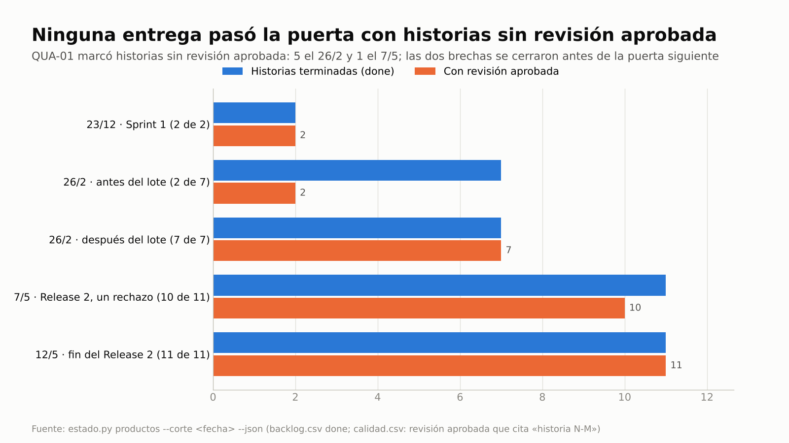
Historias terminadas contra historias con revisión aprobada en cada corte, según el estado de productos que deriva
`estado.py productos`: las brechas del 26/2 y del 7/5 se cerraron antes de la puerta siguiente (pasos 6 y 8).

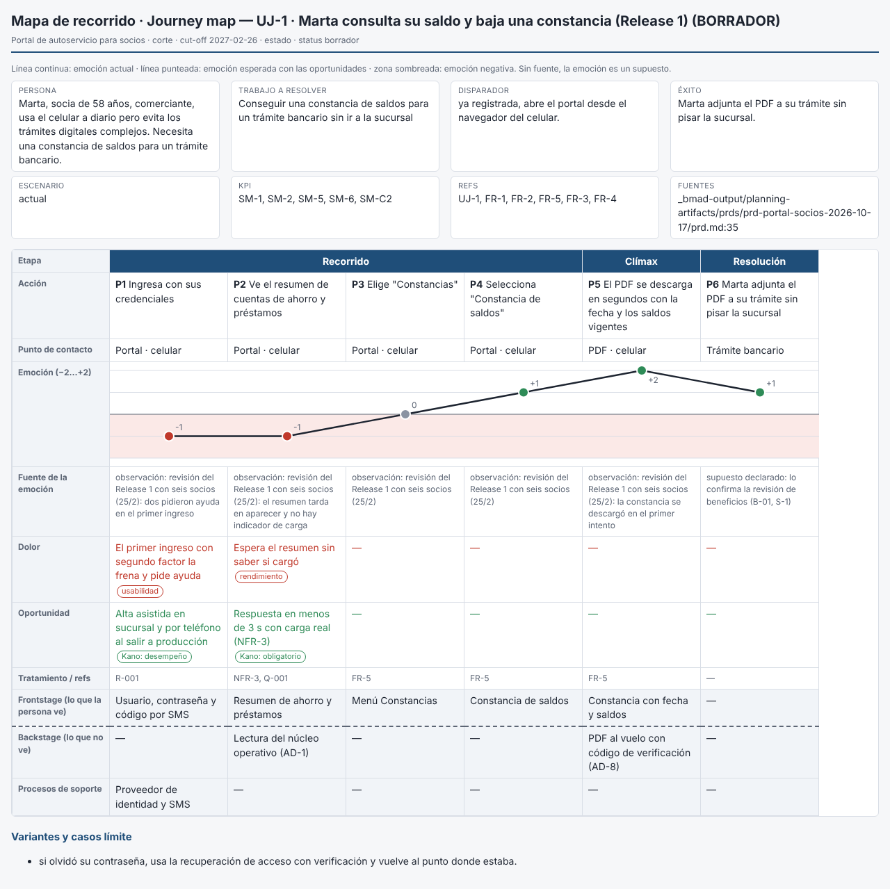
El recorrido de UJ-1 con lo observado en la revisión del Release 1: dos dolores, cada uno con su tratamiento (R-001 y
NFR-3 con Q-001) (paso 6b).

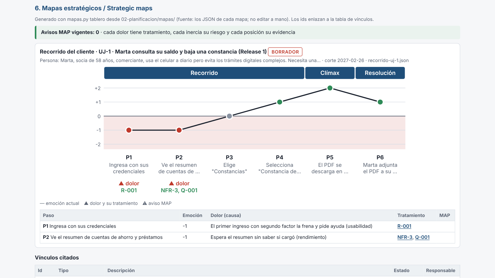
El mismo recorrido en la sección «Mapas estratégicos» del tablero de avance: curva de emoción, cada dolor con su
tratamiento enlazado y 0 avisos MAP vigentes (paso 7).

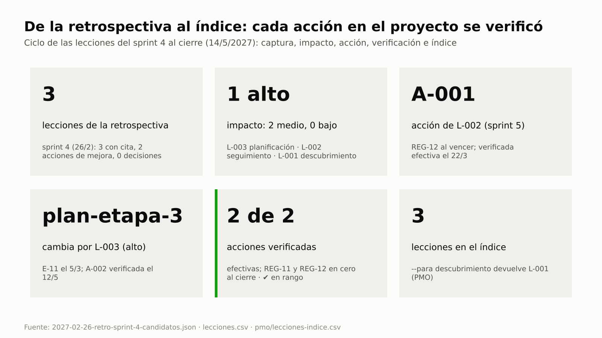
De la retrospectiva del sprint 4 al índice de la organización: 3 lecciones con cita (1 de impacto alto), la acción de
L-002 verificada en el sprint 5, L-003 cambia el plan de la etapa 3 y se verifica al cerrar el Release 2, y 3 lecciones
en el índice (pasos 6c, 7, 8 y 9).

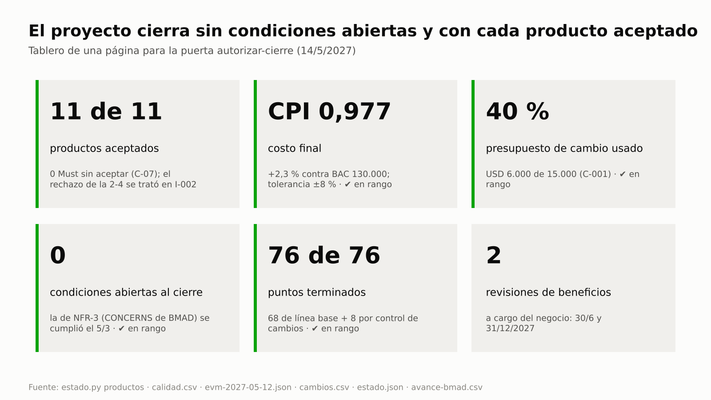
La puerta de cierre en una página: 11 de 11 productos aceptados y 0 Must sin aceptar (estado de productos, C-07),
CPI 0,977, 40 % del presupuesto de cambio usado y 0 condiciones abiertas (paso 9).

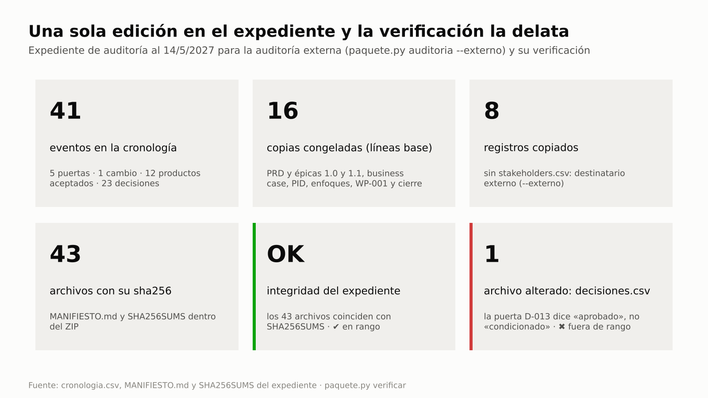
El expediente para la auditoría externa: 41 eventos en la cronología y 43 archivos con su huella; una sola palabra
cambiada en la copia y la verificación la delata (paso 9b).

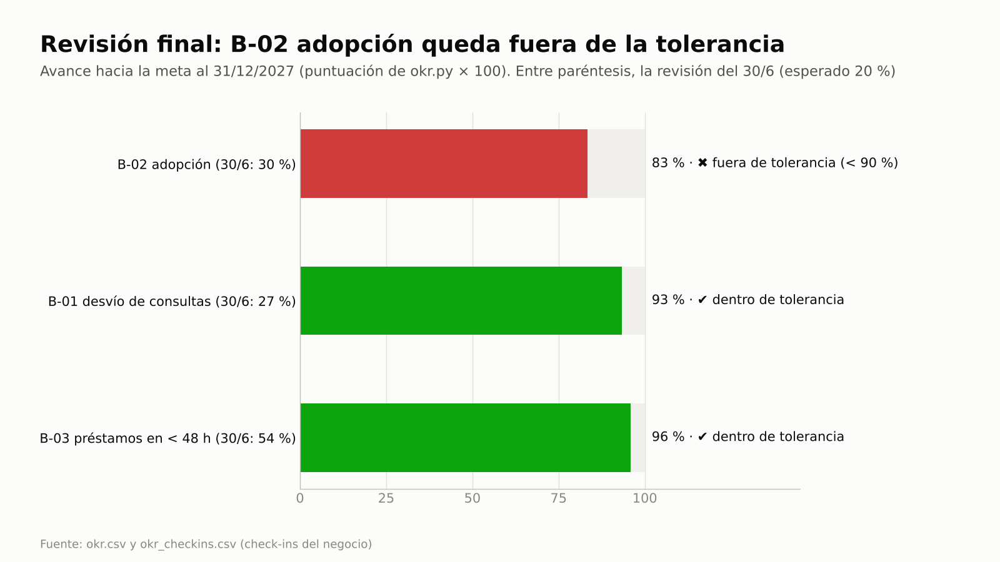
Al 31/12/2027, B-02 adopción llega al 83 % de la meta y queda fuera de la tolerancia de −10 %; B-01 y B-03, dentro
(paso 11).

## Clases

| Clase (90 min) | Pasos | Qué se lleva el asistente |
|---|---|---|
| 1 · Gobernar la construcción con BMAD | 1 (resumen, remite a E2E-5) · 2 · 3 · 4 · 5 · 6 | condición formal, paquete de trabajo con punto de control, valor ganado guardado, cambio con presupuesto y nueva línea base, radar al retomar la sesión, calidad a volumen por entrega (QUA-01/02) y estado de productos |
| 2 · Recorrido, lecciones, cierre y beneficios | 6b · 6c · 7 · 8 · 9 · 9b · 10 · 11 | recorrido del cliente con dolores tratados (MAP-03), retrospectiva con lecciones clasificadas por impacto y ámbito, lección en el plan de la etapa (E-11) y acciones verificadas (REG-11, REG-12), condición cumplida, rechazo tratado (QUA-03), informe de lecciones e índice de la organización, traspaso y paquete de cierre con la puerta verificada por id (C-03, C-07), expediente verificado, beneficios contra trayectoria y tolerancia |

Material de clase: [guion](../webinar/E2E-4/guion-instructor.md) · [ejercicio](../webinar/E2E-4/ejercicio.md) ·
[diapositivas](../webinar/E2E-4/diapositivas.json).

**Skills y agentes de pm-method:** pm-orquestador · pm-planificacion · pm-control · pm-cierre · `pm-director` ·
`pm-bmad-puente` · `pm-paquetes-trabajo` · `pm-progreso-reportes` · `pm-issues-cambios` · `pm-calidad` · `pm-reuniones` ·
`pm-mapas-estrategicos` · `pm-riesgos` · `pm-plan-etapa-y-limites` · `pm-caso-de-negocio` · `pm-okr` ·
`pm-lecciones-aprendidas` · `pm-cierre-proyecto` · `pm-visuales` · `pm-exportar` (y, en el paso 1, las de arranque e
iniciación que detalla E2E-5).
**Skills de BMAD 6.12.4** (nombres verificados en una instalación real): `bmad-forge-idea`, `bmad-product-brief`,
`bmad-prd`, `bmad-ux`, `bmad-architecture`, `bmad-create-epics-and-stories`, `bmad-sprint-planning`, `bmad-build`,
`bmad-code-review`, `bmad-correct-course`, `bmad-retrospective`, `bmad-help`.

**Duración:** 15 pasos (0 a 11, 6b, 6c y 9b: trece dentro del proyecto y dos posteriores al cierre); dos clases de 90 minutos
con el fixture; un día o más si producís los artefactos de BMAD desde cero.
Evidencia de referencia: [salida-g4.md](evidencia/salida-g4.md).

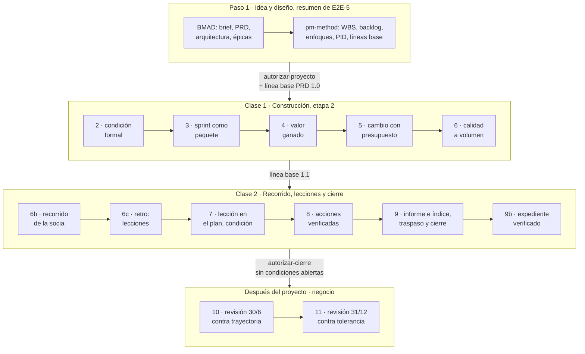

## Del uso único al control continuo

| Actividad | Cómo se hace hoy | Con pm-method (frecuencia y control) | Indicador |
|---|---|---|---|
| Revisar la calidad de cada historia | una revisión al final, o ninguna | en cada sanidad: toda historia `done` sin revisión aprobada aparece; registro en lote por entrega · **QUA-01** | historias terminadas contra revisadas ([g4-calidad-entregas](img/g4-calidad-entregas.png)) |
| Saber en qué estado está cada producto | una planilla que se arma a mano para el fin de etapa | estado de productos derivado de backlog, calidad, issues, aceptaciones y paquetes, a cualquier corte, con las diferencias entre lo registrado y lo físico (`estado.py productos`; el registro de productos de PRINCE2, sin registro propio) | productos por estado; diferencias (0 al cierre) |
| Cerrar sin productos ni riesgos sin dueño | "está todo aceptado" en el acta; las recomendaciones se escriben de memoria | en la puerta de cierre, cada issue y riesgo abierto por id con responsable en las recomendaciones (**C-03**, bloqueo) y cada requisito o historia Must con su aceptación (**C-07**, condición) | Must sin aceptar (0 al cierre, [g4-cierre](img/g4-cierre.png)) |
| Tratar un rechazo de calidad | se corrige "de palabra" y no queda traza | en cada sanidad hasta que un issue, acción o cambio cite el Q-### · **QUA-03** | rechazos sin tratamiento (0 al cierre) |
| Hacer la revisión prometida (prueba de carga) | se recuerda cuando ya venció | revisión planificada con fecha; aviso al vencer · **QUA-02** | revisiones vencidas |
| Seguir una puerta "con condiciones" | queda en el acta | condición formal; aviso en cada sanidad y en la puerta siguiente; **bloqueo del cierre** · **EST-12 · G-01** | condiciones abiertas ([g4-cierre](img/g4-cierre.png)) |
| Retomar el proyecto después de semanas | releer actas o confiar en la memoria | al abrir cada sesión, un resumen derivado de los registros (`estado.py contexto`) y la línea del radar; a pedido, el radar completo (`estado.py radar`) · **EST-12 · QUA-02 · RAD-07 · TOL-03** | qué decidir, escalar, desbloquear y vigilar, con responsable |
| Controlar un cambio y su costo | "contra la contingencia", sin monto | costo y cargo contra el presupuesto de cambio de la junta · **CAM-01 · CAM-03** (CAM-04 si supera el límite de la autoridad) | consumo del presupuesto de cambio (40 %) |
| Detectar cambios en el PRD | se descubren en la demo | contra la línea base de BMAD en cada sanidad · **ESP-10 · ESP-03** (ERROR: bloquean la puerta) | desvíos de la especificación |
| Vigilar el valor ganado | se calcula para el informe y se olvida | corte guardado y vigilado · **TOL-03** (TOL-01/02 si pronostica salir de tolerancia) | SPI, CPI y EAC por corte |
| Mirar el recorrido del cliente | un taller de diseño, una vez | mapa sobre cada entrega; en cada sanidad, todo dolor sin tratamiento · **MAP-03** (MAP-04 sin evidencia) | dolores tratados ([g4-recorrido](img/g4-recorrido.png); en el tablero, [g4-tablero-mapas-169](img/g4-tablero-mapas-169.png)) |
| Entregar la evidencia a una auditoría | se junta a mano cuando la piden; no hay cómo probar que no se editó | expediente bajo demanda desde los registros (cronología, copias congeladas, sha256 por archivo; `--externo` sin valoraciones de interesados) y verificación de cada copia (`paquete.py verificar`) | integridad OK o archivo alterado ([g4-expediente](img/g4-expediente.png)) |
| Capturar lecciones | una planilla al cierre, de memoria | retrospectiva como reunión propia: lecciones y acciones de mejora propuestas con su cita (`extraccion.py --tipo retrospectiva`); se registra lo que confirma el gestor | lecciones con cita y acción ([g4-lecciones-ciclo](img/g4-lecciones-ciclo.png)) |
| Llevar la lección al proceso donde se usa | "lo tendremos en cuenta" | clasificada por impacto y ámbito (`lecciones.py clasificar`); impacto alto sin acción en cada sanidad y en el radar · **REG-11**; lecciones de planificación sin considerar en el plan · **E-11** (`autorizar-etapa`) | lecciones abiertas sin acción (0 al cierre) |
| Comprobar que la acción funcionó | nunca | fecha de verificación por acción; aviso al vencer, en la sanidad y en el radar · **REG-12** | acciones verificadas (2 de 2) |
| Compartir lo aprendido con la organización | un informe que nadie busca | informe de lecciones desde el registro en cada límite de etapa y al cierre; exportación al índice de la organización que consulta el proyecto siguiente (`lecciones.py informe --exportar`, `buscar --para descubrimiento`) | lecciones en el índice (3) |
| Saber quién mide los beneficios | nadie después del cierre | enfoque de beneficios exigido en `autorizar-proyecto` (**P-04**), traspasado al negocio en el cierre | puntaje, salud y tolerancia ([g4-beneficios](img/g4-beneficios.png)) |

---

## Paso 0 · Preparación

**Camino rápido (recomendado):** copiá el fixture con BMAD 6.12.4 ya instalado y sus artefactos en `status: final`
(ver el [README de las guías](README.md#cómo-usar-las-guías)) en `~/proyectos-prueba/portal-e2e-4` y abrí `claude`
allí. Los prompts de BMAD ya están "hechos": leelos para entender el flujo y seguí con los de pm-method.

**Camino completo (producto desde cero):** en una carpeta vacía instalá BMAD y abrí Claude Code:
```bash
mkdir -p ~/proyectos-prueba/mi-producto && cd ~/proyectos-prueba/mi-producto && git init
npx bmad-method@6.12.4 install --modules bmm --tools claude-code --yes --user-name "<tu nombre>" \
    --set core.project_name=mi-producto --no-shims
claude
```
Cada skill de BMAD se invoca por su nombre (`/bmad-prd`, o "Run bmad-prd"); `/bmad-help` recomienda el paso siguiente.
El tiempo y el consumo de las sesiones de BMAD dependen del producto **[verificar en tu caso]**.

---

## Paso 1 · De la idea al proyecto autorizado (resumen; a fondo en E2E-5)

**Qué cubre:** la puesta en marcha (starting up a project) y la iniciación (initiating a project) con BMAD como fuente
única de la especificación. Cómo validar supuestos, comparar opciones y adaptar los enfoques se enseña en
[E2E-5](E2E-5-idea-a-proyecto.md); aquí solo dejás listo lo que la ejecución necesita.

| Sub-paso | Qué se hace (BMAD → pm-method) | Qué deberías ver |
|---|---|---|
| 1a | proyecto "Portal de autoservicio para socios", híbrido; `bmad.py detectar` | `"version": "6.12.4"`, `"soporte": "soportada"` |
| 1b | `/bmad-forge-idea` → `/bmad-product-brief`; mandato y project brief que **citan** el brief (no lo copian); D-001 enfoque | "brief 1 archivo(s) · estado=final · … sha 58db1efac463" |
| 1c | junta (Laura ejecutiva; Sofía usuaria sénior, PO y autoridad de cambio; Diego proveedor sénior; Andrea aseguramiento; Lucía jefa de equipo); puerta `autorizar-inicio` el 30/10 | primero "1 bloqueo(s)" (L-01: falta la lista de la junta); después fase `inicio` |
| 1d | `/bmad-prd`, `/bmad-ux`, `/bmad-architecture` → `bmad.py requisitos` | "42 identificadores · UJ 3 · FR 12 · NFR 6 · SM 8 · AD 13" |
| 1e | `/bmad-create-epics-and-stories` → WBS por productos y trazabilidad | "13 elementos, 8 hojas · esfuerzo 2480 h · costo 124,000"; "18 requisitos trazados" |
| 1f | backlog con columnas de gobierno (MoSCoW, puntos, iteración, release) | 68 puntos: R1 47 (sprints 1 a 4) y R2 21 (sprints 5 y 6) |
| 1g | business case (B-01 a B-03), OKR, PID con la §8 de adaptación, 7 tolerancias, enfoques de beneficios, calidad y sostenibilidad; presupuesto de cambio USD 15.000 y límite de USD 8.000 por cambio; puerta `autorizar-proyecto` y líneas base PRD y épicas 1.0 | P-04 "sin enfoque de beneficios" hasta registrarlo; "Línea base bmad-prd v1.0 registrada · sha bc048f7f59a3"; "Presupuestos: cambio=15000, limite_autoridad_cambio=8000" |

**Lo que tiene que quedar listo para la clase 1:** BMAD detectado como fuente única · backlog de 68 puntos con
columnas de gobierno · enfoque de calidad (una revisión registrada por historia que la cite como "historia N-M") ·
enfoque de beneficios (Sofía mide el 30/6 y el 31/12/2027) · presupuesto de cambio de la junta · líneas base PRD y
épicas 1.0.

<details>
<summary>Prompts completos de los sub-pasos 1a a 1g (para reproducir el recorrido)</summary>

```text
1a · Creá el proyecto de gestión "Portal de autoservicio para socios" en ./gestion, en español y con enfoque híbrido.
La ejecutiva es Laura Méndez y el gestor Martín Suárez. La especificación del producto la lleva el equipo con BMAD en
este mismo repositorio: detectalo y usalo como fuente única.

1b · Convertí el pedido del Consejo en mandato y armá el project brief. El brief de producto ya está en BMAD:
referencialo, no lo copies. Registrá la decisión de enfoque: etapas PRINCE2 con sprints de 14 días como paquetes de
trabajo y especificación con BMAD.

1c · Junta: usuaria sénior, PO y autoridad de cambio Sofía Ramírez; proveedor sénior Diego Ferreira; aseguramiento
Andrea Costa; jefa de equipo Lucía Benítez. Sprints de 14 días, velocidad de referencia 8 puntos. Armá el caso de
negocio esquemático y el plan de la etapa de iniciación, y preparame la puerta de inicio.
(Si te pregunta: "Confirmo la lista de control; decisión aprobado. Laura Méndez, ejecutiva, 30/10, fin de la
iniciación 27/11".)

1d · Traé los requisitos de BMAD y resumime la especificación. Mostrame el detalle de FR-6.

1e · Armá la WBS por productos con referencias a los FR y a las historias de BMAD (usá los paquetes 1.1 gestión, 2.1
especificación, 3.1 acceso, 3.2 consulta y constancias, 3.3 solicitudes, 4.1 consola, 5.1 transición, 5.2 puesta en
producción; USD 50 la hora) y verificá la trazabilidad requisito → historia → paquete.

1f · Sincronizá el backlog con BMAD. Sofía prioriza: Must las historias 1.1, 1.2, 1.3, 2.1, 3.1, 3.2 y 3.3; Should 1.4
y 2.2; Could 2.3. Puntos: 8 para 1.1, 1.3, 2.1, 2.2, 3.2 y 3.3; 5 para el resto. R1 = acceso, consulta y consola
(sprints 1 a 4); R2 = solicitudes (sprints 5 y 6).

1g · Armá el business case con los beneficios B-01 desvío de consultas (SM-2), B-02 adopción (SM-1) y B-03 préstamos en
menos de 48 h (SM-3), los OKR ligados (KR-1.1 30 % de socios registrados, KR-1.2 consultas de 5.000 a 3.500, KR-1.3 de
96 a 48 horas), el plan de proyecto y el PID con la adaptación del método en la §8. Tolerancias: tiempo ±3 semanas,
costo ±8 %, alcance Must sin tolerancia, calidad "NFR sin tolerancia; cada historia terminada con revisión aprobada",
beneficios -10 %, riesgo "ningún riesgo alto sin respuesta", sostenibilidad -10 % sobre las metas. Verificá la puerta
de proyecto y decime qué falta.
Después: armá el enfoque de beneficios (Sofía mide el 30/6 y el 31/12/2027; después del cierre lo gestiona el
negocio), el enfoque de calidad (criterios de aceptación de BMAD, produce Lucía, revisa Andrea, aprueba Sofía; NFR-3
con prueba de carga) y el enfoque de sostenibilidad mínimo. La junta fija un presupuesto de cambio de USD 15.000 y un
límite de USD 8.000 por cambio para la autoridad de cambio. Corré la sanidad y preparame la puerta de proyecto con la
línea base del PRD y de las épicas al 27/11.
(Si te pregunta: "Laura Méndez, ejecutiva: confirmo la lista; aprobado; congelá el business case, el PID y los tres
enfoques v1.0 y fijá las líneas base".)
```
</details>

**Dónde verificar:** `estado.json` → `integraciones.bmad`, `presupuestos`, `tolerancias.proyecto` ·
`02-planificacion/backlog.csv` · `00-direccion/enfoque-*.md` · `00-direccion/historial/` · evidencia, sub-pasos 1a a 1g.

---

## Paso 2 · Gate de preparación de BMAD y puerta autorizar-etapa (Release 1) con condición formal

**Problema que resuelve:** "aprobado con condiciones" suele quedar en el acta. Aquí el CONCERNS de BMAD se convierte en
**condición formal de la puerta** y se sigue solo hasta que alguien con rol verifica que se cumplió.

**Prompt (equipo de producto, BMAD)**
```text
/bmad-sprint-planning
Check implementation readiness only.
```
BMAD responde PASS, CONCERNS o FAIL en la conversación (en las pruebas reales no escribió archivo salvo FAIL
interactivo). Supongamos **CONCERNS: NFR-3 sin prueba de carga planificada**. NFR-3 es el requisito de rendimiento:
las consultas responden en menos de 3 segundos (p95) con conexión móvil estándar.

**Prompt (pm-method)**
```text
El gate de preparación de BMAD dio CONCERNS el 26/11 (lo informa Diego Ferreira, arquitecto): NFR-3 sin prueba de carga
planificada. Registralo, armá el plan de la etapa 2 con tolerancias de ±10 % en tiempo y costo y preparame la puerta.
Si se condiciona, planificá la prueba de carga como revisión de calidad para el 19/2 y mostrame cómo queda el
seguimiento.
```
**Si te pregunta:** "Laura Méndez, ejecutiva: condicionado; la prueba de carga entra en el plan de la etapa".

**Qué hace el sistema:** `pm-director`: `puertas.py preparacion-bmad --resultado CONCERNS --por "Arquitecto: Diego
Ferreira" --nota …`; `estado.py tolerancia --nivel etapa …`; `puertas.py verificar autorizar-etapa` (control E-10, gate
de preparación) → `estado.py puerta autorizar-etapa --decision condicionado --etapa-nombre "Release 1" --fin
2027-03-05`: el hallazgo **pasa solo a condición formal**; `pm-calidad`: **Q-001** planificada (prueba de carga NFR-3,
`fecha_prevista` 2027-02-19); `sanidad.py --rapido --corte 2026-11-27`; `bmad.py avance --corte 2026-11-27` (punto de
partida del burn-up).

**Qué deberías ver:** la verificación "1 bloqueo(s) · 1 condición(es)" con **L-01** (falta la lista de la junta) y
**E-10** "gate de preparación de BMAD en CONCERNS"; "Condiciones agregadas desde la verificación: gate de preparación
de BMAD en CONCERNS (2026-11-26: NFR-3 sin prueba de carga planificada)"; fase `entrega`, etapa 2; sanidad "0 ERROR ·
1 AVISO · 1 INFO": **EST-12** (condición abierta) y TOL-03 (todavía no hay corte de EVM guardado); avance "done 0 ·
0.0 % (puntos)".

**Dónde verificar:** `estado.json` → `puertas` (campo `condiciones`) e `integraciones.bmad.preparacion` · `calidad.csv`
(Q-001) · prompt: "¿Con qué condiciones se autorizó la etapa?".

---

## Paso 3 · Sprint 1 como paquete de trabajo, informe de punto de control y aceptación

**Problema que resuelve:** el paquete se da por terminado porque el tablero dice `done`. El informe de punto de control
(checkpoint report) solo cuenta como completados los productos con revisión aprobada, y el gestor acepta el paquete
después de comprobarlo con la sanidad (QUA-01).

**Prompt (pm-method)**
```text
Autorizá el sprint 1 como paquete de trabajo WP-001 con las historias 1.1 y 1.2 y su definición de terminado
(incluye la revisión de calidad registrada).
```
**Si te pregunta:** "Martín Suárez, gestor: apruebo WP-001".

**Prompt (equipo de producto, BMAD):** `/bmad-build` sobre cada historia (pasa de `ready-for-dev` a `review`) y
`/bmad-code-review` hasta `done`.

**Prompt (pm-method, al cierre del sprint)**
```text
Traé el avance de BMAD al 23/12 y sincronizá el backlog. Lucía (jefa de equipo) informa que la 1.1 y la 1.2 pasaron sus
pruebas el 21 y el 22/12 (revisó Andrea, aprobó Sofía): registrá las revisiones y armá su informe de punto de control.
Si la sanidad no marca historias terminadas sin revisión, aceptá el paquete.
```
**Si te pregunta:** "Martín Suárez, gestor: acepto WP-001".

**Qué hace el sistema:** `pm-paquetes-trabajo` (WP-001; `estado.py aprobar WP-001 --nivel gestor`); `bmad.py avance
--corte 2026-12-23` y `bmad.py backlog` (sincroniza la columna `estado` que lee QUA-01); `pm-calidad`: **Q-002**
(historia 1-1) y **Q-003** (historia 1-2), `completada`, `aprobado`; `pm-progreso-reportes`
(`templates/checkpoint-report.md` → `03-control/reportes/2026-12-23-checkpoint-WP-001.md`); `sanidad.py --rapido
--corte 2026-12-23`; aceptación como decisión del gestor (**D-015**).

**Qué deberías ver:** "Historias 10 · … review 1 · done 2 · 19.1 % (puntos)"; foto de calidad "terminadas 2 · con
revisión aprobada 2"; el checkpoint con "Productos completados (con calidad aprobada): historia 1-1 (Q-002), historia
1-2 (Q-003)"; sanidad "0 ERROR · 1 AVISO · 2 INFO": **ningún QUA-01** y EST-12 recordando la condición; "D-015".

**Dónde verificar:** `03-control/paquetes-trabajo/WP-001-sprint-1.md` · `03-control/reportes/2026-12-23-checkpoint-WP-001.md`
· `calidad.csv` · `decisiones.csv` (D-015).

---

## Paso 4 · Valor ganado ágil (corte guardado) e informe de aspectos destacados con las puertas

**Problema que resuelve:** el valor ganado (EVM: compara lo planificado, PV; lo ganado, EV; y lo gastado, AC) se
calcula para un informe y se olvida. Al guardar el corte, la sanidad lo vigila (TOL-01/02/03) y avisa si el pronóstico
sale de tolerancia o si el último corte quedó viejo.

**Prompt (pm-method)**
```text
Highlight del sprint 2 al 8/1: PV 41.000, EV 38.000, AC 40.500, BAC 124.000; leelo en modo ágil con 20 % de alcance
Should/Could y guardá el corte. Incluí las puertas y sus condiciones.
```

**Qué hace el sistema:** `evm.py --pv 41000 --ev 38000 --ac 40500 --bac 124000 --modo agil --pct-no-must 20 --proyecto
gestion --guardar --corte 2027-01-08`; `puertas.py estado --markdown` (§6 del informe de aspectos destacados, highlight
report).

**Qué deberías ver:** "Guardado: 03-control/reportes/evm-2027-01-08.json"; SPI 0,927 · CPI 0,938 ·
`alcance_no_entregable_pct 6.173` · `semaforo_alcance verde` (cabe dentro del 20 % de Should/Could); para la próxima
puerta, "2 bloqueo(s), 3 condición(es)": las condiciones abiertas de puertas anteriores (control G-01), las revisiones
de calidad sin cerrar, Q-001 (E-05), y el gate de BMAD en CONCERNS (E-10). `puertas.py verificar` muestra cada una con
su código.

**Dónde verificar:** `03-control/reportes/evm-2027-01-08.json` · evidencia, paso 4.

---

## Paso 5 · Cambio de rumbo: Sprint Change Proposal → control de cambios con presupuesto → traspaso → línea base 1.1

**Problema que resuelve:** el cambio entra al PRD sin pasar por nadie, o se aprueba "contra la contingencia" sin monto.
Aquí la sanidad detecta el desvío contra la línea base (ESP-10, ERROR que bloquea la puerta) y el cambio lleva `costo` y
`cargo` contra el presupuesto de cambio de la junta (CAM-03).

En BMAD se corre `/bmad-correct-course` y el PM de producto agrega **FR-13 "Pago de cuotas con débito en cuenta"** al
PRD (para simularlo en tu copia: pedíselo a `/bmad-prd` en modo edición).

**Prompt (pm-method)**
```text
Verificá la especificación contra la línea base y corré la sanidad al 12/1. Si hay cambios no controlados, registrá el
issue y la solicitud de cambio con su impacto (historia nueva de 8 puntos, un sprint más en la etapa 3, costo USD 6.000
contra el presupuesto de cambio, refuerza B-01) y pedile la decisión a Sofía. Si se aprueba, emití el traspaso para el
equipo BMAD.
```
**Si te pregunta:** "Sofía Ramírez, autoridad de cambio: aprobado para la etapa 3" (USD 6.000 está dentro de su límite
de USD 8.000; por encima, CAM-04 avisaría que debe decidir la junta).

**Prompt (equipo de producto, BMAD):** aplicar el traspaso con `/bmad-prd` (edición) y `/bmad-create-epics-and-stories`
(historia 2.4), y marcarlo `estado: aplicado`.

**Prompt (pm-method)**
```text
El equipo BMAD aplicó el traspaso de C-001. Resincronizá requisitos, trazabilidad y backlog (la 2.4 es Should, 8 puntos,
R2), fijá las líneas base 1.1 al 20/1 y verificá que no quede nada sin control.
```

**Qué hace el sistema:** `bmad.py verificar` → "agregados ['FR-13']"; `sanidad.py --rapido --corte 2027-01-12`: **ESP-10**
y **ESP-03** como ERROR → `pm-issues-cambios`: **I-001** y **C-001** con `costo=6000` y `cargo=presupuesto-cambio` →
decisión → `bmad.py handoff --cambio C-001` → (BMAD aplica) → `bmad.py requisitos`, `trazabilidad`, `backlog` →
`pm-director`: `bmad.py linea-base prd|epicas --version 1.1 --fecha 2027-01-20` → C-001 `implementado`, I-001 `cerrado`
→ `bmad.py verificar` → `sanidad.py --rapido --corte 2027-01-20` → `bmad.py avance --corte 2027-01-20`.

**Qué deberías ver:** la primera sanidad "2 ERROR · 2 AVISO · 1 INFO" (ESP-03, ESP-10, ESP-14 y EST-12); "43
identificadores", "19 requisitos trazados", "backlog.csv: 1 nuevas"; líneas base "bmad-prd v1.1 registrada · sha
203d33cb9e51" y "bmad-epicas v1.1 registrada · sha 360c24ddcd9c"; "Sin desvíos"; la sanidad final "0 ERROR · 1 AVISO ·
2 INFO" con **CAM-03 "Presupuesto de cambio: 6.000 de 15.000 (40 %)"** y EST-12; avance "Historias 11 · … 17.1 %
(puntos)": el alcance pasa de 68 a 76 puntos.

**Dónde verificar:** `issues.csv` · `cambios.csv` (columnas `costo` y `cargo`) ·
`02-planificacion/especificacion/handoff-bmad-<fecha>-C-001.md` · `00-direccion/historial/bmad-prd-v1.1/`.

---

## Paso 6 · Calidad a volumen al acercarse el fin del Release 1

**Problema que resuelve:** con muchas historias terminadas nadie verifica, una por una, que cada una tenga su revisión
registrada, y nadie recuerda que la prueba prometida ya venció. La sanidad lo detecta en cada corrida (QUA-01, QUA-02)
y la corrección se hace en lote, **por entrega**, no al final del proyecto.

**Al abrir la sesión.** Pasaron seis semanas desde el cambio. Antes de cualquier pedido, el hook de inicio le muestra al
gestor un resumen derivado de `estado.json` y los registros (`estado.py contexto`): "Abiertos: revisiones de calidad 1.
Condiciones abiertas de puertas: autorizar-etapa (2026-11-27). Próxima puerta: autorizar-etapa", y debajo la línea del
**radar de atención**: "decidir 1 (autorizar-etapa) · escalar 0 · desbloquear 1 (Q-001) · vigilar 1 (evm-2027-01-08)".
Los registros mandan sobre la memoria: si una nota de la conversación anterior dice otra cosa, vale el resumen.

**Prompt (pm-method, al retomar)**
```text
¿Qué tengo que decidir, escalar y desbloquear hoy?
```

**Prompt (pm-method)**
```text
Al 26/2 el equipo terminó las historias 1.3, 1.4, 3.1, 3.2 y 3.3. Sincronizá el backlog y corré la sanidad: ¿qué
historias terminadas no tienen revisión de calidad y qué revisiones vencieron? Mostrame el estado de los productos del
Release 1.
```
**Prompt (pm-method, después de ver los avisos)**
```text
Registrá en lote las revisiones del Release 1, una por historia ("Release 1 · historia N-M"): prueba contra los
criterios de aceptación, produce Lucía, revisa Andrea, aprueba Sofía el 25/2; todas aprobadas, la 3.3 con una observación
menor de usabilidad que va al backlog. Volvé a correr la sanidad.
```

**Qué hace el sistema:** `estado.py contexto --corte 2027-02-26` y `estado.py radar --corte 2027-02-26 --linea` (los
agrega el hook de inicio); ante la pregunta, `pm-orquestador`: `estado.py radar --corte 2027-02-26` (solo lectura);
`bmad.py backlog`; `sanidad.py --rapido --corte 2027-02-26`; `pm-paquetes-trabajo`: `estado.py productos --corte
2027-02-26 --alcance R1` (estado de productos, solo lectura); `pm-calidad`: `registro.py agregar calidad` una vez por
historia (**Q-004 a Q-008**, citando "historia N-M", la clave corta que reconoce QUA-01); `sanidad.py` otra vez.

**Qué deberías ver:** el radar "1 decidir · 0 escalar · 1 desbloquear · 2 vigilar" con «Hoy: decidir autorizar-etapa ·
escalar — · desbloquear Q-001»: decidir **EST-12** (la condición de la etapa 2, a cargo de la junta, Laura Méndez);
desbloquear **QUA-02** "Q-001 · 2027-02-19 · Lucía Benítez — revisión de calidad vencida"; vigilar **RAD-07** "2
bloqueo(s) de la próxima puerta: E-01, E-04" (faltan el plan de la etapa 3 y el informe de fin de la etapa 2, que
llegan en el paso 7) y **TOL-03** "sin corte de EVM reciente"; y "escalar una excepción no corresponde: ningún
pronóstico fuera de tolerancia ni presupuesto agotado". La línea del hook cuenta 1 en vigilar porque no corre la
verificación de la próxima puerta (RAD-07), que sí corre el radar completo. Las historias terminadas sin revisión no
son parte del radar: las lista la sanidad después de sincronizar el backlog. La primera sanidad da "0 ERROR · 7 AVISO ·
3 INFO": **QUA-01** cinco veces ("1-3-consulta-de-saldos…: terminado sin revisión de calidad registrada", y lo mismo
para 1-4, 3-1, 3-2 y 3-3), **QUA-02** "Revisión de calidad vencida Q-001 (…, prevista 2027-02-19)", EST-12, y como INFO
CAM-03, ESP-02 y **TOL-03** ("Último corte de EVM guardado el 2027-01-08 (más de 31 días)"). El estado de productos
del Release 1 da "7 productos" con "en revisión 5 · aprobado 2 · aceptado 0 … = 7", las cinco diferencias "terminado en
backlog.csv sin revisión de calidad aprobada (QUA-01)" (1-3, 1-4, 3-1, 3-2 y 3-3), 1-1 y 1-2 aprobadas con Q-002 y
Q-003 (WP-001) y "Must sin aceptar (C-07 en autorizar-cierre)": nada está aceptado todavía, la aceptación llega en el
cierre. Foto de calidad "terminadas 7 · con revisión aprobada 2". Después del lote: "0 ERROR · 2 AVISO · 2 INFO" (quedan QUA-02 y EST-12, que
se resuelven en el paso 7) y "terminadas 7 · con revisión aprobada 7".

**Dónde verificar:** `calidad.csv` (Q-004…Q-008) · `estado.py productos --alcance R1 --json`. Que esto haya pasado "otra vez" es lo que el equipo dice en la
retrospectiva del paso 6c.

---

## Paso 6b · El recorrido de la socia sobre lo entregado (mapa de recorrido desde BMAD)

**Problema que resuelve:** cada historia pasó su revisión, pero nadie miró el recorrido completo de la persona. Un
**mapa de recorrido del cliente** (customer journey map, ver [TERMINOLOGIA.md](../TERMINOLOGIA.md)) pone en una fila las
acciones de la persona, su emoción en cada paso (de −2 a +2, con la fuente que la respalda) y sus dolores; debajo, los
carriles del service blueprint: lo que ve (frontstage), lo que no ve (backstage) y los procesos de soporte. La regla de
control es simple: **todo dolor necesita un tratamiento con id** (requisito, historia del backlog, riesgo, issue, cambio,
decisión, supuesto o revisión de calidad); si no lo tiene, la sanidad avisa **MAP-03** en cada corrida.

El punto de partida no se inventa: es el recorrido UJ-1 del PRD de BMAD, "Marta consulta su saldo y baja una constancia
desde el celular" (Marta, 58 años, usa el celular a diario pero evita los trámites digitales complejos).

**Prompt (pm-method)**
```text
Armá el mapa de recorrido de UJ-1 desde la especificación de BMAD, con lo que vimos en la revisión del Release 1 con
seis socios el 25/2: dos pidieron ayuda en el primer ingreso con segundo factor; el resumen de cuentas tarda en aparecer
y no hay indicador de carga; la constancia se descargó en el primer intento. Decime qué dolores quedan sin tratamiento.
```
**Si te pregunta:** "Sofía Ramírez, product owner: confirmo las emociones y los dolores".

**Prompt (pm-method, después de ver los avisos)**
```text
El dolor del resumen lo cubre NFR-3, que verifica la prueba de carga Q-001: vinculalo. El del primer ingreso no lo
resolvemos con alcance nuevo a una etapa del cierre: registralo como riesgo para B-02 adopción, con respuesta del
negocio (alta asistida en sucursal y por teléfono durante los primeros 60 días de operación; dueña Sofía, revisión el
30/6/2027). Volvé a correr los controles.
```

**Qué hace el sistema:** `bmad.py recorridos --id UJ-1` (persona, recorrido, clímax, resolución, FR y KPI del PRD, de
solo lectura) → `pm-mapas-estrategicos`: `mapas.py recorrido semilla --uj UJ-1 --fecha 2027-02-26` (esqueleto con las
emociones `[por confirmar]`) → completa la semilla con lo observado y la persona confirma → `mapas.py recorrido validar
uj-1` → `mapas.py controles` → `mapas.py recorrido candidatos uj-1` (propone cómo tratar cada dolor; no registra nada)
→ `pm-riesgos`: **R-001** → `mapas.py vincular uj-1 P1 --refs R-001` y `vincular uj-1 P2 --refs NFR-3,Q-001` →
`mapas.py recorrido render uj-1` (Markdown con Mermaid y HTML con carriles) → `mapas.py controles`.

**Qué deberías ver:** la semilla "3 etapa(s), 6 paso(s); emociones y fuentes [por confirmar] · KPI SM-1, SM-2, SM-5,
SM-6"; la validación "0 error(es) · 0 aviso(s)"; los controles con **dos MAP-03** ("P1 «Ingresa con sus credenciales»:
dolor sin tratamiento" y lo mismo para P2); los candidatos "P1 [requisito] Alta asistida en sucursal y por teléfono al
salir a producción" y "P2 [requisito] Respuesta en menos de 3 s con carga real (NFR-3)" con "2 candidato(s); se
registran solo tras la evaluación humana"; "R-001"; "P1: refs = R-001", "P2: refs = NFR-3, Q-001"; y al final "0
aviso(s) de la familia MAP".


La curva baja en el ingreso y en el resumen (−1) y sube hasta el clímax (+2, la constancia en el primer intento). Cada
dolor tiene su tratamiento en la fila "Tratamiento / refs": R-001 y NFR-3 con Q-001.

**Por qué un riesgo y no un requisito:** el sistema propone tratar P1 como requisito; la persona decide otra cosa. A
una etapa del cierre, el dolor no justifica alcance nuevo, pero sí amenaza un beneficio (B-02): se registra como riesgo
con dueña en el negocio y fecha de revisión en la primera revisión de beneficios. El paso 11 vuelve a este riesgo.

**Dónde verificar:** `02-planificacion/mapas/recorrido-uj-1.json` (fuente) · `02-planificacion/visuales/recorrido-uj-1.html`
y `.md` (vistas) · `riesgos.csv` (R-001) · prompt: "¿Qué dolores del recorrido de la socia siguen sin tratamiento?".

---

## Paso 6c · Retrospectiva del sprint 4: lecciones con cita, impacto y ámbito, y una acción para el sprint siguiente

**Problema que resuelve:** la retro se hace, pero se mezcla con la planificación del sprint siguiente y termina en una
lista de tareas; las lecciones se escriben al cierre, de memoria, cuando ya no cambian nada, y nadie comprueba si la
acción sirvió. Aquí la **retrospectiva** es una reunión propia: mira el proceso con hechos, sin culpables, en el formato
qué funcionó · qué no funcionó · qué probamos. De su transcripción salen **lecciones candidatas** y **acciones de
mejora** con la cita textual; el gestor confirma lo que se registra, cada lección se clasifica por **impacto** y por el
**ámbito** donde se usa (ideación, descubrimiento, planificación, seguimiento) y la acción lleva la fecha en que se
comprueba su efecto. Es el principio de PRINCE2 «aprender de la experiencia» (learn from experience): una lección
identificada no es una lección aprendida hasta que cambia algo.

**Prompt (equipo de producto, BMAD):** `/bmad-retrospective` al cerrar las épicas 1 y 3. La reunión del 26/2 la
facilita Andrea Costa (aseguramiento) y queda grabada en
`gestion/03-control/reuniones/2027-02-26-retro-sprint-4-original.vtt` (el texto está en la evidencia, paso 6c).

**Prompt (pm-method)**
```text
Te dejo la transcripción de la retrospectiva del sprint 4 del 26/2. Proponeme las lecciones y las acciones de mejora,
cada una con su cita, sin registrar nada todavía.
```
**Prompt (pm-method, después de ver los candidatos)**
```text
Confirmo las tres lecciones y las dos acciones. Completá efecto y recomendación de cada lección y clasificalas: la de la
Sprint Change Proposal es de impacto alto (ESP-10 bloqueaba la puerta) y aplica a planificación y seguimiento; la de las
revisiones, impacto medio y recurrencia alta, a seguimiento; la de los socios, impacto medio, al descubrimiento de los
próximos proyectos. La acción de Lucía (definición de terminado) se verifica al cerrar el sprint 5, el 19/3.
```
**Si te pregunta:** "Martín Suárez, gestor: confirmo CL-01, CL-02, CL-03, CM-01 y CM-02".

**Qué hace el sistema:** `pm-reuniones`: `transcripcion.py` → `extraccion.py candidatos` (tipo `retrospectiva` por el
nombre del archivo: propone lecciones **CL** y acciones de mejora **CM**, no decisiones ni compromisos del plan) →
`extraccion.py registrar --confirmar CL-01,CL-02,CL-03,CM-01,CM-02 --por "Gestor: Martín Suárez" --campo …`
(**L-001…L-003** en `lecciones.csv`, **A-001** y **A-002** en `acciones.csv`); `pm-lecciones-aprendidas`:
`lecciones.py clasificar` una vez por lección (→ `revisada`) y `listar`; `sanidad.py --rapido --corte 2027-02-26`;
`lecciones.py accionar L-002 --accion "A-001; definición de terminado del sprint 5" --verificar-en 2027-03-19`.

**Qué deberías ver:** "7 intervenciones de 4 hablantes"; "Retrospectiva: se detectaron 3 lecciones candidatas, 2
acciones de mejora, 0 supuestos y 0 riesgos nuevos (sin decisiones de gobierno)"; cada candidata con hablante y hora, por
ejemplo "CL-02 … [00:01:30] · Lucía Benítez: «No funcionó lo de siempre: otra vez llegaron historias a done sin la
revisión registrada…» · no funcionó · recurrencia alta" y "CM-01 … · Lucía Benítez · 2027-03-03" (el "3/3" dicho,
resuelto contra la fecha de la reunión). Al registrar, "CL-01 → L-001 … CM-02 → A-002". El listado queda ordenado por
impacto: "L-003 · alto · recurrencia media · revisada · Martín Suárez · sin acción", luego L-002 y L-001. La sanidad
suma **REG-11** "Lección L-003 de impacto alto sin acción ni decisión (revisada; aplicar en planificacion;
seguimiento)" ("0 ERROR · 3 AVISO · 2 INFO", con EST-12 y QUA-02, que se resuelven en el paso 7). L-002 queda
"accionada-proyecto: acción A-001; definición de terminado del sprint 5 · verificar el efecto el 2027-03-19".

| Lección | Qué se dijo | Impacto · recurrencia | Ámbito | Adónde va |
|---|---|---|---|---|
| L-003 | FR-13 llegó al PRD sin pasar por la autoridad de cambio | alto (bloqueó la puerta) · media | planificación, seguimiento | plan de la etapa 3 (paso 7) |
| L-002 | otra vez historias a done sin la revisión registrada | medio (retrabajo en lote) · alta | seguimiento | A-001 en el sprint 5 (paso 8) |
| L-001 | la revisión con seis socios encontró dolores que las pruebas no ven | medio (acierto) · baja | descubrimiento | PMO e índice de la organización (paso 9) |

Criterio de impacto (guía de `pm-lecciones-aprendidas` §12): **alto** si afectó o puede afectar una tolerancia, un
beneficio o un riesgo alto, o bloqueó una puerta; **medio** si consumió margen u obligó a retrabajo sin salir de
tolerancia; **bajo** si su efecto fue local.

**Dónde verificar:** `03-control/reuniones/2027-02-26-retro-sprint-4-candidatos.md` · `lecciones.csv` (L-001…L-003:
`impacto`, `recurrencia`, `aplicar_en`, `accion`, `verificar_en`) · `acciones.csv` (A-001, A-002).

---

## Paso 7 · Fin de la etapa 2 (Release 1): prueba de carga, condición cumplida, lecciones en el plan, business case 1.1 y puerta de la etapa 3

**Problema que resuelve:** la condición no se cierra sola aunque la prueba esté aprobada: la puerta siguiente la muestra
como G-01 hasta que alguien con rol verifica el cumplimiento y lo registra. El business case se revisa en el límite de
etapa con reales y pronóstico, no solo al inicio. Y el plan de la etapa siguiente se arma **revisando el registro de
lecciones** (PRINCE2, límite de etapa): si una lección clasificada para planificación sigue sin acción, la verificación de
la puerta lo avisa (**E-11**) hasta que el plan la incorpore o alguien la descarte con motivo. El informe de lecciones de
la etapa sale del registro.

**Prompt (pm-method)**
```text
La prueba de carga de NFR-3 se hizo el 2/3: p95 2,4 s con 400 sesiones concurrentes (meta menor a 3 s); aprobada. El gate
de preparación de BMAD dio PASS el 3/3. Terminamos el Release 1: traé el avance al 5/3, abrí el límite de etapa, calculá
el valor ganado (PV 82.000, EV 80.000, AC 83.500, BAC 130.000) y guardá el corte, actualizá el business case con reales,
pronóstico y riesgos, armá el informe de fin de etapa, el plan de la etapa 3 y el tablero con el recorrido de la socia,
y preparame la puerta.
```
**Prompt (pm-method, al ver el aviso de lecciones)**
```text
¿Qué lecciones tiene que considerar el plan de la etapa 3? Incorporalas en «Lecciones incorporadas» con su acción y la
fecha de verificación (L-003: al cerrar el Release 2, el 12/5) y armá el informe de lecciones de la etapa 2.
```
**Si te pregunta:** "Laura Méndez, ejecutiva: verifiqué la condición de la etapa 2 (Q-001 aprobada y gate en PASS):
dala por cumplida" · "aprobado; etapa 3 Release 2 hasta el 14/5 con ±10 % en tiempo y costo; apruebo el business case
1.1".

**Qué hace el sistema:** `pm-registros`: A-001 y A-002 (acciones de la retro) `completada` el 3/3; `pm-calidad`: Q-001 `completada`, `aprobado`; `puertas.py preparacion-bmad --resultado PASS`;
`bmad.py avance --corte 2027-03-05`; `estado.py limite-etapa`; `evm.py … --guardar --corte 2027-03-05`;
`pm-plan-etapa-y-limites`; `pm-caso-de-negocio` en modo **mantener** (business case 1.1, que incluye R-001 entre los
riesgos); `pm-lecciones-aprendidas`: `lecciones.py listar --para planificacion --corte 2027-03-05`; `puertas.py verificar
autorizar-etapa` (**G-01** y **E-11**) → `pm-plan-etapa-y-limites`: plan de la etapa 3 con «Lecciones incorporadas» →
`lecciones.py accionar L-003 --accion "A-002; plan-etapa-3" --verificar-en 2027-05-12` → `lecciones.py informe --etapa 2
--corte 2027-03-05` (clave `informe-lecciones-etapa-2`, en revisión) → `pm-director`: `estado.py cumplir-condiciones
autorizar-etapa --fecha 2027-03-05 --por "Ejecutivo: Laura Méndez" --nota "Q-001 prueba de carga NFR-3 aprobada el
2027-03-02 (p95 2,4 s); gate de preparación de BMAD en PASS el 2027-03-03"`; `sanidad.py --rapido --corte 2027-03-05`;
`pm-visuales` (tablero con `estado.py periodo --tablero`: tiempo, costo, calidad y riesgo por regla) → `pm-mapas-estrategicos`: `mapas.py tablero --insertar
gestion/03-control/reportes/2027-03-05-tablero-avance.html` (sección «Mapas estratégicos»); puerta `autorizar-etapa`; `estado.py aprobar business-case --version 1.1`.

**Qué deberías ver:** "Historias 11 · done 7 · épicas terminadas 2/3 · 61.8 % (puntos)"; "Guardado:
03-control/reportes/evm-2027-03-05.json", SPI 0,976 · CPI 0,958; "Lecciones que aplican a planificacion: 1 de 3 ·
L-003 · alto · … · sin acción"; la verificación **antes** de cumplir "0 bloqueo(s) · 1 condición(es) · 1 aviso(s)" con
**G-01 "condiciones abiertas de puertas anteriores: autorizar-etapa 2026-11-27"** y **E-11 "lecciones para planificación
sin considerar en el plan de la etapa: L-003 (alto)"**; el plan con la tabla «Lecciones incorporadas» (L-003 con A-002,
verificación 12/5; L-002 con A-001, verificación 19/3); "L-003 accionada-proyecto: acción A-002; plan-etapa-3 ·
verificar el efecto el 2027-05-12"; "Informe de lecciones (etapa 2): …-informe-lecciones-etapa-2.md · 3 lecciones (alto
1, medio 2, bajo 0) · 0 pendientes · 3 para el índice"; después, sanidad
"0 ERROR · 0 AVISO · 1 INFO" (solo CAM-03 al 40 %; la familia MAP sigue sin avisos) y la verificación "0 bloqueo(s) ·
0 condición(es) · 0 aviso(s)"; el business case 1.1 con "R-001 (medio) amenaza B-02 adopción, con respuesta del
negocio"; "Tablero de mapas: 1 mapa(s) dibujado(s) (recorrido-uj-1.json) · 0 aviso(s) MAP · 3 vínculo(s) citado(s)";
el tablero:

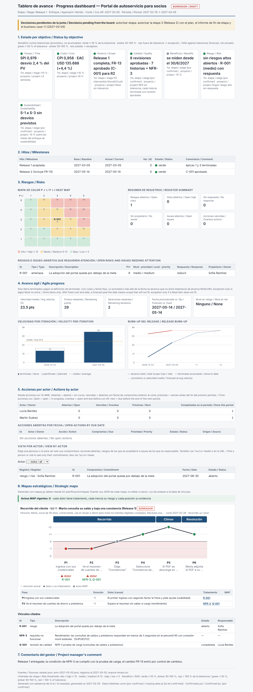
Seis de los siete objetivos de desempeño en verde (beneficios sin dato: se miden desde el 30/6), R-001 en la zona media
del mapa de calor, la decisión pendiente de la junta arriba y, al final, la sección 6 «Mapas estratégicos»:


El recorrido de UJ-1 dibujado en el tablero (SVG propio, sin `mmdc`): la curva baja en P1 y P2 y cada dolor muestra su
tratamiento (R-001; NFR-3 y Q-001). "Avisos MAP vigentes: 0". Los ids son enlaces a la tabla «Vínculos citados»: R-001
riesgo abierto de Sofía Ramírez, NFR-3 requisito no funcional y Q-001 revisión de calidad completada. Si mañana un
dolor queda sin tratamiento, la misma sección lo muestra en rojo con su aviso MAP-03.

**Dónde verificar:** `03-control/reportes/2027-03-05-informe-fin-etapa-2.md` · `02-planificacion/plan-etapa-3.md`
(«Lecciones incorporadas») · `03-control/reportes/2027-03-05-informe-lecciones-etapa-2.md` ·
`03-control/reportes/2027-03-05-tablero-avance.html` (sección 6, entre los marcadores `pm-mapas`) · `estado.json` → `puertas` (`condiciones_cumplidas`,
`condiciones_verificadas_por`, `condiciones_nota`) · `00-direccion/historial/business-case-v1.1.md`.

---

## Paso 8 · Release 2: la acción de la retro verificada (REG-12), un rechazo tratado (QUA-01 y QUA-03) y valor ganado final

**Problema que resuelve:** dos cosas que en la práctica no se hacen. Primero, **comprobar que la acción de una lección
funcionó**: la fecha de verificación vence y la sanidad y el radar la muestran (**REG-12**) hasta que alguien registra
el resultado con evidencia. La planificación del sprint 5 sirve de contraste: la misma herramienta, aplicada a otra
reunión, propone compromisos y decisiones y ninguna lección. Segundo, BMAD marca la historia `done` cuando pasa la revisión de código, pero la revisión contra los
criterios de aceptación puede rechazarla. En la práctica ese rechazo se corrige "de palabra" y no queda traza. Aquí la
historia sigue marcada (QUA-01, "terminado con revisión sin aprobar") y el rechazo también (QUA-03) hasta que un issue
lo trata y una nueva revisión lo aprueba.

**Prompt (pm-method, 8/3)**
```text
Te paso la transcripción de la planificación del sprint 5. ¿Qué propone?
```
**Prompt (pm-method, 22/3)**
```text
La historia 2.1 pasó a done el 19/3 y su revisión se registró ese mismo día, aprobada. Sincronizá, traé el avance al
22/3, corré la sanidad y el radar y decime qué lecciones de seguimiento tengo que verificar.
```
**Prompt (pm-method, después de ver el aviso)**
```text
La acción de L-002 funcionó: verificala como efectiva con la evidencia del sprint 5.
```
**Prompt (pm-method, 7/5)**
```text
Release 2 terminado en BMAD. Sincronizá el backlog y registrá las revisiones del 6/5: 2.2 y 2.3 aprobadas; la 2.4
rechazada porque falta la notificación al socio después del débito (criterio de aceptación de FR-13). Corré la sanidad
al 7/5.
```
**Prompt (pm-method, después de ver los avisos)**
```text
Registrá el rechazo como issue fuera de especificación para Lucía. Sofía decide corregirlo dentro del Release 2, sin
costo ni cambio de alcance. El 11/5 la 2.4 pasó la nueva revisión: registrala y cerrá el issue. Traé el avance al 12/5,
guardá el valor ganado final (PV y EV 130.000, AC 133.000) y corré la sanidad. Verificá L-003: en el Release 2 ninguna
Sprint Change Proposal llegó al PRD sin issue.
```
**Si te pregunta:** "Sofía Ramírez, autoridad de cambio: corregir dentro del Release 2, sin costo".

**Qué hace el sistema:** `pm-reuniones`: `transcripcion.py` y `extraccion.py candidatos` sobre la planificación (tipo
`planificacion` por el nombre; no se registra nada: el plan del sprint vive en el `sprint-status.yaml` de BMAD);
`bmad.py backlog`; `pm-calidad`: **Q-009** (historia 2-1, 19/3); `bmad.py avance --corte 2027-03-22`; `sanidad.py
--rapido --corte 2027-03-22`; `estado.py radar --corte 2027-03-22`; `lecciones.py listar --para seguimiento`;
`lecciones.py verificar L-002 --resultado efectiva --evidencia …`; después, `bmad.py backlog`; `pm-calidad`: **Q-010** y
**Q-011** aprobadas y **Q-012** `rechazado`;
`sanidad.py --rapido --corte 2027-05-07`; `pm-issues-cambios`: **I-002** (`fuera-especificacion`, cita Q-012) →
`en-accion` con la decisión de Sofía → **Q-013** (nueva revisión de la 2-4, aprobada) → I-002 `cerrado`; `bmad.py avance
--corte 2027-05-12`; `evm.py … --tol-costo 8 --tol-plazo 10 --guardar --corte 2027-05-12`; `sanidad.py --rapido --corte
2027-05-12`; `lecciones.py verificar L-003 --resultado efectiva --evidencia …`.

**Qué deberías ver:** en la planificación, "Se detectaron 1 compromiso, 0 decisiones pendientes, 1 decisión tomada, 0
supuestos y 0 riesgos nuevos" (CA-01 Lucía Benítez · 2027-03-19; CD-01 nivel gestor) y ninguna lección: la retro y la
planificación son reuniones distintas. Al 22/3: "done 8 · épicas terminadas 2/3 · 72.4 % (puntos)"; sanidad "0 ERROR ·
1 AVISO · 2 INFO" con **REG-12 "Lección L-002 accionada sin verificar su efecto (verificar_en 2027-03-19; acción:
A-001; …)"** y sin QUA-01; el radar "0 decidir · 0 escalar · 0 desbloquear · 2 vigilar" con "P3 [REG-12] L-002 ·
2027-03-19 · Lucía Benítez — lección accionada sin verificar su efecto" (y RAD-07); el listado de seguimiento con L-003
"verificar el 2027-05-12" y L-002 "verificación vencida 2027-03-19"; "L-002 verificada · 2027-03-22 · efectiva ·
sprint 5: la historia 2-1 pasó a done con Q-009 registrada el mismo día (19/3); sanidad del 22/3 sin QUA-01". Después,
sanidad al 7/5 "0 ERROR · 2 AVISO · 3 INFO": **QUA-01 "2-4-pago-de-cuotas-con-débito-en-cuenta:
terminado con revisión Q-012 sin aprobar"** y **QUA-03 "Revisión Q-012 rechazada sin issue, acción o cambio que la
trate"** (más CAM-03, ESP-02 y TOL-03 como INFO); foto "terminadas 11 · con revisión aprobada 10"; "I-002"; "Q-013";
"done 11 · épicas terminadas 3/3 · 100.0 % (puntos)"; CPI 0,977 (`sobrecosto_pct 2.308`, dentro de ±8 %); sanidad al
12/5 "0 ERROR · 0 AVISO · 1 INFO" (solo CAM-03) y foto "terminadas 11 · con revisión aprobada 11"; "L-003 verificada
· 2027-05-12 · efectiva · Release 2: el rechazo de la historia 2-4 entró como I-002 y se corrigió sin tocar la
especificación…".


Cinco cortes, cada uno con su foto: las brechas (5 historias el 26/2, 1 rechazo el 7/5) se cerraron antes de la puerta
siguiente; ninguna entrega llegó a la junta con historias sin revisión aprobada.

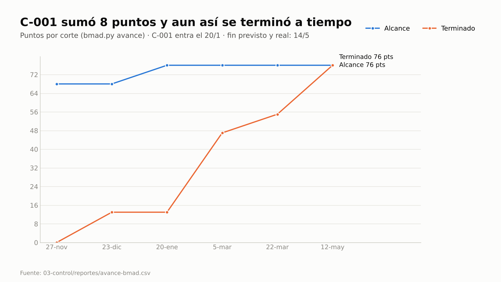
El alcance sube de 68 a 76 puntos el 20/1 (C-001); el corte del 22/3 (sprint 5) marca 55 puntos y los 76 quedan
terminados el 12/5, antes del fin previsto (14/5).

**Dónde verificar:** `03-control/reuniones/2027-03-08-planificacion-sprint-5-candidatos.md` · `lecciones.csv` (L-002 y
L-003: `verificacion`) · `calidad.csv` (Q-009…Q-013) · `issues.csv` (I-002) · `03-control/reportes/avance-bmad.csv` ·
`03-control/reportes/evm-2027-05-12.json`.

---

## Paso 9 · Aceptación, traspaso a operación, business case confirmado, paquete y cierre

**Problema que resuelve:** el proyecto cierra con condiciones olvidadas, sin traspaso formal a quien opera el producto,
con riesgos abiertos que nadie hereda, con productos que nadie aceptó y con los beneficios "a medir" sin dueño. Aquí la
puerta de cierre bloquearía con G-01 si quedara una condición abierta y con C-03 si un riesgo o issue abierto no
estuviera citado **por id**, con responsable, en las recomendaciones de seguimiento; C-07 marca cada requisito o historia
Must sin aceptar, según el estado de productos que se deriva de los registros;
la responsabilidad de los beneficios pasa explícitamente al negocio. El informe de lecciones sale del registro y las
lecciones aprobadas se comparten en el **índice de la organización**, donde las encuentra la ideación y el
descubrimiento del proyecto siguiente.

**Prompt (pm-method)**
```text
Verificá que todos los requisitos estén terminados, pasá a cierre y decime qué falta para la puerta de cierre. Registrá
la aceptación de Sofía y Laura y dejá el estado final de los productos; armá el
traspaso a operación (recibe Sofía, servicios al socio), el informe de fin de proyecto, el informe de lecciones desde el
registro (la lección de los socios va a la PMO; exportá las aprobadas al índice pmo/lecciones-indice.csv), las
recomendaciones de seguimiento (R-001 y la observación menor del Release 1), el plan de revisión de beneficios
(revisiones del negocio el 30/6 y el 31/12/2027, con línea base al entrar en operación y el criterio de desvío), el
business case confirmado, el enfoque de beneficios traspasado al negocio y el borrador de la notificación de cierre.
Preparame la puerta de cierre y el paquete para la junta con la línea base del PRD; probá también agregar el PRD vivo
de BMAD.
```
**Si te pregunta:** "Sofía Ramírez, usuaria sénior, y Laura Méndez, ejecutiva: aceptamos el producto" · "Sofía Ramírez:
recibo el producto en operación" · "Laura Méndez, ejecutiva: la propuesta de L-001 va a la PMO; compartí las lecciones en el
índice" · "Laura Méndez: cierre aprobado el 14/5; confirmo el business case, el traspaso del
enfoque de beneficios al negocio y la notificación de cierre".

**Qué hace el sistema:** `especificacion.py listar requisitos --cobertura sin-cobertura` (vacío); `estado.py cierre`;
`puertas.py verificar autorizar-cierre` (qué falta, de solo lectura); `pm-cierre-proyecto` (`estado.py aprobar
registro-aceptacion`; `estado.py productos --corte 2027-05-12 --markdown 04-cierre/product-status-account-final.md` →
clave `product-status-account-final`, en revisión; `templates/handover.md` → clave `handover`, aprobado por la
receptora; `templates/recomendaciones-seguimiento.md`; `templates/plan-revision-beneficios.md`;
`templates/notificacion-cierre.md`); `pm-lecciones-aprendidas`: `lecciones.py accionar L-001 --destino organizacion
--por "Ejecutivo: Laura Méndez"`, `lecciones.py informe --corte 2027-05-12 --exportar pmo/lecciones-indice.csv --por
"Ejecutivo: Laura Méndez"` (→ `04-cierre/informe-lecciones.md`, en revisión) y `lecciones.py buscar --indice
pmo/lecciones-indice.csv --para descubrimiento`; `pm-caso-de-negocio` en modo **confirmar** (business case 1.2) y enfoque de
beneficios 1.1 ("gestionado por: negocio"); `pm-director`: `puertas.py verificar autorizar-cierre` (C-01…C-07 y G-01)
→ `estado.py puerta autorizar-cierre` → aprobaciones y decisión de traspaso de los beneficios (**D-027**);
`pm-exportar`: `paquete.py cierre --extra gestion/00-direccion/historial/bmad-prd-v1.1/prd.md <PRD vivo en
_bmad-output/>`, `exportar.py xlsx`; `estado.py resumen`.

**Qué deberías ver:** "requisitos: 43 · historias: 11"; la verificación previa "4 bloqueo(s) · 3 condición(es) · 0
aviso(s)": C-01 y C-02 (faltan el informe de fin de proyecto y el registro de aceptación), **C-03 "1 issues/riesgos
abiertos sin recomendaciones de seguimiento: R-001"**, L-01, C-05, C-06 y **C-07 "Must sin aceptar: requisitos FR-1,
FR-2, FR-3, FR-4, FR-5, FR-6, FR-7, FR-8 … y 4 más; productos 1-1, 1-2, 1-3, 2-1, 3-1, 3-2, 3-3"**; después de la
aceptación, "11 productos · … aprobado 0 · aceptado 11 · … = 11" y en el product status account final "Fuera de
especificación: I-002" (con su decisión) y "Discrepancias …: ninguna"; el handover con "13 revisiones en calidad.csv: 12 aprobadas (una
por historia y la prueba de carga NFR-3) y 1 rechazada (Q-012, tratada en I-002 y aprobada en Q-013)"; las
recomendaciones de seguimiento con R-001 (Sofía, revisión de beneficios del 30/6/2027) y Q-008; el plan de revisión de
beneficios con el criterio "avance hacia la meta (puntuación de okr.py) menor que 0,90 = fuera de la tolerancia de
beneficios (-10 %)"; "L-001 accionada-organizacion: acción propuesta a la PMO: revisar el recorrido con usuarios
reales antes de cerrar cada release"; "Informe de lecciones (proyecto): gestion/04-cierre/informe-lecciones.md · 3
lecciones (alto 1, medio 2, bajo 0) · 0 pendientes · 3 para el índice" e "Índice: pmo/lecciones-indice.csv (3 lecciones
aprobadas; total 3)"; en el informe, "Ciclo: registradas 0 · revisadas 0 · accionadas 1 · verificadas 2", la tabla
impacto × ámbito y "Pendientes al corte: Ninguno … (REG-11 y REG-12 en cero)"; la búsqueda del proyecto siguiente "1 de
3" con "portal-de-autoservicio-para-socios:L-001 · … · accionada-organizacion · impacto medio · aplicar en
descubrimiento"; la verificación de cierre "1 bloqueo(s) · 0 condición(es) · 0 aviso(s)" (solo **L-01**, la lista
de la junta: **sin G-01, C-03 ni C-07**: R-001 está citado con responsable y los 11 productos están aceptados); fase `cerrado`; "D-027"; el paquete `exportados/<fecha>-paquete-cierre-v1.zip` con
"COMPLETO PARA LA PUERTA" en su manifiesto: incluye la línea base congelada del PRD y **excluye** el PRD vivo de BMAD
("Excluidos por estar fuera del proyecto … extra: _bmad-output/…/prd.md"), porque el paquete solo lleva archivos de la
carpeta del proyecto y deja anotado lo que quedó afuera; el Excel de registros; el resumen con "Artefactos: 27 (11 aprobados)" y "Proyecto cerrado. Pendiente fuera del
proyecto: revisiones de beneficios según el plan (responsable: usuario sénior / capa de negocio)".


Lo que la junta mira para autorizar el cierre, en una página y con cifras de los registros.

Ese índice es del mismo tipo que el que consulta [E2E-5](E2E-5-idea-a-proyecto.md) en su paso 1 (lecciones previas
de otros proyectos, solo lectura, con `buscar --indice … --para ideacion|descubrimiento`): la lección de los socios queda
disponible para el descubrimiento del próximo producto de la cooperativa.

**Dónde verificar:** `04-cierre/` (handover, recomendaciones, plan de revisión de beneficios, notificación, informe de
lecciones, product status account final) · `pmo/lecciones-indice.csv` (fuera de la carpeta del proyecto) ·
`00-direccion/historial/` · `decisiones.csv` (D-027 y la condición cumplida) · `MANIFIESTO.md` dentro del ZIP · prompt:
`/pm-method:pm-estado`.

---

## Paso 9b · Expediente de auditoría para la auditoría externa y verificación de integridad

**Problema que resuelve:** cuando una auditoría pide la evidencia del proyecto, alguien junta actas, planillas y correos
a mano durante días, y nadie puede probar después que lo entregado no se editó. Aquí el expediente sale de los registros
en un solo paso, con la cronología de puertas, decisiones, cambios y productos aceptados, las copias congeladas y una
huella sha256 por archivo; cualquier edición posterior la delata la verificación. El paquete de cierre del paso 9 es
para la junta; el expediente es para quien audita, y se arma cuando lo piden.

**Prompt (pm-method)**
```text
Andrea Costa, de aseguramiento, pide para la auditoría externa la evidencia del proyecto desde el inicio hasta el
cierre (14/5). Armá el expediente sin las valoraciones de los interesados y verificá su integridad. Después verificá
también la copia que recibió la auditoría.
```

**Qué hace el sistema:** `pm-exportar`: `paquete.py auditoria --hasta 2027-05-14 --proposito "auditoría externa"
--externo` (de solo lectura: consolida archivos que ya existen) → `paquete.py verificar <zip>` sobre el expediente y
sobre la copia recibida. `--externo` deja afuera el registro de interesados y sus valoraciones y el destino de los
envíos.

**Qué deberías ver:** "Escrito gestion/exportados/<fecha>-expediente-auditoria-inicio_2027-05-14.zip: 44 archivos · 41
eventos en la cronología · registros 8 · sanidad ERROR 0 AVISO 0", con "lineas-base 16" y "puertas 5" en el detalle; en
`INDICE.md`, "Destinatario externo: sin 03-control/registros/stakeholders.csv (valoraciones de interesados) y sin el
destino de los envíos"; la verificación "INTEGRIDAD: OK · 43 archivos coinciden con SHA256SUMS". En la copia que
recibió la auditoría alguien cambió una sola palabra en `decisiones.csv`: la puerta D-013 dice «autorizar-etapa:
aprobado» en lugar de «condicionado», como si la etapa 2 no hubiera tenido condición. La verificación responde
"INTEGRIDAD: FALLA · 1 problema(s)" y "alterado: 03-control/registros/decisiones.csv". La corrida de referencia corre
`paquete.py auditoria` con una carpeta personal vacía: en tu equipo, la sanidad incluida en el expediente puede sumar
avisos de instalación (INS) que dependen de las skills que tengas instaladas.


41 eventos en la cronología (5 puertas, 1 cambio, 12 productos aceptados y 23 decisiones y aprobaciones), 16 copias
congeladas y 8 registros sin el de interesados; los 43 archivos coinciden con su huella y la copia editada falla en el
único archivo tocado.

**Dónde verificar:** `exportados/<fecha>-expediente-auditoria-inicio_2027-05-14.zip` → `INDICE.html` (índice navegable),
`cronologia.csv`, `MANIFIESTO.md` y `SHA256SUMS` · evidencia, paso 9b.

---

## Paso 10 · Después del proyecto: primera revisión de beneficios (negocio, 30/6/2027)

El proyecto cerró el 14/5. Las revisiones **no las hace el proyecto**: las hace el negocio (Sofía Ramírez) según el plan
que recibió en el paso 9. Cada medición se registra como **check-in** (`okr_checkins.csv`, solo se agrega: queda la
historia), no editando la columna `actual`.

**Problema que resuelve:** a seis semanas de salir a producción, el puntaje del OKR sale en rojo y alguien concluye "el
proyecto fracasó". Lo correcto es comparar contra la **trayectoria** esperada a esa fecha (salud).

**Prompt (negocio, con pm-method)**
```text
Soy Sofía Ramírez, de servicios al socio. Registrá como check-in la línea base al entrar en operación (15/5: KR-1.1 0 %,
KR-1.2 5.000 consultas, KR-1.3 96 horas) y la primera revisión al 30/6 (KR-1.1 9 %, KR-1.2 4.600, KR-1.3 70 horas;
confianza 6). Puntuá los OKR y decime si vamos en camino.
```

**Qué hace el sistema:** `pm-okr`: `okr.py … --checkin KR-1.x --valor … --fecha … --autor "Usuario sénior: Sofía
Ramírez"` (seis check-ins) y `okr.py --corte 2027-06-30 --markdown gestion/03-control/reportes/2027-06-30-okr.md`. La
salud compara el puntaje con el avance lineal esperado entre el primer check-in (15/5) y la fecha meta (31/12/2027).

**Qué deberías ver:** O-1 0,37 (rojo): KR-1.1 0,30 y KR-1.2 0,27 (rojos), KR-1.3 0,54 (ámbar), pero los tres con
**"salud en-camino (esperado 0.20)"**. Según el plan, la revisión intermedia escala solo si la salud es en-riesgo o
desviado: no hay informe a la ejecutiva.

**Dónde verificar:** `00-direccion/okr_checkins.csv` · `03-control/reportes/2027-06-30-okr.md` ·
`04-cierre/plan-revision-beneficios.md`.

---

## Paso 11 · Después del proyecto: revisión final de beneficios (31/12/2027) y desvío fuera de tolerancia

**Problema que resuelve:** el objetivo agregado sale en verde y nadie mira cada beneficio contra su tolerancia. Aquí el
criterio del plan (avance menor que 0,90 = fuera de la tolerancia de −10 %) se aplica beneficio por beneficio, y el
desvío se informa a la ejecutiva con una decisión registrada que dice por dónde empezar a buscar la causa.

**Prompt (negocio, con pm-method)**
```text
Revisión final al 31/12: KR-1.1 25 %, KR-1.2 3.600 consultas, KR-1.3 50 horas (confianza 7). Registrá los check-ins,
puntuá los OKR y aplicá el criterio del plan de revisión de beneficios. Si algún beneficio queda fuera de la tolerancia,
registrá la decisión de informar a la ejecutiva y decime qué riesgo identificado lo amenazaba.
```

**Qué hace el sistema:** `pm-okr`: tres check-ins del 31/12 y `okr.py --corte 2027-12-31 --markdown
gestion/03-control/reportes/2027-12-31-okr.md`; `registro.py agregar decisiones` con nivel `capa-negocio` (**D-029**,
fecha 2028-01-10).

**Qué deberías ver:** O-1 **0,91 (verde)**; KR-1.1 0,83 (verde por la escala aspiracional de OKR) con **"salud
en-riesgo (esperado 1.00)"**; KR-1.2 0,93 y KR-1.3 0,96, en camino; D-029 "Fuera de la tolerancia de beneficios (-10 %):
KR-1.1. Causa a investigar primero: R-001 (primer ingreso con segundo factor, recorrido UJ-1 P1). Se informa a la
ejecutiva Laura Méndez…". El objetivo en verde escondía un beneficio fuera de tolerancia, y el dolor que el mapa del
paso 6b dejó registrado como riesgo es la primera hipótesis para la acción correctiva.


Avance hacia la meta por beneficio, con la revisión del 30/6 entre paréntesis: B-02 adopción queda en 83 %, por debajo
del 90 % que admite la tolerancia.

**Dónde verificar:** `03-control/reportes/2027-12-31-okr.md` · `decisiones.csv` (D-029) · `00-direccion/okr_checkins.csv`
· `riesgos.csv` (R-001).

---

## Reporte: informe de fin de proyecto (ejemplo)

> Cifras de la corrida de referencia; el texto lo redacta `pm-cierre-proyecto` y varía. Los beneficios no forman parte
> del informe de cierre como "realizados": se miden después (pasos 10 y 11).

| Dimensión | Línea base | Real | Desvío | Tolerancia |
|---|---|---|---|---|
| Alcance | 12 FR · 10 historias · 68 pts | 13 FR · 11 historias · 76 pts (C-001) | +1 FR por control de cambios | Must sin tolerancia ✓ |
| Costo | BAC 124.000 (130.000 con C-001, USD 6.000 del presupuesto de cambio) | AC 133.000 | +2,3 % | ±8 % ✓ |
| Tiempo | fin 2027-05-14 | fin 2027-05-14 | 0 | ±3 semanas ✓ |
| Calidad | una revisión por historia y prueba de carga NFR-3 | 13 revisiones: 12 aprobadas (Q-001…Q-011 y Q-013) y 1 rechazo tratado (Q-012, I-002) | Q-008 con observación menor | cada historia con revisión ✓ |
| Riesgo | ningún riesgo alto sin respuesta | R-001 (medio, adopción) abierto y traspasado al negocio en las recomendaciones de seguimiento | — | ✓ |
| Sostenibilidad | metas S-1 a S-3 del enfoque | se miden con la operación | — | -10 % sobre metas |
| Beneficios | KR-1.1 30 %, KR-1.2 3.500, KR-1.3 48 h (a dic-2027) | se miden después del cierre (pasos 10 y 11) | — | revisión según plan, a cargo del negocio |

**Gobierno:** 5 puertas (inicio, proyecto, etapa 2 condicionada por CONCERNS con la condición cumplida el 5/3, etapa 3,
cierre), líneas base PRD y épicas 1.0 y 1.1, un cambio controlado (C-001, 40 % del presupuesto de cambio), un rechazo
de calidad tratado (I-002) y el recorrido de UJ-1 con sus dos dolores tratados; cero desvíos al cierre.
**Lecciones** (informe de lecciones desde el registro, paso 9): L-003, impacto alto (toda Sprint Change Proposal entra
primero como issue; en el plan de la etapa 3, verificada el 12/5); L-002, medio (la revisión registrada es parte de la
definición de terminado; verificada el 22/3); L-001, medio, acierto (revisar el recorrido con usuarios reales antes de
cerrar cada release; propuesta a la PMO). Las tres, en el índice de la organización.

## Representaciones gráficas

**Ciclo de vida integrado PRINCE2 + BMAD:** diagrama al comienzo de esta guía y, completo, en
[PUERTAS.md §1](../PUERTAS.md). Gráficos de la corrida: [calidad por entrega](img/g4-calidad-entregas.png),
[recorrido de la socia](img/g4-recorrido.png), [ciclo de las lecciones](img/g4-lecciones-ciclo.png),
[burn-up](img/g4-burnup.png), [tablero del Release 1](img/g4-tablero.png)
con [su sección de mapas](img/g4-tablero-mapas-169.png),
[tablero de cierre](img/g4-cierre.png), [expediente de auditoría](img/g4-expediente.png) y
[revisión final de beneficios](img/g4-beneficios.png).

**Trazabilidad del cambio de rumbo:**
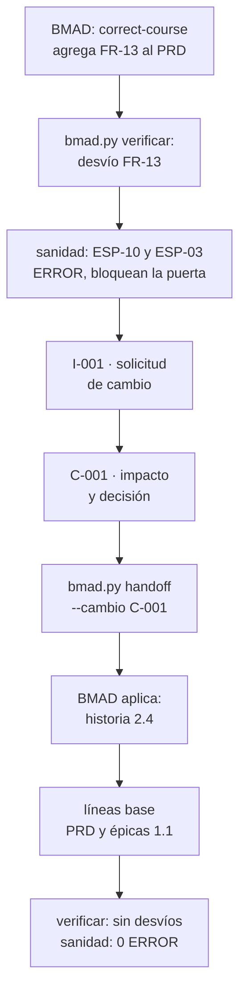

**Tratamiento de un rechazo de calidad (paso 8):**
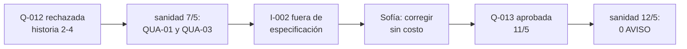

**Ciclo de una lección, de la retrospectiva al índice (pasos 6c a 9):**
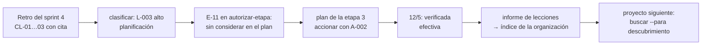

**Del dolor del recorrido al beneficio medido (pasos 6b a 11):**
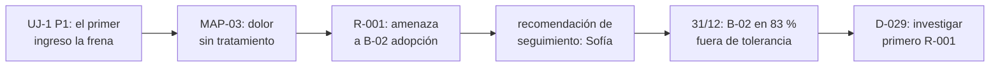

## Lista de comprobación de capacidades

- [ ] BMAD detectado y usado como fuente única; nada escrito en `_bmad/` ni `_bmad-output/` (paso 1; diseño a fondo en E2E-5).
- [ ] Presupuesto de cambio y límite de la autoridad de cambio fijados por la junta; enfoques de calidad y de beneficios
      registrados antes de `autorizar-proyecto` (P-04).
- [ ] CONCERNS de BMAD convertido en condición formal; seguido por EST-12 y G-01; cerrado con `cumplir-condiciones`.
- [ ] Punto de control del WP-001 con productos completados solo si tienen revisión aprobada, y aceptación del paquete.
- [ ] Valor ganado ágil y predictivo con cortes guardados (`--guardar --corte`) y vigilados (TOL-03).
- [ ] Cambio de rumbo detectado (ESP-10, ESP-03), controlado con `costo` y `cargo` (CAM-03), traspasado y cerrado con
      nueva línea base fechada (`bmad.py linea-base --fecha`).
- [ ] Sesión retomada con el resumen derivado de los registros (`estado.py contexto`) y el radar de atención
      (`estado.py radar`: decidir, escalar, desbloquear y vigilar, cada ítem con responsable y siguiente paso).
- [ ] Calidad a volumen por entrega: QUA-01 lista los terminados sin revisión, QUA-02 la revisión vencida, QUA-03 el
      rechazo sin tratamiento; registro en lote y sanidad limpia antes de cada puerta.
- [ ] Estado de productos derivado de los registros (`estado.py productos`) con conteos que suman el total, las
      diferencias entre lo registrado y lo físico y el product status account final del cierre.
- [ ] Recorrido de UJ-1 desde `bmad.py recorridos`, con emociones con fuente y cada dolor tratado con un id (MAP-03 en
      cero).
- [ ] Recorrido dibujado en la sección «Mapas estratégicos» del tablero del Release 1 (`mapas.py tablero --insertar`),
      con 0 avisos MAP y cada tratamiento enlazado a su vínculo.
- [ ] Retrospectiva como reunión propia: lecciones (CL) y acciones de mejora (CM) con cita, registradas tras confirmar;
      la planificación del sprint no propone lecciones.
- [ ] Lecciones clasificadas por impacto, recurrencia y ámbito; la de impacto alto en el plan de la etapa 3 (E-11 en
      cero) y las acciones verificadas al vencer su fecha (REG-11 y REG-12 en cero).
- [ ] Informe de lecciones de la etapa 2 y del proyecto desde el registro, con las aprobadas exportadas al índice de la
      organización y encontradas por `buscar --para descubrimiento`.
- [ ] Business case 1.1 en el límite de etapa y 1.2 confirmado en el cierre.
- [ ] Puerta de cierre verificada por id: C-03 (R-001 con responsable en las recomendaciones) y C-07 (ningún Must sin
      aceptar) en cero antes de la decisión de la junta.
- [ ] Aceptación, traspaso a operación, recomendaciones de seguimiento con el riesgo abierto, plan de revisión de
      beneficios con criterio de desvío, notificación de cierre y enfoque de beneficios traspasado al negocio; paquete
      de cierre (solo archivos del proyecto, externos anotados) y Excel.
- [ ] Expediente de auditoría para un destinatario externo (`paquete.py auditoria --externo`, sin el registro de
      interesados) con `INTEGRIDAD: OK`, y una copia alterada detectada por `paquete.py verificar`.
- [ ] Revisiones de beneficios posteriores al proyecto con check-ins: salud contra la trayectoria (30/6) y tolerancia por
      beneficio (31/12), con el desvío informado a la ejecutiva y su primera hipótesis.
- [ ] Todas las sanidades con `--corte` (fecha del paso); dos corridas seguidas del driver con evidencia idéntica.
