# Guía E2E-5 · De la idea al proyecto diseñado

**Qué vas a probar:** cómo una idea llega a ser un proyecto **diseñado y autorizado**, todavía sin ejecutar, usando las
skills propias de pm-method (derivadas de PRINCE2 7 y PMBOK 8). Vas a ver cinco cosas que casi nunca se hacen bien o se
hacen una sola vez: **validar los supuestos antes de invertir**, **comparar opciones con números**, **elegir el enfoque
de entrega con criterios**, **adaptar (tailoring) la gestión al contexto** y **dejar fijados los presupuestos y las
tolerancias de la junta**. El recorrido cubre la puesta en marcha (starting up a project) y la iniciación (initiating a
project) hasta la puerta `autorizar-proyecto`, y termina mostrando cómo se vigila lo que la junta aceptó sin validar.

**Escenario (ficticio):** la red de **Policlínicas Altamar** (6 policlínicas, 240.000 turnos por año) quiere que los
pacientes saquen, confirmen y cancelen turnos sin llamar. Ejecutiva: Carmen Olivera (gerenta general). Gestor: Pablo
Rinaldi. Usuaria sénior, product owner y autoridad de cambio: Inés Ferrer (jefa de atención al paciente). Proveedor
sénior: Tomás Aguirre (jefe de TI). Aseguramiento: Valeria Santos. Jefe de equipo: Nicolás Pereyra.

**Dos variantes, claramente marcadas:**
- **b) sin BMAD (principal, pasos 1 a 14, con el 5b):** todo con skills de pm-method; los supuestos y requisitos salen
  del mandato, las lecciones y `requisitos.md`.
- **a) con BMAD (pasos 15 a 17):** la misma secuencia de decisión, pero los supuestos, preguntas, requisitos, recorridos
  y decisiones de arquitectura salen del fixture BMAD real (portal de socios de una cooperativa), leídos con
  `pm-bmad-puente` en modo de solo lectura.

**Skills y agentes:** pm-orquestador · pm-inicio → `pm-mandato-y-brief` (incluye la plantilla
`hipotesis-y-experimentos`), `pm-caso-de-negocio` (con `inversion.py`), `pm-acta-constitucion`, `pm-enfoques-gestion`,
`pm-organizacion-roles`, `pm-interesados`, `pm-mapas-estrategicos` · pm-planificacion → `pm-planificacion-por-productos`,
`pm-costos-presupuesto`, `pm-plan-etapa-y-limites` · `pm-riesgos` (candidatos y riesgos) · `pm-bmad-puente` (variante a)
· `pm-visuales` · `pm-director` (`pm-direccion-decisiones`) · `pm-estado-proyecto` (sanidad, puertas y contexto de sesión).

**Duración:** 18 pasos (15 de la variante b, contando el 5b, y 3 de la variante a), 120–150 minutos de recorrido; en el
webinar, dos clases de 90 minutos. **Preparación:**
- Variante b: una carpeta vacía (`mkdir -p ~/proyectos-prueba/turnos-e2e-5 && cd ~/proyectos-prueba/turnos-e2e-5 && claude`).
- Variante a: una copia del fixture (`cp -r ~/pm-method/scripts/pruebas/fixtures/bmad-v6.12-real ~/proyectos-prueba/portal-e2e-5a`),
  como indica el [README de las guías](README.md#cómo-usar-las-guías).

**Evidencia de referencia:** [salida-g5.md](evidencia/salida-g5.md). **Material de clase:**
[guion](../webinar/E2E-5/guion-instructor.md) · [ejercicio](../webinar/E2E-5/ejercicio.md) ·
[diapositivas](../webinar/E2E-5/diapositivas.json). **Términos:** [TERMINOLOGIA.md](../TERMINOLOGIA.md).

---

## Por qué importa

Pensá en el último proyecto que viste aprobar. ¿Cuántos de los números del caso de negocio descansaban en un supuesto
que nadie había verificado? ¿Alguien decidió de antemano qué resultado haría cambiar la decisión? Lo habitual es que el
caso se escriba una vez para conseguir la aprobación, con el supuesto más optimista, y que el enfoque de entrega se
elija por costumbre ("acá siempre trabajamos así").

El escenario lo muestra con cifras. El mandato supone que un recordatorio baja el ausentismo del 18 % al 10 %. Un piloto
de cuatro semanas en una policlínica lo bajó al 13,5 %. Ese solo supuesto inflaba el VAN de cada opción en
**USD 159.213**: la opción completa pasa de 431.782 a 272.569. La idea sobrevive (la opción 2 sigue siendo la mejor),
pero con otro tamaño, y la junta lo sabe **antes** de invertir.

Hacerlo a mano exige una planilla, una lista de supuestos que nadie revisa y la memoria de quien la armó. Con pm-method,
cada supuesto crítico tiene experimento, criterio y fecha; el VAN sale de un script con las fórmulas a la vista; y la
sanidad avisa cuando falta un experimento, cuando vence una fecha, cuando un resultado negativo queda sin tratar o
cuando nadie revisó un riesgo a tiempo.

## Qué vas a lograr

1. Un **mapa de supuestos** (criticidad × certeza) con experimentos baratos, criterios fijados de antemano y resultados
   que cambian el caso de negocio, vigilados por SUP-01, SUP-02 y SUP-03.
2. **Opciones de negocio** 0/1/2 con VAN, TIR, repago y sensibilidad calculados por `inversion.py`, recalculados con la
   evidencia y con el presupuesto.
3. El **enfoque de entrega** elegido con los nueve criterios y registrado como decisión (híbrido por construcción),
   contrastado con un **mapa de Wardley** de los entregables y con el **recorrido del paciente**, cuyos dolores quedan
   tratados por requisitos y riesgos (MAP-02 y MAP-03).
4. Un **presupuesto con reservas sin doble conteo** y los **presupuestos de la junta** fijados en `estado.json`.
5. Un **proyecto adaptado a su contexto** (y el mismo proyecto en tres diseños), autorizado con cada supuesto crítico
   validado, ajustado o **aceptado expresamente por la junta** (P-11), y vigilado después de la puerta.

## Indicadores que vas a ver

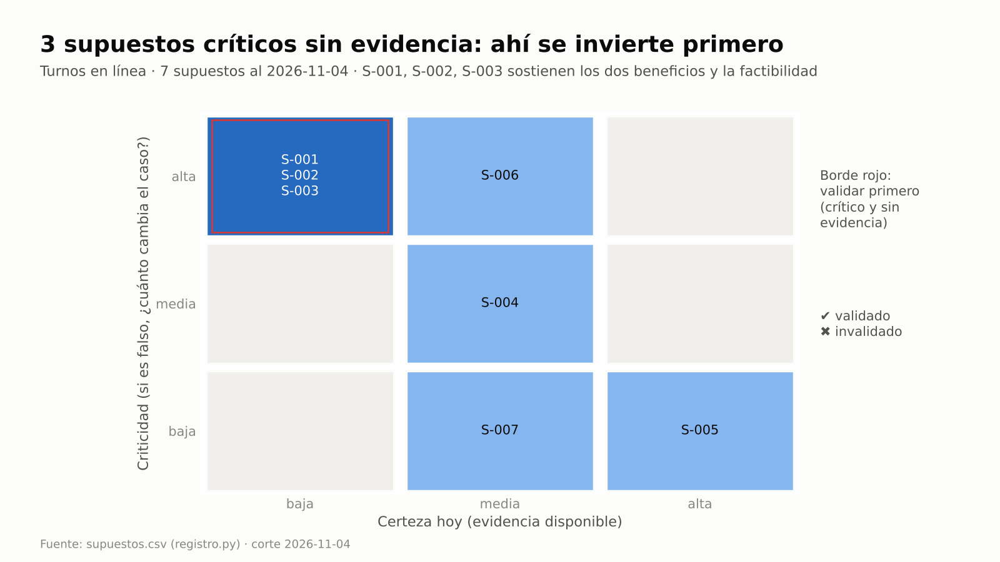
Tres supuestos críticos sin evidencia (S-001, S-002, S-003) sostienen los dos beneficios y la factibilidad: ahí se
invierte primero en aprender (paso 2).

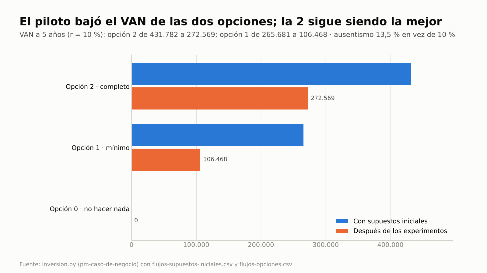
El piloto bajó el VAN de las dos opciones; la opción 2 sigue siendo la mejor, con una TIR de 54,3 % y un repago de
1,78 años (paso 4).

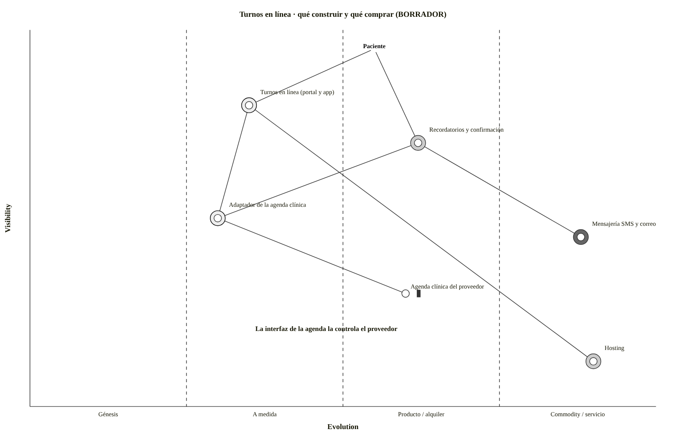
Lo que diferencia se construye, lo que el mercado ya ofrece se compra, y el adaptador queda atado a una agenda con
inercia: el mapa confirma desde otro ángulo la lectura 23 · 18 · 12 del enfoque (paso 5b).

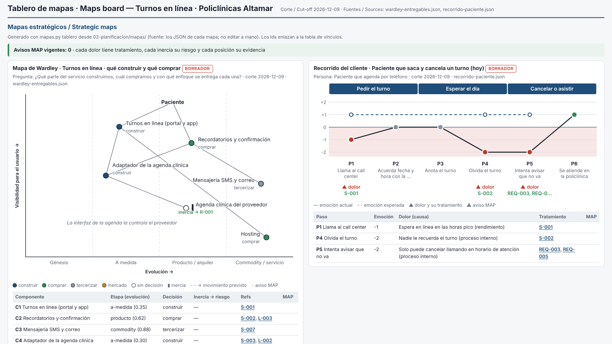
Los dos mapas del paso 5b en su tablero, con los vínculos de los pasos 6 y 9: la agenda clínica con inercia ya tiene su
riesgo (R-001), cada dolor del paciente su tratamiento (S-001, S-002, REQ-003 y REQ-005) y no queda ningún aviso MAP
(paso 14).

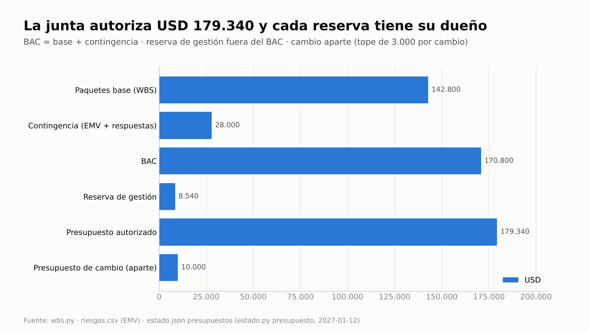
La junta autoriza USD 179.340 (BAC 170.800 + reserva de gestión 8.540) y fija aparte un presupuesto de cambio de
10.000 con tope de 3.000 por cambio (paso 9).

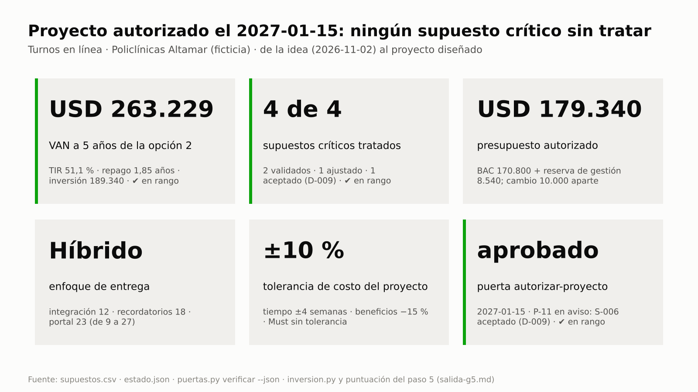
Al autorizarse el proyecto: VAN de USD 263.229 con el presupuesto real, 4 de 4 supuestos críticos tratados (uno de ellos
aceptado por la junta con la decisión D-009) y la puerta `autorizar-proyecto` aprobada el 2027-01-15 (paso 14).

## Clases

| Clase (90 min) | Pasos | Pregunta que responde |
|---|---|---|
| **1 · ¿Vale la pena?** (puesta en marcha) | 1 a 6: mandato y lecciones, mapa de supuestos, experimentos y resultados, opciones con VAN, enfoque de entrega, mapa de valor y recorrido del paciente (5b), brief y `autorizar-inicio`; contraste con la variante a (pasos 15 a 17) | ¿Qué tendría que ser cierto para que esto valga la pena, y cómo lo sabemos barato? |
| **2 · Diseñar el proyecto** (iniciación) | 7 a 14: retomar la sesión y beneficios (P-04), producto y PBS, presupuesto y reservas, organización e interesados, enfoques adaptados, bloque C (tres diseños), PID, P-11 y `autorizar-proyecto`, tablero y seguimiento | ¿Cómo dejamos el proyecto listo para que la junta delegue con cifras? |

La clase 2 usa lo que deja la clase 1: los supuestos tratados, la opción elegida y el enfoque decidido. El guion las
detalla minuto a minuto.

## Del uso único al control continuo

| Actividad | Cómo se hace hoy | Con pm-method (frecuencia · control) | Indicador |
|---|---|---|---|
| Listar los supuestos de la idea | Una sección del caso que nadie revisa | `supuestos.csv` con criticidad y certeza; candidatos destilados del mandato, las lecciones o BMAD (`riesgos.py candidatos`) | Mapa de supuestos: 3 en el cuadrante crítico |
| Validar antes de invertir | Nunca, o "lo vemos en la ejecución" | Experimento, criterio y fecha para cada supuesto crítico · SUP-01 en cada sanidad | Críticos sin experimento: 4 → 0 |
| Seguir los experimentos | Se olvidan cuando vence la fecha | Fecha límite vigilada · SUP-02 | S-003 vencido el 2026-12-07; S-006 el 2027-02-01 |
| Usar un resultado negativo | Se archiva y el caso no cambia | Invalidado sin decisión, riesgo, issue o cambio · SUP-03 | S-002 tratado con D-001 |
| Comparar opciones | Una opción "ganadora" y dos de relleno, en una planilla | Opción 0 como base; `inversion.py` calcula VAN, TIR, repago, sensibilidad y equilibrio desde un CSV de flujos, con la evidencia y con el presupuesto (pasos 4 y 9) | VAN 431.782 → 272.569 → 263.229 |
| Elegir el enfoque de entrega | Por costumbre | Nueve criterios por entregable; `estado.py set enfoque_entrega … --por` deja la decisión en `decisiones.csv`, revisada en cada puerta de etapa | 12 · 18 · 23 → híbrido (D-003) |
| Decidir qué construir y qué comprar | Por preferencia del equipo, sin mirar el mercado | Mapa de Wardley con evidencia por componente; inercia sin riesgo → MAP-02; construir algo que ya es producto o commodity sin decisión → MAP-01 | MAP-02 abierto del paso 5b al 9 |
| Entender dónde sufre el paciente | Anécdotas del call center | Recorrido con emoción y fuente por paso; cada dolor con tratamiento · MAP-03 en cada sanidad | MAP-03 resuelto en el paso 6 con REQ-003 y REQ-005 |
| Criterios de éxito con dueño y fecha | Se definen al cierre, si se definen | Verificación de `autorizar-proyecto` · P-04 | P-04 resuelto con el enfoque de beneficios |
| Presupuestos y autoridad delegada | Un monto global sin reglas | `estado.py presupuesto`; desde ahí la sanidad vigila el consumo · CAM-03, CAM-04 (en la ejecución) | Cambio 10.000 · riesgo 28.000 · gestión 8.540 · tope 3.000 |
| Adaptar la gestión al contexto | Se copia la plantilla completa, o no se escribe nada | Formalidad decidida por enfoque (D-008) y adaptación en el PID §8; tres diseños comparados (bloque C) | 7 · 16 · 12 artefactos según el diseño |
| Invertir sobre hipótesis | Se aprueba sin saberlo | Verificación de `autorizar-proyecto` · P-11: condición mientras el supuesto no se valide; aviso cuando la junta lo acepta con una decisión que lo cita | P-11 con S-003 y S-006 → S-003 validado, S-006 aceptado (D-009) |
| Retomar el proyecto semanas después | Se reconstruye de memoria o de notas viejas | `estado.py contexto`: el hook de inicio lo agrega a cada sesión; los registros mandan sobre cualquier nota de memoria | "Supuestos críticos sin validar: S-003, S-006" al abrir la clase 2 |
| Revisar los riesgos a tiempo | Se revisan cuando algo explota | `fecha_revision` de cada riesgo · REG-09 en cada sanidad | R-001, R-002 y R-003 vencidos el 2027-02-01 |

En esta guía, la sanidad corre con `--corte` en la fecha de cada paso, así el resultado es reproducible. En uso real,
pm-control la corre con la fecha de cada checkpoint y highlight.

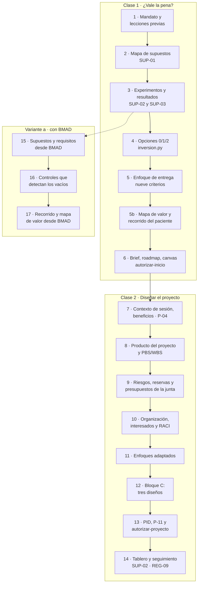

---

## Paso 1 · Mandato y lecciones previas

Todo empieza con un pedido. Lo primero no es escribir el caso de negocio: es dejar el pedido por escrito como llegó
(mandato, project mandate) y buscar qué aprendió la organización en proyectos parecidos.

**Prompt**
```text
Tengo una idea y antes de pedir plata quiero saber si vale la pena. Creá el proyecto "Turnos en línea · Policlínicas
Altamar" en ./gestion, en español, con fecha 2026-11-02; el enfoque de entrega lo decidimos después. La ejecutiva es
Carmen Olivera y el gestor Pablo Rinaldi. Convertí en mandato este correo de Carmen del 2026-11-02: "Que los pacientes
saquen, confirmen y cancelen turnos sin llamar. El call center no da abasto y el ausentismo nos cuesta caro. El teléfono
y el presencial se mantienen." Datos de la red: 240.000 turnos por año, 70 % por teléfono, ausentismo del 18 %, margen
de un turno recuperado USD 5 y costo de una llamada atendida USD 1,20 (finanzas).
Registrá estas lecciones de proyectos anteriores: la app de resultados de 2024 tuvo 11 % de uso en mayores de 65; la
integración con la agenda clínica de 2025 se estimó en 4 semanas y llevó 14; el piloto de recordatorios de odontología
bajó el ausentismo pero nadie midió la línea base.
```

**Si te pregunta** por el enfoque de entrega: "Todavía no; lo decidimos con criterios en el paso 5".

**Qué hace el sistema:** pm-orquestador → `pm-nuevo` (`nuevo_proyecto.py --fecha 2026-11-02` sin `--enfoque`: queda
`predictivo` por defecto y la etapa 0 empieza en la fecha del mandato) → pm-inicio → `pm-mandato-y-brief`: redacta
`00-direccion/mandato.md` con `templates/mandato.md` y marca como `[supuesto]` lo que el correo da por cierto; registra
las lecciones con `registro.py agregar lecciones`.

**Qué deberías ver:** "Proyecto creado en gestion · enfoque de entrega: predictivo" y las lecciones **L-001**, **L-002**
y **L-003**.

**Dónde verificar:** `gestion/00-direccion/mandato.md` · `gestion/03-control/registros/lecciones.csv` · prompt:
"Mostrame las lecciones previas".

---

## Paso 2 · Mapa de supuestos: criticidad y certeza

Un **supuesto** es algo que se da por cierto sin evidencia. Se califica en dos ejes: **criticidad** (si es falso,
¿cuánto cambia el caso?) y **certeza** (¿cuánta evidencia hay hoy?). Los de criticidad alta y certeza baja son
**hipótesis**: ahí se invierte primero en aprender.

**Prompt**
```text
Listá los supuestos que sostienen la idea en tres familias: deseabilidad (¿lo van a usar?), viabilidad (¿cierra
económicamente?) y factibilidad (¿se puede construir y operar?). Empezá por lo que ya dicen el mandato y las lecciones.
Calificá criticidad y certeza, registralos con fecha 2026-11-04 y mostrame el mapa.
```

**Si te pregunta** quién responde por cada supuesto: Inés Ferrer por la adopción, el ausentismo y las agendas; Tomás
Aguirre por la agenda clínica y el costo de los mensajes; Carmen Olivera por la normativa y la restricción de canales.

**Qué hace el sistema:** `pm-mandato-y-brief` (references/guia.md §9) usa `riesgos.py candidatos --fuentes artefactos`
para destilar candidatos del mandato y de `lecciones.csv`, propone los supuestos y los registra con
`registro.py agregar supuestos --campo categoria=… --campo criticidad=… --campo certeza=…`; corre
`sanidad.py --corte 2026-11-04` y `pm-visuales` dibuja el mapa.

**Qué deberías ver:** "artefactos: 5 candidatos" (cuatro del mandato y la lección L-002); los supuestos **S-001** a
**S-007** (S-005 es una restricción: se mantienen el teléfono y el presencial); sanidad con **4 AVISO SUP-01**: S-001,
S-002, S-003 y S-006 son críticos y no tienen experimento.


S-001 (adopción en línea), S-002 (ausentismo con recordatorio) y S-003 (interfaz de la agenda) están en el cuadrante de
borde rojo. S-006 (normativa) es crítico pero con algo más de evidencia.

**Dónde verificar:** `gestion/03-control/registros/supuestos.csv` · `03-control/reportes/2026-11-04-candidatos-riesgo.md`
· prompt: "¿Qué supuestos críticos no tienen experimento?".

---

## Paso 3 · Experimentos baratos, resultados y controles SUP

Un buen experimento es más barato que equivocarse, tiene fecha y decide **antes** qué resultado haría cambiar la
decisión. Después, el resultado tiene que llegar al caso de negocio, sea bueno o malo.

**Prompt**
```text
Para cada supuesto crítico definí el experimento más barato, el criterio para seguir y la fecha límite:
- S-001: prueba de humo, un botón "sacá tu turno en línea" en el sitio con registro de interés durante 3 semanas;
  seguimos con 1.000 registros o más; hasta el 2026-11-27; Inés Ferrer.
- S-002: piloto de recordatorio con confirmación en la Policlínica Centro, 4 semanas (2.000 turnos); seguimos si el
  ausentismo baja a 12 % o menos; hasta el 2026-12-04; Inés Ferrer.
- S-003: prueba técnica de 5 días en el entorno de pruebas del proveedor, reservar y cancelar 50 turnos; seguimos con
  50 de 50 y respuesta menor a 2 s; hasta el 2026-12-04; Tomás Aguirre.
- S-006: consulta formal a la asesoría legal sobre el consentimiento; dictamen hasta el 2027-01-29; Carmen Olivera.
Armá la hoja de hipótesis y experimentos para la junta.
```
Y el 2026-12-07:
```text
Resultados: S-001 dio 1.840 registros en 3 semanas. El piloto de S-002 bajó el ausentismo del 18 % al 13,5 %. La prueba
de S-003 no se hizo: el proveedor no entregó las credenciales. Corré la sanidad al 2026-12-07.
```

**Si te pregunta** qué hacer con S-002 y S-003: "Carmen decide: S-002 queda invalidado y el caso usa 13,5 %; la prueba
de S-003 se replanifica al 2027-01-14, porque el proveedor entrega las credenciales el 2027-01-07".

**Qué hace el sistema:** `registro.py actualizar supuestos S-… --campo experimento=… --campo criterio=… --campo
fecha_limite=…`; redacta `01-inicio/hipotesis-y-experimentos.md` con la plantilla del mismo nombre (v0.1, luego v0.2 con
la sección de resultados). Con los resultados: `validado=si|no`, `estado=validado|invalidado`, `evidencia=…`. Las dos
decisiones de Carmen van a `decisiones.csv` y la nueva fecha de S-003, al registro.

**Qué deberías ver:**
- Sanidad al 2026-11-05: **0 AVISO** (cada supuesto crítico tiene experimento y fecha).
- Sanidad al 2026-12-07: **SUP-02** "Supuesto S-003 con fecha límite 2026-12-04 vencida y sin validar" y **SUP-03**
  "Supuesto S-002 invalidado sin issue, cambio, riesgo o decisión que trate su efecto".
- **D-001** (S-002: el caso usa 13,5 %) y **D-002** (S-003 replanificado al 2027-01-14); la sanidad vuelve a **0 AVISO**.

**Dónde verificar:** `supuestos.csv` (columnas `experimento`, `criterio`, `fecha_limite`, `evidencia`) ·
`01-inicio/hipotesis-y-experimentos.md` · `decisiones.csv`.

---

## Paso 4 · Opciones de negocio 0/1/2 con VAN, TIR, repago y sensibilidad

PRINCE2 pide comparar siempre contra "no hacer nada distinto" (la opción 0). Cuatro medidas, en palabras simples:
- **VAN** (valor actual neto, NPV): cada flujo anual descontado a la tasa de la organización, sumado. Mayor que 0 crea
  valor.
- **TIR** (tasa interna de retorno, IRR): la tasa con la que el VAN da 0; se compara con la tasa de la organización.
- **Repago** (payback): cuándo el flujo acumulado llega a cero; el **repago descontado** usa los flujos descontados.
- **Sensibilidad**: cuánto cambia el VAN si un concepto varía ±20 %, y su **punto de equilibrio**: cuánto puede caer un
  beneficio antes de que el VAN llegue a 0.

**Prompt**
```text
Compará tres opciones: 0 no hacer nada distinto; 1 mínimo, recordatorios con confirmación (inversión 30.000, operación
18.000 por año); 2 completo, turnos en línea con recordatorios (inversión 180.000 en orden de magnitud, operación
36.000 por año). Beneficios: turnos recuperados = 240.000 × (0,18 − ausentismo) × 5; llamadas evitadas = 240.000 ×
adopción × 1,20, con adopción de 20 % el primer año y 40 % después. Tasa 10 % y 5 años. Calculá VAN, TIR, repago y
sensibilidad con los supuestos iniciales y con los resultados de los experimentos. Mostrame las fórmulas.
```

**Si te pregunta** por la tasa de descuento: "10 %, la fija finanzas".

**Qué hace el sistema:** `pm-caso-de-negocio` en modo esquemático escribe un CSV de flujos con una fila por concepto
(`opcion,concepto,tipo,0,1,…,5`; egresos en negativo) en `00-direccion/inversion/`, uno con los supuestos iniciales y
otro con los resultados, y corre `inversion.py <csv> --tasa 0.10` sobre cada uno. El script imprime las fórmulas
(`VAN = Σ F_t/(1+r)^t`), la tabla por opción y la sensibilidad; con `--json` entrega las mismas cifras al documento.
Redacta `00-direccion/business-case-esquematico.md` con la tabla de opciones.

**Qué deberías ver** (salida de `inversion.py` en la evidencia):

| Opción | VAN con supuestos iniciales | VAN después de los experimentos | TIR | Repago (descontado) |
|---|---|---|---|---|
| 0 · No hacer nada distinto | 0 (base) | 0 (base) | — | — |
| 1 · Mínimo: recordatorios | 265.681 | 106.468 | 117,5 % | 0,83 años (0,92) |
| 2 · Completo: turnos en línea | 431.782 | 272.569 | 54,3 % | 1,78 años (2,01) |

- La base de comparación: el 18 % de ausentismo son 43.200 turnos perdidos por año (USD 216.000 de margen).
- Sensibilidad de la opción 2 (tornado, ±20 %): las **llamadas evitadas (B-02)** mueven el VAN entre 195.702 y 349.436;
  ningún otro concepto lo mueve tanto. B-02 aporta el 65 % del valor actual de los beneficios, así que la sensibilidad
  es obligatoria (guía de `pm-caso-de-negocio` §2).
- Punto de equilibrio de B-02: **29,1 %** de lo estimado, es decir, una adopción estable del **11,6 %**. Con la tasa en
  8 % o 12 %, el VAN queda entre 298.496 y 248.728.
- VAN incremental de la opción 2 sobre la 1: 166.101 por 150.000 más de inversión.

Recomendación: opción 2 en dos releases, el primero con el valor de la opción 1 y el segundo solo si S-003 queda validado.


El supuesto del 10 % inflaba el VAN de cada opción en 159.213. Con la evidencia, la opción 2 sigue siendo la mejor.

**Dónde verificar:** `00-direccion/inversion/flujos-supuestos-iniciales.csv` y `flujos-opciones.csv` ·
`00-direccion/business-case-esquematico.md` · [salida-g5.md](evidencia/salida-g5.md), paso 4 · prompt: "¿Cuánto puede
caer la adopción antes de que la opción 2 deje de convenir?".

---

## Paso 5 · Enfoque de entrega con nueve criterios

El enfoque de entrega (predictivo, adaptativo o híbrido) se elige **por entregable**, no por costumbre. La tabla de
nueve criterios está en `skills/pm-knowledge/references/pmbok8-estandar-principios-ciclos.md` §4.4.4 y la aplica
`pm-mandato-y-brief` (references/guia.md §3): cada criterio vale de 1 (favorece predictivo) a 3 (favorece adaptativo);
una suma de 13 o menos es predictiva, de 14 a 21 híbrida y de 22 o más adaptativa.

**Prompt**
```text
Puntuá los nueve criterios de selección del enfoque para cada entregable: recordatorios y confirmación, turnos en línea
(portal y app) e integración con la agenda clínica. Mostrame la tabla, la lectura de cada uno y tu recomendación para
el proyecto. Si Carmen lo aprueba, registralo con fecha 2026-12-09.
```

**Si te pregunta** quién decide: "Carmen Olivera, ejecutiva; revisalo en cada puerta de etapa".

**Qué hace el sistema:** `pm-mandato-y-brief` (procedimiento, paso 5) puntúa y recomienda. Con la confirmación,
`pm-director` registra `estado.py set enfoque_entrega=hibrido --por "Ejecutiva: Carmen Olivera" --nivel ejecutivo
--fecha 2026-12-09`: el mismo comando cambia `estado.json` y anota la decisión en `decisiones.csv`. Luego completa esa
fila con las opciones consideradas y la revisión (`registro.py actualizar decisiones D-003 …`).

**Qué deberías ver:**

| Criterio | Recordatorios | Turnos en línea | Integración |
|---|---|---|---|
| Certeza de requisitos · estabilidad del alcance · costo del cambio | 1 · 1 · 2 | 3 · 3 · 3 | 1 · 1 · 1 |
| Regulación · valor de la retroalimentación · disponibilidad de interesados | 2 · 2 · 2 | 2 · 3 · 2 | 2 · 1 · 1 |
| Cultura · tamaño del equipo · presión por entrega temprana | 2 · 3 · 3 | 2 · 3 · 2 | 2 · 2 · 1 |
| **Suma · lectura** | **18 · híbrido** | **23 · adaptativo** | **12 · predictivo** |

"Decisión anotada: D-003" y, en `decisiones.csv`, **D-003** "enfoque de entrega: predictivo → hibrido", nivel
ejecutivo, con las opciones consideradas (predictivo, ágil, híbrido y las tres sumas) y "revisar en cada puerta de
etapa". Etapas PRINCE2 con sprints de 14 días dentro.

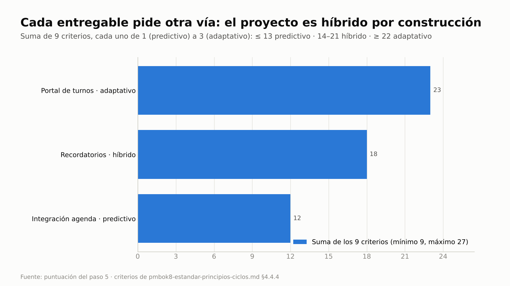
Tres entregables, tres lecturas distintas: el proyecto es híbrido por construcción.

**Dónde verificar:** `estado.json` → `enfoque_entrega` · `decisiones.csv` (D-003).

---

## Paso 5b · Mapa de valor de los entregables y recorrido del paciente

Los nueve criterios miran cada entregable por separado. Un **mapa de Wardley** los pone en una misma cadena: arriba, la
necesidad del paciente; debajo, lo que hace falta para cubrirla. Cada componente se ubica por cuán **visible** es para el
paciente (eje vertical) y cuán **estandarizado** está en el mercado (eje horizontal: génesis, a medida, producto,
commodity). Así se ve qué conviene construir, qué comprar y dónde hay **inercia**: algo difícil de cambiar, como un
sistema que ya está en uso. El **recorrido del cliente** (customer journey) mira lo mismo desde el paciente: qué hace paso
a paso, qué siente y dónde sufre.

**Prompt**
```text
Antes de seguir, armá un mapa de Wardley de los entregables con la pregunta "¿qué parte del servicio construimos, cuál
compramos y con qué enfoque se entrega cada una?": turnos en línea, recordatorios, la mensajería, el adaptador de la
agenda, la agenda clínica del proveedor y el hosting. Ubicá cada uno con evidencia de los supuestos y las lecciones.
Después armá el recorrido actual de un paciente que saca un turno por teléfono, lo olvida o intenta cancelarlo, con la
fuente de cada emoción. Corré la sanidad al 2026-12-09.
```

**Si te pregunta:** "Pablo Rinaldi y Tomás Aguirre confirman el mapa; Inés Ferrer, el recorrido. La agenda clínica del
proveedor no se reemplaza".

**Qué hace el sistema:** pm-inicio → `pm-mapas-estrategicos`: `mapas.py wardley semilla` con los seis componentes;
propone posición, decisión y evidencia de cada uno citando S-001, S-002, S-003, S-007, L-002 y L-003; `validar` y
`render` (Markdown con el bloque Mermaid `wardley-beta` y la tabla de lectura, más el texto `.owm` para
OnlineWardleyMaps). Luego `recorrido semilla` con las tres etapas, el recorrido de seis pasos, `validar`, `render` (HTML
con carriles y curva de emoción) y `recorrido candidatos`. Registra `mapa-wardley-entregables` y
`mapa-recorrido-paciente` en revisión y corre `sanidad.py --corte 2026-12-09`.

**Qué deberías ver:**

| Componente | Etapa (evolución) | Decisión | Lectura sugerida del mapa | Nueve criterios (paso 5) |
|---|---|---|---|---|
| Turnos en línea (portal y app) | a medida (0,35) | construir | adaptativo o híbrido; construir si diferencia | 23 · adaptativo |
| Recordatorios y confirmación | producto (0,62) | comprar | híbrido; preferir comprar o configurar | 18 · híbrido |
| Adaptador de la agenda clínica | a medida (0,30) | construir | predictivo con hitos: depende de un componente con inercia | 12 · predictivo |
| Agenda clínica del proveedor | producto (0,60), con inercia | — | riesgo de inercia | — |
| Mensajería SMS y correo · hosting | commodity (0,88 · 0,90) | tercerizar · comprar | predictivo; comprar o usar como servicio | — |

- `validar`: "0 error(es) · 0 aviso(s)" en los dos mapas.
- Recorrido de seis pasos en tres etapas; los dos peores momentos son "Olvida el turno" (−2, por el ausentismo del 18 %)
  e "Intenta avisar que no va" (−2). `candidatos` propone un requisito para P5: "Cancelar desde el recordatorio y liberar
  el turno".
- Sanidad al 2026-12-09: **2 AVISO**. **MAP-02**: la agenda del proveedor tiene inercia y no hay riesgo registrado.
  **MAP-03**: el dolor de P5 (cancelar solo llamando en horario de atención) no tiene tratamiento. Se resuelven en los
  pasos 6 y 9.


El mapa confirma desde otro ángulo la lectura 23 · 18 · 12 del paso 5. Recordatorios ya es un producto de mercado: se
compra y se configura. El adaptador hay que escribirlo, pero su ritmo lo fija una agenda con inercia. La guía usa la
imagen porque no todos los visores de Markdown dibujan `wardley-beta` (un tipo de diagrama de Mermaid en beta); el
bloque Mermaid queda en `wardley-entregables.md`.

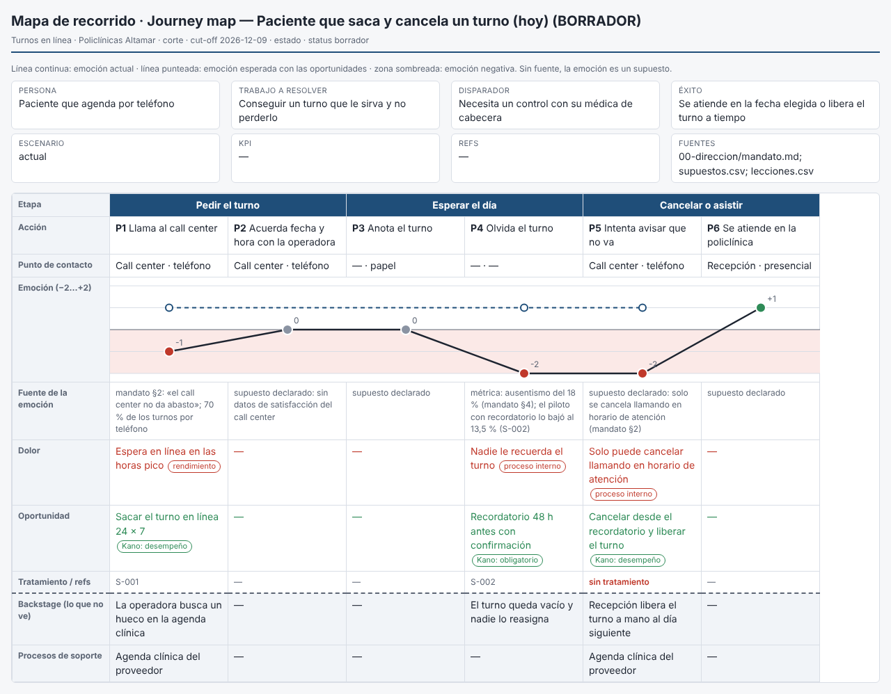
La curva cae a −2 en dos pasos. La línea punteada es la emoción esperada con las oportunidades. P5 todavía aparece "sin
tratamiento". Los dos mapas terminan, ya tratados, en el tablero de mapas del paso 14.

**Dónde verificar:** `02-planificacion/mapas/wardley-entregables.json` y `recorrido-paciente.json` (fuente) ·
`02-planificacion/visuales/wardley-entregables.md` y `.owm`, `recorrido-paciente.md` y `.html` · prompt: "¿Qué dolores
del paciente no tienen tratamiento?".

---

## Paso 6 · Project brief, requisitos, roadmap y canvas → puerta autorizar-inicio

El brief alcanza para decidir la iniciación, no más. La junta autoriza gastar en **diseñar** el proyecto, no en
construirlo.

**Prompt**
```text
Cargá los requisitos (REQ-001 a REQ-007: recordatorio 48 h antes, plantillas, confirmar o cancelar y liberar el turno,
sacar turno en línea, reprogramar, reservar en la agenda en tiempo real, accesibilidad WCAG 2.1 AA). Armá el project
brief con el caso esquemático y el enfoque, el roadmap por etapas, el canvas y el plan de la etapa 1 (iniciación hasta
el 2027-01-15). Tolerancias que fija Carmen: tiempo ±4 semanas, costo ±10 %, alcance "Must sin tolerancia",
beneficios -15 % y riesgo "ningún riesgo alto sin respuesta". Prepará la puerta autorizar-inicio para el 2026-12-11.
```

**Si te pregunta:** "Carmen Olivera, ejecutiva, confirma la lista de control y aprueba el brief y el caso esquemático".

**Qué hace el sistema:** sin BMAD, pm-method es la fuente de la especificación: `02-planificacion/requisitos.md`, leído
por la fachada (`especificacion.py fuente|resumen`). Con los requisitos cargados, `pm-mapas-estrategicos` vincula el
dolor de P5 con REQ-003 y REQ-005 (`mapas.py vincular paciente P5 --refs REQ-003,REQ-005`). `pm-mandato-y-brief`
redacta brief, roadmap y canvas; `pm-plan-etapa-y-limites`, el plan de la etapa 1. `pm-director`:
`estado.py tolerancia --nivel proyecto …`, `puertas.py verificar|lista|confirmar autorizar-inicio --fecha 2026-12-11`,
`estado.py puerta autorizar-inicio --decision aprobado --fin 2027-01-15` y
`estado.py aprobar project-brief|business-case-esquematico --version 1.0`.

**Qué deberías ver:** "Proveedor de especificación: pm-method"; "requisitos: 7"; `mapas.py controles` con un solo aviso
(MAP-02: MAP-03 quedó resuelto); la verificación de la puerta con su único bloqueo, **L-01** (falta la lista de control,
que se arma en la junta); la puerta registrada (**D-004**) y "Fase: inicio · Proceso: IP · Etapa 1: Iniciación ·
Enfoque: hibrido"; aprobaciones **D-005** y **D-006**; en el resumen, "Artefactos: 9 (2 aprobados)" (incluye los dos
mapas).

**Dónde verificar:** `01-inicio/project-brief.md`, `roadmap.md`, `canvas-arranque.md` ·
`00-direccion/decisiones/2026-12-11-verificacion-autorizar-inicio.md` · prompt: `/pm-method:pm-estado`.

---

## Paso 7 · Retomar la sesión, mapa de beneficios y enfoque de beneficios (P-04)

La iniciación empieza semanas después de la puesta en marcha, en otra sesión. Al abrir Claude Code, el hook de inicio
agrega un **contexto de sesión** derivado de `estado.json` y los registros, y avisa que esos datos mandan sobre cualquier
nota de memoria. Así nadie retoma el proyecto con lo que "recordaba".

El **mapa de beneficios** encadena salidas → capacidades → resultados → beneficios → objetivo. El **enfoque de
beneficios** dice quién mide qué, cuándo y con qué línea base, incluso después del cierre.

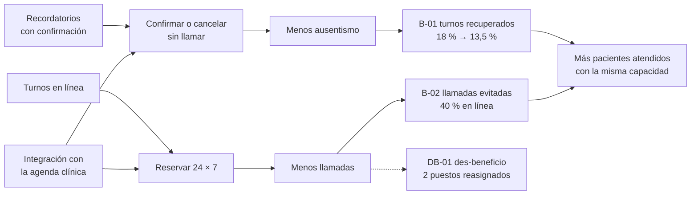

**Prompt**
```text
Retomemos el proyecto de turnos: ¿dónde quedamos al 2027-01-08? Después pasá el caso de negocio a su versión completa
con la cadena de valor, B-01 y B-02 con línea base, meta, dueña y tolerancia, y el des-beneficio. Antes de seguir,
verificá qué le falta al proyecto para la puerta autorizar-proyecto. Después armá el enfoque de beneficios: mediciones
al fin de cada etapa y a los 6 y 12 meses del cierre, a cargo de la red.
```

**Qué hace el sistema:** el contexto lo da `estado.py contexto --corte 2027-01-08` (el mismo resumen que agrega el hook
de inicio, acotado a 2.000 caracteres). Luego `pm-caso-de-negocio` en modo completo (v0.9) y
`puertas.py verificar autorizar-proyecto` como lista temprana de lo que falta, con el código de cada control; después
`templates/enfoque-beneficios.md` → `00-direccion/enfoque-beneficios.md`.

**Qué deberías ver:**
- Contexto: "Abiertos: supuestos 5, lecciones 3. Supuestos críticos sin validar: S-003, S-006. Próxima puerta:
  autorizar-proyecto".
- Verificación: "2 bloqueo(s) · 4 condición(es) · 3 aviso(s)", con **P-01** (falta el PID) y **L-01** (falta la lista
  de control) como bloqueos; **P-05** (falta usuaria sénior y proveedor sénior), **P-06** (sin plan de proyecto) y
  **P-11** (supuestos críticos sin validar: S-003, S-006) como condiciones; **P-04** "sin enfoque de beneficios",
  **P-09** y **P-10** (sin interesados ni RACI) como avisos. Es la lista de trabajo de la clase 2.
- El enfoque de beneficios registrado: P-04 desaparece de las verificaciones siguientes.

**Dónde verificar:** `00-direccion/business-case.md` · `00-direccion/enfoque-beneficios.md` · prompt: "¿Qué le falta
al proyecto para autorizar-proyecto?".

---

## Paso 8 · Descripción del producto del proyecto y PBS/WBS por productos

La **descripción del producto del proyecto** dice qué se entrega y cómo se acepta. La **PBS/WBS por productos** lo
descompone en paquetes con responsable, esfuerzo y costo, cada uno trazado a sus requisitos.

**Prompt**
```text
Escribí la descripción del producto del proyecto (propósito, productos mayores, expectativas de calidad, criterios de
aceptación priorizados, tolerancias de calidad y quién acepta) y cargá la WBS por productos con estos paquetes a USD 60
por hora: gestión 320 h; plataforma de mensajería 160 h; confirmación y liberación 200 h; portal y app 900 h más 12.000
de diseño UX externo; adaptador de la agenda 480 h; capacitación 120 h; puesta en producción como hito.
```

**Qué hace el sistema:** `pm-planificacion-por-productos` con `templates/descripcion-producto-proyecto.md` y
`wbs.csv` + `wbs.py --mermaid` (cada paquete cita sus REQ en la columna `ref`).

**Qué deberías ver:** "Turnos en línea: 12 elementos, 7 hojas · esfuerzo 2180 h · costo 142,800".

**Dónde verificar:** `02-planificacion/descripcion-producto-proyecto.md` · `02-planificacion/wbs.csv` ·
`02-planificacion/visuales/wbs.md`.

---

## Paso 9 · Riesgos, presupuesto con reservas y presupuestos de la junta

La **contingencia** cubre riesgos identificados (su valor monetario esperado, EMV, más el costo de las respuestas); la
**reserva de gestión** cubre lo no identificado y la libera solo la junta; el **presupuesto de cambio** va aparte y lo
administra la autoridad de cambio. Nada se cuenta dos veces.

**Prompt**
```text
Registrá tres riesgos con su EMV y revisión el 2027-01-29: la agenda sin interfaz documentada (P3 × I4, USD 30.000;
reducir con la prueba técnica), la adopción baja en mayores de 65 (P3 × I3, 12.000; canal asistido por 4.000) y el
dictamen legal que exija consentimiento explícito (P2 × I3, 10.000; contingencia). Armá el presupuesto: paquetes base
de la WBS, contingencia, BAC, reserva de gestión del 5 % del BAC y un presupuesto de cambio de 10.000 con tope de 3.000
por cambio. Comparalo con el orden de magnitud del brief y recalculá el VAN de la opción 2 con este presupuesto.
```

**Si te pregunta** quién fija los montos: "Carmen Olivera, ejecutiva, el 2027-01-12".

**Qué hace el sistema:** `registro.py agregar riesgos` (el script calcula puntuación y EMV); `pm-costos-presupuesto`
aplica SPEC §1.10.6 y redacta `02-planificacion/presupuesto.md`; `pm-mapas-estrategicos` cita R-001 en el componente
con inercia (`mapas.py vincular entregables C5 --refs R-001`); `pm-director` registra
`estado.py presupuesto cambio=10000 riesgo=28000 gestion=8540 limite_autoridad_cambio=3000 --por "Ejecutiva: Carmen
Olivera" --fecha 2027-01-12`; `pm-caso-de-negocio` corre `inversion.py` sobre
`00-direccion/inversion/flujos-opcion-2-presupuesto.csv`, con la opción 2 dos veces: con el orden de magnitud y con el
presupuesto.

**Qué deberías ver:** **R-001** (12, EMV 15.000), **R-002** (9, EMV 6.000), **R-003** (6, EMV 3.000); `mapas.py
controles`: "0 aviso(s) de la familia MAP" (la inercia de la agenda queda cubierta por R-001), y:

| Componente | USD |
|---|---|
| Paquetes base (WBS) | 142.800 |
| Contingencia = Σ EMV 24.000 + respuestas 4.000 | 28.000 |
| **BAC** | **170.800** |
| Reserva de gestión (5 % del BAC) | 8.540 |
| **Presupuesto autorizado** | **179.340** |
| Presupuesto de cambio (aparte; tope 3.000 por cambio) | 10.000 |

El orden de magnitud del brief (180.000, −25/+75 % = 135.000–315.000) contiene a 189.340 (autorizado + cambio). Decisión
**D-007**. Con esa inversión, `inversion.py` da para la opción 2: VAN **263.229** (−9.340 frente al orden de magnitud),
TIR **51,1 %**, repago **1,85 años**; la adopción estable de equilibrio sube de 11,6 % a 12,6 %.


Cada reserva tiene su dueño: la contingencia responde a R-001, R-002 y R-003; la reserva de gestión la libera la junta;
el presupuesto de cambio lo administra la autoridad de cambio, con un tope por cambio.

**Dónde verificar:** `riesgos.csv` · `02-planificacion/presupuesto.md` · `estado.json` → `presupuestos` ·
`00-direccion/inversion/` · prompt: "Mostrame los presupuestos de la junta".

---

## Paso 10 · Organización, interesados y RACI (breve)

E2E-3 desarrolla los interesados a fondo; acá alcanza con lo que la puerta exige: la junta completa, la matriz
poder/interés y una RACI (quién es responsable, quién aprueba, a quién se consulta y a quién se informa) de los
productos.

**Prompt**
```text
Completá la junta: usuaria sénior, product owner y autoridad de cambio Inés Ferrer; proveedor sénior Tomás Aguirre;
aseguramiento Valeria Santos; jefe de equipo Nicolás Pereyra; sprints de 14 días. Registrá los interesados (Carmen,
Inés, Tomás, dirección médica, recepción y call center, comisión de usuarios y proveedor de la agenda) con poder,
interés y compromiso actual y deseado, y la RACI de los productos 2, 3 y 4 de la WBS y del requisito REQ-006. Ubicá
"medio" como bajo en la matriz.
```

**Qué hace el sistema:** `pm-organizacion-roles` (`estado.py rol …`); `pm-interesados`: `registro.py agregar
stakeholders` y `agregar raci --campo elemento=<código WBS o REQ>`, `interesados.py --medio bajo matriz` y `raci`.

**Qué deberías ver:** **ST-001** a **ST-007**; "Gestionar de cerca (2)", "Mantener satisfecho (3)", "Mantener informado
(2)"; 18 filas RACI en 4 elementos y "RACI válida: un A por elemento, al menos un R, referencias existentes".

**Dónde verificar:** `estado.json` → `roles` · `stakeholders.csv` · `raci.csv`.

---

## Paso 11 · Enfoques de gestión adaptados al contexto (tailoring)

**Adaptar (tailoring)** es decidir cuánta formalidad necesita cada parte de la gestión, por qué, y dejarlo escrito.
No es saltearse pasos: se aligeran los documentos, no las decisiones.

**Prompt**
```text
Proponé el nivel de formalidad de los enfoques para un proyecto mediano con datos de salud y un solo equipo: riesgos,
calidad, issues y cambios, y comunicación en una página cada uno; datos digitales dentro de calidad; sostenibilidad
dentro del caso de negocio. Usá las cifras del presupuesto y de la autoridad de cambio.
```

**Si te pregunta** quién confirma el nivel: "Pablo Rinaldi, gestor; los enfoques los aprueba Carmen con el PID".

**Qué hace el sistema:** `pm-enfoques-gestion` (procedimiento, paso 2, puerta humana 1): decisión **D-008** en
`decisiones.csv` y los cuatro enfoques de una página en `02-planificacion/enfoques/`, con las mismas cifras del
presupuesto (contingencia 28.000, reserva 8.540, tope de cambio 3.000).

**Qué deberías ver:** D-008 y los artefactos `enfoque-riesgo`, `enfoque-calidad`, `enfoque-issues-cambios` y
`enfoque-comunicacion` en revisión (v0.9).

**Dónde verificar:** `02-planificacion/enfoques/` · `decisiones.csv`.

---

## Paso 12 · Bloque C: el mismo proyecto, tres diseños

¿Qué cambia si el mismo proyecto fuera interno y pequeño, regulado o un producto digital ágil? Los tres diseños salen
de las tablas del propio paquete: perfiles de `pm-mandato-y-brief` (references/guia.md §1), formatos de PID de
`pm-acta-constitucion` (references/guia.md §1 y §2) y enfoques de una página de `pm-enfoques-gestion` (references/guia.md §2).

**Prompt**
```text
Mostrame el mismo proyecto con tres diseños: interno pequeño, regulado (datos de salud) y producto digital ágil.
Para cada uno: enfoque de entrega, etapas, tolerancias, artefactos y enfoques de gestión, y qué controles cambian.
Creá cada diseño como proyecto aparte, con fecha 2027-01-12, para comparar sus estados.
```

**Qué hace el sistema:** tres carpetas con `nuevo_proyecto.py --enfoque predictivo|agil --fecha 2027-01-12`,
`estado.py tolerancia` y `estado.py artefacto` para los artefactos de cada perfil; `estado.py resumen` en cada una; las
cantidades se leen de cada `estado.json`.

**Qué deberías ver:**

| | Interno pequeño | Regulado (datos de salud) | Producto digital ágil |
|---|---|---|---|
| Perfil y PID | mínimo; acta + PID breve | completo; PID índice; aseguramiento independiente | ágil mínimo; PID compacto |
| Enfoque · etapas | predictivo · 2 | predictivo · 4 | ágil · 3 (grupos de releases) |
| Tolerancias | 2: tiempo ±2 semanas, costo ±15 % | 7: las siete dimensiones (calidad: cero no conformidades de privacidad) | 3: fecha fija, costo ±5 %, Must intocables |
| Artefactos · enfoques | 7 · 1 (riesgos, issues y cambios en una página) | 16 · 7 | 12 · 5 de una página con DoD/DoR |
| Controles que cambian | highlight mensual; sanidad en cada highlight | highlight quincenal; auditoría de privacidad como revisión de calidad; cambios solo con la junta | demo y burn-up por sprint; el PO intercambia alcance |

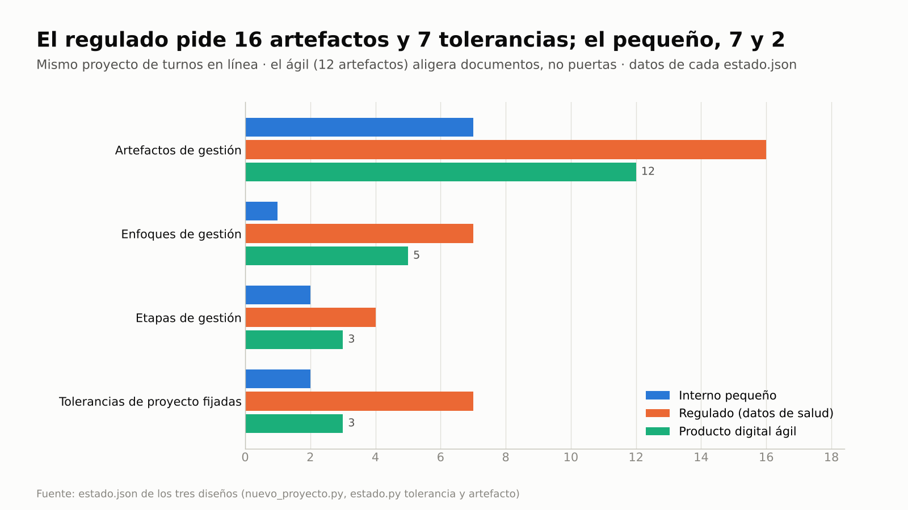
El regulado pide 16 artefactos y 7 tolerancias; el pequeño, 7 y 2. El ágil (12 artefactos) aligera documentos, pero
mantiene las puertas. El diseño real del caso (pasos 1 a 13) es un cuarto punto: híbrido, con 3 etapas.

**Dónde verificar:** los tres `estado.json` (resumen en la evidencia, paso 12) · prompt: "¿Qué cambiaría si el
proyecto fuera regulado?".

---

## Paso 13 · PID con adaptación, sanidad y puerta autorizar-proyecto: P-11 y su resolución

**P-11** es una condición de la puerta: la junta estaría invirtiendo sobre supuestos críticos sin validar. Hay dos
salidas legítimas:
- **Validar** el supuesto con su experimento.
- **Aceptarlo** con una decisión de la junta que lo cite y diga cómo se cubre. P-11 baja a **aviso**: la junta invierte
  sabiendo qué no está probado, el supuesto sigue abierto y la sanidad sigue vigilando su fecha.

**Prompt**
```text
Ensamblá el PID con los controles y la sección de adaptación, registrá el plan de proyecto dentro del PID y el plan de
la etapa 2, corré la sanidad al 2027-01-14 y verificá la puerta autorizar-proyecto.
```
Después de ver P-11:
```text
La prueba técnica de S-003 dio 50 de 50 reservas y cancelaciones, con 1,4 s de respuesta media. El dictamen de S-006
llega el 2027-01-29: Carmen acepta invertir igual, cubre el efecto con el riesgo R-003 y su contingencia, y el dictamen
es condición antes del release de recordatorios. Registralo y prepará la puerta para el 2027-01-15.
```

**Si te pregunta:** "Carmen Olivera, ejecutiva, decide por la junta, confirma la lista, aprueba la puerta y aprueba la
versión 1.0 del caso, el enfoque de beneficios, el PID, el presupuesto, la descripción del producto y los cuatro
enfoques".

**Qué hace el sistema:** `pm-acta-constitucion` redacta `00-direccion/pid.md` (§7 controles, §8 adaptación);
`sanidad.py --corte 2027-01-14` y `puertas.py verificar autorizar-proyecto`. La resolución:
`registro.py actualizar supuestos S-003 --campo validado=si …`; `pm-director` registra la decisión de nivel junta
"La junta acepta S-006 sin validar: …" y anota en S-006 qué decisión lo aceptó (el supuesto queda `abierto`). Luego
`verificar`, `lista`, `confirmar`, `estado.py puerta autorizar-proyecto --decision aprobado --fecha 2027-01-15` y las
aprobaciones.

**Qué deberías ver:**
- Sanidad al 2027-01-14: **0 ERROR · 0 AVISO · 0 INFO**.
- Verificación: "1 bloqueo(s) · 1 condición(es) · 0 aviso(s)": **L-01** (la lista de control, que se arma en la junta) y
  "condición P-11 supuestos críticos sin validar: S-003, S-006".
- Tras la resolución: S-003 validado, decisión **D-009**, y la verificación "1 bloqueo(s) · 0 condición(es) · 1
  aviso(s)" con "aviso P-11 supuestos críticos sin validar aceptados por decisión de la junta: S-006 (D-009)".
- Puerta registrada (**D-010**) con el mismo aviso, aprobaciones **D-011** a **D-019** (9 copias congeladas en
  `00-direccion/historial/`) y en el resumen "Autorizado: sí", "Presupuestos: cambio=10000, riesgo=28000, gestion=8540,
  limite_autoridad_cambio=3000", "Artefactos: 21 (11 aprobados)". Sanidad al 2027-01-15: 0 AVISO.

> P-11 es una **condición**, no un bloqueo: la junta podía aprobar igual y quedaba como observación de la puerta. Lo
> que el control evita es que se invierta sobre una hipótesis **sin saberlo**. Para que la aceptación cuente, la decisión
> tiene que ser de nivel junta, ejecutivo o capa de negocio, citar el id del supuesto y usar el verbo "aceptar"
> (`docs/PUERTAS.md`).

**Dónde verificar:** `00-direccion/pid.md` · `supuestos.csv` (S-006 sigue `abierto`, con la nota de D-009) ·
`decisiones.csv` · `00-direccion/decisiones/2027-01-15-verificacion-autorizar-proyecto.md`.

---

## Paso 14 · Tablero de una página y seguimiento después de la puerta

Aceptar un supuesto no es olvidarlo. El tablero resume el proyecto para la junta; la sanidad y el contexto de sesión
siguen mirando lo que quedó abierto.

**Prompt**
```text
Armame un tablero de una página para la junta con el VAN de la opción elegida, los supuestos críticos tratados, el
presupuesto autorizado, el enfoque de entrega, las tolerancias y el estado de la puerta. Sumá un tablero con el mapa de
valor y el recorrido del paciente, con lo que trata cada dolor y cada inercia.
```
Y el 2027-02-01, sin novedades del dictamen:
```text
Corré la sanidad al 2027-02-01 y decime qué tengo pendiente.
```

**Qué hace el sistema:** `pm-visuales` arma las tarjetas con `supuestos.csv`, `estado.json`, el resultado de
`inversion.py` y `puertas.py verificar autorizar-proyecto --json`, cuya lista `hallazgos` trae el código de cada control
(de ahí sale "P-11 en aviso: S-006 aceptado (D-009)"); `pm-mapas-estrategicos`: `mapas.py tablero`, que dibuja los dos
mapas en SVG propio (sin `mmdc`) con los avisos MAP vigentes y los vínculos en
`02-planificacion/visuales/tablero-mapas.html`. El 2027-02-01: `sanidad.py --corte 2027-02-01` y
`estado.py contexto --corte 2027-02-01`.

**Qué deberías ver:**


VAN USD 263.229 (TIR 51,1 %, repago 1,85 años con una inversión de 189.340) · 4 de 4 supuestos críticos tratados (2
validados, 1 ajustado, 1 aceptado con D-009) · presupuesto autorizado USD 179.340 · enfoque híbrido (12 · 18 · 23) ·
tolerancia de costo ±10 % · puerta `autorizar-proyecto` aprobada el 2027-01-15 con P-11 en aviso.

"Tablero de mapas: 2 mapa(s) dibujado(s) (wardley-entregables.json, recorrido-paciente.json) · 0 aviso(s) MAP · 9
vínculo(s) citado(s)":

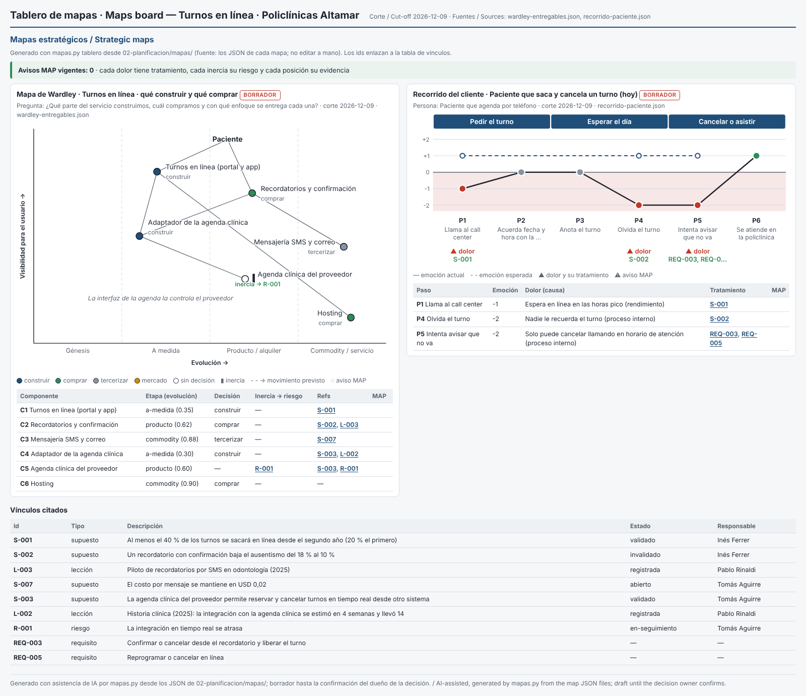
"Avisos MAP vigentes: 0". En el mapa de valor, los componentes llevan el color de su decisión (construir, comprar,
tercerizar) y la agenda clínica del proveedor, sin decisión propia, muestra su barra de inercia con "inercia → R-001".
En el recorrido, debajo de cada dolor está su tratamiento: P1 → S-001, P4 → S-002 y P5 → REQ-003 y REQ-005 (los
requisitos del paso 6); la línea punteada es la emoción esperada. Los ids son enlaces a «Vínculos citados», con
descripción, estado y responsable de cada uno (S-002 `invalidado`, R-001 `en-seguimiento`). Para una diapositiva, el
recorte 16:9 [g5-tablero-mapas-169](img/g5-tablero-mapas-169.png).

Al 2027-02-01, la sanidad da **4 AVISO**: **REG-09** para R-001, R-002 y R-003 ("abierto con la revisión vencida
(2027-01-29; propietario: …)") y **SUP-02** "Supuesto S-006 con fecha límite 2027-01-29 vencida y sin validar". El
contexto de sesión lista lo mismo sin correr la sanidad: "Riesgos con la revisión vencida (REG-09): R-001 (2027-01-29),
R-002 (2027-01-29), R-003 (2027-01-29)" y "Supuestos críticos sin validar: S-006".

**Dónde verificar:** [salida-g5.md](evidencia/salida-g5.md), paso 14 · `02-planificacion/visuales/tablero-mapas.html`
(abrilo en el navegador) · prompt: "¿Qué riesgos tienen la revisión vencida?".

---

## Variante a) con BMAD

### Paso 15 · Supuestos, preguntas y requisitos desde los artefactos de descubrimiento

En la copia del fixture (`~/proyectos-prueba/portal-e2e-5a`).

**Prompt**
```text
Creá el proyecto "Portal de autoservicio para socios" en ./gestion, español, híbrido, con fecha 2026-10-27; ejecutiva
Laura Méndez y gestor Martín Suárez. El equipo de producto ya trabajó en BMAD: mostrame qué artefactos hay, de dónde
salen los requisitos y qué supuestos y preguntas abiertas dejaron el brief, el PRD y la arquitectura. Registrá como
supuestos críticos los tres que más afectan al caso: la línea base de métricas, la interfaz del núcleo operativo y el
método de autenticación.
```

**Qué hace el sistema:** `bmad.py detectar|inventario|requisitos` (solo lectura); `especificacion.py fuente|resumen`;
`riesgos.py candidatos --fuentes bmad` (con su cita `archivo:línea`); `registro.py agregar supuestos` con `notas="origen:
BMAD …"`.

**Qué deberías ver:** seis artefactos BMAD (brief, PRD, arquitectura y épicas en `estado=final`); "42 identificadores ·
{'UJ': 3, 'FR': 12, 'NFR': 6, 'SM': 8, 'AD': 13}"; "Proveedor de especificación: bmad"; "bmad: 42 candidatos", de los
cuales **24 supuestos, 12 riesgos y 6 preguntas**; S-001 (origen `brief.md:26`, sin métricas actuales), S-002
(`prd.md:64` y `prd.md:258`) y S-003 (`prd.md:249`, pregunta abierta 1).

### Paso 16 · Qué controles detectan los vacíos

**Prompt**
```text
Corré la sanidad al 2026-10-28 y verificá qué le falta a este proyecto para autorizarse.
```

**Qué deberías ver:** sanidad con **3 AVISO SUP-01** (los tres supuestos sin experimento) y la verificación de
`autorizar-proyecto` con "4 bloqueo(s) · 5 condición(es) · 2 aviso(s)": **P-11** (S-001, S-002, S-003) además de P-01
a P-06, P-09, P-10 y L-01. No aparecen **P-07** ni **P-08** porque el PRD y la arquitectura del fixture están en
`final`; si el PRD estuviera en borrador, P-07 bloquearía.

### Paso 17 · Recorrido y mapa de valor desde la especificación

**Prompt**
```text
Con la especificación de BMAD, armá el recorrido de UJ-2 (Diego pide un préstamo) con lo que hace la operadora (UJ-3)
como carril interno, y un mapa de valor del portal desde la arquitectura y sus decisiones diferidas: qué construye el
equipo, qué se compra o terceriza y dónde está la inercia. Mostrame qué controles fallan y resolvelos con fecha
2026-10-29. Al final, llevá los dos mapas a su tablero.
```

**Si te pregunta:** "Martín Suárez confirma los mapas y decide: el outbox de notificaciones se construye y el envío se
terceriza. El núcleo operativo va como riesgo a su cargo, con revisión el 2026-11-15".

**Qué hace el sistema:** `bmad.py recorridos --id UJ-2` y `bmad.py capacidades` (solo lectura); `mapas.py recorrido
semilla --uj UJ-2 --backstage UJ-3` y `wardley semilla`, que toman los recorridos, los FR que los realizan, las métricas
SM-n, el mapa de capacidades (FR → módulo → AD-n) y las decisiones diferidas; completa emociones, fuentes, posiciones y
evidencia; `validar`, `render` y `controles`; `recorrido candidatos`; `registro.py agregar supuestos|decisiones|riesgos`
y `mapas.py vincular`; al final, `mapas.py tablero` (tablero de mapas con los dos mapas en SVG, los avisos MAP vigentes y
los vínculos).

**Qué deberías ver:**
- UJ-2 realizado por FR-6 y FR-7, con KPI SM-3 y SM-5 y la métrica de contrapeso SM-C1; 9 capacidades y 6 decisiones
  diferidas en la arquitectura.
- Semillas: el recorrido con 3 etapas y 9 pasos, una acción por paso; el mapa con 3 anclas, 15 componentes y 6 enlaces.
  El mapa final ubica 9 componentes: roles y permisos queda dentro de acceso, seguridad y rendimiento son criterios de
  calidad y tres diferidas son configuración o condiciones.
- `controles`: **MAP-01** (notificaciones, en producto, marcada construir sin decisión), **MAP-02** (núcleo operativo
  con inercia, sin riesgo), **MAP-03** y **MAP-04** (P6, "ve el estado En revisión": dolor sin tratamiento y emoción sin
  fuente).
- Resolución: **S-004** desde el candidato de P6, **D-001** (construir el outbox y tercerizar el envío), **R-001**
  (núcleo operativo, P3 × I4) y los vínculos; `controles`: "0 aviso(s) de la familia MAP".

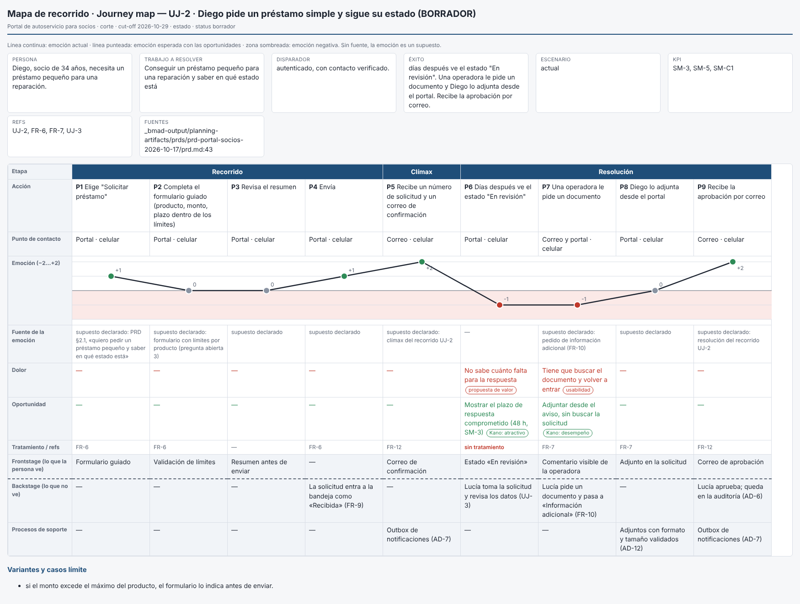
El carril de backstage muestra a Lucía (UJ-3) detrás de cada paso de Diego. El bache de P6 es la espera sin plazo
visible: el PRD promete 48 h (SM-3), pero el socio no lo ve.

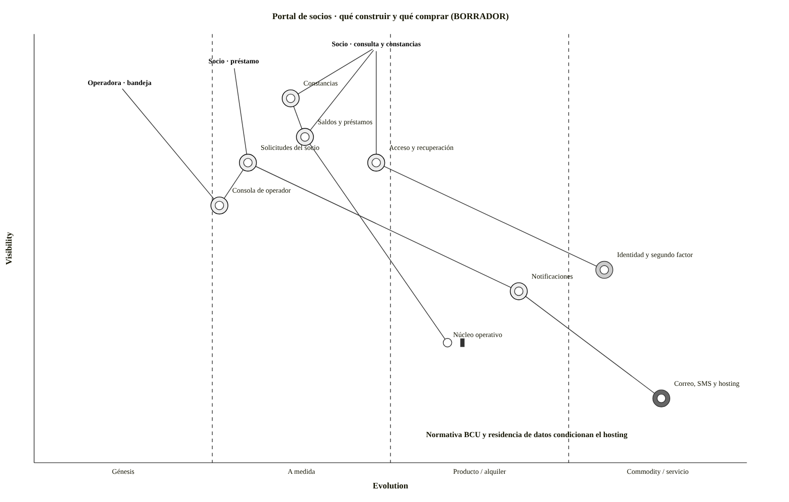
Identidad, correo y hosting, diferidos en la arquitectura, se compran o tercerizan. El núcleo operativo, con inercia,
queda como riesgo R-001.

Y el caso termina en su tablero de mapas: "Tablero de mapas: 2 mapa(s) dibujado(s) (wardley-portal.json,
recorrido-uj-2.json) · 0 aviso(s) MAP · 4 vínculo(s) citado(s)".

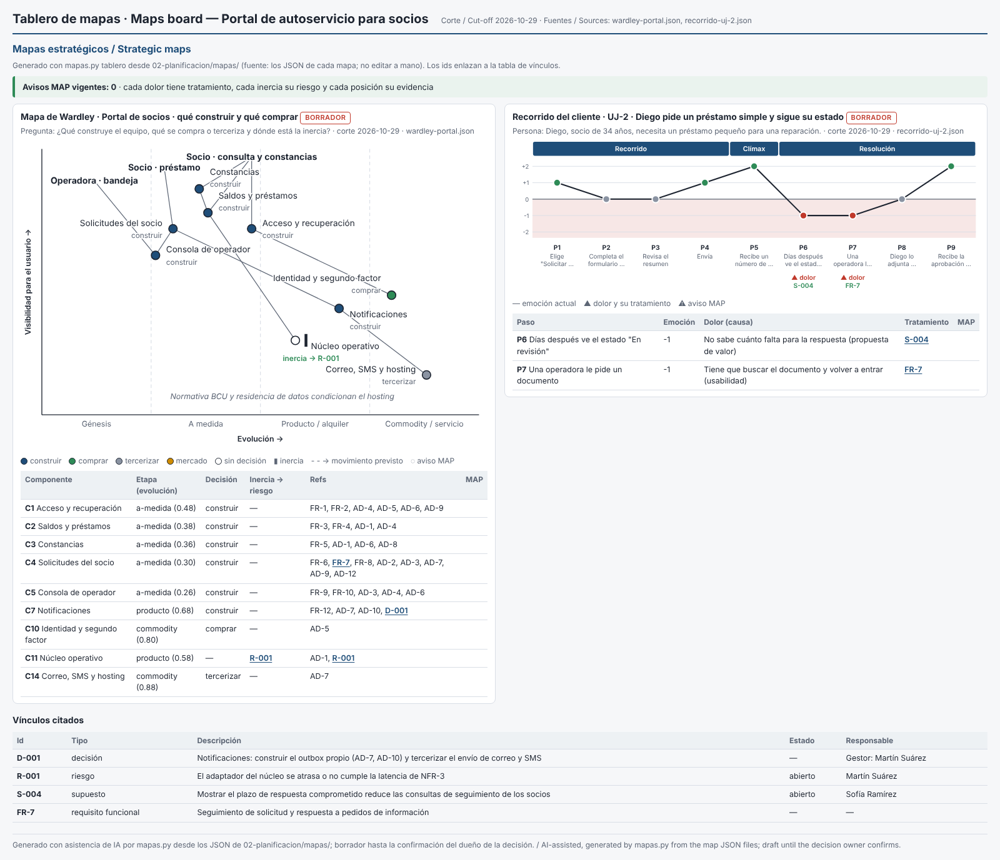
"Avisos MAP vigentes: 0". El núcleo operativo muestra "inercia → R-001"; notificaciones, en producto y marcada
construir, cita la decisión D-001; los dos dolores del recorrido tienen tratamiento (P6 → S-004, P7 → FR-7). Los
requisitos y decisiones de arquitectura que solo son evidencia (FR-n, AD-n) quedan como texto; «Vínculos citados» lista
los cuatro ids de gestión con su estado y responsable.

### Qué cambia entre a) y b)

| | b) sin BMAD | a) con BMAD |
|---|---|---|
| De dónde salen los supuestos | mandato (`[supuesto]`, `[por confirmar]`) y lecciones: 5 candidatos | brief, PRD y arquitectura: 42 candidatos con cita `archivo:línea` |
| Requisitos | `requisitos.md` (REQ-001…007), dueño pm-method | PRD de BMAD (42 ids), dueño BMAD; pm-method solo lee |
| Riesgos | se formulan desde supuestos y lecciones (R-001…R-003) | además, los riesgos y preguntas que BMAD ya declaró (12 y 6) |
| Línea base para el VAN | el mandato trae datos (18 %, USD 5, USD 1,20): `inversion.py` calcula desde el primer día | el brief declara que no hay métricas (`brief.md:26`): no hay VAN sin medir antes |
| Mapas de valor y de recorrido | componentes y recorrido propuestos desde el mandato, los supuestos y las lecciones; dolores tratados por REQ y riesgos (MAP-02, MAP-03) | recorrido desde UJ-2 con el backstage de UJ-3 y KPI SM-3; mapa desde capacidades, AD-n y decisiones diferidas, todo citado por id (MAP-01…04) |
| Controles que detectan vacíos | SUP-01/02/03, P-04, P-11, REG-09 | los mismos, más P-07 y P-08 (estado del PRD y de la arquitectura) y, con la línea base del PRD fijada, los desvíos de `bmad.py verificar` (ver E2E-4) |

---

## Lista de comprobación de capacidades

- [ ] Mandato conservado como llegó, con lo no verificado marcado `[supuesto]`, y lecciones previas en `lecciones.csv`;
      proyecto creado con la fecha del mandato (`nuevo_proyecto.py --fecha`).
- [ ] Supuestos en tres familias con criticidad y certeza, destilados de los artefactos (b) o de BMAD (a), y mapa de
      supuestos `g5-mapa-supuestos.png`.
- [ ] SUP-01 con los críticos sin experimento; experimentos con criterio y fecha; SUP-02 por fecha vencida y SUP-03 por
      un invalidado sin tratar, ambos corregidos con decisiones registradas.
- [ ] Opciones 0/1/2 con `inversion.py` (VAN, TIR, repago simple y descontado, sensibilidad y punto de equilibrio),
      antes y después de los experimentos (`g5-van-opciones.png`), y recalculadas con el presupuesto.
- [ ] Enfoque de entrega por entregable con los nueve criterios y `estado.py set enfoque_entrega=hibrido --por …`, que
      anota la decisión D-003 (`g5-enfoque-entrega.png`).
- [ ] Mapa de Wardley de los entregables con evidencia por componente y recorrido del paciente con la fuente de cada
      emoción (`g5-wardley.png`, `g5-recorrido.png`); MAP-02 y MAP-03 vistos y resueltos con R-001 y REQ-003/REQ-005.
- [ ] Brief, requisitos, roadmap, canvas y plan de la etapa 1; tolerancias de proyecto; `autorizar-inicio` con lista de
      control confirmada.
- [ ] Contexto de sesión (`estado.py contexto`) al retomar la iniciación.
- [ ] Caso completo con mapa de beneficios y enfoque de beneficios (P-04 resuelto).
- [ ] Descripción del producto del proyecto y WBS por productos trazada a REQ.
- [ ] Riesgos con EMV y fecha de revisión, presupuesto con contingencia, BAC, reserva de gestión y presupuesto de cambio
      sin doble conteo; presupuestos de la junta en `estado.json` (`g5-presupuesto.png`).
- [ ] Junta completa, interesados en la matriz y RACI válida.
- [ ] Formalidad de los enfoques decidida (D-008), enfoques de una página y adaptación en el PID §8.
- [ ] Bloque C: tres diseños con su `estado.json`, tabla y gráfico `g5-tres-disenos.png`.
- [ ] P-11 visto con su código y resuelto antes de `autorizar-proyecto`: un supuesto validado y otro aceptado por la
      junta (P-11 en aviso); aprobaciones v1.0 con copia congelada.
- [ ] Tablero de una página `g5-tablero.png` (con `puertas.py verificar --json`) y seguimiento al 2027-02-01: REG-09 y
      SUP-02 sobre lo que quedó abierto.
- [ ] Tablero de mapas `g5-tablero-mapas.png` (`mapas.py tablero`): los dos mapas dibujados, 0 avisos MAP, la inercia
      con su riesgo y cada dolor con su tratamiento enlazado.
- [ ] Variante a: requisitos y supuestos leídos de BMAD con su cita, sin escribir en BMAD; SUP-01 y P-11 sobre ellos.
- [ ] Variante a: recorrido de UJ-2 con backstage de UJ-3 y mapa de valor desde la arquitectura; MAP-01…04 resueltos con
      S-004, D-001 y R-001, y los dos mapas en su tablero (`g5-tablero-mapas-bmad.png`).
- [ ] Todas las llamadas a sanidad con `--corte`; dos corridas seguidas del driver con evidencia idéntica.

## Siguiente caso

Este caso termina donde empieza la ejecución: un proyecto autorizado, con presupuestos, tolerancias y autoridad
delegada escritos, y con lo aceptado bajo vigilancia. Para ver cómo se gestionan los riesgos de ese diseño a lo largo de
las etapas, seguí con **[E2E-1 · Gestión de riesgos](E2E-1-riesgos.md)**; para la ejecución con BMAD, sprints, calidad
y cierre, con **[E2E-4 · Producto de la idea al producto con BMAD](E2E-4-producto-bmad.md)**.
