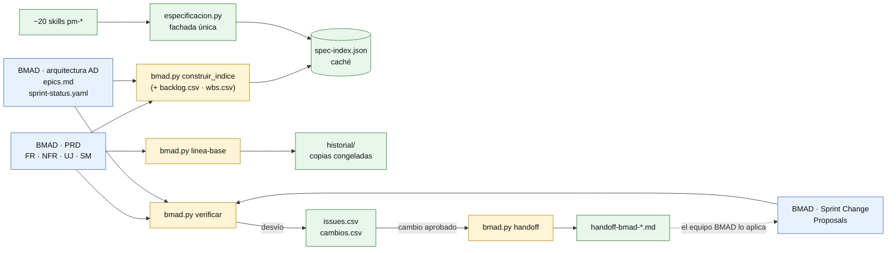
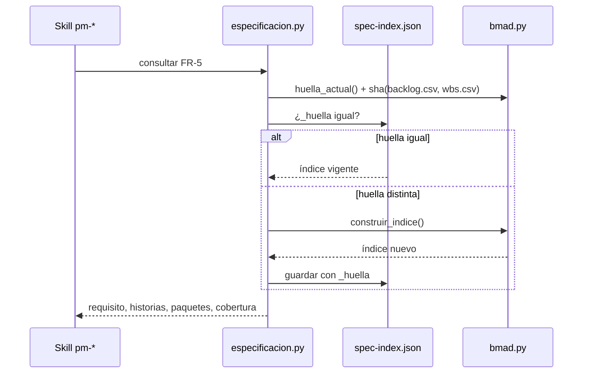
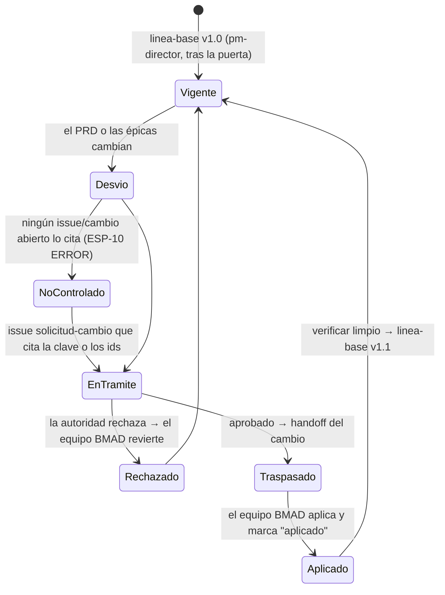

# Sincronización con fuente única · especificación ↔ gobierno

Este documento explica cómo pm-method mantiene coherentes dos capas que cambian a ritmos distintos:

- la **especificación del producto** (qué debe hacer): brief, PRD con FR/NFR/UJ/SM, arquitectura (AD), UX, épicas, historias y su estado. La escribe BMAD o, sin BMAD, pm-method en `requisitos.md`;
- el **gobierno del proyecto** (justificación, planes, prioridades, puertas, cambios). Lo escriben las skills pm-* en la carpeta del proyecto.

La regla vinculante está en `SPEC.md` §1.13 (contrato BMAD) y §1.16 (fuente única). Aquí se explica por qué se eligió, cómo funciona y cómo se detectan sus fallas. Los ejemplos salen de la corrida del [caso maestro](CASO-MAESTRO.md).

---

## 1. El problema

Unas veinte skills necesitan datos de la especificación: el business case cita métricas de éxito (SM-n), la WBS cita requisitos, los riesgos citan decisiones de arquitectura, los informes cuentan historias terminadas y el cierre acepta requisito por requisito. Al mismo tiempo, BMAD cambia el formato de sus salidas en casi cada versión menor de la serie 6 (carpetas fechadas, nombres de archivo, ids `FR-3` o `FR3`). Además, el equipo de producto edita el PRD con sus propios flujos, fuera del control de pm-method.

Hay tres riesgos:

1. **Acoplamiento.** Si cada skill lee BMAD por su cuenta, cada cambio de formato rompe muchas skills de maneras distintas.
2. **Duplicación.** Si los requisitos se copian a documentos de gestión, las copias se desactualizan sin que nadie lo note.
3. **Cambios no controlados.** Si el PRD cambia después de que la junta lo aprobó, PRINCE2 exige tratarlo como solicitud de cambio, y alguien tiene que detectarlo.

---

## 2. Opciones evaluadas y decisión

| Opción | Ventaja | Riesgo | Veredicto |
|---|---|---|---|
| A. Cada skill lee BMAD directamente | no hay copias | ~30 skills acopladas a formatos que cambian; lógica de lectura repetida e inconsistente | descartada como acceso directo; se conserva **detrás de una fachada** |
| B. Sincronización bidireccional de archivos | los dos lados al día | dos escritores sobre el mismo dato: conflictos, ids reescritos, nadie sabe quién manda | descartada |
| C. Exportar copias periódicas BMAD → pm | simple | duplicación y desfase silencioso | descartada; solo quedan **copias congeladas** como líneas base |
| D. **Fuente única + fachada de lectura + traspaso de decisiones** | un dueño por dato; las skills no dependen del formato de BMAD; los cambios dejan rastro | requiere verificar con disciplina (automatizada con huellas sha256) | **adoptada** |

**Decisión.** Cada dato tiene **un solo dueño que lo escribe**. Todos los demás lo **leen a través de una fachada** (`especificacion.py`). Cuando una decisión de gobierno afecta la especificación, se **traspasa** al dueño con un documento (`bmad.py handoff`) para que la aplique él. No hay copias editables ni sincronización bidireccional.

### Dueño de cada dato

| Dato | Dueño (escribe) | Cómo lo usa pm-method |
|---|---|---|
| Justificación, beneficios B-n, costos totales, tolerancias | business case PRINCE2 (`pm-caso-de-negocio`) | — |
| Problema, usuarios, visión del producto | brief de producto BMAD | el project brief lo cita por ruta y sha |
| Requisitos FR/NFR, journeys UJ, métricas SM | PRD BMAD (sin BMAD: `02-planificacion/requisitos.md`) | la PBS y las descripciones de producto citan ids; la matriz de trazabilidad es derivada |
| Decisiones de arquitectura AD | arquitectura BMAD | riesgos y calidad citan ids |
| Épicas, historias, estado de desarrollo | `epics.md` y `sprint-status.yaml` de BMAD | `backlog.csv`: columnas derivadas, refrescadas por `bmad.py backlog` |
| Prioridad, MoSCoW, estimación de gobierno, iteración, release, producto de la PBS | pm-method, columnas de gobierno de `backlog.csv` | el puente nunca las sobrescribe; viajan a BMAD por `handoff` |
| Vínculo requisito ↔ paquete de trabajo | pm-method, columna `ref` de `wbs.csv` | la fachada lo expone como `paquetes_wbs` |
| OKR | `00-direccion/okr.csv` (`pm-okr`) | los KR citan B-n y SM-n |

`backlog.csv` es la única tabla que combina datos de las dos capas, y cada columna tiene un dueño fijo.

---

## 3. Vista general



Colores: azul = BMAD (solo lectura) · amarillo = puente `bmad.py` · verde = carpeta del proyecto (gobierno).

---

## 4. Lectura: BMAD → pm-method

### 4.1 La fachada `especificacion.py`

Es el único punto de lectura de la especificación para todas las skills:

```bash
python3 <pm-estado-proyecto>/scripts/especificacion.py --proyecto <dir> fuente
python3 <pm-estado-proyecto>/scripts/especificacion.py --proyecto <dir> resumen [--json]
python3 <pm-estado-proyecto>/scripts/especificacion.py --proyecto <dir> consultar FR-3 | REQ-004 | 1-2-login | E-2 [--json]
python3 <pm-estado-proyecto>/scripts/especificacion.py --proyecto <dir> listar requisitos|historias|epicas \
    [--estado done] [--epica E-1] [--cobertura sin-cobertura|planificado|en-curso|terminado] [--json]
python3 <pm-estado-proyecto>/scripts/especificacion.py --proyecto <dir> indice     # fuerza la reconstrucción
```

El proveedor depende de `estado.json.integraciones.especificacion`:

- `bmad` → la fachada llama a `pm-bmad-puente/scripts/bmad.py` (`construir_indice`, `huella_actual`), que es el único código que abre archivos de BMAD;
- cualquier otro valor → proveedor `pm-method`: `02-planificacion/requisitos.md` (filas `| REQ-nnn | … |`), `backlog.csv` y `wbs.csv`.

`consultar` normaliza los ids: `FR3` se busca como `FR-3`, y `REQ4` como `REQ-004`. Ejemplo real:

```text
$ especificacion.py --proyecto gestion consultar 2-1-consultar-tramites
tipo_entidad: historia
id: 2-1-consultar-tramites
numero: 2.1
epica: E-2
titulo: Consultar trámites
estado: ready-for-dev
refs: ['FR-2']
paquetes_wbs: ['3.3']
gobierno: {'prioridad': '3', 'moscow': 'must', 'estimacion': '8', 'iteracion': 'S3', 'release': 'R1', 'producto_pbs': '3.3'}
```

La respuesta combina datos de los dos dueños (estado desde BMAD, gobierno desde `backlog.csv`, paquete desde `wbs.csv`) sin que la skill que pregunta sepa de dónde salió cada uno.

### 4.2 El contrato `pm-spec-index/1`

El índice vive en `02-planificacion/especificacion/spec-index.json`. Es un **caché derivado**: no se edita (el hook `guardian.py` lo impide) ni se cita como fuente.

| Campo | Contenido |
|---|---|
| `esquema` | `pm-spec-index/1` |
| `generado` | marca de tiempo de la construcción |
| `proveedor` | `bmad` o `pm-method` |
| `fuente` | con BMAD: `layout`, `version`, `soporte`, `raiz`; nativo: lista de archivos |
| `artefactos` (BMAD) | rutas, sha256 y `status` de cada artefacto |
| `lineas_base` (BMAD) | versión y sha256 de cada línea base registrada |
| `dueños` | quién escribe cada familia de datos |
| `requisitos[]` | `id`, `tipo` (FR, NFR, UJ, SM, AD, UX-DR o REQ), `titulo`, `fuente`, `linea`, `historias[]`, `paquetes_wbs[]`, `cobertura` |
| `epicas[]` | `id` (E-n), `titulo`, `historias[]`, `estado` |
| `historias[]` | `id` (clave BMAD `1-2-slug` o id del backlog), `numero`, `epica`, `titulo`, `estado`, `refs[]`, `paquetes_wbs[]`, `gobierno{prioridad, moscow, estimacion, iteracion, release, producto_pbs}` |
| `resumen` | `requisitos`, `sin_cobertura[]`, `historias`, `por_estado` |
| `_huella` | huella de las fuentes con la que se construyó |

**Vocabulario de cobertura** (común a los dos proveedores): `sin-cobertura` (FR o REQ sin historia ni paquete de la WBS) · `planificado` (con historia pendiente o solo con paquete de la WBS) · `en-curso` · `terminado` (todas sus historias `done`) · `n/a` (UJ, SM o AD sin historias).

Resumen real al cierre del caso maestro:

```text
{'requisitos': 10, 'sin_cobertura': [], 'historias': 6, 'por_estado': {'backlog': 0, 'ready-for-dev': 0, 'in-progress': 0, 'review': 0, 'done': 6}}
lineas_base: bmad-prd v1.1 (f30884de…), bmad-arquitectura v1.0 (0317cc45…), bmad-epicas v1.2 (2d73fdf0…)
```

### 4.3 Caché por huella



- **Con BMAD**, la huella combina el sha256 de cada artefacto BMAD inventariado con el de `backlog.csv` y `wbs.csv`.
- **Sin BMAD**, se calcula sobre `requisitos.md`, `backlog.csv` y `wbs.csv`.

En el caso maestro, la primera consulta dijo `índice reconstruido ahora` y la siguiente `índice vigente`. Si alguien modifica el PRD, la próxima lectura reconstruye el índice sola.

> **Limitación observada:** la huella nativa y la parte de `backlog.csv`/`wbs.csv` incluyen la ruta tal como se escribió en `--proyecto` (`especificacion.py`, línea 39). Pasar `gestion` en una llamada y la ruta absoluta en otra (por ejemplo, la skill y el hook de inicio) provoca reconstrucciones innecesarias y un `ESP-02` INFO de más. No afecta los datos.

---

## 5. Sentido inverso: pm-method → BMAD (traspaso)

pm-method nunca escribe en BMAD (`SPEC.md` §1.13; lo refuerzan el script, con `proteger()`, y el hook `guardian.py` para los subagentes). Cuando una decisión de gobierno cambia la especificación, se genera un **documento de traspaso** y lo aplica el equipo de producto:

```bash
python3 <pm-bmad-puente>/scripts/bmad.py --proyecto <dir> handoff --cambio C-001   # cambio aprobado (pm-issues-cambios)
python3 <pm-bmad-puente>/scripts/bmad.py --proyecto <dir> handoff                  # prioridades cambiadas (pm-agil-hibrido)
```

| Elemento | Detalle |
|---|---|
| Salida | `02-planificacion/especificacion/handoff-bmad-<fecha>-<C-###|prioridades>.md` con frontmatter `tipo: handoff-bmad`, `estado: emitido` |
| Sección 1 (con `--cambio`) | quién decidió y cuándo, descripción, impacto en alcance, **ids afectados** (columna `notas` de `cambios.csv`), acciones esperadas en BMAD: actualizar el PRD con ids estables, corregir el rumbo si afecta historias en curso, avisar para verificar |
| Sección 2 (prioridades) | tabla de historias con MoSCoW, release e iteración vigentes, marcando las que cambiaron desde el último traspaso |
| Sección 3 | confirmación del equipo BMAD: quién aplicó, cuándo, qué archivos |
| Registro | `estado.json.integraciones.bmad.handoffs[]` y `ultimo_handoff_prioridades` |
| Guardas | un cambio que no está `decision=aprobado` se rechaza; sin novedades no se genera archivo (`Nada que traspasar`) |

Ejemplo real: [ejemplos/handoff-bmad-C-001.md](ejemplos/handoff-bmad-C-001.md).

**Confirmación.** El equipo BMAD cambia `estado: emitido` por `estado: aplicado` y completa la sección 3. Mientras no lo haga, la sanidad muestra `ESP-13 Traspaso a BMAD sin confirmar` y `pm-puerta` no propone una línea base nueva.

> **Limitación observada:** el nombre del archivo usa solo la fecha (`bmad.py`, línea 568). Dos traspasos de prioridades el mismo día escriben en el mismo archivo, y `handoffs[]` queda con dos entradas que apuntan a él.

---

## 6. Verificación y líneas base



**Línea base** (`bmad.py linea-base prd|arquitectura|epicas|brief|ux --version X --por "<rol: nombre>"`), solo por pm-director y después de la decisión humana:

- copia los archivos a `00-direccion/historial/bmad-<artefacto>-v<versión>/` (copia congelada; el hook impide editarla);
- registra en `estado.json.artefactos.bmad-<artefacto>`: `externo: "bmad"`, `sha256`, `ids` presentes, `rutas_bmad`, versión y quién aprobó;
- anota la decisión en `decisiones.csv`.

`estado.py aprobar` y `estado.py artefacto` rechazan las claves externas, así que nunca escriben frontmatter dentro de BMAD.

**Verificación** (`bmad.py verificar [--json] [--marcar-vistas]`) compara cada línea base con el artefacto actual y devuelve tres tipos de hallazgo:

| Tipo | Significado |
|---|---|
| `desvio` | contenido distinto, con `ids_agregados` e `ids_retirados` |
| `falta` | el artefacto con línea base ya no se encuentra |
| `propuesta-cambio` | Sprint Change Proposal nueva de BMAD; `--marcar-vistas` la registra como vista una vez tratada |

Se ejecuta en cada período de informe, antes de cada puerta (`pm-puerta`, pm-director) y desde `pm-sync`.

**Elaboración progresiva.** Si el enfoque de cambios lo declara (más detalle sin cambiar el alcance), la autoridad de cambio puede resolver el desvío con un issue y una línea base de versión mayor, sin pasar por la junta. En el caso maestro, la historia 3.1 agregó cobertura a FR-4, que ya estaba en el PRD: I-003 → D-039 (nivel `autoridad-cambio`) → `bmad-epicas` v1.2.

---

## 7. Estabilidad de los ids

El vínculo entre capas es siempre un **id**. Los textos no se copian entre documentos.

| Familia | Formato | Dueño | Regla |
|---|---|---|---|
| Requisitos BMAD | `FR-n`, `NFR-n`, `UJ-n`, `SM-n`, `AD-n`, `UX-DR-n` (se acepta `FR3` y se normaliza) | PRD / arquitectura BMAD | no renumerar ni reutilizar ids retirados (lo pide el traspaso) |
| Requisitos nativos | `REQ-nnn` | `requisitos.md` | ídem |
| Historias BMAD | clave `épica-historia-slug` (`2-3-notificaciones-sms`) | `sprint-status.yaml` | una historia retirada en BMAD queda en `backlog.csv` como `retirada-en-bmad` para que decida el PO |
| Épicas | `E-n` | `epics.md` | — |
| Paquetes WBS | `1`, `3.7`… | `wbs.csv` | `ref` lista los ids que cubre |
| Beneficios | `B-nn`, `DB-nn` | business case | los KR los citan en `vinculo` |
| OKR | `O-n`, `KR-n.m` | `okr.csv` | — |
| Registros | `R-`, `I-`, `C-`, `D-`, `S-`, `L-`, `ST-`, `Q-`, `A-###` | `registro.py` | generados por el script, nunca a mano |

La sanidad comprueba que todo id citado exista (`ESP-04` para especificación, `REG-08` entre registros, `ESP-05` para beneficios citados por OKR).

---

## 8. Qué lee y qué escribe cada skill

Lista completa de las skills y agentes que tocan la especificación. "Fachada" significa `especificacion.py`; ninguna skill abre archivos de BMAD ni `requisitos.md` para extraer datos.

| Skill | Lee (fachada u otra vía) | Escribe como dueña | Comandos del puente |
|---|---|---|---|
| `pm-bmad-puente` | archivos BMAD (es el único que los abre) | derivados en `02-planificacion/especificacion/` (inventario, requisitos, trazabilidad, índice), columnas derivadas de `backlog.csv`, `avance-bmad.csv`, documentos de traspaso, líneas base (a pedido de pm-director) | todos |
| `pm-estado-proyecto` | — (aloja la fachada y `sanidad.py`) | `estado.json` (vía `estado.py`), registros (vía `registro.py`) | — |
| `pm-mandato-y-brief` | `fuente`, `resumen`, `consultar`; ruta y sha del brief por `bmad.py inventario` | mandato, project brief (cita el brief BMAD) | `inventario` |
| `pm-acta-constitucion` | inventario y línea base prevista del PRD | PID (referencia brief, PRD y arquitectura; no transcribe requisitos) | `inventario` |
| `pm-caso-de-negocio` | SM-n (`consultar`, `listar requisitos`) | business case, beneficios B-n que citan SM-n, plan de revisión de beneficios | — |
| `pm-okr` | SM-n | `00-direccion/okr.csv`, `okr.md` (KR citan B-n/SM-n) | — |
| `pm-planificacion-por-productos` | requisitos y cobertura | PBS, descripciones de producto, `wbs.csv` (`ref`); **solo sin BMAD**, `requisitos.md` | `requisitos`, `trazabilidad --wbs` |
| `pm-cronograma-estimacion` | épicas, historias, estados, estimación de gobierno | `actividades.csv`, cronograma, hoja de estimación | — |
| `pm-costos-presupuesto` | épicas e historias por release | hoja de costeo, presupuesto, `linea-base-costo.csv` | — |
| `pm-agil-hibrido` | historias, épicas, estados | columnas de gobierno de `backlog.csv`, release plan, retrospectivas; origen del traspaso de prioridades | `backlog`, `handoff` |
| `pm-plan-etapa-y-limites` | historias y épicas de la etapa, cobertura | planes de proyecto, de etapa y de excepción; informe de fin de etapa | `verificar` |
| `pm-paquetes-trabajo` | historias del sprint o de la épica (`listar historias --epica`) | paquete de trabajo (alcance = ids) | — |
| `pm-progreso-reportes` | estados; serie de `avance-bmad.csv` | checkpoint, highlight, informes | `avance`, `verificar` |
| `pm-riesgos` | AD-n, NFR, preguntas abiertas | `riesgos.csv` (cita ids) | — |
| `pm-calidad` | criterios por historia, NFR, cobertura | `calidad.csv`, revisiones, registro de aceptación | — |
| `pm-issues-cambios` | ids afectados; desvíos de `verificar` | `issues.csv`, `cambios.csv` (ids en `notas`), solicitud de cambio, informe de excepción; origen del traspaso de cambios | `verificar`, `handoff --cambio` |
| `pm-direccion-decisiones` (pm-director) | `verificar` antes de la puerta | puertas, aprobaciones, actas; **líneas base** | `verificar`, `linea-base` |
| `pm-cierre-proyecto` | cobertura `terminado` por requisito | aceptación, informe final, recomendaciones | `avance`, `verificar` (vía pm-cierre) |
| `pm-visuales` | `resumen`, estados (`--json`) | tablero, visuales | — |
| `pm-sanidad` | fachada e índice; inventario, líneas base, traspasos | informe de sanidad (`--reparar` solo reconstruye el índice y agrega columnas) | — |
| `pm-orquestador` | `resumen` para orientar | nada propio; enruta y hace cumplir la regla | — |
| `pm-puerta` (comando) | `resumen` y traspasos pendientes | — (prepara; registra pm-director) | `verificar` |
| `pm-sync` (comando) | `resumen` | solo refresca derivados y propone issues | `backlog`, `avance`, `verificar` |
| `pm-ayuda` (comando) | — | — (explica la regla) | — |

**Skills que no tocan la especificación:** `pm-adquisiciones`, `pm-comunicacion-stakeholders`, `pm-enfoques-gestion` (define el procedimiento de cambio, sin leer requisitos), `pm-exportar`, `pm-integraciones` (trackers y chat; BMAD es de `pm-bmad-puente`), `pm-knowledge`, `pm-lecciones-aprendidas`, `pm-organizacion-roles`, `pm-registros`, `pm-reuniones`, y los comandos `pm-nuevo`, `pm-estado` y `pm-reporte`, que delegan en las skills de arriba.

**Agentes:** `pm-inicio` (detectar, inventario), `pm-planificacion` (requisitos, trazabilidad, backlog), `pm-control` (backlog, avance, verificar; desvíos → issue), `pm-director` (verificar, linea-base), `pm-cierre` (avance y verificar finales). Los subagentes pm-* tienen prohibido escribir en carpetas de BMAD (hook `guardian.py`).

---

## 9. Sin BMAD: proveedor pm-method

Con `integraciones.especificacion` distinto de `bmad`, el contrato es el mismo y las skills no cambian:

- **Requisitos:** `02-planificacion/requisitos.md`, tabla con `| REQ-nnn | Requisito | Interesado | Categoría | Prioridad | Criterio | Método | Fase | Padre | Estado |`. Dueña: `pm-planificacion-por-productos`.
- **Historias** (si hay enfoque ágil): `backlog.csv`, con los ids de requisitos en `refs`, `producto_pbs` o `criterios_aceptacion`.
- **Paquetes:** `wbs.csv`, columna `ref`.
- **Cambios:** no hay traspaso. Cuando la autoridad aprueba un cambio, la dueña actualiza `requisitos.md` en el mismo acto (`pm-issues-cambios`, paso 9). `bmad.py` no interviene.
- **Líneas base:** los documentos de gestión se congelan en `00-direccion/historial/` como cualquier otro producto. No se generan los hallazgos `ESP-06…ESP-15`, que son propios de BMAD. Sí se controlan `ESP-03` (cobertura) y `ESP-04` (ids citados).

Salida real de una carpeta sin BMAD con tres requisitos y dos paquetes:

```text
$ especificacion.py --proyecto gestion fuente
Proveedor de especificación: pm-method · índice reconstruido ahora (2026-10-17T08:50:34)
  dueño de requisitos: pm-method requisitos.md (pm-planificacion-por-productos)
  dueño de backlog y gobierno: pm-method backlog.csv
  dueño de paquetes_wbs: pm-method wbs.csv (columna ref)
$ especificacion.py --proyecto gestion resumen
requisitos: 3
sin_cobertura: ['REQ-003']
historias: 0
$ especificacion.py --proyecto gestion consultar REQ3
id: REQ-003 · tipo: REQ · titulo: Bandeja del operador · estado_req: propuesto · cobertura: sin-cobertura
```

`scripts/probar_paquete.py` (caso C) comprueba este modo y que la sanidad detecte un `REQ-099` inexistente citado en la WBS.

---

## 10. Modos de falla y cómo se detectan

| Falla | Qué pasa si no se detecta | Detección | Corrección (dueño) |
|---|---|---|---|
| El PRD o las épicas cambian después de la línea base y nadie abre un issue | alcance aprobado distinto del real; decisiones sin autoridad | **`ESP-10` ERROR** (sanidad), `desvio` en `verificar`, resumen del hook de inicio | issue `solicitud-cambio` (`pm-issues-cambios`) → decisión → `handoff` → línea base nueva |
| El desvío ya tiene issue abierto | — | `ESP-10` AVISO ("hay un issue/cambio abierto que lo trata") | al aprobarse, línea base de versión mayor (pm-director) |
| Sprint Change Proposal de BMAD sin tratar | el "sí" de correct-course reemplaza a la autoridad de cambio | `ESP-12` AVISO, `propuesta-cambio` en `verificar` | issue + decisión; `verificar --marcar-vistas` |
| Traspaso emitido y no aplicado o no confirmado | la decisión de gobierno no llega al producto | `ESP-13` AVISO; `pm-puerta` lo informa | el equipo BMAD aplica y marca `estado: aplicado`; luego `verificar` |
| Requisito sin historia ni paquete | alcance aprobado que nadie construye | `ESP-03` (AVISO en pre-proyecto e inicio; ERROR en entrega) | planificarlo o retirarlo por control de cambios |
| Id citado que no existe (WBS, riesgos, issues, calidad, supuestos, OKR) | referencias rotas o inventadas | `ESP-04` ERROR | corregir el id o tramitar el cambio |
| KR cita un beneficio que no está en el business case | OKR desalineados | `ESP-05` AVISO | alinear `pm-caso-de-negocio` y `pm-okr` |
| Etapa de entrega sin línea base del PRD | no hay contra qué medir desvíos | `ESP-11` ERROR | `bmad.py linea-base prd` (pm-director) |
| Artefacto con línea base que desapareció o se movió | trazabilidad perdida | `ESP-09` ERROR, `falta` en `verificar` | investigar y tramitar como cambio |
| Derivado editado a mano o desactualizado | cifras de informe que no salen de la fuente | `ESP-14` AVISO; el hook niega Write/Edit sobre derivados | regenerar con `bmad.py requisitos` (o `especificacion.py indice`) |
| Estado de historia en `backlog.csv` distinto del de BMAD | informes con avance viejo | `ESP-15` AVISO | `bmad.py backlog` |
| Índice desactualizado | ninguna: se reconstruye al consultar | `ESP-02` INFO | `especificacion.py indice` o `sanidad.py --reparar` |
| BMAD declarado pero no encontrado | la fachada no puede leer | `ESP-01` / `ESP-06` ERROR | `bmad.py detectar --raiz …` |
| Versión de BMAD fuera del rango probado | lectura por patrones que puede fallar en silencio | `ESP-07` AVISO, aviso de `detectar` | `scripts/probar_paquete.py` con un fixture de esa versión |
| Carpeta del proyecto dentro de BMAD | pm-method escribiría en territorio de BMAD | `ESP-08` ERROR; `proteger()` en `bmad.py` | mover la carpeta (p. ej. `<repo>/gestion`) |
| Un subagente pm-* intenta escribir en BMAD | se rompe el "solo lectura" | hook `guardian.py` (deny) | usar `handoff` |
| Alguien edita `estado.json` o un registro a mano | puertas o valores fuera de esquema | hook (deny); `EST-*`, `REG-*` | `estado.py` / `registro.py` |

Ejemplo real de detección: [ejemplos/informe-sanidad-cambio-no-controlado.md](ejemplos/informe-sanidad-cambio-no-controlado.md). El catálogo completo de controles está en [SANIDAD.md](SANIDAD.md).

**Puntos ciegos conocidos** (observados en la corrida del caso maestro):

- `bmad.py detectar` (línea 303) reemplaza todo `integraciones.bmad`, así que pierde `handoffs`, `propuestas_vistas` y `ultimo_handoff_prioridades`. Si se vuelve a detectar (por ejemplo, después de actualizar BMAD), `ESP-13` deja de avisar sobre traspasos pendientes, `ESP-12` vuelve a mostrar propuestas ya tratadas y el siguiente `handoff` reenvía todas las prioridades. Hasta que se corrija, conviene anotar los traspasos pendientes antes de re-detectar.
- El hook solo filtra Bash de subagentes con patrones de redirección, `sed -i`, `rm`, `mv` y `cp` hacia BMAD. Una escritura hecha con otro intérprete no se intercepta; la sanidad la detecta después como `ESP-10`.
