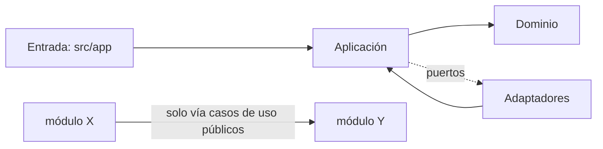
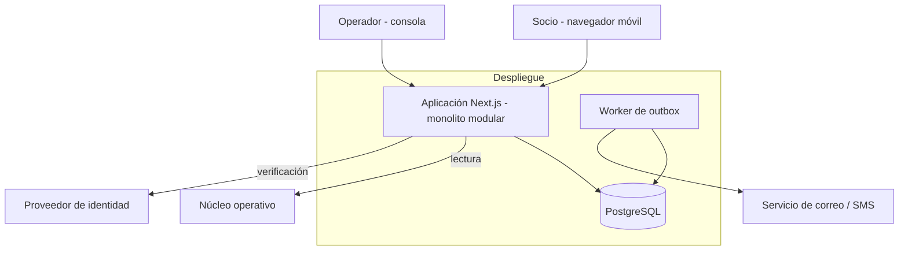

# Architecture Spine — Portal de autoservicio para socios

## Design Paradigm

Monolito modular, desplegado como una sola aplicación, con hexagonal dentro de cada módulo: el dominio no conoce frameworks ni sistemas externos; todo lo externo entra por puertos.

| Capa | Directorio | Contenido |
| --- | --- | --- |
| Dominio | `src/modules/<mod>/domain` | entidades, reglas, máquina de estados |
| Aplicación | `src/modules/<mod>/app` | casos de uso, definición de puertos |
| Adaptadores | `src/modules/<mod>/adapters` | núcleo operativo, BD, correo, PDF, identidad |
| Entrada | `src/app` | páginas y rutas HTTP del portal y la consola (solo delegan a casos de uso) |

Módulos: `acceso`, `productos`, `constancias`, `solicitudes`, `notificaciones`, `auditoria`.

## Invariants & Rules



### AD-1 — El núcleo operativo es la única fuente de saldos y préstamos
- **Binds:** FR-3, FR-4, FR-5, NFR-6
- **Prevents:** copias desfasadas de saldos; módulos que consultan el núcleo por caminos distintos.
- **Rule:** solo `productos` accede al núcleo, por el puerto `NucleoPort` (solo lectura, con timeout). Nunca se persisten ni se cachean saldos como dato vigente. Toda respuesta lleva `actualizadoEn` del núcleo. Si el núcleo falla, se devuelve el error `NUCLEO_NO_DISPONIBLE`, nunca el último valor. `constancias` obtiene los datos a través de `productos`.

### AD-2 — Base propia solo para datos del portal; un dueño por entidad
- **Binds:** FR-6 a FR-10, FR-12, NFR-5
- **Prevents:** dos módulos escribiendo la misma tabla; estados divergentes entre portal y consola.
- **Rule:** PostgreSQL guarda únicamente usuarios y contacto vigente (`acceso`), solicitudes con adjuntos y comentarios, constancias emitidas, outbox y auditoría. Cada tabla pertenece a un módulo y solo ese módulo la escribe. Los demás leen vía su caso de uso público.

### AD-3 — `Solicitud` única con máquina de estados única
- **Binds:** FR-6, FR-7, FR-8, FR-9, FR-10
- **Prevents:** un flujo de préstamo y otro de contacto con estados o notificaciones propios; transiciones desde la consola que el portal desconoce.
- **Rule:** una entidad `Solicitud` con `tipo` (`prestamo` | `contacto`) y estados `Recibida → En revisión → Información adicional → Aprobada | Rechazada`. Toda transición pasa por un caso de uso del módulo `solicitudes` que valida el estado previo, exige comentario en rechazo o pedido de información, y emite auditoría y notificación. Los cambios de contacto siguen AD-9.

### AD-4 — La autorización se decide en un único punto y la identidad sale de la sesión
- **Binds:** FR-1, FR-4, FR-11, NFR-1
- **Prevents:** fuga de datos entre socios; permisos verificados de forma distinta en cada ruta.
- **Rule:** el `socioId` se toma siempre de la sesión, nunca de parámetros de la petición. Roles: `socio`, `operador`, `admin`; "aprobar préstamo" es un permiso aparte. Cada caso de uso recibe un `Actor` y llama a `autorizar(actor, accion, recurso)` del módulo `acceso`. La consola vive bajo `/consola`, con sesión y segundo factor propios de operador, y nunca comparte cookie con la del socio.

### AD-5 — Autenticación detrás de `IdentityPort`; segundo factor obligatorio
- **Binds:** FR-1, FR-2, NFR-1
- **Prevents:** acoplar el dominio a un método de identidad aún sin decidir.
- **Rule:** el alta solo se completa si el núcleo confirma un socio vigente. Sesión con cookie `httpOnly`, `Secure`, `SameSite=Lax`, expiración por inactividad. Bloqueo temporal tras 5 intentos fallidos. La recuperación invalida credenciales y sesiones previas. El proveedor concreto va detrás de `IdentityPort` (ver Deferred).

### AD-6 — Auditoría append-only en la misma transacción
- **Binds:** FR-2, FR-5, FR-10, NFR-5
- **Prevents:** acciones sin rastro; auditoría editable.
- **Rule:** `auditoria` expone solo `registrar(evento)`; la tabla no admite `UPDATE` ni `DELETE` (permisos de BD y trigger). Cada evento guarda `actorId`, `rol`, `accion`, `recursoId`, `ts` UTC. Se escribe en la transacción de la acción auditada. Se auditan accesos, recuperaciones, emisión de constancias y toda acción sobre solicitudes.

### AD-7 — Notificaciones por outbox transaccional
- **Binds:** FR-2, FR-6, FR-7, FR-8, FR-10, FR-12
- **Prevents:** pérdida de avisos o solicitudes bloqueadas por un fallo de correo.
- **Rule:** los casos de uso insertan en `outbox` dentro de su transacción. Un worker envía por `NotificadorPort` con reintentos y registra los fallos. Un fallo de envío nunca revierte ni bloquea la acción. Los canales (correo; SMS opcional) son adaptadores intercambiables.

### AD-8 — Constancias se generan al vuelo y solo se registra la emisión
- **Binds:** FR-5
- **Prevents:** constancias con datos viejos; almacenar PDFs con datos personales.
- **Rule:** el PDF se arma en el servidor con los datos leídos del núcleo en ese momento, con fecha y hora, nombre y código de verificación único. Se guarda solo el registro (`codigo`, tipo, socio, `ts`) y no el archivo. La verificación del código consulta ese registro.

### AD-9 — `acceso` es dueño del contacto vigente y de su verificación
- **Binds:** FR-1, FR-2, FR-8, FR-12
- **Prevents:** dos almacenes de teléfono/correo/domicilio; solicitudes de contacto creadas antes o después de verificar según el módulo.
- **Rule:** `acceso` es el único dueño de `contactoVigente` y de `verificacionContacto` (código, TTL, intentos máximos). `solicitudes` cambia el contacto solo llamando a `acceso.aplicarContacto()` en la misma transacción. Para teléfono y correo, la `Solicitud` se crea ya resuelta solo tras verificar con éxito; el domicilio crea una `Solicitud` pendiente de operador.

### AD-10 — Contrato único del outbox y destinatarios
- **Binds:** FR-2, FR-6, FR-7, FR-8, FR-10, FR-12
- **Prevents:** productores con payloads distintos; direcciones copiadas en eventos.
- **Rule:** todo mensaje es `OutboxMensaje {id, evento, socioId, plantilla, params}`. Los productores nunca escriben direcciones. `notificaciones` resuelve el destinatario desde `acceso` (contacto verificado, o el anterior en cambios de contacto). Los eventos de seguridad (bloqueo, recuperación, cambio de contacto) usan este mismo camino y se auditan.

### AD-11 — `Actor` y acciones cerradas
- **Binds:** FR-11, AD-4
- **Prevents:** permisos modelados como rol en un módulo y como bandera en otro.
- **Rule:** `acceso` define `Actor {id, rol, permisos[]}` y un enum cerrado de `accion` (p. ej. `solicitud.aprobar`, `solicitud.resolver`, `constancia.emitir`); los demás módulos lo importan y no definen acciones propias. La identidad de operadores y administradores la gestiona `acceso`, con segundo factor.

### AD-12 — Solicitud: adjuntos, comentarios, asignación y bucle de información
- **Binds:** FR-7, FR-9, FR-10
- **Prevents:** adjuntos sin dueño; transiciones implícitas fuera de "Información adicional".
- **Rule:** `solicitudes` es dueño de `adjunto`, `comentario` y `asignadoA`. Cuando el socio responde en "Información adicional", la solicitud vuelve a "En revisión" por el caso de uso `responderInformacion`. Formatos y tamaños de adjuntos son configuración compartida única, validada en servidor.

### AD-13 — Cifrado en reposo y orden de emisión de constancias
- **Binds:** NFR-1, FR-5
- **Prevents:** datos personales sin cifrar; códigos de constancia registrados sin PDF.
- **Rule:** BD, respaldos y almacenamiento de adjuntos se cifran en reposo; el transporte es solo TLS. El código de una constancia se registra y audita únicamente tras generar el PDF con éxito, en una sola transacción.

## Consistency Conventions

| Concern | Convention |
| --- | --- |
| Naming | Dominio y tablas en español (`solicitud`, `socio`, `constancia`); código de infraestructura en inglés; módulos en minúscula; puertos `XxxPort`; eventos `modulo.accion.pasado`. |
| Data & formats | ids UUID v7; fechas ISO 8601 en UTC (se muestran en `America/Montevideo`); montos como entero en centésimos más código de moneda (`UYU`, `USD`); errores `{codigo, mensaje}` con códigos estables en mayúsculas. |
| State & cross-cutting | Mutación solo vía casos de uso; una transacción por caso de uso; logs JSON con `requestId`, sin datos personales ni saldos; configuración por variables de entorno validadas al arranque; textos de interfaz en español de Uruguay, centralizados. |
| UI | Mobile-first, WCAG 2.1 AA; un componente de formulario compartido con validación del mismo esquema en cliente y servidor. |

## Stack

| Name | Version |
| --- | --- |
| TypeScript | 7.0.2 |
| Node.js | 24 LTS (pasar a 26 LTS, vigente desde 2026-10-28, si el arranque es posterior) |
| Next.js (App Router) | 16.4.2 |
| React | 19.3.1 |
| PostgreSQL | 18.x (19 aún en RC) |
| drizzle-orm | 0.45.4 |
| @react-pdf/renderer | 4.9.0 |

## Structural Seed



```text
src/
  app/            # rutas: (portal)/ y consola/
  modules/        # acceso, productos, constancias, solicitudes, notificaciones, auditoria
  shared/         # tipos, errores, configuración
worker/           # proceso del outbox
db/migrations/
```

Entornos: `dev`, `staging` (núcleo simulado o de pruebas) y `prod`; misma imagen de contenedor, configuración por entorno. Disponibilidad objetivo 99,5 % (NFR-2): aplicación con al menos 2 instancias sin estado, BD con respaldos automáticos y restauración probada.

## Capability → Architecture Map

| Capability / Area | Vive en | Gobernado por |
| --- | --- | --- |
| FR-1, FR-2 Acceso y recuperación | `acceso` | AD-4, AD-5, AD-6, AD-9 |
| FR-3, FR-4 Saldos y préstamos | `productos` | AD-1, AD-4 |
| FR-5 Constancias | `constancias` | AD-1, AD-6, AD-8 |
| FR-6, FR-7, FR-8 Solicitudes del socio | `solicitudes` | AD-2, AD-3, AD-7, AD-9, AD-12 |
| FR-9, FR-10 Consola | `solicitudes` + `/consola` | AD-3, AD-4, AD-6 |
| FR-11 Roles y permisos | `acceso` | AD-4, AD-11 |
| FR-12 Notificaciones | `notificaciones` | AD-7, AD-10 |
| NFR-1 Seguridad y privacidad | transversal | AD-4, AD-5, AD-6, AD-13, convenciones de logs |
| NFR-3 Rendimiento | `productos` | AD-1 (timeout al núcleo, sin caché vigente) |

## Deferred

- Proveedor y método de identidad (pregunta abierta 1): se decide con `IdentityPort` ya definido; no afecta el resto de la arquitectura.
- Interfaz y capacidad reales del núcleo operativo (pregunta 2): el adaptador se escribe cuando se conozca; el puerto no cambia.
- Productos y límites de préstamo, y doble aprobación (pregunta 3): son configuración del módulo `solicitudes`.
- Normativa BCU, retención de auditoría y residencia de datos (preguntas 4 y 6): condicionan hosting y retención; la decisión es de cumplimiento.
- Hosting, proveedor de correo/SMS y almacenamiento de adjuntos: dependen de presupuesto y residencia de datos.
- Observabilidad, CI/CD y estrategia de pruebas: se definen al armar el repositorio.
