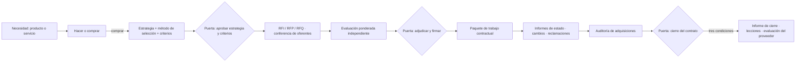

# Guía de adquisiciones · Procurement guide

## 1. Flujo de la adquisición

Momentos PRINCE2: hacer o comprar y estrategia en IP (todo el plan) y en SB (paquetes de la etapa siguiente); selección y adjudicación antes de autorizar el paquete; control en CS/MP; auditoría antes de cada cierre; cierre de contratos en la etapa en que termina el trabajo o en CP.

## 2. Hacer o comprar
Comparar ambas opciones con costo total (precio + gestión del contrato + transición), capacidad y habilidades internas, necesidad de experiencia independiente, plantilla permanente y riesgos de cada opción. Con cifras, técnicas financieras (costo-beneficio, VAN) con supuestos declarados. Decisión registrada: `registro.py --proyecto <dir> agregar decisiones --campo decision="..." --campo nivel=gestor|junta --campo decidido_por="..."`; si decide la junta como puerta, `pm-director` registra `puerta decision-ad-hoc`. Los paquetes comprados se marcan "proveedor externo" en el diccionario y en la columna `responsable` de `wbs.csv`. Para comparar construir, comprar y tercerizar con pesos explícitos y sensibilidad: `decision.py matriz <ID> --proponer --tipo adquisicion --criterios hacer-o-comprar` (`pm-direccion-decisiones`, guía §13.11: diferenciación, costo total, tiempo hasta disponible, dependencia del proveedor, capacidad interna y riesgo de construir algo que va a volverse commodity); un componente de un mapa de Wardley se nombra `<mapa>:<id>` en `--ids` y, al elegir, la decisión queda citada en él.

## 3. Contenido de la estrategia de adquisiciones
Monto estimado y su base (de `pm-costos-presupuesto`); método de entrega (proveedor único con o sin subcontratación, sociedad conjunta, representante, llave en mano…); tipo de contrato y asignación de riesgo (§4); incentivos con criterio medible; fases con criterios de entrada y salida; hitos y transferencia de conocimiento; indicadores de desempeño; hitos de pago; garantías y fianzas (de oferta, de cumplimiento, de anticipo); retenciones; seguros; plazo de garantía del producto; mecanismo de cambio contractual. Riesgos contractuales a `pm-riesgos` (con `impacto_monetario`); hitos de licitación, adjudicación y pago a `pm-cronograma-estimacion`; monto a `pm-costos-presupuesto`. Un archivo único con una sección por adquisición, o `<id>-estrategia-adquisiciones.md` por adquisición mayor.

## 4. Tipo de contrato y asignación de riesgo
| Tipo | Riesgo de costo | Cuándo conviene | Alerta |
|---|---|---|---|
| Precio fijo (cerrado, con incentivo, con ajuste) | Vendedor | Alcance definido con precisión | Nunca con alcance indefinido |
| Costos reembolsables (honorario fijo, incentivo, premio) | Comprador | Alcance incierto, I+D, alto riesgo | Exige controles y topes |
| Tiempo y materiales con tope | Compartido, sesgo al comprador | Consultoría, mantenimiento, alcance emergente | Escrutinio de horas |
| Costo objetivo | Compartido por fórmula | Grandes obras, manufactura compleja | Definir meta y reparto |
| Contratación ágil (T&M por iteración, entregables por sprint) | Compartido | Alcance que evoluciona dentro de etapas | Criterios de aceptación por iteración |

## 5. Selección
- **Método** (elegido y publicado antes de redactar los documentos): menor costo, solo calificaciones, mayor puntaje técnico, calidad y costo, fuente única justificada, presupuesto fijo.
- **Criterios**: derivados de requisitos y estrategia; pesos = 100 %; escala con descriptores observables por nivel; eliminatorios antes de abrir ofertas. Compras pequeñas: lista corta y comparación cualitativa.
- **Documento de licitación**: RFI si falta conocer el mercado; RFP si el proveedor propone la solución; RFQ si decide el precio. Esqueleto: contexto y objetivo, enunciado del trabajo o descripciones de producto (con BMAD, citar ids del PRD, sin copiar requisitos), criterios de aceptación y calidad, acceso/inspección/transparencia del control de calidad del proveedor, cronograma e hitos, tipo de contrato y pago, criterios y método de evaluación publicados, formato de respuesta, calendario (consultas, conferencia, cierre), condiciones legales, sostenibilidad o contenido local si aplican.
- **Evaluación**: eliminatorios; calificación independiente por evaluador; promedio; `puntaje = peso × calificación`, total y normalizado; extremos justificados; desempate declarado. Matriz conservada como evidencia (`criterios-seleccion.csv` opcional, formato largo: id_adquisicion, criterio, peso_pct, descriptor_1..5, candidato, calificacion, puntaje).
- **Ética**: igual información para todos los oferentes; conflictos de interés declarados; fuente única solo con justificación; nunca cambiar criterios tras ver ofertas (si se pide, negarse y registrar issue).

## 6. Control del contrato
- **Paquete contractual** (`pm-paquetes-trabajo`): productos, criterios de aceptación alineados contrato ↔ descripciones, frecuencia y formato del informe del contratista, tolerancias, mecanismo de cambio. Con proveedor ágil, cada iteración contratada es un paquete.
- **Informe de estado del contratista**: alcance, calidad, cronograma y costo (en precio fijo, hitos de pago en lugar de pronóstico de costo), pronóstico de fecha, reclamaciones, riesgos e issues, acciones correctivas, solicitudes de cambio. Riesgos e issues nuevos replicados en los registros con referencia al contrato; insumo del highlight (`pm-progreso-reportes`). Si el proveedor reporta en un tracker conectado, la instantánea se toma vía `pm-integraciones`.
- **Cambios contractuales**: siempre por `pm-issues-cambios` y por el mecanismo del contrato; registro en `cambios.csv` con referencia contractual.
- **Reclamaciones**: fecha de apertura, hechos, cláusulas, posición de cada parte, cronología; comunicaciones sobrias (pueden ser prueba); negociación, luego mediación u otro método alternativo según el contrato; consulta legal antes de escalar. Bloquean el cierre.
- **Auditoría** (`auditoria-adquisiciones.md`): A desempeño del proveedor; B cumplimiento del proceso (sí/parcial/no); C buenas prácticas; D mejoras; hallazgos con acción, responsable, fecha y estado; auditor independiente con compras.

## 7. Cierre del contrato
Tres condiciones: (1) disputas resueltas; (2) producto aceptado formalmente (aceptación contractual con `pm-calidad`); (3) pagos finales hechos o contrato terminado formalmente. Además: garantías y fianzas a liberar o mantener, retenciones a devolver, plazo de garantía vigente, obligaciones pendientes (soporte, licencias, transferencia de conocimiento) con responsable, lecciones. El informe (`cierre-contrato.md`) incluye desempeño por dimensión, historial de cambios coherente con `cambios.csv`, disputas con resolución, fecha de finalización, pago final y calificación global del proveedor.

## 8. Versión mínima vs. completa
Compras simples o con proveedor de confianza: basta el enunciado del trabajo en el contrato y la decisión de hacer o comprar registrada. Adquisiciones mayores: estrategia + criterios + licitación + informes de estado + auditoría + cierre.

## 9. Reglas complementarias
1. [PRINCE2] El contrato garantiza acceso, inspección y pruebas independientes y transparencia del control de calidad del proveedor; el proveedor sénior responde por la calidad de lo provisto.
2. [PRINCE2] Las relaciones comerciales se documentan en el enfoque de gestión comercial (`pm-enfoques-gestion`); la estrategia de esta skill es su concreción por adquisición.
3. [PMBOK→Plans] Cada contrato vincula monto, indicadores, hitos de pago, garantías, retenciones, seguros y mecanismo de cambio con cronograma, presupuesto y riesgos.
4. [PMBOK→Organizing] Evaluar cláusulas desde ambas perspectivas (cliente y contratista) y buscar estructuras ganar-ganar; en proyectos públicos o internacionales, contenido local, sostenibilidad y transferencia de conocimiento.
5. [PMBOK→Issues] Controversias: hechos, cronología, negociación y mediación antes de arbitraje o litigio; confidencialidad e imparcialidad.
6. [Plantillas] Toda reclamación se registra con fecha de apertura y se sigue hasta su resolución.
7. Al cerrar cada respuesta: ids creados (D, R, I, C, L), estado de cada contrato (planificado, en licitación, adjudicado, en curso, en disputa, cerrado) y próxima puerta con el rol que decide.
