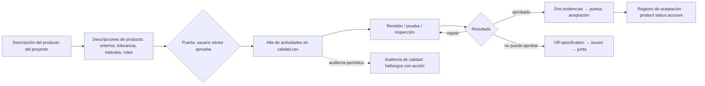

# Guía de gestión de la calidad · Quality management guide

## 1. Planificación de la calidad (pasos A)
- Cada producto a controlar necesita descripción con especificaciones medibles (cuantitativas, o cualitativas con contexto), funcionales y no funcionales, de operación y mantenimiento y de sostenibilidad. Lo que no está escrito en un producto de gestión aprobado no es requisito; una expectativa no documentada se propone documentar y, si altera la línea base, es issue.
- Por producto: qué se mide, umbral, rango aceptable (tolerancia) y prioridad (imprescindible / deseable). Advertir especificaciones desproporcionadamente estrictas para el valor del producto.
- Productor, revisores independientes del productor y autoridad de aceptación por producto; consultar a aseguramiento; las delegaciones de aceptación se documentan en el enfoque.
- Alta: `${CLAUDE_SKILL_DIR}/../pm-estado-proyecto/scripts/registro.py --proyecto <dir> agregar calidad --campo producto=... --campo metodo_verificacion=... --campo criterios=... --campo responsable_productor=... --campo revisores=... --campo aprobador=... --campo fecha_prevista=...` (estado `planificada`). Un producto puede tener varias filas.
- Aprobación: descripciones de productos especialistas → usuario sénior (el proveedor sénior acuerda técnicas); enfoque → ejecutivo. `estado.py --proyecto <dir> aprobar <clave> --por "Usuario sénior: <nombre>"` (escribe la fila en `decisiones.csv`). Si forma parte de una puerta de la junta (PID, plan de etapa), la registra `pm-director`.

## 2. Método de verificación según madurez
| Situación | Método | Valor en `calidad.csv` | Momento |
|---|---|---|---|
| Producto o método nuevo | verificación de diseño, prototipo, revisión de calidad | `revision` / `prueba` | antes de producir a escala |
| Funcionalidad compleja | validación y pruebas (unitarias, integración, rendimiento, aceptación) | `prueba` | durante y al final |
| Producto comercial | inspección en la entrega | `inspeccion` | punto de entrega |
| Requisito regulatorio | certificación documental | `auditoria` | punto de entrega |
| Incremento ágil | DoD + pruebas automatizadas + demo | `prueba` / `demostracion` | cada iteración |
| Historia BMAD | code review + DoD | `revision` | al pasar a `done` |

`metodo_verificacion` admite solo `revision`, `prueba`, `inspeccion`, `demostracion`, `auditoria`; el detalle va en `criterios` o `notas`. Declarar momento, lugar y recursos y comprobar que están en cronograma y presupuesto.

## 3. Costo de la calidad
Conformidad (prevención + evaluación) vs. no conformidad (fallas internas + externas), con supuestos declarados; existe un óptimo: más prevención deja de ser rentable; no contar solo las fallas visibles. Sirve para decidir cuántas rondas de revisión y prueba planificar. Salida: tabla en la respuesta o `02-planificacion/costo-calidad.md`.

## 4. Revisión de calidad
Estructura propuesta por el paquete (compatible con el método; la fuente no la detalla, y así se declara):
- **Roles**: presidente (conduce y decide el resultado), presentador (productor), revisores (independientes; al menos uno del lado del usuario si el negocio usará el producto), administrador (registra observaciones y acciones).
- **Preparar**: producto, versión, descripción y criterios distribuidos con antelación; cada revisor anota observaciones contra cada criterio.
- **Reunir**: observaciones una a una — mayor (impide cumplir un criterio), menor (corrección sin impacto), observación —; acciones con responsable y fecha. Resultado: `aprobado`, `aprobado-con-observaciones`, `rechazado`. No se debaten gustos, solo criterios.
- **Seguir**: `registro.py actualizar calidad Q-nnn --campo fecha_real=... --campo resultado=... --campo estado=completada --campo notas=<ruta del acta>`. Rechazado que se repite → nueva fila Q (`planificada`) referida a la anterior. Correcciones a `acciones.csv` (`origen=Q-nnn`). El presidente verifica el cierre antes de la aceptación. Repetir solo si es razonable esperar que apruebe; si no puede aprobar dentro de la tolerancia → off-specification (`pm-issues-cambios`).
- Si la revisión es una reunión con acta o transcripción, el acta formal la produce `pm-reuniones`; aquí se registra el resultado en `calidad.csv`.

## 5. Aceptación
- Dos evidencias: información de control (filas Q-nnn aprobadas, acciones cerradas) y revisión independiente contra expectativas y criterios de aceptación. La aceptación transfiere la propiedad a la junta en nombre del usuario.
- Claves: `aceptacion-<producto>` para intermedios (`03-control/reportes/AAAA-MM-DD-aceptacion-<producto>.md`); `registro-aceptacion` reservada para el producto del proyecto (`04-cierre/registro-aceptacion.md`, conduce `pm-cierre-proyecto`, puerta `autorizar-cierre` por `pm-director`).
- Registro: `estado.py aprobar aceptacion-<producto> --por "<rol: nombre>" --nivel gestor|junta` (`<producto>`: id o clave corta `N-M` de la historia, código de la WBS); el estado de productos (`estado.py productos`, guía de `pm-paquetes-trabajo` §5) lo toma de ahí. `registro-aceptacion` aprobado acepta los productos con revisión aprobada a esa fecha; los demás quedan sin aceptar (C-07 en `autorizar-cierre`). Si acepta la junta en una puerta, lo registra `pm-director`.
- Comercial: el contrato prevé acceso, inspección y pruebas independientes; los criterios contractuales no contradicen las descripciones; la aceptación contractual precede a la del proyecto y se registran por separado.

## 6. Aceptación por requisito con BMAD (`integraciones.especificacion = bmad`)
- Fuente: `02-planificacion/especificacion/matriz-trazabilidad-bmad.csv`, generada por `python3 ${CLAUDE_SKILL_DIR}/../pm-bmad-puente/scripts/bmad.py --proyecto <dir> trazabilidad --wbs 02-planificacion/wbs.csv` (regenerar antes de usarla; no se edita a mano).
- Un requisito FR/NFR se considera cumplido cuando su fila tiene `terminado=si` (todas sus historias en `done`); la aceptación del producto o release lista los ids con `terminado=si` y los pendientes, sin copiar el texto del PRD.
- Métodos de calidad: la DoD del equipo y el code review de BMAD se registran como filas Q-nnn (`metodo_verificacion=revision` para code review, `prueba` para pruebas de la DoD), una por historia significativa o por incremento; los NFR se verifican con pruebas específicas (rendimiento, seguridad).
- FR sin historia o historias sin requisito → hallazgo: criterio faltante (aquí) o hueco de alcance (`pm-issues-cambios`).
- `done` en BMAD no es aceptación PRINCE2: la autoridad de aceptación sigue aceptando con nombre y fecha.

## 7. Auditoría de calidad
- Alcance: procesos, documentos, requisitos y documentación del producto, reparación de defectos, políticas, cumplimiento del enfoque de calidad. Auditor independiente del trabajo auditado (aseguramiento, PMO o externo).
- Ejecutar: planificado vs. `calidad.csv` (cobertura, fechas reales, fallos con acción); implementación de cambios aprobados y acciones previas; buenas prácticas. Se conduce como ayuda, no como castigo.
- Hallazgos con id, severidad (mayor / menor / observación / buena práctica), acción, responsable, fecha límite, estado; áreas de mejora con medida objetivo. Deficiencias como issues; buenas prácticas a `lecciones.csv`. Auditoría de seguimiento programada.
- Opcional `03-control/registros/hallazgos-auditoria.csv`: id, tipo_auditoria, fecha_auditoria, auditor, area, hallazgo, severidad, accion, responsable, fecha_limite, estado.

## 8. Calidad en ágil o híbrido
Definición de listo y de hecho en el enfoque de calidad; criterios de aceptación por historia como condición de terminado; prototipos, pruebas automatizadas y A/B como métodos; una fila de `calidad.csv` por incremento o historia significativa (no por tarea); la revisión de la iteración actúa como revisión de calidad y la demo como evidencia de aceptación, registrada con nombre y fecha (`demostracion`). La revisión/demo es además un evento de comunicación (`pm-comunicacion-stakeholders`; su acta, `pm-reuniones`).

### 8.1 Calidad a volumen (control permanente)
Con decenas de historias `done`, en la práctica nadie verifica una por una que tengan su revisión: se descubre en la
aceptación o en producción. La sanidad lo controla en cada corrida (`sanidad.py --proyecto <dir> --corte AAAA-MM-DD`):
- **QUA-01** (AVISO): cada elemento de `02-planificacion/backlog.csv` en estado terminado (`done`, terminado, hecho,
  completado, cerrado, aceptado) necesita una fila de `calidad.csv` que lo cite en `producto`, `criterios` o `notas`
  (por id completo o por la clave corta `N-M`, p. ej. "historia 1-3") con `estado=completada` y resultado `aprobado` o
  `aprobado-con-observaciones`. Sin fila: "terminado sin revisión"; con fila sin aprobar: "terminado con revisión … sin
  aprobar".
- **QUA-02** (AVISO): revisión `planificada` o `en-curso` con `fecha_prevista` anterior al corte (típico: la prueba
  prometida para cumplir una condición de puerta).
- **QUA-03** (AVISO): revisión `rechazado` sin issue, acción o cambio que cite su Q-### → `pm-issues-cambios`
  (fuera de especificación) o acción correctiva con `origen=Q-nnn`.
- **QUA-04** (AVISO, productos de la WBS, proyectos predictivos): elemento de `wbs.csv` aceptado (`aceptacion-<código>`) o
  con su paquete recibido sin una revisión aprobada que lo cite ("producto 3.1", "paquete 3.1" o "WBS 3.1"). Misma
  derivación que el estado de productos (`estado.py productos`, guía de `pm-paquetes-trabajo` §5).
- Corrección en lote: una fila por historia, citándola en `producto` (`registro.py agregar calidad --campo "producto=Release 1 · historia 1-3 …" --campo resultado=aprobado --campo estado=completada …`), con el aprobador que corresponda. El control no aprueba nada: señala lo que falta.

## 9. Columnas de `calidad.csv`
`id` (Q-nnn, quality id) · `producto` · `metodo_verificacion` (quality method) · `criterios` · `responsable_productor` (producer) · `revisores` (separados por `;`) · `aprobador` (acceptance authority) · `fecha_prevista` · `fecha_real` · `resultado` (`aprobado`, `aprobado-con-observaciones`, `rechazado`, `pendiente`) · `estado` (`planificada`, `en-curso`, `completada`, `cancelada`) · `notas` (ubicación de la evidencia).

## 10. Flujo y reglas extendidas

- Aseguramiento de la calidad (negocio, independiente, sobre productos) ≠ aseguramiento del proyecto (junta, sobre la conducción); nombrarlos como tales.
- Lecciones del ciclo de calidad (defectos repetidos, revisores sobrecargados, criterios ambiguos) a `lecciones.csv`; los informes de fin de etapa y de proyecto resumen planificado vs. realizado desde el registro de calidad.
- Gráfico de control: límites ±3σ como convención declarada, no como regla de la fuente.
- Versión mínima: inspección en la entrega, una ronda de pruebas de aceptación, registro de calidad y de productos en una hoja. Completa: verificación de diseño, pruebas unitarias, integración, rendimiento y aceptación, varias revisiones, auditorías periódicas (producto nuevo, complejo, regulado o contratado).
- Si hay un tracker de pruebas conectado, resultados vía `pm-integraciones` como instantánea en `03-control/fuentes/`; escribir en él solo con confirmación.
