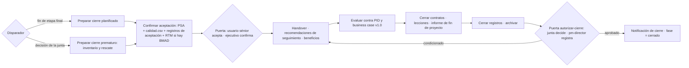

# Guía de cierre del proyecto · Closing guide

Detalle de `pm-cierre-proyecto` (agente `pm-cierre`). El SKILL.md cita cada sección por número.

## 1. Flujo de cierre · Flow

## 2. Preparar el cierre
- **Planificado**: revisar el plan de proyecto con reales de la etapa final; identificar a quién notificar (enfoque de comunicación); confirmar que la información quedará protegida y archivada para auditoría (enfoques de issues y de datos); borrador de `templates/notificacion-cierre.md`.
- **Prematuro**: verificar que la decisión de la junta está en `decisiones.csv` (la registra `pm-director`; esta skill no la escribe): el rechazo de `autorizar-proyecto`, `autorizar-etapa` o `autorizar-plan-excepcion`, o una `decision-ad-hoc` con `--motivo`. Entrar a CP con `python3 ${CLAUDE_SKILL_DIR}/../pm-estado-proyecto/scripts/estado.py --proyecto <dir> cierre --prematuro --decision D-###` (desde la iniciación o una etapa de entrega; sin la D-### de nivel junta, ejecutivo o capa de negocio, el script se niega; en el pre-proyecto no hay cierre). Queda `estado.json.cierre_prematuro` con fecha, decisión, motivo, origen y etapa (`docs/PUERTAS.md` §3.2). Actualizar el plan con reales; pedir el product status account e inventariar por estado (§3); proponer medios de rescate (puede requerir plan de excepción vía `pm-plan-etapa-y-limites`) y aprobación para liberar recursos antes; elevar al negocio las brechas que deja la cancelación. No disfrazar el resultado.
- **Plan de excepción durante el cierre prematuro** (PRINCE2 CP, preparar el cierre prematuro: rescatar productos o dejarlos en estado seguro a veces requiere un plan de excepción; `docs/PUERTAS.md` §3.2): `pm-plan-etapa-y-limites` lo prepara (`plan-excepcion-X-###`) y `pm-director` registra `autorizar-plan-excepcion` estando en CP, sin `--forzar`; el proyecto **sigue en CP** y el plan queda en `estado.json.cierre_prematuro.plan_excepcion`. Mientras no termine, `autorizar-cierre` lo bloquea con **C-09**; al terminar (o si la junta lo da por terminado sin completarlo), `pm-director` registra `estado.py cierre --plan-excepcion completado|cerrado --por "<rol: nombre>" [--nota ".."]`. Lo que el plan dejó en estado seguro va al inventario (§3) y a las recomendaciones de seguimiento.

## 3. Inventario de productos en cierre prematuro
| Categoría | Qué hacer | Dónde queda |
|---|---|---|
| Aprobados y aceptados | Confirmar traspaso | Handover |
| Aprobados no entregados | La junta decide si se transfieren | Handover + decisión D-nnn |
| En desarrollo | Completar (plan de excepción) o detener en estado seguro | Inventario + recomendaciones |
| Con concesión | Declarar la concesión y su alcance | Informe de fin de proyecto |
| No iniciados | Listar como brecha para el negocio | Recomendaciones de seguimiento |
| A dejar en estado seguro | Planificar y aprobar el trabajo de aseguramiento | Plan de excepción |
| Útiles para otros proyectos | Destinatario y forma de entrega | Recomendaciones de seguimiento |

El inventario es el artefacto `inventario-cierre-prematuro` (`04-cierre/inventario-cierre-prematuro.md`, a partir del borrador de `estado.py productos --markdown`): `estado.py artefacto inventario-cierre-prematuro --ruta 04-cierre/inventario-cierre-prematuro.md --estado en-revision`. Sin él, la verificación de `autorizar-cierre` da **C-08** (bloqueo). En un cierre prematuro, los Must sin aceptar (**C-07**) son aviso: transferirlos es legítimo si figuran en el inventario y en las recomendaciones de seguimiento; las revisiones de calidad abiertas (**C-04**) siguen bloqueando: se completan o se cancelan (`registro.py actualizar calidad Q-### --campo estado=cancelada`, con el motivo en `notas`). La lista de control de la junta suma el ítem V-07 (rescate, estado seguro y brechas elevadas).

## 4. Aceptación de productos
1. Cruzar tres fuentes: product status account (`pm-paquetes-trabajo`), `calidad.csv` (todas las actividades con resultado) y registros de aceptación (`pm-calidad`). El cruce lo deriva `python3 ${CLAUDE_SKILL_DIR}/../pm-estado-proyecto/scripts/estado.py --proyecto <dir> productos` (guía de `pm-paquetes-trabajo` §5): estado de cada producto con su Q-### y su aceptación, diferencias registrado/físico y **Must sin aceptar**; con `--markdown 04-cierre/product-status-account-final.md` queda el borrador de `product-status-account-final`. Por producto del PID: aceptado (quién, fecha) o no aceptado (motivo). Lo no aceptado es issue abierto o recomendación de seguimiento; nunca se recomienda cerrar ocultando el hueco. Verificar que las entregas por fases previas se completaron.
   La verificación de `autorizar-cierre` (`puertas.py`, `docs/PUERTAS.md` §3) lo controla por id: **C-07** (condición; aviso en un cierre prematuro, §3) lista los requisitos y las historias Must cuyo estado derivado no es aceptado ni con concesión; `registro-aceptacion` aprobado acepta los productos con revisión aprobada a esa fecha, no los demás (PRINCE2 CP, actividad 3, confirmar la aceptación: `prince2-principios-personas-procesos.md` §5.7).
2. El usuario sénior acepta el producto del proyecto contra los criterios de la descripción del producto del proyecto, con dos evidencias (información de control + revisión independiente); el ejecutivo confirma. `04-cierre/registro-aceptacion.md` (`estado.py artefacto registro-aceptacion … --estado en-revision`) y, con ambas confirmaciones por escrito, `estado.py aprobar registro-aceptacion --por "Usuario sénior: <nombre>; Ejecutivo: <nombre>"`. Los productos intermedios usan claves `aceptacion-<producto>` (pm-calidad).
3. En cierre prematuro, la junta decide qué productos aprobados pero no entregados se transfieren.

### 4.1 Aceptación por requisito (con o sin BMAD; SPEC §1.16)
- Fuente de los datos: `python3 ${CLAUDE_SKILL_DIR}/../pm-estado-proyecto/scripts/especificacion.py --proyecto <dir> listar requisitos --json` (campo `cobertura`: `terminado`, en curso/planificado o sin historia/cobertura) y `consultar <id>` para historias y paquetes. Nunca se abren archivos de BMAD ni `requisitos.md` para extraer datos.
- Con BMAD, anexo opcional: la matriz `python3 ${CLAUDE_SKILL_DIR}/../pm-bmad-puente/scripts/bmad.py --proyecto <dir> trazabilidad --wbs 02-planificacion/wbs.csv` → `02-planificacion/especificacion/matriz-trazabilidad-bmad.csv` (columnas `requisito`, `titulo`, `historias`, `estados`, `paquetes_wbs`, `cubierto`, `terminado`).
- Con BMAD, correr `bmad.py verificar` contra la última línea base del PRD: si hay desvíos sin decisión, se tratan antes como `solicitud-cambio` (`pm-issues-cambios`); traspasos de `estado.json.integraciones.bmad.handoffs` sin confirmar impiden la aceptación de los ids afectados.
- El registro de aceptación incluye una tabla por requisito FR/NFR: id, `terminado` (todas sus historias `done`), evidencia de calidad (Q-###, DoD, code review), decisión del usuario sénior (aceptado / no aceptado / concesión). Se citan ids y la ruta + sha corto de la matriz; **no se copian los textos de los requisitos**.
- FR con `cubierto=no` o `terminado=no`: hueco declarado → concesión (fuera de especificación) o recomendación de seguimiento; nunca se marca aceptado.
- Las métricas de éxito SM-n del PRD se vinculan a los beneficios del business case y al plan de revisión de beneficios.

## 5. Handover, seguimiento y beneficios
- **Handover** (`templates/handover.md`): por producto, propietario de operación y mantenimiento confirmado, elementos entregados (producto, documentación, accesos, datos, garantías, contratos de soporte), formación, fecha de transferencia y fecha límite de cargo de costos. Comprobar cómo lo previó el PID. En entrega ágil o por fases, confirmar que los traspasos previos están completos y el soporte operativo activo.
- **Recomendaciones de seguimiento** (`templates/recomendaciones-seguimiento.md`): trabajo incompleto, issues abiertos, riesgos residuales transferidos, cambios no implementados, obligaciones contractuales posteriores; cada una con destinatario, responsable, fecha y forma de seguimiento; pueden ser varias listas por audiencia. **C-03** (bloqueo de `autorizar-cierre`) comprueba cada issue y riesgo abierto por id: tiene que aparecer en una fila de tabla con la columna Responsable o Destinatario llena (o en una línea "… Responsable: <nombre>"); la verificación lista los faltantes ("R-001 (no citado)", "I-004 (citado sin responsable)"). Un riesgo que pasa a operación se cierra en `riesgos.csv` con `notas=transferido a <destinatario>` y deja de contar.
- **Beneficios** (con `pm-caso-de-negocio`): business case con costos y beneficios reales; realizados con medición y fuente; pendientes en `templates/plan-revision-beneficios.md` → `04-cierre/plan-revision-beneficios.md` (métrica, línea de base, meta, fecha y frecuencia, dueño tras el cierre, fuente de datos, método y financiamiento de la revisión, vínculo a business case y `enfoque-beneficios`, perjuicios a vigilar). Planificar no es ejecutar: las revisiones son del negocio o del programa. En cierre prematuro, estimar beneficios perdidos y conservados.

## 6. Evaluación del proyecto (fórmulas)
Comparar `00-direccion/historial/pid-v1.0.md` y `business-case-v1.0.md` con la versión vigente:
- Desempeño contra tolerancias de proyecto (tiempo, costo, alcance, calidad, beneficios, riesgo, sostenibilidad), variaciones explicadas y referenciadas a cambios aprobados (`cambios.csv`).
- Variación final de tiempo = (fecha real − fecha meta) / duración planificada.
- Variación de costo = (costo real − BAC) / BAC, con BAC sin reserva de gestión; informar aparte la reserva de gestión liberada por la junta.
- CPI final si hay EVM (`${CLAUDE_SKILL_DIR}/../pm-estado-proyecto/scripts/evm.py`).
- Concesiones y fuera de especificación; desempeño del equipo (salud, bienestar, rotación) y del método (adaptaciones que funcionaron o no).
- Entradas: `diario.md`, `lecciones.csv`, informes de fin de etapa, `avance-bmad.csv` si hay BMAD.

## 7. Informe de fin de proyecto
`templates/informe-fin-proyecto.md` (≈ project closeout report): resumen del gestor, desempeño (business case, objetivos, equipo), productos (aceptaciones, concesiones, fuera de especificación, entrega), variaciones con fórmulas, necesidad de negocio satisfecha, riesgos e issues significativos, beneficios realizados y pendientes, cierre de adquisiciones, lecciones, recomendaciones de seguimiento y, al final, la recomendación de cierre (resumen, aceptación y traspasos, concesiones, beneficios pendientes con dueño, registros cerrados, borrador de notificación, reconocimiento al equipo). Cada cifra cita su fuente; borrador; aseguramiento confirma; la junta revisa.

## 8. Cierre de registros (valores válidos)
Con `registro.py actualizar` (validado contra el esquema):
| Registro | Estado final |
|---|---|
| `riesgos.csv` | cerrar los de la etapa final; residuales → `estado=cerrado` con `notas=transferido a <destinatario>` + fila en recomendaciones (`transferido` no es estado válido de riesgos) |
| `issues.csv` | `cerrado` con `decision` y `decidido_por`, o pasar a seguimiento |
| `cambios.csv` | `cerrado`, `rechazado` o `diferido` con nota |
| `supuestos.csv` | `cerrado` o `transferido` |
| `calidad.csv` | ninguna en `planificada`/`en-curso` |
| `acciones.csv` | `completada` o `cancelada`; las vivas pasan a recomendaciones |
| `lecciones.csv` | ninguna en `registrada` |
| `diario.md` | entrada final |
Nunca borrar filas. Verificar que el product status account refleja el estado final. Archivar según el enfoque de datos.

## 9. Reglas extendidas
1. [PRINCE2] Nunca permitir la deriva hacia el uso sin cierre formal: aceptación, traspasos completados, propietarios de operación confirmados y fecha límite de cargo de costos.
2. [PRINCE2] Todos los registros se cierran y la información se archiva para auditoría futura; se propone un reconocimiento al equipo.
3. [PMBOK→CP] Reseña posterior a la acción como técnica de evaluación: qué debía ocurrir, qué ocurrió, por qué hubo diferencias, qué aprendemos; sin culpables.
4. [Plantillas] Versión mínima (proyecto pequeño): informe de fin de proyecto y lecciones en una página con tabla objetivos/criterios/evidencia, variaciones y aceptación; completa con beneficios, adquisiciones, riesgos e issues, handover y anexo EVM si el proyecto es grande, contratado o parte de un programa.
5. [Plantillas] El informe incorpora el cierre de todos los contratos; un contrato abierto bloquea el cierre o pasa a seguimiento con dueño.

## 10. Ejemplos adicionales
- "Redactá el informe de fin de proyecto comparando el PID original con lo entregado."
- "Evaluate benefits: which ones are realized, which are pending, and who owns the post-project reviews?"
- "Prepare the closure recommendation and notification for the board; what gate do we need?"
- "Con BMAD: armá la aceptación por requisito con la matriz de trazabilidad."
