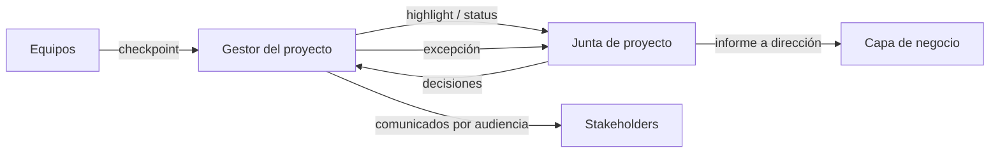

# Enfoque de gestión de la comunicación · Communication management approach — {{proyecto}}

> Cómo, cuándo, a quién y por qué medio fluye la información del proyecto, dentro y fuera de él. Se redacta al final del inicio porque recoge las comunicaciones que exigen los demás enfoques. Mapeo del paquete: ≈ plan de comunicaciones + parte operativa del plan de compromiso de stakeholders. Lo prepara el gestor; lo aprueba el ejecutivo. / How project information flows to and from stakeholders.

**Versión mínima / Minimal version:** {{version_minima}}
*`sí`: una matriz de 5–8 filas (junta, equipo, usuarios clave, proveedores, PMO) y la frecuencia del highlight report.*

## 1. Introducción y alcance / Introduction and scope

{{alcance}}
*Qué comunicaciones cubre: internas del proyecto, hacia la organización usuaria, hacia proveedores, hacia público externo. Qué queda fuera (p. ej. comunicaciones corporativas).*

## 2. Procedimiento / Procedure

{{procedimiento}}
*Cómo se planifica, prepara, aprueba, envía y archiva cada comunicación; quién revisa antes de enviar; dónde quedan los originales (carpeta del proyecto, canal, repositorio).*

## 3. Herramientas y técnicas / Tools and techniques

{{herramientas}}
*Correo, chat, tablero, repositorio de documentos, reuniones, reportes automáticos. Indicar si hay integración con tracker o con herramientas de reuniones (`estado.json.integraciones`).*

## 4. Registros / Records

{{registros}}
*Qué comunicaciones quedan registradas (decisiones en `decisiones.csv`, acciones acordadas en `acciones.csv` con `A-###`, actas en `03-control/reportes/`). Una acción no es un issue.*

## 5. Informes del método / Method reports

| Informe / Report | Emisor / From | Destinatario / To | Frecuencia o disparador / Frequency or trigger | Formato / Format |
|---|---|---|---|---|
| Checkpoint report | {{chk_emisor}} | Gestor del proyecto | {{chk_frecuencia}} | {{chk_formato}} |
| Highlight report (≈ status report) | Gestor del proyecto | Junta de proyecto | {{hl_frecuencia}} | {{hl_formato}} |
| Informe de fin de etapa / End stage report | Gestor del proyecto | Junta de proyecto | Fin de cada etapa | {{fe_formato}} |
| Informe de excepción / Exception report | Gestor del proyecto | Junta de proyecto | Cuando se prevé superar una tolerancia | {{ex_formato}} |
| Informe de riesgos / Risk report | {{rr_emisor}} | {{rr_destino}} | {{rr_frecuencia}} | {{rr_formato}} |
| Informe de fin de proyecto / End project report | Gestor del proyecto | Junta de proyecto | Cierre | {{fp_formato}} |
| Revisión de iteración / demo (ágil, híbrido) / Sprint review | Equipo + product owner | Usuarios e interesados clave | Fin de cada iteración | {{demo_formato}} |

*La frecuencia del highlight report la decide la junta; en ágil puede alinearse con el fin de cada iteración.*

## 6. Políticas por audiencia y matriz operativa / Audience policies and operational matrix

**Matriz operativa (anexo) / Operational matrix (annex):** `02-planificacion/matriz-comunicaciones.md` — dueño único: `pm-comunicacion-stakeholders`.
*Este enfoque fija las políticas (qué necesita cada tipo de audiencia, canales permitidos, quién puede emitir, idioma); la matriz fila a fila vive en el anexo y no se duplica aquí.*

| Tipo de audiencia / Audience type | Política / Policy |
|---|---|
| Junta y capa de negocio / Board | {{pol_junta}} |
| Equipo y proveedores / Team and suppliers | {{pol_equipo}} |
| Usuarios y operación / Users and operations | {{pol_usuarios}} |
| Externos y reguladores / External | {{pol_externos}} |

*Cada grupo del registro con interés o poder medio o alto debe aparecer en la matriz del anexo. Dirección quiere decisiones y desvíos; el equipo, prioridades y bloqueos; el cliente, hitos y riesgos que le afectan; los proveedores, dependencias y pagos.*

## 7. Comunicación extraordinaria / Escalation communication

{{extraordinaria}}
*Qué eventos disparan una comunicación fuera de calendario (excepción, incidente de calidad, riesgo materializado sobre un umbral, cambio de alcance aprobado) y en qué plazo.*

## 8. Información confidencial / Confidential information

{{confidencial}}
*Qué información es confidencial, quién autoriza su difusión y por qué canales no debe circular.*

## 9. Roles y responsabilidades / Roles and responsibilities

{{roles}}
*Quién prepara, quién revisa, quién aprueba y quién envía cada tipo de comunicación; papel de aseguramiento y soporte.*

## 10. Revisión del enfoque / Review

{{revision}}
*Cuándo se revisa el enfoque (como mínimo en cada fin de etapa) y qué dispara su actualización (nuevos stakeholders, cambio de patrocinador, quejas de información).*

*Este diagrama puede mejorarse con `pm-visuales` (diagram-design o archify) si `estado.json.integraciones.diagramas` lo indica.*

## Lista de verificación / Checklist
- [ ] Políticas por tipo de audiencia definidas; la matriz operativa está en el anexo `matriz-comunicaciones.md` (no duplicada) y cubre a cada grupo con poder o interés medio/alto.
- [ ] Las comunicaciones que exigen los enfoques de riesgo, calidad, cambios y beneficios están incluidas.
- [ ] Frecuencia del highlight report acordada con la junta.
- [ ] Disparadores de comunicación extraordinaria definidos con plazo.
- [ ] Reglas de confidencialidad y autorización explícitas.
- [ ] Coherente con el plan de compromiso de stakeholders.
- [ ] En ágil/híbrido: demo o revisión de iteración incluida como evento de comunicación.
- [ ] Aprobado por el ejecutivo y registrado en `decisiones.csv`.
