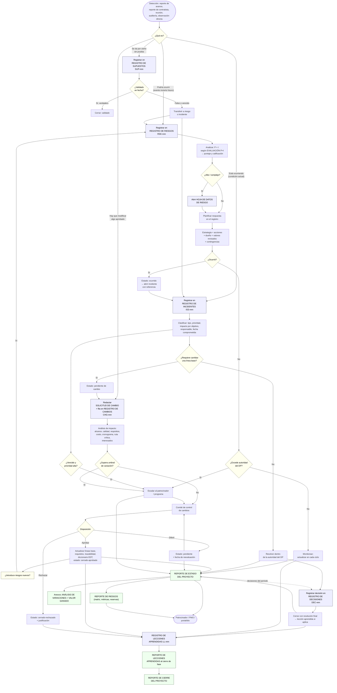

# Plantillas de documentos, registros y reportes de proyecto

## 0. Cómo usar este archivo

Este archivo es la referencia de conocimiento de la skill `pm-knowledge` para todo lo que
no es "plan de gestión" ni "documento de inicio": los **documentos de trabajo**, los
**registros vivos** y los **reportes y auditorías** con los que un proyecto se controla
día a día. Está pensado para que un agente de IA pueda:

1. Reconocer qué artefacto corresponde a una necesidad del usuario ("necesito registrar
   que el proveedor se atrasó" → registro de incidentes + reporte de estado del contratista).
2. Generar el artefacto con la estructura correcta (campos, obligatoriedad, formato tabular
   o narrativo).
3. Calcular lo calculable (EVM, PERT, P×I, puntajes ponderados) sin equivocarse.
4. Mantener la coherencia entre artefactos (un riesgo que ocurre pasa a incidente; un
   cambio aprobado actualiza líneas base y registro de cambios).
5. Traducir conceptos entre vocabularios PMBOK/PMI y PRINCE2 cuando el usuario mezcla ambos.

### Convenciones de este documento

| Convención | Significado |
|---|---|
| **Nombre ES (Nombre EN)** | Nombre en español seguido del nombre original en inglés. |
| **Oblig.** | `Sí` = el artefacto no es utilizable sin el campo; `Rec.` = recomendado; `Opc.` = opcional / de adaptación. |
| **Enfoque** | `Predictivo`, `Ágil` o `Ambos`, según para qué ciclo de vida está pensado el artefacto. |
| "no determinado en la fuente" | El material de origen no especifica el dato; el agente debe preguntar al usuario o aplicar la práctica habitual que se indica como inferencia. |
| Ejemplos | Todos los ejemplos son genéricos e inventados para este archivo (un proyecto ficticio de implantación de un portal de reservas de embarques, "Proyecto Faro"). No provienen de la obra base. |
| Equivalencia PRINCE2 | Correspondencia aproximada con el producto de gestión PRINCE2 más cercano; cuando no hay equivalente directo se indica el producto que absorbe la función. |

### Estructura estándar de cada ficha de artefacto

Cada artefacto se describe con el mismo esqueleto, para que el agente pueda recorrerlo
mecánicamente:

1. **Ficha**: nombre ES/EN, propósito, cuándo se crea/actualiza, quién elabora y quién
   aprueba, entradas, salidas (a qué otros artefactos alimenta), enfoque.
2. **Elementos**: tabla campo → contenido esperado → ejemplo genérico → obligatoriedad.
   En registros, la tabla define el esquema de fila (columnas) apto para CSV.
3. **Fórmulas y reglas de cálculo** (cuando aplican).
4. **Criterios de calidad / checklist** (5–10 verificaciones).
5. **Relación con otros artefactos y equivalencia PRINCE2**.
6. **Adaptación**: versión mínima (proyecto pequeño) y versión completa (proyecto grande o regulado).

### Mapa general de artefactos

| Familia | Artefactos | Naturaleza | Frecuencia típica |
|---|---|---|---|
| Documentos de proyecto (Cap. 3) | Solicitud de cambio, documentación de requisitos, matriz de trazabilidad, enunciado del alcance, diccionario de la EDT, estimaciones de esfuerzo/duración y hoja de trabajo, estimaciones de costos y hoja de trabajo (incl. ascendente), matriz de asignación de responsabilidades, acta del equipo, evaluación de probabilidad e impacto, hoja de datos de riesgo, estrategia de adquisiciones, criterios de selección de proveedores, análisis de interesados, historia de usuario, retrospectiva | Mayormente de planificación; algunos "a demanda" | Se crean una vez y se elaboran progresivamente; algunos son estáticos (RAM) y otros muy dinámicos (hoja de datos de riesgo) |
| Registros y bitácoras (Cap. 4) | Registro de supuestos, backlog, registro de cambios, registro de decisiones, registro de incidentes, registro de interesados, registro de riesgos, registro de lecciones aprendidas | Tabulares, vivos | Se abren al inicio y se actualizan durante todo el proyecto |
| Reportes y auditorías (Cap. 5) | Reporte de avance del miembro del equipo, reporte de estado del proyecto, reporte de análisis de variaciones, análisis de valor ganado, reporte de riesgos, reporte de estado del contratista, reporte de cierre de contrato, reporte de lecciones aprendidas, reporte de cierre del proyecto, auditoría de calidad, auditoría de riesgos, auditoría de adquisiciones | Narrativos con tablas de apoyo | Los de estado siguen una cadencia fija (p. ej., mensual); los de cierre y las auditorías son por evento o periódicos |
| Plantillas combinadas (Apéndice) | Visión + propuesta; acta de constitución + enunciado del alcance; plan de alcance + plan de calidad; plan de comunicaciones + plan de involucramiento de interesados; estrategia de adquisiciones + selección de proveedores | Fusiones para proyectos pequeños | Según adaptación |

### Principios transversales extraídos de la estructura de la obra

- **Adaptación (tailoring) siempre**: ningún artefacto es obligatorio por sí mismo; el
  tamaño, el riesgo y el enfoque del proyecto determinan cuáles se usan, cuáles se
  combinan y cuáles se omiten. Un proyecto pequeño puede fundir el enunciado del alcance
  con el acta de constitución; un proyecto sin contrataciones no necesita estrategia de
  adquisiciones ni criterios de selección.
- **Alineación entre artefactos**: cada plantilla declara con qué otros documentos debe
  ser coherente. El agente debe verificar esa coherencia al crear o actualizar.
- **Trazabilidad de movimientos entre registros**: cuando un ítem migra de un registro a
  otro (un supuesto no validado se vuelve riesgo; un riesgo que se materializa se vuelve
  incidente), se cierra en el registro de origen con una nota de destino y se anota el
  origen en el registro de destino.
- **Cabecera común**: prácticamente todas las plantillas comparten título del proyecto y
  fecha de preparación; muchas agregan responsable del documento (director del proyecto,
  patrocinador, auditor, proveedor).
- **Reportes como agregación**: el reporte de avance individual alimenta el reporte de
  estado del proyecto; el análisis de variaciones y el valor ganado pueden ser anexos del
  reporte de estado o informes independientes.

---

# PARTE I — DOCUMENTOS DEL PROYECTO (Project Documents)

Los documentos de proyecto son los artefactos de trabajo distintos de los planes de
gestión. Sirven tanto a ciclos de vida predictivos como adaptativos. Algunos se usan de
forma puntual (solicitud de cambio, estrategia de adquisiciones), otros son la base de la
planificación (enunciado del alcance, estimaciones, análisis de interesados).

---

## 1. Solicitud de cambio (Change Request)

### 1.1 Ficha

| Atributo | Detalle |
|---|---|
| Nombre ES / EN | Solicitud de cambio (Change Request) |
| Propósito | Proponer formalmente una modificación a cualquier aspecto del proyecto o del producto (alcance, requisitos, calidad, costo, cronograma, documentos) y dejar documentados su justificación, sus impactos y la decisión tomada. |
| Cuándo se crea | A demanda, cada vez que alguien identifica la necesidad de alterar algo aprobado o bajo línea base. |
| Cuándo se actualiza | Se completa con la disposición (aprobar / diferir / rechazar) tras la revisión; después se archiva y su resumen vive en el registro de cambios. |
| Quién elabora | Cualquier interesado (miembro del equipo, cliente, patrocinador, proveedor). |
| Quién aprueba | El comité de control de cambios (CCB) o la autoridad definida en el plan de gestión de cambios. |
| Entradas | Plan de gestión de cambios; línea base afectada; análisis de impacto del equipo. |
| Salidas / alimenta a | Registro de cambios; actualizaciones a líneas base y documentos del proyecto si se aprueba; matriz de trazabilidad (si cambian requisitos). |
| Enfoque | Ambos, aunque es más formal en predictivo. En ágil, los cambios de alcance se absorben vía backlog y la solicitud formal se reserva para cambios de presupuesto, fecha o contrato. |

### 1.2 Elementos

| Campo (ES / EN) | Contenido esperado | Ejemplo genérico | Oblig. |
|---|---|---|---|
| Título del proyecto (Project title) | Identificación del proyecto afectado. | Proyecto Faro – Portal de reservas | Sí |
| Fecha de preparación (Date prepared) | Fecha en que se redacta la solicitud. | 2026-03-04 | Sí |
| Solicitante (Requestor) | Nombre y, si aporta contexto, cargo de quien pide el cambio. | Laura Méndez, líder de operaciones | Sí |
| Categoría (Category) | Clasificación por el aspecto principal afectado: alcance, calidad, requisitos, costo, cronograma, documentos. Puede marcarse más de una. | Alcance | Sí |
| Descripción detallada del cambio (Detailed description of proposed change) | Qué se quiere cambiar, con el detalle suficiente para que cualquier lector entienda el antes y el después. | Incorporar un paso de validación de peso bruto verificado antes de confirmar la reserva. | Sí |
| Justificación (Justification for proposed change) | Por qué es necesario; origen (regulatorio, cliente, defecto, oportunidad). | Requisito normativo de la autoridad portuaria vigente desde el siguiente trimestre. | Sí |
| Impacto en alcance (Scope impact) | Indicación de si aumenta, disminuye o modifica el alcance, más descripción. | Aumenta: una pantalla y una regla de negocio nuevas. | Sí |
| Impacto en calidad (Quality impact) | Efecto sobre métricas o criterios de aceptación del producto o del proceso. | Modifica: nuevo caso de prueba obligatorio. | Sí |
| Impacto en requisitos (Requirements impact) | Requisitos nuevos, modificados o eliminados; referencia a sus ID. | Aumenta: REQ-041 nuevo; REQ-012 modificado. | Sí |
| Impacto en costo (Cost impact) | Efecto sobre presupuesto, estimaciones o necesidades de financiamiento; monto estimado. | Aumenta: +USD 6.500 (40 h de desarrollo + pruebas). | Sí |
| Impacto en cronograma (Schedule impact) | Efecto sobre fechas, hitos y, en particular, si altera la ruta crítica. | Aumenta: +5 días hábiles; afecta hito "Pruebas de aceptación". | Sí |
| Impacto en interesados (Stakeholder impact) | Nivel de riesgo que el cambio supone para la relación con los interesados (alto / medio / bajo) y descripción. | Medio: operaciones debe recapacitarse. | Rec. |
| Comentarios (Comments) | Aclaraciones, alternativas evaluadas, supuestos. | Alternativa descartada: validación manual posterior. | Opc. |
| Disposición (Disposition) | Decisión del CCB: aprobar, diferir o rechazar. | Aprobar | Sí (al cierre) |
| Justificación de la decisión (Disposition justification) | Razones del CCB; condiciones asociadas. | Aprobado con cargo a la reserva de gestión. | Sí (al cierre) |
| Obligatorio / discrecional (Mandatory / discretionary) | Casilla de adaptación: indica si el cambio es ineludible (legal, seguridad) u opcional. | Obligatorio | Opc. |
| Consecuencia de no hacer el cambio (Implication of not changing) | Campo de adaptación: qué ocurre si se rechaza. | Multas y rechazo de reservas por la terminal. | Opc. |

### 1.3 Reglas de cálculo y de proceso

- **Variación relativa de costo del cambio** = costo del cambio / BAC vigente. Si supera el
  umbral de variación de costo definido en el plan para la dirección del proyecto, la
  aprobación escala al nivel superior (patrocinador o comité de dirección).
- **Variación relativa de cronograma** = días adicionales / duración total planificada.
  Misma lógica de umbral.
- Un cambio que afecta la ruta crítica siempre debe marcarse explícitamente; el agente no
  debe inferir "sin impacto en fecha" si no hay un análisis de red.
- Disposición "diferir" exige una fecha o un evento de reevaluación.

### 1.4 Criterios de calidad / checklist

1. ¿La descripción permite reconstruir el estado "antes" y "después" sin leer otro documento?
2. ¿La justificación identifica el origen del cambio (normativo, defecto, mejora, cliente)?
3. ¿Hay un impacto declarado (aunque sea "ninguno") para cada dimensión: alcance, calidad, requisitos, costo, cronograma?
4. ¿El impacto en cronograma indica explícitamente si toca la ruta crítica?
5. ¿El impacto en costo tiene un monto y una fuente de financiamiento (reserva, presupuesto adicional)?
6. ¿Se referencian los ID de requisitos y entregables afectados?
7. ¿La disposición está firmada/fechada por la autoridad definida en el plan de gestión de cambios?
8. ¿Se creó o actualizó la fila correspondiente en el registro de cambios?
9. Si se aprobó, ¿se actualizaron las líneas base y la matriz de trazabilidad?
10. Si se difirió, ¿existe fecha o hito de reevaluación?

### 1.5 Relación con otros artefactos y equivalencia PRINCE2

- **Alineado con**: plan de gestión de cambios (define el proceso y la autoridad) y registro de cambios (lleva el resumen y el estado).
- **Alimenta**: líneas base (alcance, cronograma, costo), documentación de requisitos, matriz de trazabilidad, registro de riesgos (si el cambio introduce riesgos), reporte de estado (resumen de cambios del período).
- **Equivalencia PRINCE2**: *Issue Report* del tipo *Request for Change* (RFC); su seguimiento corresponde al *Issue Register* y su autoridad al *Change Authority* definido en el *Change Control Approach*. Un cambio que excede tolerancias genera además un *Exception Report*.

### 1.6 Adaptación

| Versión | Contenido |
|---|---|
| Mínima (proyecto pequeño) | Solicitante, fecha, descripción, justificación, un único bloque "impacto global" (texto libre), disposición y fecha de decisión. |
| Completa (proyecto grande / regulado) | Todos los campos; impactos por dimensión con montos y días; casilla obligatorio/discrecional; consecuencia de no cambiar; ítems de configuración afectados; firma de CCB; referencia a riesgos derivados. |

---

## 2. Documentación de requisitos (Requirements Documentation)

### 2.1 Ficha

| Atributo | Detalle |
|---|---|
| Nombre ES / EN | Documentación de requisitos (Requirements Documentation) |
| Propósito | Capturar, en detalle suficiente para medirlos y validarlos, las condiciones y capacidades que el producto, servicio o resultado debe cumplir, agrupadas por categoría y con su prioridad, criterio de aceptación y método de verificación. Sirve para negociar prioridades y gestionar expectativas. |
| Cuándo se crea | Al inicio de la planificación, a partir de la propuesta, el acta de constitución y el registro de interesados. |
| Cuándo se actualiza | Elaboración progresiva. En predictivo, los requisitos de alto nivel se detallan pero rara vez cambian; en adaptativo, el documento evoluciona iteración a iteración. |
| Quién elabora | no determinado en la fuente (práctica habitual: analista de negocio o director del proyecto con los interesados; en ágil, el dueño del producto). |
| Quién aprueba | no determinado en la fuente (práctica habitual: el interesado origen de cada requisito y el patrocinador para el conjunto). |
| Entradas | Propuesta del proyecto, acta de constitución, resumen del proyecto (brief), registro de supuestos, registro de interesados, plan de gestión del alcance, plan de gestión de requisitos. |
| Salidas / alimenta a | Registro de interesados, línea base del alcance, plan de gestión de la calidad, plan de recursos, plan de comunicaciones, registro de riesgos, plan de adquisiciones, reporte de cierre. |
| Enfoque | Ambos. En ágil puede fundirse con el backlog e indicar la iteración o el release de cada requisito. |

### 2.2 Categorías de requisitos (taxonomía de referencia)

| Categoría (ES / EN) | Qué agrupa | Ejemplo genérico |
|---|---|---|
| De negocio (Business) | Necesidades de alto nivel de la organización que justifican el proyecto. | Reducir el tiempo de confirmación de reserva a menos de 2 horas. |
| De interesados (Stakeholder) | Necesidades de grupos o personas concretas. | El despachante necesita ver el estado de la reserva sin llamar. |
| De solución (Solution) | Funcionales y no funcionales del producto. | El portal debe soportar 500 usuarios concurrentes. |
| De transición y preparación (Transition and readiness) | Lo necesario para pasar del estado actual al futuro. | Migrar 18 meses de histórico de reservas. |
| Del proyecto (Project) | Condiciones que el proyecto en sí debe cumplir. | Entregar antes del cierre del ejercicio fiscal. |
| De calidad (Quality) | Criterios y métricas de aceptación. | Cero defectos críticos abiertos en producción. |

### 2.3 Elementos (esquema de fila)

| Campo (ES / EN) | Contenido esperado | Ejemplo genérico | Oblig. |
|---|---|---|---|
| ID (ID) | Identificador único, estable, que no se reutiliza. | REQ-012 | Sí |
| Requisito (Requirement) | Condición o capacidad, redactada de forma verificable (un solo requisito por fila). | El sistema debe enviar confirmación por correo en menos de 5 minutos tras aprobar la reserva. | Sí |
| Interesado (Stakeholder) | Persona, rol u organización que origina el requisito; si no hay nombre, usar el cargo hasta tenerlo. | Jefe de atención al cliente | Sí |
| Categoría (Category) | Una de la taxonomía anterior u otra definida en el plan de requisitos. | Solución – funcional | Sí |
| Prioridad (Priority) | Nivel o grupo (p. ej., niveles 1–3, o imprescindible / deseable / opcional). | Imprescindible | Sí |
| Criterios de aceptación (Acceptance criteria) | Condiciones observables para que el interesado dé por cumplido el requisito. | 95 % de los correos enviados en ≤ 5 min durante la prueba de carga. | Sí |
| Método de prueba o verificación (Test or verification method) | Inspección, prueba, demostración o análisis. | Prueba automatizada de carga | Sí |
| Fase o release (Phase or release) | Momento del ciclo de vida o incremento en que se entregará. | Release 2 | Rec. |
| Supuestos / restricciones asociados (Assumptions / constraints) | Campo de adaptación. | Depende del servicio SMTP corporativo. | Opc. |
| Estado (Status) | Campo de adaptación: propuesto, aprobado, implementado, verificado, descartado. | Aprobado | Opc. |

### 2.4 Reglas

- Prioridad y secuencia del backlog deben coincidir cuando ambos existen.
- Cada requisito debe tener al menos un método de verificación; si no es verificable, no está listo para la línea base.
- Un cambio aprobado que toca un requisito actualiza esta tabla y la matriz de trazabilidad en la misma operación.

### 2.5 Criterios de calidad / checklist

1. ¿Cada fila contiene un único requisito atómico?
2. ¿La redacción es verificable (medible, observable) y no ambigua?
3. ¿Todo requisito tiene origen (interesado) identificado?
4. ¿La prioridad usa la escala definida en el plan de gestión de requisitos?
5. ¿El criterio de aceptación es compatible con el método de verificación?
6. ¿Los requisitos de transición y de calidad están presentes, no sólo los funcionales?
7. ¿Los ID son únicos y están referenciados en la matriz de trazabilidad?
8. ¿Se registraron supuestos asociados en el registro de supuestos?

### 2.6 Relación con otros artefactos y equivalencia PRINCE2

- **Alineado con**: plan de gestión de requisitos, plan de gestión de la calidad, matriz de trazabilidad, plan de release.
- **Equivalencia PRINCE2**: no existe un producto único; la función se reparte entre la *Project Product Description* (requisitos y criterios de aceptación del cliente) y las *Product Descriptions* individuales (criterios y método de calidad por producto). En PRINCE2 Agile, los requisitos de bajo nivel son historias de usuario del backlog.

### 2.7 Adaptación

| Versión | Contenido |
|---|---|
| Mínima | ID, requisito, prioridad, criterio de aceptación. Puede ser el propio backlog. |
| Completa | Todos los campos; relaciones padre-hijo (negocio → técnico); organización responsable (si hay proveedores); herramienta de gestión de requisitos con trazabilidad automatizada. |

---

## 3. Matriz de trazabilidad de requisitos (Requirements Traceability Matrix)

### 3.1 Ficha

| Atributo | Detalle |
|---|---|
| Nombre ES / EN | Matriz de trazabilidad de requisitos (Requirements Traceability Matrix, RTM) |
| Propósito | Seguir los atributos de cada requisito a lo largo del ciclo de vida y demostrar cómo se vincula con objetivos de negocio, entregables de la EDT, métricas de verificación y técnicas de validación. Una variante (matriz inter-requisitos) relaciona categorías de requisitos entre sí (negocio ↔ técnico, funcional ↔ técnico, técnico ↔ entregable). |
| Cuándo se crea | Una vez, al consolidar la documentación de requisitos. |
| Cuándo se actualiza | Cuando se agregan o modifican requisitos (normalmente vía solicitud de cambio aprobada). |
| Quién elabora | no determinado en la fuente (práctica habitual: analista de negocio / director del proyecto). |
| Quién aprueba | no determinado en la fuente. |
| Entradas | Acta de constitución, registro de supuestos, registro de interesados, plan de gestión del alcance, plan de gestión de requisitos, plan de involucramiento de interesados, registro de lecciones aprendidas. |
| Salidas / alimenta a | Plan de gestión de la calidad, enunciado del trabajo de adquisiciones, solicitudes de cambio. |
| Enfoque | Ambos. En adaptativo se agrega la columna de release/iteración y la prioridad debe seguir el orden del backlog. |

### 3.2 Elementos — matriz principal

| Campo (ES / EN) | Contenido esperado | Ejemplo genérico | Oblig. |
|---|---|---|---|
| ID (ID) | Identificador del requisito (el mismo de la documentación de requisitos). | REQ-012 | Sí |
| Requisito (Requirement) | Enunciado resumido. | Confirmación por correo ≤ 5 min | Sí |
| Fuente (Source) | Interesado que lo originó. | Jefe de atención al cliente | Sí |
| Prioridad (Priority) | Escala del plan de requisitos. | Imprescindible | Sí |
| Categoría (Category) | Funcional, no funcional, seguridad, mantenibilidad, etc. | Funcional | Sí |
| Objetivo (Objective) | Objetivo de negocio del acta de constitución o del caso de negocio que el requisito ayuda a cumplir. | OBJ-2 Reducir tiempo de confirmación | Sí |
| Entregable (Deliverable) | Elemento de la EDT que materializa el requisito. | 1.3.2 Módulo de notificaciones | Sí |
| Verificación (Verification) | Métrica con la que se mide el cumplimiento. | % de correos ≤ 5 min | Sí |
| Validación (Validation) | Técnica para confirmar que satisface la necesidad del interesado. | Prueba de aceptación de usuario | Sí |
| Organización responsable (Accountable organization) | Adaptación: quién responde por el requisito cuando hay proveedores. | Proveedor B | Opc. |
| Release (Release) | Adaptación para adaptativo. | R2 | Opc. |
| Estado de trazabilidad (Trace status) | Adaptación: completa / parcial / huérfano. | Completa | Opc. |

### 3.3 Elementos — matriz inter-requisitos

| Campo (ES / EN) | Contenido esperado | Ejemplo genérico | Oblig. |
|---|---|---|---|
| ID de requisito de negocio (Business requirement ID) | Identificador del requisito padre. | BR-03 | Sí |
| Requisito de negocio (Business requirement) | Condición que satisface una necesidad del negocio. | Confirmar reservas en menos de 2 h | Sí |
| Prioridad (Priority) | Escala del plan. | Nivel 1 | Sí |
| Fuente (Source) | Interesado origen. | Gerencia comercial | Sí |
| ID de requisito técnico (Technical requirement ID) | Identificador del requisito hijo. | TR-11 | Sí |
| Requisito técnico (Technical requirement) | Desempeño técnico que el entregable debe alcanzar. | Cola de mensajes con latencia < 30 s | Sí |
| Prioridad (Priority) | Escala del plan. | Nivel 1 | Sí |
| Fuente (Source) | Interesado origen del requisito técnico. | Arquitecto de soluciones | Sí |

### 3.4 Reglas

- **Regla de cobertura hacia adelante**: todo requisito debe trazar al menos a un entregable y a un método de verificación.
- **Regla de cobertura hacia atrás**: todo entregable de la EDT debe trazar al menos a un requisito; un entregable sin requisito es sospecha de sobre-alcance (*gold plating*).
- **Requisito huérfano** = sin objetivo de negocio asociado → candidato a eliminación o a solicitud de cambio.
- Métrica de completitud: `cobertura = requisitos con entregable y verificación / total de requisitos`.

### 3.5 Criterios de calidad / checklist

1. ¿Todos los ID coinciden con la documentación de requisitos (sin duplicados ni faltantes)?
2. ¿Cada requisito tiene objetivo de negocio, entregable y método de verificación?
3. ¿Cada entregable de la EDT aparece al menos una vez?
4. ¿Las prioridades coinciden con la documentación de requisitos y con el backlog?
5. ¿Los requisitos técnicos cuelgan de al menos un requisito de negocio (matriz inter-requisitos)?
6. ¿La matriz se actualizó con la última solicitud de cambio aprobada?
7. ¿Se usa una herramienta cuando el volumen supera lo manejable en una tabla manual?

### 3.6 Relación con otros artefactos y equivalencia PRINCE2

- **Alineado con**: enfoque de desarrollo, plan de gestión de requisitos, documentación de requisitos, plan de release e iteración, backlog.
- **Equivalencia PRINCE2**: no hay producto equivalente formal. La trazabilidad se logra combinando la *Product Breakdown Structure*, las *Product Descriptions* (criterios de calidad y método) y el *Quality Register* (evidencia de verificación). El *Product Status Account* cubre el estado, no la trazabilidad a objetivos.

### 3.7 Adaptación

| Versión | Contenido |
|---|---|
| Mínima | ID, requisito, entregable, verificación. |
| Completa | Ambas matrices; estructura jerárquica negocio → técnico → especificación; organización responsable; release; herramienta especializada. |

---

## 4. Enunciado del alcance del proyecto (Project Scope Statement)

### 4.1 Ficha

| Atributo | Detalle |
|---|---|
| Nombre ES / EN | Enunciado del alcance del proyecto (Project Scope Statement) |
| Propósito | Describir narrativamente el alcance del proyecto y del producto, cada entregable clave con sus criterios de aceptación, y lo que queda explícitamente fuera. Da más contexto que la EDT y más detalle que el acta de constitución. |
| Cuándo se crea | Una vez, al inicio de la planificación. |
| Cuándo se actualiza | Sólo ante un cambio significativo de alcance aprobado. |
| Quién elabora | no determinado en la fuente (práctica habitual: director del proyecto con el equipo). |
| Quién aprueba | no determinado en la fuente (práctica habitual: patrocinador / cliente). |
| Entradas | Propuesta, acta de constitución, resumen del proyecto, lienzo de arranque (startup canvas), plan de gestión del alcance, documentación de requisitos. |
| Salidas / alimenta a | EDT (y, con ella, la línea base del alcance); diccionario de la EDT. |
| Enfoque | Ambos. En pequeño puede fundirse con el acta de constitución; en ágil, con el plan de release e iteración. |

### 4.2 Elementos

| Campo (ES / EN) | Contenido esperado | Ejemplo genérico | Oblig. |
|---|---|---|---|
| Título del proyecto (Project title) | Identificación. | Proyecto Faro | Sí |
| Fecha de preparación (Date prepared) | Fecha de la versión. | 2026-02-10 | Sí |
| Descripción del alcance del proyecto (Project scope description) | Narrativa que elabora la descripción del acta y los requisitos: qué se hará y qué características tendrá el producto. | Diseño, construcción e implantación de un portal web de reservas de embarque integrado con tres navieras. | Sí |
| Entregables del proyecto (Project deliverables) | Lista de los productos principales (del proyecto y del producto), elaborada a partir del acta. | Portal web; integraciones con navieras; manual de operación; plan de capacitación. | Sí |
| Criterios de aceptación (Acceptance criteria) | Condiciones para que cada entregable sea aceptado; pueden definirse por componente. | Portal: pasa pruebas de aceptación con ≤ 2 defectos menores abiertos. | Sí |
| Exclusiones del proyecto (Project exclusions) | Lo que explícitamente no forma parte del alcance del producto ni del proyecto. | No incluye facturación ni cobros en línea. | Sí |
| Restricciones (Constraints) | Adaptación: límites impuestos (fecha, presupuesto, normativa). | Salida a producción antes del 30/11. | Opc. |
| Supuestos (Assumptions) | Adaptación: referencia al registro de supuestos. | Ver SUP-001 a SUP-006. | Opc. |

### 4.3 Criterios de calidad / checklist

1. ¿La descripción es coherente con el acta de constitución y con la documentación de requisitos?
2. ¿Cada entregable tiene al menos un criterio de aceptación medible?
3. ¿Las exclusiones cubren las zonas grises que ya generaron preguntas de interesados?
4. ¿Los entregables listados son exactamente los de nivel superior de la EDT?
5. ¿Está firmado o aceptado por el patrocinador antes de construir la EDT?
6. ¿Toda modificación posterior pasó por solicitud de cambio?

### 4.4 Relación con otros artefactos y equivalencia PRINCE2

- **Alineado con**: acta de constitución, propuesta, resumen del proyecto, lienzo de arranque, EDT, documentación de requisitos.
- **Equivalencia PRINCE2**: *Project Product Description* (propósito, composición, criterios de aceptación del cliente, exclusiones) dentro del *Project Brief* y luego del *PID*.

### 4.5 Adaptación

| Versión | Contenido |
|---|---|
| Mínima | Descripción breve, lista de entregables con criterio de aceptación, exclusiones; integrado en el acta de constitución abreviada. |
| Completa | Narrativa por entregable, criterios por componente, exclusiones, restricciones, supuestos, referencias a requisitos y a la EDT. |

---

## 5. Diccionario de la EDT (WBS Dictionary)

### 5.1 Ficha

| Atributo | Detalle |
|---|---|
| Nombre ES / EN | Diccionario de la EDT (WBS Dictionary) |
| Propósito | Detallar cada paquete de trabajo (o cuenta de control) de la estructura de desglose del trabajo: qué incluye, hitos, actividades, recursos, costos, requisitos de calidad, criterios de aceptación, referencias técnicas y contractuales. Convierte la EDT (un gráfico o esquema) en una especificación operable. |
| Cuándo se crea | Tras aprobar la EDT; se completa con elaboración progresiva a medida que se conocen actividades, recursos y costos. |
| Cuándo se actualiza | Durante toda la planificación y ante cambios aprobados. |
| Quién elabora | no determinado en la fuente (práctica habitual: director del proyecto con los responsables de cada paquete). |
| Quién aprueba | no determinado en la fuente. |
| Entradas | Documentación de requisitos, enunciado del alcance, EDT, estimaciones de costos, métricas de calidad, contratos. |
| Salidas / alimenta a | Registro de riesgos, plan de gestión de adquisiciones (como mini-enunciado de trabajo de lo tercerizado). |
| Enfoque | Predictivo principalmente. Nota: la EDT en sí no tiene plantilla porque depende de la naturaleza del trabajo; el nivel más bajo es el paquete de trabajo y por encima están las cuentas de control usadas para reportar. |

### 5.2 Elementos

| Campo (ES / EN) | Contenido esperado | Ejemplo genérico | Oblig. |
|---|---|---|---|
| Nombre del paquete de trabajo (Work package name) | Nombre e identificador tal como figuran en la EDT. | 1.3.2 Módulo de notificaciones | Sí |
| Descripción del trabajo (Description of work) | Qué entregable produce el paquete y qué incluye. | Servicio de envío de correos y SMS de confirmación. | Sí |
| Hitos (Milestones) | Hitos vinculados al paquete. | Diseño aprobado; pruebas superadas | Rec. |
| Fechas de vencimiento (Due dates) | Fecha de cada hito. | 15/04; 20/05 | Rec. |
| ID de actividad (Activity ID) | Identificador, normalmente extensión de la numeración de la EDT. | 1.3.2.1 | Rec. |
| Actividad (Activity) | Actividad del cronograma incluida en el paquete. | Configurar plantillas de correo | Rec. |
| Recurso del equipo (Team resource) | Personas o roles asignados. | Desarrollador backend | Rec. |
| Horas de mano de obra (Labor hours) | Esfuerzo total estimado. | 40 h | Rec. |
| Tarifa (Labor rate) | Costo por hora o día (de las estimaciones de costos). | USD 45/h | Rec. |
| Total mano de obra (Labor total) | Horas × tarifa. | USD 1.800 | Rec. |
| Unidades de material (Material units) | Cantidad de material requerido. | 1 licencia | Opc. |
| Costo de material (Material cost) | Costo unitario. | USD 300 | Opc. |
| Total material (Material total) | Unidades × costo unitario. | USD 300 | Opc. |
| Costo total (Total cost) | Suma de mano de obra, material y otros. | USD 2.100 | Rec. |
| Requisitos de calidad (Quality requirements) | Métricas o estándares aplicables. | 99 % de entregas en ≤ 5 min | Rec. |
| Criterios de aceptación (Acceptance criteria) | Del enunciado del alcance. | Prueba de aceptación firmada | Sí |
| Información técnica (Technical information) | Especificaciones o referencias a documentos técnicos. | Ver ARQ-07, sección 4 | Opc. |
| Información contractual (Contract information) | Contratos o acuerdos que afectan el paquete. | Contrato PRV-2026-03 | Opc. |

### 5.3 Fórmulas

- `Total mano de obra = horas × tarifa`
- `Total material = unidades × costo unitario`
- `Costo total del paquete = total mano de obra + total material + otros costos directos`
- `Costo de la cuenta de control = Σ costo total de sus paquetes`

### 5.4 Criterios de calidad / checklist

1. ¿Cada paquete de la EDT tiene su entrada en el diccionario (regla del 100 %)?
2. ¿La descripción permite a alguien ajeno entender qué se entrega y qué no?
3. ¿Los criterios de aceptación coinciden con el enunciado del alcance?
4. ¿Las horas y tarifas coinciden con las estimaciones de esfuerzo y costo?
5. ¿Los hitos coinciden con el cronograma?
6. ¿Los paquetes tercerizados referencian su contrato?
7. ¿Se referencian documentos externos en lugar de duplicar su contenido?

### 5.5 Relación con otros artefactos y equivalencia PRINCE2

- **Alineado con**: EDT, enunciado del alcance, estimaciones de duración, cronograma, estimaciones de costos, presupuesto, plan de calidad, plan de recursos, plan de adquisiciones.
- **Equivalencia PRINCE2**: *Product Description* (identificador, propósito, composición, criterios y método de calidad) combinada con el *Work Package* (lo que se encarga a un equipo con fechas, costos, tolerancias y referencias contractuales).

### 5.6 Adaptación

| Versión | Contenido |
|---|---|
| Mínima | Puede omitirse. Si se usa: nombre, descripción, costo estimado, fechas clave y recursos asignados. |
| Completa | Todos los campos; actividades y recursos por línea; secciones técnica y contractual; uso como mini-enunciado de trabajo para entregables tercerizados. |

---

## 6. Estimaciones de esfuerzo y duración (Effort / Duration Estimates)

### 6.1 Ficha

| Atributo | Detalle |
|---|---|
| Nombre ES / EN | Estimaciones de esfuerzo y duración (Effort / Duration Estimates) |
| Propósito | Registrar, por actividad, paquete de trabajo o cuenta de control, cuánto trabajo (esfuerzo, en horas-persona) y cuánto tiempo calendario (duración, en días o semanas) tomará completar el trabajo. |
| Cuándo se crea | Durante la planificación del cronograma. |
| Cuándo se actualiza | De forma continua, a medida que se refinan actividades (planificación gradual / rolling wave). |
| Quién elabora | no determinado en la fuente (práctica habitual: quien ejecutará el trabajo, consolidado por el director del proyecto). |
| Quién aprueba | no determinado en la fuente. |
| Entradas | Registro de supuestos, plan de gestión del cronograma, registro de lecciones aprendidas. |
| Salidas / alimenta a | Cronograma del proyecto; estimaciones de costos. |
| Enfoque | Predictivo. En ágil se trabaja con cajas de tiempo fijas (time boxes) y métodos relativos (puntos de historia), no con duraciones por actividad. |

### 6.2 Elementos (esquema de fila)

| Campo (ES / EN) | Contenido esperado | Ejemplo genérico | Oblig. |
|---|---|---|---|
| ID (ID) | Identificador de la actividad o paquete. | 1.3.2.1 | Sí |
| Descripción de la actividad (Activity description) | Qué trabajo se realiza. | Configurar plantillas de correo | Sí |
| Horas de esfuerzo (Effort hours) | Trabajo necesario, en horas (o días-persona). | 40 h | Rec. |
| Estimación de duración (Duration estimate) | Tiempo transcurrido, en días (o semanas/meses). | 6 días | Sí |
| Reserva de contingencia (Contingency reserve) | Adaptación: colchón por incertidumbre a nivel de cuenta de control o fase. | +1 día | Opc. |
| Base de la estimación (Basis of estimate) | Adaptación: método y supuestos. | Analógica, proyecto Delta 2025 | Opc. |

### 6.3 Fórmulas y reglas de conversión

- `Duración en días = horas de esfuerzo / 8` (jornada de 8 h; ajustar si la organización usa otra).
- `Duración en semanas = horas de esfuerzo / 40`.
- La conversión directa supone un recurso a tiempo completo y productividad promedio; en cualquier otro caso usar la hoja de trabajo paramétrica (sección 7).
- Regla de productividad: es habitual asumir que una persona dedica efectivamente alrededor del 75 % de su jornada al trabajo del proyecto; aplicar ese factor si no hay dato propio.
- La reserva de contingencia se declara aparte del estimado base, nunca "escondida" dentro de él.

### 6.4 Criterios de calidad / checklist

1. ¿Esfuerzo y duración están en unidades declaradas y consistentes con el plan de cronograma?
2. ¿La duración es coherente con el esfuerzo dividido por la disponibilidad real del recurso?
3. ¿Se indica el método de estimación (analógico, paramétrico, tres valores)?
4. ¿Los supuestos de la estimación están en el registro de supuestos?
5. ¿La reserva está separada y justificada?
6. ¿La estimación fue hecha o validada por quien ejecutará el trabajo?
7. ¿Se refinó tras la última ronda de planificación gradual?

### 6.5 Relación con otros artefactos y equivalencia PRINCE2

- **Alineado con**: registro de supuestos, estimaciones de costos.
- **Equivalencia PRINCE2**: no es un producto de gestión independiente; corresponde al paso "estimar" de la técnica de planificación basada en productos y queda incorporado en el *Stage Plan* / *Team Plan*.

### 6.6 Adaptación

| Versión | Contenido |
|---|---|
| Mínima | ID, actividad, duración. |
| Completa | Esfuerzo, duración, reserva por cuenta de control, base de la estimación, rango y nivel de confianza; refinamiento por oleadas. |

---

## 7. Hoja de trabajo de estimación de esfuerzo y duración (Effort / Duration Estimating Worksheet)

### 7.1 Ficha

| Atributo | Detalle |
|---|---|
| Nombre ES / EN | Hoja de trabajo de estimación de esfuerzo y duración (Effort / Duration Estimating Worksheet) |
| Propósito | Documentar el cálculo de las duraciones cuando se usan métodos cuantitativos: paramétrico, analógico y de múltiples valores (tres puntos / PERT). Hace auditables los números que llegan a las estimaciones de duración. |
| Cuándo se crea / actualiza | Junto con las estimaciones de duración; se refina con ellas. |
| Quién elabora | no determinado en la fuente (práctica habitual: estimador / director del proyecto). |
| Entradas | Registro de supuestos, información de alcance y requisitos, plan de gestión del cronograma, registro de riesgos, registro de lecciones aprendidas. |
| Salidas / alimenta a | Estimaciones de duración; cronograma. |
| Enfoque | Predictivo. |

### 7.2 Elementos — bloque paramétrico

| Campo (ES / EN) | Contenido esperado | Ejemplo genérico | Oblig. |
|---|---|---|---|
| ID (ID) | Actividad. | A-14 | Sí |
| Horas de esfuerzo (Effort hours) | Trabajo total requerido para un recurso promedio. | 120 h | Sí |
| Cantidad de recursos (Resource quantity) | Personas asignadas. | 2 | Sí |
| Porcentaje disponible (Percent available) | Fracción de la jornada dedicada al proyecto. | 0,75 | Sí |
| Factor de desempeño (Performance factor) | Multiplicador de productividad: 1,0 recurso promedio; < 1 recurso experto (más rápido); > 1 recurso novato (más lento). | 0,9 | Rec. |
| Estimación de duración (Duration estimate) | Resultado de la fórmula, en horas calendario (convertir luego a días). | 80 h ≈ 10 días | Sí |

### 7.3 Elementos — bloque analógico

| Campo (ES / EN) | Contenido esperado | Ejemplo genérico | Oblig. |
|---|---|---|---|
| ID (ID) | Actividad. | A-15 | Sí |
| Actividad previa (Previous activity) | Trabajo histórico comparable y su tamaño. | Integrar 2 navieras (proyecto Delta) | Sí |
| Duración previa (Previous duration) | Duración real registrada. | 30 días | Sí |
| Actividad actual (Current activity) | En qué difiere la actual (tamaño). | Integrar 3 navieras | Sí |
| Multiplicador (Multiplier) | Tamaño actual / tamaño previo, ajustado por complejidad si corresponde. | 1,5 | Sí |
| Estimación de duración (Duration estimate) | Duración previa × multiplicador. | 45 días | Sí |

### 7.4 Elementos — bloque de múltiples valores

| Campo (ES / EN) | Contenido esperado | Ejemplo genérico | Oblig. |
|---|---|---|---|
| ID (ID) | Actividad. | A-16 | Sí |
| Duración optimista (Optimistic duration, O) | Todo sale bien: sin demoras ni faltantes. | 8 días | Sí |
| Duración más probable (Most likely duration, M) | Demoras normales, nada extraordinario. | 12 días | Sí |
| Duración pesimista (Pessimistic duration, P) | Se materializan riesgos relevantes. | 22 días | Sí |
| Ecuación de ponderación (Weighting equation) | Fórmula usada (beta/PERT, triangular u otra). | PERT | Sí |
| Duración esperada (Expected duration, tE) | Resultado. | 13 días | Sí |
| Desviación estándar (Standard deviation) | Adaptación: dispersión de la estimación. | 2,3 días | Opc. |

### 7.5 Fórmulas

**Paramétrica (duración a partir del esfuerzo)**

```
Duración = Esfuerzo / (Cantidad de recursos × Porcentaje disponible × Factor de desempeño)
```

Ejemplo propio: 120 h de esfuerzo, 2 personas, 75 % disponibles, factor 0,9 →
120 / (2 × 0,75 × 0,9) = 88,9 h ≈ 11 días de 8 h.

Nota sobre el factor de desempeño: se aplica como divisor cuando se expresa "a menor
valor, más rápido" (experto = 0,8). Si la organización lo define al revés (experto = 1,25),
hay que multiplicar. El agente debe declarar la convención elegida.

**Analógica**

```
Multiplicador = Tamaño actual / Tamaño previo   (× ajuste por complejidad, opcional)
Duración estimada = Duración previa × Multiplicador
```

**Tres valores — distribución beta (PERT)**

```
tE = (O + 4M + P) / 6
σ  = (P − O) / 6
```

**Tres valores — distribución triangular**

```
tE = (O + M + P) / 3
```

**Ponderación alternativa cuando el equipo no tiene experiencia o hay riesgos altos**:
dar más peso al pesimista, p. ej. `tE = (O + 3M + 2P) / 6` o cualquier combinación cuyos
pesos sumen el denominador. El agente debe explicitar los pesos elegidos.

**Rango de confianza** (aprox., con beta): `tE ± 1σ ≈ 68 %`, `tE ± 2σ ≈ 95 %`.

### 7.6 Criterios de calidad / checklist

1. ¿Se indica qué bloque (paramétrico, analógico, múltiples valores) produjo cada estimación?
2. ¿Los tres valores O/M/P provienen de personas con conocimiento del trabajo?
3. ¿P ≥ M ≥ O en todas las filas?
4. ¿La convención del factor de desempeño está declarada?
5. ¿El multiplicador analógico se basa en una medida de tamaño comparable?
6. ¿El resultado se convirtió a la unidad del cronograma (días/semanas)?
7. ¿La desviación estándar o el rango acompaña a las estimaciones críticas?

### 7.7 Relación con otros artefactos y equivalencia PRINCE2

- **Alimenta**: estimaciones de duración, cronograma, registro de riesgos (los P altos señalan riesgos).
- **Equivalencia PRINCE2**: sin producto propio; es evidencia de la técnica de estimación dentro del *Stage Plan*; las variaciones O–P pueden reflejarse como tolerancia de tiempo.

### 7.8 Adaptación

| Versión | Contenido |
|---|---|
| Mínima | Sólo el bloque de tres valores con PERT para las actividades de la ruta crítica. |
| Completa | Los tres bloques, σ y rangos, pesos alternativos documentados, trazabilidad al registro de lecciones aprendidas para los análogos. |

---

## 8. Estimaciones de costos (Cost Estimates)

### 8.1 Ficha

| Atributo | Detalle |
|---|---|
| Nombre ES / EN | Estimaciones de costos (Cost Estimates) |
| Propósito | Cuantificar el costo de los recursos necesarios para completar el trabajo (personas, equipos, materiales, suministros, servicios, instalaciones) por paquete o actividad, con su base, método, supuestos, rango y nivel de confianza. |
| Cuándo se crea | En la planificación de costos, tras las estimaciones de esfuerzo. |
| Cuándo se actualiza | Periódicamente, con planificación gradual y ante cambios aprobados. |
| Quién elabora | no determinado en la fuente (práctica habitual: director del proyecto con el equipo y compras). |
| Quién aprueba | no determinado en la fuente. |
| Entradas | Plan de gestión de costos, plan de gestión de la calidad, registro de riesgos, registro de lecciones aprendidas. |
| Salidas / alimenta a | Presupuesto del proyecto (línea base de costos). |
| Enfoque | Predictivo; en ágil se suele presupuestar por iteración o por equipo-mes. |

### 8.2 Elementos (esquema de fila)

| Campo (ES / EN) | Contenido esperado | Ejemplo genérico | Oblig. |
|---|---|---|---|
| ID (ID) | ID de EDT o de actividad. | 1.3.2 | Sí |
| Recurso (Resource) | Persona, equipo o material que origina el costo. | Desarrollador backend; licencia SMTP | Sí |
| Costos de mano de obra (Labor costs) | Equipo propio o contratado. | USD 1.800 | Sí |
| Costos físicos (Physical costs) | Material, equipos, suministros, instalaciones. | USD 300 | Sí |
| Reserva (Reserve) | Contingencia asignada, si la hay. | USD 210 | Rec. |
| Estimación (Estimate) | Suma de mano de obra + físicos + reserva. | USD 2.310 | Sí |
| Base de la estimación (Basis of estimates) | Unidad y cantidad que sustentan el número (horas, m², unidades). | 40 h × USD 45 | Sí |
| Método (Method) | Analógico, paramétrico, tres valores, ascendente, juicio experto. | Ascendente | Sí |
| Supuestos / restricciones (Assumptions / constraints) | Lo que se dio por cierto al estimar. | Tarifa fija durante 2026 | Rec. |
| Rango (Range) | Banda de precisión (p. ej., −10 % / +25 %). | −10 % / +20 % | Rec. |
| Nivel de confianza (Confidence level) | Grado de certeza (alto/medio/bajo o %). | Medio | Rec. |
| Tipo de contrato (Contract type) | Adaptación: si el recurso es un proveedor, modalidad contractual que afecta honorarios e incentivos. | Precio fijo | Opc. |
| Costo de calidad / indirectos / financiamiento | Adaptación: si se incluyeron, declararlos. | Indirectos 12 % | Opc. |

### 8.3 Fórmulas

- `Estimación de la fila = mano de obra + costos físicos + reserva`
- `Estimación del paquete = Σ filas del paquete`
- `Línea base de costos = Σ paquetes + reservas de contingencia` (la reserva de gestión queda fuera de la línea base pero dentro del presupuesto total).
- `Presupuesto total (BAC) = línea base de costos + reserva de gestión` (convención PMBOK; declarar si la organización usa otra).
- Clases de precisión habituales (orientativas, de práctica general): orden de magnitud −25 %/+75 %; presupuestaria −10 %/+25 %; definitiva −5 %/+10 %.

### 8.4 Criterios de calidad / checklist

1. ¿Cada fila tiene base de estimación verificable (cantidad × tarifa o cotización)?
2. ¿El método está declarado y es adecuado a la información disponible?
3. ¿La reserva de contingencia está separada y vinculada a riesgos del registro?
4. ¿Los supuestos están también en el registro de supuestos?
5. ¿El rango y la confianza son coherentes con la fase del proyecto?
6. ¿Las horas coinciden con las estimaciones de esfuerzo?
7. ¿Se indicó el tipo de contrato en los costos de proveedores?
8. ¿Se declaró si incluye indirectos, costo de calidad y financiamiento?

### 8.5 Relación con otros artefactos y equivalencia PRINCE2

- **Alineado con**: registro de supuestos, estimaciones de esfuerzo.
- **Equivalencia PRINCE2**: costos del *Stage Plan* / *Project Plan* y sección de costos del *Business Case*; la reserva equivale al presupuesto de riesgo y al presupuesto de cambios.

### 8.6 Adaptación

| Versión | Contenido |
|---|---|
| Mínima | ID, recurso, estimación, método. |
| Completa | Todos los campos; indirectos, costo de calidad y financiamiento; tipo de contrato; rango y confianza; refinamiento por oleadas. |

---

## 9. Hoja de trabajo de estimación de costos (Cost Estimating Worksheet) e hoja ascendente (Bottom-up)

### 9.1 Ficha

| Atributo | Detalle |
|---|---|
| Nombre ES / EN | Hoja de trabajo de estimación de costos (Cost Estimating Worksheet); Hoja de trabajo de estimación ascendente (Bottom-up Cost Estimating Worksheet) |
| Propósito | Hacer explícito y auditable el cálculo de cada estimación de costo: paramétrico (unidades × costo unitario), analógico (costo previo × razón de tamaño), múltiples valores (PERT) y ascendente (suma detallada de todas las categorías de costo del paquete). |
| Cuándo se crea / actualiza | Con las estimaciones de costos; se refina periódicamente. |
| Quién elabora | no determinado en la fuente. |
| Entradas | Plan de gestión de costos, alcance y requisitos, cronograma, plan de calidad, registro de riesgos, registro de lecciones aprendidas. |
| Salidas / alimenta a | Estimaciones de costos; presupuesto. |
| Enfoque | Predictivo. |

### 9.2 Elementos — bloque paramétrico

| Campo (ES / EN) | Contenido esperado | Ejemplo genérico | Oblig. |
|---|---|---|---|
| ID (ID) | EDT o actividad. | 1.4.1 | Sí |
| Variable de costo (Cost variable) | Impulsor cuantificable: horas, m², licencias, GB. | Usuarios licenciados | Sí |
| Costo por unidad (Cost per unit) | Precio unitario. | USD 12 | Sí |
| Número de unidades (Number of units) | Cantidad. | 250 | Sí |
| Estimación de costo (Cost estimate) | Unidades × costo unitario. | USD 3.000 | Sí |

### 9.3 Elementos — bloque analógico

| Campo (ES / EN) | Contenido esperado | Ejemplo genérico | Oblig. |
|---|---|---|---|
| ID (ID) | EDT o actividad. | 1.4.2 | Sí |
| Actividad previa (Previous activity) | Trabajo comparable y su tamaño. | Capacitar 40 usuarios | Sí |
| Costo previo (Previous cost) | Costo real histórico. | USD 4.000 | Sí |
| Actividad actual (Current activity) | Tamaño actual. | Capacitar 60 usuarios | Sí |
| Multiplicador (Multiplier) | Actual / previo, ajustado por inflación o complejidad. | 1,5 × 1,05 = 1,575 | Sí |
| Estimación de costo (Cost estimate) | Costo previo × multiplicador. | USD 6.300 | Sí |

### 9.4 Elementos — bloque de múltiples valores

| Campo (ES / EN) | Contenido esperado | Ejemplo genérico | Oblig. |
|---|---|---|---|
| ID (ID) | EDT o actividad. | 1.4.3 | Sí |
| Costo optimista (Optimistic cost, O) | Todos los costos identificados, sin aumentos. | USD 8.000 | Sí |
| Costo más probable (Most likely cost, M) | Fluctuaciones normales. | USD 10.000 | Sí |
| Costo pesimista (Pessimistic cost, P) | Se materializan sobrecostos relevantes. | USD 16.000 | Sí |
| Ecuación de ponderación (Weighting equation) | PERT / triangular / otra. | PERT | Sí |
| Costo esperado (Expected cost, cE) | Resultado. | USD 10.667 | Sí |

### 9.5 Elementos — hoja ascendente (bottom-up)

| Campo (ES / EN) | Contenido esperado | Ejemplo genérico | Oblig. |
|---|---|---|---|
| ID (ID) | Paquete de trabajo. | 1.3.2 | Sí |
| Horas de mano de obra (Labor hours) | Esfuerzo estimado. | 40 | Sí |
| Tarifa (Labor rate) | Por hora o día. | 45 | Sí |
| Total mano de obra (Total labor) | Horas × tarifa. | 1.800 | Sí |
| Materiales (Material) | Cotización o cantidad × unitario. | 300 | Rec. |
| Suministros (Supplies) | Ídem. | 50 | Opc. |
| Equipos (Equipment) | Alquiler, leasing o compra. | 0 | Opc. |
| Viajes (Travel) | Cotizaciones de viaje. | 400 | Opc. |
| Otros costos directos (Other direct costs) | Cualquier otro directo, con su tipo. | 120 (certificado SSL) | Opc. |
| Costos indirectos (Indirect costs) | Gastos generales / overhead asignados. | 320 | Rec. |
| Reserva (Reserve) | Contingencia del paquete. | 300 | Rec. |
| Estimación (Estimate) | Suma de todo lo anterior. | 3.290 | Sí |

### 9.6 Fórmulas

```
Paramétrica:   Costo = Unidades × Costo unitario
Analógica:     Multiplicador = Tamaño actual / Tamaño previo (× ajustes)
               Costo = Costo previo × Multiplicador
PERT (beta):   cE = (O + 4M + P) / 6 ;  σ = (P − O) / 6
Triangular:    cE = (O + M + P) / 3
Ascendente:    Estimación = Total mano de obra + Materiales + Suministros + Equipos
                           + Viajes + Otros directos + Indirectos + Reserva
               Total mano de obra = Horas × Tarifa
```

Verificación cruzada recomendada: cuando se dispone de una estimación ascendente y una
analógica para el mismo paquete, una diferencia mayor al 25 % obliga a revisar supuestos.

### 9.7 Criterios de calidad / checklist

1. ¿Cada estimación muestra su cálculo (no sólo el resultado)?
2. ¿Las unidades de la variable paramétrica son medibles y están justificadas?
3. ¿El multiplicador analógico incluye ajuste por inflación cuando el dato histórico es antiguo?
4. ¿P ≥ M ≥ O?
5. ¿La hoja ascendente cubre indirectos y reserva de forma explícita?
6. ¿Las horas coinciden con la hoja de esfuerzo/duración?
7. ¿Las cotizaciones de proveedores están referenciadas con fecha y validez?

### 9.8 Relación con otros artefactos y equivalencia PRINCE2

- **Alimenta**: estimaciones de costos, presupuesto, diccionario de la EDT (costos de paquete).
- **Equivalencia PRINCE2**: evidencia de estimación del *Stage Plan*; los paquetes ascendentes se corresponden con el costo de cada *Work Package*.

### 9.9 Adaptación

| Versión | Contenido |
|---|---|
| Mínima | Hoja ascendente simplificada (mano de obra + otros + reserva) para los paquetes principales. |
| Completa | Los cuatro bloques; σ; verificación cruzada; indirectos; trazabilidad a cotizaciones y lecciones aprendidas. |

---

## 10. Matriz de asignación de responsabilidades (Responsibility Assignment Matrix, RAM)

### 10.1 Ficha

| Atributo | Detalle |
|---|---|
| Nombre ES / EN | Matriz de asignación de responsabilidades (Responsibility Assignment Matrix, RAM); variante más común: matriz RACI |
| Propósito | Mostrar la intersección entre paquetes de trabajo (o entregables/actividades) y personas, roles u organizaciones, indicando el tipo de participación de cada uno. |
| Cuándo se crea | En la planificación de recursos; se elabora progresivamente a medida que se conocen alcance y recursos. |
| Cuándo se actualiza | Rara vez; es de los documentos más estables. Cambia ante reasignaciones o nuevos paquetes. |
| Quién elabora | no determinado en la fuente (práctica habitual: director del proyecto). |
| Quién aprueba | no determinado en la fuente (práctica habitual: gerentes funcionales que ceden recursos). |
| Entradas | Información de alcance, documentación de requisitos, plan de gestión de recursos, registro de interesados. |
| Salidas / alimenta a | Cronograma (asignaciones), plan de comunicaciones, documentos de adquisiciones (RFP/RFQ). |
| Enfoque | Ambos; en ágil se usa a nivel de rol (dueño del producto, equipo, facilitador) más que de persona. |

### 10.2 Tipos de participación

| Código | Nombre ES / EN | Significado |
|---|---|---|
| R | Responsable (Responsible) | Ejecuta el trabajo. Puede haber varios. |
| A | Aprobador / responsable final (Accountable) | Responde ante el director del proyecto de que el trabajo se termine a tiempo, cumpla requisitos y sea aceptable. **Uno y sólo uno por fila**; no se comparte. |
| C | Consultado (Consulted) | Posee información necesaria; se le consulta antes o durante. |
| I | Informado (Informed) | Se le notifica al completar. |
| S | Firma / aprobación (Sign-off) | Variante: quien formalmente acepta el entregable. |
| Rs | Recurso (Resource) | Variante: aporta recursos sin ejecutar. |

### 10.3 Elementos

| Campo (ES / EN) | Contenido esperado | Ejemplo genérico | Oblig. |
|---|---|---|---|
| Paquete de trabajo (Work package) | Fila: paquete, cuenta de control o actividad. | 1.3.2 Módulo de notificaciones | Sí |
| Recurso (Resource) | Columna: persona, rol, división u organización. | Ana (backend), Luis (QA), Proveedor B | Sí |
| Celda (Assignment) | Código de participación según la leyenda. | A / R / C / I | Sí |
| Leyenda (Key) | Definición de cada código usado. **Siempre obligatoria.** | R = ejecuta; A = responde… | Sí |

### 10.4 Reglas de validación

- Exactamente una "A" por fila.
- Al menos una "R" por fila.
- Ninguna columna sin asignaciones (recurso fantasma) y ninguna fila vacía (paquete huérfano).
- Alerta si un mismo recurso tiene "A" en más del 40 % de las filas (concentración) o si una fila tiene más de 3 "C" (sobre-consulta).

### 10.5 Criterios de calidad / checklist

1. ¿Hay leyenda que explique cada código?
2. ¿Cada fila tiene una única A y al menos una R?
3. ¿El nivel (paquete / cuenta de control / actividad) es el adecuado al tamaño del proyecto?
4. ¿Los proveedores aparecen como columnas cuando ejecutan paquetes?
5. ¿Las asignaciones coinciden con el plan de recursos y con el cronograma?
6. ¿Se revisó con los gerentes funcionales afectados?

### 10.6 Relación con otros artefactos y equivalencia PRINCE2

- **Alineado con**: información de alcance, documentación de requisitos, documentos de adquisiciones.
- **Equivalencia PRINCE2**: estructura del equipo de gestión del proyecto y descripciones de rol (en el *PID*), más la asignación de *Work Packages* a *Team Managers*. En proyectos grandes, intersección EDT × OBS.

### 10.7 Adaptación

| Versión | Contenido |
|---|---|
| Mínima | RACI a nivel de entregable con 3–6 columnas. |
| Completa | RAM a nivel de paquete, intersección con la estructura organizacional, códigos extendidos (S, Rs), integrada en el plan de gestión de recursos. |

---

## 11. Acta del equipo (Team Charter)

### 11.1 Ficha

| Atributo | Detalle |
|---|---|
| Nombre ES / EN | Acta del equipo (Team Charter); también "acuerdo operativo del equipo" o, en ágil, "normas del equipo / acuerdos de trabajo" |
| Propósito | Establecer reglas básicas y expectativas de convivencia: valores, reuniones, comunicación, toma de decisiones, resolución de conflictos y otros acuerdos. Especialmente útil en equipos virtuales, multiorganizacionales o multiculturales. |
| Cuándo se crea | Una vez, al conformar el equipo. |
| Cuándo se actualiza | Ante rotación significativa; el equipo debería revisarla periódicamente y reafirmarla. |
| Quién elabora | El propio equipo (incluidos los contratistas que ocupan roles clave), facilitado por el director del proyecto. |
| Quién aprueba | El equipo por consenso; no determinado en la fuente más allá de eso. |
| Entradas | Plan de gestión de recursos; valores organizacionales. |
| Salidas / alimenta a | Plan de comunicaciones; registro de decisiones (procedimiento de decisión). |
| Enfoque | Ambos; en ágil se centra en cómo el equipo se autoorganiza. |

### 11.2 Elementos

| Campo (ES / EN) | Contenido esperado | Ejemplo genérico | Oblig. |
|---|---|---|---|
| Valores y principios del equipo (Team values and principles) | Lista breve de valores compartidos. | Respeto mutuo; decidir con datos; asumir buena intención. | Sí |
| Pautas de reuniones (Meeting guidelines) | Reglas que mantienen productivas las reuniones. | Agenda previa; puntualidad; decisores presentes. | Sí |
| Pautas de comunicación (Communication guidelines) | Reglas de interacción y canales. | Sin interrupciones; canal de chat sólo para urgencias; respuesta en 24 h. | Sí |
| Proceso de toma de decisiones (Decision-making process) | Cómo se decide, peso del director del proyecto, votación, cuándo puede reabrirse una decisión. | Consenso; si no hay acuerdo en 2 rondas decide el DP; se reabre sólo con información nueva. | Sí |
| Proceso de resolución de conflictos (Conflict resolution process) | Pasos, cuándo escalar, cuándo posponer. | Conversación directa → mediación del DP → escalamiento al patrocinador. | Sí |
| Normas del equipo (Team norms) | Acuerdos operativos. | Horario núcleo 10–15 h; cámaras encendidas en dailies. | Rec. |
| Otros acuerdos (Other agreements) | Cualquier otro pacto de colaboración. | Rotación semanal del rol de facilitador. | Opc. |

### 11.3 Criterios de calidad / checklist

1. ¿Fue construida con participación de todo el equipo, incluidos contratistas clave?
2. ¿Es coherente con los valores de la organización?
3. ¿El proceso de decisión define qué pasa cuando no hay consenso?
4. ¿El proceso de conflicto define cuándo escalar?
5. ¿Se contemplaron diferencias culturales y de zona horaria?
6. ¿Tiene fecha de próxima revisión?
7. ¿Cabe en una página y es recordable?

### 11.4 Relación con otros artefactos y equivalencia PRINCE2

- **Alineado con**: plan de gestión de recursos.
- **Equivalencia PRINCE2**: no hay producto formal; PRINCE2 Agile menciona acuerdos de trabajo del equipo. Lo más cercano son las descripciones de rol y las tolerancias delegadas en el *Work Package*.

### 11.5 Adaptación

| Versión | Contenido |
|---|---|
| Mínima | Media página con 3–5 normas y la regla de decisión. |
| Completa | Todas las secciones; anexos de etiqueta de herramientas; revisión trimestral registrada. |

---

## 12. Evaluación de probabilidad e impacto (Probability and Impact Assessment)

### 12.1 Ficha

| Atributo | Detalle |
|---|---|
| Nombre ES / EN | Evaluación de probabilidad e impacto (Probability and Impact Assessment, P×I); incluye la matriz de probabilidad e impacto (P×I Matrix) |
| Propósito | Tres funciones: (1) definir las escalas de probabilidad y de impacto por objetivo (alcance, calidad, cronograma, costo) cuando no están en el plan de gestión de riesgos; (2) ubicar cada riesgo en una matriz para priorizar respuestas y visualizar la exposición global; (3) definir qué combinaciones P×I se consideran riesgo alto, medio o bajo. |
| Cuándo se crea | Una vez, al planificar la gestión de riesgos. |
| Cuándo se actualiza | Casi nunca; sólo si cambia el apetito de riesgo de la organización. |
| Quién elabora | no determinado en la fuente (práctica habitual: director del proyecto con el patrocinador, que fija el apetito de riesgo). |
| Quién aprueba | no determinado en la fuente (práctica habitual: patrocinador). |
| Entradas | Plan de gestión de riesgos, registro de riesgos. |
| Salidas / alimenta a | Registro de riesgos (puntajes), hoja de datos de riesgo, reporte de riesgos (conteo por celda). |
| Enfoque | Ambos. |

### 12.2 Elementos — definiciones de escala

| Campo (ES / EN) | Contenido esperado | Ejemplo genérico | Oblig. |
|---|---|---|---|
| Impacto en alcance (Scope impact) — 5 niveles | De "desviación mínima respecto a requisitos" a "el producto no sirve para su propósito"; en medio, cantidad y severidad de requisitos incumplidos. | Alto: varios requisitos esenciales incumplidos. | Sí |
| Impacto en calidad (Quality impact) — 5 niveles | De "desviación mínima de desempeño" a "desempeño tan bajo que el producto es inservible". | Medio: un requisito de desempeño muy deficiente. | Sí |
| Impacto en cronograma (Schedule impact) — 5 niveles | Expresado como % de aumento de la duración total; los niveles bajos se definen por consumo de holgura en rutas no críticas. | Muy bajo: deslizamiento en rutas no críticas con holgura restante; Bajo: 1–5 %; Medio: 5–10 %; Alto: 10–20 %; Muy alto: > 20 %. | Sí |
| Impacto en costo (Cost impact) — 5 niveles | Expresado como % de aumento del costo; niveles bajos definidos por consumo de contingencia. | Muy bajo: usa parte de la contingencia; Bajo: agota la contingencia; Medio: 5–10 %; Alto: 10–20 %; Muy alto: > 20 %. | Sí |
| Probabilidad (Probability) — 5 niveles | Bandas de porcentaje. | Muy baja 1–20 %; Baja 21–40 %; Media 41–60 %; Alta 61–80 %; Muy alta > 80 %. | Sí |
| Calificación de riesgo (Risk rating) | Reglas que combinan P e I para clasificar alto/medio/bajo. | Alto: probabilidad ≥ media con impacto muy alto en cualquier objetivo. | Sí |
| Urgencia (Urgency) | Adaptación: cuán pronto debe implementarse la respuesta. | Respuesta necesaria en < 30 días | Opc. |
| Otros objetivos (Other objectives) | Adaptación: p. ej., satisfacción de interesados; o fusionar alcance+calidad en "técnico". | Técnico | Opc. |

Nota: los porcentajes anteriores son **valores de referencia de práctica general**; cada
organización los ajusta. Un proyecto donde el costo es crítico usa bandas estrechas
(p. ej., 2/4/6/8/10 %); uno con holgura, bandas amplias (5/10/15/20/25 %).

### 12.3 Elementos — matriz P×I

| Campo (ES / EN) | Contenido esperado | Oblig. |
|---|---|---|
| Eje vertical: probabilidad (Probability) | Muy baja → muy alta. | Sí |
| Eje horizontal: impacto (Impact) | Muy bajo → muy alto. | Sí |
| Celda | ID(s) de riesgo ubicados ahí, o conteo. | Sí |
| Zonas de color (Rating zones) | Verde/amarillo/rojo según reglas de calificación. | Rec. |
| Matriz de oportunidades (Opportunity matrix) | Adaptación: espejo para riesgos positivos. | Opc. |

### 12.4 Fórmulas y reglas de puntuación

**Escala numérica lineal (1–5)**

```
Puntaje = P × I          → rango 1–25
Alto ≥ 15 ; Medio 6–14 ; Bajo ≤ 5   (umbrales orientativos; ajustar al apetito de riesgo)
```

**Escala de probabilidad en fracción y de impacto no lineal** (énfasis en riesgos graves):

```
Probabilidad: 0,1 / 0,3 / 0,5 / 0,7 / 0,9
Impacto:      0,05 / 0,10 / 0,20 / 0,40 / 0,80   (se duplica en cada nivel)
Puntaje = P × I   → máximo 0,72
```

**Escala relativa (sin números)**: combinar las etiquetas ("alta–media") y aplicar la
tabla de calificación. Reglas de referencia (orientativas, de práctica general):

| Calificación | Regla de referencia |
|---|---|
| Alto | P ≥ media con I = muy alto; o P ≥ alta con I = alto; o P = muy alta con I = medio; o impacto medio en más de dos objetivos. |
| Medio | Combinaciones intermedias: P muy baja con I ≥ alto; P baja con I ≥ medio; P media con I bajo-alto; P alta con I ≤ medio; P muy alta con I ≤ bajo. |
| Bajo | P media con I muy bajo; P baja con I ≤ bajo; P muy baja con I ≤ medio. |

**Impacto multi-objetivo**: cuando un riesgo afecta varios objetivos, tomar el **máximo**
de los impactos (conservador) o una suma ponderada por criticidad del objetivo; declarar
cuál se usa.

**Tamaño de matriz**: 3×3 proyecto pequeño; 5×5 mediano; hasta 10×10 grande/complejo.

**Exposición global**: `conteo de riesgos en zona roja` y `Σ puntajes` son indicadores
de la cantidad de contingencia necesaria.

### 12.5 Criterios de calidad / checklist

1. ¿Las escalas de impacto están definidas para cada objetivo relevante?
2. ¿Las bandas de probabilidad son excluyentes y cubren 0–100 %?
3. ¿Las reglas de calificación reflejan el apetito de riesgo acordado con el patrocinador?
4. ¿Se declaró si la puntuación es numérica (y lineal o no) o relativa?
5. ¿Está definido cómo tratar riesgos con impacto en varios objetivos?
6. ¿Existe matriz espejo para oportunidades si el plan las gestiona?
7. ¿Se incorporó urgencia cuando hay riesgos de ventana corta?

### 12.6 Relación con otros artefactos y equivalencia PRINCE2

- **Alineado con**: plan de gestión de riesgos, registro de riesgos.
- **Equivalencia PRINCE2**: escalas, cuadrícula de probabilidad-impacto y tolerancias de riesgo definidas en el *Risk Management Approach*; la matriz poblada es un resumen del *Risk Register*.

### 12.7 Adaptación

| Versión | Contenido |
|---|---|
| Mínima | Matriz 3×3 con un solo impacto agregado y tres reglas de calificación. |
| Completa | Escalas 5×5 por objetivo, puntuación no lineal, urgencia, matriz de oportunidades, umbrales por criticidad de objetivo. |

---

## 13. Hoja de datos de riesgo (Risk Data Sheet)

### 13.1 Ficha

| Atributo | Detalle |
|---|---|
| Nombre ES / EN | Hoja de datos de riesgo (Risk Data Sheet) |
| Propósito | Expandir un riesgo individual del registro de riesgos con toda la información de análisis y respuesta: causa, probabilidad e impactos por objetivo, puntaje, estrategia, valores revisados post-respuesta, responsable, acciones, riesgos secundarios y residuales, planes de contingencia y de reserva (fallback), y las reservas de tiempo y dinero asociadas. |
| Cuándo se crea | A demanda, cuando un riesgo lo amerita (complejo, alto o con mucha información). |
| Cuándo se actualiza | Continuamente durante la vida del riesgo. Es uno de los documentos más dinámicos. |
| Quién elabora | El dueño del riesgo (risk owner); no determinado en la fuente más allá de la figura del responsable. |
| Quién aprueba | no determinado en la fuente. |
| Entradas | Registro de riesgos, evaluación de probabilidad e impacto. |
| Salidas / alimenta a | Registro de riesgos (actualización de la fila), reporte de riesgos. |
| Enfoque | Ambos; más común en predictivo. |

### 13.2 Elementos

| Campo (ES / EN) | Contenido esperado | Ejemplo genérico | Oblig. |
|---|---|---|---|
| ID del riesgo (Risk ID) | El mismo del registro. | RSK-007 | Sí |
| Descripción del riesgo (Risk description) | Enunciado detallado (evento, causa, efecto). | Si la naviera C demora la homologación de su API, la integración se retrasa y el hito de pruebas se desplaza. | Sí |
| Estado (Status) | Abierto / cerrado (ampliable: en seguimiento, ocurrido, retirado). | Abierto | Sí |
| Causa del riesgo (Risk cause) | Circunstancias o impulsores que originan el riesgo. | La naviera C no tiene entorno de pruebas estable. | Sí |
| Probabilidad (Probability) | Escala del plan. | Alta (0,7) | Sí |
| Impacto en alcance / calidad / cronograma / costo (Impact by objective) | Nivel por objetivo. | Alcance: bajo; Calidad: bajo; Cronograma: alto; Costo: medio | Sí |
| Puntaje (Score) | P × I (numérico) o combinación relativa. | 0,28 (alto) | Sí |
| Respuestas (Responses) | Estrategia planificada (evitar, mitigar, transferir, aceptar, escalar; para oportunidades: explotar, mejorar, compartir, aceptar, escalar). | Mitigar: simulador propio de la API de C. | Sí |
| Probabilidad revisada (Revised probability) | Tras implementar la respuesta. | Media (0,5) | Rec. |
| Impacto revisado (Revised impact) | Por objetivo, tras la respuesta. | Cronograma: medio | Rec. |
| Puntaje revisado (Revised score) | Recalculado. | 0,10 (medio) | Rec. |
| Responsable (Responsible party) | Dueño del riesgo. | Arquitecto de integraciones | Sí |
| Acciones (Actions) | Tareas concretas con fecha para ejecutar la respuesta. | Construir simulador antes del 15/04. | Sí |
| Riesgos secundarios (Secondary risks) | Nuevos riesgos que la respuesta introduce. | El simulador puede divergir de la API real. | Rec. |
| Riesgo residual (Residual risk) | Lo que queda tras la respuesta. | Demora de hasta 1 semana aun con simulador. | Rec. |
| Plan de contingencia (Contingency plan) | Qué se hará si ocurre un disparador definido; se usa cuando el riesgo (o el residual) se acepta. | Si al 30/04 no hay homologación, salir a producción sin la naviera C. | Rec. |
| Fondos de contingencia (Contingency funds) | Dinero reservado para proteger el presupuesto. | USD 4.000 | Rec. |
| Tiempo de contingencia (Contingency time) | Tiempo reservado para proteger el cronograma. | 5 días | Rec. |
| Planes de reserva (Fallback plans) | Qué hacer si la respuesta principal falla. | Contratar integrador externo homologado. | Opc. |
| Comentarios (Comments) | Información adicional. | Revisado con la naviera el 02/03. | Opc. |
| Disparador (Trigger) | Adaptación: señal que indica que el riesgo está por ocurrir. | Sin respuesta de C en 10 días hábiles. | Opc. |

### 13.3 Fórmulas

```
Puntaje = P × I_max   (o P × Σ I_i × w_i con pesos por objetivo)
Puntaje revisado = P_rev × I_rev
Reducción de exposición = Puntaje − Puntaje revisado
Valor monetario esperado (VME) = P × impacto en costo   → base para dimensionar fondos de contingencia
Tiempo esperado = P × impacto en días                   → base para contingencia de tiempo
```

### 13.4 Criterios de calidad / checklist

1. ¿El enunciado sigue la forma causa → evento → efecto?
2. ¿La probabilidad e impactos usan las escalas de la evaluación P×I?
3. ¿La estrategia elegida es una de las cinco reconocidas y hay acciones concretas con fecha?
4. ¿Hay valores revisados que justifiquen el costo de la respuesta?
5. ¿Se documentaron riesgos secundarios y residual?
6. ¿El plan de contingencia tiene disparador explícito?
7. ¿Las contingencias de fondos y tiempo están reflejadas en las reservas del proyecto?
8. ¿La fila del registro de riesgos está sincronizada con esta hoja?

### 13.5 Relación con otros artefactos y equivalencia PRINCE2

- **Alineado con**: registro de riesgos, evaluación P×I, reporte de riesgos.
- **Equivalencia PRINCE2**: entrada completa del *Risk Register* (causa, evento, efecto, probabilidad, impacto, proximidad, respuesta, estado, dueño y ejecutor de la respuesta — *risk owner* y *risk actionee*). La "proximidad" de PRINCE2 equivale al campo de urgencia/disparador.

### 13.6 Adaptación

| Versión | Contenido |
|---|---|
| Mínima | No usarla; el registro de riesgos basta. |
| Completa | Todos los campos para riesgos altos o complejos; disparadores; VME; enlace a reservas y a reporte de riesgos. |

---

## 14. Estrategia de adquisiciones (Procurement Strategy)

### 14.1 Ficha

| Atributo | Detalle |
|---|---|
| Nombre ES / EN | Estrategia de adquisiciones (Procurement Strategy) |
| Propósito | Para una contratación concreta, definir cómo se entregará el trabajo (método de entrega), bajo qué tipo de contrato (con sus incentivos y criterios) y por qué fases pasará la adquisición (con criterios de entrada/salida, hitos y transferencia de conocimiento). |
| Cuándo se crea | Una vez por cada adquisición relevante, cuando se decide comprar. |
| Cuándo se actualiza | Rara vez. |
| Quién elabora | no determinado en la fuente (práctica habitual: director del proyecto con el área de compras/legal, cuya participación se recomienda para cumplir políticas). |
| Quién aprueba | no determinado en la fuente (práctica habitual: compras / patrocinador). |
| Entradas | Acta de constitución, registro de interesados, hoja de ruta, documentación de requisitos, matriz de trazabilidad, línea base del alcance, cronograma, plan de recursos. |
| Salidas / alimenta a | Cronograma, presupuesto, registro de riesgos. |
| Enfoque | Ambos; en ágil se prefieren contratos que permitan alcance variable (p. ej., tiempo y materiales con tope, o por iteración). |

### 14.2 Elementos

| Campo (ES / EN) | Contenido esperado | Ejemplo genérico | Oblig. |
|---|---|---|---|
| Método de entrega (Delivery method) | Servicios profesionales: relación comprador-contratista (unión transitoria, representante, con/sin subcontratación). Construcción: modalidad (diseño-construcción, diseño-licitación-construcción, etc.). | Contratista único sin subcontratación autorizada. | Sí |
| Tipo de contrato (Contract type) | Marcar la modalidad y describir incentivos. | Precio fijo con incentivo (FPIF) | Sí |
| Honorario de incentivo o premio (Incentive or award fee) | Monto o fórmula del incentivo. | Bono de 5 % por entrega anticipada ≥ 2 semanas | Rec. |
| Criterios del incentivo (Criteria) | Condiciones medibles para ganarlo. | Fecha de aceptación formal ≤ 15/05. | Rec. |
| Ciclo de vida de la adquisición (Procurement life cycle) | Tabla de fases. | Ver abajo. | Sí |
| — Fase (Phase) | Nombre de la etapa. | Diseño; Construcción; Transición | Sí |
| — Criterios de entrada (Entry criteria) | Condiciones para iniciar la fase. | Requisitos aprobados | Sí |
| — Entregables o hitos clave (Key deliverables or milestones) | Qué se produce en la fase. | Documento de diseño aprobado | Sí |
| — Criterios de salida (Exit criteria) | Condiciones y evaluaciones para pasar a la siguiente fase. | Revisión técnica superada | Sí |
| — Transferencia de conocimiento (Knowledge transfer) | Capacitación, documentación o acompañamiento exigidos. | 2 talleres + manual de operación | Rec. |

### 14.3 Tipos de contrato (catálogo de referencia)

| Familia | Sigla | Nombre ES / EN | Quién asume el riesgo de costo |
|---|---|---|---|
| Precio fijo | FFP | Precio fijo cerrado (Firm Fixed Price) | Vendedor |
| Precio fijo | FPIF | Precio fijo con incentivo (Fixed Price Incentive Fee) | Compartido con tope |
| Precio fijo | FP-EPA | Precio fijo con ajuste económico (Fixed Price with Economic Price Adjustment) | Vendedor, salvo inflación/índices |
| Costos reembolsables | CPFF | Costo más honorario fijo (Cost Plus Fixed Fee) | Comprador |
| Costos reembolsables | CPIF | Costo más honorario con incentivo (Cost Plus Incentive Fee) | Compartido |
| Costos reembolsables | CPAF | Costo más honorario por premio (Cost Plus Award Fee) | Comprador; premio subjetivo |
| Tiempo y materiales | T&M | Tiempo y materiales (Time and Materials) | Comprador (habitual con tope) |

### 14.4 Reglas

- Si el alcance está bien definido → precio fijo; si es incierto → costos reembolsables o T&M con tope.
- Cada incentivo debe tener criterio medible y fecha de medición.
- La fase de transferencia de conocimiento se planifica desde el inicio, no al final.
- Compras simples o con proveedor de confianza no requieren estrategia formal: basta el enunciado del trabajo en el contrato.

### 14.5 Criterios de calidad / checklist

1. ¿El tipo de contrato es coherente con el grado de definición del alcance?
2. ¿Los incentivos tienen criterios medibles?
3. ¿Cada fase tiene criterios de entrada y salida verificables?
4. ¿Se contempló la transferencia de conocimiento?
5. ¿Compras/legal validaron el cumplimiento de políticas?
6. ¿Los hitos de la adquisición están en el cronograma y su costo en el presupuesto?
7. ¿Los riesgos contractuales están en el registro de riesgos?

### 14.6 Relación con otros artefactos y equivalencia PRINCE2

- **Alineado con**: acta de constitución, hoja de ruta, documentación de requisitos, matriz de trazabilidad, planes de cronograma, costos, recursos y adquisiciones.
- **Equivalencia PRINCE2**: no existía producto específico en PRINCE2 6; en PRINCE2 7 corresponde al *Commercial Management Approach*. La relación con proveedores también se refleja en el *Work Package* con cláusulas contractuales.

### 14.7 Adaptación

| Versión | Contenido |
|---|---|
| Mínima | Omitir si no hay compras; o fundir con el plan de gestión de adquisiciones. |
| Completa | Una estrategia por adquisición mayor; combinada con los criterios de selección de proveedores (ver Apéndice). |

---

## 15. Criterios de selección de proveedores (Source Selection Criteria)

### 15.1 Ficha

| Atributo | Detalle |
|---|---|
| Nombre ES / EN | Criterios de selección de proveedores (Source Selection Criteria) |
| Propósito | Definir y ponderar los atributos que el comprador exige, describir qué desempeño merece cada nivel de calificación y puntuar las propuestas de forma objetiva y comparable. |
| Cuándo se crea | Antes de emitir la solicitud de propuestas, para cada adquisición mayor. |
| Cuándo se actualiza | No se modifica una vez recibidas las propuestas (integridad del proceso). |
| Quién elabora | no determinado en la fuente (práctica habitual: director del proyecto con compras y expertos técnicos). |
| Quién aprueba | no determinado en la fuente (práctica habitual: compras). |
| Entradas | Documentación de requisitos, línea base del alcance, cronograma, plan de recursos, plan de adquisiciones, estrategia de adquisiciones. |
| Salidas / alimenta a | Decisión de adjudicación; contrato. |
| Enfoque | Ambos. |

### 15.2 Procedimiento (7 pasos)

1. Definir los criterios de evaluación.
2. Asignar un peso a cada criterio; la suma debe ser 100 %.
3. Definir el rango de calificación (1–5 o 1–10).
4. Describir qué desempeño corresponde a cada valor del rango, por criterio.
5. Calificar cada propuesta criterio por criterio.
6. Multiplicar peso × calificación para obtener el puntaje por criterio.
7. Sumar los puntajes; la propuesta con mayor total gana (salvo criterios eliminatorios).

### 15.3 Elementos

| Campo (ES / EN) | Contenido esperado | Ejemplo genérico | Oblig. |
|---|---|---|---|
| Criterio (Criterion) | Atributo evaluado. | Experiencia en integraciones con navieras | Sí |
| Descriptor de nivel 1…5 (Rating descriptors) | Qué significa cada valor para ese criterio. | 1: sin experiencia; 3: 2–4 proyectos similares; 5: es su competencia central. | Sí |
| Peso (Weight) | % del total; Σ = 100 %. | 25 % | Sí |
| Calificación del candidato (Candidate rating) | Valor asignado dentro del rango. | 4 | Sí |
| Puntaje del candidato (Candidate score) | Peso × calificación. | 1,00 | Sí |
| Total (Total) | Σ puntajes del candidato. | 3,85 | Sí |
| Criterio eliminatorio (Pass/fail criterion) | Adaptación: requisitos mínimos sin los cuales no se evalúa. | Certificación ISO 27001 vigente | Opc. |

### 15.4 Criterios habituales (catálogo)

Capacidad y aptitud; costo del producto y costo del ciclo de vida; fechas de entrega;
pericia técnica; experiencia previa; enfoque propuesto y plan de trabajo; calificación,
disponibilidad y competencia del personal clave; estabilidad financiera; experiencia
gerencial; capacitación y transferencia de conocimiento. Adaptaciones: conocimiento de
leyes y regulaciones locales (internacional); manejo logístico (construcción).

### 15.5 Fórmulas

```
Σ pesos = 100 %  (o 1,00)
Puntaje_criterio = Peso × Calificación
Total_candidato = Σ Puntaje_criterio
Total máximo posible = Calificación máxima × 1,00
Total normalizado (%) = Total_candidato / Total máximo posible × 100
```

Regla de desempate sugerida: mayor puntaje en el criterio de mayor peso; luego menor costo
del ciclo de vida.

### 15.6 Criterios de calidad / checklist

1. ¿Los pesos suman exactamente 100 %?
2. ¿Cada nivel de la escala tiene descriptor observable para cada criterio?
3. ¿Los criterios derivan de requisitos y de la estrategia de adquisiciones?
4. ¿Se definieron criterios eliminatorios antes de abrir propuestas?
5. ¿Los evaluadores calificaron de forma independiente antes de consolidar?
6. ¿La planilla quedó congelada antes de recibir ofertas?
7. ¿Se documentó la justificación de las calificaciones extremas (1 y 5)?

### 15.7 Relación con otros artefactos y equivalencia PRINCE2

- **Alineado con**: documentación de requisitos, línea base del alcance, cronograma, plan de recursos, plan y estrategia de adquisiciones.
- **Equivalencia PRINCE2**: sin producto propio; parte del *Commercial Management Approach* (PRINCE2 7) y de los procedimientos de compras corporativos.

### 15.8 Adaptación

| Versión | Contenido |
|---|---|
| Mínima | Para compras pequeñas, no se necesita ponderación: lista corta de criterios y comparación cualitativa. |
| Completa | Escala 1–10, criterios eliminatorios, evaluadores múltiples con promedio, análisis de sensibilidad de pesos, combinada con la estrategia de adquisiciones. |

---

## 16. Análisis de interesados (Stakeholder Analysis)

### 16.1 Ficha

| Atributo | Detalle |
|---|---|
| Nombre ES / EN | Análisis de interesados (Stakeholder Analysis) |
| Propósito | Clasificar a los interesados según variables como poder/influencia, interés y actitud, para completar el registro de interesados y planificar el involucramiento por grupos. |
| Cuándo se crea | Al inicio del proyecto. |
| Cuándo se actualiza | Cuando entran o salen interesados o se aprende algo nuevo sobre ellos. |
| Quién elabora | no determinado en la fuente (práctica habitual: director del proyecto; contenido sensible, de circulación restringida). |
| Quién aprueba | no determinado en la fuente. |
| Entradas | Acta de constitución, documentos de adquisiciones. |
| Salidas / alimenta a | Registro de interesados, plan de involucramiento de interesados, plan de comunicaciones. |
| Enfoque | Ambos. |

### 16.2 Modelos de clasificación

| Modelo | Variables | Uso típico |
|---|---|---|
| Poder / interés (Power / interest) | Alto-bajo × alto-bajo. | Cuadrícula 2×2 estándar. |
| Poder / interés / actitud | Agrega aliado-neutral-opositor. | Plantilla de referencia de este archivo. |
| Influencia / impacto (Influence / impact) | Capacidad de influir × grado en que el proyecto los afecta. | Alternativa 2×2. |
| Poder / urgencia / legitimidad (salience) | Tres atributos booleanos → 7 clases. | Proyectos con muchos interesados. |
| Cubo de interesados (3×3) | Poder × interés × actitud en tres niveles. | Proyectos grandes. |

### 16.3 Elementos (esquema de fila)

| Campo (ES / EN) | Contenido esperado | Ejemplo genérico | Oblig. |
|---|---|---|---|
| Nombre o rol (Name or role) | Persona, grupo u organización. | Gerencia de operaciones portuarias | Sí |
| Interés (Interest) | Grado de preocupación por el proyecto (alto/bajo o 1–5). | Alto | Sí |
| Influencia (Influence) | Capacidad de condicionar resultados o decisiones. | Alta | Sí |
| Actitud (Attitude) | Grado de apoyo: aliado / neutral / opositor (o desconocedor, resistente, neutral, partidario, líder). | Neutral | Sí |
| Estrategia de involucramiento (Engagement strategy) | Adaptación: gestionar de cerca / mantener satisfecho / mantener informado / monitorear. | Gestionar de cerca | Opc. |
| Fuente de la evaluación (Assessment source) | Adaptación: entrevista, observación, histórico. | Entrevista 12/02 | Opc. |

### 16.4 Reglas de clasificación (cuadrícula poder/interés)

| Poder | Interés | Estrategia |
|---|---|---|
| Alto | Alto | Gestionar de cerca; involucrar en decisiones. |
| Alto | Bajo | Mantener satisfecho; comunicación de alto nivel. |
| Bajo | Alto | Mantener informado; aprovechar como aliados o detectar resistencia temprana. |
| Bajo | Bajo | Monitorear con esfuerzo mínimo. |

La actitud modula la estrategia: un opositor de alto poder exige plan de conversión o
mitigación; un aliado de alto poder puede actuar como patrocinador informal.

### 16.5 Criterios de calidad / checklist

1. ¿Se incluyeron interesados externos (reguladores, proveedores, comunidad) y no sólo internos?
2. ¿Las valoraciones tienen fuente (no sólo opinión del DP)?
3. ¿La actitud se evaluó por separado del interés?
4. ¿La clasificación se tradujo en una estrategia por grupo?
5. ¿El documento tiene circulación restringida (contenido sensible)?
6. ¿Se revisó tras cada cambio organizacional relevante?

### 16.6 Relación con otros artefactos y equivalencia PRINCE2

- **Alineado con**: registro de interesados, plan de involucramiento de interesados.
- **Equivalencia PRINCE2**: sección de análisis de interesados del *Communication Management Approach* (identificación, análisis y definición de la estrategia de comunicación por interesado).

### 16.7 Adaptación

| Versión | Contenido |
|---|---|
| Mínima | Cuadrícula 2×2 (interés × influencia) fundida con el registro de interesados. |
| Completa | Cubo 3×3 o modelo de salience; estrategia por interesado; historial de cambios de actitud. |

---

## 17. Historia de usuario (User Story)

### 17.1 Ficha

| Atributo | Detalle |
|---|---|
| Nombre ES / EN | Historia de usuario (User Story) |
| Propósito | Expresar brevemente un resultado deseado desde la perspectiva de un interesado, manteniendo visible la necesidad durante el desarrollo. |
| Cuándo se crea | Al inicio del proyecto (a partir de la visión y los requisitos) y de forma continua a medida que se aclaran necesidades. |
| Cuándo se actualiza | Durante todo el proyecto; se refinan antes de entrar a una iteración. |
| Quién elabora | Cualquiera del equipo o los interesados; el dueño del producto las prioriza en el backlog. |
| Quién aprueba | Dueño del producto (prioridad y aceptación); no determinado en la fuente más allá de la priorización. |
| Entradas | Declaración de visión, lienzo de arranque, documentación de requisitos, registro de interesados. |
| Salidas / alimenta a | Backlog. |
| Enfoque | Ágil / adaptativo. |

### 17.2 Formato canónico

```
Como <interesado / rol>, quiero <necesidad o deseo> para <beneficio / valor>.
```

### 17.3 Elementos

| Campo (ES / EN) | Contenido esperado | Ejemplo genérico | Oblig. |
|---|---|---|---|
| ID (ID) | Identificador. | US-023 | Sí |
| Interesado (Stakeholder) | Rol, cargo o persona con la necesidad. | Despachante de aduana | Sí |
| Necesidad (Need / want) | Qué quiere que haga la funcionalidad. | Recibir una alerta cuando la reserva cambia de estado | Sí |
| Beneficio (Benefit) | Valor que obtiene. | Para no tener que consultar el portal cada hora | Sí |
| Criterios de aceptación / definición de terminado (Acceptance criteria / definition of done) | Adaptación: condiciones verificables. | Alerta por correo y SMS en ≤ 2 min; registrada en el historial. | Rec. |
| Puntos de historia (Story points) | Adaptación: tamaño relativo. | 5 | Opc. |
| Iteración asignada (Iteration) | Adaptación. | Sprint 7 | Opc. |
| Responsable (Responsible party) | Adaptación. | Equipo Alfa | Opc. |
| Prioridad (Priority) | Orden en el backlog. | 12 | Rec. |

### 17.4 Reglas de calidad (criterios INVEST, práctica general)

Independiente, Negociable, Valiosa, Estimable, Pequeña (Small), Testeable.

### 17.5 Criterios de calidad / checklist

1. ¿El rol es concreto (no "usuario" genérico)?
2. ¿El beneficio explica el porqué y no repite la necesidad?
3. ¿Cabe en una o dos oraciones?
4. ¿Tiene criterios de aceptación antes de entrar a la iteración?
5. ¿Es independiente de otras historias o se declaró la dependencia?
6. ¿Está trazada a un requisito o a un objetivo de la visión?

### 17.6 Relación con otros artefactos y equivalencia PRINCE2

- **Alineado con**: documentación de requisitos, información de alcance.
- **Equivalencia PRINCE2**: en PRINCE2 Agile, la historia de usuario funciona como *Product Description* de grano fino; el conjunto priorizado es el backlog del producto.

### 17.7 Adaptación

| Versión | Contenido |
|---|---|
| Mínima | Tarjeta con el formato canónico. |
| Completa | Tarjeta + criterios de aceptación + puntos + iteración + responsable + trazabilidad, en herramienta ágil. |

---

## 18. Retrospectiva (Retrospective)

### 18.1 Ficha

| Atributo | Detalle |
|---|---|
| Nombre ES / EN | Retrospectiva (Retrospective) |
| Propósito | Al final de cada iteración, en un entorno seguro, identificar qué funcionó y qué mejorar para que el equipo sea más eficaz en la siguiente iteración. Es el motor de la mejora continua. |
| Cuándo se crea | Al cierre de cada iteración (sprint). |
| Cuándo se actualiza | Cada iteración produce una nueva; las acciones se siguen en la siguiente. |
| Quién elabora | El equipo, facilitado por el facilitador/scrum master; no determinado en la fuente más allá de "el equipo". |
| Quién aprueba | No aplica (acuerdo del equipo). |
| Entradas | Datos de la iteración (velocidad, impedimentos, incidentes), retrospectiva anterior. |
| Salidas / alimenta a | Resumen de lecciones aprendidas, cierre del proyecto, backlog (acciones de mejora). |
| Enfoque | Ágil / adaptativo (también útil al cierre de fase en predictivo). |

### 18.2 Formatos de referencia

**Estrella de mar (Starfish)**

| Campo (ES / EN) | Contenido esperado | Ejemplo genérico |
|---|---|---|
| Empezar (Start) | Acciones o conductas nuevas a adoptar. | Revisar diseño en pareja antes de codificar. |
| Dejar de hacer (Stop) | Lo que se abandona. | Reuniones sin agenda. |
| Mantener (Keep) | Prácticas que funcionan. | Demo con el cliente cada quincena. |
| Más (More) | Prácticas inconsistentes que deben hacerse más. | Pruebas automatizadas en cada entrega. |
| Menos (Less) | Prácticas excesivas a reducir. | Cambios de prioridad a mitad de sprint. |

**4 L**

| Campo (ES / EN) | Contenido esperado | Ejemplo genérico |
|---|---|---|
| Gustó (Liked) | Lo que el equipo valoró. | Apoyo rápido del área de infraestructura. |
| Aprendió (Learned) | Conocimiento nuevo. | La API de la naviera B limita a 100 llamadas/min. |
| Faltó (Lacked) | Lo que escaseó. | Datos de prueba realistas. |
| Anheló (Longed for) | Lo que se desea tener. | Entorno de staging dedicado. |

### 18.3 Elementos comunes

| Campo (ES / EN) | Contenido esperado | Oblig. |
|---|---|---|
| Título del proyecto / iteración (Project title / iteration) | Identificación. | Sí |
| Fecha (Date prepared) | Fecha de la sesión. | Sí |
| Participantes (Participants) | Adaptación. | Rec. |
| Ítems por categoría | Según el formato elegido. | Sí |
| Acciones de mejora (Improvement actions) | Adaptación: 1–3 acciones con responsable y fecha, para llevar al backlog. | Rec. |
| Seguimiento de acciones anteriores (Previous actions follow-up) | Adaptación. | Rec. |

### 18.4 Criterios de calidad / checklist

1. ¿Participó todo el equipo y se garantizó un ambiente sin culpas?
2. ¿Se revisaron las acciones de la retrospectiva anterior?
3. ¿Salen 1–3 acciones concretas con dueño y fecha (no una lista interminable)?
4. ¿Las acciones entran al backlog o al registro de lecciones aprendidas?
5. ¿Se registraron lecciones trasladables a otros equipos?
6. ¿Duró lo previsto (caja de tiempo)?

### 18.5 Relación con otros artefactos y equivalencia PRINCE2

- **Alineado con**: resumen de lecciones aprendidas, cierre del proyecto.
- **Equivalencia PRINCE2**: las conclusiones alimentan el *Lessons Log*; PRINCE2 Agile incorpora la retrospectiva como práctica de cierre de iteración y de *End Stage*.

### 18.6 Adaptación

| Versión | Contenido |
|---|---|
| Mínima | Tres columnas (bien / mejorar / acciones). |
| Completa | Formato rotativo (estrella de mar, 4 L, otros), métricas de la iteración, seguimiento de acciones, exportación al registro de lecciones aprendidas. |

---

# PARTE II — REGISTROS Y BITÁCORAS (Logs and Registers)

Los registros son documentos tabulares, vivos, que se abren al inicio del proyecto y se
mantienen hasta el cierre. Casi todos sirven a predictivo y ágil; el **backlog** es
esencialmente ágil y el **registro de cambios** esencialmente predictivo. En ágil, el
registro de incidentes suele llamarse "registro de impedimentos".

**Combinaciones habituales**: varios registros pueden vivir como pestañas de una misma hoja
de cálculo. Un **registro RAID** agrupa riesgos (R), supuestos (A), incidentes (I) y
decisiones (D); un **registro AID** agrupa supuestos, incidentes y decisiones.

**Regla de migración entre registros**: cuando un ítem cambia de naturaleza (supuesto no
validado → riesgo; riesgo materializado → incidente; incidente que exige cambio de línea
base → solicitud de cambio), se cierra en el origen con estado "transferido" y referencia
al nuevo ID, y en el destino se anota el ID de origen en comentarios.

---

## 19. Registro de supuestos (Assumption Log)

### 19.1 Ficha

| Atributo | Detalle |
|---|---|
| Nombre ES / EN | Registro de supuestos (Assumption Log); también registra restricciones |
| Propósito | Documentar los factores que se consideran ciertos sin prueba (supuestos) y los factores limitantes impuestos al proyecto (restricciones), asignar quién los valida, cuándo y con qué acciones, y seguir su estado hasta que dejen de ser supuestos. |
| Cuándo se crea | Al inicio (muchos supuestos vienen del acta de constitución y el caso de negocio). |
| Cuándo se actualiza | Durante todo el proyecto; un supuesto validado se cierra; uno invalidado puede transferirse a riesgo o incidente. |
| Quién elabora | Director del proyecto y equipo; las restricciones las imponen cliente, patrocinador o reguladores. |
| Quién aprueba | no determinado en la fuente. |
| Entradas | Cualquier documento del proyecto; acta de constitución; resumen del proyecto. |
| Salidas / alimenta a | Documentación de requisitos, enunciado del alcance, estimaciones de duración, cronograma, plan de calidad, estimaciones de recursos, registro de riesgos, plan de involucramiento. |
| Enfoque | Ambos. |

### 19.2 Esquema de fila

| Columna (ES / EN) | Contenido esperado | Ejemplo genérico | Oblig. |
|---|---|---|---|
| ID (ID) | Identificador único. | SUP-004 | Sí |
| Categoría (Category) | Tipo: técnico, recursos, cronograma, externo, regulatorio; o "restricción". | Externo | Sí |
| Supuesto / restricción (Assumption / constraint) | Enunciado claro. | La naviera B proveerá credenciales de API antes del 01/03. | Sí |
| Responsable (Responsible party) | Quien debe validar el supuesto. | Líder de integraciones | Sí |
| Fecha límite (Due date) | Cuándo debe estar validado. | 2026-02-20 | Sí |
| Acciones (Actions) | Pasos para validar. | Solicitar confirmación escrita a la naviera. | Rec. |
| Estado (Status) | Activo / transferido / cerrado (validado o invalidado). | Activo | Sí |
| Comentarios (Comments) | Información adicional; ID de destino si se transfirió. | Transferido a RSK-009 | Opc. |
| Tipo (Type) | Adaptación: supuesto vs. restricción (si no se usa la categoría). | Supuesto | Opc. |

### 19.3 Reglas

- Todo supuesto tiene fecha límite y responsable; sin eso es un deseo, no un supuesto gestionado.
- Supuesto vencido sin validar → se evalúa como riesgo (probabilidad de ser falso × impacto).
- Las restricciones no se "validan": se verifican y se respetan; en proyectos grandes conviene separarlas en un registro propio.

### 19.4 Criterios de calidad / checklist

1. ¿Cada supuesto es falsable (se puede comprobar verdadero o falso)?
2. ¿Tiene responsable y fecha?
3. ¿Los supuestos de las estimaciones y de los requisitos están aquí y no sólo en esos documentos?
4. ¿Los vencidos fueron revisados?
5. ¿Los transferidos tienen el ID de destino?
6. ¿Las restricciones del acta están incluidas?

### 19.5 Relación y equivalencia PRINCE2

- **Alineado con**: acta de constitución, resumen del proyecto, registro de incidentes, registro de riesgos.
- **Equivalencia PRINCE2**: no hay registro dedicado; los supuestos se consignan en el *Project Brief* / *Business Case* / *Plans* y su seguimiento informal cae en el *Daily Log*; un supuesto incierto se gestiona como riesgo en el *Risk Register*.

### 19.6 Adaptación

| Versión | Contenido |
|---|---|
| Mínima | ID, enunciado, responsable, fecha, estado; como pestaña de un registro AID/RAID. |
| Completa | Separación supuestos/restricciones, categorías, acciones, trazabilidad a documentos origen y a riesgos destino. |

---

## 20. Backlog (Backlog)

### 20.1 Ficha

| Atributo | Detalle |
|---|---|
| Nombre ES / EN | Backlog del producto (Product Backlog) |
| Propósito | Lista única y priorizada de todo el trabajo pendiente (requisitos o historias de usuario) en proyectos adaptativos; es la fuente de la que se toman ítems para cada iteración. |
| Cuándo se crea | Al inicio, junto con la declaración de visión del producto. |
| Cuándo se actualiza | Continuamente (refinamiento); la prioridad la fija el dueño del producto. |
| Quién elabora | Dueño del producto con el equipo e interesados. |
| Quién aprueba | Dueño del producto (orden); no determinado en la fuente más allá de eso. |
| Entradas | Visión del producto, hoja de ruta, documentación de requisitos, historias de usuario. |
| Salidas / alimenta a | Plan de release, planificación de iteración, matriz de trazabilidad. |
| Enfoque | Ágil / adaptativo. |

### 20.2 Esquema de fila

| Columna (ES / EN) | Contenido esperado | Ejemplo genérico | Oblig. |
|---|---|---|---|
| ID (ID) | Identificador. | PB-031 | Sí |
| Descripción resumida / requisito (Summary description / requirement) | Una o dos oraciones; o la historia de usuario. | Alerta de cambio de estado de reserva | Sí |
| Prioridad (Priority) | Grupo (alta/media/baja) o número de orden. | 3 | Sí |
| Estado (Status) | No iniciado / en progreso / completado (ampliable: refinado, listo). | No iniciado | Sí |
| Historia de usuario asociada (User story) | Adaptación, si el backlog guarda requisitos. | US-023 | Opc. |
| Iteración / release (Iteration / release) | Adaptación. | R2 / Sprint 7 | Opc. |
| Tipo de usuario (User type) | Adaptación: quién se beneficia. | Despachante | Opc. |
| Categoría (Category) | Adaptación para proyectos grandes. | Notificaciones | Opc. |
| Estimación (Estimate) | Adaptación: puntos o talla. | 5 | Opc. |

### 20.3 Reglas

- Un solo backlog por producto; orden total (no hay dos ítems con la misma posición).
- La prioridad del backlog y la de la documentación de requisitos / matriz de trazabilidad deben coincidir.
- Los ítems próximos a entrar a iteración deben estar refinados (criterios de aceptación, estimación).

### 20.4 Criterios de calidad / checklist

1. ¿Está ordenado por valor/prioridad y no por fecha de alta?
2. ¿Los ítems de la parte superior están listos (criterios y estimación)?
3. ¿Los ítems grandes de la parte inferior están marcados como épicas a dividir?
4. ¿La velocidad del equipo permite proyectar releases?
5. ¿Las acciones de retrospectiva y los impedimentos técnicos están incluidos?
6. ¿La trazabilidad a requisitos/objetivos existe para lo que se construirá?

### 20.5 Relación y equivalencia PRINCE2

- **Alineado con**: visión del producto, hoja de ruta, plan de release.
- **Equivalencia PRINCE2**: PRINCE2 Agile adopta el backlog del producto directamente; en PRINCE2 clásico la *Product Breakdown Structure* con prioridades MoSCoW cumple un papel análogo.

### 20.6 Adaptación

| Versión | Contenido |
|---|---|
| Mínima | ID, descripción, prioridad, estado. |
| Completa | Historias, épicas, estimaciones, release, tipo de usuario, categoría, criterios de aceptación, herramienta ágil. |

---

## 21. Registro de cambios (Change Log)

### 21.1 Ficha

| Atributo | Detalle |
|---|---|
| Nombre ES / EN | Registro de cambios (Change Log) |
| Propósito | Seguir cada solicitud de cambio desde su presentación hasta la decisión final, en una sola vista. |
| Cuándo se crea | Al inicio del proyecto (vacío). |
| Cuándo se actualiza | Cada vez que se presenta, evalúa o decide una solicitud de cambio. |
| Quién elabora | Director del proyecto (o quien administre el control de cambios). |
| Quién aprueba | No aplica (es un índice); la decisión de cada fila la toma el CCB. |
| Entradas | Solicitudes de cambio; plan de gestión de cambios. |
| Salidas / alimenta a | Reporte de estado (resumen de cambios del período), reporte de cierre de contrato (cambios contractuales), registro de lecciones aprendidas. |
| Enfoque | Predictivo principalmente. |

### 21.2 Esquema de fila

| Columna (ES / EN) | Contenido esperado | Ejemplo genérico | Oblig. |
|---|---|---|---|
| ID (ID) | Identificador único del cambio. | CHG-012 | Sí |
| Categoría (Category) | La marcada en la solicitud (alcance, calidad, requisitos, costo, cronograma, documentos). | Alcance | Sí |
| Descripción del cambio (Description of change) | Resumen de la solicitud. | Validación de peso verificado antes de confirmar reserva | Sí |
| Solicitante (Requestor) | Quien lo pidió. | L. Méndez | Sí |
| Fecha de presentación (Submission date) | Fecha de ingreso. | 2026-03-04 | Sí |
| Estado (Status) | Abierto / pendiente / cerrado. | Cerrado | Sí |
| Disposición (Disposition) | Aprobado / diferido / rechazado. | Aprobado | Sí (al decidir) |
| Fecha de decisión (Decision date) | Adaptación. | 2026-03-11 | Rec. |
| Impacto en costo (Cost impact) | Adaptación: monto. | +6.500 | Opc. |
| Impacto en cronograma (Schedule impact) | Adaptación: días. | +5 d | Opc. |
| Obligatorio / discrecional (Mandatory / discretionary) | Adaptación. | Obligatorio | Opc. |
| Ítems de configuración afectados (Configuration items) | Adaptación: gestión de configuración. | Módulo reservas v2.3 | Opc. |
| Corrección de defecto (Bug fix) | Adaptación en TI: sí/no. | No | Opc. |

### 21.3 Reglas

- Estado y disposición son campos distintos: un cambio "cerrado" puede estar "rechazado".
- Un cambio "diferido" permanece "pendiente" con fecha de reevaluación.
- Métricas derivadas: `tasa de aprobación = aprobados / decididos`; `impacto acumulado de cambios aprobados` en costo y días, para contrastar con las reservas.

### 21.4 Criterios de calidad / checklist

1. ¿Toda solicitud de cambio emitida tiene fila aquí (y viceversa)?
2. ¿Los pendientes tienen fecha prevista de decisión?
3. ¿Los aprobados tienen reflejo en líneas base y documentos?
4. ¿El impacto acumulado se compara con las reservas en el reporte de estado?
5. ¿Los cambios contractuales están vinculados a su contrato?

### 21.5 Relación y equivalencia PRINCE2

- **Alineado con**: plan de gestión de cambios, solicitud de cambio.
- **Equivalencia PRINCE2**: *Issue Register* filtrado por tipo *Request for Change* (y *Off-specification*).

### 21.6 Adaptación

| Versión | Contenido |
|---|---|
| Mínima | ID, descripción, solicitante, fecha, disposición. |
| Completa | Impactos, obligatoriedad, configuración, defectos, fechas de decisión e implementación. |

---

## 22. Registro de decisiones (Decision Log)

### 22.1 Ficha

| Atributo | Detalle |
|---|---|
| Nombre ES / EN | Registro de decisiones (Decision Log) |
| Propósito | Dejar constancia de las decisiones tomadas (técnicas, de proyecto, de proceso), quién las tomó, cuándo y con qué fundamento, para evitar reabrir debates y para explicar el porqué de la situación actual. |
| Cuándo se crea | Al inicio del proyecto. |
| Cuándo se actualiza | Cada vez que se toma una decisión relevante (incluidas las surgidas en reportes de avance y estado). |
| Quién elabora | Director del proyecto o facilitador de la reunión. |
| Quién aprueba | El responsable autorizado de cada decisión (según el acta del equipo o la RAM). |
| Entradas | Reuniones, reportes de avance/estado, solicitudes de cambio, incidentes. |
| Salidas / alimenta a | Comunicaciones, registro de incidentes (cierre), registro de lecciones aprendidas. |
| Enfoque | Ambos. |

### 22.2 Esquema de fila

| Columna (ES / EN) | Contenido esperado | Ejemplo genérico | Oblig. |
|---|---|---|---|
| ID (ID) | Identificador. | DEC-015 | Sí |
| Categoría (Category) | Técnica / proyecto / proceso / comercial. | Técnica | Sí |
| Decisión (Decision) | Enunciado preciso de lo decidido. | Usar cola de mensajes gestionada en lugar de servidor propio. | Sí |
| Responsable (Responsible party) | Persona autorizada que decidió. | Arquitecto de soluciones | Sí |
| Fecha (Date) | Fecha de la decisión. | 2026-02-18 | Sí |
| Comentarios (Comments) | Alternativas consideradas, razones, impacto. | Alternativa descartada: RabbitMQ propio por costo operativo. | Rec. |
| Impacto en entregables/objetivos (Impact) | Adaptación. | +USD 200/mes OPEX; −3 días | Opc. |
| Interesados afectados / a informar (Stakeholders impacted / informed) | Adaptación. | Infraestructura, Finanzas | Opc. |
| Estado (Status) | Adaptación: vigente / revocada / reemplazada por DEC-xxx. | Vigente | Opc. |

### 22.3 Reglas

- Una decisión reabierta no se borra: se marca "reemplazada" y se crea una nueva fila.
- Las decisiones del CCB sobre cambios viven en el registro de cambios; aquí se registran las demás (o se referencian).

### 22.4 Criterios de calidad / checklist

1. ¿La decisión está escrita de forma que no admita dos lecturas?
2. ¿Figura quién la tomó y con qué autoridad?
3. ¿Se registraron las alternativas descartadas?
4. ¿Se comunicó a los afectados?
5. ¿Las decisiones que cierran incidentes están referenciadas en el registro de incidentes?

### 22.5 Relación y equivalencia PRINCE2

- **Alineado con**: enunciado del alcance, RAM, plan de comunicaciones, registro de incidentes.
- **Equivalencia PRINCE2**: sin producto formal; se consignan en el *Daily Log* y en las decisiones reportadas en *Highlight Reports* / *End Stage Reports*; las decisiones del *Project Board* se documentan en sus actas.

### 22.6 Adaptación

| Versión | Contenido |
|---|---|
| Mínima | ID, decisión, responsable, fecha. |
| Completa | Categoría, alternativas, impacto, interesados, estado, enlace a incidentes y cambios. |

---

## 23. Registro de incidentes (Issue Log)

### 23.1 Ficha

| Atributo | Detalle |
|---|---|
| Nombre ES / EN | Registro de incidentes (Issue Log); en ágil: registro de impedimentos / bloqueos (Impediment Log) |
| Propósito | Registrar y seguir los incidentes: condiciones actuales (no futuras) que pueden afectar los objetivos del proyecto, incluidos puntos en disputa, desacuerdos y riesgos que ya se materializaron. |
| Cuándo se crea | Al inicio del proyecto. |
| Cuándo se actualiza | Continuamente; cada reporte de avance/estado aporta incidentes nuevos. |
| Quién elabora | Director del proyecto; cualquier miembro puede reportar. |
| Quién aprueba | No aplica; cada incidente tiene un responsable de resolución. |
| Entradas | Reportes de avance, reportes de estado del contratista, registro de riesgos (riesgos ocurridos), reuniones. |
| Salidas / alimenta a | Registro de decisiones, solicitudes de cambio, registro de lecciones aprendidas, reportes de estado y de cierre. |
| Enfoque | Ambos. |

### 23.2 Esquema de fila

| Columna (ES / EN) | Contenido esperado | Ejemplo genérico | Oblig. |
|---|---|---|---|
| ID (ID) | Identificador. | ISS-021 | Sí |
| Tipo (Type) | Categoría: técnico, de interesados, conflicto, recursos, proveedor, etc. | Proveedor | Sí |
| Descripción del incidente (Issue description) | Qué está ocurriendo y desde cuándo. | La naviera C no entregó credenciales de API; integración bloqueada desde el 03/03. | Sí |
| Prioridad (Priority) | Urgente / alta / media / baja. | Alta | Sí |
| Impacto en objetivos (Impact on objectives) | Qué objetivos afecta y en qué grado. | Cronograma: alto (hito pruebas); Costo: bajo | Sí |
| Responsable (Responsible party) | Quien debe resolverlo. | Líder de integraciones | Sí |
| Estado (Status) | Abierto / cerrado (ampliable: en progreso, escalado). | Abierto | Sí |
| Fecha de resolución (Resolution date) | Fecha límite comprometida (y real, al cerrar). | 2026-03-20 | Sí |
| Resolución final (Final resolution) | Cómo se resolvió. | Credenciales recibidas el 18/03; pruebas replanificadas. | Sí (al cerrar) |
| Comentarios (Comments) | Aclaraciones; origen si vino de un riesgo. | Origen: RSK-007 | Opc. |
| Fuente (Source) | Adaptación: quién o qué lo detectó. | Reporte de avance semana 10 | Opc. |
| Interesados afectados / involucrados (Stakeholders) | Adaptación. | Operaciones; naviera C | Opc. |
| Fecha de apertura (Date raised) | Adaptación (muy recomendable para medir antigüedad). | 2026-03-05 | Rec. |
| Escalado a (Escalated to) | Adaptación. | Patrocinador | Opc. |

### 23.3 Reglas

- Un incidente no es un riesgo: si todavía no ocurrió, va al registro de riesgos.
- Un riesgo que ocurre se cierra como "ocurrido" y abre un incidente con referencia cruzada.
- Incidente que requiere modificar una línea base → solicitud de cambio; el incidente queda "pendiente de cambio" hasta la decisión.
- Métricas: `antigüedad = hoy − fecha de apertura`; `incidentes abiertos por prioridad`; `% resueltos dentro de fecha comprometida`.
- Escalar si la prioridad es urgente/alta y la antigüedad supera el umbral del plan de comunicaciones.

### 23.4 Criterios de calidad / checklist

1. ¿Cada incidente tiene responsable y fecha de resolución comprometida?
2. ¿La prioridad es coherente con el impacto declarado?
3. ¿Los incidentes vencidos están escalados o replanificados con justificación?
4. ¿Los que nacieron de riesgos tienen la referencia cruzada?
5. ¿Los que generaron cambios referencian el CHG-xxx?
6. ¿La resolución final describe qué se hizo (no sólo "resuelto")?
7. ¿Las lecciones derivadas están en el registro de lecciones aprendidas?

### 23.5 Relación y equivalencia PRINCE2

- **Alineado con**: registro de riesgos, registro de decisiones, registro de lecciones aprendidas.
- **Equivalencia PRINCE2**: *Issue Register* (tipos: solicitud de cambio, fuera de especificación, problema/inquietud), con *Issue Reports* para los incidentes formales. Los informales van al *Daily Log*.

### 23.6 Adaptación

| Versión | Contenido |
|---|---|
| Mínima | ID, descripción, responsable, fecha, estado. |
| Completa | Tipo, prioridad, impacto por objetivo, fuente, interesados, escalamiento, antigüedad, referencias cruzadas a riesgos y cambios. |

---

## 24. Registro de interesados (Stakeholder Register)

### 24.1 Ficha

| Atributo | Detalle |
|---|---|
| Nombre ES / EN | Registro de interesados (Stakeholder Register) |
| Propósito | Identificar a las personas y organizaciones afectadas por el proyecto o que pueden afectarlo, y documentar su posición, rol, contacto, requisitos principales, expectativas y clasificación. |
| Cuándo se crea | Al inicio (a partir del acta de constitución); al principio estará incompleto. |
| Cuándo se actualiza | Durante todo el proyecto, a medida que se conoce mejor a los interesados y cambian su influencia o requisitos. |
| Quién elabora | Director del proyecto. |
| Quién aprueba | no determinado en la fuente. |
| Entradas | Acta de constitución, lienzo de arranque, documentos de adquisiciones, análisis de interesados. |
| Salidas / alimenta a | Documentación de requisitos, plan de calidad, plan de comunicaciones, plan de gestión de riesgos, registro de riesgos, plan de involucramiento. |
| Enfoque | Ambos. |

### 24.2 Esquema de fila

| Columna (ES / EN) | Contenido esperado | Ejemplo genérico | Oblig. |
|---|---|---|---|
| Nombre (Name) | Persona; si no se conoce, cargo u organización provisional. | Carla Rossi | Sí |
| Posición / rol (Position / role) | Cargo en la organización y/o función en el proyecto. | Gerente de operaciones / dueña del producto | Sí |
| Información de contacto (Contact information) | Correo, teléfono, ubicación. | c.rossi@ejemplo.test | Rec. |
| Requisitos (Requirements) | Necesidades de alto nivel respecto al proyecto o producto. | Visibilidad en tiempo real de reservas | Sí |
| Expectativas (Expectations) | Lo que espera que ocurra (a veces no dicho). | Que el portal reemplace las planillas en 3 meses | Sí |
| Clasificación (Classification) | Según el modelo elegido: aliado/neutral/opositor; impacto alto/medio/bajo; interno/externo. | Aliada; alto impacto | Sí |
| ID (ID) | Adaptación (recomendado para CSV). | STK-003 | Rec. |
| Interés / Influencia / Actitud | Adaptación: traer del análisis de interesados. | Alto / Alta / Aliada | Opc. |
| Nivel de involucramiento actual / deseado (Engagement current / desired) | Adaptación: del plan de involucramiento. | Partidaria / Líder | Opc. |

### 24.3 Reglas

- Información sensible (actitud, estrategia) puede mantenerse en una versión restringida del registro.
- Cada requisito de alto nivel aquí listado debería aparecer luego en la documentación de requisitos.

### 24.4 Criterios de calidad / checklist

1. ¿Están los interesados externos y los "silenciosos" (los que no piden pero pueden bloquear)?
2. ¿Cada interesado tiene al menos un requisito o expectativa registrados?
3. ¿La clasificación usa el mismo modelo que el análisis de interesados?
4. ¿Los datos de contacto están vigentes?
5. ¿Se actualizó tras los últimos cambios organizacionales o de proveedor?
6. ¿La versión con información sensible tiene acceso restringido?

### 24.5 Relación y equivalencia PRINCE2

- **Alineado con**: acta de constitución, análisis de interesados, plan de involucramiento.
- **Equivalencia PRINCE2**: lista e análisis de interesados dentro del *Communication Management Approach*.

### 24.6 Adaptación

| Versión | Contenido |
|---|---|
| Mínima | Nombre, rol, requisitos/expectativas, clasificación; sin contacto en proyectos internos pequeños; fundido con el análisis de interesados o con el plan de comunicaciones. |
| Completa | Todos los campos, análisis integrado, niveles de involucramiento actual y deseado, versión restringida. |

---

## 25. Registro de riesgos (Risk Register)

### 25.1 Ficha

| Atributo | Detalle |
|---|---|
| Nombre ES / EN | Registro de riesgos (Risk Register) |
| Propósito | Capturar cada riesgo individual con los resultados de su análisis, la respuesta planificada, su implementación y estado actual, a lo largo de todo el proyecto. |
| Cuándo se crea | Al inicio del proyecto. |
| Cuándo se actualiza | Continuamente: identificación, análisis, respuestas, seguimiento. |
| Quién elabora | Director del proyecto; cada riesgo tiene un dueño. |
| Quién aprueba | no determinado en la fuente (práctica habitual: el patrocinador revisa los riesgos altos y las reservas). |
| Entradas | Cualquier documento del entorno del proyecto; en particular: registro de supuestos, registro de incidentes, lecciones aprendidas, planes y documentación de requisitos, alcance, cronograma y estimaciones, costos y presupuesto, plan de calidad, plan de recursos, plan de riesgos, documentos de adquisiciones y contratos, registro de interesados. |
| Salidas / alimenta a | Enunciado del alcance, estimaciones de duración y costo, plan de calidad, requisitos de recursos, reporte de riesgos, plan de adquisiciones, plan de involucramiento, registro de lecciones aprendidas, cierre del proyecto. |
| Enfoque | Ambos; en ágil puede convivir con el registro de impedimentos. |

### 25.2 Esquema de fila

| Columna (ES / EN) | Contenido esperado | Ejemplo genérico | Oblig. |
|---|---|---|---|
| ID (Risk ID) | Identificador. | RSK-007 | Sí |
| Enunciado del riesgo (Risk statement) | Forma recomendada: "Si <condición/causa>, puede ocurrir <evento>, lo que provocaría <efecto>" o "<Evento> puede ocurrir, causando <impacto>". | Si la naviera C demora la homologación, la integración se retrasa y el hito de pruebas se desplaza. | Sí |
| Dueño (Risk owner) | Responsable de gestionar y seguir el riesgo. | Arquitecto de integraciones | Sí |
| Probabilidad (Probability) | Escala del plan. | Alta | Sí |
| Impacto en alcance (Scope impact) | Nivel. | Bajo | Sí |
| Impacto en calidad (Quality impact) | Nivel. | Bajo | Sí |
| Impacto en cronograma (Schedule impact) | Nivel. | Alto | Sí |
| Impacto en costo (Cost impact) | Nivel. | Medio | Sí |
| Puntaje (Score) | P × I o combinación relativa. | Alto (0,28) | Sí |
| Respuesta (Response) | Estrategia y resumen. | Mitigar: simulador de API | Sí |
| Probabilidad revisada (Revised probability) | Post-respuesta. | Media | Rec. |
| Impactos revisados (Revised impacts) | Por objetivo, post-respuesta. | Cron.: medio | Rec. |
| Puntaje revisado (Revised score) | Recalculado. | Medio (0,10) | Rec. |
| Responsable de acciones (Responsible party / actionee) | Quien ejecuta las acciones (puede diferir del dueño). | Dev. backend senior | Rec. |
| Acciones (Actions) | Tareas concretas con fecha. | Simulador listo 15/04 | Sí |
| Estado (Status) | Abierto / cerrado (ampliable: ocurrido, retirado, transferido a incidente). | Abierto | Sí |
| Comentarios (Comments) | Información adicional; referencias cruzadas. | Ver hoja de datos RDS-007 | Opc. |
| Fuente (Source) | Adaptación: de dónde surgió. | Registro de supuestos SUP-004 | Opc. |
| Tipo (Type) | Adaptación: amenaza / oportunidad. | Amenaza | Rec. |
| Categoría (Category) | Adaptación: técnica, externa, organizacional, de gestión (RBS). | Externa | Rec. |
| Fecha de identificación (Date identified) | Adaptación. | 2026-02-20 | Rec. |
| Disparador / proximidad (Trigger / proximity) | Adaptación. | Sin respuesta de C en 10 d | Opc. |

### 25.3 Fórmulas

```
Puntaje = P × I   (I = máximo entre objetivos, o ponderado; declarar)
Puntaje revisado = P_rev × I_rev
VME_i = P_i × impacto monetario_i
Reserva de contingencia sugerida = Σ VME_i (riesgos aceptados/residuales)  [enfoque simple]
Exposición total = Σ puntajes abiertos ; Tendencia = exposición_t − exposición_(t−1)
```

### 25.4 Reglas

- Enunciado en forma causa–evento–efecto; sin eso, no se puede evaluar bien P ni I.
- Oportunidades con estrategias propias (explotar, mejorar, compartir, aceptar, escalar).
- Riesgo ocurrido → estado "ocurrido" + incidente nuevo con referencia.
- Riesgo que excede la autoridad del DP → "escalar" (al programa, portafolio o patrocinador).
- Los riesgos de proveedores reportados en el reporte de estado del contratista deben aparecer aquí.

### 25.5 Criterios de calidad / checklist

1. ¿Cada riesgo es un evento incierto futuro (no un incidente ni un hecho)?
2. ¿El enunciado sigue causa–evento–efecto?
3. ¿Hay dueño, probabilidad, impactos por objetivo y puntaje?
4. ¿La respuesta es una estrategia reconocida con acciones fechadas?
5. ¿Los valores revisados justifican el costo de la respuesta?
6. ¿Las reservas reflejan los riesgos aceptados?
7. ¿Se revisó el registro en el último ciclo de reporte?
8. ¿Hay oportunidades, no sólo amenazas?
9. ¿Los riesgos ocurridos/transferidos tienen referencia al incidente?

### 25.6 Relación y equivalencia PRINCE2

- **Alineado con**: presupuesto, registro de incidentes, registro de supuestos, registro de decisiones, registro de lecciones aprendidas.
- **Equivalencia PRINCE2**: *Risk Register* (identificador, autor, fecha, categoría, descripción causa–evento–efecto, probabilidad, impacto, valor esperado, proximidad, respuesta, estado, *risk owner*, *risk actionee*).

### 25.7 Adaptación

| Versión | Contenido |
|---|---|
| Mínima | ID, enunciado, dueño, P, I agregado, puntaje, respuesta, estado. |
| Completa | Impactos por objetivo, valores revisados, tipo, categoría RBS, fuente, disparador, VME, enlace a hojas de datos y al reporte de riesgos. |

---

## 26. Registro de lecciones aprendidas (Lessons Learned Register)

### 26.1 Ficha

| Atributo | Detalle |
|---|---|
| Nombre ES / EN | Registro de lecciones aprendidas (Lessons Learned Register) |
| Propósito | Capturar, durante el proyecto, desafíos, problemas, buenas prácticas y cualquier aprendizaje (sobre riesgos, incidentes, adquisiciones, defectos de calidad, desempeño sobresaliente o deficiente) útil para el proyecto actual, para otros proyectos y para la organización. |
| Cuándo se crea | Al inicio. |
| Cuándo se actualiza | Continuamente; se consolida en el reporte de lecciones aprendidas al cierre de fase o proyecto. |
| Quién elabora | Cualquier miembro; lo administra el director del proyecto. |
| Quién aprueba | no determinado en la fuente. |
| Entradas | Retrospectivas, incidentes, riesgos ocurridos, cambios, decisiones, auditorías, reportes de avance. |
| Salidas / alimenta a | Reporte (resumen) de lecciones aprendidas, repositorio organizacional, otros proyectos. |
| Enfoque | Ambos. |

### 26.2 Esquema de fila

| Columna (ES / EN) | Contenido esperado | Ejemplo genérico | Oblig. |
|---|---|---|---|
| ID (ID) | Identificador. | LL-009 | Sí |
| Categoría (Category) | Proceso, técnica, entorno, interesados, fase, adquisiciones, calidad… | Adquisiciones | Sí |
| Disparador (Trigger) | Contexto, evento o condición que originó el aprendizaje. | La naviera C no tenía entorno de pruebas estable. | Sí |
| Lección (Lesson) | Qué debería hacerse (o evitarse) la próxima vez; redactada de forma transferible. | Exigir en el contrato un entorno de pruebas disponible antes del inicio de integración. | Sí |
| Responsable (Responsible party) | Quien debe implementar/difundir la lección. | Jefe de compras | Sí |
| Comentarios (Comments) | Aclaraciones. | Aplicable a todos los contratos de integración. | Opc. |
| Identificada por (Identified by) | Adaptación. | Líder de integraciones | Opc. |
| Fecha (Date) | Adaptación. | 2026-03-20 | Rec. |
| Próxima oportunidad de aplicación / fecha prevista (Next opportunity / target date) | Adaptación para asegurar que se actúe. | Contrato naviera D – mayo 2026 | Opc. |
| Impacta sistema/política organizacional (Organizational impact) | Adaptación: sí/no (requiere escalar) o aplicable localmente. | Sí | Opc. |
| Tipo (Type) | Adaptación: buena práctica / problema / mejora. | Mejora | Rec. |

### 26.3 Reglas

- La lección se redacta como recomendación accionable, no como queja ni como relato.
- Toda lección con impacto organizacional se eleva a la PMO/repositorio.
- Al cierre de fase, el reporte de lecciones aprendidas consolida y organiza este registro.

### 26.4 Criterios de calidad / checklist

1. ¿La lección es accionable y generalizable?
2. ¿Tiene disparador (contexto) que permita juzgar su aplicabilidad?
3. ¿Tiene responsable y, si corresponde, próxima oportunidad de aplicación?
4. ¿Se capturan buenas prácticas y no sólo problemas?
5. ¿Las retrospectivas vuelcan aquí lo transferible?
6. ¿Se marcaron las que requieren cambios organizacionales?

### 26.5 Relación y equivalencia PRINCE2

- **Alineado con**: plan de gestión de cambios, registro de cambios, registro de incidentes, registro de decisiones, resumen de lecciones aprendidas.
- **Equivalencia PRINCE2**: *Lessons Log*.

### 26.6 Adaptación

| Versión | Contenido |
|---|---|
| Mínima | ID, lección, responsable. |
| Completa | Categoría, disparador, tipo, identificador, fechas, próxima aplicación, impacto organizacional, estado de implementación. |

---

# PARTE III — REPORTES Y AUDITORÍAS (Reports and Audits)

Todos los proyectos reportan su estado, pero los predictivos dependen más de reportes
formales. En proyectos pequeños bastan los reportes de avance del equipo y el reporte de
estado del proyecto; los grandes agregan análisis de valor ganado y reporte de riesgos.
Los reportes de estado siguen una cadencia fija; los de cierre y lecciones aprendidas son
por evento. Las auditorías no son universales: suelen aplicarse en proyectos grandes y
pueden ser conducidas por el proyecto, la PMO o el nivel de programa/portafolio. El formato
de reportes y auditorías rara vez cambia durante el proyecto.

**Cadena de agregación**: reporte de avance del miembro del equipo + reporte de estado del
contratista → reporte de estado del proyecto (con análisis de variaciones y valor ganado
como anexos o secciones) → reporte al patrocinador / PMO / portafolio.

---

## 27. Reporte de avance del miembro del equipo (Team Member Progress Report)

### 27.1 Ficha

| Atributo | Detalle |
|---|---|
| Nombre ES / EN | Reporte de avance del miembro del equipo (Team Member Progress Report / Team Member Status Report) |
| Propósito | Que cada miembro informe al director del proyecto, con cadencia fija, lo planificado vs. lo logrado en el período (actividades, fondos, calidad), las causas de las desviaciones, lo previsto para el próximo período y los riesgos e incidentes nuevos. |
| Cuándo se crea | En cada período de reporte (semanal o quincenal, según el plan de comunicaciones). |
| Quién elabora | El miembro del equipo. |
| Quién recibe / aprueba | Director del proyecto, que lo consolida en el reporte de estado. |
| Entradas | Cronograma, estimaciones de costo, presupuesto, asignaciones del período anterior. |
| Salidas / alimenta a | Reporte de estado del proyecto, análisis de variaciones, valor ganado, registro de riesgos, registro de incidentes, registro de decisiones, registro de lecciones aprendidas. |
| Enfoque | Predictivo; en ágil lo reemplazan la reunión diaria y el tablero. |

### 27.2 Elementos

| Campo (ES / EN) | Contenido esperado | Ejemplo genérico | Oblig. |
|---|---|---|---|
| Título del proyecto / fecha / miembro / rol (Project title, date, team member, role) | Cabecera. | Proyecto Faro – 2026-03-13 – Ana P. – Dev. backend | Sí |
| Actividades planificadas para este período (Activities planned this period) | Lo que debía iniciarse, continuar o terminar. | Configurar plantillas; prueba unitaria de envío | Sí |
| Actividades logradas (Activities accomplished) | Lo efectivamente iniciado, continuado o terminado. | Plantillas configuradas | Sí |
| Actividades planificadas no logradas (Planned but not accomplished) | Lo pendiente. | Prueba unitaria de envío | Sí |
| Causa raíz de las variaciones de actividades (Root cause of activity variances) | Por qué no se logró. | Entorno SMTP de pruebas caído 2 días | Sí |
| Fondos gastados este período (Funds spent this period) | Monto real. | USD 1.900 | Rec. |
| Fondos planificados para este período (Funds planned this period) | Monto previsto. | USD 1.800 | Rec. |
| Causa raíz de las variaciones de fondos (Root cause of funds variances) | Explicación; distinguir mano de obra vs. material; si falló la base de la estimación o los supuestos. | 2 h extra de soporte; supuesto de entorno estable incorrecto | Rec. |
| Variaciones de calidad identificadas (Quality variances identified) | Desviaciones de desempeño o calidad del producto. | Tasa de rebote de correos 4 % (meta 1 %) | Rec. |
| Acción correctiva o preventiva planificada (Planned corrective or preventive action) | Cómo se recupera o se previene. | Validar dominios antes del envío | Rec. |
| Actividades planificadas para el próximo período (Activities planned next period) | Trabajo previsto. | Prueba unitaria; integración con cola | Sí |
| Costos planificados para el próximo período (Costs planned next period) | Monto previsto. | USD 1.800 | Rec. |
| Nuevos riesgos identificados (New risks identified) | A trasladar al registro de riesgos. | Límite de envíos del proveedor SMTP | Sí |
| Nuevos incidentes identificados (New issues identified) | A trasladar al registro de incidentes. | Entorno SMTP de pruebas inestable | Sí |
| Comentarios (Comments) | Lo que aporte contexto. | Vacaciones del 25 al 29. | Opc. |
| Escalamientos (Escalations) | Adaptación: lo que necesita intervención superior. | Acceso a entorno productivo de pruebas | Opc. |
| Decisiones tomadas (Decisions made) | Adaptación → registro de decisiones. | Usar validador de dominios X | Opc. |
| Lecciones / transferencia de conocimiento (Lessons / knowledge transfer) | Adaptación → registro de lecciones. | — | Opc. |

### 27.3 Fórmulas

```
Variación de actividades (%) = (planificadas − logradas) / planificadas × 100
Variación de fondos del período = gastado − planificado   (positivo = sobrecosto)
```

### 27.4 Criterios de calidad / checklist

1. ¿Lo "planificado" coincide con lo que decía el reporte anterior para este período?
2. ¿Toda actividad no lograda tiene causa raíz (no síntoma)?
3. ¿Los fondos se comparan con lo planificado del período, no con el acumulado?
4. ¿Los riesgos e incidentes nuevos se cargaron en sus registros?
5. ¿Hay acción correctiva para cada variación significativa?
6. ¿Se entregó en la fecha de corte?

### 27.5 Relación y equivalencia PRINCE2

- **Alineado con**: cronograma, estimaciones de costo, presupuesto, registro de incidentes, registro de riesgos, reporte de estado, análisis de variaciones, valor ganado.
- **Equivalencia PRINCE2**: *Checkpoint Report* (del *Team Manager* al *Project Manager*, con la frecuencia fijada en el *Work Package*).

### 27.6 Adaptación

| Versión | Contenido |
|---|---|
| Mínima | Hecho / no hecho / próximo / bloqueos (cuatro bloques). |
| Completa | Todos los campos, incluidos fondos, calidad, escalamientos, decisiones y lecciones. |

---

## 28. Reporte de estado del proyecto (Project Status Report)

### 28.1 Ficha

| Atributo | Detalle |
|---|---|
| Nombre ES / EN | Reporte de estado del proyecto (Project Status Report); también reporte de desempeño o de avance |
| Propósito | Informar, con cadencia fija y a nivel de resumen (logros, no actividades), el estado de cronograma y costo del período, las causas de las variaciones, los impactos en hitos y reservas, las acciones correctivas, lo previsto para el próximo período y los riesgos e incidentes nuevos. |
| Cuándo se crea | En cada período de reporte (típicamente mensual o quincenal). |
| Quién elabora | Director del proyecto, a partir de los reportes de avance del equipo y de los contratistas. |
| Quién recibe / aprueba | Patrocinador, PMO, gestión de portafolio u otro órgano de supervisión. |
| Entradas | Reportes de avance del equipo, reportes de estado del contratista, cronograma, estimaciones de costo, presupuesto, registros de incidentes y riesgos, análisis de variaciones, valor ganado, registro de cambios. |
| Salidas / alimenta a | Decisiones del patrocinador, registro de decisiones, reporte de riesgos, cierre del proyecto. |
| Enfoque | Ambos (en ágil puede tomar la forma de informe de release con gráficos de avance). |

### 28.2 Elementos

| Campo (ES / EN) | Contenido esperado | Ejemplo genérico | Oblig. |
|---|---|---|---|
| Título / fecha / director del proyecto / patrocinador (Project title, date, PM, sponsor) | Cabecera. | Proyecto Faro – 2026-03-31 – J. Pérez – M. Díaz | Sí |
| Estado general (Overall status) | Adaptación muy habitual: semáforo global y por dimensión. | Ámbar (cronograma) | Rec. |
| Logros de este período (Accomplishments this period) | Paquetes o hitos completados. | Módulo de notificaciones aceptado | Sí |
| Logros planificados no completados (Planned but not completed) | Lo que debía cerrarse y no se cerró. | Integración naviera C | Sí |
| Causa raíz de las variaciones (Root cause of variances) | Por qué. | Credenciales de API demoradas por el proveedor | Sí |
| Impacto en hitos próximos o fecha de fin (Impact to upcoming milestones or due date) | Qué hitos se mueven; si hay trabajo atrasado en ruta crítica o si la ruta crítica cambió. | Hito "Pruebas de aceptación" +5 d; ruta crítica ahora pasa por naviera C | Sí |
| Acción correctiva o preventiva planificada (cronograma) | Cómo se recupera. | Paralelizar pruebas de navieras A y B | Sí |
| Fondos gastados este período (Funds spent this period) | Monto real. | USD 42.000 | Sí |
| Causa raíz de las variaciones de presupuesto | Mano de obra vs. material; base de estimación vs. supuestos. | Horas extra de integración | Sí |
| Impacto en presupuesto total o fondos de contingencia (Impact to overall budget or contingency) | Si se consume contingencia y cuánta. | Se usan USD 4.000 de contingencia (quedan 21.000) | Sí |
| Acción correctiva o preventiva planificada (costo) | Cómo se recupera. | Renegociar tarifa de soporte | Sí |
| Logros planificados para el próximo período (Accomplishments planned next period) | Paquetes a completar. | Integración C; inicio de UAT | Sí |
| Costos planificados para el próximo período (Costs planned next period) | Monto previsto. | USD 38.000 | Sí |
| Nuevos riesgos (New risks) | Resumen → registro de riesgos. | RSK-011 límite SMTP | Sí |
| Nuevos incidentes (New issues) | Resumen → registro de incidentes. | ISS-023 entorno inestable | Sí |
| Comentarios (Comments) | Contexto. | Visita del regulador el 10/04. | Opc. |
| Escalamientos (Escalations) | Adaptación. | Decisión sobre salida sin naviera C | Opc. |
| Decisiones tomadas (Decisions made) | Adaptación → registro de decisiones. | DEC-018 | Opc. |
| Resumen de solicitudes de cambio del período (Change requests summary) | Adaptación → referencia al registro de cambios. | 2 presentadas, 1 aprobada (CHG-012) | Rec. |
| Lecciones / transferencia de conocimiento | Adaptación. | LL-009 | Opc. |
| Indicadores EVM (SPI, CPI, EAC) | Adaptación: si se usa valor ganado, resumen aquí y detalle en anexo. | SPI 0,92; CPI 0,97; EAC 1,03 × BAC | Opc. |

### 28.3 Reglas de semáforo (práctica general; alinear con los umbrales del plan)

| Color | Cronograma | Costo |
|---|---|---|
| Verde | Variación dentro del umbral (p. ej., SPI ≥ 0,95 o desvío ≤ 5 %) | CPI ≥ 0,95 o desvío ≤ 5 % |
| Ámbar | Fuera del umbral pero recuperable con acciones ya definidas (p. ej., 0,85 ≤ SPI < 0,95) | 0,85 ≤ CPI < 0,95 |
| Rojo | Fuera del umbral y sin plan de recuperación creíble, o afecta la fecha de fin / BAC | CPI < 0,85 o necesita presupuesto adicional |

### 28.4 Criterios de calidad / checklist

1. ¿El nivel es de logros/paquetes y no de tareas?
2. ¿Toda variación tiene causa raíz, impacto y acción?
3. ¿El impacto en la ruta crítica está evaluado explícitamente?
4. ¿El consumo de contingencia está cuantificado y el remanente declarado?
5. ¿Los riesgos e incidentes nuevos están en sus registros con ID?
6. ¿Los cambios del período están resumidos con referencia al registro de cambios?
7. ¿Los números coinciden con el análisis de variaciones y el valor ganado?
8. ¿El semáforo responde a los umbrales del plan y no a la percepción?
9. ¿Lo "planificado para este período" coincide con lo prometido en el reporte anterior?

### 28.5 Relación y equivalencia PRINCE2

- **Alineado con**: reportes de avance del equipo, cronograma, estimaciones de costo, presupuesto, registro de incidentes, registro de riesgos, análisis de variaciones, valor ganado, reporte de estado del contratista.
- **Equivalencia PRINCE2**: *Highlight Report* (del *Project Manager* al *Project Board*, con la frecuencia fijada en el *Communication Management Approach*). Si una variación supera tolerancias, se emite además un *Exception Report*.

### 28.6 Adaptación

| Versión | Contenido |
|---|---|
| Mínima | Una página: semáforo, 3 logros, 3 pendientes con causa, próximos pasos, riesgos/incidentes nuevos. |
| Completa | Todos los campos; anexos de análisis de variaciones y valor ganado; resumen de cambios; escalamientos; tablero de la PMO (dashboard, mapa de calor, semáforos). |

---

## 29. Reporte de análisis de variaciones (Variance Analysis Report)

### 29.1 Ficha

| Atributo | Detalle |
|---|---|
| Nombre ES / EN | Reporte de análisis de variaciones (Variance Analysis Report) |
| Propósito | Reunir, para cronograma, costo y desempeño técnico (alcance + calidad), el resultado planificado, el real, la variación, su causa raíz y la respuesta planificada. Puede ser informe independiente, sección del reporte de estado o respaldo del análisis de valor ganado. |
| Cuándo se crea | En cada período de reporte o cuando una variación supera un umbral. |
| Quién elabora | Director del proyecto (o analista de control de proyectos). |
| Quién recibe / aprueba | Patrocinador / PMO. |
| Entradas | Reportes de avance, reporte de estado, cronograma, estimaciones de costo, presupuesto, registro de incidentes, valor ganado, reporte de estado del contratista. |
| Salidas / alimenta a | Reporte de estado, acciones correctivas, solicitudes de cambio, registro de riesgos. |
| Enfoque | Predictivo. |

### 29.2 Elementos (se repiten para cada dimensión)

| Campo (ES / EN) | Contenido esperado | Ejemplo genérico (cronograma) | Oblig. |
|---|---|---|---|
| Resultado planificado (Planned result) | Trabajo / costo / métrica técnica previstos. | 8 paquetes completados al 31/03 | Sí |
| Resultado real (Actual result) | Lo efectivamente alcanzado. | 6 paquetes completados | Sí |
| Variación (Variance) | Diferencia, absoluta y relativa. | −2 paquetes (−25 %) | Sí |
| Causa raíz (Root cause) | Origen real de la desviación. | Dependencia externa (credenciales naviera C) | Sí |
| Respuesta planificada (Planned response) | Acción correctiva o preventiva. | Paralelizar pruebas; escalar al proveedor | Sí |
| Nivel de análisis (Level) | Adaptación: actividad, recurso, paquete, cuenta de control o proyecto. | Cuenta de control 1.3 | Rec. |
| Requiere escalamiento (Escalate) | Adaptación: casilla. | Sí | Opc. |
| Implicación si la variación continúa (Implication of continued variance) | Adaptación: pronóstico por tendencia o según respuestas. | Fin del proyecto +3 semanas si no se recupera | Rec. |

Dimensiones: **Variación de cronograma (Schedule variance)**, **Variación de costo (Cost
variance)**, **Variación técnica (Technical variance)**; esta última puede descomponerse en
variación de alcance y variación de calidad.

### 29.3 Fórmulas y umbrales

```
Variación absoluta = Real − Planificado
Variación relativa (%) = (Real − Planificado) / Planificado × 100
```

Convención de signo: para costo y duración, positivo = peor (más gasto, más tiempo); para
avance físico, negativo = peor. El agente debe declarar la convención en el reporte.

**Umbrales de variación** (definidos en el plan para la dirección del proyecto, sección
de umbrales de alcance, cronograma y costo). Regla operativa:

| Situación | Acción |
|---|---|
| \|variación\| ≤ umbral de atención | Registrar; sin acción obligatoria. |
| umbral de atención < \|variación\| ≤ umbral de escalamiento | Causa raíz + acción correctiva en el reporte de estado. |
| \|variación\| > umbral de escalamiento | Escalar al patrocinador; evaluar solicitud de cambio de línea base. |

Si el plan no define umbrales, valores de partida habituales: atención 5 %, escalamiento
10 % (cronograma y costo). Para variación técnica, el umbral se expresa en requisitos
incumplidos o métricas de calidad fuera de especificación.

### 29.4 Criterios de calidad / checklist

1. ¿Se cubren las tres dimensiones (aunque alguna tenga variación cero)?
2. ¿La variación está expresada en términos absolutos y relativos?
3. ¿La causa raíz es un origen y no un síntoma ("retraso" no es causa)?
4. ¿La respuesta es concreta, con responsable y fecha?
5. ¿Se comparó con los umbrales del plan y se marcó lo que escala?
6. ¿Hay pronóstico de la implicación si continúa?
7. ¿Los números coinciden con el valor ganado y el reporte de estado?

### 29.5 Relación y equivalencia PRINCE2

- **Alineado con**: reportes de avance, reporte de estado, cronograma, estimaciones de costo, presupuesto, registro de incidentes, valor ganado, reporte de estado del contratista.
- **Equivalencia PRINCE2**: la comparación plan/real contra tolerancias es parte del *Highlight Report*; una variación que previsiblemente excederá la tolerancia genera un *Exception Report* (causas, opciones, recomendación).

### 29.6 Adaptación

| Versión | Contenido |
|---|---|
| Mínima | Tabla de tres filas (cronograma, costo, técnico) dentro del reporte de estado. |
| Completa | Informe independiente por cuenta de control, con pronósticos, escalamientos y tableros de la PMO. |

---

## 30. Análisis de valor ganado (Earned Value Analysis)

### 30.1 Ficha

| Atributo | Detalle |
|---|---|
| Nombre ES / EN | Análisis de valor ganado (Earned Value Analysis, EVA); reporte de valor ganado (Earned Value Report) |
| Propósito | Medir la salud del proyecto integrando alcance, cronograma y costo mediante métricas matemáticas, para el período y acumuladas, y pronosticar el costo final y la eficiencia necesaria para terminar dentro del presupuesto. |
| Cuándo se crea | En cada período de reporte, a intervalos predefinidos. |
| Quién elabora | Director del proyecto / control de proyectos. |
| Quién recibe / aprueba | Patrocinador / PMO. |
| Entradas | Línea base de medición del desempeño (cronograma + costo integrados), avance físico de paquetes, costos reales. |
| Salidas / alimenta a | Reporte de estado, análisis de variaciones, reporte de riesgos (reservas), reporte de estado del contratista (si aplica EVM contractual). |
| Enfoque | Predictivo; aplicable a ágil con adaptaciones (puntos completados como EV). |

### 30.2 Elementos

| Campo (ES / EN) | Contenido esperado | Oblig. |
|---|---|---|
| Presupuesto hasta la conclusión (Budget at Completion, BAC) | Presupuesto total autorizado para el trabajo (línea base de costos). | Sí |
| Estado general (Overall status) | Semáforo o frase de síntesis. | Rec. |
| Columnas temporales | Período actual (Current reporting period); acumulado al período actual (Current period cumulative); acumulado al período anterior (Past period cumulative). | Sí |
| Valor planificado (Planned Value, PV) | Valor del trabajo que debía estar hecho a la fecha. | Sí |
| Valor ganado (Earned Value, EV) | Valor del trabajo realmente hecho, medido en términos del presupuesto. | Sí |
| Costo real (Actual Cost, AC) | Costo incurrido por el trabajo hecho. | Sí |
| Variación de cronograma (Schedule Variance, SV) | EV − PV. | Sí |
| Variación de costo (Cost Variance, CV) | EV − AC. | Sí |
| Índice de desempeño del cronograma (Schedule Performance Index, SPI) | EV / PV. | Sí |
| Índice de desempeño del costo (Cost Performance Index, CPI) | EV / AC. | Sí |
| Causa raíz de la variación de cronograma (Root cause of schedule variance) | Explicación. | Sí |
| Impacto en cronograma (Schedule impact) | Efecto sobre entregables, hitos, ruta crítica. | Sí |
| Causa raíz de la variación de costo (Root cause of cost variance) | Explicación. | Sí |
| Impacto en presupuesto (Budget impact) | Efecto en presupuesto, contingencia y reservas; acciones previstas. | Sí |
| Porcentaje planificado (Percent planned) | PV / BAC. | Sí |
| Porcentaje ganado (Percent earned) | EV / BAC. | Sí |
| Porcentaje gastado (Percent spent) | AC / BAC. | Sí |
| Estimación a la conclusión (Estimate at Completion, EAC) | Pronóstico de costo total; se presentan al menos dos variantes y se elige una con justificación. | Sí |
| EAC seleccionada, justificación y explicación (Selected EAC, justification) | Cuál se adopta y por qué. | Sí |
| Índice de desempeño del trabajo por completar (To-Complete Performance Index, TCPI) | Eficiencia requerida para terminar en BAC o en EAC. | Sí |
| Estimación hasta la conclusión (Estimate to Complete, ETC) | Adaptación: costo restante previsto. | Rec. |
| Variación a la conclusión (Variance at Completion, VAC) | Adaptación: BAC − EAC. | Rec. |
| Pronóstico de fecha (Schedule forecast) | Adaptación: por SPI, por cronograma ganado o por ruta crítica. | Opc. |
| Cronograma ganado (Earned Schedule, ES) | Adaptación: métricas de tiempo. | Opc. |

### 30.3 Fórmulas (hechos de dominio público)

**Básicas**

```
SV  = EV − PV            (> 0 adelantado; < 0 atrasado; en unidades monetarias)
CV  = EV − AC            (> 0 bajo presupuesto; < 0 sobrecosto)
SPI = EV / PV            (> 1 adelantado; < 1 atrasado)
CPI = EV / AC            (> 1 eficiente; < 1 ineficiente)
% planificado = PV / BAC
% ganado      = EV / BAC
% gastado     = AC / BAC
```

**Pronósticos de costo (EAC)**

| Supuesto sobre el trabajo restante | Fórmula | Cuándo usarla |
|---|---|---|
| Se hará al ritmo presupuestado (la variación fue atípica) | `EAC = AC + (BAC − EV)` | Variación puntual, ya corregida. |
| Se mantendrá el CPI actual (la variación es típica) | `EAC = BAC / CPI` | Tendencia de costo estable. |
| Influyen CPI y SPI (el atraso también encarece) | `EAC = AC + (BAC − EV) / (CPI × SPI)` | Atraso con presión de fecha; proyectos con mucha mano de obra. |
| Reestimación ascendente | `EAC = AC + ETC_ascendente` | La línea base dejó de ser válida. |

**Derivadas**

```
ETC = EAC − AC
VAC = BAC − EAC          (< 0 anticipa sobrecosto)
TCPI (para terminar en BAC) = (BAC − EV) / (BAC − AC)
TCPI (para terminar en EAC) = (BAC − EV) / (EAC − AC)
```

Interpretación de TCPI: > 1 exige mayor eficiencia que la lograda hasta ahora; si TCPI
supera 1,10 y el CPI acumulado es < 0,90, terminar en BAC es poco realista y conviene
revisar la línea base.

**Pronósticos de tiempo (adaptación)**

```
Duración estimada ≈ Duración planificada / SPI           (aproximación simple; SPI tiende a 1 al final)
Cronograma ganado: ES = t tal que PV(t) = EV_actual
SV(t) = ES − AT   ;   SPI(t) = ES / AT      (AT = tiempo real transcurrido)
Duración estimada (ES) = Duración planificada / SPI(t)
```

**Reglas de cálculo del EV** (declarar el método por paquete): 0/100, 50/50, hitos
ponderados, porcentaje físico completado, esfuerzo prorrateado o nivel de esfuerzo.

### 30.4 Ejemplo numérico propio (ilustrativo)

BAC = 200.000; a fin de mes 3: PV = 90.000; EV = 81.000; AC = 86.000.

```
SV = 81.000 − 90.000 = −9.000        SPI = 0,90
CV = 81.000 − 86.000 = −5.000        CPI = 0,94
% planificado = 45 % ; % ganado = 40,5 % ; % gastado = 43 %
EAC (BAC/CPI) = 200.000 / 0,94 = 212.766
EAC (CPI×SPI) = 86.000 + (200.000 − 81.000) / (0,94 × 0,90) = 86.000 + 140.662 = 226.662
ETC (según EAC seleccionada BAC/CPI) = 126.766 ; VAC = −12.766
TCPI (BAC) = 119.000 / 114.000 = 1,04 ; TCPI (EAC 212.766) = 119.000 / 126.766 = 0,94
```

Lectura: atrasado y con leve sobrecosto; terminar en BAC exige un 4 % más de eficiencia;
la EAC conservadora sugiere reservar un 6–13 % adicional.

### 30.5 Criterios de calidad / checklist

1. ¿BAC corresponde a la línea base vigente (incluye cambios aprobados)?
2. ¿El EV se midió con el método declarado por paquete, no "a ojo"?
3. ¿AC incluye todos los costos del período (compromisos devengados, no sólo facturas pagadas)?
4. ¿Se presentan al menos dos EAC y se justifica la elegida?
5. ¿El TCPI se calcula contra la meta correcta (BAC o EAC)?
6. ¿Las causas raíz de SV y CV están explicadas y vinculadas a incidentes/riesgos?
7. ¿Los acumulados del período anterior coinciden con el reporte anterior?
8. ¿Se declaró la convención de signos?
9. ¿El impacto en reservas y contingencia está cuantificado?

### 30.6 Relación y equivalencia PRINCE2

- **Alineado con**: reporte de estado, cronograma, presupuesto, análisis de variaciones, reporte de estado del contratista.
- **Equivalencia PRINCE2**: no hay producto ni técnica EVM prescrita; las métricas se incorporan como información de desempeño en *Highlight Report*, *End Stage Report* y para evaluar tolerancias de costo y tiempo.

### 30.7 Adaptación

| Versión | Contenido |
|---|---|
| Mínima | A nivel de proyecto: PV, EV, AC, SPI, CPI, una EAC. |
| Completa | Por cuenta de control; período y acumulados; varias EAC con justificación; TCPI; ETC; VAC; cronograma ganado; curva S y tableros. |

---

## 31. Reporte de riesgos (Risk Report)

### 31.1 Ficha

| Atributo | Detalle |
|---|---|
| Nombre ES / EN | Reporte de riesgos (Risk Report) |
| Propósito | Presentar el riesgo global del proyecto y resumir los riesgos individuales (identificación, análisis, respuestas, implementación, seguimiento), el estado de las reservas y, si existe, el resultado de la auditoría de riesgos. |
| Cuándo se crea | Al inicio del proyecto; se actualiza a lo largo del mismo (cadencia habitual: con el reporte de estado o mensual). |
| Quién elabora | Director del proyecto. |
| Quién recibe / aprueba | Patrocinador / PMO / comité de riesgos. |
| Entradas | Registro de supuestos, registro de incidentes, lecciones aprendidas, plan de gestión de riesgos, reportes de desempeño, análisis de variaciones, valor ganado, auditoría de riesgos, reportes de estado del contratista, registro de riesgos, hojas de datos de riesgo. |
| Salidas / alimenta a | Registro de lecciones aprendidas, reporte de cierre del proyecto. |
| Enfoque | Ambos; en proyectos pequeños se absorbe en el reporte de estado. |

### 31.2 Elementos

| Sección / campo (ES / EN) | Contenido esperado | Ejemplo genérico | Oblig. |
|---|---|---|---|
| Resumen ejecutivo (Executive summary) | Exposición global, riesgos individuales principales, respuestas propuestas y tendencias, en un párrafo. | Exposición global en descenso; 2 riesgos altos activos ligados a proveedores. | Sí |
| Estado y tendencias del riesgo global (Overall risk status and trends) | Declaración de alto nivel sobre la dirección del riesgo total. | Tendencia a la baja desde el cierre de la fase de diseño. | Sí |
| Impulsores significativos del riesgo global (Significant drivers of overall risk) | Fuentes que explican la mayor parte de la exposición. | Dependencia de 3 proveedores externos. | Sí |
| Respuestas recomendadas al riesgo global (Recommended responses) | Acciones a nivel de proyecto. | Cláusulas de penalidad; integrador de respaldo. | Sí |
| Matriz P×I con conteo por celda (Number of risks in each P×I cell) | Cuántos riesgos hay en cada combinación. | 5×5 con totales | Sí |
| Métricas (Metrics) | Conteos: riesgos por objetivo (alcance, cronograma, costo, calidad); por probabilidad (muy alta, alta, media); activos; recién cerrados. | 14 activos; 3 cerrados este mes | Sí |
| Riesgos críticos / principales y respuestas (Top risks and responses) | Lista de los 3–5 más importantes con su respuesta. | RSK-007 (mitigar), RSK-011 (transferir)… | Sí |
| Cambios en riesgos críticos desde el último reporte (Changes to critical risks) | Entradas, salidas y re-puntuaciones. | RSK-004 bajó a medio tras respuesta. | Sí |
| Resumen del análisis cuantitativo (Quantitative analysis summary) | Resultados de simulación (curva S, tornado), probabilidad de cumplir objetivos (alcance, cronograma, costo, calidad, otros), rango de resultados de cronograma y costo, impulsores clave de las variaciones, respuestas propuestas. | P(terminar ≤ 30/11) = 68 %; costo P80 = 1,08 × BAC | Opc. (sólo si hay análisis cuantitativo) |
| Estado de reservas de costo (Cost reserve status) | Reserva total, usada a la fecha, usada este período, remanente. | 25.000 / 4.000 / 4.000 / 21.000 | Sí |
| Estado de reservas de cronograma (Schedule reserve status) | Ídem en días. | 15 d / 5 d / 5 d / 10 d | Sí |
| Evaluación de la suficiencia de las reservas (Assessment of reserve adequacy) | Si el remanente cubre la exposición pendiente. | Suficiente si RSK-007 se mitiga en abril. | Sí |
| Resumen de la auditoría de riesgos (Risk audit summary) | Eventos, procesos, recomendaciones. | Ver auditoría del 15/03. | Opc. |
| Anexos (Appendices) | Adaptación: registro completo, insumos del modelo cuantitativo (distribuciones, correlaciones). | — | Opc. |

### 31.3 Fórmulas e indicadores

```
Exposición total = Σ (P_i × I_i) de riesgos abiertos
Tendencia = Exposición_t − Exposición_(t−1)
Reserva remanente = Reserva total − Reserva usada a la fecha
Cobertura de reserva = Reserva remanente / Σ VME de riesgos abiertos aceptados   (≥ 1 deseable)
Tasa de cierre = Riesgos cerrados en el período / Riesgos abiertos al inicio del período
```

### 31.4 Criterios de calidad / checklist

1. ¿El resumen ejecutivo distingue riesgo global de riesgos individuales?
2. ¿Los conteos de la matriz coinciden con el registro de riesgos?
3. ¿Los riesgos principales tienen respuesta y dueño?
4. ¿Se reportan cambios respecto del período anterior?
5. ¿Las reservas usadas coinciden con el reporte de estado y el valor ganado?
6. ¿La suficiencia de reservas está argumentada con números?
7. ¿Se omitió la sección cuantitativa si no hubo análisis cuantitativo (en lugar de dejarla vacía)?
8. ¿Incluye oportunidades?

### 31.5 Relación y equivalencia PRINCE2

- **Alineado con**: registro de supuestos, registro de incidentes, reportes de desempeño, plan de gestión de riesgos, registro de riesgos.
- **Equivalencia PRINCE2**: no hay producto independiente; el resumen de riesgos es sección del *Highlight Report* y del *End Stage Report*; el presupuesto de riesgo se controla en el *Stage Plan*.

### 31.6 Adaptación

| Versión | Contenido |
|---|---|
| Mínima | Sección de riesgos del reporte de estado: top 5, cambios, reservas. |
| Completa | Reporte independiente con matriz, métricas, análisis cuantitativo, reservas, auditoría y anexos. |

---

## 32. Reporte de estado del contratista (Contractor Status Report)

### 32.1 Ficha

| Atributo | Detalle |
|---|---|
| Nombre ES / EN | Reporte de estado del contratista (Contractor Status Report) |
| Propósito | Que el proveedor informe al director del proyecto, con cadencia fija, su desempeño en alcance, calidad, cronograma y costo del período, su pronóstico, reclamos o disputas, riesgos, incidentes y acciones correctivas. |
| Cuándo se crea | En cada período de reporte definido en el contrato. |
| Quién elabora | El contratista / proveedor. |
| Quién recibe / aprueba | Director del proyecto (y administrador del contrato). |
| Entradas | Contrato y enunciado del trabajo, cronograma del contrato, hitos de pago. |
| Salidas / alimenta a | Reporte de estado del proyecto, análisis de variaciones, valor ganado, registro de riesgos, registro de incidentes, auditoría de adquisiciones, reporte de cierre de contrato. |
| Enfoque | Ambos. |

### 32.2 Elementos

| Campo (ES / EN) | Contenido esperado | Ejemplo genérico | Oblig. |
|---|---|---|---|
| Título / fecha / proveedor / n.º de contrato (Project title, date, vendor, contract #) | Cabecera. | Proyecto Faro – 2026-03-31 – Proveedor B – PRV-2026-03 | Sí |
| Desempeño de alcance este período (Scope performance this period) | Avance en el alcance contratado. | Entregados 3 de 4 conectores. | Sí |
| Desempeño de calidad este período (Quality performance) | Variaciones de calidad o desempeño. | 2 defectos mayores abiertos. | Sí |
| Desempeño de cronograma este período (Schedule performance) | En plazo / adelantado / atrasado y causa. | Atrasado 4 días: espera de credenciales. | Sí |
| Desempeño de costo este período (Cost performance) | En presupuesto / sobre / bajo y causa. | En presupuesto. | Sí (si el contrato no es de precio fijo) |
| Pronóstico para períodos futuros (Forecast performance) | Fecha estimada de entrega y costo final; en precio fijo se omite el costo. | Entrega final 20/05. | Sí |
| Reclamos o disputas (Claims or disputes) | Nuevos o resueltos en el período. | Reclamo por cambio de alcance no formalizado (en análisis). | Sí |
| Riesgos (Risks) | Nuevos → registro de riesgos del proyecto. | Rotación del líder técnico del proveedor. | Sí |
| Incidentes (Issues) | Nuevos → registro de incidentes. | Acceso VPN intermitente. | Sí |
| Acción correctiva o preventiva planificada (Planned corrective or preventive action) | Para recuperar alcance, calidad, cronograma o costo. | Refuerzo de 1 desarrollador por 2 semanas. | Sí |
| Comentarios (Comments) | Contexto. | — | Opc. |
| Escalamientos (Escalations) | Adaptación: al patrocinador, gerente de programa u oficial de contratos. | Definición de alcance del conector 4 | Opc. |
| Solicitudes de cambio contractual (Contract change requests) | Adaptación: resumen de las presentadas en el período. | CCR-02 presentada | Rec. |
| Desempeño técnico (Technical performance) | Adaptación: fusión de alcance + calidad. | — | Opc. |

### 32.3 Reglas

- Los riesgos e incidentes del contratista se replican en los registros del proyecto con prefijo o referencia al contrato.
- En contratos de precio fijo no se reporta pronóstico de costo (el riesgo es del proveedor), pero sí hitos de pago.
- Todo reclamo se registra con fecha de apertura y se sigue hasta su resolución (alimenta el reporte de cierre de contrato).

### 32.4 Criterios de calidad / checklist

1. ¿Las cuatro dimensiones de desempeño están cubiertas?
2. ¿El pronóstico de fecha es coherente con el atraso reportado?
3. ¿Los reclamos están documentados con estado?
4. ¿Riesgos e incidentes se cargaron en los registros del proyecto?
5. ¿Las acciones correctivas tienen fecha y responsable del lado del proveedor?
6. ¿El reporte llegó en la fecha contractual?
7. ¿Se referencian las solicitudes de cambio contractual?

### 32.5 Relación y equivalencia PRINCE2

- **Alineado con**: plan de adquisiciones, cronograma, estimaciones de costo, presupuesto, análisis de variaciones, valor ganado, reporte de estado del proyecto.
- **Equivalencia PRINCE2**: *Checkpoint Report* emitido por un *Team Manager* externo, con el contenido y la frecuencia fijados en el *Work Package* (que en PRINCE2 incorpora las condiciones contractuales).

### 32.6 Adaptación

| Versión | Contenido |
|---|---|
| Mínima | Estado técnico (alcance+calidad), cronograma, pronóstico de fecha, bloqueos. |
| Completa | Todos los campos; costo (si aplica); reclamos; cambios contractuales; escalamientos; métricas EVM del contrato. |

---

## 33. Reporte de cierre de contrato (Contract Closeout Report)

### 33.1 Ficha

| Atributo | Detalle |
|---|---|
| Nombre ES / EN | Reporte de cierre de contrato (Contract Closeout Report) |
| Propósito | Documentar el desempeño del proveedor (para evaluarlo en futuras contrataciones), el historial de cambios y disputas del contrato, y formalizar que el acuerdo se completó o terminó: disputas resueltas, producto aceptado, pagos finales efectuados. |
| Cuándo se crea | Al completar o terminar cada contrato. |
| Quién elabora | Director del proyecto con el representante de contratos/compras. |
| Quién aprueba | Quien firma la aceptación (patrocinador o autoridad contractual); no determinado en la fuente más allá del campo "firmado por". |
| Entradas | Contrato, registro de cambios (cambios contractuales), reportes de estado del contratista, registro de reclamos/disputas, auditoría de adquisiciones, aceptaciones de entregables, pagos. |
| Salidas / alimenta a | Reporte de cierre del proyecto, registro de lecciones aprendidas, repositorio de evaluación de proveedores. |
| Enfoque | Ambos. |

### 33.2 Elementos

| Campo (ES / EN) | Contenido esperado | Ejemplo genérico | Oblig. |
|---|---|---|---|
| Título / fecha / director del proyecto / representante de contratos (Project title, date, PM, contract representative) | Cabecera. | — | Sí |
| Análisis de desempeño del proveedor — qué funcionó bien (Vendor performance: what worked well) por alcance, calidad, cronograma, costo y otros | Aspectos positivos por dimensión; "otros" incluye facilidad de trabajo conjunto. | Cronograma: entregó 3 de 4 hitos en fecha. Otros: comunicación proactiva. | Sí |
| Análisis de desempeño del proveedor — qué puede mejorar (what can be improved) por alcance, calidad, cronograma, costo y otros | Aspectos a mejorar por dimensión. | Calidad: 2 defectos mayores en aceptación. | Sí |
| Registro de cambios del contrato (Record of contract changes) — ID, descripción, fecha de aprobación | Tomados del registro de cambios. | CHG-012 – validación de peso – 2026-03-11 | Sí (si hubo) |
| Registro de disputas del contrato (Record of contract disputes) — descripción, resolución, fecha de resolución | Reclamos y su cierre. | Reclamo por alcance del conector 4 – aceptado parcialmente – 2026-05-02 | Sí (si hubo) |
| Fecha de finalización del contrato (Date of contract completion) | Fecha formal. | 2026-05-20 | Sí |
| Firmado por (Signed off by) | Quien acepta el cierre. | M. Díaz, patrocinador | Sí |
| Fecha del pago final (Date of final payment) | Fecha. | 2026-06-05 | Sí |
| Calificación global del proveedor (Vendor rating) | Adaptación: puntaje 1–5 por dimensión para el repositorio de proveedores. | 4 / 3 / 4 / 5 | Opc. |

### 33.3 Reglas de cierre

Un contrato no se cierra hasta que: (1) todas las disputas estén resueltas; (2) el producto
o resultado esté formalmente aceptado; (3) los pagos finales estén efectuados (o el
contrato haya sido terminado formalmente). El agente debe verificar las tres condiciones
antes de marcar el cierre.

### 33.4 Criterios de calidad / checklist

1. ¿Las tres condiciones de cierre están cumplidas y documentadas?
2. ¿La evaluación del proveedor cubre las cinco dimensiones (incl. "otros")?
3. ¿Los cambios listados coinciden con el registro de cambios?
4. ¿Todas las disputas tienen resolución y fecha?
5. ¿Las lecciones del contrato pasaron al registro de lecciones aprendidas?
6. ¿La evaluación se guardó donde compras la consulte en futuras licitaciones?

### 33.5 Relación y equivalencia PRINCE2

- **Alineado con**: plan de adquisiciones, auditoría de adquisiciones, registro de cambios, reporte de cierre del proyecto.
- **Equivalencia PRINCE2**: no hay producto específico; el cierre de *Work Packages* externos y la evaluación de proveedores se recogen en el *End Project Report* y en el *Lessons Report*; en PRINCE2 7, parte del *Commercial Management Approach*.

### 33.6 Adaptación

| Versión | Contenido |
|---|---|
| Mínima | Párrafo de evaluación del proveedor + fechas de cierre y pago; sin tablas de cambios ni disputas. |
| Completa | Todas las secciones; calificación numérica; si el proyecto giró en torno a un único gran contrato, fundir con el reporte de cierre del proyecto. |

---

## 34. Reporte de lecciones aprendidas (Lessons Learned Report / Summary)

### 34.1 Ficha

| Atributo | Detalle |
|---|---|
| Nombre ES / EN | Reporte (resumen) de lecciones aprendidas (Lessons Learned Report / Lessons Learned Summary) |
| Propósito | Consolidar y organizar, al cierre de fase o de proyecto, lo que el equipo hizo muy bien y debe transmitirse, y lo que debe mejorarse, por área de desempeño; incluye riesgos e incidentes relevantes, defectos de calidad, gestión de proveedores y áreas de desempeño excepcional o deficiente. Se guarda junto al registro de lecciones aprendidas en el repositorio organizacional. |
| Cuándo se crea | Al cierre de cada fase en proyectos largos; al cierre del proyecto en los cortos. |
| Quién elabora | Director del proyecto con el equipo. |
| Quién aprueba | no determinado en la fuente (práctica habitual: patrocinador / PMO). |
| Entradas | Registro de lecciones aprendidas, retrospectivas, registro de incidentes, registro de riesgos, registro de decisiones, registro de cambios, auditorías, reportes de cierre de contrato. |
| Salidas / alimenta a | Repositorio de lecciones de la organización; reporte de cierre del proyecto; otros proyectos. |
| Enfoque | Ambos. |

### 34.2 Elementos

**Bloque A — Análisis de desempeño del proyecto (Project performance analysis)**: para cada
área, dos columnas: *qué funcionó bien (what worked well)* y *qué puede mejorarse (what can
be improved)*.

| Área (ES / EN) | Qué cubre | Ejemplo genérico (mejorar) |
|---|---|---|
| Definición y gestión de requisitos (Requirements definition and management) | Prácticas e incidentes al definir y gestionar requisitos. | Requisitos de transición llegaron tarde. |
| Definición y gestión del alcance (Scope definition and management) | Ídem para alcance. | Exclusiones poco explícitas generaron disputas. |
| Desarrollo y control del cronograma (Schedule development and control) | Ídem para cronograma. | Subestimación de dependencias externas. |
| Estimación y control de costos (Cost estimating and control) | Ídem para costos. | Reserva de contingencia bien dimensionada (bien). |
| Planificación y control de la calidad (Quality planning and control) | Prácticas de calidad (los defectos concretos van en otro bloque). | Pruebas de carga tardías. |
| Planificación y control de recursos físicos (Physical resource planning and control) | Adquisición y gestión de materiales/equipos. | Entornos de prueba insuficientes. |
| Desarrollo y desempeño del equipo (Team development and performance) | Trabajo con el equipo. | Acta del equipo redujo conflictos (bien). |
| Gestión de las comunicaciones (Communications management) | Planificación y distribución de información. | Reporte semanal demasiado largo. |
| Gestión de riesgos (Risk management) | El proceso (los riesgos concretos van aparte). | Revisión quincenal del registro efectiva (bien). |
| Planificación y gestión de adquisiciones (Procurement planning and management) | Planificar, conducir y administrar contratos. | Exigir entorno de pruebas del proveedor en el contrato. |
| Involucramiento de interesados (Stakeholder engagement) | Prácticas de involucramiento. | Regulador incorporado tarde. |
| Información de mejora de procesos (Process improvement information) | Procesos a continuar / a cambiar o descontinuar. | Mantener la revisión de diseño en pareja. |
| Información específica del producto (Product-specific information) | Prácticas de entrega del producto concreto. | Patrón de integración reutilizable. |
| Otros (Other) | Control de cambios, gestión de configuración, gestión de fases, enfoque híbrido, etc. | Flujo de cambios demasiado lento para defectos. |

**Bloque B — Riesgos e incidentes (Risks and issues)**: descripción del riesgo o incidente;
respuesta y su eficacia; comentarios para mejorar.

**Bloque C — Defectos de calidad (Quality defects)**: descripción del defecto; resolución;
comentarios.

**Bloque D — Gestión de proveedores (Vendor management)**: proveedor; incidente, reclamo o
disputa; resolución; comentarios.

**Bloque E — Otros (Other)**: áreas de desempeño excepcional (exceptional performance) y
áreas de mejora (areas for improvement).

### 34.3 Criterios de calidad / checklist

1. ¿Cada área tiene al menos una entrada en "funcionó bien" o "puede mejorar" (o se justifica su omisión)?
2. ¿Las lecciones están formuladas como recomendaciones, no como relatos?
3. ¿Se incluyen aciertos y no sólo problemas?
4. ¿Los riesgos, defectos y proveedores citados tienen referencia a sus registros?
5. ¿Se agregaron secciones de gestión de cambios, gestión de fases o enfoque híbrido cuando corresponde?
6. ¿Se cargó en el repositorio organizacional con metadatos buscables?
7. ¿Las lecciones con impacto organizacional se escalaron a la PMO?

### 34.4 Relación y equivalencia PRINCE2

- **Alineado con**: registro de incidentes, registro de riesgos, registro de decisiones, registro de lecciones aprendidas, retrospectivas.
- **Equivalencia PRINCE2**: *Lessons Report* (PRINCE2 2009/2017; en PRINCE2 7 se integra como sección del *End Stage Report* / *End Project Report*).

### 34.5 Adaptación

| Versión | Contenido |
|---|---|
| Mínima | Tabla de dos columnas (bien / mejorar) con 5–8 filas y 3 lecciones prioritarias. |
| Completa | Los cinco bloques; secciones adicionales (cambios, fases, híbrido); indexación en el repositorio; plan de implementación de lecciones. |

---

## 35. Reporte de cierre del proyecto (Project Closeout Report)

### 35.1 Ficha

| Atributo | Detalle |
|---|---|
| Nombre ES / EN | Reporte de cierre del proyecto o de fase (Project / Phase Closeout Report) |
| Propósito | Documentar el desempeño final comparado con los objetivos del acta de constitución: evidencia de cumplimiento de criterios de completitud, variaciones de tiempo y costo, satisfacción de la necesidad de negocio, resumen de riesgos e incidentes; incorpora la información del cierre de adquisiciones. |
| Cuándo se crea | Al final del proyecto o de cada fase (en proyectos largos se compila al final a partir de los cierres de fase). |
| Quién elabora | Director del proyecto. |
| Quién aprueba | Patrocinador (aceptación final); no determinado en la fuente más allá de la cabecera. |
| Entradas | Acta de constitución, plan para la dirección del proyecto (todos sus componentes), formulario de aceptación del producto, valor ganado final, registros de riesgos e incidentes, reportes de cierre de contrato, resumen de lecciones aprendidas, documentación de requisitos, reporte de riesgos. |
| Salidas / alimenta a | Archivo del proyecto; transferencia a operaciones; gestión de beneficios. |
| Enfoque | Ambos; en incremental/ágil, la entrega de una capacidad mayor amerita un cierre formal de fase. |

### 35.2 Elementos

| Campo (ES / EN) | Contenido esperado | Ejemplo genérico | Oblig. |
|---|---|---|---|
| Título / fecha / director del proyecto (Project title, date, PM) | Cabecera. | — | Sí |
| Descripción del proyecto (Project description) | Resumen de alto nivel. | Portal de reservas integrado con 3 navieras. | Sí |
| Resumen de desempeño — alcance (Performance summary: scope) | Objetivos de alcance, criterios de completitud medibles y evidencia de cumplimiento. | Objetivo: 3 integraciones; criterio: aceptación firmada; evidencia: actas 12, 14, 19. | Sí |
| Resumen de desempeño — calidad (Performance summary: quality) | Objetivos y criterios de calidad; verificación y validación del formulario de aceptación. | Objetivo: ≤ 2 defectos menores; resultado: 1 defecto menor abierto. | Sí |
| Variaciones — tiempo (Variances: time) | Objetivo, resultado final, variación, comentarios. | Meta 30/11; real 12/12; +12 días; causa: proveedor C. | Sí |
| Variaciones — costo (Variances: cost) | Objetivo, gasto final, variación, comentarios. | BAC 200.000; real 211.500; +5,75 %. | Sí |
| Necesidades de negocio (Business needs) | Cómo el resultado satisface la necesidad del caso de negocio. | Tiempo de confirmación bajó de 6 h a 1,5 h. | Sí |
| Riesgos e incidentes (Risks and issues) | Riesgo o incidente significativo; respuesta o resolución; comentarios; exposición global. | RSK-007 → mitigado con simulador; ISS-021 → resuelto 18/03. | Sí |
| Gestión de beneficios (Benefits management) | Adaptación: beneficios logrados vs. previstos y plan de medición posterior. | Medición de adopción a 6 meses. | Rec. |
| Cierre de adquisiciones (Procurement closeout summary) | Adaptación: referencia a los reportes de cierre de contrato. | PRV-2026-03 cerrado 20/05. | Rec. |
| Transferencia a operaciones / aceptación final (Handover / final acceptance) | Adaptación: firmas y fecha. | Aceptado por M. Díaz, 15/12. | Rec. |

### 35.3 Fórmulas

```
Variación final de tiempo (%) = (Fecha real − Fecha meta) / Duración planificada × 100
Variación final de costo (%) = (Costo real − BAC) / BAC × 100
CPI final = BAC_ajustado / Costo real     (si se usa EVM)
```

### 35.4 Criterios de calidad / checklist

1. ¿Cada objetivo del acta tiene criterio de completitud y evidencia?
2. ¿Las variaciones finales están explicadas y referenciadas a cambios aprobados?
3. ¿La necesidad de negocio se evalúa con la métrica del caso de negocio?
4. ¿Los riesgos e incidentes significativos están resumidos con su resolución?
5. ¿Se incorporó el cierre de todos los contratos?
6. ¿Está vinculado al resumen de lecciones aprendidas?
7. ¿Hay aceptación formal del patrocinador y plan de medición de beneficios?
8. ¿Se adaptó al programa si el proyecto forma parte de uno?

### 35.5 Relación y equivalencia PRINCE2

- **Alineado con**: plan para la dirección del proyecto (todos los componentes), resumen de lecciones aprendidas.
- **Equivalencia PRINCE2**: *End Project Report* (desempeño contra el *PID*, revisión del *Business Case*, de objetivos y del desempeño del equipo, lecciones, acciones de seguimiento) y, para cierres de fase, *End Stage Report*. El plan de medición de beneficios equivale al *Benefits Management Approach*.

### 35.6 Adaptación

| Versión | Contenido |
|---|---|
| Mínima | Una página: descripción, tabla objetivos/criterios/evidencia, variaciones de tiempo y costo, aceptación. |
| Completa | Cierres de fase compilados; beneficios; adquisiciones; riesgos e incidentes; transferencia a operaciones; anexo con EVM final y lecciones. |

---

## 36. Auditoría de calidad (Quality Audit)

### 36.1 Ficha

| Atributo | Detalle |
|---|---|
| Nombre ES / EN | Auditoría de calidad (Quality Audit) |
| Propósito | Revisión estructurada e independiente de elementos del proyecto o del producto para identificar buenas prácticas compartibles, áreas de mejora y deficiencias o defectos, cada uno con acción, responsable y fecha. También puede verificar la implementación de cambios aprobados y de acciones correctivas/preventivas. |
| Cuándo se crea | A intervalos predeterminados o a demanda. |
| Quién elabora | Auditor del proyecto (independiente del equipo auditado: PMO, aseguramiento de calidad, auditor externo). |
| Quién recibe / aprueba | Director del proyecto y patrocinador / PMO; no determinado en la fuente más allá del campo "auditor". |
| Entradas | Plan de gestión de la calidad, procesos y documentos del proyecto, requisitos y documentación del producto, registro de defectos, políticas organizacionales. |
| Salidas / alimenta a | Registro de incidentes (deficiencias), solicitudes de cambio, registro de lecciones aprendidas, reporte de estado. |
| Enfoque | Ambos. |

### 36.2 Áreas auditables (casillas)

Procesos del proyecto; documentos del proyecto; requisitos del producto; documentación del
producto; reparación de defectos o deficiencias; cumplimiento de políticas y procedimientos
organizacionales; cumplimiento del plan de gestión de la calidad.

### 36.3 Elementos

| Campo (ES / EN) | Contenido esperado | Ejemplo genérico | Oblig. |
|---|---|---|---|
| Título / fecha de preparación / auditor / fecha de auditoría (Project title, date prepared, project auditor, audit date) | Cabecera. | — | Sí |
| Área auditada (Area audited) | Casillas marcadas. | Procesos del proyecto; plan de calidad | Sí |
| Buenas prácticas de proyectos similares (Good practices from similar projects) | Prácticas recomendables detectadas o comparadas. | Revisión de diseño en pareja. | Rec. |
| Áreas de mejora (Areas for improvement) | Qué mejorar y qué medición debe alcanzarse. | Cobertura de pruebas automatizadas del 55 % al 80 %. | Sí |
| Deficiencias o defectos — ID (Deficiencies or defects: ID) | Identificador del hallazgo. | QA-03 | Sí |
| — Defecto (Defect) | Descripción de la deficiencia. | Casos de prueba sin trazabilidad a requisitos. | Sí |
| — Acción (Action) | Corrección requerida. | Completar columna de requisito en el plan de pruebas. | Sí |
| — Responsable (Responsible party) | Quien corrige. | Líder de QA | Sí |
| — Fecha límite (Due date) | Plazo de cumplimiento. | 2026-04-15 | Sí |
| Comentarios (Comments) | Observaciones adicionales. | — | Opc. |
| Estado del hallazgo (Finding status) | Adaptación: abierto / cerrado / verificado. | Abierto | Rec. |
| Severidad (Severity) | Adaptación: mayor / menor / observación. | Menor | Rec. |

### 36.4 Criterios de calidad / checklist

1. ¿El auditor es independiente del trabajo auditado?
2. ¿Cada deficiencia tiene acción, responsable y fecha?
3. ¿Las áreas de mejora tienen una medida objetivo?
4. ¿Se verificó la implementación de cambios aprobados y acciones correctivas previas?
5. ¿Las buenas prácticas se enviaron al registro de lecciones aprendidas?
6. ¿Los hallazgos abiertos se siguen en el registro de incidentes o en un registro de hallazgos?
7. ¿Se programó la auditoría de seguimiento?

### 36.5 Relación y equivalencia PRINCE2

- **Alineado con**: plan de gestión de la calidad.
- **Equivalencia PRINCE2**: función de *Project Assurance* (aseguramiento del proyecto) y revisiones de calidad registradas en el *Quality Register*; los hallazgos se gestionan como *issues*.

### 36.6 Adaptación

| Versión | Contenido |
|---|---|
| Mínima | Lista de verificación de 10 puntos + tabla de hallazgos. |
| Completa | Plan de auditoría, muestreo, severidad, estado, seguimiento de cambios y acciones correctivas, informe compartido con otros proyectos. |

---

## 37. Auditoría de riesgos (Risk Audit)

### 37.1 Ficha

| Atributo | Detalle |
|---|---|
| Nombre ES / EN | Auditoría de riesgos (Risk Audit) |
| Propósito | Evaluar la eficacia de la identificación de riesgos, de las respuestas y del proceso de gestión de riesgos en su conjunto; detectar buenas prácticas y áreas de mejora. |
| Cuándo se crea | Periódicamente, según el plan de gestión de riesgos, o a demanda. |
| Quién elabora | Auditor del proyecto (independiente). |
| Quién recibe / aprueba | Director del proyecto, patrocinador, PMO. |
| Entradas | Plan de gestión de riesgos, registro de riesgos, hojas de datos de riesgo, reporte de riesgos, registro de incidentes (riesgos ocurridos), políticas organizacionales de riesgo. |
| Salidas / alimenta a | Reporte de riesgos (resumen de auditoría), registro de lecciones aprendidas, actualizaciones al plan de gestión de riesgos. |
| Enfoque | Ambos. |

### 37.2 Elementos

**Bloque A — Auditoría de eventos de riesgo (Risk event audit)**

| Campo (ES / EN) | Contenido esperado | Ejemplo genérico | Oblig. |
|---|---|---|---|
| Evento (Event) | Riesgo ocurrido, del registro. | RSK-007 demora de homologación | Sí |
| Causa (Cause) | Causa raíz registrada. | Proveedor sin entorno de pruebas | Sí |
| Respuesta (Response) | Lo que se implementó. | Simulador de API | Sí |
| Comentario (Comment) | ¿Podía preverse? ¿Podía responderse mejor? | Previsible desde la due diligence; respuesta eficaz pero tardía. | Sí |

**Bloque B — Auditoría de respuestas a riesgos (Risk response audit)**

| Campo (ES / EN) | Contenido esperado | Ejemplo genérico | Oblig. |
|---|---|---|---|
| Evento (Event) | Riesgo del registro. | RSK-004 | Sí |
| Respuesta (Response) | Estrategia planificada. | Transferir (seguro) | Sí |
| Exitosa (Successful) | Sí / no / parcial. | Sí | Sí |
| Acciones de mejora (Actions to improve) | Oportunidades de mejorar la respuesta. | Negociar franquicia menor. | Rec. |

**Bloque C — Auditoría del proceso de gestión de riesgos (Risk management process audit)**

| Proceso (ES / EN) | Seguido (Followed) | Herramientas y técnicas usadas (Tools and techniques used) |
|---|---|---|
| Planificación de la gestión de riesgos (Risk management planning) | Sí / parcial / no | Plan de riesgos, escalas P×I |
| Identificación de riesgos (Risk identification) | Sí / parcial / no | Tormenta de ideas, listas de verificación, análisis de supuestos |
| Análisis de riesgos (Risk analysis) | Sí / parcial / no | Matriz P×I, VME, simulación |
| Planificación de respuestas (Risk response planning) | Sí / parcial / no | Estrategias, planes de contingencia |
| Monitoreo de riesgos (Risk monitoring) | Sí / parcial / no | Revisión quincenal, reporte de riesgos |

**Bloque D — Descripción de buenas prácticas a compartir (Good practices to share)**:
prácticas repetibles y recomendaciones para actualizar formularios, plantillas, políticas
o procesos.

**Bloque E — Descripción de áreas de mejora (Areas for improvement)**: prácticas a mejorar,
plan de mejora, fechas de seguimiento.

Adaptaciones: evaluación de la eficacia del enfoque global de riesgos; cumplimiento de
políticas corporativas; inclusión de la gestión de oportunidades; riesgo global además de
eventos individuales.

### 37.3 Indicadores sugeridos

```
Tasa de materialización = riesgos ocurridos / riesgos identificados
Tasa de sorpresa = incidentes sin riesgo previo / total de incidentes   (alta → identificación deficiente)
Eficacia de respuestas = respuestas exitosas / respuestas implementadas
Puntualidad = respuestas implementadas antes del disparador / respuestas planificadas
```

### 37.4 Criterios de calidad / checklist

1. ¿Se auditaron eventos, respuestas y proceso (los tres bloques)?
2. ¿Cada evento ocurrido tiene juicio de previsibilidad?
3. ¿La eficacia de las respuestas se evaluó con evidencia?
4. ¿Se comparó el proceso real con el plan de gestión de riesgos?
5. ¿Se incluyeron oportunidades?
6. ¿Las mejoras tienen plan y fecha de seguimiento?
7. ¿El resumen se incorporó al reporte de riesgos?

### 37.5 Relación y equivalencia PRINCE2

- **Alineado con**: plan de gestión de riesgos, registro de riesgos, reporte de riesgos.
- **Equivalencia PRINCE2**: revisión de *Project Assurance* sobre el cumplimiento del *Risk Management Approach*; sus conclusiones alimentan el *Lessons Log* y el *End Stage Report*.

### 37.6 Adaptación

| Versión | Contenido |
|---|---|
| Mínima | Revisión de los riesgos ocurridos y de la eficacia de las respuestas (bloques A y B). |
| Completa | Los cinco bloques; indicadores; cumplimiento de políticas; oportunidades; riesgo global; plan de mejora con seguimiento. |

---

## 38. Auditoría de adquisiciones (Procurement Audit)

### 38.1 Ficha

| Atributo | Detalle |
|---|---|
| Nombre ES / EN | Auditoría de adquisiciones (Procurement Audit) |
| Propósito | Revisar los contratos y los procesos de contratación en cuanto a completitud, exactitud y eficacia, para mejorar la adquisición actual y las futuras. Incluye el desempeño del proveedor y el cumplimiento de los procesos de planificar, efectuar y controlar adquisiciones. |
| Cuándo se crea | Periódicamente durante el proyecto o a demanda (típicamente antes del cierre de cada contrato). |
| Quién elabora | Auditor del proyecto (independiente), con compras. |
| Quién recibe / aprueba | Director del proyecto, patrocinador, compras / PMO. |
| Entradas | Plan de adquisiciones, estrategia de adquisiciones, criterios de selección, contrato, reportes de estado del contratista, registro de cambios contractuales, disputas. |
| Salidas / alimenta a | Reporte de cierre de contrato, registro de lecciones aprendidas, políticas y procedimientos de compras. |
| Enfoque | Ambos. |

### 38.2 Elementos

**Bloque A — Auditoría del desempeño del proveedor (Vendor performance audit)**: qué
funcionó bien y qué puede mejorarse en alcance, calidad, cronograma, costo y otros
aspectos (incluidos los cualitativos: facilidad de trato, rapidez de respuesta, actitud
colaborativa).

| Campo (ES / EN) | Contenido esperado | Ejemplo genérico |
|---|---|---|
| Alcance — bien / mejorar (Scope) | Manejo del alcance contratado. | Bien: sin desvíos de alcance. Mejorar: definición del conector 4. |
| Calidad — bien / mejorar (Quality) | Calidad del producto entregado. | Mejorar: defectos en aceptación. |
| Cronograma — bien / mejorar (Schedule) | Cumplimiento de fechas. | Bien: 3 de 4 hitos en fecha. |
| Costo — bien / mejorar (Cost) | Cumplimiento presupuestario. | Bien: sin reclamos de costo. |
| Otros — bien / mejorar (Other) | Aspectos cualitativos. | Bien: comunicación proactiva. |

**Bloque B — Auditoría del proceso de gestión de adquisiciones (Procurement management
process audit)**

| Proceso (ES / EN) | Seguido (Followed) | Herramientas y técnicas eficaces (Tools and techniques used) |
|---|---|---|
| Planificar las adquisiciones (Procurement planning) | Sí / parcial / no | Análisis hacer-o-comprar, estrategia, criterios ponderados |
| Efectuar las adquisiciones (Conducting procurements) | Sí / parcial / no | Solicitud de propuestas, conferencia de oferentes, evaluación ponderada |
| Controlar las adquisiciones (Managing procurements) | Sí / parcial / no | Reportes de estado del contratista, inspecciones, control de cambios contractual |

**Bloque C — Buenas prácticas a compartir (Good practices to share)**: prácticas a
incorporar en políticas, procedimientos o procesos; lecciones aprendidas.

**Bloque D — Áreas de mejora (Areas for improvement)**: mejoras al proceso de compras;
cambios a políticas; lecciones aprendidas.

### 38.3 Criterios de calidad / checklist

1. ¿Se evaluó al proveedor en las cinco dimensiones, incluidas las cualitativas?
2. ¿Se verificó que cada proceso de adquisición se siguió según el plan?
3. ¿Los hallazgos se cruzaron con los reportes de estado del contratista?
4. ¿Las buenas prácticas y mejoras se formularon como cambios a políticas o plantillas?
5. ¿El resultado alimentó el reporte de cierre de contrato?
6. ¿Se registraron lecciones aprendidas con responsable?

### 38.4 Relación y equivalencia PRINCE2

- **Alineado con**: plan de adquisiciones, reporte de estado del contratista, reporte de cierre de contrato.
- **Equivalencia PRINCE2**: revisión de *Project Assurance* del lado del proveedor (*Supplier Assurance*) y, en PRINCE2 7, verificación del *Commercial Management Approach*.

### 38.5 Adaptación

| Versión | Contenido |
|---|---|
| Mínima | Evaluación del proveedor en cinco líneas + tres lecciones. |
| Completa | Los cuatro bloques; cumplimiento de políticas; calificación numérica del proveedor; recomendaciones a compras. |

---

# PARTE IV — PLANTILLAS COMBINADAS (Combination Templates)

El Apéndice de la obra ilustra cinco fusiones de plantillas para proyectos que no
justifican documentos separados. El valor para el agente está en **qué se combina, qué
se recorta y por qué**.

## 39. Declaración de visión + propuesta de proyecto (Vision Statement + Project Proposal)

| Aspecto | Detalle |
|---|---|
| Qué se combina | La declaración de visión del producto (para quién, qué necesidad, atributos clave, por qué lo comprarían) se inserta como sección dentro de la propuesta del proyecto. |
| Qué se recorta | Nada: se conserva el contenido íntegro de ambas. |
| Por qué | Ambas se escriben al mismo tiempo, para la misma audiencia (quien decide financiar) y comparten el relato de valor; separarlas duplica el contexto. |
| Secciones resultantes | Título propuesto y fecha; resumen ejecutivo; visión del producto (estamos desarrollando ___ para ___; necesidades a las que responde; atributos clave; beneficios por los que lo adoptarán); antecedentes; solución y enfoque (metas, alcance); información financiera; requisitos de recursos (físicos y de equipo); conclusión. |
| Enfoque | Ambos; especialmente útil en ágil, donde la visión del producto guía el backlog. |
| Equivalencia PRINCE2 | *Project Mandate* + *Outline Business Case*; la visión equivale al propósito y a los beneficios esperados del *Business Case* inicial. |
| Regla para el agente | Usar cuando el usuario pide "propuesta" y el producto es nuevo o poco conocido; si el producto es una mejora incremental, la visión puede reducirse a un párrafo. |

## 40. Acta de constitución + enunciado del alcance (Charter + Scope Statement)

| Aspecto | Detalle |
|---|---|
| Qué se combina | Acta de constitución abreviada con las partes esenciales del enunciado del alcance integradas. |
| Qué se recorta del acta | Requisitos de alto nivel, riesgo global del proyecto, lista de interesados, criterios de salida y niveles de autoridad del director del proyecto. |
| Qué se toma del enunciado del alcance | Exclusiones y criterios de aceptación de los entregables. |
| Por qué | En proyectos pequeños el acta y el alcance se aprueban juntos y por la misma persona; los elementos recortados viven mejor en los registros (interesados, riesgos) o en el plan. |
| Secciones resultantes | Título, fecha, patrocinador, director del proyecto; propósito del proyecto; descripción de alto nivel; límites y exclusiones; entregables con criterios de aceptación; objetivos y criterios de éxito (alcance, tiempo, costo, otros); hitos resumidos con fechas; presupuesto; aprobaciones (firmas, nombres y fechas del director del proyecto y del patrocinador u originador). |
| Enfoque | Ambos. |
| Equivalencia PRINCE2 | *Project Brief* con su *Project Product Description* embebida. |
| Regla para el agente | Proponerla cuando el proyecto dura menos de ~6 meses, tiene un solo patrocinador y pocos interesados; si hay múltiples organizaciones o contratos, mantener documentos separados. |

## 41. Plan de gestión del alcance + plan de gestión de la calidad (Scope Management Plan + Quality Management Plan)

| Aspecto | Detalle |
|---|---|
| Qué se combina | Versiones abreviadas de ambos planes. |
| Contenido resultante | Cómo se descompone y organiza el alcance (válido para predictivo o ágil: EDT o backlog/épicas); objetivos de calidad expresados por entregable con métrica o especificación, medida y criterio de aceptación; qué entregables y procesos quedan sujetos a revisión de calidad; cómo se gestionan los cambios de alcance. |
| Por qué | Los criterios de aceptación son el punto de unión natural entre alcance y calidad: definir el entregable y definir cómo se acepta en la misma tabla evita inconsistencias. |
| Enfoque | Ambos. |
| Equivalencia PRINCE2 | *Quality Management Approach* + la parte de alcance de la *Project Product Description* y las *Product Descriptions*; el control de cambios de alcance remite al *Change Control Approach*. |
| Regla para el agente | Tabla central obligatoria: entregable → métrica/especificación → medida → criterio de aceptación. Si el usuario no da métricas, proponer una por entregable y marcarla como "a confirmar". |

## 42. Plan de gestión de las comunicaciones + plan de involucramiento de los interesados (Communications Management Plan + Stakeholder Engagement Plan)

| Aspecto | Detalle |
|---|---|
| Qué se combina | Versiones abreviadas de ambos planes en una tabla por interesado más una sección de enfoque de involucramiento. |
| Qué se recorta del plan de comunicaciones | Emisor, supuestos, restricciones y glosario de términos. |
| Qué se recorta del plan de involucramiento | Nivel actual y deseado de involucramiento, cambios pendientes de interesados y relaciones entre interesados. |
| Qué se agrega | Dos campos nuevos por interesado: influencia (capacidad de condicionar dirección o decisiones) y actitud (favorable o desfavorable al proyecto). |
| Secciones resultantes | Tabla: interesado → influencia → actitud → información que necesita → método → momento o frecuencia; luego tabla: interesado → enfoque de involucramiento. |
| Por qué | La comunicación es el instrumento principal del involucramiento; en proyectos pequeños, decidir qué se le dice a cada interesado y cómo se lo involucra es una sola decisión. |
| Enfoque | Ambos. |
| Equivalencia PRINCE2 | *Communication Management Approach* (que en PRINCE2 ya incluye el análisis de interesados). |
| Regla para el agente | Un interesado de alta influencia y actitud desfavorable debe tener frecuencia de comunicación mayor y un enfoque de involucramiento explícito; alertar si falta. |

## 43. Estrategia de adquisiciones + criterios de selección de proveedores (Procurement Strategy + Source Selection Criteria)

| Aspecto | Detalle |
|---|---|
| Qué se combina | La estrategia de una adquisición (método de entrega, tipo de contrato, incentivos y criterios, ciclo de vida por fases) seguida de la planilla de selección (descriptores por nivel 1–5, pesos, calificación y puntaje por candidato, totales). |
| Qué se recorta | Nada: se conserva el contenido íntegro de ambas. |
| Por qué | Ambas se preparan para la misma adquisición y antes de salir al mercado; el tipo de contrato y las fases condicionan qué criterios importan (p. ej., transferencia de conocimiento). |
| Enfoque | Ambos. |
| Equivalencia PRINCE2 | *Commercial Management Approach* (PRINCE2 7). |
| Regla para el agente | Verificar coherencia: si la estrategia exige transferencia de conocimiento, debe haber un criterio ponderado para ello; si el contrato es de costos reembolsables, debe haber criterio de estabilidad financiera y de control de costos del oferente. |

### Principios generales de combinación (derivados)

1. Se combinan artefactos que **se aprueban juntos, por la misma autoridad y en el mismo momento**.
2. Se recorta lo que **ya vive en un registro** (interesados, riesgos, supuestos) o lo que **no aporta decisiones** en un proyecto pequeño (glosarios, niveles de autoridad).
3. Se conserva íntegro lo que **no tiene duplicados** en otro artefacto (visión, criterios de selección).
4. Toda combinación debe mantener los **criterios de aceptación** y las **exclusiones**: son los elementos que más disputas evitan.
5. La combinación es una decisión de adaptación que se documenta en el plan para la dirección del proyecto.

---

# PARTE V — ESQUEMAS CSV PROPUESTOS

Convenciones para todos los esquemas:

- Codificación UTF-8, separador coma, texto entre comillas cuando contenga comas o saltos de línea.
- Fechas en ISO 8601 (`AAAA-MM-DD`); montos como número decimal sin separador de miles, con columna `moneda` cuando aplique.
- `id` con prefijo fijo de tres letras y número secuencial de tres dígitos (`RSK-007`); nunca se reutiliza.
- Columnas "permitidos" con valores exactos en minúsculas y sin acentos para facilitar filtros; la presentación al usuario puede traducirlos.
- Toda tabla incluye `fecha_creacion`, `fecha_actualizacion` y `comentarios` aunque la plantilla original no las muestre: son necesarias para auditar la vida del registro.

## 44.1 Registro de supuestos — `registro_supuestos.csv`

| Columna | Tipo | Permitidos / formato | Oblig. |
|---|---|---|---|
| id | texto | `SUP-###` | Sí |
| tipo | enum | `supuesto`, `restriccion` | Sí |
| categoria | enum | `tecnico`, `recursos`, `cronograma`, `costo`, `externo`, `regulatorio`, `organizacional`, `otro` | Sí |
| enunciado | texto | libre, falsable | Sí |
| responsable | texto | nombre o rol | Sí |
| fecha_limite | fecha | ISO | Sí |
| acciones | texto | libre | No |
| estado | enum | `activo`, `validado`, `invalidado`, `transferido`, `cerrado` | Sí |
| id_destino | texto | `RSK-###` / `ISS-###` si transferido | Cond. |
| origen_documento | texto | acta, caso de negocio, estimación… | No |
| fecha_creacion | fecha | ISO | Sí |
| fecha_actualizacion | fecha | ISO | Sí |
| comentarios | texto | libre | No |

## 44.2 Backlog — `backlog.csv`

| Columna | Tipo | Permitidos / formato | Oblig. |
|---|---|---|---|
| id | texto | `PB-###` | Sí |
| tipo_item | enum | `historia`, `epica`, `requisito`, `defecto`, `mejora_tecnica`, `accion_retro` | Sí |
| descripcion | texto | 1–2 oraciones o formato "como/quiero/para" | Sí |
| rol_usuario | texto | rol beneficiario | No |
| categoria | texto | módulo / tema | No |
| prioridad | entero | orden total 1..n (único) | Sí |
| estimacion | número | puntos o talla | No |
| release | texto | `R#` | No |
| iteracion | texto | `S#` | No |
| estado | enum | `nuevo`, `refinado`, `listo`, `en_progreso`, `completado`, `descartado` | Sí |
| criterios_aceptacion | texto | libre | Rec. |
| id_requisito | texto | `REQ-###` | No |
| fecha_creacion | fecha | ISO | Sí |
| fecha_actualizacion | fecha | ISO | Sí |
| comentarios | texto | libre | No |

## 44.3 Registro de cambios — `registro_cambios.csv`

| Columna | Tipo | Permitidos / formato | Oblig. |
|---|---|---|---|
| id | texto | `CHG-###` | Sí |
| categoria | enum | `alcance`, `calidad`, `requisitos`, `costo`, `cronograma`, `documentos`, `contrato` | Sí |
| descripcion | texto | resumen | Sí |
| solicitante | texto | nombre / rol | Sí |
| fecha_presentacion | fecha | ISO | Sí |
| obligatoriedad | enum | `obligatorio`, `discrecional` | No |
| impacto_costo | número | monto (+/−) | No |
| moneda | texto | ISO 4217 | Cond. |
| impacto_cronograma_dias | número | días (+/−) | No |
| afecta_ruta_critica | enum | `si`, `no`, `no_evaluado` | Rec. |
| estado | enum | `abierto`, `en_evaluacion`, `pendiente`, `cerrado` | Sí |
| disposicion | enum | `aprobado`, `diferido`, `rechazado`, `` (vacío si no decidido) | Cond. |
| fecha_decision | fecha | ISO | Cond. |
| autoridad_decision | texto | CCB / patrocinador | Cond. |
| fecha_reevaluacion | fecha | ISO (si diferido) | Cond. |
| items_configuracion | texto | lista separada por `;` | No |
| es_correccion_defecto | enum | `si`, `no` | No |
| ids_relacionados | texto | `ISS-###;RSK-###;REQ-###` | No |
| fecha_creacion | fecha | ISO | Sí |
| fecha_actualizacion | fecha | ISO | Sí |
| comentarios | texto | libre | No |

## 44.4 Registro de decisiones — `registro_decisiones.csv`

| Columna | Tipo | Permitidos / formato | Oblig. |
|---|---|---|---|
| id | texto | `DEC-###` | Sí |
| categoria | enum | `tecnica`, `proyecto`, `proceso`, `comercial`, `organizacional` | Sí |
| decision | texto | enunciado preciso | Sí |
| responsable | texto | quien decide | Sí |
| fecha | fecha | ISO | Sí |
| alternativas | texto | descartadas | No |
| justificacion | texto | libre | Rec. |
| impacto | texto | entregables / objetivos | No |
| interesados_afectados | texto | lista `;` | No |
| estado | enum | `vigente`, `revocada`, `reemplazada` | Sí |
| id_reemplazo | texto | `DEC-###` | Cond. |
| ids_relacionados | texto | `ISS-###;CHG-###` | No |
| fecha_creacion | fecha | ISO | Sí |
| fecha_actualizacion | fecha | ISO | Sí |
| comentarios | texto | libre | No |

## 44.5 Registro de incidentes — `registro_incidentes.csv`

| Columna | Tipo | Permitidos / formato | Oblig. |
|---|---|---|---|
| id | texto | `ISS-###` | Sí |
| tipo | enum | `tecnico`, `interesados`, `conflicto`, `recursos`, `proveedor`, `calidad`, `otro` | Sí |
| descripcion | texto | qué ocurre y desde cuándo | Sí |
| fuente | texto | reporte / persona | No |
| fecha_apertura | fecha | ISO | Sí |
| prioridad | enum | `urgente`, `alta`, `media`, `baja` | Sí |
| impacto_alcance | enum | `ninguno`, `bajo`, `medio`, `alto` | Rec. |
| impacto_cronograma | enum | ídem | Rec. |
| impacto_costo | enum | ídem | Rec. |
| impacto_calidad | enum | ídem | Rec. |
| impacto_descripcion | texto | libre | Sí |
| responsable | texto | quien resuelve | Sí |
| estado | enum | `abierto`, `en_progreso`, `escalado`, `pendiente_cambio`, `cerrado` | Sí |
| fecha_resolucion_comprometida | fecha | ISO | Sí |
| fecha_resolucion_real | fecha | ISO | Cond. |
| resolucion_final | texto | qué se hizo | Cond. |
| escalado_a | texto | rol | Cond. |
| id_riesgo_origen | texto | `RSK-###` | No |
| id_cambio_generado | texto | `CHG-###` | No |
| interesados | texto | lista `;` | No |
| fecha_creacion | fecha | ISO | Sí |
| fecha_actualizacion | fecha | ISO | Sí |
| comentarios | texto | libre | No |

## 44.6 Registro de interesados — `registro_interesados.csv`

| Columna | Tipo | Permitidos / formato | Oblig. |
|---|---|---|---|
| id | texto | `STK-###` | Sí |
| nombre | texto | persona / cargo provisional / organización | Sí |
| organizacion | texto | libre | Rec. |
| posicion | texto | cargo | Rec. |
| rol_proyecto | texto | función en el proyecto | Sí |
| contacto | texto | correo / teléfono | No |
| requisitos | texto | alto nivel | Sí |
| expectativas | texto | libre | Sí |
| interes | enum | `alto`, `medio`, `bajo` | Rec. |
| influencia | enum | `alta`, `media`, `baja` | Rec. |
| actitud | enum | `lider`, `partidario`, `neutral`, `resistente`, `desconocedor` | Rec. |
| clasificacion | texto | según modelo (`aliado/neutral/opositor`, `interno/externo`, impacto) | Sí |
| involucramiento_actual | enum | mismos valores que actitud | No |
| involucramiento_deseado | enum | ídem | No |
| estrategia | enum | `gestionar_de_cerca`, `mantener_satisfecho`, `mantener_informado`, `monitorear` | No |
| confidencial | enum | `si`, `no` (si `si`, no exportar a versiones públicas) | Sí |
| fecha_creacion | fecha | ISO | Sí |
| fecha_actualizacion | fecha | ISO | Sí |
| comentarios | texto | libre | No |

## 44.7 Registro de riesgos — `registro_riesgos.csv`

| Columna | Tipo | Permitidos / formato | Oblig. |
|---|---|---|---|
| id | texto | `RSK-###` | Sí |
| tipo | enum | `amenaza`, `oportunidad` | Sí |
| categoria | enum | `tecnico`, `externo`, `organizacional`, `gestion`, `comercial`, `otro` | Rec. |
| causa | texto | condición origen | Sí |
| evento | texto | lo que podría ocurrir | Sí |
| efecto | texto | consecuencia sobre objetivos | Sí |
| enunciado | texto | "Si <causa>, puede <evento>, provocando <efecto>" (puede derivarse) | Sí |
| fuente | texto | documento / persona | No |
| fecha_identificacion | fecha | ISO | Sí |
| dueno | texto | risk owner | Sí |
| probabilidad | enum | `muy_baja`, `baja`, `media`, `alta`, `muy_alta` | Sí |
| probabilidad_num | número | 0,1 / 0,3 / 0,5 / 0,7 / 0,9 (o la escala del plan) | Rec. |
| impacto_alcance | enum | `muy_bajo`…`muy_alto` | Sí |
| impacto_calidad | enum | ídem | Sí |
| impacto_cronograma | enum | ídem | Sí |
| impacto_costo | enum | ídem | Sí |
| impacto_num | número | según escala (p. ej., 0,05–0,80) | Rec. |
| puntaje | número | probabilidad_num × impacto_num | Sí |
| calificacion | enum | `alto`, `medio`, `bajo` | Sí |
| estrategia | enum | amenazas: `evitar`, `mitigar`, `transferir`, `aceptar`, `escalar`; oportunidades: `explotar`, `mejorar`, `compartir`, `aceptar`, `escalar` | Sí |
| respuesta | texto | descripción | Sí |
| acciones | texto | tareas con fechas | Sí |
| responsable_acciones | texto | risk actionee | Rec. |
| probabilidad_revisada | enum | ídem probabilidad | Rec. |
| impacto_revisado | enum | ídem impacto | Rec. |
| puntaje_revisado | número | — | Rec. |
| disparador | texto | señal de ocurrencia | No |
| proximidad | enum | `inminente`, `corto_plazo`, `mediano_plazo`, `largo_plazo` | No |
| vme | número | probabilidad_num × impacto monetario | No |
| moneda | texto | ISO 4217 | Cond. |
| contingencia_fondos | número | monto | No |
| contingencia_tiempo_dias | número | días | No |
| estado | enum | `abierto`, `en_seguimiento`, `ocurrido`, `retirado`, `cerrado` | Sí |
| id_incidente_generado | texto | `ISS-###` | Cond. |
| id_hoja_datos | texto | referencia a hoja de datos | No |
| fecha_creacion | fecha | ISO | Sí |
| fecha_actualizacion | fecha | ISO | Sí |
| comentarios | texto | libre | No |

## 44.8 Registro de lecciones aprendidas — `registro_lecciones.csv`

| Columna | Tipo | Permitidos / formato | Oblig. |
|---|---|---|---|
| id | texto | `LL-###` | Sí |
| categoria | enum | `proceso`, `tecnica`, `entorno`, `interesados`, `fase`, `adquisiciones`, `calidad`, `riesgos`, `equipo`, `otro` | Sí |
| tipo | enum | `buena_practica`, `problema`, `mejora` | Sí |
| disparador | texto | contexto / evento | Sí |
| leccion | texto | recomendación accionable | Sí |
| identificada_por | texto | persona / rol | No |
| fecha | fecha | ISO | Sí |
| responsable | texto | quien implementa / difunde | Sí |
| proxima_oportunidad | texto | dónde aplicar | No |
| fecha_prevista_aplicacion | fecha | ISO | No |
| impacto_organizacional | enum | `si`, `no` | Rec. |
| estado | enum | `registrada`, `en_implementacion`, `implementada`, `escalada_pmo`, `descartada` | Sí |
| ids_relacionados | texto | `ISS-###;RSK-###;CHG-###;DEC-###` | No |
| fecha_creacion | fecha | ISO | Sí |
| fecha_actualizacion | fecha | ISO | Sí |
| comentarios | texto | libre | No |

## 44.9 Documentos tabulares adicionales

### `documentacion_requisitos.csv`

| Columna | Tipo | Permitidos / formato | Oblig. |
|---|---|---|---|
| id | texto | `REQ-###` | Sí |
| requisito | texto | enunciado verificable | Sí |
| interesado | texto | origen | Sí |
| categoria | enum | `negocio`, `interesado`, `solucion_funcional`, `solucion_no_funcional`, `transicion`, `proyecto`, `calidad` | Sí |
| prioridad | enum | `imprescindible`, `deseable`, `opcional` (o `nivel_1..3`) | Sí |
| criterios_aceptacion | texto | libre | Sí |
| metodo_verificacion | enum | `inspeccion`, `prueba`, `demostracion`, `analisis` | Sí |
| fase_release | texto | `R#` / fase | Rec. |
| id_padre | texto | `REQ-###` (jerarquía) | No |
| estado | enum | `propuesto`, `aprobado`, `implementado`, `verificado`, `descartado` | Rec. |
| supuestos | texto | referencia `SUP-###` | No |
| fecha_creacion / fecha_actualizacion | fecha | ISO | Sí |
| comentarios | texto | libre | No |

### `matriz_trazabilidad.csv`

| Columna | Tipo | Permitidos / formato | Oblig. |
|---|---|---|---|
| id_requisito | texto | `REQ-###` | Sí |
| requisito | texto | resumen | Sí |
| fuente | texto | interesado | Sí |
| prioridad | enum | como en requisitos | Sí |
| categoria | enum | como en requisitos | Sí |
| id_objetivo | texto | `OBJ-#` | Sí |
| id_entregable_edt | texto | código EDT | Sí |
| verificacion_metrica | texto | métrica | Sí |
| validacion_tecnica | texto | técnica | Sí |
| organizacion_responsable | texto | — | No |
| release | texto | `R#` | No |
| estado_traza | enum | `completa`, `parcial`, `huerfano` | Rec. |

### `matriz_inter_requisitos.csv`

| Columna | Tipo | Oblig. |
|---|---|---|
| id_req_negocio, req_negocio, prioridad_negocio, fuente_negocio | texto / enum | Sí |
| id_req_tecnico, req_tecnico, prioridad_tecnico, fuente_tecnico | texto / enum | Sí |

### `ram_raci.csv` (formato largo, una fila por asignación)

| Columna | Tipo | Permitidos | Oblig. |
|---|---|---|---|
| id_paquete | texto | código EDT | Sí |
| paquete | texto | nombre | Sí |
| recurso | texto | persona / rol / organización | Sí |
| rol_raci | enum | `R`, `A`, `C`, `I`, `S` | Sí |

Validación: exactamente una `A` y al menos una `R` por `id_paquete`.

### `analisis_interesados.csv`

| Columna | Tipo | Permitidos | Oblig. |
|---|---|---|---|
| id | texto | `STK-###` | Sí |
| nombre_rol | texto | — | Sí |
| interes | enum | `alto`, `bajo` (o 1–5) | Sí |
| influencia | enum | `alta`, `baja` (o 1–5) | Sí |
| actitud | enum | `aliado`, `neutral`, `opositor` | Sí |
| estrategia | enum | como en registro de interesados | Rec. |
| fuente_evaluacion | texto | — | No |

### `estimaciones_duracion.csv`

| Columna | Tipo | Oblig. |
|---|---|---|
| id, actividad | texto | Sí |
| esfuerzo_horas | número | Rec. |
| recursos_cantidad, porcentaje_disponible, factor_desempeno | número | No |
| optimista, mas_probable, pesimista | número | No |
| metodo | enum `parametrico`, `analogico`, `pert`, `triangular`, `juicio_experto` | Sí |
| duracion_dias | número | Sí |
| desviacion_estandar | número | No |
| reserva_dias | número | No |
| base_estimacion | texto | Rec. |

### `estimaciones_costo.csv`

| Columna | Tipo | Oblig. |
|---|---|---|
| id, recurso | texto | Sí |
| horas, tarifa, total_mano_obra | número | Rec. |
| materiales, suministros, equipos, viajes, otros_directos, indirectos | número | No |
| reserva | número | Rec. |
| estimacion | número | Sí |
| moneda | texto | Sí |
| metodo | enum `parametrico`, `analogico`, `pert`, `ascendente`, `juicio_experto` | Sí |
| base_estimacion, supuestos | texto | Rec. |
| rango_inferior_pct, rango_superior_pct | número | Rec. |
| nivel_confianza | enum `alto`, `medio`, `bajo` | Rec. |
| tipo_contrato | enum siglas (FFP, FPIF, FP-EPA, CPFF, CPIF, CPAF, T&M) | No |

### `criterios_seleccion.csv` (formato largo)

| Columna | Tipo | Oblig. |
|---|---|---|
| id_adquisicion | texto | Sí |
| criterio | texto | Sí |
| peso_pct | número (Σ = 100 por adquisición) | Sí |
| descriptor_1 … descriptor_5 | texto | Sí |
| candidato | texto | Sí |
| calificacion | entero 1–5 | Sí |
| puntaje | número = peso_pct/100 × calificacion | Sí |

### `hallazgos_auditoria.csv` (calidad, riesgos, adquisiciones)

| Columna | Tipo | Permitidos | Oblig. |
|---|---|---|---|
| id | texto | `AUD-###` | Sí |
| tipo_auditoria | enum | `calidad`, `riesgos`, `adquisiciones` | Sí |
| fecha_auditoria, auditor | fecha / texto | — | Sí |
| area | texto | área auditada / proceso | Sí |
| hallazgo | texto | deficiencia / observación | Sí |
| severidad | enum | `mayor`, `menor`, `observacion`, `buena_practica` | Sí |
| accion | texto | — | Cond. |
| responsable | texto | — | Cond. |
| fecha_limite | fecha | ISO | Cond. |
| estado | enum | `abierto`, `en_progreso`, `cerrado`, `verificado` | Sí |

### `evm_periodos.csv`

| Columna | Tipo | Oblig. |
|---|---|---|
| periodo (AAAA-MM o número) | texto | Sí |
| nivel (`proyecto` / código de cuenta de control) | texto | Sí |
| bac, pv_periodo, ev_periodo, ac_periodo, pv_acum, ev_acum, ac_acum | número | Sí |
| sv, cv, spi, cpi (calculados sobre acumulados) | número | Sí |
| eac_metodo | enum `bac_cpi`, `ac_mas_restante`, `cpi_spi`, `ascendente` | Sí |
| eac, etc, vac, tcpi_bac, tcpi_eac | número | Sí |
| metodo_ev | enum `0_100`, `50_50`, `hitos_ponderados`, `pct_fisico`, `prorrateo`, `nivel_esfuerzo` | Rec. |

### `reportes_estado_indice.csv` (índice de reportes emitidos)

| Columna | Tipo | Oblig. |
|---|---|---|
| id (`RPT-###`), tipo (`avance_equipo`, `estado_proyecto`, `variaciones`, `evm`, `riesgos`, `contratista`), periodo, fecha_emision, autor, destinatarios, semaforo_general, ruta_archivo | texto / fecha | Sí |

---

# PARTE VI — FLUJO DE CONTROL: DE LA DETECCIÓN AL REPORTE

## 45. Diagrama Mermaid

El diagrama muestra cómo un evento detectado (algo que podría pasar, algo que está
pasando, o algo que debe cambiar) entra al sistema de registros, se evalúa, se decide y
se reporta, incluidas las migraciones entre registros.



## 46. Reglas de transición entre estados (resumen tabular)

| Origen | Evento | Destino | Acción en origen | Acción en destino |
|---|---|---|---|---|
| Supuesto activo | Vence sin validar o resulta falso | Riesgo (si aún incierto) o incidente (si ya afecta) | Estado `transferido`, `id_destino` | Campo `fuente` = SUP-### |
| Riesgo abierto | Se materializa | Incidente | Estado `ocurrido`, `id_incidente_generado` | `id_riesgo_origen` = RSK-### |
| Riesgo abierto | Supera autoridad del DP | Escalamiento (patrocinador/programa) | Estrategia `escalar` | Registro de decisiones |
| Incidente abierto | Requiere cambiar línea base | Solicitud de cambio | Estado `pendiente_cambio`, `id_cambio_generado` | `ids_relacionados` = ISS-### |
| Incidente abierto | Se resuelve | Decisión + lección | Estado `cerrado`, resolución final | DEC-### y LL-### referencian ISS-### |
| Solicitud de cambio | Aprobada | Líneas base y documentos | Disposición `aprobado`, estado `cerrado` | Actualizar requisitos, RTM, diccionario EDT, cronograma, presupuesto |
| Solicitud de cambio | Aprobada y genera incertidumbre | Riesgo | — | `fuente` = CHG-### |
| Solicitud de cambio | Diferida | Misma solicitud | Estado `pendiente`, `fecha_reevaluacion` | — |
| Cualquier registro | Período de reporte | Reporte de estado | — | Resumir nuevos, cerrados y críticos con sus ID |

---

# PARTE VII — GLOSARIO ES / EN

| # | Término ES | Término EN | Definición breve (propia) |
|---|---|---|---|
| 1 | Acción correctiva | Corrective action | Intervención para realinear el desempeño futuro con el plan tras una desviación ya ocurrida. |
| 2 | Acción preventiva | Preventive action | Intervención para evitar que una desviación prevista llegue a producirse. |
| 3 | Acta del equipo | Team charter | Acuerdo de valores, reglas de reunión, comunicación, decisión y conflicto del equipo. |
| 4 | Análisis de valor ganado | Earned value analysis (EVA) | Técnica que integra alcance, tiempo y costo para medir desempeño y pronosticar. |
| 5 | Análisis de variaciones | Variance analysis | Comparación plan/real con causa raíz y respuesta, por cronograma, costo y técnica. |
| 6 | Apetito de riesgo | Risk appetite | Grado de incertidumbre que la organización está dispuesta a aceptar. |
| 7 | Auditoría de adquisiciones | Procurement audit | Revisión de contratos y procesos de compra. |
| 8 | Auditoría de calidad | Quality audit | Revisión independiente de procesos, documentos o productos. |
| 9 | Auditoría de riesgos | Risk audit | Evaluación de la eficacia de identificación, respuestas y proceso de riesgos. |
| 10 | Backlog | Backlog | Lista priorizada de trabajo pendiente en enfoques adaptativos. |
| 11 | Base de la estimación | Basis of estimate | Datos y supuestos que sustentan una cifra estimada. |
| 12 | Cadencia | Cadence | Frecuencia fija de un reporte o ceremonia. |
| 13 | Caja de tiempo | Time box | Duración fija e inamovible de una iteración o actividad. |
| 14 | Causa raíz | Root cause | Origen último de una variación o incidente, distinto del síntoma. |
| 15 | Comité de control de cambios | Change control board (CCB) | Grupo autorizado a aprobar, diferir o rechazar cambios. |
| 16 | Contingencia | Contingency reserve | Tiempo o dinero reservado para riesgos identificados y aceptados. |
| 17 | Costo real | Actual cost (AC) | Costo incurrido por el trabajo realizado. |
| 18 | Criterios de aceptación | Acceptance criteria | Condiciones que deben cumplirse para aceptar un entregable o requisito. |
| 19 | Criterios de selección de proveedores | Source selection criteria | Atributos ponderados para evaluar propuestas. |
| 20 | Cuenta de control | Control account | Punto de la EDT donde se integra alcance, costo y cronograma para medir desempeño. |
| 21 | Diccionario de la EDT | WBS dictionary | Descripción detallada de cada paquete de trabajo. |
| 22 | Disposición | Disposition | Resultado de una solicitud de cambio: aprobar, diferir, rechazar. |
| 23 | Dueño del riesgo | Risk owner | Persona responsable de gestionar un riesgo. |
| 24 | Enunciado del alcance | Scope statement | Descripción narrativa del alcance, entregables, criterios de aceptación y exclusiones. |
| 25 | Enunciado del riesgo | Risk statement | Redacción causa–evento–efecto de un riesgo. |
| 26 | Escalamiento | Escalation | Elevar un asunto a un nivel de autoridad superior. |
| 27 | Estimación a la conclusión | Estimate at completion (EAC) | Pronóstico del costo total al terminar. |
| 28 | Estimación analógica | Analogous estimate | Estimación por comparación con trabajo previo similar. |
| 29 | Estimación ascendente | Bottom-up estimate | Suma de estimaciones detalladas por paquete. |
| 30 | Estimación hasta la conclusión | Estimate to complete (ETC) | Costo previsto del trabajo restante. |
| 31 | Estimación paramétrica | Parametric estimate | Estimación por relación estadística entre variables (unidades × tasa). |
| 32 | Estimación por tres valores | Three-point estimate | Combinación de optimista, más probable y pesimista. |
| 33 | Estrategia de adquisiciones | Procurement strategy | Método de entrega, tipo de contrato y fases de una compra. |
| 34 | Exclusiones | Exclusions | Lo que explícitamente queda fuera del alcance. |
| 35 | Factor de desempeño | Performance factor | Multiplicador de productividad del recurso respecto al promedio. |
| 36 | Hoja de datos de riesgo | Risk data sheet | Ficha detallada de un riesgo individual. |
| 37 | Historia de usuario | User story | Necesidad expresada como "como… quiero… para…". |
| 38 | Impedimento | Impediment / blocker | Término ágil para incidente que bloquea al equipo. |
| 39 | Incidente | Issue | Condición actual que afecta o puede afectar los objetivos. |
| 40 | Índice de desempeño del costo | Cost performance index (CPI) | EV / AC. |
| 41 | Índice de desempeño del cronograma | Schedule performance index (SPI) | EV / PV. |
| 42 | Índice de desempeño del trabajo por completar | To-complete performance index (TCPI) | Eficiencia de costo requerida para terminar en una meta. |
| 43 | Lección aprendida | Lesson learned | Conocimiento derivado de la experiencia, útil para el futuro. |
| 44 | Línea base | Baseline | Versión aprobada de alcance, cronograma o costo, modificable sólo por control de cambios. |
| 45 | Matriz de asignación de responsabilidades | Responsibility assignment matrix (RAM) | Cruce trabajo × recurso con tipo de participación. |
| 46 | Matriz de probabilidad e impacto | Probability and impact matrix | Cuadrícula para priorizar riesgos. |
| 47 | Matriz de trazabilidad de requisitos | Requirements traceability matrix (RTM) | Vínculo de cada requisito con objetivos, entregables y verificación. |
| 48 | Paquete de trabajo | Work package | Nivel más bajo de la EDT. |
| 49 | Planificación gradual | Rolling wave planning | Detallar el trabajo cercano y dejar el lejano a alto nivel. |
| 50 | Presupuesto hasta la conclusión | Budget at completion (BAC) | Presupuesto total de la línea base. |
| 51 | Puntaje de riesgo | Risk score | Producto o combinación de probabilidad e impacto. |
| 52 | RACI | RACI | Responsable, aprobador, consultado, informado. |
| 53 | Registro RAID | RAID log | Registro combinado de riesgos, supuestos, incidentes y decisiones. |
| 54 | Reporte de avance del miembro del equipo | Team member progress report | Informe periódico individual al director del proyecto. |
| 55 | Reporte de cierre | Closeout report | Documento final de desempeño del proyecto, fase o contrato. |
| 56 | Reporte de estado | Status report | Informe periódico del director del proyecto al patrocinador. |
| 57 | Reserva de gestión | Management reserve | Fondos para trabajo imprevisto, fuera de la línea base. |
| 58 | Restricción | Constraint | Factor limitante impuesto al proyecto. |
| 59 | Retrospectiva | Retrospective | Reunión de mejora al final de cada iteración. |
| 60 | Riesgo residual | Residual risk | Riesgo que permanece tras la respuesta. |
| 61 | Riesgo secundario | Secondary risk | Riesgo nuevo creado por una respuesta. |
| 62 | Ruta crítica | Critical path | Secuencia de actividades que determina la duración mínima. |
| 63 | Solicitud de cambio | Change request | Propuesta formal de modificar algo aprobado. |
| 64 | Supuesto | Assumption | Factor que se da por cierto sin prueba. |
| 65 | Umbral de variación | Variance threshold | Desviación a partir de la cual se exige acción o escalamiento. |
| 66 | Valor ganado | Earned value (EV) | Valor presupuestado del trabajo realizado. |
| 67 | Valor monetario esperado | Expected monetary value (EMV / VME) | Probabilidad × impacto monetario. |
| 68 | Valor planificado | Planned value (PV) | Valor presupuestado del trabajo previsto a una fecha. |
| 69 | Variación a la conclusión | Variance at completion (VAC) | BAC − EAC. |
| 70 | Variación de costo / de cronograma | Cost variance (CV) / Schedule variance (SV) | EV − AC / EV − PV. |

---

# PARTE VIII — REGLAS OPERATIVAS PARA UN AGENTE DE IA

## 47. Reglas de selección y creación de artefactos

1. **Clasificar antes de registrar**: ante cualquier evento, preguntar si es incierto y futuro (riesgo), actual (incidente), una modificación de algo aprobado (cambio) o algo dado por cierto (supuesto). Nunca registrar lo mismo en dos registros sin referencia cruzada.
2. **Preguntar el enfoque** (predictivo, ágil, híbrido) antes de proponer artefactos: en ágil, ofrecer backlog, historias y retrospectiva antes que diccionario de EDT y registro de cambios.
3. **Proponer la versión mínima primero** y ofrecer la completa sólo si el tamaño, el riesgo, la regulación o la presencia de proveedores lo justifican.
4. **Ofrecer combinaciones** cuando el proyecto es pequeño: acta + alcance; comunicaciones + involucramiento; alcance + calidad; estrategia + selección de proveedores; registros en un RAID.
5. **Respetar la cabecera común**: título del proyecto, fecha de preparación y responsable en todo artefacto.
6. **No inventar datos del usuario**: donde falte información, dejar el campo con "a confirmar" y listar las preguntas pendientes al final del artefacto.
7. **Marcar los campos obligatorios faltantes** antes de declarar un artefacto "listo".
8. **Generar los registros como CSV** siguiendo los esquemas de la Parte V, con `id` secuencial y columnas de fecha de creación/actualización.

## 48. Reglas de cálculo

9. **Declarar siempre las convenciones**: signo de variaciones, escala de P e I (lineal o no), método de medición del EV, convención del factor de desempeño.
10. **Verificar P ≥ M ≥ O** antes de calcular PERT; si no se cumple, pedir corrección.
11. **Verificar Σ pesos = 100 %** en criterios de selección antes de puntuar; rechazar planillas que no cierren.
12. **Exactamente una "A" por fila** en RACI; al menos una "R"; alertar concentraciones.
13. **Presentar al menos dos EAC** con su supuesto y recomendar una; recalcular ETC, VAC y TCPI en consecuencia.
14. **Comparar toda variación con el umbral del plan**; si no hay umbrales definidos, usar 5 % (atención) y 10 % (escalamiento) y decirlo explícitamente.
15. **Separar reservas**: contingencia (dentro de la línea base) y gestión (fuera); nunca mezclarlas en el BAC sin indicarlo.
16. **Redondear sólo en la presentación**, no en los cálculos intermedios.
17. **Mostrar el cálculo** (fórmula con valores sustituidos) en hojas de trabajo y en el reporte de valor ganado.

## 49. Reglas de coherencia entre artefactos

18. **Sincronizar al aprobar un cambio**: actualizar en la misma operación el registro de cambios, las líneas base afectadas, la documentación de requisitos, la matriz de trazabilidad y el diccionario de la EDT; luego preguntar por riesgos nuevos.
19. **Migrar con referencia cruzada**: toda transferencia entre registros deja ID de destino en el origen e ID de origen en el destino.
20. **Replicar lo externo**: riesgos e incidentes de los reportes del contratista se copian a los registros del proyecto con referencia al contrato.
21. **Validar la cadena de reporte**: lo "planificado para este período" debe coincidir con lo prometido en el reporte anterior; los acumulados del período anterior deben coincidir con el reporte anterior.
22. **Reconciliar números**: reporte de estado, análisis de variaciones y valor ganado deben mostrar las mismas cifras de costo y avance; si difieren, detener y señalar la discrepancia.
23. **Cerrar contratos sólo con las tres condiciones** (disputas resueltas, producto aceptado, pago final) verificadas.
24. **Cerrar el proyecto con evidencia** por objetivo del acta; sin evidencia, el objetivo figura como "no verificado", no como "cumplido".
25. **Trazabilidad bidireccional**: alertar requisitos sin entregable y entregables sin requisito.

## 50. Reglas de redacción y confidencialidad

26. **Causa raíz, no síntoma**: rechazar "retraso" o "falta de tiempo" como causa; pedir el origen.
27. **Un ítem por fila**: requisitos, riesgos, incidentes y lecciones atómicos.
28. **Riesgos en forma causa–evento–efecto**; incidentes con "qué ocurre y desde cuándo"; lecciones como recomendación accionable.
29. **Proteger el análisis de interesados**: tratar actitud e influencia como información sensible; ofrecer versión restringida y versión pública del registro de interesados.
30. **Semáforos por umbral, no por percepción**: todo color debe poder justificarse con una cifra y un umbral.
31. **Nivel de resumen en el reporte de estado**: logros y paquetes, no tareas; derivar el detalle a anexos.
32. **Fechas ISO y moneda explícita** en todo artefacto.

## 51. Reglas de traducción PMBOK ↔ PRINCE2

33. Cuando el usuario use vocabulario PRINCE2, mapear: *Issue Register* → registro de incidentes + registro de cambios; *Highlight Report* → reporte de estado; *Checkpoint Report* → reporte de avance del equipo / del contratista; *Exception Report* → análisis de variaciones con escalamiento; *End Stage / End Project Report* → cierre de fase / de proyecto; *Lessons Log / Report* → registro / reporte de lecciones; *Project Product Description* → enunciado del alcance; *Product Description* + *Work Package* → diccionario de la EDT; *Risk Management Approach* → plan de riesgos + evaluación P×I; *Communication Management Approach* → plan de comunicaciones + análisis y registro de interesados.
34. Advertir que **tolerancias** (PRINCE2) y **umbrales de variación** (PMBOK) cumplen la misma función y deben fijarse una sola vez.
35. No afirmar que un producto PRINCE2 "es igual" a una plantilla PMBOK; usar "equivale aproximadamente a" y señalar el elemento que falta o sobra.

## 52. Reglas de proceso del agente

36. **Antes de entregar**, recorrer la lista de verificación del artefacto y reportar al usuario qué puntos no se cumplen.
37. **Al actualizar un registro**, nunca sobrescribir filas históricas: cambiar estado, agregar fecha de actualización y comentario.
38. **Al generar un reporte periódico**, leer primero los registros y el reporte anterior; construir el reporte a partir de los datos y no al revés.
39. **Documentar la adaptación**: indicar qué campos se omitieron o fusionaron y por qué, para que el siguiente lector (humano o agente) lo entienda.
40. **Escalar cuando corresponda**: si una variación, riesgo o incidente supera umbrales o autoridad, el artefacto debe incluir la recomendación explícita de escalar, con destinatario.

---

# PARTE IX — COBERTURA Y LÍMITES

## 53. Qué cubre este archivo

- Los 18 documentos de proyecto, 8 registros, 12 reportes y auditorías y 5 plantillas combinadas de los capítulos 3, 4, 5 y Apéndice de la obra de referencia, descritos con estructura uniforme y redacción propia.
- Fórmulas de estimación (paramétrica, analógica, PERT/beta, triangular, ascendente), de valor ganado (PV, EV, AC, SV, CV, SPI, CPI, EAC en cuatro variantes, ETC, VAC, TCPI en dos variantes, porcentajes, cronograma ganado), de puntuación de riesgos (P×I lineal, no lineal, relativa, VME) y de selección ponderada de proveedores.
- Escalas de referencia de probabilidad e impacto y reglas de calificación alto/medio/bajo, presentadas como valores orientativos ajustables.
- Esquemas CSV para los 8 registros y para 12 artefactos tabulares adicionales, con tipos y valores permitidos.
- Diagrama de flujo de control y tabla de transiciones entre registros.
- Equivalencias aproximadas con productos de gestión PRINCE2 (2017 y 7).
- Glosario de 70 términos y 40 reglas operativas.

## 54. Qué no cubre

- Los capítulos 1 y 2 de la obra (documentos de inicio y planes de gestión: propuesta, caso de negocio, acta de constitución, planes subsidiarios, plan para la dirección del proyecto). Se referencian sólo como entradas/salidas. Deben tratarse en otro archivo de la skill.
- La EDT en sí: la obra no provee plantilla porque depende de la naturaleza del trabajo; aquí se cubre su diccionario.
- Técnicas de análisis cuantitativo de riesgos (simulación Monte Carlo, árboles de decisión, diagramas tornado): se mencionan como contenido del reporte de riesgos, pero no se desarrollan.
- Métodos de estimación ágil (puntos de historia, planning poker, velocidad): sólo se mencionan como alternativa a las duraciones por actividad.
- Gestión de configuración, formularios de aceptación de producto y plantillas de contrato: se referencian pero no se detallan.
- Normativa legal de contratación pública o privada de ningún país.

## 55. Límites de la extracción y supuestos declarados

- **Quién elabora / quién aprueba**: la fuente sólo lo indica para algunos artefactos (solicitud de cambio, reportes de avance, estado y contratista, auditorías con "auditor"). En los demás se escribió "no determinado en la fuente" y se añadió la práctica habitual como inferencia etiquetada.
- **Fórmulas no legibles en la extracción**: las ecuaciones de la distribución beta en las hojas de trabajo aparecían como imágenes no extraídas en algunas páginas; se reconstruyeron a partir de la forma estándar de PERT, que es conocimiento de dominio público, y coinciden con las versiones textuales presentes en las tablas de elementos.
- **Plantilla de historia de usuario**: la página de plantilla aparece vacía en la extracción (sólo el título); los campos se tomaron de la tabla de elementos y del texto introductorio.
- **Página 2 de la matriz inter-requisitos**: la extracción sólo muestra el encabezado de página; no se perdió contenido de campos.
- **Retrospectiva**: la obra describe dos formatos (estrella de mar y 4 L) y la plantilla impresa usa el de 4 L; aquí se describen ambos.
- **Escalas numéricas y umbrales**: los porcentajes de probabilidad e impacto, los umbrales de semáforo (5 %/10 %), las clases de precisión de estimación y los umbrales de calificación de riesgo (≥ 15 alto, etc.) son valores de referencia de práctica general; el agente debe tratarlos como configurables y nunca presentarlos como norma obligatoria.
- **Equivalencias PRINCE2**: son aproximaciones de este archivo, no de la obra de referencia, que no trata PRINCE2.
- **Ejemplos**: todos los ejemplos ("Proyecto Faro", navieras A/B/C, Proveedor B, cifras) son inventados para este archivo y no describen ningún proyecto ni organización real.
- **Nombres de campos**: se conservan en inglés entre paréntesis como etiquetas cortas para facilitar la correspondencia con herramientas y literatura; su descripción es íntegramente propia.

## 56. Mantenimiento

- Revisar este archivo si la skill incorpora el tratamiento de los capítulos 1 y 2, para unificar nombres de entradas/salidas.
- Si la organización del usuario define escalas, umbrales o códigos propios (p. ej., RACI con "S"), parametrizar las secciones 12, 28.3, 29.3 y los enum de la Parte V en lugar de editar las fichas.
- Versionar los esquemas CSV: cualquier cambio de columnas debe acompañarse de una regla de migración de archivos existentes.
