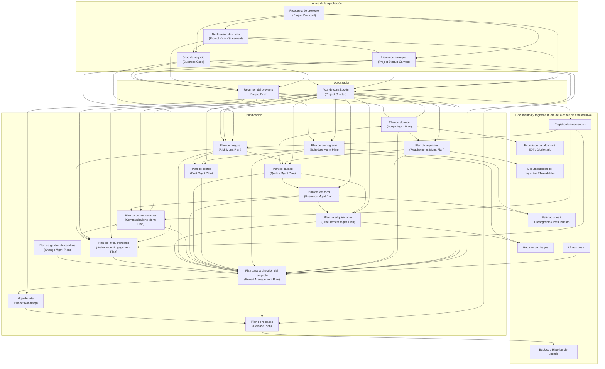

# Plantillas de inicio y planes de proyecto (Project Startup and Planning Templates)

> Archivo de conocimiento de referencia para el skill `pm-knowledge`. Describe **qué es** cada artefacto de arranque y de planificación, **qué campos** suele tener, **qué decisión habilita**, **cómo se relaciona** con los demás y **cómo adaptarlo** al tamaño del proyecto. Todo el contenido está redactado en palabras propias; los ejemplos son inventados y genéricos.

---

## 0. Cómo leer este archivo

| Sección | Contenido | Para qué la usa el agente |
|---|---|---|
| 1 | Marco general: cómo se organiza la fuente y su filosofía de adaptación (tailoring) | Entender la lógica de familias de artefactos antes de generar uno |
| 2 | Fichas de los 7 artefactos de arranque | Generar documentos de pre‑aprobación y autorización |
| 3 | Fichas de los 13 planes | Generar planes subsidiarios y el plan integrado |
| 4 | Mapa de dependencias (Mermaid) | Decidir en qué orden producir artefactos y qué entradas pedir |
| 5 | Glosario ES/EN | Mantener terminología coherente y bilingüe |
| 6 | Reglas operativas para el agente | Comportamiento al generar, revisar o adaptar |
| 7 | Cobertura y límites | Saber qué no cubre este archivo |

Convenciones:

- **ES (EN)**: nombre en español seguido del nombre en inglés.
- **Obligatorio / Opcional**: criterio de este archivo para una versión "razonable" del artefacto, no una exigencia de la fuente.
- **"no determinado en la fuente"**: la fuente no se pronuncia sobre ese punto; lo que sigue a esa marca es práctica habitual, no contenido del libro.
- **PRINCE2**: la equivalencia con productos de gestión PRINCE2 es una aportación de este archivo para facilitar el mapeo entre métodos; la fuente no la incluye.

---

## 1. Marco general

### 1.1 Qué es la fuente y qué no es

La fuente es un **catálogo de plantillas** de dirección de proyectos, no un manual teórico. Su autora parte de tres observaciones sobre la profesión:

1. La mayoría de los proyectos ya no son puramente predictivos (cascada) ni puramente adaptativos (ágiles): se gestionan de forma **híbrida**, y las plantillas deben servir a ambos mundos.
2. A los directores de proyecto se les exige cada vez más responsabilidad por **resultados de negocio**, no solo por entregar en plazo y presupuesto; por eso incluye artefactos "de negocio" (propuesta, caso de negocio, lienzo de arranque) pensados para dialogar con la alta dirección.
3. Las plantillas sirven para **no reinventar la rueda**: a quien empieza le dan una guía para recolectar y ordenar información; a quien tiene experiencia le permiten capturar datos consistentes entre proyectos; a una PMO le permiten un enfoque repetible.

La fuente **no enseña** conceptos de dirección de proyectos ni técnicas; asume que el lector los aprende en otro sitio. Por eso este archivo complementa cada ficha con criterios de calidad y reglas operativas que la fuente no explicita.

### 1.2 Cómo organiza la fuente sus plantillas

La organización sigue el **tipo de trabajo** que se hace en un proyecto, no las áreas de conocimiento ni los grupos de procesos:

| Familia | Qué agrupa | Ejemplos (cubiertos aquí en negrita) |
|---|---|---|
| Inicio del proyecto (Starting the Project) | Artefactos que justifican la necesidad, dan una visión de alto nivel y autorizan el proyecto | **Propuesta, caso de negocio, lienzo de arranque, visión, acta, resumen, hoja de ruta** |
| Planes de proyecto (Project Plans) | Documentos que establecen *cómo* se gestionará cada aspecto | **Los 12 planes subsidiarios y el plan para la dirección del proyecto** |
| Documentos de proyecto (Project Documents) | Insumos de trabajo que se elaboran y organizan durante el proyecto | Enunciado del alcance, diccionario de la EDT, hojas de estimación, historias de usuario, retrospectiva |
| Registros y bitácoras (Logs and Registers) | Artefactos vivos que se actualizan a lo largo de todo el proyecto | Registro de riesgos, de interesados, de supuestos, backlog, bitácora de decisiones |
| Informes y auditorías (Reports and Audits) | Artefactos para seguimiento, rendición de cuentas y verificación | Informe de estado, análisis de variación, valor ganado, auditoría de calidad, cierre |

Además existe un apéndice con **plantillas combinadas**, que materializa la idea de que varios artefactos pueden fusionarse en uno solo cuando el proyecto es pequeño.

### 1.3 Estructura estándar de cada plantilla en la fuente

Cada plantilla se presenta con un patrón fijo, que este archivo reutiliza y amplía:

1. **Descripción y lista de contenidos**: qué es el artefacto y qué información suele incluir.
2. **Flujo de información**: de qué artefactos recibe datos y a cuáles alimenta (solo para planes y artefactos de inicio).
3. **Consejos de adaptación (tailoring tips)**: cómo recortar, ampliar o combinar según tamaño, sector o enfoque de desarrollo.
4. **Alineación (alignment)**: con qué otros artefactos debe mantenerse coherente.
5. **Tabla de elementos**: cada campo con una explicación breve.
6. **Formulario en blanco**: una disposición posible de los campos.

### 1.4 Filosofía de adaptación (tailoring) de la autora, en palabras propias

- **Ninguna plantilla es obligatoria**. Se usan las que hacen falta, en la profundidad que haga falta. Un proyecto sin compras no necesita plan de adquisiciones; un equipo pequeño sin recursos físicos relevantes puede prescindir del plan de recursos.
- **El formulario es una sugerencia de disposición**, no un contrato. Lo que importa es la información que se captura, no la maquetación.
- **Combinar es legítimo y frecuente**: la autora sugiere fusiones concretas (por ejemplo, propuesta + caso de negocio en proyectos chicos; acta + enunciado del alcance; plan de alcance + plan de requisitos; plan de comunicaciones + plan de involucramiento de interesados; visión + acta en proyectos híbridos).
- **Dos o tres artefactos de arranque bastan** para la mayoría de los proyectos, porque la información se repite entre ellos. Hay que elegir el que mejor encaja y adaptarlo.
- **La rigidez debe reflejar el enfoque de desarrollo**: en trabajo predictivo conviene un control de cambios riguroso; en trabajo adaptativo el plan debe permitir que el alcance evolucione. En proyectos híbridos hay que decir explícitamente qué entregables van por cada vía y cómo se integran.
- **El tamaño cambia la forma**: en proyectos grandes cada plan subsidiario suele ser un documento independiente y el plan para la dirección del proyecto es una "carcasa" con referencias; en proyectos pequeños una hoja de ruta puede hacer las veces de plan para la dirección del proyecto.
- **Momento de creación y cambio**: los artefactos de arranque se crean una vez (antes o poco después de la autorización) y solo se revisan ante cambios significativos del entorno o del proyecto. Los planes se crean una vez antes de fijar las líneas base y rara vez cambian; las excepciones son el plan de comunicaciones y el plan de involucramiento de interesados, que se actualizan periódicamente, y el plan de releases, que es dinámico por naturaleza.

### 1.5 Los tres momentos del arranque

| Momento | Artefactos típicos | Quién suele elaborarlos | Pregunta que responden |
|---|---|---|---|
| Antes de la aprobación formal | Propuesta, caso de negocio, lienzo de arranque | El patrocinador (todavía puede no haber director de proyecto designado) | ¿Justifican la necesidad y los beneficios la inversión de tiempo, dinero y gente? |
| Al aprobar / autorizar | Declaración de visión, acta de constitución, resumen de proyecto | Patrocinador, director de proyecto o ambos en conjunto | ¿Qué proyecto es, para qué, con qué límites y bajo qué autoridad? |
| Tras la autorización, al empezar a planificar | Hoja de ruta | Director de proyecto | ¿Cómo se ve el proyecto en el tiempo, por fases, hitos y revisiones? |

### 1.6 Los tres estilos de planificación

La fuente distingue tres actitudes frente a la planificación, que condicionan cuánto detalle tienen los planes:

| Estilo | Característica | Implicación para los planes |
|---|---|---|
| Alcance bien definido y estable | Mucho esfuerzo de planificación inicial; se busca minimizar cambios | Los trece planes aplican casi íntegramente; líneas base firmes |
| Elaboración progresiva | Planificación moderada al inicio; se detalla a medida que se sabe más | Planes con niveles de precisión crecientes y planificación por oleadas (rolling wave) |
| Adaptativo / ágil | Planificación mínima para empezar; el alcance evoluciona con la retroalimentación | Visión, backlog, plan de releases; los planes de gestión se usan sobre todo para integrar con la parte predictiva |

Los planes de la fuente están pensados **predominantemente** para el primer estilo, pero cada ficha incluye consejos para el híbrido y el adaptativo.

---
## 2. Artefactos de inicio del proyecto (Starting the Project)

Los siete artefactos de esta sección comparten un rasgo: capturan información **de alto nivel** que luego se detalla en planes y documentos. Mucha información se repite entre ellos; por eso el agente debe elegir pocos y adaptarlos en lugar de generar los siete por defecto.

---

### 2.1 Propuesta de proyecto (Project Proposal)

#### Ficha

| Atributo | Contenido |
|---|---|
| Nombre ES / EN | Propuesta de proyecto / Project Proposal |
| Propósito | Presentar, en una o dos páginas, una oportunidad, la solución a un problema o la forma de abordar un proyecto obligatorio, con suficiente contexto para que quien decide pueda juzgar si vale la pena emprenderlo. |
| Decisión que habilita | "¿Seguimos adelante y profundizamos (caso de negocio, canvas, acta) o descartamos la idea?" Es la puerta de entrada al embudo de iniciativas. |
| Cuándo se crea | Antes de la aprobación formal del proyecto. |
| Cuándo se actualiza | Se elabora una sola vez; solo se revisa si cambian de forma significativa el mercado, el entorno o la necesidad que la motiva. |
| Quién la elabora | Normalmente el patrocinador o el área que detecta la necesidad, porque aún no hay director de proyecto designado. |
| Quién la aprueba | Los decisores de la organización (comité de inversiones, dirección). La fuente no especifica un rol concreto: **no determinado en la fuente**. |
| Entradas necesarias | Conocimiento del problema u oportunidad, datos de contexto (mercado, historia, eventos), una idea inicial de solución, orden de magnitud de costos y recursos. |
| Enfoque | Ambos. En proyectos híbridos conviene añadir una nota sobre las metodologías de entrega previstas. |
| Extensión recomendada | Una o dos páginas. |

#### Elementos

| Campo ES (EN) | Qué debe contener | Ejemplo genérico (inventado) | Oblig./Opc. |
|---|---|---|---|
| Título propuesto y fecha (Proposed Project Title, Date) | Nombre de trabajo de la iniciativa y fecha de la versión. | "Portal único de reservas de salas — v0.2, marzo" | Obligatorio |
| Resumen ejecutivo (Executive Summary) | Síntesis en un párrafo: cuál es el problema u oportunidad, cómo se piensa atacar, qué objetivos y entregables principales se esperan. Debe poder leerse solo. | "Los equipos pierden tiempo buscando salas libres en tres calendarios distintos. Se propone un portal único integrado con el directorio corporativo, operativo en seis meses, que elimine la doble reserva." | Obligatorio |
| Antecedentes del proyecto (Project Background) | Contexto que hace evidente la necesidad: historia, condiciones del mercado, hechos desencadenantes, factores del entorno. | "Desde la fusión, conviven dos sistemas de reservas; el 18 % de las reuniones del último trimestre tuvo conflicto de sala." | Obligatorio |
| Solución y enfoque (Solution and Approach) | Metas, alcance resumido, línea de tiempo esperada y una descripción breve de la metodología (predictiva, ágil, híbrida). | "Meta: una sola fuente de verdad para reservas. Alcance: salas de las tres sedes; excluye equipamiento audiovisual. Entrega incremental en tres releases." | Obligatorio |
| Información financiera (Financial Information) | Necesidades de financiación de alto nivel; opcionalmente métricas financieras (retorno, recuperación). | "Orden de magnitud: 120 k; ahorro estimado de 40 h/semana de personal administrativo." | Obligatorio |
| Requisitos de recursos (Resource Requirements) | Recursos físicos (materiales, equipos, instalaciones) y perfil del equipo (habilidades y cantidad). | "Físicos: ninguno adicional. Equipo: un líder técnico, dos desarrolladores, un analista a medio tiempo." | Obligatorio |
| Conclusión (Conclusion) | Repaso de los puntos clave y petición explícita de decisión. | "Se solicita autorización para elaborar el caso de negocio y asignar un director de proyecto." | Obligatorio |
| Anexo de estudios (Appendix) | Investigación o estudios de respaldo, si existen. | Encuesta interna de satisfacción con las reservas. | Opcional |
| Nota metodológica híbrida (Hybrid Delivery Note) | Qué partes irán por vía predictiva y cuáles por vía adaptativa. | "Integración con el directorio: predictiva. Interfaz de usuario: iterativa con demos quincenales." | Opcional |

#### Criterios de calidad / checklist de revisión

1. El resumen ejecutivo se entiende sin leer el resto y cabe en un párrafo.
2. El problema u oportunidad está descrito con al menos un dato verificable (cifra, fecha, hecho).
3. La solución propuesta responde directamente al problema planteado, no a otro.
4. El alcance deja ver al menos un límite explícito (algo que queda fuera).
5. La cifra financiera indica su nivel de confianza (orden de magnitud, estimación preliminar).
6. Los recursos mencionan tanto perfiles de personas como recursos físicos, o declaran que no hace falta ninguno adicional.
7. La conclusión pide una decisión concreta.
8. Cabe en una o dos páginas.
9. Si el proyecto es híbrido, dice qué partes van por cada vía.
10. No contradice la visión ni el caso de negocio, si ya existen.

#### Relación con otros artefactos

- **Alimenta a**: plan de negocio de la organización, lienzo de arranque, caso de negocio, acta de constitución, resumen de proyecto, hoja de ruta, y también a varios planes (alcance, requisitos, recursos, adquisiciones) que la fuente lista como receptores de información de la propuesta.
- **Depende de**: no tiene predecesor formal; nace del conocimiento del negocio y de la estrategia.
- **Debe alinearse con**: caso de negocio, declaración de visión, lienzo de arranque, acta, resumen de proyecto y hoja de ruta.
- **Equivalente PRINCE2 más cercano**: el **mandato de proyecto (project mandate)**, que dispara el proceso de pre‑proyecto, con elementos del **business case esquemático (outline business case)**.

#### Adaptación

| Versión | Qué incluye |
|---|---|
| Mínima (proyecto pequeño) | Media página: problema con un dato, solución en dos líneas, cifra de orden de magnitud, equipo necesario, petición de decisión. Puede fusionarse con el caso de negocio en un solo documento. |
| Completa (proyecto grande o de nuevo producto) | Las dos páginas con todos los campos, nota de metodología híbrida, anexos de investigación, y, en desarrollo de nuevos productos, la declaración de visión integrada en el mismo documento. |

---

### 2.2 Caso de negocio (Business Case)

#### Ficha

| Atributo | Contenido |
|---|---|
| Nombre ES / EN | Caso de negocio / Business Case |
| Propósito | Documentar la justificación de negocio del proyecto: situación actual, visión futura, amenazas y oportunidades, costos, beneficios, alternativas y métricas financieras. |
| Decisión que habilita | "¿Es esta la mejor alternativa para resolver la necesidad y justifica la inversión?" Es la base para autorizar (o no) el proyecto y para medir después si los beneficios se cumplieron. |
| Cuándo se crea | Antes de la aprobación formal; a menudo recibe la visión como insumo. |
| Cuándo se actualiza | Una sola vez; solo cambia ante cambios significativos del mercado, del análisis financiero o de la definición del proyecto. |
| Quién lo elabora | El patrocinador o el área de negocio, con apoyo de finanzas; puede intervenir el futuro director de proyecto si ya está identificado. |
| Quién lo aprueba | La dirección que autoriza la inversión. **No determinado en la fuente** en cuanto a rol exacto. |
| Entradas necesarias | Propuesta de proyecto, declaración de visión, datos de mercado, estimaciones de costo y beneficio por alternativa, apetito de riesgo de la organización, plan estratégico. |
| Enfoque | Ambos. Para híbridos se recomienda una sección de enfoque del proyecto que indique qué partes son predictivas, cuáles adaptativas y cómo se integran. |

#### Elementos

| Campo ES (EN) | Qué debe contener | Ejemplo genérico (inventado) | Oblig./Opc. |
|---|---|---|---|
| Título y fecha (Project Title, Date) | Identificación del proyecto y versión. | "Renovación del sistema de facturación — caso de negocio v1" | Obligatorio |
| Resumen ejecutivo (Executive Summary) | Visión general breve del caso para quien no leerá el detalle. | "Sustituir el sistema de facturación actual reduce los errores de emisión un 60 % y recupera la inversión en 20 meses." | Obligatorio |
| Antecedentes (Background Information) | Entorno y contexto de negocio; identificación del problema u oportunidad; vínculo explícito con el plan estratégico. | "El sistema actual quedará sin soporte el próximo año; la estrategia corporativa prioriza la automatización administrativa." | Obligatorio |
| Objetivos del proyecto (Project Objectives) | Objetivos medibles que el proyecto pretende alcanzar, con criterios de éxito asociados. | "Reducir el tiempo de emisión de factura de 3 días a 1; cero facturas rechazadas por formato." | Obligatorio |
| Beneficios (Project Benefits) | Beneficios esperados: eficiencia, calidad, ingresos, cumplimiento, etc., preferiblemente cuantificados y con fecha de materialización. | "Ahorro anual de 85 k en reprocesos a partir del segundo año." | Obligatorio |
| Definición del proyecto (Project Definition) | Entregables clave, fronteras del alcance y, si corresponde, el enfoque para producirlos. | "Entregables: módulo de facturación, migración de datos históricos de 5 años, capacitación. Fuera de alcance: cobranzas." | Obligatorio |
| Evaluación del mercado (Market Assessment) | Panorama del mercado: disponibilidad tecnológica, marco legal y regulatorio, aspectos ambientales, competidores. | "Existen tres soluciones SaaS maduras; la normativa de factura electrónica cambia en 14 meses." | Opcional (obligatorio si hay componente de mercado) |
| Análisis de alternativas (Alternatives Analysis) | Alternativas consideradas (incluida "no hacer nada"), con beneficios, costos y riesgos de cada una; cómo cada una resuelve la necesidad; viabilidad; alternativa recomendada. | "A: mantener y parchear. B: SaaS estándar. C: desarrollo propio. Recomendada: B." | Obligatorio |
| Análisis financiero (Financial Analysis) | Indicadores clave por alternativa: valor presente neto, retorno de la inversión, flujo de caja, costo del ciclo de vida. | "B: VPN positivo a 3 años; ROI 38 %; costo del ciclo de vida a 5 años 310 k." | Obligatorio |
| Panorama de riesgos (Risk Overview) | Amenazas y oportunidades de alto nivel con su impacto potencial. | "Amenaza: resistencia del área contable. Oportunidad: reutilizar la integración para otros países." | Obligatorio |
| Anexos (Appendices) | Hojas de cálculo, investigación, referencias. | Modelo financiero detallado. | Opcional |
| Gobernanza del proyecto (Project Governance) | Para proyectos grandes: estructura de decisión, comités, umbrales de escalado. | "Comité directivo mensual; el patrocinador aprueba desviaciones mayores al 10 %." | Opcional |
| Enfoque del proyecto (Project Approach) | Para híbridos: qué partes predictivas, qué partes adaptativas, cómo se integran. | "Migración de datos: predictiva. Portal de usuario: iterativo." | Opcional |

#### Criterios de calidad / checklist de revisión

1. Hay al menos dos alternativas reales además de la recomendada, y una de ellas es "no hacer nada" o "mínimo cambio".
2. Cada alternativa tiene beneficios, costos y riesgos comparables (misma base de cálculo, mismo horizonte).
3. Los indicadores financieros declaran supuestos (tasa de descuento, horizonte, moneda).
4. Los beneficios están cuantificados y tienen responsable y fecha prevista de materialización.
5. Los objetivos son medibles y tienen criterio de éxito.
6. La alineación con la estrategia es explícita (nombra el objetivo estratégico que apoya).
7. La definición del proyecto marca qué queda fuera.
8. El panorama de riesgos incluye tanto amenazas como oportunidades.
9. El resumen ejecutivo es coherente con las cifras del cuerpo.
10. El documento es coherente con la propuesta y será coherente con el acta.

#### Relación con otros artefactos

- **Recibe de**: propuesta de proyecto, declaración de visión.
- **Alimenta a**: acta de constitución, lienzo de arranque, resumen de proyecto, plan para la dirección del proyecto, plan de gestión de riesgos.
- **Debe alinearse con**: propuesta, acta, plan para la dirección del proyecto.
- **Equivalente PRINCE2 más cercano**: el **business case** (producto de gestión de línea base), en su versión detallada; en PRINCE2 el business case se mantiene vivo durante todo el proyecto, mientras que aquí se concibe como un documento que se crea una vez y se revisa solo ante cambios significativos.

#### Adaptación

| Versión | Qué incluye |
|---|---|
| Mínima | Una página fusionada con la propuesta: problema, objetivo medible, dos alternativas con costo y beneficio, recomendación, riesgos principales. Sin evaluación de mercado ni indicadores financieros complejos. |
| Completa | Documento de varias páginas; el análisis de alternativas puede ser un documento aparte; incluye evaluación de mercado por los cuatro ejes (tecnología, legal, ambiental, competencia), tabla financiera por alternativa, sección de gobernanza y sección de enfoque híbrido; anexos con el modelo financiero. |

---

### 2.3 Lienzo de arranque del proyecto (Project Startup Canvas)

#### Ficha

| Atributo | Contenido |
|---|---|
| Nombre ES / EN | Lienzo de arranque del proyecto / Project Startup Canvas |
| Propósito | Resumir visualmente, en una sola página, la información esencial de un proyecto nuevo. Está inspirado en los lienzos de modelo de negocio y de startup, pero centrado en información de proyecto (entregables, recursos, hitos, amenazas) en lugar de mercado, canales y distribución. |
| Decisión que habilita | Alineación rápida de los interesados sobre qué es el proyecto antes de invertir en documentos largos; sirve como insumo compacto para el acta y para iniciar la EDT o el backlog. |
| Cuándo se crea | Antes de la aprobación formal o inmediatamente después, en una sesión de trabajo. |
| Cuándo se actualiza | Una vez; solo se retoca ante cambios significativos de entorno, alcance, cronograma, presupuesto o recursos. |
| Quién lo elabora | Patrocinador y/o director de proyecto, idealmente en taller con interesados clave. |
| Quién lo aprueba | **No determinado en la fuente**; en la práctica funciona como artefacto de consenso más que de aprobación formal. |
| Entradas necesarias | Propuesta de proyecto, declaración de visión, conocimiento de los interesados y una primera idea de costos e hitos. |
| Enfoque | Ambos; especialmente útil en ágil e híbrido por su brevedad. |

#### Elementos

| Campo ES (EN) | Qué debe contener | Ejemplo genérico (inventado) | Oblig./Opc. |
|---|---|---|---|
| Problema / oportunidad (Problem/Opportunity) | Qué problema resuelve o qué oportunidad aprovecha, con contexto solo si aporta. | "Los técnicos de campo registran visitas en papel y se pierden el 7 % de los partes." | Obligatorio |
| Solución / alcance (Solution/Scope) | Solución propuesta y límites: qué está dentro y qué fuera. | "App móvil de partes de visita con firma del cliente. Fuera: facturación." | Obligatorio |
| Entregables (Deliverables) | Entregables clave del proyecto y del producto. | "App Android, panel web de supervisión, manual de uso." | Obligatorio |
| Propuesta de valor (Value Proposition) | Por qué hace falta el proyecto y qué valor aporta. | "Cerrar partes el mismo día y facturar 5 días antes." | Obligatorio |
| Interesados / clientes (Stakeholders / Customers) | Interesados clave, incluidos cliente y usuario final. | "Jefatura de servicio técnico, 40 técnicos, área de facturación." | Obligatorio |
| Recursos (Resources) | Recursos físicos y habilidades críticas. | "Dos desarrolladores móviles, 40 tablets, acceso al ERP." | Obligatorio |
| Costos (Costs) | Estimación inicial: fijos y variables, de proyecto y de mantenimiento. | "Proyecto 60 k; licencias 4 k/año; mantenimiento 10 k/año." | Obligatorio |
| Hitos (Milestones) | Hitos clave. | "Piloto con 5 técnicos en el mes 2; despliegue total en el mes 4." | Obligatorio |
| Amenazas / restricciones (Threats/Constraints) | Amenazas y restricciones significativas. | "Cobertura móvil irregular en zonas rurales; presupuesto cerrado para este ejercicio." | Obligatorio |
| Bloques de negocio (Customer Segments, Channels, Revenue Streams) | Solo para nuevos productos: segmentos, canales, fuentes de ingreso en lugar de entregables/recursos/hitos. | "Segmento: pymes de servicios; canal: tienda de aplicaciones; ingreso: suscripción." | Opcional |

#### Criterios de calidad / checklist de revisión

1. Cabe en una página y se lee de un vistazo.
2. Cada bloque tiene como máximo tres a cinco viñetas.
3. El problema y la propuesta de valor están conectados (la propuesta responde al problema).
4. El bloque de alcance contiene al menos una exclusión.
5. Los hitos tienen fechas o ventanas de tiempo.
6. Los costos distinguen al menos proyecto vs. operación posterior.
7. Los interesados incluyen al usuario final, no solo al cliente que paga.
8. Las amenazas y restricciones son específicas del proyecto, no genéricas.
9. Es coherente con la visión y, después, con el enunciado del alcance, la EDT, el registro de interesados, el cronograma de hitos, las estimaciones de costo y el registro de riesgos.

#### Relación con otros artefactos

- **Recibe de**: propuesta de proyecto, declaración de visión.
- **Alimenta a**: acta de constitución, resumen de proyecto, estructura de desglose del trabajo, backlog, requisitos de recursos, estimaciones de costo, cronograma, registro de riesgos, plan de releases, plan de adquisiciones, plan de involucramiento de interesados.
- **Debe alinearse con**: visión, enunciado del alcance, EDT, registro de interesados, cronograma de hitos, estimaciones de costo, registro de riesgos.
- **Equivalente PRINCE2 más cercano**: no hay un producto idéntico; se aproxima a un **project brief ultracompacto** o a la **descripción del producto del proyecto (project product description)** en formato visual.

#### Adaptación

| Versión | Qué incluye |
|---|---|
| Mínima | El lienzo en sí ya es la versión mínima; puede reducirse a problema, solución, valor, interesados y amenazas. |
| Completa | Lienzo con los nueve bloques más anexos de respaldo (estimación de costos detallada, lista de interesados). Para nuevos productos, se sustituyen entregables, recursos e hitos por segmentos de clientes, canales y fuentes de ingreso para mantener el foco en el usuario y el mercado. |

---

### 2.4 Declaración de visión del proyecto (Project Vision Statement)

#### Ficha

| Atributo | Contenido |
|---|---|
| Nombre ES / EN | Declaración de visión del proyecto / Project Vision Statement |
| Propósito | Expresar la imagen futura del producto o servicio que se va a crear: para quién es, qué necesidad cubre, qué lo caracteriza y por qué lo elegirían. Debe ser aspiracional pero alcanzable. |
| Decisión que habilita | Alinear al equipo y a los interesados en torno a un "norte" compartido; sirve de criterio para priorizar el backlog y para juzgar si una funcionalidad aporta a la visión. |
| Cuándo se crea | Al comienzo mismo del proyecto; a menudo antes del caso de negocio, al que sirve de insumo. |
| Cuándo se actualiza | Una sola vez, al inicio. |
| Quién la elabora | Patrocinador o dueño de producto, con el director de proyecto; en entornos ágiles suele liderarla el dueño de producto. |
| Quién la aprueba | **No determinado en la fuente**; en la práctica la refrenda el patrocinador. |
| Entradas necesarias | Propuesta de proyecto, lienzo de arranque, conocimiento del cliente objetivo y de la competencia. |
| Enfoque | Sobre todo ágil (productos digitales), pero aplicable a cualquier proyecto que entregue un producto o servicio. En híbridos puede fusionarse con el acta. |

#### Elementos

| Campo ES (EN) | Qué debe contener | Ejemplo genérico (inventado) | Oblig./Opc. |
|---|---|---|---|
| Producto o servicio (Product or Service) | Qué se está desarrollando. | "Una plataforma de reserva de turnos para clínicas veterinarias." | Obligatorio |
| Cliente objetivo (Target Customer) | Persona o grupo que comprará o usará el producto. | "Clínicas veterinarias independientes de hasta tres consultorios." | Obligatorio |
| Necesidades (Needs) | Necesidades o requisitos que el producto atiende. | "Reducir ausencias a turnos y liberar al personal de recepción del teléfono." | Obligatorio |
| Atributos clave (Key Attributes) | Características o funciones importantes. | "Recordatorios automáticos, confirmación en un toque, agenda compartida." | Obligatorio |
| Beneficio clave (Key Benefit) | Por qué el cliente lo elegiría. | "Menos turnos perdidos y más tiempo de atención por profesional." | Obligatorio |
| Metas de negocio alineadas (Aligned Business Goals) | Objetivos de negocio que el producto apoya. | "Entrar en el segmento de salud animal con ingresos recurrentes." | Opcional |
| Competidores y diferenciación (Competitors and Differentiation) | Competidores clave y en qué este producto será mejor o distinto. | "Las alternativas actuales son agendas genéricas; esta se integra con historias clínicas veterinarias." | Opcional |
| Formato en frase (One‑sentence Vision) | Opción de condensar todo en una o dos oraciones siguiendo una fórmula fija (para / que / el producto / que / a diferencia de). | Una frase que une producto, cliente, necesidad, atributo y beneficio. | Opcional |

#### Criterios de calidad / checklist de revisión

1. Se puede leer en voz alta en menos de treinta segundos.
2. Nombra un cliente objetivo concreto, no "todos los usuarios".
3. La necesidad está formulada desde el cliente, no desde la tecnología.
4. Los atributos clave son pocos (tres a cinco) y distintivos.
5. El beneficio responde a la pregunta "¿por qué lo elegirían?".
6. Es aspiracional pero verosímil con los recursos disponibles.
7. No contiene requisitos detallados ni soluciones técnicas.
8. Es coherente con la propuesta, el lienzo, el acta y el resumen de proyecto.

#### Relación con otros artefactos

- **Recibe de**: propuesta de proyecto, lienzo de arranque.
- **Alimenta a**: caso de negocio, acta de constitución, resumen de proyecto, plan de releases, plan de involucramiento de interesados, plan para la dirección del proyecto.
- **Debe alinearse con**: propuesta, lienzo, acta, resumen de proyecto, plan de releases.
- **Equivalente PRINCE2 más cercano**: no existe un producto de gestión equivalente; lo más próximo es la **descripción del producto del proyecto (project product description)** en su parte de propósito, o la "visión" que PRINCE2 Agile toma del Scrum.

#### Adaptación

| Versión | Qué incluye |
|---|---|
| Mínima | Una sola frase con la fórmula (producto, cliente, necesidad, atributo diferencial, beneficio). |
| Completa | Los cinco campos básicos más metas de negocio, competidores y diferenciación; en híbridos, incorporada como primera sección del acta de constitución. |

---
### 2.5 Acta de constitución del proyecto (Project Charter)

#### Ficha

| Atributo | Contenido |
|---|---|
| Nombre ES / EN | Acta de constitución del proyecto / Project Charter |
| Propósito | Autorizar formalmente el proyecto, dejar constancia de por qué se hace y nombrar al director de proyecto con su nivel de autoridad. Describe el proyecto en términos de alto nivel. |
| Decisión que habilita | "El proyecto existe oficialmente, tiene un responsable con autoridad definida y puede consumir recursos de la organización." Sin acta no hay mandato para planificar. |
| Cuándo se crea | Una vez aprobado el proyecto, antes de la planificación detallada. |
| Cuándo se actualiza | Se elabora una vez; solo se modifica ante cambios significativos de entorno, alcance, cronograma, recursos, presupuesto o interesados. |
| Quién la elabora | El patrocinador, el director de proyecto o ambos trabajando juntos. |
| Quién la aprueba | El patrocinador u otra persona con autoridad para autorizar el proyecto; la plantilla prevé firmas del patrocinador (u originador) y del director de proyecto. |
| Entradas necesarias | Propuesta de proyecto, lienzo de arranque, caso de negocio; también la visión si existe. |
| Enfoque | Ambos. En híbridos puede fusionarse con la declaración de visión; en proyectos pequeños, con el enunciado del alcance; en proyectos bajo contrato, el enunciado del trabajo contractual puede hacer sus veces. |

#### Elementos

| Campo ES (EN) | Qué debe contener | Ejemplo genérico (inventado) | Oblig./Opc. |
|---|---|---|---|
| Título, fecha, patrocinador, director (Project Title, Date Prepared, Sponsor, Project Manager) | Identificación básica y las dos personas clave. | "Migración del almacén de datos — patrocinadora: directora de Operaciones; DP: líder de datos." | Obligatorio |
| Propósito del proyecto (Project Purpose) | La razón de ser; puede remitir al caso de negocio, al plan estratégico, a un factor externo o a un contrato. | "Cumplir la nueva norma de reporte regulatorio que entra en vigor en 12 meses." | Obligatorio |
| Descripción de alto nivel (High‑Level Project Description) | Resumen de qué se hará. | "Consolidar cinco fuentes de datos en un almacén único con reportes regulatorios automatizados." | Obligatorio |
| Límites del proyecto (Project Boundaries) | Límites del alcance; exclusiones y otras limitaciones. | "No incluye los sistemas de la filial internacional ni la analítica predictiva." | Obligatorio |
| Entregables clave (Key Deliverables) | Entregables de proyecto y de producto de alto nivel, que luego se detallan en el enunciado del alcance. | "Almacén de datos, catálogo de datos, diez reportes regulatorios, plan de operación." | Obligatorio |
| Requisitos de alto nivel (High‑Level Requirements) | Condiciones o capacidades que deben cumplirse para satisfacer el propósito; funciones del producto imprescindibles. Se detallan después en la documentación de requisitos. | "Los reportes deben generarse en menos de 4 horas; trazabilidad de cada dato a su origen." | Obligatorio |
| Riesgo general del proyecto (Overall Project Risk) | Valoración global de cuán arriesgado es el proyecto, considerando volatilidad, incertidumbre, complejidad y ambigüedad del entorno, y la exposición de los interesados a variaciones del resultado. | "Riesgo general alto: plazo regulatorio fijo y dependencia de datos de calidad desigual." | Obligatorio |
| Objetivos y criterios de éxito (Project Objectives and Success Criteria) | Objetivos al menos de alcance, tiempo y costo, cada uno con su métrica de éxito; opcionalmente calidad, seguridad, satisfacción. | "Tiempo: operativo antes del cierre del tercer trimestre. Criterio: primer reporte regulatorio emitido sin observaciones." | Obligatorio |
| Cronograma resumido de hitos (Summary Milestone Schedule) | Eventos significativos con fecha: fin de entregables clave, inicio/fin de fases, aceptación del producto. | "Diseño aprobado: mes 2. Carga histórica completa: mes 6. Aceptación: mes 9." | Obligatorio |
| Recursos financieros preaprobados / presupuesto (Preapproved Financial Resources / Budget) | Fondos disponibles, fuentes y, si aplica, límites anuales. | "Presupuesto aprobado 480 k, 60 % este ejercicio y 40 % el próximo." | Obligatorio |
| Lista de interesados clave (Key Stakeholder List) | Personas o grupos que influyen o son influidos por el proyecto, con su rol; se detalla luego en el registro de interesados. | "Regulador (receptor de reportes), área de Finanzas (dueña de datos), TI (operación)." | Obligatorio |
| Criterios de salida del proyecto (Project Exit Criteria) | Condiciones, métricas o resultados que deben cumplirse para dar por concluido el proyecto. | "Tres ciclos mensuales de reporte emitidos sin incidentes y transferencia a operación firmada." | Obligatorio |
| Nivel de autoridad del director de proyecto (Project Manager Authority Level) | Autoridad en cuatro dimensiones: decisiones de personal (contratar, aceptar o rechazar personas), gestión del presupuesto y umbral de variación que obliga a escalar, decisiones técnicas, y resolución de conflictos (dentro del equipo, en la organización, con externos). | "Puede reasignar personal dentro del equipo; aprueba gastos hasta 15 k; escala desviaciones mayores al 8 %; decide la arquitectura con el comité técnico." | Obligatorio |
| Nombre y autoridad del patrocinador (Sponsor Name and Authority) | Quién supervisa al director de proyecto a efectos del proyecto y qué puede hacer: aprobar cambios, fijar límites de variación aceptables, resolver conflictos entre proyectos, defender el proyecto ante la alta dirección. | "La patrocinadora aprueba cambios de alcance y presupuesto y resuelve conflictos de prioridad con otros proyectos." | Obligatorio |
| Aprobaciones / firmas (Approvals) | Firma, nombre y fecha del director de proyecto y del patrocinador u originador. | Dos firmas con fecha. | Obligatorio |

#### Criterios de calidad / checklist de revisión

1. El propósito remite a una fuente de justificación identificable (caso de negocio, estrategia, norma, contrato).
2. Hay objetivos con criterio de éxito medible al menos para alcance, tiempo y costo.
3. Los límites incluyen exclusiones explícitas.
4. Cada entregable clave es reconocible como algo que se puede aceptar o rechazar.
5. La autoridad del director de proyecto está definida en las cuatro dimensiones (personal, presupuesto/variación, técnica, conflictos), con cifras donde corresponda.
6. La autoridad del patrocinador es complementaria y no se solapa con la del director de proyecto.
7. Los hitos tienen fecha y son coherentes con el presupuesto y con el caso de negocio.
8. Los criterios de salida permiten saber objetivamente cuándo termina el proyecto.
9. La valoración del riesgo general está justificada en una o dos líneas.
10. El acta está firmada o cuenta con evidencia de aprobación equivalente.
11. Es coherente con el caso de negocio, el enunciado del alcance, el cronograma de hitos, el presupuesto, el registro de interesados y el registro de riesgos.

#### Relación con otros artefactos

- **Recibe de**: propuesta de proyecto, lienzo de arranque, caso de negocio (y visión, si existe).
- **Alimenta a**: registro de interesados, todos los componentes del plan para la dirección del proyecto, documentación de requisitos, matriz de trazabilidad, enunciado del alcance, plan de involucramiento de interesados, hoja de ruta, plan de releases y prácticamente todos los planes subsidiarios.
- **Debe alinearse con**: caso de negocio, enunciado del alcance, cronograma de hitos, presupuesto, registro de interesados, registro de riesgos.
- **Equivalente PRINCE2 más cercano**: el **project brief** (autoriza la fase de inicio) junto con la **estructura del equipo de gestión del proyecto y descripciones de roles**; la autorización formal del proyecto en PRINCE2 corresponde al **PID (Project Initiation Documentation)** aprobado por la junta de proyecto, que aquí se reparte entre acta y plan para la dirección del proyecto.

#### Adaptación

| Versión | Qué incluye |
|---|---|
| Mínima | Una página fusionada con el enunciado del alcance: propósito, descripción, exclusiones, entregables, tres objetivos con criterio, hitos, presupuesto, nombre del DP y del patrocinador con una línea de autoridad cada uno, firmas. |
| Completa | Las tres páginas con todos los campos; sección de visión integrada (híbrido); tabla de objetivos por dimensión (alcance, tiempo, costo, otros); tabla de interesados con rol; autoridad desglosada en cuatro bloques; aprobaciones formales. En proyectos bajo contrato, referencia al enunciado del trabajo contractual. |

---

### 2.6 Resumen del proyecto (Project Brief)

#### Ficha

| Atributo | Contenido |
|---|---|
| Nombre ES / EN | Resumen del proyecto / Project Brief |
| Propósito | Sintetizar en una o dos páginas los elementos clave del proyecto para que el equipo y los interesados compartan una misma comprensión. Es un documento de alineación, no de autorización. |
| Decisión que habilita | Confirmar que todos entienden lo mismo sobre metas, alcance, presupuesto, plazos e interesados antes de planificar en detalle. |
| Cuándo se crea | Una vez aprobado el proyecto, en paralelo o inmediatamente después del acta. |
| Cuándo se actualiza | Una vez; solo cambia ante cambios significativos de alcance, cronograma, costo o interesados. |
| Quién lo elabora | Patrocinador, director de proyecto o ambos. |
| Quién lo aprueba | **No determinado en la fuente**; en la práctica lo valida el patrocinador y lo comparte el director de proyecto. |
| Entradas necesarias | Propuesta, caso de negocio, lienzo de arranque, declaración de visión. |
| Enfoque | Ambos. En híbridos conviene indicar la metodología y qué entregables van por vía adaptativa y cuáles por predictiva. |

#### Elementos

| Campo ES (EN) | Qué debe contener | Ejemplo genérico (inventado) | Oblig./Opc. |
|---|---|---|---|
| Título y fecha (Project Title, Date) | Identificación. | "Rediseño del proceso de alta de proveedores" | Obligatorio |
| Visión general del proyecto (Project Overview) | Resumen del proyecto con un breve porqué. | "Reducir de 20 a 5 días el alta de un proveedor nuevo, eliminando pasos manuales duplicados entre Compras y Finanzas." | Obligatorio |
| Metas y criterios de éxito (Goals and Success Criteria) | Metas generales con la medida que indicará que se lograron. | "Meta: proceso ágil y auditable. Éxito: 90 % de altas en menos de 5 días." | Obligatorio |
| Objetivos y criterios de éxito (Objectives and Success Criteria) | Objetivos específicos y medibles con su criterio. | "Objetivo: formulario único en línea. Éxito: cero reenvíos de documentación por correo." | Obligatorio |
| Restricciones y supuestos iniciales (Initial Constraints and Assumptions) | Limitaciones conocidas y expectativas no verificadas. | "Restricción: no cambiar el ERP. Supuesto: el área legal valida el contrato marco en dos semanas." | Obligatorio |
| Descripción del alcance (Scope Description) | Narrativa corta del alcance. | "Rediseño del flujo, formulario web, integración con el ERP para la creación del maestro de proveedores." | Obligatorio |
| Presupuesto (Budget) | Fondos asignados. | "95 k." | Obligatorio |
| Línea de tiempo e hitos (Timeline and Milestones) | Duración y fechas de hitos clave. | "Cinco meses; piloto con diez proveedores en el mes 3." | Obligatorio |
| Interesados clave (Key Stakeholders) | Interesados significativos, incluidos cliente y usuario final. | "Compras, Finanzas, Legal, proveedores piloto." | Obligatorio |
| Cliente y audiencia objetivo (Customer and Target Audience) | Para proyectos con cliente externo: quién es el cliente y a quién va dirigido el producto o servicio. | "Cliente: cadena minorista regional. Audiencia: sus 300 proveedores locales." | Opcional |
| Nota metodológica (Methodology Note) | En híbridos: qué métodos se usarán y qué entregables son adaptativos o predictivos. | "Integración ERP: predictiva. Formulario y flujo: iterativo con revisiones semanales." | Opcional |

#### Criterios de calidad / checklist de revisión

1. Cabe en una o dos páginas.
2. Metas y objetivos están diferenciados (lo general vs. lo específico) y ambos tienen criterio de éxito.
3. Restricciones y supuestos están separados y no se confunden entre sí.
4. El alcance narrativo coincide con los entregables del acta.
5. Presupuesto y plazos son los mismos que en el acta.
6. Los interesados incluyen al usuario final.
7. Si el proyecto es para un cliente externo, el cliente y la audiencia están identificados.
8. Puede entregarse a un miembro nuevo del equipo y entenderlo sin explicación.
9. Es coherente con la propuesta, el acta, la hoja de ruta y el plan para la dirección del proyecto.

#### Relación con otros artefactos

- **Recibe de**: propuesta, caso de negocio, lienzo de arranque, declaración de visión.
- **Alimenta a**: plan para la dirección del proyecto, enunciado del alcance, registro de supuestos, cronograma, estimaciones de costo, plan de involucramiento de interesados, registro de interesados; además los planes de alcance, cronograma, releases, comunicaciones y riesgos lo listan como insumo.
- **Debe alinearse con**: propuesta, acta, hoja de ruta, plan para la dirección del proyecto.
- **Equivalente PRINCE2 más cercano**: el **project brief** de PRINCE2 es el homónimo directo, aunque en PRINCE2 cumple también la función de autorizar la fase de inicio (que aquí recae en el acta).

#### Adaptación

| Versión | Qué incluye |
|---|---|
| Mínima | Una página: visión general, tres objetivos con criterio, alcance en tres líneas, presupuesto, plazo, interesados. Restricciones y supuestos en dos viñetas. |
| Completa | Dos páginas con tablas de metas/objetivos vs. criterios, tabla de restricciones vs. supuestos (o referencia al registro de supuestos en proyectos grandes), sección de cliente y audiencia, nota metodológica híbrida. |

---

### 2.7 Hoja de ruta del proyecto (Project Roadmap)

#### Ficha

| Atributo | Contenido |
|---|---|
| Nombre ES / EN | Hoja de ruta del proyecto / Project Roadmap |
| Propósito | Mostrar, en un gráfico de alto nivel, las fases del ciclo de vida, los entregables o eventos principales de cada fase, los hitos significativos y el momento y tipo de las revisiones. |
| Decisión que habilita | Comunicar a los interesados el "mapa" temporal del proyecto; en proyectos pequeños puede sustituir al plan para la dirección del proyecto. |
| Cuándo se crea | Tras la autorización, cuando ya existen el acta y, al menos en borrador, el plan para la dirección del proyecto. |
| Cuándo se actualiza | Una vez; solo cambia si cambian las fechas de eventos, hitos o entregables clave. |
| Quién la elabora | El director de proyecto. |
| Quién la aprueba | **No determinado en la fuente**; en la práctica se valida con el patrocinador como parte del plan. |
| Entradas necesarias | Acta de constitución, plan para la dirección del proyecto (ciclo de vida, enfoque de desarrollo, revisiones). |
| Enfoque | Ambos. En híbridos se añaden el enfoque de desarrollo y las fechas de release. |

#### Elementos

| Campo ES (EN) | Qué debe contener | Ejemplo genérico (inventado) | Oblig./Opc. |
|---|---|---|---|
| Fases del ciclo de vida (Project Life Cycle Phases) | Nombre de cada fase, en orden. | "Descubrimiento → Diseño → Construcción → Transición → Cierre" | Obligatorio |
| Entregables o eventos principales (Major Deliverables or Events) | Entregables clave, puertas de fase, aprobaciones importantes, eventos externos. | "Fin de Diseño: arquitectura aprobada. Evento externo: auditoría anual en el mes 7." | Obligatorio |
| Hitos significativos (Significant Milestones) | Hitos del proyecto con fecha. | "Piloto en producción: semana 18." | Obligatorio |
| Momento y tipo de revisiones (Timing and Types of Reviews) | Revisiones de dirección, de cliente, de cumplimiento u otras. | "Revisión de dirección al cierre de cada fase; demo con cliente cada dos semanas durante Construcción." | Obligatorio |
| Enfoque de desarrollo y releases (Development Approach and Release Dates) | En híbridos: qué fases o entregables son adaptativos y las fechas de release. | "Release 1 en semana 10; Release 2 en semana 18; integración predictiva en paralelo." | Opcional |

#### Criterios de calidad / checklist de revisión

1. Se lee en una sola vista (una página o una pantalla).
2. Las fases tienen límites visibles (puertas o criterios de salida).
3. Cada hito tiene fecha o ventana y se corresponde con los hitos del acta.
4. Las revisiones indican tipo y momento, no solo "revisiones periódicas".
5. Los entregables principales coinciden con los entregables clave del acta.
6. Si hay trabajo adaptativo, las releases están representadas como hitos.
7. Es coherente con el acta y el plan para la dirección del proyecto.
8. Tiene fecha de versión; si cambia una fecha clave, se versiona.

#### Relación con otros artefactos

- **Recibe de**: acta de constitución, plan para la dirección del proyecto.
- **Alimenta a**: cronograma del proyecto, registro de riesgos, lista de hitos, plan de releases, plan de gestión de cambios (que debe alinearse con ella).
- **Debe alinearse con**: acta, plan para la dirección del proyecto.
- **Equivalente PRINCE2 más cercano**: la vista gráfica del **plan de proyecto (project plan)** a nivel de etapas de gestión, con sus hitos y los puntos de decisión de la junta (end stage assessments).

#### Adaptación

| Versión | Qué incluye |
|---|---|
| Mínima | Una línea de tiempo con fases, cuatro a seis hitos y las revisiones de fin de fase. En proyectos pequeños, esta hoja de ruta **es** el plan para la dirección del proyecto. |
| Completa | Documento independiente con una franja por fase, entregables y eventos por fase, hitos, revisiones por tipo, releases e iteraciones del componente adaptativo, y leyenda de enfoque de desarrollo por entregable. |

---
## 3. Planes de proyecto (Project Plans)

Los planes responden a la pregunta **"¿cómo vamos a gestionar X?"**, no "¿qué vamos a entregar?". Son documentos de método: fijan procesos, umbrales, roles, herramientas y frecuencias. Todos los planes subsidiarios son componentes del plan para la dirección del proyecto. Salvo indicación contraria, se elaboran una vez antes de fijar las líneas base y rara vez cambian.

Convenciones comunes a todas las fichas de planes:

- **Quién lo elabora**: el director de proyecto, con el equipo y los especialistas del área (finanzas, compras, calidad, etc.). La fuente no lo detalla por plan: cuando no se indique nada, asumir esta regla.
- **Quién lo aprueba**: la fuente no define aprobadores por plan (**no determinado en la fuente**). Práctica habitual: el patrocinador aprueba el plan para la dirección del proyecto en su conjunto y, con ello, los subsidiarios; algunos planes requieren además la conformidad del área funcional dueña del proceso (compras, calidad, finanzas).

---

### 3.1 Plan de gestión del alcance (Scope Management Plan)

#### Ficha

| Atributo | Contenido |
|---|---|
| Nombre ES / EN | Plan de gestión del alcance / Scope Management Plan |
| Propósito | Establecer cómo se definirá, organizará, desarrollará, controlará y validará el alcance: cómo se descompone en entregables, qué se considera cambio frente a revisión, cómo se mantiene la línea base y cómo se aceptan los entregables. |
| Decisión que habilita | Define las reglas del juego para decir "esto está dentro / esto es un cambio / esto está aceptado". Sin él, cada discusión de alcance se resuelve caso a caso. |
| Cuándo se crea | Al inicio de la planificación, antes del enunciado del alcance y de la EDT. |
| Cuándo se actualiza | Una vez; normalmente no cambia. |
| Entradas necesarias | Propuesta, acta de constitución, resumen de proyecto, plan para la dirección del proyecto (enfoque de desarrollo y ciclo de vida). |
| Enfoque | Predominantemente predictivo; para híbridos se recomienda dividirlo en una sección de entregables predictivos y otra de entregables adaptativos. |

#### Elementos

| Campo ES (EN) | Qué debe contener | Ejemplo genérico (inventado) | Oblig./Opc. |
|---|---|---|---|
| Descomposición y organización del alcance / EDT (Decomposing and Organizing Scope / WBS) | Si se usará una EDT, cómo se organizará (por fases, por geografía, por entregables principales u otro criterio) y las pautas para definir cuentas de control y paquetes de trabajo. | "EDT por entregable principal; paquetes de trabajo de entre 40 y 80 horas; cuenta de control por entregable." | Obligatorio |
| Diccionario de la EDT (WBS Dictionary) | Si se usa, qué información documentará y con qué nivel de detalle. | "Para cada paquete: descripción, criterios de aceptación, responsable, estimación y supuestos." | Opcional |
| Cambio vs. revisión de alcance (Scope Change vs. Revision) | Qué constituye un cambio (pasa por control de cambios) y qué una revisión (no pasa). | "Cambiar una función es cambio; corregir un texto o un color es revisión." | Obligatorio |
| Mantenimiento de la línea base de alcance (Scope Baseline Maintenance) | Qué tipos de cambio van al control formal y cómo se mantiene actualizada la línea base. | "La línea base se actualiza solo tras aprobación del comité; versión nueva con registro de diferencias." | Obligatorio |
| Aceptación de entregables (Deliverable Acceptance) | Para cada entregable, cómo se validará con el cliente, qué pruebas o documentos hacen falta para la firma. | "Cada módulo se acepta tras superar la prueba de aceptación de usuario y entregar el manual." | Obligatorio |
| Integración alcance‑requisitos (Scope and Requirements Integration) | Cómo los requisitos de producto y proyecto se reflejan en el enunciado del alcance y la EDT; puntos de integración; cómo se valida conjuntamente. | "Cada requisito se vincula a un paquete de trabajo en la matriz de trazabilidad antes de aprobar la EDT." | Obligatorio |
| Consideraciones híbridas (Hybrid Considerations) | Cómo se integran entregables adaptativos con predictivos. | "Las iteraciones del portal aparecen como paquetes de trabajo cerrados en la EDT; su contenido se detalla en el backlog." | Opcional (obligatorio en híbridos) |
| Alcance adaptativo (Adaptive Scope) | Tipo de backlog (de requisitos, de historias) y criterios de priorización. | "Backlog de historias priorizado por valor de negocio y riesgo; refinamiento semanal." | Opcional (obligatorio en híbridos/ágiles) |
| Historias de usuario (User Stories) | Formato que debe usar el equipo. | "Como [rol] quiero [capacidad] para [beneficio], con criterios de aceptación en formato dado/cuando/entonces." | Opcional |
| Plan de prueba y evaluación (Test and Evaluation Plan) | En proyectos grandes: cómo se validarán y aceptarán los entregables por el cliente, como documento aparte. | Referencia al plan de pruebas. | Opcional |
| Interfaz con análisis de negocio (Business Analysis Interface) | Si hay análisis de negocio, cómo interactúan sus actividades con la dirección del proyecto. | "El analista de negocio es dueño de los requisitos; el DP, de la EDT; se sincronizan en la revisión de alcance." | Opcional |

#### Criterios de calidad / checklist de revisión

1. La distinción cambio/revisión incluye al menos un ejemplo de cada lado.
2. La aceptación de entregables nombra quién firma y qué evidencia hace falta.
3. El criterio de organización de la EDT está justificado por la naturaleza del proyecto.
4. Hay un tamaño orientativo para los paquetes de trabajo.
5. Los puntos de integración con los requisitos son concretos (qué artefacto, en qué momento).
6. En híbridos, cada entregable tiene asignada una vía (predictiva o adaptativa).
7. En ágiles, están definidos el tipo de backlog y el criterio de priorización.
8. Es coherente con el enfoque de desarrollo, la descripción del ciclo de vida, el plan de gestión de cambios y el plan de requisitos.

#### Relación con otros artefactos

- **Recibe de**: propuesta, acta, resumen de proyecto, plan para la dirección del proyecto, plan de gestión de la calidad.
- **Alimenta a**: documentación de requisitos, enunciado del alcance, EDT, diccionario de la EDT, plan de requisitos, plan de adquisiciones, plan de riesgos.
- **Debe alinearse con**: enfoque de desarrollo, descripción del ciclo de vida, plan de gestión de cambios, plan de requisitos, backlog, historias de usuario.
- **Equivalente PRINCE2 más cercano**: no hay un plan de alcance separado; su contenido vive en el **enfoque de control de cambios (change control approach)**, en la **estrategia de gestión de la calidad** (aceptación) y en la técnica de **planificación basada en productos** (desglose de productos ≈ EDT).

#### Adaptación

| Versión | Qué incluye |
|---|---|
| Mínima | Media página fusionada con el plan de requisitos: criterio de EDT, regla cambio/revisión con un ejemplo, quién acepta cada entregable y con qué evidencia. |
| Completa | Documento de dos páginas con todos los campos, dos secciones (predictiva/adaptativa) en híbridos, referencia a plan de pruebas independiente y sección de interfaz con análisis de negocio. |

---

### 3.2 Plan de gestión de requisitos (Requirements Management Plan)

#### Ficha

| Atributo | Contenido |
|---|---|
| Nombre ES / EN | Plan de gestión de requisitos / Requirements Management Plan |
| Propósito | Especificar cómo se realizarán las actividades de requisitos durante todo el proyecto: la **planificación** (elicitar, analizar, categorizar, priorizar, documentar, definir métricas y estructura de trazabilidad) y la **gestión** (seguir, informar, trazar, validar y controlar configuración). |
| Decisión que habilita | Garantiza que los requisitos se capturen de forma consistente, que cada uno se pueda rastrear hasta un entregable y una prueba, y que sus cambios se controlen. |
| Cuándo se crea | Al inicio de la planificación, junto con el plan de alcance. |
| Cuándo se actualiza | Una vez; normalmente no cambia. |
| Entradas necesarias | Propuesta, acta, enfoque de desarrollo, plan de alcance, plan de calidad. |
| Enfoque | Ambos. En ágil, el backlog es el mecanismo de gestión y seguimiento de requisitos y debe describirse aquí; en híbridos, se especifica cómo se tratan los requisitos de cada vía. |

#### Elementos

| Campo ES (EN) | Qué debe contener | Ejemplo genérico (inventado) | Oblig./Opc. |
|---|---|---|---|
| Recolección / elicitación (Requirements Collection) | Técnicas para obtener requisitos: entrevistas, talleres, observación, lluvia de ideas, prototipos, análisis de documentos. | "Talleres por área con prototipos de baja fidelidad; entrevistas con los cinco usuarios más intensivos." | Obligatorio |
| Análisis (Requirements Analysis) | Cómo se analizarán para priorizar, categorizar y evaluar su impacto en el producto o el enfoque. | "Cada requisito se evalúa por valor, esfuerzo y riesgo técnico antes de entrar al alcance." | Obligatorio |
| Categorías (Requirements Categories) | Taxonomía: de negocio, de interesados, de solución (funcionales / no funcionales), de calidad, de transición, de proyecto. | "Negocio, usuario, funcional, no funcional, regulatorio, de transición." | Obligatorio |
| Documentación (Requirements Documentation) | Formato: desde una hoja de cálculo simple hasta un documento con descripciones detalladas y anexos. | "Hoja compartida con identificador, descripción, categoría, prioridad, origen, estado, criterio de aceptación." | Obligatorio |
| Priorización (Requirements Prioritization) | Método de priorización; qué requisitos son innegociables (regulatorios, de política interna, de infraestructura) y cuáles son deseables. | "Clasificación en imprescindible / debería / podría; los regulatorios son siempre imprescindibles." | Obligatorio |
| Métricas (Requirements Metrics) | Contra qué medidas se evaluará cada requisito, incluyendo márgenes de diseño y quién aprueba bajar de ellos. | "Capacidad requerida: 500 usuarios simultáneos; diseño objetivo: 20 % por encima; reducir el margen requiere aprobación del cliente." | Obligatorio |
| Estructura de trazabilidad (Requirements Traceability) | Qué atributos se usarán para enlazar cada requisito desde su origen hasta el entregable que lo satisface y la prueba que lo verifica. | "Origen → requisito → paquete de trabajo → caso de prueba → resultado." | Obligatorio |
| Seguimiento (Requirements Tracking) | Frecuencia y técnicas para seguir el avance de los requisitos. | "Estado de cada requisito revisado quincenalmente en la matriz de trazabilidad." | Obligatorio |
| Informes (Requirements Reporting) | Cómo y con qué frecuencia se informa sobre requisitos. | "Indicador de requisitos aprobados / implementados / verificados en el informe de estado mensual." | Obligatorio |
| Validación (Requirements Validation) | Métodos para validar: inspección, auditoría, demostración, prueba. | "Funcionales: prueba automatizada. No funcionales: demostración de carga. Regulatorios: inspección documental." | Obligatorio |
| Gestión de la configuración (Requirements Configuration Management) | Sistema para controlar versiones de los requisitos y su documentación, proceso de cambio y niveles de autorización. | "Repositorio versionado; un cambio en un requisito imprescindible requiere aprobación del comité de cambios." | Obligatorio |
| Estrategia de prueba y evaluación (Test and Evaluation Strategy) | Puede documentarse aquí; en proyectos grandes, plan de pruebas aparte. | Referencia o resumen de la estrategia de pruebas. | Opcional |
| Uso del backlog (Backlog Usage) | En ágil/híbrido: cómo el backlog gestiona y rastrea los requisitos. | "El backlog es la fuente única; cada historia lleva su identificador de requisito de origen." | Opcional (obligatorio en ágil/híbrido) |
| Interfaz con análisis de negocio (Business Analysis Interface) | Cómo se articulan las actividades de requisitos del análisis de negocio con las de dirección de proyecto. | "El analista mantiene la documentación; el DP controla alcance y cambios." | Opcional |

#### Criterios de calidad / checklist de revisión

1. Las técnicas de elicitación son adecuadas a los interesados identificados (no se entrevista a quien no está disponible).
2. La taxonomía de categorías cubre funcionales y no funcionales.
3. El método de priorización identifica explícitamente los requisitos innegociables.
4. La estructura de trazabilidad llega hasta la verificación (prueba), no solo hasta el entregable.
5. Cada método de validación está asignado a un tipo de requisito.
6. Está definido quién puede autorizar un cambio de requisito y a qué nivel.
7. Hay una frecuencia concreta de seguimiento e informe.
8. En ágil/híbrido, el papel del backlog está descrito y se distingue de la documentación formal.
9. Es coherente con el enfoque de desarrollo, el plan de cambios, el plan de alcance y el backlog.

#### Relación con otros artefactos

- **Recibe de**: propuesta, acta, enfoque de desarrollo, plan de alcance, plan de calidad.
- **Alimenta a**: documentación de requisitos, matriz de trazabilidad, plan de calidad, registro de riesgos, plan de adquisiciones.
- **Debe alinearse con**: enfoque de desarrollo, plan de gestión de cambios, plan de alcance, backlog.
- **Equivalente PRINCE2 más cercano**: no existe producto específico; su contenido se reparte entre las **descripciones de producto** (criterios de calidad y método de verificación), la **estrategia de gestión de la calidad** y el **enfoque de control de cambios / gestión de la configuración**.

#### Adaptación

| Versión | Qué incluye |
|---|---|
| Mínima | Fusionado con el plan de alcance: técnica principal de elicitación, formato de la hoja de requisitos, método de priorización, quién aprueba cambios. |
| Completa | Documento de dos páginas con los once campos básicos, estrategia de pruebas (o referencia a plan aparte), sección de backlog, interfaz con análisis de negocio y tratamiento diferenciado para la vía predictiva y la adaptativa. |

---

### 3.3 Plan de gestión del cronograma (Schedule Management Plan)

#### Ficha

| Atributo | Contenido |
|---|---|
| Nombre ES / EN | Plan de gestión del cronograma / Schedule Management Plan |
| Propósito | Especificar cómo se desarrollará, supervisará y controlará el cronograma: metodología, herramienta, precisión de las estimaciones, unidades, umbrales de variación y proceso de actualización. |
| Decisión que habilita | Permite que las estimaciones y el seguimiento sean comparables y que todos sepan cuándo una desviación requiere actuar o escalar. |
| Cuándo se crea | Al inicio de la planificación, antes de estimar duraciones. |
| Cuándo se actualiza | Una vez; normalmente no cambia. |
| Entradas necesarias | Acta, resumen de proyecto, plan para la dirección del proyecto. |
| Enfoque | Ambos. Para híbridos se añade duración de iteraciones, planificación de iteraciones y planificación de releases. |

#### Elementos

| Campo ES (EN) | Qué debe contener | Ejemplo genérico (inventado) | Oblig./Opc. |
|---|---|---|---|
| Metodología de programación (Schedule Methodology) | Método: camino crítico, ágil, o combinación. | "Camino crítico para la obra civil; iteraciones de dos semanas para el software de control." | Obligatorio |
| Herramientas (Scheduling Tools) | Herramientas de programación, de informes, de valor ganado. | "Herramienta de cronograma corporativa para la parte predictiva; tablero kanban para la adaptativa." | Obligatorio |
| Nivel de precisión / exactitud (Level of Accuracy) | Exactitud requerida de las estimaciones y cómo evoluciona con la elaboración progresiva o la planificación por oleadas. | "Fase actual: ±10 %; fases futuras: ±25 % hasta que se detallen a tres meses vista." | Obligatorio |
| Unidades de medida (Units of Measure) | Días, semanas, meses, iteraciones, releases u otra unidad. | "Días laborables en la vía predictiva; iteraciones en la adaptativa." | Obligatorio |
| Umbrales de variación (Variance Thresholds) | Medidas que indican si una actividad, paquete o el proyecto está a tiempo, requiere acción preventiva o está atrasado y requiere acción correctiva. | "Hasta 5 % de desvío: aceptable; 5–10 %: alerta y acción preventiva; más de 10 %: acción correctiva y escalado." | Obligatorio |
| Actualizaciones del cronograma (Schedule Updates) | Frecuencia, permisos, control de versiones, integridad de la línea base y reglas para rebasar la línea base. | "Actualización semanal por el planificador; solo el DP puede modificar la línea base y únicamente con cambio aprobado." | Obligatorio |
| Iteraciones y releases (Iterations and Releases) | Duración de las iteraciones; cómo se planifican iteraciones y releases; objetivo de cada release e iteración. | "Iteraciones de dos semanas; planificación de release al inicio de cada trimestre; cada iteración con un objetivo escrito." | Opcional (obligatorio en híbrido/ágil) |
| Reglas de planificación por oleadas (Rolling Wave Guidelines) | Nivel de detalle y momento de descomposición de la EDT por horizonte. | "Detalle a nivel de actividad para los próximos 90 días; a nivel de paquete para el resto." | Opcional |
| Reglas de valor ganado (EVM Rules) | Si se usa valor ganado: reglas para el porcentaje completado y técnicas de medición (fórmula fija, porcentaje completado, nivel de esfuerzo). | "Paquetes de menos de un mes: 0/100; de más de un mes: hitos ponderados." | Opcional |

#### Criterios de calidad / checklist de revisión

1. La metodología elegida coincide con el enfoque de desarrollo de cada entregable.
2. Los umbrales tienen tres zonas (aceptable, alerta, correctiva) y cifras concretas.
3. La precisión declarada es realista para la fase actual y se dice cuándo se refinará.
4. Está claro quién puede tocar el cronograma, quién la línea base y bajo qué condición.
5. Las unidades de medida son las mismas que usará el plan de costos.
6. En híbridos, la duración de la iteración está fijada y las releases aparecen como hitos del cronograma integrado.
7. Si hay valor ganado, las reglas de medición están definidas por tipo de paquete.
8. Es coherente con el acta y con el plan de gestión de costos.

#### Relación con otros artefactos

- **Recibe de**: acta, resumen de proyecto, plan para la dirección del proyecto.
- **Alimenta a**: estimaciones de duración, cronograma, línea base del cronograma, registro de riesgos, plan de costos, plan de releases.
- **Debe alinearse con**: acta, plan de gestión de costos, plan de adquisiciones, plan de cambios, plan de riesgos.
- **Equivalente PRINCE2 más cercano**: PRINCE2 no separa un plan de gestión del cronograma; las decisiones equivalentes (herramienta, formato, tolerancias de tiempo) se registran en el **PID** (controles del proyecto y tolerancias) y en la sección de "planificación" del enfoque adoptado.

#### Adaptación

| Versión | Qué incluye |
|---|---|
| Mínima | Media página: herramienta, unidad, un umbral de alerta y uno de escalado, frecuencia de actualización. |
| Completa | Dos páginas con todos los campos, tabla de objetivos por release e iteración, reglas de planificación por oleadas y reglas de valor ganado. |

---

### 3.4 Plan de releases (Release Plan)

#### Ficha

| Atributo | Contenido |
|---|---|
| Nombre ES / EN | Plan de releases / Release Plan |
| Propósito | Funcionar como un cronograma de alto nivel, similar a una hoja de ruta, que indica en qué release se entregará cada requisito o historia de usuario. Puede detallarse en iteraciones. |
| Decisión que habilita | Negociar con los interesados qué valor se entrega cuándo, y dar al equipo un horizonte de planificación más allá de la iteración en curso. |
| Cuándo se crea | Una vez que existen la visión del producto y un backlog inicial. |
| Cuándo se actualiza | Es **dinámico**: tras cada iteración pueden reordenarse requisitos e historias según retroalimentación y necesidades del cliente. Regla fija: una vez iniciada una iteración, su contenido no se cambia. |
| Quién lo elabora | Dueño de producto con el equipo; el director de proyecto lo integra con el cronograma predictivo en híbridos. |
| Quién lo aprueba | **No determinado en la fuente**; en la práctica lo valida el dueño de producto / patrocinador. |
| Entradas necesarias | Lienzo de arranque, acta, resumen de proyecto, hoja de ruta, plan para la dirección del proyecto, visión del producto, backlog, disponibilidad de recursos. |
| Enfoque | Ágil e híbrido. |

#### Elementos

| Campo ES (EN) | Qué debe contener | Ejemplo genérico (inventado) | Oblig./Opc. |
|---|---|---|---|
| Objetivo de la release (Release Goal) | Funciones o características que la release pondrá a disposición; el "para qué" de la release. | "Release 1: que un cliente pueda registrarse y hacer su primer pedido de principio a fin." | Obligatorio |
| Fechas de la release (Release Dates) | Línea de tiempo o hitos de inicio y fin de la release y de sus iteraciones. | "Release 1: semanas 1–8, cuatro iteraciones de dos semanas." | Obligatorio |
| Historias o requisitos (User Stories / Requirements) | Elementos del backlog asignados a la release (y, cuando madura, a iteraciones concretas). | "Registro de usuario, catálogo básico, carrito, pago con tarjeta." | Obligatorio |
| Asignación a iteraciones (Iteration Assignment) | A medida que se concreta, qué historia va en qué iteración. | "Iteración 1: registro y catálogo. Iteración 2: carrito." | Opcional |
| Carriles por equipo o flujo (Swim Lanes) | Una franja por equipo o flujo de trabajo. | "Carril front, carril back, carril datos." | Opcional |
| Dependencias entre historias (Story Relationships) | Si se representa en línea de tiempo, relaciones entre historias o funcionalidades. | "El pago depende de carrito; carrito depende de catálogo." | Opcional |
| Integración con el cronograma maestro (Integrated Master Schedule Link) | En híbridos: releases como hitos del cronograma integrado; iteraciones como bloques sin detalle de historias. | "Cada release es un hito del cronograma predictivo; las iteraciones figuran como actividades de dos semanas." | Opcional (recomendado en híbridos) |

#### Criterios de calidad / checklist de revisión

1. Cada release tiene un objetivo expresado en términos de capacidad para el usuario, no de lista de tareas.
2. Las fechas son coherentes con la duración de iteración definida en el plan de cronograma.
3. Las historias asignadas caben en la capacidad conocida del equipo (si hay velocidad histórica, se usa).
4. Las historias de la iteración en curso no se modifican.
5. Las prioridades del plan coinciden con el orden del backlog.
6. Las dependencias entre historias están identificadas cuando condicionan el orden.
7. En híbridos, las releases están reflejadas como hitos en el cronograma maestro.
8. Es coherente con la visión del producto, la hoja de ruta, el backlog y el plan de cronograma.

#### Relación con otros artefactos

- **Recibe de**: lienzo de arranque, acta, resumen de proyecto, hoja de ruta, plan para la dirección del proyecto, visión, backlog.
- **Alimenta a**: historias de usuario, backlog (reordenamiento), cronograma integrado.
- **Debe alinearse con**: visión del producto, hoja de ruta, backlog, plan de cronograma.
- **Equivalente PRINCE2 más cercano**: en PRINCE2 Agile, el **plan de release** se inserta como nivel de plan entre el plan de etapa y los planes de sprint; en PRINCE2 clásico corresponde a un **plan de etapa (stage plan)** orientado a producto.

#### Adaptación

| Versión | Qué incluye |
|---|---|
| Mínima | Una tabla de tres columnas: release, objetivo, historias principales; con fecha objetivo por release. |
| Completa | Línea de tiempo con carriles por equipo, iteraciones con objetivo cada una, historias asignadas, dependencias y enlace a hitos del cronograma maestro. |

---

### 3.5 Plan de gestión de costos (Cost Management Plan)

#### Ficha

| Atributo | Contenido |
|---|---|
| Nombre ES / EN | Plan de gestión de costos / Cost Management Plan |
| Propósito | Establecer cómo se estimarán, estructurarán, supervisarán y controlarán los costos: unidades, precisión, exactitud, vínculo con la estructura contable, umbrales de control, reglas de medición del desempeño y formato de informes. Puede añadir niveles de autoridad para comprometer fondos, límites de financiación y cuándo se registran los costos. |
| Decisión que habilita | Hace comparables las estimaciones, define cuándo una desviación presupuestaria exige actuar y fija cómo se calculará el desempeño (valor ganado, si aplica). |
| Cuándo se crea | Al inicio de la planificación, antes de estimar costos. |
| Cuándo se actualiza | Una vez; normalmente no cambia. |
| Entradas necesarias | Acta, plan de cronograma, plan de riesgos. |
| Enfoque | Predominantemente predictivo. En proyectos pequeños donde el director de proyecto no gestiona presupuesto, puede omitirse. |

#### Elementos

| Campo ES (EN) | Qué debe contener | Ejemplo genérico (inventado) | Oblig./Opc. |
|---|---|---|---|
| Unidades de medida (Units of Measure) | Cómo se mide cada tipo de recurso: horas/días/semanas de personal; unidades físicas (metros, toneladas, litros); suma alzada por uso. | "Personal en horas; cableado en metros; alquiler de grúa en suma alzada por jornada." | Obligatorio |
| Nivel de precisión (Level of Precision) | Redondeo de las estimaciones (centenas, miles, etc.). | "Redondeo a miles." | Obligatorio |
| Nivel de exactitud (Level of Accuracy) | Rango de exactitud exigido y cómo se refina con la elaboración progresiva o por oleadas. | "Orden de magnitud −25 %/+75 % en inicio; definitiva −5 %/+10 % tras diseño." | Obligatorio |
| Vínculos con procedimientos organizacionales (Organizational Procedure Links) | Alineación de la estimación e informes con la numeración de la EDT y con el plan de cuentas u otras estructuras contables. | "Cada paquete de trabajo se mapea a un centro de costo del plan de cuentas." | Obligatorio |
| Umbrales de control (Control Thresholds) | Medidas que indican si se está dentro del presupuesto, en alerta o fuera (normalmente % de desviación respecto de la línea base). | "Hasta 5 %: aceptable; 5–10 %: alerta; más de 10 %: acción correctiva y escalado." | Obligatorio |
| Reglas de medición del desempeño (Rules of Performance Measurement) | Nivel de la EDT donde se mide avance y gasto; nivel de reporte (paquete o cuenta de control); método (hitos ponderados, fórmula fija, porcentaje completado); fórmulas para estimación hasta concluir y a la conclusión. | "Medición a nivel de cuenta de control; hitos ponderados; EAC calculado con el índice de desempeño de costo acumulado." | Obligatorio si hay valor ganado; opcional en caso contrario |
| Detalles adicionales (Additional Details) | Variables de financiación estratégica: hacer o comprar, comprar o alquilar, financiación externa o interna. | "Equipos de prueba en alquiler; desarrollo interno salvo el módulo de pagos." | Opcional |
| Formato e información de informes de costo (Cost Reporting) | Qué se informa, con qué formato y frecuencia. | "Informe mensual con gasto real, comprometido, pronóstico y desviación por cuenta de control." | Obligatorio |
| Autoridad y límites de financiación (Funding Authority and Limits) | Quién puede comprometer fondos y hasta cuánto; límites por período. | "DP hasta 20 k por compromiso; límite trimestral de 150 k." | Opcional |

#### Criterios de calidad / checklist de revisión

1. Las unidades de medida de personal coinciden con las del plan de cronograma y del plan de recursos.
2. Precisión y exactitud están diferenciadas y la exactitud tiene rangos por fase.
3. Los umbrales tienen tres zonas con cifras.
4. El vínculo con la EDT y con el plan de cuentas es explícito.
5. Si se usa valor ganado, el método de medición está definido por tipo de paquete y las fórmulas de pronóstico están escritas.
6. La frecuencia y el contenido del informe de costos están fijados.
7. Está claro quién puede comprometer fondos.
8. Es coherente con el acta (presupuesto preaprobado) y con el plan de cronograma.

#### Relación con otros artefactos

- **Recibe de**: acta, plan de cronograma, plan de riesgos.
- **Alimenta a**: estimaciones de costo, registro de riesgos, presupuesto, plan de adquisiciones, plan de cambios.
- **Debe alinearse con**: acta, plan de cronograma, plan de adquisiciones, plan de riesgos.
- **Equivalente PRINCE2 más cercano**: no existe plan de costos separado; las tolerancias de costo, el formato de informe y el presupuesto de riesgo y de cambios se fijan en el **PID** (controles del proyecto) y en el **plan de proyecto**.

#### Adaptación

| Versión | Qué incluye |
|---|---|
| Mínima | Omitir si el DP no gestiona presupuesto. Si lo gestiona: unidad, redondeo, un umbral de alerta y uno de escalado, informe mensual. |
| Completa | Todos los campos, reglas de valor ganado con fórmulas, tabla de autoridad de compromiso, decisiones hacer/comprar/alquilar. |

---
### 3.6 Plan de gestión de la calidad (Quality Management Plan)

#### Ficha

| Atributo | Contenido |
|---|---|
| Nombre ES / EN | Plan de gestión de la calidad / Quality Management Plan |
| Propósito | Describir cómo se aplicarán las políticas, procedimientos y guías de calidad para alcanzar los objetivos de calidad del proyecto y del producto: normas, objetivos, roles, entregables y procesos sujetos a revisión, enfoques de gestión y de control de calidad, y procedimientos aplicables. |
| Decisión que habilita | Define qué significa "bien hecho" para cada entregable y proceso, y cómo se comprobará. Permite aceptar o rechazar con criterio objetivo. |
| Cuándo se crea | Durante la planificación, tras tener requisitos de alto nivel y antes de estimar costos de calidad. |
| Cuándo se actualiza | Una vez; normalmente no cambia. |
| Entradas necesarias | Acta, plan de requisitos, plan de riesgos, plan de involucramiento de interesados, documentación de requisitos, matriz de trazabilidad, registro de riesgos, políticas de calidad de la organización, normas del sector. |
| Enfoque | Ambos. En proyectos pequeños, calidad, requisitos y alcance suelen tratarse como un solo aspecto. |

#### Elementos

| Campo ES (EN) | Qué debe contener | Ejemplo genérico (inventado) | Oblig./Opc. |
|---|---|---|---|
| Normas de calidad (Quality Standards) | Normas del sector o del producto (internacionales, de ingeniería, regulatorias) que aplican. | "Norma de accesibilidad web nivel AA; guía interna de codificación segura." | Obligatorio |
| Objetivos de calidad (Quality Objectives) | Medidas que deben alcanzar el proyecto o los componentes del producto para satisfacer a los interesados; por entregable: métrica o especificación y forma de medir. | "Entregable: API. Métrica: tiempo de respuesta < 300 ms al percentil 95. Medida: prueba de carga mensual." | Obligatorio |
| Roles y responsabilidades de calidad (Quality Roles and Responsibilities) | Roles necesarios para las actividades de calidad y sus responsabilidades. | "Líder de calidad: define pruebas y audita. Desarrolladores: pruebas unitarias. Cliente: prueba de aceptación." | Obligatorio |
| Entregables y procesos sujetos a revisión (Deliverables and Processes Subject to Quality Review) | Entregables con métricas asociadas y procesos que requieren verificación de que se ejecutan correctamente. | "Entregables: API, portal, manual. Procesos: despliegue, gestión de incidentes, revisión de código." | Obligatorio |
| Enfoque de gestión de la calidad (Quality Management Approach) | Cómo se gestionará el proceso de calidad en su conjunto; momento y contenido de las auditorías de calidad de proyecto y producto. | "Auditoría de proceso al cierre de cada fase; revisión de métricas en el informe mensual." | Obligatorio |
| Enfoque de control de calidad (Quality Control Approach) | Cómo se medirá el desempeño del producto y del proyecto para asegurar que cumple los objetivos. | "Inspección de cada entregable contra su lista de verificación; pruebas automatizadas en cada integración." | Obligatorio |
| Procedimientos de calidad aplicables (Applicable Quality Procedures) | Procedimientos de no conformidad y retrabajo, acciones correctivas, auditorías, mejora continua. | "Toda no conformidad se registra, se analiza la causa raíz y se cierra con evidencia en 10 días." | Obligatorio |
| Referencias regulatorias (Regulatory References) | Citas a regulaciones específicas del sector o a políticas internas que las integran. | "Reglamento de dispositivos del organismo regulador; política corporativa de validación." | Opcional |

#### Criterios de calidad / checklist de revisión

1. Cada objetivo de calidad tiene métrica, umbral y método de medición.
2. Los entregables sujetos a revisión coinciden con los entregables clave del acta y del alcance.
3. Hay al menos un proceso (no solo entregables) sujeto a verificación.
4. Los roles cubren tanto el aseguramiento (proceso) como el control (producto).
5. El procedimiento de no conformidad dice quién registra, quién analiza y en cuánto tiempo se cierra.
6. Las normas citadas son aplicables y verificables, no genéricas.
7. Es coherente con las políticas de calidad de la organización.
8. Es coherente con el acta, el plan de alcance, el plan de requisitos, el plan de recursos y los documentos de adquisición.

#### Relación con otros artefactos

- **Recibe de**: acta, plan de requisitos, plan de riesgos, plan de involucramiento de interesados, documentación de requisitos, matriz de trazabilidad, registro de riesgos.
- **Alimenta a**: plan de alcance, estimaciones de costo, plan de recursos, documentos de adquisición (solicitudes de propuesta y de cotización), plan de requisitos, plan de adquisiciones, plan de cambios.
- **Debe alinearse con**: acta, plan de alcance, plan de requisitos, plan de recursos, documentos de adquisición.
- **Equivalente PRINCE2 más cercano**: la **estrategia / enfoque de gestión de la calidad (quality management approach)**, complementada con las **descripciones de producto** (criterios y tolerancias de calidad) y el **registro de calidad**.

#### Adaptación

| Versión | Qué incluye |
|---|---|
| Mínima | Tabla de entregables con criterio de aceptación y quién lo verifica; una línea sobre cómo se tratan los defectos. Puede fusionarse con el plan de alcance. |
| Completa | Documento de dos páginas con normas citadas, tabla de objetivos por entregable, matriz de roles, lista de entregables y procesos, enfoques de gestión y control, procedimientos detallados y referencias regulatorias. |

---

### 3.7 Plan de gestión de recursos (Resource Management Plan)

#### Ficha

| Atributo | Contenido |
|---|---|
| Nombre ES / EN | Plan de gestión de recursos / Resource Management Plan |
| Propósito | Orientar cómo se asignarán, gestionarán y liberarán los miembros del equipo y los recursos físicos: métodos de estimación, adquisición, incorporación y liberación de personas; roles y responsabilidades; organigrama; formación; identificación, adquisición y gestión de materiales, equipos y suministros. |
| Decisión que habilita | Permite saber qué perfiles y recursos se necesitan, cómo conseguirlos, quién decide qué, y cómo evitar que falten materiales cuando se necesitan. |
| Cuándo se crea | Durante la planificación, tras tener la línea base del alcance y un cronograma preliminar. |
| Cuándo se actualiza | Una vez; normalmente no cambia. |
| Entradas necesarias | Propuesta, acta, plan de calidad, línea base del alcance, cronograma, documentación de requisitos, registro de riesgos, registro de interesados. |
| Enfoque | Predictivo e híbrido. En ágil se usa solo para recursos físicos: el equipo se autogestiona y documenta su forma de trabajar en un acuerdo de equipo. |

#### Elementos

| Campo ES (EN) | Qué debe contener | Ejemplo genérico (inventado) | Oblig./Opc. |
|---|---|---|---|
| Identificación y estimación del equipo (Team Member Identification and Estimates) | Métodos para identificar habilidades y nivel requerido; técnicas para estimar cantidad (históricos, paramétrica, estándares del sector); tabla de rol, número, nivel. | "Rol: ingeniero de datos; cantidad: 2; nivel: senior. Base: proyecto análogo del año anterior." | Obligatorio |
| Adquisición del equipo (Team Member Acquisition) | Cómo se incorpora al personal; diferencias entre internos y contratados en la incorporación. | "Internos: asignación por el gerente funcional con dos semanas de aviso. Contratados: vía proveedor marco, con acuerdo de confidencialidad y acceso restringido." | Obligatorio |
| Gestión y liberación del equipo (Team Member Management and Release) | Cómo se gestiona al equipo según la autoridad del DP y la procedencia; cómo se libera, incluyendo transferencia de conocimiento. | "Liberación al cerrar cada fase; sesión de traspaso documentada antes de la salida." | Obligatorio |
| Organigrama del proyecto (Project Organizational Chart) | Jerarquía de reporte y estructura organizativa del proyecto. | Diagrama con patrocinador, DP, líderes técnicos, equipos. | Obligatorio |
| Roles y responsabilidades (Roles and Responsibilities) | Por rol: descripción, autoridad (decisiones, aprobaciones, influencia), responsabilidades (actividades, procesos, traspasos), cualificaciones (experiencia, licencias, antigüedad) y competencias (habilidades técnicas, idiomas, tecnologías). | "Líder técnico: decide la arquitectura; revisa el código; requiere 5 años de experiencia; competencias en la plataforma elegida." | Obligatorio |
| Requisitos de formación (Training Requirements) | Formación necesaria en equipos, tecnología o procesos; cómo y cuándo se hará. | "Curso de la herramienta de orquestación para todo el equipo en la primera quincena." | Opcional |
| Identificación y estimación de recursos físicos (Physical Resource Identification and Estimates) | Métodos para identificar materiales, equipos y suministros; unidades; técnicas de estimación; tabla de recurso, cantidad, grado/calidad. | "Recurso: servidores de prueba; cantidad: 4; grado: configuración estándar corporativa." | Obligatorio si hay recursos físicos relevantes |
| Adquisición de recursos físicos (Physical Resource Acquisition) | Comprar, alquilar, arrendar o tomar de inventario; alineación con adquisiciones. | "Servidores: alquiler en nube; herramientas de medición: inventario del laboratorio." | Obligatorio si hay recursos físicos relevantes |
| Gestión de recursos físicos (Physical Resource Management) | Inventario, cadena de suministro, logística para asegurar disponibilidad. | "Pedido de materiales con 6 semanas de anticipación; inventario mínimo de repuestos críticos." | Obligatorio si hay recursos físicos relevantes |
| Incorporación de contratistas externos (External Contractor Onboarding) | Cómo se incorporan, cómo se les da la información necesaria sin exponer datos propietarios; acuerdos de confidencialidad. | "Acceso solo a repositorios del proyecto; firma de confidencialidad previa." | Opcional |
| Acuerdo de equipo (Team Operating Agreement) | En ágil: referencia al acuerdo de trabajo que el equipo define por sí mismo. | "El equipo define su definición de hecho y sus ceremonias en el acuerdo de equipo." | Opcional |

#### Criterios de calidad / checklist de revisión

1. Cada rol tiene autoridad y responsabilidad descritas; no hay roles sin decisiones ni decisiones sin rol.
2. Las cantidades estimadas de personas se justifican con una técnica o un referente.
3. El proceso de liberación incluye transferencia de conocimiento.
4. Las unidades de medida de los recursos físicos coinciden con las del plan de costos.
5. Los recursos adquiridos fuera de la organización remiten al plan de adquisiciones.
6. Hay previsión de formación cuando se introduce tecnología o proceso nuevo.
7. Los contratistas externos tienen reglas de acceso a información.
8. En ágil, el plan se limita a recursos físicos y remite al acuerdo de equipo.
9. Es coherente con la EDT, la documentación de requisitos, el plan de calidad y el plan de adquisiciones.

#### Relación con otros artefactos

- **Recibe de**: propuesta, acta, plan de calidad, línea base del alcance, cronograma, documentación de requisitos, registro de riesgos, registro de interesados.
- **Alimenta a**: presupuesto, matriz de asignación de responsabilidades, plan de comunicaciones, registro de riesgos, plan de adquisiciones, plan de involucramiento de interesados.
- **Debe alinearse con**: EDT, documentación de requisitos, plan de calidad, plan de adquisiciones.
- **Equivalente PRINCE2 más cercano**: la **estructura del equipo de gestión del proyecto** con sus **descripciones de roles** (parte del PID); la gestión de recursos físicos no tiene producto específico en PRINCE2 y se trata dentro de los planes.

#### Adaptación

| Versión | Qué incluye |
|---|---|
| Mínima | Tabla de roles con responsabilidad y autoridad, y una línea sobre cómo se consigue y libera a la gente. Omitir recursos físicos si no son relevantes. |
| Completa | Dos páginas: estimación de equipo con técnica, procesos de adquisición y liberación diferenciados por procedencia, organigrama, matriz completa de roles (autoridad, responsabilidad, cualificaciones, competencias), plan de formación, tres bloques de recursos físicos, reglas para contratistas. |

---

### 3.8 Plan de gestión de las comunicaciones (Communications Management Plan)

#### Ficha

| Atributo | Contenido |
|---|---|
| Nombre ES / EN | Plan de gestión de las comunicaciones / Communications Management Plan |
| Propósito | Describir cómo se planificarán, estructurarán, ejecutarán y supervisarán las comunicaciones del proyecto: quién necesita qué información, en qué formato, por qué medio, con qué frecuencia y quién la emite. Puede incluir el tratamiento de información sensible y el proceso para actualizar el propio plan. |
| Decisión que habilita | Evita tanto el silencio como el ruido: cada interesado recibe lo que necesita cuando lo necesita, y hay un responsable de cada comunicación. |
| Cuándo se crea | Durante la planificación, una vez identificados los interesados. |
| Cuándo se actualiza | **Periódicamente** a lo largo del proyecto, a medida que entran y salen interesados y cambian las necesidades de comunicación. Es uno de los dos planes que la fuente considera vivos. |
| Entradas necesarias | Acta, resumen de proyecto, documentación de requisitos, plan de recursos, registro de interesados, plan de involucramiento de interesados. |
| Enfoque | Ambos. |

#### Elementos

| Campo ES (EN) | Qué debe contener | Ejemplo genérico (inventado) | Oblig./Opc. |
|---|---|---|---|
| Requisitos de comunicación de los interesados (Stakeholder Communication Requirements) | Personas o grupos que deben recibir información y sus necesidades específicas. | "Comité directivo: estado ejecutivo y decisiones pendientes. Equipo: avance diario y bloqueos." | Obligatorio |
| Información (Information) | Qué se comunica: idioma, formato, contenido, nivel de detalle. | "Informe de estado de una página en español, con semáforo por objetivo y tres riesgos principales." | Obligatorio |
| Método o medio (Method or Media) | Cómo se entrega: correo, reunión presencial, videoconferencia, tablero, repositorio. | "Reunión mensual presencial; tablero en línea actualizado en continuo." | Obligatorio |
| Momento y frecuencia (Time Frame and Frequency) | Cada cuánto y en qué circunstancias. | "Mensual, y extraordinario ante desvío mayor al 10 %." | Obligatorio |
| Emisor (Sender) | Persona o grupo responsable de emitir la comunicación. | "Director de proyecto." | Obligatorio |
| Glosario de términos y acrónimos (Glossary of Common Terminology) | Términos propios del proyecto o usados con sentido particular. | "CC: cuenta de control; UAT: prueba de aceptación de usuario." | Opcional |
| Diagramas o flujogramas de comunicación (Communication Flowcharts) | Secuencia de eventos de comunicación en proyectos complejos. | Flujo de escalado de incidentes de equipo a comité. | Opcional |
| Autorización de divulgación de información confidencial (Confidential Information Release Authority) | En proyectos multiorganización: quién autoriza la salida de información interna o confidencial. | "Solo el patrocinador autoriza compartir cifras de costo con el socio externo." | Opcional |
| Compatibilidad tecnológica (Technology Compatibility) | Cómo se garantiza que la información llegue a todos pese a diferencias de hardware, software o infraestructura. | "Documentos en formato abierto; reuniones con opción telefónica." | Opcional |
| Consideraciones multinacionales (Multinational Considerations) | Idioma de negocio, moneda, unidades, traducción, cultura. | "Idioma de trabajo inglés; informes financieros en moneda local y en la del grupo." | Opcional |
| Recursos y presupuesto de comunicación (Communication Resources and Budget) | En proyectos con componente comunicacional fuerte: personas, tiempo y dinero dedicados. | "Un responsable de comunicación a medio tiempo; 8 k para materiales." | Opcional |

#### Criterios de calidad / checklist de revisión

1. Cada interesado del registro aparece al menos en una fila de la matriz de comunicaciones.
2. Cada fila tiene las cinco columnas completas (interesado, información, medio, frecuencia, emisor).
3. Las frecuencias son coherentes con los hitos y revisiones del cronograma.
4. Existe una regla para comunicaciones extraordinarias (umbral que dispara una comunicación no programada).
5. Está definido quién autoriza divulgar información sensible, si hay terceros.
6. El glosario incluye los acrónimos que aparecen en los informes del proyecto.
7. En equipos distribuidos, hay previsiones de idioma, zona horaria y tecnología.
8. Hay un mecanismo para revisar el plan cuando cambian los interesados.
9. Es coherente con el cronograma, el registro de interesados y el plan de involucramiento.

#### Relación con otros artefactos

- **Recibe de**: acta, resumen de proyecto, documentación de requisitos, plan de recursos, registro de interesados, plan de involucramiento de interesados.
- **Alimenta a**: registro de interesados, plan de involucramiento de interesados (relación bidireccional).
- **Debe alinearse con**: cronograma, registro de interesados, plan de involucramiento de interesados.
- **Equivalente PRINCE2 más cercano**: la **estrategia / enfoque de gestión de la comunicación (communication management approach)**, que en PRINCE2 incluye además el análisis de interesados; aquí ese análisis vive en el plan de involucramiento y en el registro de interesados.

#### Adaptación

| Versión | Qué incluye |
|---|---|
| Mínima | Una tabla de cinco columnas con cuatro a seis filas (comité, patrocinador, equipo, cliente/usuarios). Puede absorber el plan de involucramiento. |
| Completa | Tabla completa, glosario, flujogramas, reglas de confidencialidad entre organizaciones, consideraciones multinacionales, recursos y presupuesto dedicados, proceso de actualización del plan. |

---

### 3.9 Plan de gestión de riesgos (Risk Management Plan)

#### Ficha

| Atributo | Contenido |
|---|---|
| Nombre ES / EN | Plan de gestión de riesgos / Risk Management Plan |
| Propósito | Describir cómo se estructurarán y ejecutarán las actividades de gestión de riesgos, tanto amenazas como oportunidades: metodología, roles, financiación, frecuencia, categorías, apetito de riesgo, seguimiento y auditoría, definiciones de probabilidad e impacto, y matriz de probabilidad e impacto. |
| Decisión que habilita | Hace que todos evalúen los riesgos con la misma escala y sepan cuánto riesgo está dispuesta a tolerar la organización, cuánta reserva hay y quién hace qué. |
| Cuándo se crea | Durante la planificación, antes de identificar y analizar riesgos en el registro. |
| Cuándo se actualiza | Una vez; normalmente no cambia. |
| Entradas necesarias | Caso de negocio, acta, resumen de proyecto, cualquier componente del plan para la dirección del proyecto, registro de interesados. |
| Enfoque | Ambos. En ágil, los riesgos se abordan al inicio de cada iteración y en la retrospectiva, y pueden llamarse bloqueos o impedimentos. |

#### Elementos

| Campo ES (EN) | Qué debe contener | Ejemplo genérico (inventado) | Oblig./Opc. |
|---|---|---|---|
| Metodología (Methodology) | Enfoque, herramientas, técnicas y fuentes de datos para gestionar riesgos. | "Identificación en taller mensual y en cada revisión de fase; análisis cualitativo con matriz 5×5; cuantitativo solo para el cronograma." | Obligatorio |
| Roles y responsabilidades (Roles and Responsibilities) | Quién hace qué en cada actividad de riesgo. | "DP: facilita y mantiene el registro. Dueño de riesgo: ejecuta la respuesta. Patrocinador: aprueba uso de reserva de gestión." | Obligatorio |
| Categorías de riesgo (Risk Categories) | Agrupaciones para clasificar riesgos; base de una estructura de desglose de riesgos si se usa. | "Técnicos, externos, organizacionales, de dirección de proyecto." | Obligatorio |
| Financiación de la gestión de riesgos (Risk Management Funding) | Fondos para las actividades de riesgo (asesoría experta, transferencia a terceros) y protocolos para establecer, medir y asignar reservas de contingencia y de gestión. | "Reserva de contingencia: 8 % del costo base, asignada por riesgo. Reserva de gestión: 5 %, liberada por el patrocinador." | Obligatorio |
| Protocolos de contingencia (Contingency Protocols) | Reglas para usar y reponer las reservas. | "El uso de contingencia se registra en el registro de riesgos y se informa mensualmente." | Obligatorio |
| Frecuencia y momento (Frequency and Timing) | Cada cuánto se hacen las actividades formales y cuándo las puntuales. | "Revisión del registro cada dos semanas; reevaluación completa al cierre de fase." | Obligatorio |
| Apetito / tolerancias de riesgo de los interesados (Stakeholder Risk Appetite / Tolerances) | Umbrales de riesgo de la organización y de los interesados clave por objetivo. | "Tolerancia baja a retrasos (fecha regulatoria); tolerancia media a sobrecostos de hasta 10 %." | Obligatorio |
| Seguimiento y auditoría (Risk Tracking and Audit) | Cómo se registran las actividades de riesgo y cómo se auditan los procesos. | "Registro versionado; auditoría de proceso de riesgos por la PMO a mitad de proyecto." | Obligatorio |
| Definiciones de probabilidad (Definitions of Probability) | Escala y definición de cada nivel, acordes al apetito de riesgo. | "Cinco niveles con rangos porcentuales definidos por la organización (por ejemplo, muy baja hasta un límite, muy alta por encima de otro)." | Obligatorio |
| Definiciones de impacto por objetivo (Definitions of Impact by Objective) | Escala y definición de cada nivel de impacto para alcance, calidad, tiempo y costo (o para el proyecto en conjunto). | "Costo: cada nivel definido como un rango de sobrecosto porcentual sobre la cuenta de control. Tiempo: rangos de semanas de retraso en el camino crítico." | Obligatorio |
| Matriz de probabilidad e impacto (Probability and Impact Matrix) | Combinaciones que indican riesgo alto, medio y bajo; puntuación para priorizar; opcionalmente proximidad temporal. | "Matriz 5×5; puntuación = probabilidad × impacto; zona roja a partir de cierto valor; riesgos con proximidad menor a un mes suben un nivel." | Obligatorio |

#### Criterios de calidad / checklist de revisión

1. Las escalas de probabilidad e impacto tienen definiciones operativas (cifras o rangos), no solo etiquetas.
2. El impacto está definido para cada objetivo (al menos tiempo y costo).
3. Las reservas tienen tamaño, criterio de asignación y autoridad de liberación.
4. Cada actividad de riesgo tiene un rol responsable.
5. La frecuencia de revisión es compatible con la duración del proyecto y del ciclo de vida.
6. El apetito de riesgo está expresado por objetivo y es coherente con las prioridades del acta.
7. Las categorías permiten clasificar todos los riesgos conocidos sin categoría "otros" dominante.
8. En ágil, se indica cómo se tratan los riesgos en planificación de iteración y retrospectiva.
9. Es coherente con los planes de alcance, cronograma, costos, calidad, recursos, adquisiciones e involucramiento de interesados.

#### Relación con otros artefactos

- **Recibe de**: caso de negocio, acta, resumen de proyecto, cualquier componente del plan para la dirección del proyecto, registro de interesados.
- **Alimenta a**: plan de costos, plan de calidad, registro de riesgos, plan de involucramiento de interesados.
- **Debe alinearse con**: planes de alcance, cronograma, costos, calidad, recursos, adquisiciones e involucramiento de interesados.
- **Equivalente PRINCE2 más cercano**: la **estrategia / enfoque de gestión del riesgo (risk management approach)**, que incluye igualmente escalas, tolerancias, categorías, roles y presupuesto de riesgo; el **registro de riesgos** es el equivalente del artefacto que este plan alimenta.

#### Adaptación

| Versión | Qué incluye |
|---|---|
| Mínima | Media página: matriz 3×3 con definiciones simples, categorías básicas, frecuencia de revisión, quién es dueño del registro; la información de riesgos se incluye en el informe de estado en lugar de un informe de riesgos aparte. |
| Completa | Tres páginas: metodología con análisis cuantitativo de cronograma y presupuesto, matriz 5×5 (o más granular), definiciones por objetivo, protocolos de reservas, auditorías de riesgo e informes de riesgo independientes. |

---
### 3.10 Plan de gestión de las adquisiciones (Procurement Management Plan)

#### Ficha

| Atributo | Contenido |
|---|---|
| Nombre ES / EN | Plan de gestión de las adquisiciones / Procurement Management Plan |
| Propósito | Describir cómo se gestionarán todos los aspectos de las compras y contrataciones del proyecto: integración del trabajo contratado con el resto del proyecto (alcance, cronograma, documentación, riesgo, informes), calendario de actividades de adquisición, métricas de desempeño del vendedor, roles y autoridad, supuestos y restricciones, jurisdicción y moneda, seguros y garantías, vendedores precalificados. |
| Decisión que habilita | Permite decidir qué se compra, cuándo, bajo qué reglas y con qué controles, y asegura que el trabajo del contratista encaje en el plan del proyecto. |
| Cuándo se crea | Durante la planificación, cuando ya hay línea base de alcance, cronograma y requisitos suficientes para saber qué se externaliza. |
| Cuándo se actualiza | Una vez; normalmente no cambia. |
| Entradas necesarias | Propuesta, acta, lienzo de arranque, registro de interesados, plan de alcance, documentación de requisitos, matriz de trazabilidad, línea base del alcance, cronograma, plan de calidad, plan de recursos, registro de riesgos; políticas de compras de la organización. |
| Enfoque | Ambos. No se necesita si el proyecto se hace solo con recursos internos o si las compras se cubren con una orden de compra abierta ya existente. |

#### Elementos

| Campo ES (EN) | Qué debe contener | Ejemplo genérico (inventado) | Oblig./Opc. |
|---|---|---|---|
| Integración de las adquisiciones — alcance (Procurement Integration — Scope) | Cómo se integra la EDT del contratista con la EDT del proyecto. | "La EDT del proveedor de instalación cuelga del entregable 3 de la EDT del proyecto." | Obligatorio |
| Integración — cronograma (Integration — Schedule) | Cómo se integra el cronograma del contratista con el del proyecto, incluidos hitos y artículos de largo plazo de entrega. | "El proveedor reporta avance quincenal contra hitos acordados; los equipos de largo plazo se piden 16 semanas antes." | Obligatorio |
| Integración — documentación (Integration — Documentation) | Cómo se integra la documentación del contratista con la del proyecto. | "Entregables documentales del proveedor se cargan al repositorio del proyecto con la misma nomenclatura." | Obligatorio |
| Integración — riesgo (Integration — Risk) | Cómo se integran identificación, análisis y respuesta de riesgos del contratista con la gestión de riesgos del proyecto. | "El proveedor identifica riesgos en su informe mensual; se incorporan al registro del proyecto con dueño compartido." | Obligatorio |
| Integración — informes (Integration — Reporting) | Cómo se integran los informes de estado del contratista con el informe del proyecto. | "El informe del proveedor se recibe el día 3 de cada mes y se consolida en el informe del proyecto el día 5." | Obligatorio |
| Calendario de actividades de adquisición (Timing of Key Procurement Activities) | Fechas clave: enunciado del trabajo listo, emisión de documentos de licitación, recepción de propuestas, adjudicación, inicio del contrato. | "Enunciado del trabajo: semana 4; emisión: semana 6; propuestas: semana 9; adjudicación: semana 11." | Obligatorio |
| Métricas de desempeño (Performance Metrics) | Métricas para evaluar al vendedor: ítem, métrica, método de medición. | "Puntualidad de entregas: 95 % en fecha; medido por registro de recepción." | Obligatorio |
| Roles, responsabilidades y autoridad (Roles, Responsibilities, and Authority) | Del DP, del contratista, del área de compras y de otros interesados relevantes del contrato. | "DP: acepta entregables técnicos. Compras: negocia y firma. Legal: revisa cláusulas." | Obligatorio |
| Supuestos y restricciones (Assumptions and Constraints) | Supuestos y restricciones propios de las adquisiciones, por categoría. | "Supuesto: existe más de un proveedor calificado. Restricción: el presupuesto de compras no puede superar el 40 % del total." | Obligatorio |
| Jurisdicción legal y moneda (Legal Jurisdiction and Currency) | Lugar cuya ley rige el contrato; moneda de precios y pagos. | "Jurisdicción del país sede; pagos en moneda local con precios fijados en la del proveedor y tipo de cambio pactado." | Obligatorio |
| Gestión de riesgos contractuales (Risk Management — Bonds and Insurance) | Requisitos de garantías de cumplimiento o seguros para reducir riesgo. | "Garantía de cumplimiento del 10 % del contrato; seguro de responsabilidad civil vigente." | Opcional |
| Vendedores precalificados (Prequalified Sellers) | Lista de proveedores ya precalificados que se usarán. | Tres proveedores del acuerdo marco corporativo. | Opcional |
| Estrategia de adquisición integrada (Procurement Strategy, combined) | En proyectos con pocas compras: fusión con el documento de estrategia de adquisición (tipo de contrato, método de selección). | "Contrato de precio fijo; selección por mejor valor." | Opcional |

#### Criterios de calidad / checklist de revisión

1. Cada una de las cinco dimensiones de integración (alcance, cronograma, documentación, riesgo, informes) tiene una regla concreta.
2. El calendario de adquisición es compatible con el cronograma del proyecto (hay holgura entre adjudicación e inicio del trabajo).
3. Las métricas de desempeño tienen método de medición y umbral.
4. Hay un rol con autoridad para firmar y otro para aceptar técnicamente, y no son el mismo salvo decisión explícita.
5. La jurisdicción y la moneda están fijadas y, si difieren de las del proveedor, hay regla de tipo de cambio.
6. Los supuestos de adquisición están también en el registro de supuestos (o referenciados).
7. El plan cumple las políticas de compras de la organización (validado con compras o legal).
8. Es coherente con los planes de alcance, requisitos, cronograma y costos, con la línea base del alcance, el cronograma, las estimaciones, el presupuesto y la estrategia de adquisición.

#### Relación con otros artefactos

- **Recibe de**: propuesta, acta, lienzo de arranque, registro de interesados, plan de alcance, documentación de requisitos, matriz de trazabilidad, línea base del alcance, cronograma, plan de calidad, plan de recursos, registro de riesgos.
- **Alimenta a**: registro de riesgos, registro de interesados, estrategia de adquisición, plan de riesgos (alineación).
- **Debe alinearse con**: plan de alcance, plan de requisitos, línea base del alcance, plan de cronograma, cronograma, plan de costos, estimaciones de costo, presupuesto, estrategia de adquisición.
- **Equivalente PRINCE2 más cercano**: PRINCE2 no tiene un producto de adquisiciones; lo más cercano es tratar al proveedor como parte del **equipo de gestión del proyecto** (rol de proveedor principal), con **paquetes de trabajo (work packages)** que definen cómo se integran el alcance, los informes y las tolerancias del trabajo contratado.

#### Adaptación

| Versión | Qué incluye |
|---|---|
| Mínima | Omitir si no hay compras o si hay orden de compra abierta. Si hay pocas compras: una página fusionada con la estrategia de adquisición: qué se compra, tipo de contrato, calendario, quién firma, quién acepta, métrica principal. |
| Completa | Dos páginas: tabla de integración por las cinco dimensiones, calendario detallado, tabla de métricas, matriz de roles, supuestos y restricciones por categoría, jurisdicción y moneda, garantías y seguros, lista de precalificados; revisado por compras y legal. |

---

### 3.11 Plan de involucramiento de los interesados (Stakeholder Engagement Plan)

#### Ficha

| Atributo | Contenido |
|---|---|
| Nombre ES / EN | Plan de involucramiento de los interesados / Stakeholder Engagement Plan |
| Propósito | Describir las estrategias y acciones para lograr una participación productiva de los interesados en las decisiones y en el desempeño del proyecto: nivel actual y deseado de involucramiento, enfoque por interesado o grupo, alcance e impacto de los cambios sobre ellos, e interrelaciones entre interesados. |
| Decisión que habilita | Dónde invertir el esfuerzo de relación: a quién hay que mover de resistente a neutral, a quién mantener como líder, y qué acciones concretas lo logran. |
| Cuándo se crea | Durante la planificación, tras elaborar el registro de interesados. |
| Cuándo se actualiza | **Periódicamente**, según haga falta, a lo largo del proyecto. Es el segundo plan "vivo" de la fuente. |
| Entradas necesarias | Acta, resumen de proyecto, declaración de visión, lienzo de arranque, registro de interesados, registro de supuestos, bitácora de cambios, registro de incidentes, plan de recursos, cronograma, plan de comunicaciones, plan de riesgos, registro de riesgos. |
| Enfoque | Ambos. En ágil e híbrido, gran parte del involucramiento ocurre en las demostraciones de producto, y eso debe quedar reflejado. |

#### Elementos

| Campo ES (EN) | Qué debe contener | Ejemplo genérico (inventado) | Oblig./Opc. |
|---|---|---|---|
| Matriz de evaluación del involucramiento (Stakeholder Engagement Assessment Matrix) | Por interesado (tomado del registro), marcar nivel actual y nivel deseado en una escala de cinco posiciones: desconocedor, resistente, neutral, partidario, líder. Las marcas suelen ser "A" (actual) y "D" (deseado). | "Gerente de operaciones: actual resistente, deseado partidario. Patrocinadora: actual y deseado líder." | Obligatorio |
| Enfoque de involucramiento (Stakeholder Engagement Approach) | Acciones concretas para llevar a cada interesado del nivel actual al deseado. | "Gerente de operaciones: reunión individual quincenal, participación en el diseño del piloto, visibilidad de los beneficios para su área." | Obligatorio |
| Cambios pendientes en interesados (Pending Stakeholder Changes) | Altas, bajas o cambios previstos de interesados y su impacto potencial. | "El responsable regulatorio cambia en el segundo trimestre; riesgo de reabrir requisitos acordados." | Obligatorio |
| Interrelaciones (Interrelationships) | Relaciones y solapamientos entre grupos de interesados. | "Finanzas y Compras comparten jefatura; el sindicato influye en los técnicos de campo." | Opcional (obligatorio si hay muchos interesados) |
| Mapa de relaciones (Stakeholder Relationship Map) | Diagrama de conexiones cuando hay relaciones múltiples e intersectadas. | Grafo de influencia entre áreas y externos. | Opcional |
| Involucramiento en demostraciones (Engagement through Product Demos) | En ágil/híbrido: quién asiste a las demos, con qué frecuencia y qué se espera de ellos. | "Demo cada dos semanas con usuarios clave; retroalimentación recogida en el backlog." | Opcional (obligatorio en ágil/híbrido) |

Definición de los cinco niveles de involucramiento (en palabras propias):

| Nivel ES (EN) | Significado |
|---|---|
| Desconocedor (Unaware) | No sabe del proyecto ni de sus efectos. |
| Resistente (Resistant) | Conoce el proyecto y sus efectos y se opone al cambio. |
| Neutral (Neutral) | Conoce el proyecto; ni apoya ni se opone. |
| Partidario (Supportive) | Conoce el proyecto y sus efectos y apoya el cambio. |
| Líder (Leading) | Conoce el proyecto y trabaja activamente para que tenga éxito. |

#### Criterios de calidad / checklist de revisión

1. Todos los interesados clave del registro aparecen en la matriz.
2. Para cada interesado con brecha entre actual y deseado hay al menos una acción con responsable y fecha.
3. El nivel deseado es realista (no todos deben ser líderes).
4. Los cambios pendientes de interesados tienen impacto evaluado.
5. Las acciones de involucramiento están reflejadas en el plan de comunicaciones y en el cronograma.
6. En ágil/híbrido, las demostraciones figuran como mecanismo de involucramiento.
7. El plan tiene fecha de última revisión y frecuencia de actualización.
8. La información sensible sobre actitudes de personas se maneja con discreción (acceso restringido).
9. Es coherente con el registro de interesados, el plan de comunicaciones y el cronograma.

#### Relación con otros artefactos

- **Recibe de**: acta, resumen de proyecto, visión, lienzo de arranque, registro de interesados, registro de supuestos, bitácora de cambios, registro de incidentes, plan de recursos, cronograma, plan de comunicaciones, plan de riesgos, registro de riesgos.
- **Alimenta a**: documentación de requisitos, plan de comunicaciones, registro de interesados, plan de calidad, plan de riesgos (alineación).
- **Debe alinearse con**: registro de interesados, plan de comunicaciones, cronograma.
- **Equivalente PRINCE2 más cercano**: la parte de **análisis de interesados** del **enfoque de gestión de la comunicación (communication management approach)**; PRINCE2 no separa un plan de involucramiento.

#### Adaptación

| Versión | Qué incluye |
|---|---|
| Mínima | Omitir como documento aparte; incorporar al plan de comunicaciones una columna de "nivel actual / deseado" y otra de "acción". |
| Completa | Matriz completa, enfoque por interesado con acciones, calendario de revisión, sección de cambios pendientes, interrelaciones, mapa de relaciones y sección de demostraciones; indispensable en proyectos de alto riesgo con muchos interesados. |

---

### 3.12 Plan de gestión de cambios (Change Management Plan)

#### Ficha

| Atributo | Contenido |
|---|---|
| Nombre ES / EN | Plan de gestión de cambios / Change Management Plan |
| Propósito | Describir cómo se gestionará el cambio en el proyecto: grado de control y su integración con el resto de la gestión, definiciones de qué es un cambio en cronograma, presupuesto, alcance y documentos, composición y autoridad del comité de control de cambios, y proceso de solicitud, seguimiento, revisión y disposición. |
| Decisión que habilita | Distingue lo que exige aprobación formal de lo que no, define quién decide y garantiza que cada cambio se evalúe por su impacto antes de aceptarse, diferirse o rechazarse. |
| Cuándo se crea | Durante la planificación, antes de fijar las líneas base. |
| Cuándo se actualiza | Una vez; normalmente no cambia. |
| Entradas necesarias | Acta, planes de alcance, requisitos, cronograma, costos y calidad; hoja de ruta; políticas organizacionales de control de cambios y configuración. |
| Enfoque | Ambos, pero con rigor distinto: riguroso en predictivo; flexible y abierto al alcance evolutivo en adaptativo; en híbridos, debe identificar qué entregables están sujetos a control de cambios formal. |

> Nota terminológica: aquí "gestión de cambios" se refiere al **control de cambios del proyecto** (cambios a líneas base y documentos), no a la gestión del cambio organizacional (adopción por las personas).

#### Elementos

| Campo ES (EN) | Qué debe contener | Ejemplo genérico (inventado) | Oblig./Opc. |
|---|---|---|---|
| Enfoque de gestión de cambios (Change Management Approach) | Grado de control de cambios y cómo se integra con los demás aspectos de la gestión del proyecto. | "Control formal para líneas base; los cambios de backlog los gestiona el dueño de producto sin pasar por comité." | Obligatorio |
| Definición de cambio de cronograma (Schedule Change Definition) | Cambio frente a revisión del cronograma; cuándo una variación obliga a pasar por control de cambios y rebasar la línea base. | "Mover una actividad sin afectar hitos es revisión; desplazar un hito más de dos semanas es cambio." | Obligatorio |
| Definición de cambio de presupuesto (Budget Change Definition) | Cambio frente a actualización del presupuesto; cuándo la variación exige control de cambios. | "Reasignar entre cuentas de control sin superar el total es actualización; aumentar el total es cambio." | Obligatorio |
| Definición de cambio de alcance (Scope Change Definition) | Cambio frente a elaboración progresiva; cuándo la variación exige control de cambios. | "Detallar un paquete de trabajo es elaboración; añadir una función no prevista es cambio." | Obligatorio |
| Definición de cambio de documentos (Project Document Change Definition) | Cuándo la actualización de planes u otros documentos exige control de cambios. | "Cambios en planes subsidiarios: aprobación del DP. Cambios en el acta: comité." | Obligatorio |
| Comité de control de cambios (Change Control Board) | Nombre, rol en el comité, responsabilidades y nivel de autoridad para aprobar o rechazar de cada miembro. | "Patrocinadora: preside, aprueba cualquier cambio. DP: evalúa impacto, aprueba cambios menores hasta 5 k. Líder técnico: evalúa viabilidad." | Obligatorio |
| Proceso — presentación de solicitudes (Change Request Submittal) | Quién recibe las solicitudes, formularios, políticas o procedimientos. | "Cualquier interesado puede presentar; se usa el formulario de solicitud; lo recibe el DP." | Obligatorio |
| Proceso — seguimiento (Change Request Tracking) | Cómo se sigue cada solicitud desde su presentación hasta la disposición final. | "Bitácora de cambios con identificador, fecha, estado y decisión." | Obligatorio |
| Proceso — revisión (Change Request Review) | Cómo se analiza el impacto en objetivos (alcance, cronograma, costo, calidad, riesgo). | "El DP prepara la evaluación de impacto en cinco días; el comité decide en la siguiente sesión quincenal." | Obligatorio |
| Proceso — disposición (Change Request Disposition / Outcome) | Resultados posibles: aprobar, diferir, rechazar; comunicación de la decisión. | "Decisión registrada y comunicada al solicitante en dos días; si se aprueba, se actualizan líneas base y planes." | Obligatorio |
| Gestión de la configuración (Configuration Management) | Si hay pocos elementos configurables, se incluye aquí: cómo se nombran, rastrean y auditan los elementos de configuración; si hay muchos, plan aparte. | "Elementos de configuración: documentos de arquitectura y líneas base; nomenclatura con versión; auditoría de configuración al cierre de fase." | Opcional |
| Entregables sujetos a control (Deliverables Subject to Change Control) | En híbridos: lista de entregables bajo control formal y lista de los que evolucionan vía backlog. | "Bajo control: integración con el ERP, obra civil. Vía backlog: interfaz de usuario." | Opcional (obligatorio en híbridos) |
| Formularios anexos (Attached Forms) | Formulario de solicitud de cambio y bitácora. | Referencia a las plantillas de solicitud y de bitácora. | Opcional |

#### Criterios de calidad / checklist de revisión

1. Las cuatro definiciones (cronograma, presupuesto, alcance, documentos) tienen un umbral concreto que separa cambio de revisión.
2. Cada miembro del comité tiene autoridad definida con límite (monto, días, tipo de cambio).
3. Hay un nivel de aprobación delegado para cambios menores que evita colapsar el comité.
4. El proceso tiene tiempos (plazo de evaluación, frecuencia de decisión, plazo de comunicación).
5. Las tres disposiciones posibles (aprobar, diferir, rechazar) están contempladas y se registran.
6. Está claro qué pasa después de aprobar: quién actualiza líneas base y planes.
7. En híbridos, está explícito qué entregables siguen el proceso formal y cuáles el backlog.
8. Si hay elementos de configuración, están identificados con reglas de nombre y versión.
9. Es coherente con la hoja de ruta y con los planes de alcance, requisitos, cronograma, costos y calidad.

#### Relación con otros artefactos

- **Relacionado con**: bitácora de cambios, solicitud de cambio.
- **Alimenta a**: plan para la dirección del proyecto (del que forma parte).
- **Debe alinearse con**: hoja de ruta, plan de alcance, plan de requisitos, plan de cronograma, plan de costos, plan de calidad.
- **Equivalente PRINCE2 más cercano**: el **enfoque de control de cambios (change control approach)**, que en PRINCE2 incluye también la gestión de la configuración y el **presupuesto de cambios**; la **autoridad de cambio (change authority)** equivale al comité de control de cambios.

#### Adaptación

| Versión | Qué incluye |
|---|---|
| Mínima | Media página: una regla por tipo de cambio, quién aprueba (una o dos personas), un formulario sencillo y una bitácora. En ágil, basta con declarar que el backlog es el mecanismo de cambio y que solo las fechas de release y el presupuesto total pasan por aprobación. |
| Completa | Dos páginas: enfoque, cuatro definiciones con umbrales, tabla del comité con autoridad por miembro, proceso en cuatro etapas con tiempos, lista de entregables bajo control (híbrido), sección de configuración (o referencia a plan aparte), formularios anexos. |

---

### 3.13 Plan para la dirección del proyecto (Project Management Plan)

#### Ficha

| Atributo | Contenido |
|---|---|
| Nombre ES / EN | Plan para la dirección del proyecto / Project Management Plan |
| Propósito | Describir cómo el equipo ejecutará, gestionará y cerrará el proyecto. Tiene poca información propia; se compone principalmente de los planes subsidiarios y las líneas base, integrados en un enfoque coherente. Lo propio: ciclo de vida elegido, enfoque de desarrollo por entregable clave, umbrales de variación, gestión de líneas base, momento y tipo de revisiones. |
| Decisión que habilita | Es el documento de referencia para dirigir el proyecto: fija qué se considera desviación aceptable, cuándo actuar y cuándo activar el control de cambios. Su aprobación marca el paso de planificar a ejecutar. |
| Cuándo se crea | Durante la planificación inicial, de forma progresiva a medida que se completan los subsidiarios. |
| Cuándo se actualiza | Una vez fijadas las líneas base, no cambia salvo cambio significativo en el acta, el entorno o el alcance (y entonces vía control de cambios). |
| Quién lo elabora | El director de proyecto, integrando el trabajo del equipo. |
| Quién lo aprueba | **No determinado en la fuente** de forma explícita; práctica habitual: el patrocinador, y en algunos entornos también el cliente. |
| Entradas necesarias | Todos los documentos de arranque, todos los planes subsidiarios y las líneas base. |
| Enfoque | Ambos. Si hay componente ágil, debe describir cómo se integran los entregables adaptativos con los predictivos. |

#### Elementos

| Campo ES (EN) | Qué debe contener | Ejemplo genérico (inventado) | Oblig./Opc. |
|---|---|---|---|
| Ciclo de vida del proyecto (Project Life Cycle) | Por fase: nombre, actividades clave, entregables clave, criterios de entrada, criterios de salida, revisiones clave. | "Fase Diseño — entrada: acta aprobada y requisitos de alto nivel; salida: arquitectura aprobada por el comité técnico; revisión: puerta de diseño." | Obligatorio |
| Enfoques de desarrollo (Development Approaches) | Por entregable clave: predictivo (alcance conocido y estable), adaptativo (alcance evolutivo), iterativo, incremental o híbrido. | "Infraestructura: predictivo. Aplicación de usuario: adaptativo con iteraciones de dos semanas. Datos: incremental por dominio." | Obligatorio |
| Planes subsidiarios (Subsidiary Management Plans) | Lista de los planes que forman parte del plan: como índice, como enlaces a documentos electrónicos o como lista de documentos separados que se consideran parte del plan; con comentario por cada uno (alcance, tiempo, costo, calidad, recursos, comunicaciones, riesgos, adquisiciones, interesados, otros). | "Adquisiciones: no aplica, sin compras externas. Seguridad: plan de seguridad en obra, documento aparte." | Obligatorio |
| Umbral de variación de alcance (Scope Variance Threshold) | Variaciones aceptables, de alerta e inaceptables, expresadas en funciones presentes en el producto o en métricas de desempeño. | "Aceptable: todas las funciones imprescindibles presentes. Alerta: falta una función 'debería'. Inaceptable: falta una imprescindible." | Obligatorio |
| Gestión de la línea base de alcance (Scope Baseline Management) | Respuesta a cada zona de variación; qué dispara acción preventiva o correctiva; cuándo se activa el control de cambios; diferencia entre revisión y cambio (una revisión exige menos aprobación: cambiar un color es revisión; cambiar una función es cambio). | "Alerta: el DP replanifica. Inaceptable: solicitud de cambio al comité." | Obligatorio |
| Umbral de variación de cronograma (Schedule Variance Threshold) | Zonas de variación en porcentaje respecto a la línea base, holgura consumida o uso de reserva de cronograma. | "Aceptable hasta 5 %; alerta 5–10 % o más del 50 % de la holgura consumida; inaceptable más de 10 %." | Obligatorio |
| Gestión de la línea base de cronograma (Schedule Baseline Management) | Respuesta por zona; disparadores de acción; cuándo se activa el control de cambios. | "Alerta: compresión del cronograma. Inaceptable: solicitud de cambio para rebasar." | Obligatorio |
| Umbral de variación de costo (Cost Variance Threshold) | Zonas de variación porcentual respecto a la línea base. | "Aceptable 0–5 %; alerta 5–10 %; inaceptable más de 10 %." | Obligatorio |
| Gestión de la línea base de costo (Cost Baseline Management) | Respuesta por zona; disparadores; control de cambios. | "Alerta: revisión de estimación a la conclusión y plan de recuperación. Inaceptable: solicitud de cambio y uso de reserva de gestión." | Obligatorio |
| Líneas base (Baselines) | Línea base de alcance (enunciado, EDT, diccionario), de cronograma, de costo; opcionalmente la línea base de medición del desempeño que integra las tres. | Anexos con las tres líneas base aprobadas y fechadas. | Obligatorio |
| Integración predictivo‑adaptativo (Predictive–Adaptive Integration) | Si hay componente ágil: cómo se integran los entregables adaptativos con los predictivos. | "Las releases son hitos del cronograma; el backlog alimenta las iteraciones; las dependencias se gestionan en la reunión semanal de integración." | Opcional (obligatorio en híbridos) |
| Información específica del proyecto (Project‑Specific Information) | Cualquier otra información relevante para gestionar el proyecto. | "Calendario de feriados de las tres sedes; restricciones de acceso al sitio." | Opcional |
| Planes adicionales (Additional Plans) | Planes por la naturaleza del proyecto: tecnología, logística, seguridad, etc. | "Plan de seguridad y salud en obra." | Opcional |

#### Criterios de calidad / checklist de revisión

1. Cada fase tiene criterios de entrada y de salida verificables y al menos una revisión.
2. Cada entregable clave del acta tiene un enfoque de desarrollo asignado.
3. La lista de subsidiarios indica, para cada uno, si está incluido, referenciado o no aplica (con razón).
4. Los umbrales de alcance, cronograma y costo tienen tres zonas con cifras o criterios objetivos.
5. Para cada zona hay una respuesta definida y está claro cuándo se activa el control de cambios.
6. Los umbrales coinciden con los definidos en los planes subsidiarios de cronograma y costos.
7. Las líneas base están adjuntas o referenciadas, fechadas y aprobadas.
8. En híbridos, la integración entre vías está descrita con mecanismos concretos (reuniones, hitos, dependencias).
9. El plan es coherente con el acta, la visión, el resumen de proyecto, la hoja de ruta y todos los subsidiarios.
10. Existe evidencia de aprobación antes de pasar a ejecución.

#### Relación con otros artefactos

- **Recibe de**: todos los documentos de arranque, todos los planes subsidiarios, todas las líneas base.
- **Alimenta a**: todos los planes subsidiarios (es el documento fundacional), hoja de ruta, plan de releases, plan de alcance, plan de cronograma, plan de riesgos.
- **Debe alinearse con**: acta, visión, resumen de proyecto, hoja de ruta, todos los subsidiarios.
- **Equivalente PRINCE2 más cercano**: la **documentación de inicio del proyecto (PID)**, que igualmente reúne los enfoques (calidad, riesgo, cambio, comunicación), el **plan de proyecto**, los **controles del proyecto** (tolerancias, equivalentes a los umbrales de variación) y la estructura de roles; la diferencia es que el PID incluye el business case, que aquí es un artefacto de arranque separado.

#### Adaptación

| Versión | Qué incluye |
|---|---|
| Mínima | La hoja de ruta (fases, entregables, hitos, revisiones) más una tabla de umbrales de variación de tres filas. En proyectos pequeños, esto basta. |
| Completa | "Carcasa" de tres páginas con ciclo de vida, enfoques de desarrollo, índice de subsidiarios con enlaces a documentos independientes, umbrales y gestión de líneas base, líneas base anexas, sección de integración híbrida y planes adicionales específicos (tecnología, logística, seguridad). |

---
## 4. Mapa de dependencias entre artefactos de inicio y planificación

### 4.1 Diagrama general (Mermaid)

El diagrama resume los flujos "recibe de / alimenta a" descritos en las fichas. Las flechas indican que el artefacto origen aporta información al destino. Se omiten algunas flechas secundarias para mantener la legibilidad; el detalle completo está en cada ficha.

### 4.2 Orden recomendado de producción

El orden siguiente respeta las dependencias y es el que debe seguir el agente cuando se le pide "preparar el arranque y la planificación" de un proyecto:

| Paso | Artefacto | Por qué en este punto |
|---|---|---|
| 1 | Propuesta de proyecto | No depende de nada; abre el embudo. |
| 2 | Declaración de visión (si el proyecto entrega un producto o servicio) | Insumo del caso de negocio y del lienzo. |
| 3 | Lienzo de arranque | Consolida propuesta y visión en una página; sirve de taller de alineación. |
| 4 | Caso de negocio | Necesita propuesta y visión; justifica la inversión y elige alternativa. |
| 5 | Acta de constitución | Requiere propuesta, lienzo y caso de negocio; autoriza y nombra al DP. |
| 6 | Resumen del proyecto | Sintetiza los anteriores para el equipo; puede ir en paralelo con el acta. |
| 7 | Plan para la dirección del proyecto (carcasa: ciclo de vida, enfoques de desarrollo) | Los subsidiarios necesitan conocer el ciclo de vida y el enfoque de desarrollo. |
| 8 | Plan de alcance y plan de requisitos | Base para el enunciado del alcance, la EDT y la documentación de requisitos. |
| 9 | Plan de cronograma | Define unidades y umbrales que usará el plan de costos. |
| 10 | Plan de riesgos | Define reservas y apetito que usan los planes de costos y calidad. |
| 11 | Plan de costos | Depende de cronograma y riesgos. |
| 12 | Plan de calidad | Necesita requisitos y riesgos; alimenta recursos y adquisiciones. |
| 13 | Plan de recursos | Necesita calidad, alcance y cronograma preliminar. |
| 14 | Plan de adquisiciones (si aplica) | Necesita alcance, requisitos, cronograma, calidad, recursos y riesgos. |
| 15 | Plan de involucramiento de interesados | Necesita el registro de interesados y los planes previos. |
| 16 | Plan de comunicaciones | Se construye con el de involucramiento (relación bidireccional). |
| 17 | Plan de gestión de cambios | Necesita conocer alcance, cronograma, costos y calidad para definir umbrales. |
| 18 | Plan de releases (ágil/híbrido) | Necesita visión, backlog inicial, hoja de ruta y plan de cronograma. |
| 19 | Hoja de ruta | Necesita acta y plan para la dirección del proyecto (ciclo de vida y revisiones). |
| 20 | Plan para la dirección del proyecto (cierre: umbrales, líneas base, aprobación) | Integra todo y se aprueba antes de ejecutar. |

En proyectos pequeños este orden se comprime: pasos 1–4 en un solo documento (propuesta + caso de negocio), pasos 5–6 en uno (acta + enunciado del alcance), pasos 8–17 en dos o tres páginas fusionadas, y pasos 19–20 en una hoja de ruta con tabla de umbrales.

### 4.3 Matriz de alineación obligatoria

Pares de artefactos que la fuente exige mantener coherentes (la coherencia debe verificarse en ambos sentidos):

| Artefacto | Debe ser coherente con |
|---|---|
| Propuesta | Caso de negocio, visión, lienzo, acta, resumen, hoja de ruta |
| Caso de negocio | Propuesta, acta, plan para la dirección del proyecto |
| Lienzo de arranque | Visión, enunciado del alcance, EDT, registro de interesados, cronograma de hitos, estimaciones de costo, registro de riesgos |
| Visión | Propuesta, lienzo, acta, resumen |
| Acta | Caso de negocio, enunciado del alcance, cronograma de hitos, presupuesto, registro de interesados, registro de riesgos |
| Resumen del proyecto | Propuesta, acta, hoja de ruta, plan para la dirección del proyecto |
| Hoja de ruta | Acta, plan para la dirección del proyecto |
| Plan de alcance | Enfoque de desarrollo, ciclo de vida, plan de cambios, plan de requisitos, backlog, historias de usuario |
| Plan de requisitos | Enfoque de desarrollo, plan de cambios, plan de alcance, backlog |
| Plan de cronograma | Acta, plan de costos |
| Plan de releases | Visión del producto, hoja de ruta, backlog, plan de cronograma |
| Plan de costos | Acta, plan de cronograma |
| Plan de calidad | Acta, plan de alcance, plan de requisitos, plan de recursos, documentos de adquisición |
| Plan de recursos | EDT, documentación de requisitos, plan de calidad, plan de adquisiciones |
| Plan de comunicaciones | Cronograma, registro de interesados, plan de involucramiento |
| Plan de riesgos | Planes de alcance, cronograma, costos, calidad, recursos, adquisiciones, involucramiento |
| Plan de adquisiciones | Planes de alcance, requisitos, cronograma, costos; línea base del alcance; cronograma; estimaciones; presupuesto; estrategia de adquisición |
| Plan de involucramiento | Registro de interesados, plan de comunicaciones, cronograma |
| Plan de cambios | Hoja de ruta, planes de alcance, requisitos, cronograma, costos, calidad |
| Plan para la dirección del proyecto | Acta, visión, resumen, hoja de ruta, todos los subsidiarios |

### 4.4 Datos que se repiten entre artefactos (fuente única de verdad)

Para evitar incoherencias, el agente debe tratar estos datos como **un solo valor** que se copia, no se reescribe, entre artefactos:

| Dato | Dónde nace | Dónde se repite |
|---|---|---|
| Objetivos y criterios de éxito | Caso de negocio | Acta, resumen |
| Entregables clave | Lienzo / acta | Resumen, hoja de ruta, plan de calidad, plan para la dirección (enfoque de desarrollo) |
| Exclusiones de alcance | Lienzo / acta | Resumen, enunciado del alcance |
| Hitos | Lienzo / acta | Resumen, hoja de ruta, plan de releases, plan de comunicaciones (frecuencias) |
| Presupuesto | Caso de negocio / acta | Resumen, plan de costos, plan para la dirección (umbrales) |
| Interesados clave | Lienzo / acta | Resumen, registro de interesados, plan de comunicaciones, plan de involucramiento |
| Umbrales de variación | Planes de cronograma y costos | Plan para la dirección del proyecto, plan de cambios (definiciones de cambio) |
| Unidades de medida | Plan de cronograma | Plan de costos, plan de recursos |
| Enfoque de desarrollo por entregable | Plan para la dirección del proyecto | Plan de alcance, plan de requisitos, plan de cambios, hoja de ruta |
| Reservas de contingencia y gestión | Plan de riesgos | Plan de costos, presupuesto |

---
## 5. Glosario ES/EN

Definiciones en palabras propias, limitadas al sentido con que se usan en esta sección.

| # | Término ES | Term EN | Definición breve |
|---|---|---|---|
| 1 | Acta de constitución del proyecto | Project charter | Documento que autoriza formalmente el proyecto, declara su razón de ser y nombra al director de proyecto con su nivel de autoridad. |
| 2 | Alcance | Scope | Conjunto de productos, servicios y resultados que el proyecto debe entregar, y el trabajo necesario para ello. |
| 3 | Análisis de alternativas | Alternatives analysis | Comparación de opciones (incluida la de no actuar) por beneficios, costos y riesgos para recomendar una. |
| 4 | Apetito de riesgo | Risk appetite | Grado de incertidumbre que la organización o un interesado está dispuesto a aceptar a cambio de un beneficio. |
| 5 | Backlog | Backlog | Lista ordenada por prioridad de requisitos o historias pendientes en enfoques adaptativos. |
| 6 | Caso de negocio | Business case | Justificación documentada de la inversión en el proyecto: necesidad, alternativas, costos, beneficios, riesgos y métricas financieras. |
| 7 | Ciclo de vida del proyecto | Project life cycle | Serie de fases por las que pasa el proyecto desde su inicio hasta su cierre. |
| 8 | Comité de control de cambios | Change control board (CCB) | Grupo formal con autoridad para aprobar, diferir o rechazar solicitudes de cambio. |
| 9 | Control de cambios | Change control | Proceso para presentar, evaluar, decidir y registrar cambios a las líneas base y a los documentos. |
| 10 | Criterios de éxito | Success criteria | Medidas que indican si un objetivo se ha cumplido. |
| 11 | Criterios de salida | Exit criteria | Condiciones que deben cumplirse para dar por concluida una fase o el proyecto. |
| 12 | Cuenta de control | Control account | Punto de la EDT donde se integran alcance, cronograma y costo para medir el desempeño. |
| 13 | Declaración de visión | Vision statement | Imagen futura del producto o servicio: para quién, qué necesidad cubre, qué lo caracteriza y por qué lo elegirían. |
| 14 | Diccionario de la EDT | WBS dictionary | Documento que describe cada componente de la EDT (alcance, criterios de aceptación, responsable, estimaciones). |
| 15 | Director de proyecto | Project manager | Persona asignada para liderar el equipo y alcanzar los objetivos del proyecto. |
| 16 | Elaboración progresiva | Progressive elaboration | Refinamiento continuo del plan a medida que se dispone de más información. |
| 17 | Enfoque adaptativo | Adaptive approach | Modo de desarrollo en que el alcance evoluciona mediante iteraciones y retroalimentación. |
| 18 | Enfoque de desarrollo | Development approach | Método para crear un entregable: predictivo, adaptativo, iterativo, incremental o híbrido. |
| 19 | Enfoque híbrido | Hybrid approach | Combinación de métodos predictivos y adaptativos en un mismo proyecto. |
| 20 | Enfoque predictivo | Predictive approach | Modo de desarrollo con alcance definido al inicio y planificación detallada previa (también llamado cascada). |
| 21 | Entregable | Deliverable | Producto, resultado o capacidad verificable que se produce para completar un proceso, fase o proyecto. |
| 22 | Enunciado del alcance | Scope statement | Descripción detallada del alcance del proyecto y del producto, con entregables, criterios de aceptación y exclusiones. |
| 23 | Estructura de desglose del trabajo (EDT) | Work breakdown structure (WBS) | Descomposición jerárquica del alcance total en componentes manejables. |
| 24 | Estructura de desglose de riesgos | Risk breakdown structure (RBS) | Jerarquía de categorías de riesgo usada para clasificar y agrupar riesgos. |
| 25 | Hito | Milestone | Punto o evento significativo del proyecto, sin duración. |
| 26 | Historia de usuario | User story | Descripción breve de una funcionalidad desde la perspectiva del usuario, con criterios de aceptación. |
| 27 | Hoja de ruta | Roadmap | Representación gráfica de alto nivel de fases, entregables, hitos y revisiones a lo largo del tiempo. |
| 28 | Iteración | Iteration | Período fijo de trabajo en el que se produce un incremento del producto; su contenido no cambia una vez iniciada. |
| 29 | Interesado | Stakeholder | Persona o grupo que influye en el proyecto o es influido por él. |
| 30 | Lienzo de arranque | Startup canvas | Resumen visual de una página con la información esencial de un proyecto nuevo. |
| 31 | Línea base | Baseline | Versión aprobada de alcance, cronograma o costo contra la que se mide el desempeño; solo cambia por control de cambios. |
| 32 | Línea base de medición del desempeño | Performance measurement baseline (PMB) | Línea base integrada de alcance, cronograma y costo. |
| 33 | Matriz de probabilidad e impacto | Probability and impact matrix | Cuadrícula que combina niveles de probabilidad e impacto para clasificar riesgos en alto, medio y bajo. |
| 34 | Matriz de trazabilidad de requisitos | Requirements traceability matrix | Tabla que vincula cada requisito con su origen, el entregable que lo satisface y la prueba que lo verifica. |
| 35 | Nivel de exactitud | Level of accuracy | Rango de desviación aceptable de una estimación respecto del valor real. |
| 36 | Nivel de precisión | Level of precision | Grado de redondeo con que se expresan las estimaciones. |
| 37 | Paquete de trabajo | Work package | Nivel más bajo de la EDT; unidad de trabajo estimable y asignable. |
| 38 | Patrocinador | Sponsor | Persona o grupo que provee recursos y apoyo al proyecto y es responsable de su éxito ante la organización. |
| 39 | Plan de releases | Release plan | Cronograma de alto nivel que asigna requisitos o historias a releases y, opcionalmente, a iteraciones. |
| 40 | Plan para la dirección del proyecto | Project management plan | Documento integrador que describe cómo se ejecutará, supervisará y cerrará el proyecto; incluye subsidiarios y líneas base. |
| 41 | Plan subsidiario | Subsidiary management plan | Componente del plan para la dirección del proyecto dedicado a un aspecto (alcance, costos, riesgos, etc.). |
| 42 | Planificación por oleadas | Rolling wave planning | Técnica de elaboración progresiva: se detalla el trabajo cercano y se deja a alto nivel el lejano. |
| 43 | Propuesta de proyecto | Project proposal | Documento breve que presenta una oportunidad o problema y la solución propuesta para que se decida si emprender el proyecto. |
| 44 | Release | Release | Conjunto de funcionalidades que se pone a disposición de los usuarios en un momento dado. |
| 45 | Reserva de contingencia | Contingency reserve | Tiempo o dinero asignado para riesgos identificados y aceptados; la gestiona el director de proyecto. |
| 46 | Reserva de gestión | Management reserve | Tiempo o dinero retenido para trabajo imprevisto dentro del alcance; su uso requiere aprobación de la dirección. |
| 47 | Resumen del proyecto | Project brief | Síntesis de una o dos páginas de los elementos clave del proyecto para alinear al equipo y a los interesados. |
| 48 | Revisión (frente a cambio) | Revision (vs. change) | Ajuste menor que no altera la línea base ni requiere el proceso formal de control de cambios. |
| 49 | Riesgo general del proyecto | Overall project risk | Efecto de la incertidumbre sobre el proyecto en su conjunto, considerando volatilidad, incertidumbre, complejidad y ambigüedad del entorno. |
| 50 | Umbral de variación | Variance threshold | Límite de desviación respecto de la línea base que separa lo aceptable, lo que exige alerta y lo que exige acción correctiva. |
| 51 | Valor ganado | Earned value (EV) | Medida del trabajo realizado expresada en términos del presupuesto autorizado para ese trabajo. |
| 52 | Vendedor precalificado | Prequalified seller | Proveedor que ya ha superado una evaluación previa y puede ser contratado sin repetirla. |

---

## 6. Reglas operativas para un agente de IA que genere estos artefactos

### 6.1 Antes de generar

1. **Identificar el momento del proyecto.** Preguntar o inferir si el proyecto está antes de la aprobación (propuesta, caso de negocio, lienzo), en la autorización (visión, acta, resumen) o en planificación (planes, hoja de ruta). No generar un acta si no hay decisión de aprobar; no generar planes si no hay acta o mandato equivalente.
2. **Elegir pocos artefactos de arranque.** Por defecto, proponer dos o tres (por ejemplo, caso de negocio + acta, o lienzo + acta + resumen) y justificar la elección; nunca generar los siete sin que se pida.
3. **Determinar el enfoque de desarrollo** (predictivo, adaptativo, híbrido) y el tamaño del proyecto antes de decidir la versión (mínima o completa) de cada artefacto.
4. **Recolectar las entradas listadas en la ficha.** Si falta una entrada clave (por ejemplo, el presupuesto para el acta), pedirla o marcar el campo como "pendiente de confirmar" en lugar de inventar un valor.
5. **Reutilizar los datos de la fuente única de verdad** (sección 4.4): objetivos, entregables, hitos, presupuesto e interesados se copian del artefacto donde nacen, no se reescriben.

### 6.2 Al generar

6. **Respetar la estructura de ficha**: propósito, momento, responsables, entradas, campos, criterios de calidad, relaciones y adaptación. El usuario puede pedir solo el formulario, pero el agente debe tener la ficha completa en mente.
7. **Marcar obligatorios y opcionales.** Un artefacto mínimo omite opcionales; nunca omite obligatorios sin declararlo explícitamente.
8. **Ser medible donde la ficha lo exige.** Objetivos, criterios de éxito, umbrales, métricas de calidad y escalas de riesgo deben llevar cifras, rangos o criterios verificables; si no se conocen, proponer un valor por defecto razonable y marcarlo como propuesta.
9. **Separar siempre lo que la fuente separa**: metas vs. objetivos; restricciones vs. supuestos; cambio vs. revisión; precisión vs. exactitud; reserva de contingencia vs. reserva de gestión; amenazas vs. oportunidades.
10. **Incluir exclusiones de alcance** en cualquier artefacto que describa el alcance (propuesta, lienzo, acta, resumen, enunciado).
11. **Definir umbrales en tres zonas** (aceptable, alerta, acción correctiva) en los planes de cronograma, costos y en el plan para la dirección del proyecto, y asegurar que los tres digan lo mismo.
12. **Asignar autoridad con límites.** Toda mención a autoridad (director de proyecto, patrocinador, comité de cambios, roles de compras) debe incluir el límite (monto, porcentaje, tipo de decisión).
13. **Tratar los híbridos explícitamente.** Si el proyecto es híbrido, cada entregable clave debe tener asignada una vía, y los planes de alcance, requisitos, cronograma, cambios y el plan para la dirección deben contener su sección de integración.
14. **En ágil, no sobrecargar.** Usar visión, lienzo, backlog y plan de releases como núcleo; limitar el plan de recursos a recursos físicos; describir el control de cambios como gestión del backlog; tratar riesgos en la planificación de iteración y la retrospectiva.
15. **Omitir planes no aplicables con razón.** "Plan de adquisiciones: no aplica, no hay compras externas" es una respuesta válida y debe figurar en el índice de subsidiarios del plan para la dirección del proyecto.
16. **Fechar y versionar** cada artefacto; indicar la regla de actualización (una vez / ante cambio significativo / periódico / dinámico).
17. **Usar nombres bilingües** en el título de cada artefacto y de cada campo la primera vez que aparece (ES seguido de EN entre paréntesis), salvo que el usuario pida un solo idioma.
18. **No inventar datos de la organización** (nombres de personas, cifras reales, normas específicas). Usar marcadores claros ("[nombre del patrocinador]", "[monto]") o ejemplos explícitamente marcados como ilustrativos.

### 6.3 Al revisar o adaptar

19. **Ejecutar el checklist de la ficha** sobre el artefacto recibido y reportar los ítems que fallan, con una sugerencia concreta por cada uno.
20. **Verificar la alineación cruzada** (sección 4.3): comparar los datos repetidos entre artefactos y señalar las discrepancias (por ejemplo, presupuesto distinto en acta y resumen).
21. **Al fusionar artefactos**, conservar todos los campos obligatorios de ambos y eliminar duplicados; indicar en el título que es un artefacto combinado (por ejemplo, "Acta de constitución y enunciado del alcance").
22. **Al reducir a versión mínima**, listar qué se omitió y por qué, para que el lector sepa que la omisión fue deliberada.
23. **Al ampliar a versión completa**, no rellenar campos con texto genérico: dejar "pendiente" los que requieran información que no se tiene.
24. **Al mapear a PRINCE2 u otro método**, usar las equivalencias de este archivo y advertir que son aproximaciones (por ejemplo, el PID reúne lo que aquí se reparte entre acta, plan para la dirección y caso de negocio).

### 6.4 Límites de conducta

25. **No reproducir texto de la fuente.** Este archivo es una reformulación; el agente genera contenido propio y nunca presenta descripciones del libro como citas.
26. **No presentar los formularios como únicos ni normativos.** Siempre recordar que la disposición es una sugerencia y que el método es adaptable.
27. **No confundir "gestión de cambios" del proyecto con gestión del cambio organizacional**; si el usuario necesita lo segundo, decirlo y ofrecer un artefacto distinto.
28. **Escalar la decisión al humano** cuando la elección entre artefactos o versiones dependa de información de gobernanza que el agente no tiene (quién aprueba, qué exige la PMO, si hay contrato).

### 6.5 Guía de elicitación: preguntas que el agente debe hacer para completar cada artefacto

Cuando el usuario pide un artefacto y no aporta toda la información, el agente usa estas preguntas (en este orden de prioridad) antes de redactar. Las preguntas marcadas con (*) corresponden a campos obligatorios; si no se responden, el campo se marca como "pendiente de confirmar".

#### Propuesta de proyecto (Project Proposal)

1. (*) ¿Qué problema u oportunidad motiva la iniciativa, y qué dato lo evidencia?
2. (*) ¿Qué pasaría si no se hace nada?
3. (*) ¿Cuál es la solución que se propone y qué queda fuera de ella?
4. (*) ¿Orden de magnitud del costo y del beneficio esperado?
5. (*) ¿Qué perfiles y recursos físicos haría falta movilizar?
6. (*) ¿Qué decisión concreta se pide a quien la lea?
7. ¿Hay estudios, encuestas o análisis que respalden la necesidad?
8. ¿Se prevé un enfoque de entrega concreto (predictivo, iterativo, híbrido)?

#### Caso de negocio (Business Case)

1. (*) ¿Qué objetivo estratégico de la organización apoya el proyecto?
2. (*) ¿Cuáles son los objetivos medibles y sus criterios de éxito?
3. (*) ¿Qué beneficios se esperan, cuantificados, y cuándo se materializan?
4. (*) ¿Qué alternativas se consideraron (incluida "no hacer nada") y por qué se descartan?
5. (*) ¿Qué indicadores financieros usa la organización (VPN, ROI, recuperación, costo del ciclo de vida) y con qué supuestos (tasa, horizonte, moneda)?
6. (*) ¿Cuáles son las principales amenazas y oportunidades?
7. ¿Hay factores de mercado relevantes (tecnología, regulación, ambiente, competencia)?
8. ¿Cómo se gobernará el proyecto si es grande (comités, umbrales de escalado)?
9. ¿Qué partes serán predictivas y cuáles adaptativas, si es híbrido?

#### Lienzo de arranque (Project Startup Canvas)

1. (*) ¿Problema u oportunidad en una frase?
2. (*) ¿Solución en una frase y dos exclusiones?
3. (*) ¿Tres a cinco entregables clave?
4. (*) ¿Por qué vale la pena (propuesta de valor)?
5. (*) ¿Quién paga, quién usa, quién decide, quién puede bloquear?
6. (*) ¿Recursos críticos (personas y cosas)?
7. (*) ¿Costo de proyecto y costo de operación posterior?
8. (*) ¿Cuatro a seis hitos con fecha aproximada?
9. (*) ¿Qué puede salir mal y qué restricciones no se pueden mover?
10. Si es un producto nuevo: ¿segmentos de clientes, canales y fuentes de ingreso?

#### Declaración de visión (Project Vision Statement)

1. (*) ¿Qué producto o servicio se crea?
2. (*) ¿Para quién, concretamente?
3. (*) ¿Qué necesidad del cliente atiende?
4. (*) ¿Qué tres atributos lo distinguen?
5. (*) ¿Por qué lo elegirían frente a lo que ya existe?
6. ¿Qué meta de negocio apoya?
7. ¿Quiénes son los competidores o alternativas actuales?

#### Acta de constitución (Project Charter)

1. (*) ¿Quién patrocina y quién dirigirá el proyecto?
2. (*) ¿Cuál es la razón de ser y en qué documento se justifica (caso de negocio, norma, contrato, estrategia)?
3. (*) ¿Qué entrega el proyecto y qué queda explícitamente fuera?
4. (*) ¿Qué requisitos de alto nivel son imprescindibles?
5. (*) ¿Objetivos de alcance, tiempo y costo con su criterio de éxito? ¿Hay otros (calidad, seguridad, satisfacción)?
6. (*) ¿Hitos principales con fecha?
7. (*) ¿Presupuesto preaprobado, fuentes y límites por período?
8. (*) ¿Interesados clave y su rol?
9. (*) ¿Cuándo se considera terminado el proyecto (criterios de salida)?
10. (*) ¿Qué puede decidir el director de proyecto sin consultar en personal, presupuesto, técnica y conflictos? ¿A partir de qué desviación debe escalar?
11. (*) ¿Qué puede decidir el patrocinador (cambios, variaciones, conflictos entre proyectos)?
12. (*) ¿Cuán arriesgado es el proyecto en conjunto y por qué?
13. ¿Hay un contrato cuyo enunciado del trabajo deba referenciarse?

#### Resumen del proyecto (Project Brief)

1. (*) ¿Resumen del proyecto y su porqué en tres líneas?
2. (*) ¿Metas generales y objetivos específicos, cada uno con su criterio de éxito?
3. (*) ¿Qué restricciones hay (no negociables) y qué supuestos (no verificados)?
4. (*) ¿Alcance en un párrafo?
5. (*) ¿Presupuesto y duración?
6. (*) ¿Hitos clave?
7. (*) ¿Interesados clave, incluidos usuarios finales?
8. ¿Hay cliente externo y audiencia objetivo?
9. ¿Qué entregables van por vía adaptativa y cuáles por predictiva?

#### Hoja de ruta (Project Roadmap)

1. (*) ¿Qué fases tiene el ciclo de vida y cómo se llaman?
2. (*) ¿Qué entregables, puertas o eventos externos marcan cada fase?
3. (*) ¿Hitos con fecha?
4. (*) ¿Qué revisiones hay (dirección, cliente, cumplimiento) y cuándo?
5. ¿Hay releases o iteraciones que mostrar?

#### Plan de gestión del alcance (Scope Management Plan)

1. (*) ¿Cómo se organizará la EDT (por entregable, fase, geografía)? ¿Tamaño orientativo de paquete?
2. (*) ¿Qué distingue un cambio de alcance de una revisión? Un ejemplo de cada uno.
3. (*) ¿Qué cambios pasan por control formal y cómo se mantiene la línea base?
4. (*) ¿Quién acepta cada entregable y con qué evidencia?
5. (*) ¿Cómo se vinculan requisitos y EDT, y cuándo se valida la relación?
6. ¿Se usará diccionario de la EDT y con qué contenido?
7. En híbrido: ¿qué entregables son adaptativos, qué backlog se usa, cómo se prioriza, qué formato de historia?
8. ¿Hay análisis de negocio formal con el que coordinar?

#### Plan de gestión de requisitos (Requirements Management Plan)

1. (*) ¿Con qué técnicas se obtendrán los requisitos y de quién?
2. (*) ¿Cómo se analizarán y categorizarán?
3. (*) ¿Dónde y en qué formato se documentarán?
4. (*) ¿Cómo se priorizan y cuáles son innegociables?
5. (*) ¿Qué métricas y márgenes de diseño aplican?
6. (*) ¿Qué cadena de trazabilidad se mantiene (origen → requisito → entregable → prueba)?
7. (*) ¿Cada cuánto se sigue e informa el estado de los requisitos?
8. (*) ¿Cómo se valida cada tipo de requisito?
9. (*) ¿Quién autoriza cambiar un requisito y cómo se versiona?
10. En ágil/híbrido: ¿cómo cumple el backlog estas funciones?

#### Plan de gestión del cronograma (Schedule Management Plan)

1. (*) ¿Camino crítico, ágil o combinación?
2. (*) ¿Qué herramientas?
3. (*) ¿Exactitud exigida ahora y cómo se refinará?
4. (*) ¿Unidades (días, semanas, iteraciones)?
5. (*) ¿Umbrales de aceptable / alerta / correctiva?
6. (*) ¿Quién actualiza, con qué frecuencia, quién puede tocar la línea base y cuándo se rebasa?
7. En híbrido: ¿duración de iteración, cómo se planifican iteraciones y releases?
8. ¿Se usa planificación por oleadas? ¿Horizonte de detalle?
9. ¿Se usa valor ganado? ¿Reglas de porcentaje completado?

#### Plan de releases (Release Plan)

1. (*) ¿Cuál es el objetivo de cada release en términos de lo que podrá hacer el usuario?
2. (*) ¿Fechas de inicio y fin de cada release y sus iteraciones?
3. (*) ¿Qué historias o requisitos del backlog van en cada release?
4. ¿Qué historias van en qué iteración (si ya se sabe)?
5. ¿Hay equipos o flujos distintos que mostrar en carriles?
6. ¿Dependencias entre historias que condicionen el orden?
7. En híbrido: ¿cómo se reflejan las releases en el cronograma maestro?

#### Plan de gestión de costos (Cost Management Plan)

1. (*) ¿Gestiona el director de proyecto el presupuesto? Si no, el plan puede omitirse.
2. (*) ¿Unidades por tipo de recurso?
3. (*) ¿Redondeo (precisión) y rangos de exactitud por fase?
4. (*) ¿Cómo se vincula con la EDT y con el plan de cuentas?
5. (*) ¿Umbrales de aceptable / alerta / correctiva?
6. (*) ¿Qué se informa, cómo y cada cuánto?
7. ¿Se usa valor ganado? ¿Nivel de medición, método, fórmulas de pronóstico?
8. ¿Quién puede comprometer fondos y hasta cuánto? ¿Límites por período?
9. ¿Decisiones de hacer/comprar/alquilar o de financiación?

#### Plan de gestión de la calidad (Quality Management Plan)

1. (*) ¿Qué normas del sector o políticas internas aplican?
2. (*) ¿Qué métrica y umbral define la calidad de cada entregable clave?
3. (*) ¿Quién hace qué en calidad (definir, ejecutar, auditar, aceptar)?
4. (*) ¿Qué entregables y qué procesos se revisan?
5. (*) ¿Cómo y cuándo se audita el proceso de calidad?
6. (*) ¿Cómo se mide el producto (inspección, prueba, demostración)?
7. (*) ¿Qué pasa con una no conformidad: quién registra, quién analiza, en cuánto tiempo se cierra?
8. ¿Hay regulaciones específicas que citar?

#### Plan de gestión de recursos (Resource Management Plan)

1. (*) ¿Qué roles, cuántos y de qué nivel? ¿Con qué base se estimó?
2. (*) ¿Cómo se consigue a la gente (interna y contratada) y cómo se la libera? ¿Hay transferencia de conocimiento?
3. (*) ¿Organigrama del proyecto?
4. (*) Por rol: ¿qué decide, qué hace, qué cualificaciones y competencias necesita?
5. ¿Hace falta formación? ¿Cuándo?
6. ¿Qué recursos físicos (materiales, equipos, instalaciones), en qué cantidad y calidad?
7. ¿Se compran, alquilan o toman de inventario? ¿Cómo se asegura su disponibilidad?
8. ¿Hay contratistas externos? ¿Qué reglas de acceso a información?
9. En ágil: ¿existe un acuerdo de equipo al que remitir?

#### Plan de gestión de las comunicaciones (Communications Management Plan)

1. (*) Por cada interesado o grupo: ¿qué información necesita, en qué formato y nivel de detalle?
2. (*) ¿Por qué medio?
3. (*) ¿Con qué frecuencia y en qué circunstancias extraordinarias?
4. (*) ¿Quién la emite?
5. ¿Qué términos y acrónimos deben definirse?
6. ¿Hay varias organizaciones? ¿Quién autoriza divulgar información confidencial?
7. ¿Hay equipos en distintos países? ¿Idioma, moneda, unidades, zonas horarias?
8. ¿La comunicación es un componente importante? ¿Recursos y presupuesto dedicados?
9. ¿Cómo y cuándo se revisará este plan?

#### Plan de gestión de riesgos (Risk Management Plan)

1. (*) ¿Qué enfoque y herramientas se usarán? ¿Habrá análisis cuantitativo?
2. (*) ¿Quién identifica, quién analiza, quién es dueño de las respuestas, quién aprueba el uso de reservas?
3. (*) ¿Qué categorías de riesgo se usan?
4. (*) ¿Cuánta reserva de contingencia y de gestión, cómo se asigna y quién la libera?
5. (*) ¿Cada cuánto se revisan los riesgos y cuándo se reevalúan a fondo?
6. (*) ¿Cuánto riesgo tolera la organización por objetivo (tiempo, costo, alcance, calidad)?
7. (*) ¿Cómo se registran las actividades y quién audita el proceso?
8. (*) ¿Qué escala de probabilidad y qué definición tiene cada nivel?
9. (*) ¿Qué escala de impacto por objetivo?
10. (*) ¿Qué combinaciones son alto, medio y bajo? ¿Se considera la proximidad?
11. En ágil: ¿cómo se tratan los impedimentos en planificación y retrospectiva?

#### Plan de gestión de las adquisiciones (Procurement Management Plan)

1. (*) ¿Hay compras externas? ¿Existe ya una orden de compra abierta que las cubra? Si no hay compras, el plan se omite.
2. (*) ¿Cómo se integra el trabajo del contratista en alcance, cronograma, documentación, riesgo e informes?
3. (*) ¿Fechas clave del proceso de adquisición?
4. (*) ¿Con qué métricas se evaluará al proveedor?
5. (*) ¿Quién firma, quién acepta técnicamente, quién negocia, quién revisa legalmente?
6. (*) ¿Supuestos y restricciones de compras?
7. (*) ¿Jurisdicción y moneda?
8. ¿Se exigen garantías o seguros?
9. ¿Hay proveedores precalificados?
10. ¿Qué políticas de compras de la organización aplican?

#### Plan de involucramiento de los interesados (Stakeholder Engagement Plan)

1. (*) Por cada interesado clave: ¿nivel actual y nivel deseado (desconocedor, resistente, neutral, partidario, líder)?
2. (*) ¿Qué acción concreta cierra la brecha, quién la hace y cuándo?
3. (*) ¿Se prevén altas, bajas o cambios de interesados? ¿Con qué impacto?
4. ¿Qué relaciones hay entre interesados que condicionen la estrategia?
5. En ágil/híbrido: ¿quién asiste a las demostraciones y con qué frecuencia?
6. ¿Quién puede ver este plan? (contiene juicios sobre personas)

#### Plan de gestión de cambios (Change Management Plan)

1. (*) ¿Qué grado de control se quiere y cómo convive con el enfoque de desarrollo?
2. (*) ¿Qué umbral convierte una variación de cronograma, presupuesto, alcance o documentos en un cambio formal?
3. (*) ¿Quién integra el comité, con qué rol, responsabilidad y autoridad (límites)?
4. (*) ¿Cómo se presenta una solicitud, quién la recibe, con qué formulario?
5. (*) ¿Dónde se registra y cómo se sigue?
6. (*) ¿Quién evalúa el impacto, en cuánto tiempo, y cuándo decide el comité?
7. (*) ¿Qué disposiciones son posibles y cómo se comunican y aplican?
8. ¿Hay elementos de configuración que nombrar, versionar y auditar?
9. En híbrido: ¿qué entregables están bajo control formal y cuáles evolucionan vía backlog?

#### Plan para la dirección del proyecto (Project Management Plan)

1. (*) ¿Qué fases tiene el ciclo de vida y cuáles son sus criterios de entrada, salida y revisiones?
2. (*) ¿Qué enfoque de desarrollo tiene cada entregable clave?
3. (*) ¿Qué planes subsidiarios se incluyen, cuáles se referencian y cuáles no aplican?
4. (*) ¿Umbrales de variación de alcance, cronograma y costo en tres zonas?
5. (*) ¿Qué respuesta corresponde a cada zona y cuándo se activa el control de cambios?
6. (*) ¿Están aprobadas y fechadas las líneas base de alcance, cronograma y costo?
7. En híbrido: ¿qué mecanismos integran las dos vías (hitos, reuniones, dependencias)?
8. ¿Hay planes adicionales por la naturaleza del proyecto (seguridad, logística, tecnología)?
9. ¿Quién aprueba el plan y cuándo?

### 6.6 Guía de selección por escenario

| Escenario | Artefactos de arranque recomendados | Planes recomendados | Observaciones |
|---|---|---|---|
| Proyecto interno pequeño (menos de tres meses, un equipo, sin compras) | Lienzo de arranque + acta fusionada con enunciado del alcance | Hoja de ruta con tabla de umbrales (hace de plan para la dirección); plan de alcance + requisitos fusionado; plan de comunicaciones con columna de involucramiento; regla de cambios de media página | Omitir costos si el DP no gestiona presupuesto; riesgos con matriz 3×3 en el informe de estado |
| Proyecto predictivo mediano (seis a doce meses, varias áreas, algunas compras) | Caso de negocio + acta + resumen | Plan para la dirección como carcasa; todos los subsidiarios en versión intermedia; adquisiciones fusionado con estrategia de adquisición | Umbrales en tres zonas coherentes entre cronograma, costos y plan para la dirección |
| Proyecto grande o regulado | Propuesta + caso de negocio (con alternativas aparte y gobernanza) + acta + resumen + hoja de ruta independiente | Todos los subsidiarios como documentos independientes; plan de pruebas aparte; plan de configuración aparte; informes y auditorías de riesgo | El plan para la dirección es un índice con enlaces; aprobaciones formales en cada plan |
| Producto digital ágil | Visión + lienzo de arranque (con bloques de negocio) | Plan de releases; plan de alcance en su versión adaptativa (backlog, priorización, formato de historia); plan de recursos solo para recursos físicos; cambios descritos como gestión del backlog; involucramiento vía demostraciones | El acuerdo de equipo sustituye la parte de personas del plan de recursos |
| Proyecto híbrido (infraestructura predictiva + software adaptativo) | Visión fusionada con el acta + resumen con nota metodológica | Plan para la dirección con sección de integración; plan de alcance en dos secciones; plan de cronograma con iteraciones y releases como hitos; plan de cambios con lista de entregables bajo control formal | Cada entregable clave debe tener asignada su vía |
| Proyecto bajo contrato para cliente externo | Enunciado del trabajo contractual como acta (o referenciado) + resumen con cliente y audiencia | Plan de adquisiciones (si se subcontrata), plan de comunicaciones con reglas de confidencialidad, plan de calidad alineado con los criterios de aceptación contractuales | Las tolerancias del contrato condicionan los umbrales |
| Proyecto multinacional o multiorganización | Acta con autoridad de patrocinador detallada + resumen | Plan de comunicaciones con consideraciones multinacionales y autorización de divulgación; plan de involucramiento con mapa de relaciones; plan de adquisiciones con jurisdicción y moneda | Glosario de términos obligatorio |

### 6.7 Anti‑patrones frecuentes y cómo evitarlos

| Anti‑patrón | Dónde aparece | Corrección |
|---|---|---|
| Generar los siete artefactos de arranque por defecto | Inicio | Elegir dos o tres y justificar; el resto se marca como no necesario. |
| Objetivos sin criterio de éxito ("mejorar la experiencia") | Caso de negocio, acta, resumen | Exigir métrica, umbral y plazo para cada objetivo. |
| Alcance solo "por inclusión" | Propuesta, lienzo, acta, resumen | Añadir al menos una exclusión explícita. |
| Autoridad del DP descrita como "gestionar el proyecto" | Acta | Desglosar en personal, presupuesto/variación, técnica, conflictos, con límites. |
| Umbrales distintos en distintos planes | Cronograma, costos, plan para la dirección, cambios | Definirlos una vez y copiarlos; verificar en revisión cruzada. |
| Escalas de riesgo con etiquetas sin definición | Plan de riesgos | Dar rango o criterio para cada nivel de probabilidad e impacto por objetivo. |
| Plan de comunicaciones sin emisor ni frecuencia | Comunicaciones | Completar las cinco columnas en cada fila. |
| Nivel deseado "líder" para todos los interesados | Involucramiento | Fijar niveles deseados realistas y acciones solo donde hay brecha. |
| Control de cambios rígido aplicado al backlog ágil | Cambios | Declarar el backlog como mecanismo de cambio y limitar el control formal a fechas de release y presupuesto total. |
| Plan de adquisiciones genérico sin compras reales | Adquisiciones | Omitir con razón declarada en el índice de subsidiarios. |
| Plan para la dirección que repite los subsidiarios | Plan para la dirección | Mantenerlo como carcasa con índice, ciclo de vida, enfoques, umbrales y líneas base. |
| Inventar datos de la organización para "completar" | Todos | Usar marcadores y marcar ejemplos como ilustrativos. |
| Confundir gestión de cambios del proyecto con gestión del cambio organizacional | Cambios | Aclarar el alcance del plan y ofrecer un artefacto distinto para la adopción. |
| Caso de negocio con una sola alternativa | Caso de negocio | Añadir al menos "no hacer nada" y una alternativa de distinto perfil de costo/riesgo. |
| Hoja de ruta con hitos sin fecha | Hoja de ruta | Toda entrada lleva fecha o ventana temporal. |

---
## 7. Cobertura y límites

### 7.1 Qué cubre este archivo

- Los 7 artefactos del capítulo de inicio (propuesta, caso de negocio, lienzo de arranque, declaración de visión, acta de constitución, resumen de proyecto, hoja de ruta).
- Los 13 artefactos del capítulo de planes (12 subsidiarios y el plan para la dirección del proyecto).
- Para cada uno: propósito, momento, responsables, entradas, campos con descripción propia y ejemplo inventado, criterios de calidad, relaciones, equivalencia PRINCE2 aproximada y versiones mínima y completa.
- La filosofía de adaptación de la fuente y su estructura de presentación.
- Un mapa de dependencias, un orden de producción recomendado, una matriz de alineación y una lista de datos de fuente única.
- Glosario bilingüe de 52 términos y 28 reglas operativas.

### 7.2 Qué no cubre

- Los capítulos de **documentos de proyecto** (enunciado del alcance, diccionario de la EDT, estimaciones, matriz de responsabilidades, acta de equipo, análisis de interesados, historias de usuario, retrospectiva, etc.), de **registros y bitácoras** (supuestos, backlog, cambios, decisiones, incidentes, interesados, riesgos, lecciones aprendidas) y de **informes y auditorías**. Varios de ellos aparecen aquí solo como destinos u orígenes de información.
- El apéndice de **plantillas combinadas**; las combinaciones se mencionan en las secciones de adaptación solo como sugerencias de la fuente.
- Técnicas de dirección de proyectos (cómo estimar, cómo calcular valor ganado, cómo facilitar un taller): la fuente declara no enseñarlas y este archivo tampoco.
- Los formularios gráficos en sí. Se describe qué campos contienen, no su maquetación.

### 7.3 Puntos no determinados en la fuente

- **Aprobadores por artefacto**: la fuente solo prevé firmas explícitas en el acta de constitución (director de proyecto y patrocinador u originador). Para el resto, los aprobadores indicados en este archivo son práctica habitual, no contenido de la fuente.
- **Elaborador de cada plan**: la fuente no lo detalla por plan; se asume el director de proyecto con el equipo y los especialistas del área.
- **Tamaños concretos de umbrales, reservas o escalas**: la fuente ilustra algunos con ejemplos; los valores de este archivo son ejemplos propios y deben calibrarse con la organización.
- **Equivalencias PRINCE2**: aportación de este archivo; la fuente no las incluye.

### 7.4 Cómo se relaciona con otros archivos del skill

- Los artefactos que aquí aparecen como destino (enunciado del alcance, EDT, registros, informes) deben describirse en archivos de referencia complementarios del skill `pm-knowledge`.
- Cuando exista un archivo de método PRINCE2 en el skill, las equivalencias de la sección "Relación con otros artefactos" deben revisarse contra él para mantener una sola tabla de mapeo.

### 7.5 Advertencia de uso

Este archivo es material de conocimiento derivado y reformulado. No sustituye a la obra original ni a la formación en dirección de proyectos. Los ejemplos son ficticios y genéricos; cualquier parecido con proyectos reales es casual. Las cifras de umbrales, reservas y escalas son ilustrativas y deben ajustarse al apetito de riesgo y a las políticas de cada organización.
