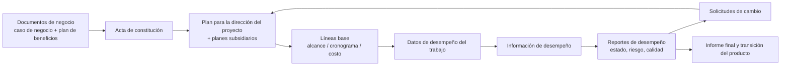

# PMBOK 8 — Catálogo de artefactos, herramientas y técnicas, y anexos

> Archivo de conocimiento de referencia para el skill `pm-knowledge`. Responde a tres preguntas que un agente se hace constantemente: **qué documento corresponde producir** (sección 2), **qué técnica aplicar y cómo** (sección 3) y **cómo comportarse** en materia de PMO, inteligencia artificial y adquisiciones (secciones 4 y 5). El contenido está reformulado en palabras propias; los ejemplos numéricos son inventados.

---

## 0. Cómo leer este archivo

| Sección | Contenido | Para qué la usa el agente |
|---|---|---|
| 1 | Marco: cómo organiza la octava edición sus entradas, salidas, herramientas y técnicas; áreas de enfoque y dominios de desempeño | Ubicar cualquier artefacto o técnica en el mapa general |
| 2 | Catálogo de entradas y salidas (artefactos), en nueve familias, con fichas | Saber qué es, para qué sirve, qué contiene y a qué plantilla de Snyder o producto PRINCE2 equivale |
| 3 | Catálogo de herramientas y técnicas, en catorce familias, con pasos, fórmulas, salidas y trampas | Elegir la técnica adecuada a una pregunta y ejecutarla correctamente |
| 4 | Anexos: PMO, inteligencia artificial, adquisiciones y evolución de la Guía, traducidos a comportamiento de agente | Definir guardarraíles y rol del "asistente de PMO" |
| 5 | Reglas operativas (45) | Comportamiento concreto del agente al generar, revisar o aconsejar |
| 6 | Glosario ES/EN | Terminología coherente y bilingüe |
| 7 | Cobertura y límites | Saber qué no cubre este archivo y dónde buscar lo demás |

Convenciones:

- **ES (EN)**: nombre en español seguido del nombre en inglés en la primera aparición.
- **Área de enfoque (Focus Area)**: en la octava edición, los cinco grupos clásicos (Inicio, Planificación, Ejecución, Monitoreo y Control, Cierre) reaparecen bajo este nombre, independientes del enfoque de desarrollo.
- **Dominio de desempeño (Performance Domain)**: en la octava edición son siete: Gobernanza, Interesados, Alcance, Recursos, Cronograma, Riesgo y Finanzas. Las adquisiciones no forman un dominio propio: se tratan en el apéndice X4.
- **"no determinado en la fuente"**: el extracto disponible no se pronuncia sobre ese punto; lo que sigue a esa marca es práctica habitual, no contenido de la Guía.
- **Snyder** se refiere al libro de plantillas de dirección de proyectos alineado con PMBOK descrito en los archivos `plantillas-*.md` de este mismo skill. **PRINCE2** se refiere a los productos de gestión de PRINCE2 7 descritos en los archivos `prince2-*.md`. Ambos mapeos son aportación de este archivo.

---

## 1. Marco general

### 1.1 Qué cambió en la octava edición y por qué importa para el catálogo

La octava edición combina la mirada por principios y dominios de desempeño de la séptima edición con la vuelta de los procesos (cuarenta, no prescriptivos) y de los cinco grupos clásicos, rebautizados como áreas de enfoque. En consecuencia, la Guía vuelve a tener dos catálogos alfabéticos independientes de los procesos:

- la sección 4 reúne **entradas y salidas** (artefactos, documentos, planes, líneas base, datos de desempeño), y
- la sección 5 reúne **herramientas y técnicas** (métodos de recopilación, análisis, representación, decisión, comunicación, estimación, programación, riesgo, calidad, adquisiciones, prácticas ágiles y tecnología).

Ambos catálogos están ordenados alfabéticamente y sin numeración de sección. Este archivo los reorganiza **por familia funcional**, que es como un agente los necesita: primero decide qué pregunta tiene, luego qué técnica responde a esa pregunta y, finalmente, qué artefacto documenta el resultado.

### 1.2 Principios de la octava edición (contexto)

Los seis principios que la octava edición consolida —adoptar una visión holística, enfocarse en el valor, incorporar la calidad en procesos y entregables, ser un líder responsable, integrar la sostenibilidad en todas las áreas y construir una cultura empoderada— no se desarrollan aquí (pertenecen al estándar), pero conviene recordarlos porque varias reglas operativas de la sección 5 se derivan de ellos: por ejemplo, la exigencia de que toda recomendación del agente explicite el valor para el negocio y el impacto en sostenibilidad.

### 1.3 Cadena de valor de los artefactos

La lectura es la siguiente: los documentos de negocio preceden al proyecto y justifican el acta; el acta habilita el plan; el plan fija líneas base; la ejecución produce datos crudos; el control los convierte en información comparada contra la línea base; la información se empaqueta en reportes que generan decisiones y solicitudes de cambio; los cambios aprobados actualizan el plan; y al cierre todo converge en un informe final y en la transición del producto. Cada eslabón tiene técnicas asociadas que se describen en la sección 3.

### 1.4 Dato → información → reporte

La Guía distingue tres niveles que el agente debe respetar al redactar:

| Nivel | ES (EN) | Qué es | Ejemplo propio |
|---|---|---|---|
| 1 | Datos de desempeño del trabajo (work performance data) | Observaciones crudas y mediciones sin interpretar | "Actividad 4.2 terminó el día 37; costo real acumulado 118 000" |
| 2 | Información de desempeño del trabajo (work performance information) | Datos comparados contra el plan y los umbrales | "La actividad 4.2 terminó 5 días tarde; CPI acumulado 0,91, por debajo del umbral 0,95" |
| 3 | Reportes de desempeño del trabajo (work performance reports) | Información empaquetada para provocar decisión, acción o conciencia | Reporte de estado con semáforo, pronóstico EAC y tres decisiones solicitadas al patrocinador |

Regla práctica: nunca presentar un dato crudo como si fuera una conclusión, y nunca emitir un reporte sin la comparación contra la línea base.

---

## 2. Catálogo de entradas y salidas (artefactos)

Las fichas siguen un esquema fijo: **qué es**, **para qué sirve**, **dónde aparece** (área de enfoque, dominio o proceso cuando la fuente lo nombra), **contenido típico** (campos en palabras propias), **equivalente Snyder** y **equivalente PRINCE2**. Cuando un artefacto es una "actualización de X", se trata dentro de la ficha de X.

### 2.0 Mapa de familias

| Familia | Artefactos incluidos | Sección |
|---|---|---|
| A. Negocio y estrategia | Caso de negocio, plan de gestión de beneficios, documentos de negocio, acta de constitución, enfoque de desarrollo, estrategia de financiamiento, propuestas de financiamiento, requisitos de financiamiento, pronósticos de ingresos, capacidades organizacionales, factores ambientales de la empresa, activos de los procesos de la organización, regulaciones | 2.1 |
| B. Registros y bitácoras | Registro de supuestos, registro de cambios, registro de incidentes, registro de lecciones aprendidas, registro de riesgos, registro de interesados, backlog (producto, iteración, release), lista de hitos, lista de actividades y atributos, matriz de habilidades | 2.2 |
| C. Planes | Plan para la dirección del proyecto y sus componentes: gestión de cambios, comunicaciones, configuración, financiero, adquisiciones, calidad, requisitos, recursos, riesgos, cronograma, alcance, estrategia de abastecimiento, involucramiento de interesados, iteración, release, pruebas | 2.3 |
| D. Estructuras jerárquicas | EDT/WBS, diccionario de la EDT, estructura de desglose de recursos, estructura de desglose de riesgos, estructura de desglose de la organización, estructura de desglose de valor, organigrama del proyecto | 2.4 |
| E. Líneas base | Línea base del alcance, del cronograma, de costos y línea base para la medición del desempeño, con sus actualizaciones | 2.5 |
| F. Datos visuales y modelos de cronograma | Diagrama de red del cronograma, cronograma del proyecto, datos del cronograma, calendarios del proyecto y de recursos, matriz de trazabilidad de requisitos, lienzo de proyecto | 2.6 |
| G. Reportes e información de desempeño | Datos, información y reportes de desempeño; reporte de estado; reporte de calidad; reporte de riesgos; informe final; pronósticos de costo y cronograma; mediciones de control de calidad; métricas de calidad; documentos de prueba y evaluación; evaluaciones de desempeño del equipo; comunicaciones del proyecto | 2.7 |
| H. Acuerdos y adquisiciones | Acuerdos, documentación de adquisiciones, análisis y decisiones de hacer o comprar, documentos de licitación | 2.8 |
| I. Otros documentos del proyecto | Entregables (aceptados, verificados), producto, componente, solicitudes de cambio (y aprobadas), base de las estimaciones, estimaciones de costo y duración, requisitos de recursos, asignaciones de recursos físicos/virtuales y del equipo, acta del equipo, historias de usuario, documentación de requisitos, enunciado del alcance, transición del producto final, salidas de otros procesos, estimación de paquetes de trabajo, documentos del proyecto (genérico) | 2.9 |

---

### 2.1 Familia A — Artefactos de negocio y estrategia

#### Tabla resumen

| ES (EN) | Qué es | Para qué sirve | Dónde aparece |
|---|---|---|---|
| Caso de negocio (business case) | Estudio documentado de viabilidad económica que justifica un componente de portafolio, programa o proyecto | Autorizar (o no) el inicio; medir al final si se cumplió lo prometido | Antes del inicio; entrada del acta; revisado periódicamente y al cierre |
| Plan de gestión de beneficios (benefits management plan) | Descripción de cómo y cuándo se obtendrán, maximizarán y sostendrán los beneficios | Conectar el proyecto con el valor que la organización espera recibir después de cerrarlo | Antes del inicio; se mantiene iterativamente; referencia en el cierre |
| Documentos de negocio (business documents) | Término paraguas para el caso de negocio y el plan de beneficios | Dar contexto estratégico a los procesos de inicio | Inicio; Gobernanza |
| Acta de constitución del proyecto (project charter) | Documento emitido por el patrocinador o iniciador que autoriza formalmente el proyecto y da autoridad al director | Legitimar el uso de recursos de la organización; fijar propósito, objetivos medibles y criterios de éxito y de salida | Inicio; Gobernanza |
| Enfoque de desarrollo (development approach) | Método elegido para crear y evolucionar el producto: predictivo, adaptativo o híbrido | Condicionar todos los demás planes (longitud de iteraciones, nivel de detalle, forma de medir) | Planificación; Gobernanza |
| Estrategia de financiamiento (funding strategy) | Combinación de fuentes de fondos internas o externas | Asegurar que el dinero llegue cuando la línea base de costos lo requiere | Planificación; Finanzas |
| Propuestas de financiamiento (funding proposals) | Solicitud formal de fondos para el proyecto o para una fase, sustentada en una propuesta de valor | Obtener presupuesto de una fuente interna o externa | Inicio y Planificación; Finanzas |
| Requisitos de financiamiento del proyecto (project funding requirements) | Fondos totales y periódicos derivados de la línea base de costos más la reserva de gestión | Programar desembolsos y detectar brechas entre gasto previsto y fondos disponibles | Planificación; Finanzas |
| Pronósticos de ingresos (revenue forecasts) | Proyección de ingresos futuros atribuibles al proyecto o a la organización | Sustentar el caso de negocio y la priorización de portafolio | Inicio; Gobernanza y Finanzas |
| Capacidades organizacionales (organizational capabilities) | Políticas, formas de trabajo, estructuras y actitudes que condicionan la adopción de métodos adaptativos | Evaluar si el enfoque de desarrollo deseado es viable en esa organización | Planificación; Gobernanza |
| Factores ambientales de la empresa (enterprise environmental factors, EEF) | Condiciones internas o externas que el equipo no controla y que influyen o restringen al proyecto | Entrada de casi todos los procesos de planificación | Transversal |
| Activos de los procesos de la organización (organizational process assets, OPA) | Planes, procesos, políticas, plantillas y bases de conocimiento propias de la organización ejecutante | Reutilizar lo que la organización ya sabe y cumplir sus reglas | Transversal |
| Regulaciones (regulations) | Requisitos impuestos por autoridades gubernamentales | Restricción obligatoria; la Guía remite a los OPA/EEF | Transversal |

#### Fichas

**Caso de negocio (business case)**

- Contenido típico: necesidad u oportunidad que origina la iniciativa; objetivos y razones del inicio; análisis de la situación (problema, brechas, causas); alternativas consideradas, incluida la de no hacer nada; costos, beneficios y riesgos de cada alternativa; recomendación; medidas de éxito con las que se evaluará el proyecto al cierre; criterios de decisión "seguir / no seguir". El patrocinador es responsable de mantenerlo; el director aporta recomendaciones y vigila que el acta, el plan y el plan de beneficios se mantengan alineados con él.
- Nota de uso: es un documento de negocio, no un documento del proyecto; puede vivir a nivel de programa. El agente nunca debería "inventar" un caso de negocio sin datos de beneficios; si faltan, debe marcarlos como supuestos a validar.
- Equivalente Snyder: **Caso de negocio (Business Case)** y, en versión abreviada, la **Propuesta de proyecto (Project Proposal)**. Ver `plantillas-inicio-y-planes.md`.
- Equivalente PRINCE2: **Business case** (producto de gestión de línea base, propiedad del Ejecutivo; se actualiza en cada límite de etapa).

**Plan de gestión de beneficios (benefits management plan)**

- Contenido típico: beneficios objetivo (tangibles e intangibles; el valor financiero suele expresarse como VAN); alineación con la estrategia; horizonte de realización (corto, largo plazo, continuo o por fase); dueño de cada beneficio; métricas directas e indirectas; supuestos; riesgos sobre la realización; cómo el valor se integra en las operaciones una vez cerrado el proyecto.
- Equivalente Snyder: no existe plantilla específica en los archivos de referencia; los campos de beneficios se reparten entre el caso de negocio y el acta ("no determinado en la fuente" para una plantilla dedicada).
- Equivalente PRINCE2: **Benefits management approach** (enfoque de gestión de beneficios), que sobrevive al cierre del proyecto y lo mantiene la organización corporativa.

**Acta de constitución del proyecto (project charter)**

- Contenido típico (nivel alto, no detallado): propósito; objetivos medibles y criterios de éxito; requisitos de alto nivel; descripción, límites y entregables clave; riesgo general; cronograma resumido de hitos; recursos financieros preaprobados; lista de interesados clave; requisitos de aprobación (qué es éxito, quién lo decide, quién aprueba); criterios de salida (condiciones para cerrar o cancelar); director asignado con su nivel de autoridad; patrocinador que autoriza.
- Diferencia con el enunciado del alcance: el acta es alto nivel y autoriza; el enunciado del alcance detalla y se elabora progresivamente. La Guía reconoce que parecen redundantes y aclara que la diferencia es el nivel de detalle.
- Equivalente Snyder: **Acta de constitución (Project Charter)**; plantilla combinada acta + enunciado del alcance para proyectos pequeños.
- Equivalente PRINCE2: **Project brief** (resumen del proyecto) en la pre-iniciación y, una vez detallado, la **PID (project initiation documentation)**; el "mandato de proyecto" cumple la función de disparador.

**Enfoque de desarrollo (development approach)**

- Contenido típico: tipo de enfoque elegido (predictivo, adaptativo, híbrido) por entregable o componente; justificación (incertidumbre de requisitos, frecuencia de entrega deseada, restricciones regulatorias, madurez de la organización); consecuencias sobre la longitud de iteraciones y releases, el nivel de detalle de la planificación y las métricas.
- Equivalente Snyder: se documenta dentro del plan para la dirección del proyecto y de la hoja de ruta (roadmap).
- Equivalente PRINCE2: no es un producto independiente; se decide al adaptar el método (tailoring) y se registra en la PID.

**Estrategia de financiamiento (funding strategy)** y **propuestas de financiamiento (funding proposals)**

- Estrategias que la Guía enumera, reformuladas: presupuesto departamental fijo o reasignado; suma global única; desembolsos incrementales por fase o hito; inversión externa (inversores que aportan capital a cambio de participación); subvenciones de gobiernos u ONG; micromecenazgo (crowdfunding) con muchos aportes pequeños; contrato con un cliente, cuando la organización ejecutante actúa como proveedor.
- Contenido típico de una propuesta de financiamiento: alcance y fase a financiar, costo estimado más reservas, propuesta de valor, fuente a la que se solicita, calendario de desembolsos, condiciones.
- Equivalente Snyder: "no determinado en la fuente"; la información suele incluirse en el caso de negocio y el plan de gestión de costos.
- Equivalente PRINCE2: forma parte del business case (costos, financiación) y de los acuerdos con la organización corporativa.

**Requisitos de financiamiento del proyecto (project funding requirements)**

- Contenido típico: fondos totales (línea base de costos + reserva de gestión); fondos por período (trimestral, anual); fuente de cada tramo. La línea base de costos ya incluye la reserva para contingencias; la reserva de gestión queda fuera de la línea base pero dentro del presupuesto. El presupuesto hasta la conclusión (budget at completion, BAC) es la suma de todos los presupuestos autorizados para el trabajo.
- Relación gráfica (reformulada de la figura de la Guía): la curva acumulada de la línea base de costos crece en S; los fondos llegan en escalones; la diferencia entre el escalón y la curva es el colchón de liquidez disponible en cada momento.
- Equivalente Snyder: sección "requisitos de financiamiento" dentro del **Plan de gestión de costos**.
- Equivalente PRINCE2: tolerancias de costo y presupuesto por etapa dentro del **Project plan** y los **Stage plans**.

**Pronósticos de ingresos (revenue forecasts)**

- Contenido típico: ingresos esperados por período, hipótesis de volumen y precio, sensibilidad, relación con los beneficios del caso de negocio.
- Equivalente Snyder / PRINCE2: parte del caso de negocio / business case.

**Capacidades organizacionales (organizational capabilities)**

- Contenido típico: estructura de reporte, políticas de personal, cultura de decisión, tolerancia al cambio, experiencia previa con enfoques adaptativos. La Guía insiste en que pasar de predictivo a adaptativo no es declararlo, sino cambiar la mentalidad desde la dirección ejecutiva y sostener el esfuerzo.
- Equivalente: no hay plantilla en Snyder ni producto en PRINCE2; PRINCE2 lo aborda como contexto para la adaptación (tailoring).

**Factores ambientales de la empresa (EEF)**

- Internos (reformulado): cultura, estructura y gobernanza; distribución geográfica de instalaciones y equipos; infraestructura; software de TI (herramientas de cronograma, gestión de configuración, autorización de trabajo); disponibilidad de recursos (restricciones de compra, proveedores aprobados); capacidad del personal.
- Externos: condiciones de mercado; influencias sociales y culturales; restricciones legales (seguridad, protección de datos, empleo, compras); bases de datos comerciales (benchmarks, datos de estimación, bases de riesgos); investigación académica; normas gubernamentales o sectoriales; consideraciones financieras (tipos de cambio, interés, inflación, aranceles); entorno físico (clima, condiciones de trabajo).
- Uso para el agente: al generar cualquier plan, listar explícitamente qué EEF asumió (por ejemplo, "se asume moneda estable"); si cambian, registrar la actualización.
- Equivalente PRINCE2: no es un producto, pero equivale al contexto que PRINCE2 pide analizar al adaptar el método y en el registro de supuestos del business case.

**Activos de los procesos de la organización (OPA)**

- Dos categorías: (1) procesos, políticas, documentos y plantillas, que normalmente fija la PMO y el proyecto solo adapta siguiendo las reglas; (2) repositorios de conocimiento (lecciones aprendidas, métricas, datos financieros históricos, defectos), que el proyecto actualiza continuamente.
- Uso para el agente: antes de crear una plantilla nueva, preguntar si existe una organizacional; al cierre, proponer qué entradas van al repositorio de lecciones.
- Equivalente PRINCE2: estándares y métodos corporativos que la organización impone al proyecto y los **lessons logs/reports** que lo alimentan.

---

### 2.2 Familia B — Registros y bitácoras

#### Tabla resumen

| ES (EN) | Qué es | Para qué sirve | Dónde aparece |
|---|---|---|---|
| Registro de supuestos (assumption log) | Documento que acumula supuestos y restricciones de todo el ciclo de vida | Hacer visibles las premisas; convertirlas en riesgos cuando son frágiles | Desde el acta (restricciones estratégicas) hasta el cierre |
| Registro de cambios (change log) | Lista completa de cambios solicitados con su estado | Trazabilidad de cada solicitud y de su disposición | Monitoreo y control; proceso de evaluar e implementar cambios |
| Registro de incidentes (issue log) | Documento donde se anotan y siguen los problemas actuales | Asignar dueño y fecha a cada problema; evitar que se pierdan | Ejecución y Monitoreo y control |
| Registro de lecciones aprendidas (lessons learned register) | Repositorio del conocimiento ganado en el proyecto, fase o iteración | Mejorar el desempeño futuro del equipo y de la organización | Se crea temprano en Gestionar el conocimiento del proyecto; se actualiza en muchos procesos; al cierre pasa al repositorio organizacional |
| Registro de riesgos (risk register) | Repositorio de los riesgos individuales identificados y su tratamiento | Centralizar identificación, análisis, respuesta, implementación y monitoreo | Dominio Riesgo: procesos Identificar, Analizar, Planificar respuestas, Implementar respuestas, Monitorear |
| Registro de interesados (stakeholder register) | Información, evaluación y clasificación de los interesados | Base del plan de involucramiento y de las comunicaciones | Dominio Interesados; se inicia en Inicio |
| Backlog (backlog) | Lista ordenada y priorizada del trabajo pendiente, a menudo en historias de usuario | Gestionar el alcance en enfoques adaptativos; en ellos es el mecanismo de cambio | Dominio Alcance; Planificación y Ejecución adaptativas |
| Lista de hitos (milestone list) | Hitos del proyecto, marcando si son obligatorios u opcionales | Comunicar puntos de control; los hitos tienen duración cero | Dominio Cronograma |
| Lista de actividades y atributos (activity list / activity attributes) | Tabulación de las actividades con descripción suficiente y sus atributos extendidos | Construir el modelo de cronograma; ordenar y filtrar en reportes | Dominio Cronograma; Planificación |
| Matriz de habilidades (skill matrix) | Mapa de competencias requeridas frente a las disponibles | Detectar brechas y planificar capacitación o contratación | Dominio Recursos |

#### Fichas

**Registro de supuestos (assumption log)**

- Contenido típico: identificador; tipo (supuesto o restricción); enunciado; origen (caso de negocio, acta, estimación, diseño técnico); fecha; dueño; estado (abierto, validado, invalidado, cerrado); impacto si resulta falso; riesgo asociado si lo hubiera. Las restricciones estratégicas nacen en el caso de negocio y pasan al acta; los supuestos de bajo nivel surgen al estimar, secuenciar o diseñar.
- Equivalente Snyder: **Registro de supuestos (Assumption Log)**; esquema CSV propuesto en `plantillas-documentos-registros-reportes.md` §44.1.
- Equivalente PRINCE2: no hay producto dedicado; los supuestos se consignan en el business case, los planes y el **risk register**.

**Registro de cambios (change log)**

- Contenido típico: identificador; fecha; solicitante; descripción; categoría (correctiva, preventiva, reparación de defecto, actualización); impacto evaluado en alcance, cronograma, costo, calidad y riesgo; disposición (aprobada, diferida, rechazada); quién decidió y cuándo; estado de implementación. Toda solicitud, cualquiera que sea su disposición, debe quedar registrada.
- Equivalente Snyder: **Registro de cambios (Change Log)**; CSV §44.3.
- Equivalente PRINCE2: **Issue register** (en PRINCE2 una solicitud de cambio es un tipo de issue) y el **issue report** asociado.

**Registro de incidentes (issue log)**

- Contenido típico: identificador; descripción; fecha de detección; quién lo detectó; prioridad o urgencia; dueño; acciones; fecha objetivo; estado; resolución. La Guía lo define de forma muy breve; el detalle de campos es práctica habitual.
- Equivalente Snyder: **Registro de incidentes (Issue Log)**; CSV §44.5.
- Equivalente PRINCE2: **Issue register** (issues de tipo problema/preocupación) y el **daily log** para asuntos informales.

**Registro de lecciones aprendidas (lessons learned register)**

- Contenido típico: categoría; descripción de la situación; impacto; recomendación; acción propuesta; quién la captó; fecha; fase o iteración. Admite formatos no textuales (video, audio, imágenes). Quienes hicieron el trabajo participan en capturar las lecciones; al final del proyecto o fase el contenido migra al repositorio de la organización.
- Equivalente Snyder: **Registro de lecciones aprendidas (Lessons Learned Register)** y **Reporte de lecciones aprendidas**; CSV §44.8.
- Equivalente PRINCE2: **Lessons log** durante el proyecto y **lessons report** al final de etapa o proyecto.

**Registro de riesgos (risk register)**

- Contenido típico tras identificar: identificador único; enunciado estructurado que separa causa, riesgo y efecto; dueño potencial; respuestas potenciales. Datos adicionales según el formato que fije el plan de riesgos: título corto; categoría (p. ej., nivel de la estructura de desglose de riesgos); estado; causas; efectos sobre objetivos; disparadores (trigger: señales de que el riesgo está por materializarse); referencia a la EDT afectada; fechas (identificación, ventana de ocurrencia, caducidad, plazo para actuar). Tras analizar: probabilidad, impacto por objetivo, puntuación, prioridad, urgencia. Tras planificar respuestas: estrategia, acciones, dueño confirmado, costo y plazo de la respuesta, riesgos secundarios y residuales, plan de contingencia y de reserva.
- Equivalente Snyder: **Registro de riesgos (Risk Register)** y **Hoja de datos de riesgo (Risk Data Sheet)**; CSV §44.7.
- Equivalente PRINCE2: **Risk register**.

**Registro de interesados (stakeholder register)**

- Contenido típico: identificación (nombre, cargo, ubicación, contacto, rol en el proyecto); evaluación (requisitos principales, expectativas, capacidad de influir, fase de mayor influencia); clasificación (interno/externo; poder, interés, influencia, impacto; hacia arriba/abajo/afuera/al lado; o el modelo que el director elija). Es un documento sensible: algunas evaluaciones (actitud, nivel de apoyo) no deben circular abiertamente.
- Equivalente Snyder: **Registro de interesados (Stakeholder Register)** y **Análisis de interesados**; CSV §44.6.
- Equivalente PRINCE2: análisis de interesados dentro del **Communication management approach**.

**Backlog (backlog)**

- Tipos: **backlog del producto** (product backlog), preparado por el dueño del producto, con requisitos, funcionalidades, épicas e historias que representan toda la visión; **backlog de iteración** (iteration/sprint backlog), subconjunto seleccionado para la iteración actual con sus tareas; **backlog de release** (release backlog), subconjunto planificado para un release que puede abarcar varias iteraciones.
- Contenido típico de cada ítem: identificador; título; descripción (a menudo como historia de usuario); criterios de aceptación; valor para el negocio; estimación relativa (puntos de historia); prioridad; dependencias; estado; release o iteración destino.
- Equivalente Snyder: **Backlog**; CSV §44.2.
- Equivalente PRINCE2: no hay producto dedicado; en PRINCE2 Agile el backlog actúa como descomposición dinámica del **product breakdown structure** y de las **product descriptions**.

**Lista de hitos (milestone list)**

- Contenido típico: nombre; fecha planificada; obligatorio (contractual, regulatorio) u opcional (basado en experiencia); criterio de cumplimiento; entregable asociado. Un hito no consume tiempo.
- Equivalente Snyder: sección de hitos en el **Acta** y en la **Hoja de ruta (Roadmap)**.
- Equivalente PRINCE2: hitos dentro del **Project plan** y los límites de etapa (stage boundaries).

**Lista de actividades y atributos (activity list / activity attributes)**

- Lista: identificador; nombre; descripción del trabajo lo bastante clara para que quien la ejecute sepa qué hacer.
- Atributos que se completan progresivamente: identificador de EDT y de entregable; predecesoras y sucesoras; tipo de relación lógica; adelantos y retrasos; requisitos de recursos; fechas impuestas; restricciones; supuestos; lugar de ejecución; calendario asignado; tipo de esfuerzo (nivel de esfuerzo, esfuerzo discreto, prorrateado: "no determinado en la fuente").
- Equivalente Snyder: lista de actividades dentro de la **Hoja de trabajo de estimación de esfuerzo y duración**; "no determinado en la fuente" como plantilla independiente.
- Equivalente PRINCE2: actividades dentro de los **Stage plans** y **Team plans** (PRINCE2 planifica por productos y deriva actividades).

**Matriz de habilidades (skill matrix)**

- Contenido típico: filas con personas o roles; columnas con competencias; nivel actual y nivel requerido por celda; brecha; acción (capacitar, contratar, mentoría). Debe revisarse periódicamente.
- Equivalente Snyder: sección de roles y competencias del **Plan de gestión de recursos**.
- Equivalente PRINCE2: descripciones de rol en la PID (**project management team structure** y **role descriptions**).

---

### 2.3 Familia C — Planes

#### Plan para la dirección del proyecto (project management plan)

- Qué es: el documento que explica cómo se ejecutará, monitoreará, controlará y cerrará el proyecto. Es la base de toda decisión y es un documento vivo.
- Componentes que la octava edición enumera: plan de gestión de cambios, de comunicaciones, financiero, de iteración, de adquisiciones, de calidad, de requisitos, de release, de recursos, de riesgos, del cronograma, del alcance, de estrategia de abastecimiento, de involucramiento de interesados y de pruebas; más las tres líneas base. El equipo adapta y conserva solo los componentes relevantes.
- Se construye integrando las **salidas de otros procesos (outputs from other processes)**: planes subsidiarios y líneas base producidos por procesos de planificación; sus cambios obligan a actualizar el plan integrado.
- Equivalente Snyder: **Plan para la dirección del proyecto (Project Management Plan)**.
- Equivalente PRINCE2: **PID**, que agrupa los enfoques (approaches) de riesgo, calidad, cambio, comunicación, sostenibilidad y digital/datos, el plan de proyecto, el business case y la estructura de equipo.

#### Tabla resumen de componentes

| ES (EN) | Para qué sirve | Contenido típico (reformulado) | Snyder | PRINCE2 |
|---|---|---|---|---|
| Plan de gestión de cambios (change management plan) | Establecer el comité de control de cambios (CCB), su autoridad y cómo opera el sistema de control de cambios | Composición y poderes del comité (a veces llamado comité directivo); flujo de solicitud, evaluación, decisión y comunicación; niveles de autoridad; herramientas; umbrales que requieren escalado | Plan de gestión de cambios (Change Management Plan) | Change management approach + autoridad de cambio (change authority) y presupuesto de cambios |
| Plan de gestión de las comunicaciones (communications management plan) | Definir cómo, cuándo y quién administra y distribuye la información | Requisitos de comunicación por interesado; qué se comunica (idioma, formato, nivel de detalle); razón; frecuencia y plazos de acuse; responsable de emitir; responsable de autorizar información confidencial; receptores; métodos y tecnologías; recursos (tiempo, presupuesto); procedimiento de actualización; glosario; diagramas de flujo de información, lista de reportes y plan de reuniones; restricciones legales o de política; plantillas de reuniones y correos. Funciona como entrada (guía) y como salida (se actualiza cuando cambian interesados, alcance o fases) | Plan de gestión de las comunicaciones | Communication management approach |
| Plan de gestión de la configuración (configuration management plan) | Identificar qué elementos están bajo control de configuración y cómo se registran y reportan sus cambios | Lista de elementos de configuración; convenciones de identificación y versionado; quién puede cambiar qué; auditorías de configuración; relación con el control de cambios | Incluido en el plan de gestión de cambios | Parte del change management approach; configuration item records y product status account |
| Plan de gestión financiera (financial management plan) | Describir cómo se planifican, estructuran y controlan los costos | Unidades de medida; nivel de precisión (redondeo); nivel de exactitud (rango aceptable, p. ej. ±10 %, incluyendo contingencias); vínculos con la EDT y las cuentas de control (control accounts) enlazadas a la contabilidad; umbrales de control (desviación tolerada antes de actuar, en %); reglas de medición del desempeño (puntos de la EDT donde se mide, técnicas de valor ganado como hitos ponderados, fórmula fija o porcentaje completado, ecuaciones para el EAC); formatos y frecuencia de reportes; detalles adicionales (opciones de financiamiento, tratamiento de tipos de cambio, registro de costos) | Plan de gestión de costos (Cost Management Plan) | Tolerancias de costo en el project plan; aspectos financieros del business case |
| Plan de gestión de las adquisiciones (procurement management plan) | Describir cómo se adquirirán bienes y servicios externos | Coordinación con cronograma y control; calendario de actividades de adquisición; métricas para gestionar contratos; roles y autoridad frente al departamento de compras; restricciones y supuestos; jurisdicción legal y moneda de pago; si se usarán estimaciones independientes como criterio; requisitos de garantías de cumplimiento o seguros; proveedores precalificados; tipo de licitación (internacional, nacional, local); alineación con fuentes de financiamiento externas | Plan de gestión de las adquisiciones + Estrategia de adquisiciones | No hay producto dedicado; PRINCE2 lo trata como parte del project approach y de los acuerdos con proveedores (supplier) en la estructura de equipo |
| Plan de gestión de la calidad (quality management plan) | Describir cómo se aplicarán políticas y procedimientos para lograr los objetivos de calidad | Normas de calidad aplicables; objetivos de calidad; roles; entregables y procesos sujetos a revisión; actividades de control y aseguramiento planificadas; herramientas y métodos; procedimientos para no conformidades y mejora continua. Debe revisarse temprano: evita retrabajo y sobrecostos | Plan de gestión de la calidad | Quality management approach + quality register |
| Plan de gestión de los requisitos (requirements management plan) | Describir cómo se analizarán, documentarán y gestionarán los requisitos (algunas organizaciones lo llaman plan de análisis de negocio) | Planificación, seguimiento y reporte de actividades de requisitos; gestión de configuración de requisitos (cómo se inician cambios, cómo se analiza el impacto, cómo se trazan, niveles de autorización); proceso de priorización; métricas y su justificación; estructura de trazabilidad (atributos de la matriz) | Plan de gestión de los requisitos | No hay producto dedicado; se cubre con product descriptions y el quality management approach |
| Plan de gestión de los recursos (resource management plan) | Describir cómo se adquieren, asignan, monitorean y controlan los recursos (puede dividirse en plan del equipo y plan de recursos físicos) | Identificación y cuantificación de recursos; forma de adquirirlos; roles y responsabilidades (rol, autoridad, responsabilidad, competencia); organigrama del proyecto; gestión del equipo (definir, dotar, gestionar, liberar); capacitación; desarrollo del equipo; control de recursos físicos (inventario, equipos, suministros); plan de reconocimiento y recompensas | Plan de gestión de recursos | Project management team structure y role descriptions en la PID |
| Plan de gestión de los riesgos (risk management plan) | Describir cómo se estructurarán y ejecutarán las actividades de riesgo | Estrategia general; metodología (enfoques, herramientas, fuentes de datos); roles; financiamiento de las actividades de riesgo y protocolos para usar reservas; calendario y frecuencia; categorías (estructura de desglose de riesgos); apetito de riesgo de los interesados expresado como umbrales medibles por objetivo; definiciones de probabilidad e impacto (escalas de 3 o 5 niveles); formato de la matriz de probabilidad e impacto; formatos de reporte; seguimiento y auditoría | Plan de gestión de riesgos | Risk management approach |
| Plan de gestión del cronograma (schedule management plan) | Establecer criterios y actividades para desarrollar, monitorear y controlar el cronograma | Metodología y herramienta de programación; longitud de releases e iteraciones en ciclos adaptativos (los períodos acotados en tiempo limitan la expansión del alcance); nivel de exactitud; unidades de medida; vínculos con la EDT; mantenimiento del modelo (cómo se registra avance); umbrales de control (% de desviación); reglas de medición del desempeño (cómo se fija el porcentaje completado, técnicas de valor ganado, SV y SPI); formatos de reporte | Plan de gestión del cronograma | Tolerancias de tiempo en project plan y stage plans |
| Plan de gestión del alcance (scope management plan) | Describir cómo se define, desarrolla, monitorea, controla y valida el alcance | Proceso para preparar el enunciado del alcance; proceso para crear la EDT a partir del enunciado; cómo se aprueba y mantiene la línea base del alcance; cómo se obtiene la aceptación formal de entregables | Plan de gestión del alcance | Enfoque de planificación por productos en la PID; product descriptions y project product description |
| Plan de estrategia de abastecimiento (sourcing strategy plan) | Decidir qué elementos se harán internamente, cuáles se contratarán y por qué | Decisiones de internalizar o externalizar; justificación en términos de valor, plazo, riesgo y finanzas; criterios de selección de fuente; puede o no detallar cómo se hará la compra | Estrategia de adquisiciones (Procurement Strategy) | Decisiones de aprovisionamiento en la PID; "no determinado en la fuente" como producto propio |
| Plan de involucramiento de los interesados (stakeholder engagement plan) | Identificar estrategias y acciones para lograr la participación productiva de los interesados | Nivel de involucramiento actual y deseado por interesado o grupo; estrategias específicas; acciones, responsables y fechas; relación con el plan de comunicaciones; cómo se medirá el avance del involucramiento | Plan de involucramiento de los interesados (combinable con el de comunicaciones) | Parte del communication management approach |
| Plan de iteración (iteration plan) | Detallar el trabajo comprometido para la iteración en curso | Objetivo de la iteración; ítems del backlog seleccionados; tareas; capacidad del equipo; criterios de terminado; riesgos e impedimentos conocidos | "no determinado en la fuente" | Team plan / sprint plan en PRINCE2 Agile |
| Plan de release (release plan) | Resumir qué funcionalidades se liberarán y cuándo, a partir de la hoja de ruta del producto | Objetivos del release; número de iteraciones; funcionalidades por iteración; dependencias; impedimentos; disponibilidad de recursos | Plan de releases (Release Plan) | Stage plan en PRINCE2 Agile (el release suele coincidir con una etapa) |
| Plan de pruebas (test plan) | Describir cómo se probará o inspeccionará el producto para cumplir expectativas de desempeño y fiabilidad | Alcance de pruebas; tipos (unitarias, integración, aceptación, no destructivas, etc. según sector); criterios de entrada y salida; entornos; responsables; trazabilidad a requisitos | Parte del plan de gestión de la calidad | Quality management approach + product descriptions (criterios y método de calidad) |

---

### 2.4 Familia D — Estructuras jerárquicas

| ES (EN) | Qué es | Para qué sirve | Contenido típico | Snyder | PRINCE2 |
|---|---|---|---|---|---|
| Estructura de desglose del trabajo, EDT (work breakdown structure, WBS) | Descomposición jerárquica de todo el alcance del trabajo necesario para producir los entregables | Base de la línea base del alcance, de las cuentas de control y de la agregación de costos y cronograma | Niveles descendentes cada vez más detallados; el nivel inferior es el **paquete de trabajo (work package)** con identificador único (código de cuentas); la **cuenta de control (control account)** integra alcance, presupuesto y cronograma para medir valor ganado y agrupa dos o más paquetes; el **paquete de planificación (planning package)** está por debajo de la cuenta de control y por encima del paquete de trabajo, con contenido conocido pero sin actividades detalladas | EDT (WBS) y Diccionario de la EDT | Product breakdown structure (PRINCE2 descompone por productos, no por trabajo) |
| Diccionario de la EDT (WBS dictionary) | Documento de soporte con el detalle de cada componente de la EDT | Evitar ambigüedad sobre qué incluye cada paquete | Código de cuentas; descripción del trabajo; supuestos y restricciones; organización responsable; hitos; actividades asociadas; recursos; estimación de costo; requisitos de calidad; criterios de aceptación; referencias técnicas; información del acuerdo o contrato | Diccionario de la EDT | Product descriptions |
| Estructura de desglose de recursos (resource breakdown structure) | Jerarquía de recursos por categoría y tipo | Planificar, gestionar y controlar recursos en conjunto con la EDT | Categorías (personal, materiales, equipos, suministros) y tipos (nivel de habilidad, grado, certificación) | Sección del plan de gestión de recursos | "no determinado en la fuente" |
| Estructura de desglose de riesgos (risk breakdown structure, RBS) | Jerarquía de fuentes potenciales de riesgo | Ayudar a identificar y categorizar riesgos; puede ser genérica de la organización o adaptada | Ejemplo reformulado de niveles: técnico (definición de alcance y requisitos, estimaciones, procesos, tecnología, interfaces); de gestión (dirección de proyecto, programa/portafolio, operaciones, organización, dotación, comunicación); comercial (términos contractuales, compras internas, proveedores, subcontratos, estabilidad del cliente, alianzas); externo (legislación, tipos de cambio, sitio, clima, competencia, regulación) | Categorías del plan de gestión de riesgos | Categorías de riesgo en el risk management approach |
| Estructura de desglose de la organización (organizational breakdown structure, OBS) | Jerarquía de la organización del proyecto que muestra qué unidad ejecuta qué actividades | Que cada departamento vea sus responsabilidades en el proyecto | Departamentos o equipos con sus paquetes de trabajo colgando | Organigrama del plan de recursos | Project management team structure |
| Estructura de desglose de valor (value breakdown structure, VBS) | Una EDT con una estimación de valor asignada a cada elemento | Decidir si un elemento de alcance es realmente imprescindible y si acelerarlo o eliminarlo mejora el valor neto | Valor por elemento; marca de "obligatorio" cuando su valor equivale al del proyecto entero | "no determinado en la fuente" | "no determinado en la fuente" |
| Organigrama del proyecto (project organization chart) | Representación gráfica de los miembros del equipo y sus relaciones de reporte | Aclarar líneas de autoridad; el detalle crece con el tamaño del proyecto | Roles, nombres, relaciones | Parte del plan de gestión de recursos | Project management team structure |

Regla del 100 %: la suma del trabajo de los niveles inferiores debe equivaler exactamente al nivel superior; nada falta y nada sobra. Ver decomposition en §3.8.

---

### 2.5 Familia E — Líneas base

| ES (EN) | Qué es | Para qué sirve | Contenido típico | Snyder | PRINCE2 |
|---|---|---|---|---|---|
| Línea base del alcance (scope baseline) | Versión aprobada del enunciado del alcance, la EDT y su diccionario, modificable solo mediante control formal de cambios | Referencia para decidir si una solicitud está dentro o fuera del proyecto | Enunciado del alcance aprobado; EDT con paquetes de trabajo, cuentas de control y paquetes de planificación; diccionario | Acta + enunciado del alcance + EDT + diccionario (aprobados) | Project product description + product breakdown structure + product descriptions aprobadas en la PID |
| Línea base del cronograma (schedule baseline) | Versión aprobada del modelo de cronograma con fechas de inicio y fin de línea base | Comparar fechas reales con las aprobadas para detectar variaciones | Fechas de inicio y fin de línea base por actividad e hito; aprobación de interesados | Cronograma aprobado dentro del plan de gestión del cronograma | Project plan / stage plan aprobados (con tolerancias) |
| Línea base de costos (cost baseline) | Versión aprobada del presupuesto distribuido en el tiempo, excluyendo la reserva de gestión | Comparar costo real contra lo planificado; base del valor planificado | Presupuesto por período acumulado (curva S); incluye reservas para contingencias; excluye reserva de gestión | Línea base de costos del plan de gestión de costos | Presupuesto del project plan con tolerancias |
| Línea base para la medición del desempeño (performance measurement baseline, PMB) | Integración de las tres líneas base anteriores | Gestionar, medir y controlar la ejecución con valor ganado | Alcance + cronograma + costo integrados por cuenta de control | Base del Análisis de valor ganado | "no determinado en la fuente" (PRINCE2 controla por tolerancias y etapas, no por PMB) |

**Actualizaciones de líneas base (cost / schedule baseline updates)**: solo mediante solicitud de cambio aprobada. La Guía describe el flujo para costos: entradas (presupuesto aprobado, solicitudes de cambio, costos reales, plan) → salidas (línea base revisada, estimaciones actualizadas, pronósticos de presupuesto, asiento en el registro de cambios). Para el agente: nunca "ajustar" una línea base para que el proyecto parezca en plan; replanificar sin cambio aprobado es una señal de alerta.

---

### 2.6 Familia F — Datos visuales y modelos de cronograma

| ES (EN) | Qué es | Para qué sirve | Contenido típico | Snyder | PRINCE2 |
|---|---|---|---|---|---|
| Diagrama de red del cronograma (project schedule network diagram) | Representación gráfica de las relaciones lógicas (dependencias) entre actividades | Visualizar secuencia, convergencias y divergencias de caminos | Nodos de actividad; flechas con tipo de relación (FS, SS, FF, SF) y adelantos/retrasos (p. ej. "FS + 15"); puede incluir actividades resumen y una narrativa que explique secuencias inusuales. Una actividad con varias predecesoras es una **convergencia de caminos**; con varias sucesoras, una **divergencia**; ambas concentran riesgo | "no determinado en la fuente" | "no determinado en la fuente" (PRINCE2 lo admite como técnica de planificación) |
| Cronograma del proyecto (project schedule) | Salida del modelo de cronograma: actividades enlazadas con fechas, duraciones, hitos y recursos | Comunicar cuándo ocurre cada cosa; debe mantenerse flexible ante nuevo conocimiento | Diagrama de barras (Gantt), diagrama de hitos o red con fechas | Cronograma del plan de gestión del cronograma | Project plan / stage plan (gráfico) |
| Datos del cronograma (schedule data) | Conjunto de información que describe y controla el cronograma | Reconstruir y mantener el modelo | Hitos, actividades, atributos, supuestos y restricciones; histogramas de recursos; cronogramas alternativos (mejor/peor caso, nivelado o no, con o sin fechas impuestas); reservas aplicadas; proyecciones de flujo de caja; calendarios de pedidos y entregas | "no determinado en la fuente" | "no determinado en la fuente" |
| Calendario del proyecto (project calendar) | Días y turnos laborables disponibles para las actividades | Permitir que el modelo calcule fechas realistas; puede haber varios calendarios | Días hábiles, feriados, turnos | Parte del plan de cronograma | "no determinado en la fuente" |
| Calendario de recursos (resource calendar) | Días y turnos en que cada recurso específico está disponible | Estimar utilización y evitar sobreasignación | Horario, fines de semana, feriados, vacaciones, experiencia y ubicación del recurso | Parte del plan de recursos | "no determinado en la fuente" |
| Matriz de trazabilidad de requisitos (requirements traceability matrix) | Cuadrícula que enlaza cada requisito con su origen y con los entregables que lo satisfacen | Garantizar que cada requisito aporta valor y se entrega; gestionar cambios de alcance del producto | Columnas de trazabilidad: necesidades de negocio, objetivos del proyecto, entregables de la EDT, diseño, desarrollo, estrategia y casos de prueba, requisitos de alto nivel a detallados. Atributos por requisito: identificador, descripción, justificación, dueño, fuente, prioridad, versión, estado (activo, cancelado, diferido, agregado, aprobado, asignado, completado), fecha de estado, estabilidad, complejidad, criterios de aceptación | Matriz de trazabilidad de requisitos | "no determinado en la fuente"; la trazabilidad se logra con product descriptions y el quality register |
| Lienzo de proyecto (project canvas) | Herramienta visual de una página con las piezas esenciales del proyecto | Alinear rápidamente a equipo e interesados; detectar huecos temprano | Casillas reformuladas: propósito; objetivo; requisitos de aprobación; alcance (requisitos, entregables, exclusiones); supuestos y restricciones; recursos (físicos, financieros, humanos); hitos; interesados y usuarios; riesgos y su tratamiento; fases; equipo; lecciones aprendidas | Lienzo de arranque (Project Canvas) | "no determinado en la fuente"; cumple la función del project brief en versión visual |

---

### 2.7 Familia G — Reportes e información de desempeño

| ES (EN) | Qué es | Para qué sirve | Contenido típico | Snyder | PRINCE2 |
|---|---|---|---|---|---|
| Datos de desempeño del trabajo (work performance data) | Observaciones y mediciones crudas recogidas durante la ejecución | Materia prima de los procesos de control | Trabajo completado; indicadores clave; medidas técnicas; fechas reales de inicio y fin; puntos de historia completados; estado de entregables; número de solicitudes de cambio; número de defectos; costos y duraciones reales | Reporte de avance del miembro del equipo | Checkpoint report (datos del equipo) |
| Información de desempeño del trabajo (work performance information) | Datos analizados y comparados con el plan, los documentos y los umbrales | Decidir si hace falta acción preventiva o correctiva | Variaciones, índices, tendencias, comparación con umbrales | Reporte de análisis de variaciones | Base del highlight report |
| Reportes de desempeño del trabajo (work performance reports) | Representación física o electrónica de la información, destinada a generar decisiones, acciones o conciencia | Comunicar según el plan de comunicaciones | Estado de elementos de configuración; gráficos de valor ganado; tendencias y pronósticos; gráficos de trabajo pendiente por iteración; histogramas de defectos; desempeño de contratos; resúmenes de riesgo; formatos: tableros, mapas de calor, semáforos | Reporte de estado del proyecto | Highlight report, end stage report |
| Reporte de estado (status report) | Documento con el estado actual, el progreso desde el último reporte y pronósticos de costo y cronograma | Informar periódicamente al patrocinador y al comité | Período; semáforo general y por dimensión; logros; próximos entregables; variaciones; pronósticos; riesgos e incidentes clave; decisiones requeridas | Reporte de estado del proyecto | Highlight report |
| Reporte de calidad (quality report) | Documento con problemas de calidad, recomendaciones de acción correctiva y resumen de hallazgos del control | Alimentar mejoras de proceso, proyecto y producto | Problemas detectados; no conformidades; recomendaciones; métricas | Auditoría de calidad | Quality register + entradas del end stage report |
| Reporte de riesgos (risk report) | Información sobre las fuentes de riesgo general del proyecto y resumen de los riesgos individuales | Dar al patrocinador la visión agregada que el registro no da | Principales impulsores del riesgo general; número de amenazas y oportunidades; distribución por categoría; métricas y tendencias; resultados de análisis cuantitativo; estado de respuestas | Reporte de riesgos | Sección de riesgos del highlight report / end stage report |
| Informe final (final report) | Resumen del desempeño del proyecto o fase al cierre | Formalizar el cierre y documentar el grado de logro | Descripción resumida; objetivos de alcance con evidencia de cumplimiento; objetivos de calidad, fechas reales de hitos y causas de variación; objetivos de costo (rango aceptable, costo real, causas); validación del producto final; objetivos de cronograma y beneficios (grado de logro y estimación de realización futura); cómo se atendieron las necesidades de negocio; riesgos e incidentes relevantes y su tratamiento | Reporte de cierre del proyecto | End project report |
| Pronósticos de costos (cost forecasts) | Estimación a la conclusión (EAC) calculada a partir del desempeño pasado | Saber si el proyecto sigue dentro de las tolerancias de presupuesto y si hacen falta cambios | EAC, ETC, VAC, TCPI con supuestos | Análisis de valor ganado | Pronóstico en highlight report |
| Pronósticos del cronograma (schedule forecasts) | Predicción de condiciones futuras basada en la información disponible al calcular el cronograma | Anticipar desvíos y decidir acciones | Fechas de fin proyectadas; SV, SPI; reservas de cronograma consumidas; efecto de acciones correctivas | Análisis de valor ganado | Pronóstico en highlight report |
| Mediciones de control de calidad (quality control measurements) | Resultados documentados de las actividades de aseguramiento/control de calidad, en el formato del plan de calidad | Verificar cumplimiento de métricas | Valor medido, tolerancia, resultado, fecha, responsable | Hoja de verificación / auditoría de calidad | Quality register |
| Métricas de calidad (quality metrics) | Descripción de un atributo del proyecto o producto y de cómo se verificará | Hacer medible la calidad | Ejemplos reformulados: % de tareas a tiempo; CPI; tasa de fallos; defectos por día; tiempo de inactividad mensual; errores por línea de código; satisfacción del cliente; % de requisitos cubiertos por pruebas | Parte del plan de gestión de la calidad | Criterios de calidad en product descriptions |
| Documentos de prueba y evaluación de calidad (quality test and evaluation documents) | Documentos que describen cómo se evaluará si los entregables cumplen las normas del plan de calidad | Detectar errores y no conformidades temprano, cuando corregir cuesta menos | Casos y escenarios de prueba; protocolos de inspección; resultados; evidencias | Parte del plan de calidad | Quality register + quality review records |
| Evaluaciones de desempeño del equipo (team performance assessments) | Valoración formal o informal de la eficacia del equipo tras acciones de desarrollo | Decidir capacitación, mentoría o cambios | Indicadores reformulados: mejora de habilidades individuales; mejora de competencias colectivas; reducción de rotación; mayor cohesión y colaboración | "no determinado en la fuente" | "no determinado en la fuente" |
| Comunicaciones del proyecto (project communications) | Todo lo que se emite a los interesados | Mantener informados y alineados | Reportes de desempeño, estado de entregables, avance del cronograma, costos incurridos, presentaciones | Varios reportes | Highlight / checkpoint / exception reports |

---

### 2.8 Familia H — Acuerdos y adquisiciones

| ES (EN) | Qué es | Para qué sirve | Contenido típico | Snyder | PRINCE2 |
|---|---|---|---|---|---|
| Acuerdos (agreements) | Cualquier documento o comunicación que fija las intenciones iniciales de un proyecto: contrato, acuerdo de nivel de servicio (SLA), memorando de entendimiento (MOU), carta de acuerdo, orden de compra, correo electrónico, incluso acuerdo verbal | Entrada del acta cuando el proyecto nace de un cliente; marco de obligaciones entre comprador y vendedor | Partes; objeto; alcance (enunciado del trabajo); plazos; precio y forma de pago; criterios de aceptación; garantías; penalidades e incentivos; propiedad intelectual; resolución de disputas; cumplimiento legal local, nacional e internacional | Estrategia de adquisiciones; reportes de contratista | Acuerdos con proveedores dentro de la estructura de equipo; "no determinado en la fuente" como producto |
| Documentación de adquisiciones (procurement documentation) | Todos los registros usados para firmar, ejecutar y cerrar un acuerdo, incluidos los anteriores al proyecto | Soporte completo para administrar y auditar la adquisición | Enunciado del trabajo (SOW); información de pagos; desempeño del contratista; planos, planes y correspondencia | Reporte de estado del contratista; Reporte de cierre de contrato | "no determinado en la fuente" |
| Análisis y decisión de hacer o comprar (make-or-buy analysis and decisions) | Proceso de reunir datos sobre los requisitos del producto y compararlos con alternativas de compra o fabricación interna | Decidir si el equipo hace el trabajo o se adquiere afuera | Alternativas; costos totales; riesgos; capacidad interna; necesidad de experiencia independiente; decisión y justificación | Estrategia de adquisiciones | "no determinado en la fuente" |
| Documentos de licitación (bid documents) | Documentos para solicitar información, cotizaciones o propuestas a vendedores potenciales | Abrir el proceso competitivo | Solicitud de información (RFI), solicitud de propuesta (RFP), solicitud de cotización (RFQ); invitación a licitar (IFB/ITT); criterios de evaluación publicados | Criterios de selección de proveedores | "no determinado en la fuente" |

Ver el apéndice de adquisiciones en §4.3 para estrategia, selección de fuente, tipos de contrato y reclamaciones.

---

### 2.9 Familia I — Otros documentos del proyecto

| ES (EN) | Qué es | Para qué sirve | Contenido típico | Snyder | PRINCE2 |
|---|---|---|---|---|---|
| Entregable (deliverable) | Producto, resultado o capacidad única y verificable que debe producirse para completar un proceso, fase o proyecto; puede ser tangible o intangible | Materializar los objetivos | Nombre, descripción, criterios de aceptación, responsable | EDT / diccionario | Product (con su product description) |
| Entregables verificados (verified deliverables) | Entregables terminados y comprobados como correctos por el proceso Monitorear y Controlar el Alcance | Entrada de la validación formal; si hay cambios, se reinspeccionan | Evidencia de verificación | "no determinado en la fuente" | Productos aprobados en quality review |
| Entregables aceptados (accepted deliverables) | Entregables validados por la persona o grupo autorizado contra criterios establecidos | Cerrar formalmente el alcance; el aprobador debería involucrarse temprano | Acta de aceptación, fecha, firmante, observaciones | Parte del reporte de cierre | Acceptance records en Closing a project |
| Producto (product) | Artefacto producido y cuantificable, final o componente; tangible o intangible (bienes digitales, servicios) | Término paraguas | — | — | Product |
| Componente (component) | Elemento predefinido de un portafolio, programa o proyecto, con trabajo asociado a objetivos estratégicos | Unidad de gestión en portafolios | — | — | "no determinado en la fuente" |
| Solicitud de cambio (change request) | Propuesta formal para modificar un documento, entregable o línea base; puede nacer dentro o fuera del proyecto y la puede presentar cualquier interesado | Canalizar correcciones, prevenciones, reparaciones y nuevas ideas por el proceso Evaluar e Implementar Cambios | Identificador; solicitante; descripción; justificación; tipo (acción correctiva, acción preventiva, reparación de defecto, actualización); impacto estimado; alternativas; recomendación | Solicitud de cambio (Change Request) | Issue report (tipo request for change / off-specification) |
| Solicitudes de cambio aprobadas (approved change requests) | Solicitudes procesadas según el plan de cambios por el director, el CCB u otra persona designada, con disposición aprobada, diferida o rechazada | Se implementan en Gestionar la Ejecución del Proyecto; las diferidas o rechazadas se comunican al solicitante | Disposición; fecha; firmante; instrucciones de implementación | Registro de cambios | Decisión registrada en el issue register |
| Cambios aprobados (approved changes) | Modificaciones ya en implementación o implementadas tras aprobación plena | Distinguir lo aprobado de lo ejecutado | Estado de implementación; verificación | Registro de cambios | Product status account actualizado |
| Base de las estimaciones (basis of estimates) | Documentación de soporte que explica cómo se derivó cada estimación | Que cualquiera pueda entender y auditar la estimación | Método; supuestos; restricciones; nivel de detalle; rango (p. ej. ±10 %); nivel de confianza; riesgos que la afectan | Hojas de trabajo de estimación | Supuestos de los planes |
| Estimaciones de costos (cost estimates) | Evaluación cuantitativa de los costos probables de los recursos de una actividad, basada en lo conocido en ese momento | Construir el presupuesto; mejoran con el avance | Costos de mano de obra, materiales, equipos, servicios, instalaciones, inflación, financiamiento, contingencia; por actividad o resumidas; en moneda o en horas-persona para neutralizar tipos de cambio; alternativas (hacer/comprar, comprar/arrendar) | Estimaciones de costos + hoja de trabajo | Estimaciones en stage plans |
| Estimaciones de duración (duration estimates) | Evaluación cuantitativa de los períodos de trabajo necesarios, sin incluir retrasos (lags) | Construir el cronograma | Valor con rango (p. ej. "2 semanas ± 2 días") o con probabilidad (p. ej. "15 % de probabilidad de superar 3 semanas") | Estimaciones de esfuerzo y duración + hoja de trabajo | Estimaciones en stage plans |
| Estimación de paquetes de trabajo (work package estimation) | Estimación de costo y duración al nivel más bajo de la EDT, a veces por simulación con distribuciones de probabilidad | Base de la planificación detallada; los paquetes se descomponen luego en actividades | Costo, duración, distribución, supuestos | Hoja ascendente (bottom-up) | "no determinado en la fuente" |
| Requisitos de recursos (resource requirements) | Tipos y cantidades de recursos por paquete de trabajo o actividad, agregables por rama de la EDT y proyecto | Dimensionar el equipo y las compras | Tipo, cantidad, calificación, disponibilidad, supuestos | Parte del plan de recursos | Requisitos de recursos en planes |
| Asignaciones de recursos físicos y virtuales (physical or virtual resource assignments) | Documentación de materiales, equipos, instalaciones y también recursos digitales (software, entornos de prueba, licencias, personas remotas) | Saber qué se usará, en qué cantidad, dónde, y si es interno, externo o remoto; son dinámicas | Tipo, cantidad, ubicación, origen, utilización esperada | "no determinado en la fuente" | "no determinado en la fuente" |
| Asignaciones del equipo del proyecto (project team assignments) | Lista de miembros con roles y responsabilidades; puede incluir un directorio y nombres en organigramas y cronogramas | Formalizar quién está en el proyecto | Nombre, rol, responsabilidad, dedicación, contacto | Parte del plan de recursos | Project management team structure |
| Asignaciones de desempeño del equipo (team performance assignments) | Reparto de tareas según habilidades, roles y requisitos | Que el trabajo avance con eficiencia | Tarea, responsable, criterio | "no determinado en la fuente" | Work packages (PRINCE2) |
| Acta del equipo (team charter) | Documento con valores, acuerdos y pautas operativas del equipo | Fijar expectativas de conducta; funciona mejor si lo elabora el propio equipo; se revisa para integrar nuevos miembros | Valores; pautas de comunicación; criterios y procesos de decisión; resolución de conflictos; pautas de reuniones; acuerdos (reglas básicas) | Acta del equipo (Team Charter) | "no determinado en la fuente" |
| Historias de usuario (user stories) | Descripción breve de un resultado desde la perspectiva de un interesado; una "promesa de conversación" | Expresar requisitos en lenguaje del usuario | Rol (quién), objetivo (qué necesita), motivación (para qué); criterios de aceptación centrados en funcionalidad y expectativa del usuario | Historia de usuario (User Story) | Product description ligera en PRINCE2 Agile |
| Documentación de requisitos (requirements documentation) | Descripción de cómo cada requisito cubre la necesidad de negocio; evoluciona de alto nivel a detallado | Base de la línea base del alcance y de las pruebas; antes de la línea base deben ser inequívocos, trazables, completos, consistentes y aceptados | Clasificación: de negocio; de interesados; de solución (funcionales y no funcionales: fiabilidad, seguridad, desempeño, soporte, retención); de transición y preparación (conversión de datos, capacitación); del proyecto (hitos, obligaciones contractuales); de calidad (pruebas, certificaciones) | Documentación de requisitos | Product descriptions + project product description |
| Enunciado del alcance del proyecto (project scope statement) | Descripción detallada del alcance, entregables principales, supuestos y restricciones, incluyendo alcance del proyecto y del producto | Entendimiento común; guía de ejecución; referencia para juzgar si una solicitud está dentro o fuera | Descripción del alcance (elaboración progresiva de lo que dice el acta); entregables (incluidos reportes y documentación); criterios de aceptación; exclusiones explícitas (reducen la expansión incontrolada del alcance) | Enunciado del alcance (Project Scope Statement) | Project product description |
| Transición del producto, servicio o resultado final (final product, service, or result transition) | Entrega del resultado del proyecto (o de la fase) al grupo que lo operará, mantendrá y soportará | Cerrar el ciclo del proyecto y abrir el del producto | Acta de transferencia; documentación operativa; capacitación; garantías; pendientes | Reporte de cierre | Handover en Closing a project; benefits management approach |
| Documentos del proyecto (project documents) y sus actualizaciones | Toda la documentación creada en las cinco áreas de enfoque para iniciar, planificar, ejecutar, controlar y cerrar | Término genérico de salida en muchos procesos | Ejemplos: registro de cambios, de incidentes, cronograma, enunciado del alcance, documentación de requisitos, registros de riesgos e interesados | Varios | Registros (registers) y logs |

---

## 3. Catálogo de herramientas y técnicas

Cada familia tiene una tabla con **para qué sirve**, **cuándo usarla**, **cómo se aplica (pasos o fórmula)**, **salidas** y **trampas** habituales. Las técnicas con cálculo (valor ganado, camino crítico, tres puntos, árbol de decisión, Monte Carlo, financieras, puntuación de riesgos) tienen además un bloque desarrollado con fórmulas escritas y un ejemplo inventado.

### 3.0 Mapa de familias y pregunta que responden

| Familia | Pregunta típica del usuario | Sección |
|---|---|---|
| A. Recopilación de datos | "¿Qué necesitan los interesados?", "¿Qué riesgos hay?", "¿Qué hizo el proyecto anterior?" | 3.1 |
| B. Análisis de datos | "¿Vamos bien?", "¿Cuánto costará al final?", "¿Qué alternativa conviene?", "¿Por qué pasó esto?" | 3.2 |
| C. Representación de datos | "Muéstramelo en una vista", "¿Quién hace qué?", "¿Qué riesgo es más grave?" | 3.3 |
| D. Toma de decisiones | "¿Cómo decidimos entre opciones?", "¿Qué priorizamos?" | 3.4 |
| E. Comunicación | "¿Cómo informo a cada interesado?", "¿Qué reunión necesito?" | 3.5 |
| F. Habilidades interpersonales y de equipo | "Hay un conflicto", "El equipo está desmotivado", "¿Cómo lidero?" | 3.6 |
| G. Estimación | "¿Cuánto durará / costará?" | 3.7 |
| H. Programación | "¿Cuál es el camino crítico?", "¿Cómo acortamos el cronograma?", "¿Cómo repartimos recursos?" | 3.8 |
| I. Financieras | "¿Conviene la inversión?", "¿Cuánto hace falta y cuándo?" | 3.9 |
| J. Calidad | "¿Cumple el entregable?", "¿El proceso es estable?", "¿Cuánto cuesta la calidad?" | 3.10 |
| K. Riesgo | "¿Qué hacemos con este riesgo?", "¿Cuál es la exposición total?" | 3.11 |
| L. Adquisiciones | "¿Hacemos o compramos?", "¿Cómo elegimos proveedor?", "¿Qué contrato?" | 3.12 |
| M. Prácticas ágiles y adaptativas | "¿Cómo gestionamos el backlog?", "¿Vamos a terminar la iteración?" | 3.13 |
| N. Modelado y tecnología | "¿Qué puede automatizar la IA?", "¿Qué herramientas de control de cambios?" | 3.14 |

---

### 3.1 Familia A — Recopilación de datos (data gathering)

Definición general: seleccionar, recoger, medir y analizar datos de un área de interés para responder preguntas del proyecto.

| ES (EN) | Para qué sirve | Cuándo usarla | Cómo se aplica | Salidas | Trampas |
|---|---|---|---|---|---|
| Tormenta de ideas (brainstorming) | Generar muchas ideas en poco tiempo con un grupo y un facilitador | Identificar requisitos, riesgos, soluciones, interesados | Dos fases: generación (sin juzgar) y análisis (agrupar, depurar, priorizar) | Lista bruta y lista depurada de ideas | Dominio de las voces fuertes; juzgar durante la generación; no cerrar con acciones |
| Variantes de tormenta de ideas (brainstorming techniques) | Adaptar la dinámica al contexto | Equipos remotos, tímidos, temas complejos | **Brain-netting** (virtual, con herramientas en línea, admite anonimato); **brainwriting** (cada quien escribe antes de compartir); **servilleta de ideas** (idea napkin: cinco casillas —personas, oferta, cliente, propuesta de valor, competencias clave—); **individual** (escritura libre con cronómetro, asociación de palabras, telarañas visuales); **mapa mental**; **tormenta inversa** (cómo empeorar el problema, para hallar causas); **ronda** (round-robin: todos por turno); **starbursting** (seis preguntas: quién, qué, cuándo, dónde, por qué, cómo); **FODA**; **cinco porqués** (preguntar "por qué" repetidamente hasta la causa raíz) | Igual que arriba, con mejor participación | Elegir una variante por moda y no por el problema |
| Entrevistas (interviews) | Obtener información directa, formal o informal, de interesados | Requisitos, riesgos, lecciones, información confidencial | Preparar preguntas, mezclar preguntas abiertas y cerradas, registrar respuestas; uno a uno o en grupo | Notas, requisitos, riesgos identificados | Preguntas inductivas; no validar lo entendido; omitir el seguimiento |
| Grupos focales (focus groups) | Conocer expectativas y actitudes de interesados precalificados sobre un producto propuesto | Diseño de producto, validación de concepto | Moderador entrenado guía una conversación interactiva, más conversacional que una entrevista | Síntesis de expectativas y objeciones | Grupo poco representativo; moderador que opina |
| Cuestionarios y encuestas (questionnaires and surveys) | Reunir rápidamente información de muchos encuestados | Audiencias variadas, dispersas geográficamente, cuando conviene análisis estadístico | Diseñar preguntas, pilotar, distribuir, analizar | Datos agregados, distribuciones | Sesgo de muestra; preguntas ambiguas; baja tasa de respuesta |
| Listas de verificación (checklists) | Recordar ítems, acciones o puntos a considerar, construidos con experiencia previa | Identificación de riesgos, preparación para iniciar ("definición de listo" o "kit completo"), revisiones | Recorrer la lista; explorar además lo que no está en ella; actualizarla periódicamente | Lista marcada; riesgos adicionales | Creer que la lista es exhaustiva; no retirar ítems obsoletos |
| Evaluación comparativa (benchmarking) | Comparar productos, procesos y prácticas con los de organizaciones comparables | Fijar metas de calidad, generar ideas de mejora, medir desempeño | Elegir referentes (internos o externos, del mismo sector u otro); recoger métricas; comparar; adaptar | Brechas y buenas prácticas | Comparar peras con manzanas; copiar sin adaptar |
| Investigación de mercado (market research) | Examinar la capacidad del sector y de vendedores específicos | Antes de licitar; para refinar objetivos de adquisición | Conferencias, reseñas en línea, bases de datos; equilibrar tecnologías maduras con amplitud de oferentes | Lista de vendedores potenciales; madurez tecnológica | Confundir marketing de proveedores con capacidad real |
| Análisis de documentos (document analysis) | Revisar y evaluar información documentada relevante | Requisitos, riesgos, lecciones, auditorías | Inventariar documentos (acuerdos, planes de negocio, reglas de negocio, flujos de proceso, material de marketing, planes, supuestos, históricos, documentación técnica, registros de problemas, políticas, reportes de calidad y pruebas, regulaciones, solicitudes de propuesta, casos de uso); leer con una pregunta concreta; extraer y trazar | Requisitos, riesgos, hallazgos | Documentos desactualizados tomados como vigentes |
| Observación y conversación (observation/conversation) | Ver cómo la gente realmente ejecuta su trabajo | Procesos detallados; usuarios que no saben o no quieren articular requisitos | Observador externo ("sombra laboral") u observador participante que ejecuta el proceso para descubrir requisitos ocultos | Requisitos tácitos | El observado cambia su conducta; generalizar desde un solo caso |
| Listas de indicaciones (prompt lists) | Marco predefinido de categorías para disparar la identificación de riesgos | Talleres de riesgos | Usar el nivel inferior de la estructura de desglose de riesgos para riesgos individuales; marcos estratégicos para el riesgo general: **PESTLE** (político, económico, sociocultural, tecnológico, legal, ambiental), **TECOP** (técnico, ambiental, comercial, operativo, político), **VUCA** (volatilidad, incertidumbre, complejidad, ambigüedad) | Riesgos por categoría | Forzar riesgos para llenar categorías |
| Conversaciones y pruebas con clientes (customer talks and tests) | Obtener retroalimentación directa del cliente durante desarrollo y pruebas | Enfoques adaptativos, desarrollo de productos | Sesiones periódicas de demostración y prueba con clientes reales | Ajustes de requisitos; confianza | Hablar solo con el patrocinador y no con usuarios |
| Revisión de información histórica (historical information review) | Alimentar estimaciones análogas y paramétricas | Estimación temprana | Verificar que los datos sean exactos, los parámetros cuantificables y los modelos escalables | Modelos de estimación calibrados | Datos de proyectos "parecidos" solo en apariencia |

---

### 3.2 Familia B — Análisis de datos (data analysis)

Definición general: preprocesar, limpiar, transformar, analizar, interpretar y visualizar datos para decidir con fundamento; puede hacerse a mano o con herramientas de inteligencia de negocio.

#### Tabla

| ES (EN) | Para qué sirve | Cuándo usarla | Cómo se aplica | Salidas | Trampas |
|---|---|---|---|---|---|
| Análisis de alternativas (alternative analysis) | Evaluar opciones para elegir cómo hacer el trabajo o qué solución adoptar | Decidir enfoque, solución, respuesta a un problema | Enumerar alternativas; definir criterios; evaluar; recomendar (puede combinarse con análisis multicriterio) | Alternativa recomendada con justificación | Presentar una sola alternativa "de compromiso"; omitir la opción de no hacer nada |
| Análisis de supuestos y restricciones (assumption and constraint analysis) | Comprobar la validez de supuestos y restricciones para hallar riesgos | Planificación, revisión de riesgos | Para cada supuesto: ¿es exacto, estable, consistente, completo? Si no, amenaza. Para cada restricción: ¿puede relajarse o eliminarse? Si sí, oportunidad | Riesgos nuevos; supuestos a validar | Supuestos implícitos no registrados |
| Análisis costo-beneficio (cost-benefit analysis) | Comparar beneficios esperados con costos de una actividad o alternativa | Caso de negocio, respuestas a riesgos, hacer/comprar | Cuantificar costos y beneficios en una misma unidad y horizonte; comparar; considerar intangibles aparte (ver §3.9) | Relación beneficio/costo, beneficio neto | Beneficios inflados; costos ocultos (operación, mantenimiento) |
| Costo de la calidad (cost of quality, CoQ) | Entender cuánto cuesta prevenir, evaluar y fallar | Plan de calidad, decisiones de inversión en pruebas | Ver bloque §3.10 | Balance óptimo prevención/evaluación vs. fallas | Medir solo costos de falla visibles |
| Análisis de valor ganado (earned value analysis) | Comparar la línea base para la medición del desempeño con el desempeño real de costo y cronograma | Monitoreo y control de proyectos con línea base | Ver bloque desarrollado más abajo | CV, SV, CPI, SPI, EAC, ETC, VAC, TCPI | Medir EV sin reglas de avance definidas; usar EV solo como porcentaje de gasto |
| Índice de desempeño hasta la conclusión (to-complete performance index, TCPI) | Eficiencia de costo que habrá que lograr en lo que resta para cumplir una meta | Cuando el CPI acumulado cae bajo la meta | Ver bloque EVM | TCPI frente a BAC o frente a EAC | Exigir un TCPI irreal sin discutir cambio de meta |
| Análisis de variación (variance analysis) | Determinar causa y magnitud de la diferencia entre línea base y realidad | Cada ciclo de control | Calcular variaciones de duración, costo, utilización de recursos, tarifas, desempeño técnico; analizarlas de forma integrada; proponer acción preventiva o correctiva | Causas; acciones | Analizar costo y tiempo por separado; corregir síntomas |
| Análisis de tendencias (trend analysis) | Pronosticar resultados futuros a partir de resultados históricos | Anticipar deslizamientos antes de que ocurran | Modelos matemáticos sobre series de CPI, SPI, defectos, velocidad; extrapolar; recomendar acciones preventivas | Pronósticos, alertas tempranas | Extrapolar con pocos puntos; ignorar cambios de contexto |
| Análisis de regresión (regression analysis) | Hallar la relación estadística entre variables de entrada y resultados | Mejorar modelos de estimación y comprender qué impulsa el desempeño | Reunir pares entrada-salida de proyectos pasados; ajustar el modelo; validar | Ecuación de estimación; factores explicativos | Confundir correlación con causalidad |
| Análisis de reservas (reserve analysis) | Evaluar cuánto riesgo queda y si la reserva de cronograma y presupuesto alcanza | Planificación y cada revisión de riesgos | Comparar reserva restante con exposición restante; decidir si usar, reducir o liberar reserva. La **reserva para contingencias** cubre riesgos identificados ("conocidos-desconocidos"), está dentro de la línea base, puede ser un %, un monto fijo o resultado de análisis cuantitativo y debe identificarse explícitamente. La **reserva de gestión** cubre lo imprevisto, está fuera de la línea base y dentro del presupuesto | Reserva recomendada; alertas de consumo | Confundir contingencia con colchón arbitrario; gastar reserva en alcance nuevo |
| Análisis de causa raíz (root cause analysis) | Encontrar la razón subyacente de una variación, defecto o riesgo; una causa puede explicar varios efectos | Problemas repetidos, no conformidades | Definir el problema; recoger datos; trazar causas (cinco porqués, Ishikawa); verificar; eliminar causas; comprobar que no recurre | Causa(s) raíz y acciones | Detenerse en la primera causa plausible; culpar a personas |
| Análisis de sensibilidad (sensitivity analysis) | Determinar qué riesgos o incertidumbres tienen mayor efecto potencial en los resultados | Tras un análisis cuantitativo de riesgos | Correlacionar variaciones de cada elemento del modelo con variaciones del resultado; ordenar por fuerza de correlación; graficar como **diagrama de tornado** | Lista ordenada de impulsores | Mostrar el tornado sin decir qué hacer con los primeros ítems |
| Simulación (simulation) | Modelar el efecto combinado de riesgos individuales e incertidumbres sobre los objetivos | Proyectos con alta incertidumbre; necesidad de probabilidad de cumplir una fecha o presupuesto | **Monte Carlo**: ver bloque | Distribución de probabilidad del fin o costo; curva S; percentiles | Distribuciones inventadas; ignorar correlaciones entre actividades |
| Análisis mediante árbol de decisiones (decision tree analysis) | Evaluar cadenas de decisiones bajo incertidumbre y elegir la mejor | Decisiones de inversión, estrategias de respuesta | Ver bloque EMV | Valor monetario esperado por rama; decisión óptima | Olvidar restar la inversión; probabilidades sin fundamento |
| Diagramas de influencia (influence diagrams) | Representar gráficamente entidades, resultados e influencias en decisiones bajo incertidumbre | Situaciones con muchas variables interrelacionadas | Modelar variables, relaciones causales y orden temporal; expresar incertidumbres como rangos o distribuciones; evaluar con simulación | Elementos de mayor influencia; curvas S y tornados | Diagramas tan complejos que nadie los lee |
| Análisis "qué pasaría si" (what-if analysis) | Evaluar escenarios y su efecto en los objetivos | Viabilidad del cronograma ante retrasos de proveedores, huelgas, cambios de permisos | Formular el escenario; recalcular la red del cronograma; comparar; preparar reservas y planes de respuesta | Cronogramas alternativos; reservas | Escenarios solo pesimistas o solo optimistas |
| Análisis de procesos (process analysis) | Identificar oportunidades de mejora, restricciones y actividades sin valor en un proceso | Mejora continua, calidad | Mapear el proceso; medir; detectar desperdicios y cuellos de botella; proponer cambios | Mejoras priorizadas | Optimizar un paso y empeorar el flujo total |
| Análisis del producto (product analysis) | Traducir descripciones de alto nivel en entregables significativos | Definir el alcance del producto | Técnicas: desglose del producto, análisis de requisitos, análisis de sistemas, ingeniería de sistemas, análisis de valor, ingeniería de valor | Entregables y requisitos detallados | Saltar al diseño sin definir uso y características |
| Revisiones del desempeño (performance reviews) | Medir, comparar y analizar el desempeño real del trabajo en curso contra la línea base del cronograma | Control del cronograma | Fechas reales de inicio y fin, porcentaje completado, duración restante | Variaciones de cronograma | Porcentajes completados "a ojo" |
| Análisis del desempeño técnico (technical performance analysis) | Comparar logros técnicos reales con los planificados | Proyectos de ingeniería y producto | Definir medidas técnicas objetivas (peso, tiempos de transacción, defectos entregados, capacidad); comparar con metas por hito; interpretar desvíos como señal de amenazas u oportunidades | Tendencias técnicas; riesgos | Medidas no cuantificables |
| Análisis de interesados (stakeholder analysis) | Obtener la lista de interesados con posición, rol, intereses, expectativas, actitud e interés informativo | Inicio y cada cambio de fase | Identificar los "intereses en juego": interés (afectado por decisiones), derechos (legales o morales), propiedad, conocimiento, contribución (fondos, recursos, apoyo, mediación política) | Registro de interesados; insumos del plan de involucramiento | Lista estática; omitir opositores |
| Análisis de requisitos de comunicación (communication requirements analysis) | Determinar las necesidades de información de los interesados | Plan de comunicaciones | Fuentes: registro y plan de interesados; número de canales; organigramas; responsabilidades e interdependencias; enfoque de desarrollo; disciplinas involucradas; logística y ubicaciones; necesidades internas y externas (medios, público, contratistas); requisitos legales. Fórmula de canales potenciales: **n(n − 1) / 2**, donde n es el número de participantes (la fórmula es práctica habitual; la fuente menciona el conteo de canales sin escribirla) | Matriz de requisitos de comunicación | Suponer que todos quieren lo mismo con la misma frecuencia |
| Análisis de hacer o comprar (make-or-buy analysis) | Decidir si el trabajo lo hace el equipo o se adquiere afuera | Planificación de adquisiciones | Ver §3.12 | Decisión y justificación | Ignorar costos de transacción y de gestión del contrato |
| Análisis FODA (SWOT analysis) | Examinar fortalezas, debilidades, oportunidades y amenazas de la organización, el proyecto o una opción | Identificación de riesgos (amplía hacia riesgos internos), evaluación estratégica | Identificar fortalezas y debilidades; derivar oportunidades desde fortalezas y amenazas desde debilidades; evaluar cuánto las fortalezas compensan amenazas y cuánto las debilidades frenan oportunidades | Riesgos internos; estrategia | Cuadrantes genéricos sin consecuencias |
| Conciliación del límite de financiamiento (funding limit reconciliation) | Alinear el gasto planificado con los límites de fondos comprometidos | Presupuestación con desembolsos escalonados | Comparar curva de gasto con escalones de fondos; reprogramar trabajo con fechas impuestas para nivelar el ritmo de gasto | Cronograma y línea base ajustados | Nivelar gasto empeorando el camino crítico sin avisar |
| Analítica predictiva (predictive analytics) | Descubrir patrones y predecir escenarios, desempeño o eventos usando datos históricos y actuales con aprendizaje automático | Pronóstico de riesgos, cronograma, recursos | Entrenar o usar modelos con datos de proyectos previos; validar; interpretar con criterio humano | Predicciones con intervalo de confianza | Confiar ciegamente en el modelo; datos sesgados |

#### Bloque desarrollado: gestión del valor ganado (earned value management, EVM)

Idea central: integrar las líneas base de alcance, cronograma y costo en la línea base para la medición del desempeño y seguir tres magnitudes por paquete de trabajo y cuenta de control.

**Magnitudes base**

| Sigla | ES (EN) | Qué mide | Cómo se obtiene |
|---|---|---|---|
| PV | Valor planificado (planned value) | Presupuesto autorizado para el trabajo programado hasta la fecha de corte, sin reserva de gestión | Suma de los presupuestos de las actividades que deberían estar hechas |
| EV | Valor ganado (earned value) | Trabajo realmente ejecutado, valorado al presupuesto autorizado para ese trabajo | Suma del PV de lo completado; nunca mayor que el PV total del componente; requiere reglas de avance (hitos ponderados, fórmula fija como 0/100 o 50/50, porcentaje completado) |
| AC | Costo real (actual cost) | Costo incurrido por el trabajo que el EV mide, con la misma definición de costos (directos, indirectos) | Contabilidad; no tiene tope |
| BAC | Presupuesto hasta la conclusión (budget at completion) | Suma de todos los presupuestos del trabajo; el PV total | Línea base de costos |

**Variaciones e índices**

| Fórmula | Lectura |
|---|---|
| CV = EV − AC | Variación de costo: positiva = bajo presupuesto; cero = en presupuesto; negativa = sobre presupuesto |
| SV = EV − PV | Variación de cronograma: positiva = adelantado; cero = en plan; negativa = atrasado |
| CPI = EV / AC | Índice de desempeño de costo: > 1 eficiente; = 1 exacto; < 1 ineficiente |
| SPI = EV / PV | Índice de desempeño de cronograma: > 1 adelantado; = 1 en plan; < 1 atrasado |

**Pronósticos**

| Fórmula | Supuesto bajo el cual se usa |
|---|---|
| EAC = BAC / CPI | El CPI acumulado se mantendrá en lo que resta (desempeño "típico") |
| EAC = AC + (BAC − EV) | Lo que resta se hará al ritmo planificado (las variaciones pasadas fueron atípicas) |
| EAC = AC + ETC ascendente | El plan original ya no sirve; se reestima el trabajo restante desde abajo |
| EAC = AC + [(BAC − EV) / (CPI × SPI)] | Tanto la eficiencia de costo como la de cronograma afectarán lo que resta |
| ETC = EAC − AC | Costo esperado del trabajo restante (si el trabajo avanza como se asumió) |
| ETC = reestimación | Reestimación ascendente del trabajo restante |
| VAC = BAC − EAC | Variación a la conclusión: positiva = terminará bajo presupuesto; negativa = sobre presupuesto |
| TCPI = (BAC − EV) / (BAC − AC) | Eficiencia necesaria para terminar dentro del BAC: > 1 más difícil que hasta ahora; = 1 igual; < 1 más fácil |
| TCPI = (BAC − EV) / (EAC − AC) | Eficiencia necesaria para cumplir el EAC aprobado (cuando el BAC dejó de ser viable y el EAC lo reemplaza) |

**Ejemplo inventado**: BAC = 1 000; a la fecha de corte PV = 400, EV = 350, AC = 420.
CV = 350 − 420 = −70 (sobre costo). SV = 350 − 400 = −50 (atrasado). CPI = 350/420 ≈ 0,83. SPI = 350/400 = 0,875.
EAC (típico) = 1 000/0,83 ≈ 1 200. EAC (atípico) = 420 + (1 000 − 350) = 1 070. EAC (CPI×SPI) = 420 + 650/(0,83×0,875) ≈ 420 + 894 ≈ 1 314.
VAC (con EAC típico) = 1 000 − 1 200 = −200. TCPI(BAC) = 650/580 ≈ 1,12: habría que ser 12 % más eficiente que lo planificado en lo que resta; frente al CPI actual de 0,83 es poco creíble, lo que justifica proponer un EAC revisado.

**EVM en enfoques adaptativos**: el esfuerzo se expresa en puntos de historia. PV = puntos planificados hasta una fecha (normalmente fin de iteración); EV = puntos de las historias consideradas terminadas en esa fecha; AC = costo del equipo en la iteración (horas trabajadas × tarifa). Los índices se calculan igual. Precaución: solo cuentan historias terminadas según la definición de terminado, no "casi terminadas".

**Reglas de aplicación para el agente**: (1) pedir siempre la fecha de corte; (2) verificar que EV ≤ PV del componente; (3) presentar las cuatro variantes de EAC y explicar cuál supuesto corresponde a la situación; (4) acompañar CPI y SPI con la tendencia de los últimos períodos; (5) recordar que SPI tiende a 1 al final del proyecto aunque haya retraso, por lo que debe complementarse con el análisis del camino crítico.

#### Bloque desarrollado: árbol de decisiones y valor monetario esperado (EMV)

Pasos:
1. Dibujar el **nodo de decisión** (cuadrado) con las alternativas; anotar el costo de cada una.
2. Para cada alternativa, dibujar los **nodos de probabilidad** (círculos) con los escenarios posibles, su probabilidad (deben sumar 1) y el resultado monetario de cada uno.
3. Calcular el **valor neto de cada rama terminal** = resultado − costo de la alternativa.
4. Calcular el **EMV de cada alternativa** = Σ (probabilidad del escenario × valor neto de la rama).
5. Elegir la alternativa con mayor EMV (o menor costo esperado si son costos), y comentar el peor caso de cada una, porque el EMV no muestra el riesgo de pérdida.

Ejemplo inventado: construir una planta nueva cuesta 120; con demanda fuerte (60 %) rinde 200 y con demanda débil (40 %) rinde 90. Ampliar la planta actual cuesta 50; rinde 120 con demanda fuerte y 60 con débil.
Construir: 0,6 × (200 − 120) + 0,4 × (90 − 120) = 0,6 × 80 + 0,4 × (−30) = 48 − 12 = 36.
Ampliar: 0,6 × (120 − 50) + 0,4 × (60 − 50) = 0,6 × 70 + 0,4 × 10 = 42 + 4 = 46.
Decisión: ampliar (EMV 46 > 36), que además evita el peor caso de perder 30.

El EMV de un riesgo individual se calcula igual: **EMV = probabilidad × impacto monetario** (negativo para amenazas, positivo para oportunidades); la suma de los EMV de los riesgos identificados es una base habitual para dimensionar la reserva para contingencias.

#### Bloque desarrollado: simulación Monte Carlo

Pasos:
1. Construir el modelo (red del cronograma o estructura de costos) con las dependencias reales.
2. Asignar a cada actividad o partida una distribución de probabilidad (triangular, beta, uniforme) a partir de estimaciones de tres puntos; incorporar riesgos discretos con su probabilidad e impacto.
3. Ejecutar miles de iteraciones muestreando aleatoriamente cada distribución y recalculando la fecha de fin o el costo total.
4. Leer la distribución resultante: histograma y curva S acumulada; identificar los percentiles de interés (P50, P80, P90).
5. Complementar con análisis de sensibilidad (tornado) e índice de criticidad (porcentaje de iteraciones en que cada actividad resultó crítica).

Lectura típica: "hay un 10 % de probabilidad de terminar en o antes de la fecha A y un 90 % de terminar antes de la fecha B"; la diferencia entre la fecha determinista y el percentil elegido es la reserva de cronograma necesaria.

Trampas: usar la fecha determinista del camino crítico como si fuera la P50 (suele ser mucho más optimista por la convergencia de caminos); ignorar correlaciones; presentar un solo número en lugar de un rango.

---

### 3.3 Familia C — Representación de datos (data representation)

| ES (EN) | Para qué sirve | Cuándo usarla | Cómo se aplica | Salidas | Trampas |
|---|---|---|---|---|---|
| Diagrama de afinidad (affinity diagram) | Clasificar gran número de ideas en grupos para revisarlos | Tras una tormenta de ideas; agrupar causas de defectos | Escribir cada idea en una tarjeta; agrupar por afinidad en silencio; nombrar los grupos | Categorías priorizables | Grupos forzados; un ítem en varios grupos |
| Diagrama de causa y efecto (cause-and-effect diagram; espina de pescado, Ishikawa) | Rastrear un efecto hasta sus causas raíz | Problemas de calidad, análisis de riesgos | Enunciado del problema en la cabeza; ramas por categoría de causa (p. ej., personas, método, máquina, material, medición, entorno); subcausas; verificar con datos | Causas candidatas para verificar | Confundir síntomas con causas |
| Diagrama de flujo (flowchart; mapa de proceso) | Mostrar secuencia de pasos, decisiones, bucles y caminos paralelos de un proceso | Entender un procedimiento; detectar mejoras; definir la cadena de valor horizontal | Símbolos estándar; entradas → actividades → decisiones → salidas | Proceso visible; puntos de mejora | Nivel de detalle inconsistente |
| Diagramas jerárquicos (hierarchical charts) | Mostrar posiciones y relaciones en formato descendente | Alcance, organización, recursos, valor | EDT; estructura de desglose de la organización; estructura de desglose de recursos; estructura de desglose de valor (ver §2.4) | Estructuras | Mezclar criterios de descomposición en un mismo nivel |
| Mapa mental (mind mapping) | Consolidar ideas de sesiones individuales en un solo mapa para ver coincidencias y diferencias | Requisitos, riesgos, alcance | Tema central; ramas; subramas; conectar | Visión integrada | Mapa como fin en sí mismo |
| Matriz de probabilidad e impacto (probability and impact matrix) | Mapear cada riesgo por su probabilidad y su impacto en los objetivos | Análisis cualitativo de riesgos | Ver bloque | Prioridad de cada riesgo | Escalas no definidas de antemano |
| Matriz de asignación de responsabilidades (responsibility assignment matrix, RAM) y RACI | Mostrar qué recurso se asigna a cada paquete de trabajo o actividad | Planificar recursos; aclarar roles con recursos internos y externos | Ver bloque | Matriz validada | Más de un "A" por fila; filas sin "R" |
| Matriz de evaluación del involucramiento de interesados (stakeholder engagement assessment matrix) | Comparar nivel de involucramiento actual (C) y deseado (D) de cada interesado | Plan de involucramiento; monitoreo | Niveles: **desconocedor** (unaware), **reticente** (resistant), **neutral**, **partidario** (supportive), **líder** (leading). La brecha C→D define las comunicaciones necesarias | Brechas por interesado | Publicar la matriz a los propios interesados |
| Mapeo y representación de interesados (stakeholder mapping/representation) | Categorizar interesados para construir relaciones | Inicio y cambios de fase | **Cuadrículas** poder/interés, poder/influencia, impacto/influencia (proyectos pequeños o relaciones simples); **cubo de interesados** (tres dimensiones combinadas, mejor para comunidades complejas); **modelo de prominencia** (salience: poder, urgencia y legitimidad; variante que sustituye legitimidad por proximidad); **direcciones de influencia** (hacia arriba: alta dirección, patrocinador, comité; hacia abajo: equipo y especialistas; hacia afuera: proveedores, gobierno, público, usuarios, reguladores; hacia los lados: pares que compiten por recursos); **priorización** cuando hay muchos interesados o cambian con frecuencia | Clasificación y estrategia por grupo | Tratar la clasificación como permanente |
| Formatos orientados a texto (text-oriented formats) | Describir responsabilidades detalladas en forma de esquema | Roles complejos | Descripciones de puesto o formularios rol–responsabilidad–autoridad con competencias y calificaciones; reutilizables como plantillas | Descripciones de rol | Documentos que nadie actualiza |
| Gráficos de control (control charts) | Determinar si un proceso es estable y predecible | Procesos repetitivos; también variaciones de costo y cronograma, frecuencia de cambios de alcance | Ver §3.10 | Señales de proceso fuera de control | Confundir límites de control con límites de especificación |
| Representación de datos por tipo (data representation) | Elegir el gráfico según la naturaleza del dato | Cualquier reporte | **Circular** para datos nominales (categorías sin orden); **barras** para ordinales (categorías con orden); **histograma** para discretos (valores finitos); **líneas** para continuos (cualquier valor) | Gráfico adecuado | Gráfico circular con 12 porciones; barras para series temporales |
| Tableros de proyecto (project dashboards) | Mostrar progreso o desempeño frente a medidas clave con gráficos | Reporte ejecutivo | Combinan semáforos (rojo-ámbar-verde), barras, circulares, gráficos de control, curvas S, tendencias de SPI; recolección electrónica; resumen con posibilidad de profundizar; texto explicativo para lo que supera umbrales | Tablero | Métricas de vanidad; semáforos sin criterio escrito |
| Radiadores de información (information radiators; "gráficos grandes y visibles") | Exhibir información físicamente para compartir conocimiento a tiempo | Equipos colocalizados, ágiles | Pegados donde todos pasan; fáciles de actualizar y actualizados con frecuencia; "baja tecnología, alto contacto"; muestran trabajo hecho, pendiente, riesgos | Transparencia | Radiador desactualizado = desconfianza |
| Controles visuales (visual controls) | En entornos lean, mostrar el proceso con señales visuales para comparar real vs. esperado | Flujo de trabajo | **Tableros de tareas / kanban** (por hacer, en curso, hecho; límites de trabajo en curso; "enjambre" cuando una columna se satura; tiempo de ciclo = de inicio a fin de la tarea; tiempo de entrega = desde que entra al tablero hasta que se entrega); **gráficos de trabajo pendiente y completado** (burn charts) que muestran velocidad; **lista de impedimentos** (descripción, severidad, acciones) | Flujo visible | Límites de trabajo en curso que no se respetan |
| Gráfico de trabajo pendiente (burndown chart) | Trabajo restante frente al tiempo que queda en el período acotado | Iteraciones | Línea ideal diagonal; trabajo restante real diario; línea de tendencia para pronosticar la variación al cierre y actuar a tiempo | Pronóstico de cierre de iteración | Reiniciar el gráfico al cambiar el alcance sin anotarlo |
| Gráfico de trabajo completado (burnup chart) | Trabajo completado hacia un hito | Releases, proyectos adaptativos | Línea superior con el alcance total (sube si se agrega alcance); línea de completado que parte de cero | Progreso y cambios de alcance visibles | Omitir la línea de alcance total |
| Diagrama de flujo acumulado (cumulative flow diagram) | Mostrar ítems terminados, en cada estado y en el backlog a lo largo del tiempo | Sistemas de flujo (kanban) | Bandas apiladas por estado; el grosor de una banda = trabajo en curso en ese estado; la distancia horizontal = tiempo de entrega aproximado | Cuellos de botella | Demasiados estados |
| Lienzo de proyecto (project canvas) | Ver §2.6 | Inicio | — | — | — |
| Curva S (S-curve diagram) | Costos (o valor) acumulados en el tiempo | EVM, financiamiento | Graficar PV, EV y AC acumulados | Lectura visual de variaciones | Escalas que ocultan la brecha |
| Diagrama de tornado (tornado diagram) | Resultado del análisis de sensibilidad | Riesgo cuantitativo | Barras horizontales ordenadas por correlación con el resultado | Impulsores principales | Ver §3.2 |
| Histograma de recursos (resource histogram) | Horas o cantidad de recurso por período | Nivelación de recursos | Barras por período; línea de capacidad | Sobreasignaciones | Ignorar calendarios de recursos |

#### Bloque desarrollado: matriz de probabilidad e impacto y puntuación

1. Tomar las **definiciones del plan de riesgos**: escala de probabilidad (p. ej., muy alta > 70 %, alta 51–70 %, media 31–50 %, baja 11–30 %, muy baja 1–10 %, insignificante < 1 %) y escala de impacto por objetivo (tiempo, costo, calidad), con descripciones negativas para amenazas y positivas para oportunidades. Lo habitual son 5 niveles para procesos detallados y 3 para simples.
2. Asignar a cada nivel un **valor numérico** si se quiere puntuación (ejemplo habitual: probabilidad 0,10 / 0,30 / 0,50 / 0,70 / 0,90; impacto 0,05 / 0,10 / 0,20 / 0,40 / 0,80).
3. **Puntuación = probabilidad × impacto**. Con la escala del ejemplo, el mayor valor es 0,90 × 0,80 = 0,72 y el menor 0,10 × 0,05 = 0,005; los umbrales de prioridad (alta/media/baja) los fija la organización.
4. Ubicar cada riesgo en la cuadrícula: amenazas a un lado, oportunidades al otro, de modo que las celdas más extremas queden en el centro o en los bordes según la convención elegida.
5. Registrar supuestos y diferencias de percepción entre evaluadores; los riesgos de baja probabilidad e impacto pueden quedar en una **lista de vigilancia** (watch list).

Trampas: usar escalas distintas por evaluador; puntuar sin definir el objetivo afectado; olvidar riesgos no mapeables (éticos, reputacionales, de moral del equipo) que requieren juicio cualitativo.

#### Bloque desarrollado: RAM / RACI

Pasos:
1. Filas: paquetes de trabajo o actividades (de la EDT). Columnas: personas, roles o unidades.
2. Asignar letras: **R** responsable de ejecutar; **A** quien rinde cuentas (uno y solo uno por fila); **C** consultado antes; **I** informado después. Variantes: añadir "L" líder o "S" soporte si el proyecto lo requiere.
3. Verificar: cada fila tiene exactamente una A y al menos una R; ninguna columna está saturada de R; nadie es C en todo.
4. Validar con los involucrados y referenciar desde el plan de recursos.

Puede construirse a varios niveles: alto nivel (equipos o unidades por componente de la EDT) y detallado (personas por actividad). Es especialmente útil cuando conviven recursos internos y externos.

---

### 3.4 Familia D — Toma de decisiones (decision-making)

| ES (EN) | Para qué sirve | Cuándo usarla | Cómo se aplica | Salidas | Trampas |
|---|---|---|---|---|---|
| Votación (voting) | Decidir colectivamente entre alternativas | Clasificar y priorizar requisitos; decisiones de equipo | **Unanimidad** (todos de acuerdo); **mayoría** (más del 50 %; grupos impares evitan empates); **pluralidad** (gana el bloque mayor aunque no llegue al 50 %; útil con más de dos opciones) | Decisión y nivel de respaldo | Votar sin discutir antes; usar unanimidad para todo |
| Decisión autocrática (autocratic decision-making) | Una persona decide por el grupo | Urgencias; decisiones de bajo impacto; cuando la autoridad es clara | El decisor escucha (idealmente) y decide; comunica el porqué | Decisión rápida | Desmotivación si se abusa |
| Análisis de decisiones multicriterio (multicriteria decision analysis, MCDA) | Evaluar y clasificar alternativas con una matriz de decisión | Selección de proveedores, priorización de proyectos, elección de solución | Definir criterios (riesgo, incertidumbre, valor, costo); ponderarlos; puntuar cada alternativa por criterio; **puntaje = Σ (peso × puntuación)**; ordenar; herramientas: matriz de priorización, proceso analítico jerárquico (AHP) | Ranking justificado | Pesos acomodados para que gane la opción deseada; criterios redundantes |
| Priorización y clasificación (prioritization/ranking) | Ordenar requisitos e interesados por importancia | Backlog, alcance, comunicaciones | **MoSCoW** (imprescindible / debería / podría / no por ahora); **método de los 100 puntos** (cada participante reparte 100 puntos); **costo del retraso** (cost of delay: cuánto valor se pierde por semana de espera, a veces dividido por la duración para obtener un orden); **análisis Kano** (atributos básicos, de desempeño y de deleite) | Lista priorizada | Todo es "imprescindible" |
| Técnica de grupo nominal (nominal group) | Estructurar la decisión en grupos grandes o con temas polémicos | Talleres | Generación individual en silencio; ronda de exposición sin debate; aclaraciones; votación o puntuación; las ideas se consideran todas antes de discutir | Lista ordenada con participación equilibrada | Saltarse la fase silenciosa |
| Seis sombreros para pensar (Six Thinking Hats, marca registrada) | Conversación creativa estructurada por modos de pensamiento | Análisis de ideas, resolución de problemas | Azul: facilita y mira el panorama; blanco: hechos; rojo: emociones; negro: riesgos y objeciones; amarillo: beneficios; verde: ideas nuevas | Análisis equilibrado | Un mismo participante siempre con el mismo sombrero |
| Patrón divergir–converger (diverge/converge) | Ampliar primero las alternativas y luego cerrar | Decisiones de equipo | Generación individual (evita que figuras senior influyan); puesta en común; convergencia hacia una opción; variantes con voto simultáneo que reducen el pensamiento de grupo: **voto romano** (pulgar arriba/abajo/al medio), **puño de cinco** (fist of five: 0 a 5 dedos como grado de apoyo), **Delphi de banda ancha** (estimaciones individuales en varias rondas con discusión entre rondas hasta converger) | Decisión con compromiso | Convergir demasiado pronto |
| Escalado de decisiones (escalation) | Resolver decisiones fuera de la autoridad del equipo | Gobernanza | El equipo investiga alternativas, evalúa impactos y escala con una recomendación ("traigan soluciones, no problemas") | Decisión por la autoridad correcta | Escalar sin análisis previo |
| Resolución de problemas (problem-solving) | Hallar soluciones duraderas a incidentes y desafíos | Calidad, ejecución | Pasos: definir el problema; identificar la causa raíz; generar soluciones; elegir la mejor; implementar; verificar la eficacia | Problema resuelto y verificado | Omitir la verificación final |
| Pensamiento de diseño (design thinking) | Entender usuarios, cuestionar supuestos, redefinir problemas y crear soluciones para prototipar y probar | Nuevos productos, servicios | Proceso no lineal e iterativo: definir el problema, idear, prototipar, probar; centrado en la experiencia del cliente | Prototipos validados | Saltar la fase de empatía |
| Pensamiento crítico (critical thinking) | Cuestionar, analizar, interpretar y juzgar información con objetividad | Siempre, especialmente ante sesgos, ambigüedad y complejidad | Reunir información equilibrada; reconocer sesgos y supuestos no declarados; analizar evidencia; aplicar razonamiento inductivo, deductivo y abductivo; detectar falsas premisas, falsas analogías y apelaciones emocionales; incluye reflexión y metacognición | Juicios defendibles | Confundir escepticismo con cinismo |

---

### 3.5 Familia E — Comunicación

| ES (EN) | Para qué sirve | Cuándo usarla | Cómo se aplica | Salidas | Trampas |
|---|---|---|---|---|---|
| Escucha activa (active listening) | Reducir malentendidos | Siempre; crítica en entornos globales y multiculturales | Reconocer, aclarar, confirmar, comprender y eliminar barreras | Comprensión verificada | Escuchar para responder, no para entender |
| Métodos de comunicación (communication methods) | Elegir el procedimiento de transferencia de información | Plan de comunicaciones | **Interactiva** (intercambio multidireccional en tiempo real: reuniones, llamadas, mensajería, videoconferencia); **de empuje** (push: enviada a destinatarios específicos; asegura distribución pero no comprensión: cartas, memorandos, reportes, correos, blogs); **de atracción** (pull: el receptor accede cuando quiere; para grandes volúmenes o audiencias: portales, intranets, cursos, bases de lecciones). Formas: interpersonal, grupo pequeño (3–6), pública, masiva, redes sociales | Método por mensaje | Enviar por correo lo que exige conversación |
| Modelos de comunicación (communication models) | Representar cómo ocurre la comunicación para diseñar estrategias | Comunicación persona a persona o entre grupos pequeños (no sirve para correos masivos o redes) | **Básico emisor–receptor**: codificar → transmitir (con ruido) → decodificar. **Interactivo**: añade acuse de recibo (no implica acuerdo ni comprensión) y retroalimentación (el receptor codifica y devuelve; si coincide, la comunicación fue exitosa; la escucha activa la facilita). **Intercultural**: el estado emocional, conocimiento, cultura (generacional, nacional, disciplinar, de género), personalidad y sesgos de ambos lados afectan codificación y decodificación. El emisor es responsable de claridad y de confirmar interpretación; el receptor, de recibir completo, interpretar y acusar | Estrategia de mensajes clave | Suponer que "enviado" = "entendido" |
| Competencia y habilidades de comunicación (communication competence / skills) | Combinar habilidades a medida: claridad de propósito, relaciones, liderazgo | Formación del equipo | Orales (interacción, presentación, escucha, facilitación); visuales (visualización de datos, lenguaje no verbal); electrónicas (redacción profesional, correos, chat y también la redacción de instrucciones para IA) | Comunicación eficaz | Habilidades solo orales |
| Evaluación de estilos de comunicación (communication styles assessment) | Identificar método, formato y contenido preferidos | Interesados poco colaborativos; tras una evaluación de involucramiento | Perfilar preferencias; adaptar artefactos | Comunicación a medida | Estereotipar |
| Tecnología de comunicación (communication technology) | Elegir herramientas y sistemas | Plan de comunicaciones | Factores: urgencia; disponibilidad y fiabilidad; facilidad de uso y capacitación; entorno (presencial o virtual, zonas horarias, idiomas, cultura); sensibilidad y confidencialidad (seguridad adicional, políticas de redes sociales) | Pila de herramientas | Herramienta nueva sin capacitación |
| Retroalimentación (feedback) | Información sobre reacciones a comunicaciones, entregables o situaciones | Comunicación interactiva | Incluye coaching, mentoría, negociación | Ajustes | Retroalimentación sin seguimiento |
| Comunicación no verbal (nonverbal communication) | Transmitir significado con gestos, tono y expresión | Reuniones, negociación | Conciencia de lo que se dice y lo que no; espejo y contacto visual | Coherencia | Ignorar diferencias culturales |
| Presentaciones (presentations) | Entregar formalmente información | Avances, antecedentes de decisiones, promoción del proyecto | Contenido y entrega adaptados a expectativas de la audiencia y a los objetivos del equipo | Comprensión y apoyo | Diapositivas densas sin mensaje |
| Elaboración de reportes (project reporting) | Recopilar y distribuir información adaptada a cada grupo | Según plan de comunicaciones | Nivel, formato y detalle por tipo de interesado; regular o por excepción | Reportes | Un mismo reporte para todos |
| Reuniones (meetings) y gestión de reuniones (meeting management) | Decidir, resolver, aprender, planificar, informar | Decisiones, talleres facilitados, resolución de incidentes, lecciones y retrospectivas, lanzamientos, planificación de iteración, estado | Pasos: agenda con objetivos distribuida antes; empezar y terminar a la hora; invitar a los adecuados; mantener el tema; gestionar expectativas, incidentes y conflictos; registrar acciones con responsable | Acta con acciones | Reunión sin decisión ni acción |
| Narración (storytelling) | Transmitir lecciones, buenas prácticas y resultados en forma narrativa | Lecciones aprendidas, cultura | Historias con situación, decisión y desenlace; transfieren conocimiento tácito y refuerzan valores | Memoria organizacional | Anécdotas sin lección |
| Gestión de la información (information management) | Conectar a las personas con conocimiento explícito codificado | Lecciones, repositorios | Codificar lecciones; registro de lecciones; servicios de biblioteca; búsqueda; sistema de información para la dirección de proyectos (PMIS) con gestión documental; añadir interacción ("contáctame") para que el usuario pregunte al autor | Conocimiento accesible | Repositorios que nadie consulta |
| Gestión del conocimiento (knowledge management) | Conectar a las personas para crear conocimiento y compartir conocimiento tácito | Proyectos innovadores, complejos o con equipos diversos | Redes informales y foros; comunidades de práctica; acompañamiento de trabajo (shadowing) y acompañamiento inverso; grupos focales; seminarios; talleres de revisión de lecciones; técnicas de creatividad; ferias y cafés de conocimiento; capacitación interactiva | Conocimiento compartido | Pretender codificar lo tácito |
| Sistema de información para la dirección de proyectos (project management information system, PMIS) | Recopilar, integrar y difundir salidas de los procesos | Todo el proyecto | Herramientas de cronograma, autorización de trabajo, gestión de configuración, recolección y distribución de información, interfaces con repositorios; automatización de indicadores | Información integrada | Varias fuentes de verdad |
| Herramientas de colaboración virtual (virtual collaboration tools) | Facilitar comunicación y coordinación de equipos dispersos | Equipos virtuales | Plataformas en la nube con edición simultánea de documentos | Trabajo compartido | Exceso de canales |
| Conciencia cultural (cultural awareness) | Adaptar la estrategia de comunicación a diferencias entre individuos, grupos y organizaciones | Equipos y comunidades diversas | Planificar comunicaciones considerando diferencias culturales | Menos malentendidos | Estereotipos |
| Conciencia política (political awareness) | Reconocer relaciones de poder formales e informales y operar en ellas | Planificación de comunicaciones | Entender la estrategia de la organización; saber quién tiene poder e influencia; desarrollar la capacidad de comunicarse con ellos | Comunicación realista | Ignorar la política = sorpresas |
| Creación de redes (networking) | Establecer conexiones con personas dentro y fuera de la organización | Resolver problemas, influir, ganar apoyo | Participar en redes formales e informales | Acceso a la organización informal | Redes solo hacia arriba |

---

### 3.6 Familia F — Habilidades interpersonales y de equipo

| ES (EN) | Para qué sirve | Cuándo usarla | Cómo se aplica | Salidas | Trampas |
|---|---|---|---|---|---|
| Gestión de conflictos (conflict management) | Convertir diferencias en productividad y mejores decisiones | Siempre que haya conflicto; fuentes: recursos escasos, prioridades de cronograma, estilos personales | Abordar temprano y en privado con enfoque directo y colaborativo; el equipo resuelve primero, el director facilita si escala; procedimientos formales si persiste. Factores para elegir técnica: importancia e intensidad; presión de tiempo; poder relativo; importancia de la relación; motivación de corto o largo plazo. Cinco técnicas: **retirarse/evitar** (posponer); **suavizar/acomodar** (enfatizar acuerdos, ceder); **comprometer/conciliar** (satisfacción parcial, a veces perder-perder); **forzar/dirigir** (imponer, ganar-perder, para emergencias); **colaborar/resolver** (integrar perspectivas, consenso, ganar-ganar). Buenas prácticas: comunicación abierta y respetuosa; centrarse en el asunto y no en las personas; en el presente y futuro, no en el pasado; buscar alternativas juntos | Conflicto resuelto; relación preservada | Evitar siempre; o forzar siempre |
| Inteligencia emocional (emotional intelligence) | Identificar, evaluar y gestionar emociones propias, ajenas y del grupo | Liderazgo, equipos bajo presión | Cuatro áreas: **autoconciencia** (autoevaluación realista); **autogestión** (controlar impulsos, pensar antes de actuar); **conciencia social** (empatía, leer señales no verbales); **habilidades sociales** (gestionar grupos, crear redes, generar rapport). Algunos modelos añaden motivación | Menos tensión, más cooperación, menor rotación | Tratarla como rasgo fijo |
| Liderazgo (leadership) | Guiar, motivar y dirigir al equipo hacia los objetivos | Todo miembro del equipo, en estructuras centralizadas o compartidas | Establecer y mantener la **visión** (propósito, qué es éxito, cómo mejorará el futuro, cómo saber si se desvían; clara, concisa, accionable, inspiradora); pensamiento crítico; motivación; habilidades interpersonales; toma de decisiones (unilateral: rápida pero propensa a error; grupal: más conocimiento y compromiso pero más lenta); gestión de conflictos | Equipo alineado | Confundir gestión (medios, procesos) con liderazgo (personas) |
| Liderazgo de servicio (servant leadership) | Liderar atendiendo las necesidades y el desarrollo de los miembros para maximizar el desempeño | Equipos autoorganizados | Eliminar impedimentos; facilitar; proteger al equipo; al servicio de los objetivos del negocio | Equipo empoderado | "Servir" sin dirección |
| Gestión y liderazgo centralizados vs. distribuidos (centralized / distributed management and leadership) | Decidir dónde reside la autoridad | Diseño de la organización del proyecto | **Centralizado**: decisiones de arriba hacia abajo en pocos líderes; rendición de cuentas en una persona (director); el acta autoriza a formar el equipo. **Distribuido**: decisiones repartidas; equipos autoorganizados; un facilitador rotativo en lugar de un director | Modelo de gobernanza | Declarar autoorganización sin dar autoridad real |
| Coaching y mentoría (coaching and mentoring) | Desarrollar personas | Desarrollo del equipo | Coaching: preguntas que ayudan a que la persona halle su solución; orientado a metas concretas. Mentoría: compartir conocimiento y experiencia; relación de largo plazo | Competencias | Mentor que impone |
| Colocación (colocation) | Ubicar físicamente juntos a los miembros más activos | Momentos clave o todo el proyecto | Sala de equipo, carteleras, espacios comunes; puede ser temporal | Mejor comunicación | Forzar presencialidad sin propósito |
| Equipos virtuales (virtual teams) | Trabajar con poco o ningún contacto presencial | Talento disperso, teletrabajo, turnos distintos, movilidad reducida, ahorro de viajes y oficinas | Entorno en línea con archivos, hilos y calendario; más tiempo para fijar expectativas, protocolos de conflicto, inclusión en decisiones, diferencias culturales y reconocimiento | Acceso a talento | Subestimar el esfuerzo de comunicación |
| Facilitación (facilitation) | Guiar un evento grupal hacia una decisión o conclusión | Talleres, reuniones | Asegurar participación efectiva, comprensión mutua, consideración de todas las contribuciones, adhesión según el proceso de decisión acordado y seguimiento de acuerdos | Decisiones con respaldo | Facilitador que opina |
| Influencia (influencing) | Lograr resultados sin autoridad directa (matriz) | Interesados y equipo | Persuasión; articular claramente posiciones; escucha activa; considerar perspectivas; reunir información para acuerdos manteniendo la confianza | Apoyo | Manipulación |
| Negociación (negotiation) | Alcanzar acuerdos y resolver conflictos | Equipo, interesados, adquisiciones | En adquisiciones aclara estructura, derechos, obligaciones y términos antes de firmar; la lidera quien tiene autoridad para firmar; el director asiste; termina en documento firmado | Acuerdo | Negociar sin alternativa de respaldo |
| Motivación (motivation) | Dar razones para actuar | Gestión del equipo | Empoderar y permitir autonomía. Modelos: **Herzberg** (factores motivadores —logro, crecimiento, avance— generan satisfacción; factores de higiene —políticas, salario, entorno— solo evitan insatisfacción); **Pink** (motivadores intrínsecos: autonomía, maestría, propósito; el dinero motiva hasta que el pago es justo); **McClelland** (necesidades de logro, poder y afiliación); **McGregor X/Y y Z** (X: la gente trabaja por dinero, dirección vertical; Y: motivación intrínseca, estilo coaching; Z: autorrealización y sentido, o bienestar y empleo de por vida en la versión de Ouchi) | Compromiso | Recompensas uniformes |
| Construcción de equipo (team building) | Mejorar relaciones sociales y colaboración | Inicio y de forma continua; vital en equipos remotos | Desde cinco minutos en una reunión hasta eventos facilitados; monitorear el funcionamiento del equipo | Confianza | Evento único y nada más |
| Escalera de Tuckman (Tuckman ladder) | Describir etapas de desarrollo del equipo | Diagnóstico de equipo | **Formación** (se conocen, independientes); **turbulencia** (abordan el trabajo y surgen diferencias; puede volverse contraproducente); **normalización** (ajustan hábitos, confían); **desempeño** (unidad interdependiente); **disolución** (terminan y se liberan). Pueden estancarse, retroceder o saltar etapas | Acciones por etapa | Suponer linealidad |
| Capacitación (training) | Mejorar competencias | Brechas de habilidades | Formal o informal: aula, en línea, en el puesto, mentoría, coaching; planificada según el plan de recursos o emergente por observación; el costo puede ir al proyecto o a la organización | Competencias | Capacitar sin aplicar |
| Reconocimiento y recompensas (recognition and rewards) | Reforzar conductas deseables | Todo el ciclo, no solo al final | Adaptar a la cultura; lo intangible (crecer, lograr, ser apreciado) puede valer más que el dinero | Motivación | Premiar solo resultados individuales en un equipo |
| Evaluaciones individuales y de equipo (individual and team assessments) | Conocer fortalezas, preferencias y formas de decidir e interactuar | Formación de equipos | Encuestas de actitud, evaluaciones específicas, entrevistas estructuradas, pruebas de aptitud, grupos focales | Comprensión mutua | Etiquetar personas |
| Reglas básicas (ground rules) | Fijar expectativas de conducta | Acta del equipo | Definidas por el propio equipo | Normas compartidas | Reglas impuestas |
| Teoría organizacional (organizational theory) | Entender cómo se comportan personas, equipos y unidades | Plan de recursos | Estilo de liderazgo flexible según madurez del equipo; la estructura y cultura organizacional condicionan la del proyecto | Planificación más rápida | Aplicar teorías sin contexto |
| Inteligencia cultural organizacional (organizational cultural intelligence) | Desempeñarse con eficacia en contextos multiculturales | Equipos globales | Reconocer diferencias de pensamiento y expresión sin caer en estereotipos | Colaboración | Estereotipar |
| Preasignación (preassignment) | Recursos definidos de antemano | Propuestas competitivas; expertos imprescindibles; asignaciones previas al plan de recursos | Documentar y confirmar disponibilidad | Equipo inicial | Suponer disponibilidad total |
| Gestión verde de recursos humanos (green human resource management) | Políticas de personal orientadas a la sostenibilidad | Reclutamiento, capacitación, evaluación, recompensas | Incluir prácticas verdes en cada política y evaluar la participación del equipo | Desempeño ambiental | Lavado verde |
| Visión basada en recursos (resource-based view) y VRIO | Identificar recursos estratégicos que dan ventaja competitiva | Estrategia, caso de negocio | Evaluar cada recurso o capacidad por **valor**, **rareza**, **imitabilidad** (dificultad de copiar) y **organización** (capacidad de explotarlo) | Recursos a proteger o desarrollar | Confundir recursos valiosos con raros |

---

### 3.7 Familia G — Estimación

Panorama: estimar es determinar tiempo, recursos y costo necesarios. Las técnicas pueden ser cualitativas (basadas en percepción de procesos y condiciones) o cuantitativas (numéricas) y suelen combinarse. La exactitud mejora a medida que avanza el proyecto.

| ES (EN) | Para qué sirve | Cuándo usarla | Cómo se aplica | Salidas | Trampas |
|---|---|---|---|---|---|
| Juicio de expertos (expert judgment) | Aprovechar experiencia especializada | Siempre, como complemento | Consultar a personas o grupos con formación, conocimiento o experiencia relevante; triangular varias opiniones | Estimaciones y supuestos | Un solo experto; experto con interés en el resultado |
| Estimación análoga (analogous estimating) | Estimar con datos históricos de un proyecto o actividad similar | Poca información detallada; etapas tempranas | Tomar duración, presupuesto, tamaño, peso o complejidad de un proyecto similar; ajustar por diferencias conocidas; aplicable al total o a segmentos | Estimación gruesa, rápida y barata | Similitud solo aparente; sin ajuste |
| Estimación paramétrica (parametric estimating) | Calcular costo o duración con un algoritmo basado en datos históricos y parámetros | Hay relación estadística conocida (m² en construcción, metros de cable, número de planos) | **Duración = cantidad de trabajo × horas por unidad** (o cantidad / productividad). Ejemplo: instalar 1 000 m de cable a 25 m/h = 40 h | Estimación escalable; más exacta si el modelo es bueno | Parámetros fuera del rango de los datos históricos |
| Estimación ascendente (bottom-up estimating) | Agregar estimaciones de los componentes inferiores de la EDT | Se dispone del detalle; se necesita exactitud | Descomponer la actividad hasta estimar con confianza; estimar cada parte; sumar; reflejar dependencias en el uso de recursos | Estimación detallada | Costosa; suma de optimismos u holguras ocultas |
| Estimación por múltiples puntos (multipoint estimating) | Mejorar una estimación puntual considerando incertidumbre y riesgo | Actividades inciertas | Tres valores: **más probable (tM)** (recursos realistas, productividad, interrupciones), **optimista (tO)** (mejor caso), **pesimista (tP)** (peor caso). **Distribución triangular: tE = (tO + tM + tP) / 3**, para cuando hay pocos datos históricos o datos de juicio. Práctica habitual adicional ("no determinado en la fuente" en el extracto): **distribución beta/PERT: tE = (tO + 4·tM + tP) / 6**, con desviación estándar aproximada **σ = (tP − tO) / 6** | Estimación esperada con rango | Pedir tres puntos y usar solo el más probable |
| Estimación por tamaño relativo (relative size estimation) | Comparar ítems entre sí en lugar de predecir tiempo absoluto | Enfoques adaptativos | Puntos de historia (reflejan esfuerzo o complejidad relativos; los equipos comparan mejor que predicen); tallas de camiseta; **planning poker** (cada miembro elige una carta de la secuencia tipo Fibonacci en secreto, se revelan a la vez, se discuten las divergencias y se repite hasta converger: práctica habitual, "no determinado en la fuente") | Tamaños relativos; velocidad como base de pronóstico | Convertir puntos a horas; comparar velocidades entre equipos |
| Delphi de banda ancha (wideband Delphi) | Converger estimaciones de expertos sin influencia de los dominantes | Alta incertidumbre, varios expertos | Rondas de estimación individual anónima con discusión entre rondas hasta consenso | Estimación consensuada | Rondas infinitas |
| Modelo constructivo de costos (constructive cost model, COCOMO) | Estimar esfuerzo, tiempo y costo de software | Proyectos de software | Entradas: líneas de código fuente o puntos de función y factores de ajuste | Esfuerzo y plazo | Calibración obsoleta |
| Puntos de función (function points) | Medir la funcionalidad de negocio de un sistema | Dimensionamiento de software | Contar funciones (entradas, salidas, consultas, archivos) ponderadas por complejidad | Tamaño funcional | Exige contadores entrenados |
| Agregación de costos (cost aggregation) | Sumar estimaciones por paquete de trabajo hacia cuentas de control y proyecto | Desarrollar el presupuesto | Seguir la EDT de abajo hacia arriba; añadir contingencias por nivel | Línea base de costos | Doble conteo de contingencias |
| Estimación de paquetes de trabajo (work package estimation) | Estimar al nivel inferior de la EDT, incluso por simulación | Planificación detallada | Distribuciones de probabilidad para costo y duración con distintos supuestos, restricciones y riesgos | Rangos por paquete | Falsa precisión |
| Base de las estimaciones (basis of estimates) | Documentar cómo se obtuvo cada estimación | Siempre | Ver §2.9 | Trazabilidad | Estimaciones sin supuestos |

Reglas para el agente: declarar siempre el método, el rango y el nivel de confianza; distinguir esfuerzo (horas-persona) de duración (períodos de calendario); no incluir retrasos (lags) en la duración; proponer el rango de exactitud según la fase (p. ej., orden de magnitud al inicio, definitivo al planificar: la Guía no fija porcentajes, por lo que los rangos concretos son práctica habitual).

---

### 3.8 Familia H — Programación (scheduling)

| ES (EN) | Para qué sirve | Cuándo usarla | Cómo se aplica | Salidas | Trampas |
|---|---|---|---|---|---|
| Descomposición (decomposition) | Dividir alcance y entregables en partes manejables hasta el paquete de trabajo | Crear la EDT | Pasos: identificar y analizar entregables y trabajo; estructurar la EDT; descomponer niveles superiores en inferiores; asignar códigos; verificar que la descomposición es suficiente. Formas: por fases en el segundo nivel y entregables en el tercero; por entregables principales; incluyendo subcomponentes contratados (el vendedor desarrolla su EDT contractual). Enfoques: descendente, guías de la organización, plantillas; ascendente para agrupar. En ágil, las épicas se descomponen en historias. Verificar necesidad y suficiencia de los componentes inferiores. **Regla del 100 %**. Descomposición excesiva genera gestión improductiva | EDT con paquetes de trabajo | Descomponer lo lejano en el tiempo (ver planificación gradual) |
| Planificación gradual (rolling wave planning) | Planificar en detalle lo cercano y a alto nivel lo lejano | Incertidumbre; entregables aún no acordados | Paquetes de planificación para lo lejano; se descomponen en actividades cuando llega la información | Plan con niveles de detalle variables | Nunca volver a detallar |
| Método de diagramación por precedencia (precedence diagramming method, PDM) | Construir el modelo de cronograma con actividades en nodos y relaciones lógicas | Secuenciar actividades | Relaciones: **fin a inicio (FS)** (la sucesora no empieza hasta que termina la predecesora; la más común); **fin a fin (FF)** (la sucesora no termina hasta que termina la predecesora); **inicio a inicio (SS)** (la sucesora no empieza hasta que empieza la predecesora); **inicio a fin (SF)** (la predecesora no termina hasta que la sucesora empieza; rarísima). Dos actividades pueden tener dos relaciones (SS y FF), pero no se recomienda; elegir la de mayor impacto. Sin bucles cerrados | Red lógica | Relaciones redundantes; fechas impuestas en lugar de lógica |
| Determinación e integración de dependencias (dependency determination and integration) | Caracterizar cada dependencia | Secuenciar | Atributos combinables: **obligatoria** (legal, contractual o inherente al trabajo; "lógica dura") o **discrecional** ("lógica blanda", buena práctica preferida; documentarla porque genera holguras arbitrarias y limita opciones; revisar al hacer ejecución rápida); **externa** (con actividades fuera del proyecto, fuera del control del equipo) o **interna** (dentro del control del equipo). No confundir dependencias obligatorias con restricciones de fecha en la herramienta | Dependencias clasificadas | Tratar toda dependencia como obligatoria |
| Adelantos y retrasos (leads and lags) | Ajustar la relación lógica en el tiempo | Secuenciar | **Adelanto** (lead): la sucesora puede anticiparse (p. ej., FS con 2 semanas de adelanto; suele representarse como retraso negativo). **Retraso** (lag): la sucesora se demora (p. ej., SS con 15 días de retraso). No deben sustituir la lógica; no forman parte de la duración; documentar supuestos | Red afinada | Usar retrasos para ocultar actividades reales |
| Método del camino crítico (critical path method, CPM) | Estimar la duración mínima y la flexibilidad (holgura) de cada camino, sin considerar límites de recursos | Desarrollar y controlar el cronograma | Ver bloque | Camino crítico; holguras totales y libres | Ignorar caminos casi críticos |
| Análisis de la red del cronograma (schedule network analysis) | Técnica paraguas para generar el modelo de cronograma | Desarrollo del cronograma | Combina CPM, optimización de recursos y modelado; además: evaluar si agregar reservas donde convergen o divergen caminos; revisar si el camino crítico tiene actividades de alto riesgo o de plazo largo que exijan reservas o respuestas; iterar hasta un modelo viable | Modelo viable | Un solo pase sin iteración |
| Compresión del cronograma (schedule compression) | Acortar la duración sin reducir alcance | Fechas impuestas, restricciones | **Intensificación** (crashing): añadir recursos (horas extra, más personal, pagar entregas urgentes) a actividades del camino crítico donde eso acorte la duración, buscando el menor costo incremental por unidad de tiempo; sube costo y riesgo. **Ejecución rápida** (fast tracking): solapar actividades o fases normalmente secuenciales, al menos parcialmente; sube riesgo de retrabajo y exige coordinación. Útil el **análisis de holgura negativa**: si una restricción fuerza fechas anteriores a lo que la lógica permite, la holgura total se vuelve negativa y señala cuánto hay que comprimir | Cronograma comprimido con costo y riesgo cuantificados | Comprimir actividades no críticas; comprimir sin recalcular el nuevo camino crítico |
| Técnicas de optimización de recursos (resource optimization techniques) | Ajustar fechas para equilibrar demanda y oferta de recursos | Sobreasignación; recursos compartidos o escasos | **Nivelación** (resource leveling): mueve fechas según restricciones de recursos; puede cambiar el camino crítico y alargar el proyecto; usa la holgura disponible. **Alisado** (resource smoothing): solo usa holgura libre y total, no cambia el camino crítico ni la fecha de fin; puede no resolver todas las sobreasignaciones | Cronograma realista en recursos | Nivelar automáticamente sin revisar el resultado |
| Método de la cadena crítica (critical chain method) y gestión de proyectos por cadena crítica (critical chain project management, CCPM) | Colocar amortiguadores (buffers) en los caminos para absorber recursos limitados e incertidumbre; proteger la fecha de entrega | Entornos con alta variabilidad y recursos compartidos | Agregar la variabilidad de cada tarea en un **amortiguador de proyecto** en lugar de holguras por tarea; la cadena crítica es el camino crítico nivelado por recursos; se monitorea el **índice de protección del amortiguador (buffer protection index, BPI)**: % de amortiguador consumido frente a % de cadena crítica completada; a diferencia del SPI, está diseñado para proteger la fecha de entrega y priorizar tareas del día a día. Se apoya en la teoría de restricciones | Amortiguadores; señal de salud del cronograma | Añadir amortiguadores además de holguras por tarea |
| Arrastre del camino crítico (critical path drag) y su costo (critical path drag cost) | Cuantificar cuánto tiempo añade al proyecto una actividad crítica | Priorizar compresión | Arrastre = tiempo que la actividad agrega a la duración total = máximo que puede acortarse antes de dejar de ser crítica o llegar a cero. Costo del arrastre = reducción del retorno de la inversión por ese retraso (costo del recurso + costo de la demora) | Actividades donde comprimir rinde más | Calcularlo sin red actualizada |
| Planificación de releases ágil (agile release planning) | Resumen de alto nivel del calendario de releases (típicamente 3–6 meses) desde la hoja de ruta y la visión del producto | Enfoques adaptativos | Visión → hoja de ruta → plan de release (número de iteraciones) → plan de iteración (funcionalidades por iteración; historias estimadas en puntos; tareas estimadas en horas si el equipo lo desea) | Calendario de funcionalidades por iteración | Comprometer fechas con alcance fijo |
| Ramificación y acotamiento (branch and bound) | Optimización que divide un problema en subproblemas y descarta los que no contienen el óptimo | Secuencias óptimas de tareas con restricciones | Explorar y podar sistemáticamente | Secuencia óptima | Explosión combinatoria |
| Algoritmos genéticos (genetic algorithms) | Optimización inspirada en la selección natural | Nivelación, conflictos de recursos, planificación del camino crítico | Explorar combinaciones de decisiones sin sesgo humano; metaheurística | Estrategias de programación | Soluciones inexplicables |
| Análisis "qué pasaría si" (what-if analysis) | Ver §3.2 | — | — | — | — |

#### Bloque desarrollado: método del camino crítico (CPM)

Convención usada aquí: el proyecto empieza el día 1 y las fechas son enteros (hay otras convenciones igualmente válidas, por ejemplo empezar en 0).

1. **Pase hacia adelante**: desde el inicio, para cada actividad
   - ES (inicio temprano) = máximo EF de sus predecesoras + 1 (o 1 si no tiene predecesoras);
   - **EF (fin temprano) = ES + duración − 1**.
2. **Pase hacia atrás**: desde el fin, para cada actividad
   - LF (fin tardío) = mínimo LS de sus sucesoras − 1 (o el EF del proyecto si no tiene sucesoras);
   - **LS (inicio tardío) = LF − duración + 1**.
3. **Holgura total (total float) = LS − ES = LF − EF**: cuánto puede retrasarse la actividad sin mover el fin del proyecto ni violar una restricción.
4. **Holgura libre (free float) = ES de la sucesora más temprana − EF − 1**: cuánto puede retrasarse sin retrasar el inicio temprano de ninguna sucesora.
5. El **camino crítico** es la secuencia con menor holgura total (normalmente cero); determina la duración mínima. Puede haber varios caminos críticos o casi críticos.
6. **Holgura positiva en el camino crítico** aparece si una restricción se fija después del fin temprano; **holgura negativa** si una restricción obliga a terminar antes de lo que permite la lógica: hay que comprimir.

Ejemplo inventado: A (5 días) → B (5) → D (15); A → C (10) → D.
Adelante: A: ES 1, EF 5. B: ES 6, EF 10. C: ES 6, EF 15. D: ES 16 (tras C), EF 30.
Atrás: D: LF 30, LS 16. C: LF 15, LS 6. B: LF 15, LS 11. A: LF 5, LS 1.
Holguras: A 0, C 0, D 0 (críticas); B = 11 − 6 = 5 (y su holgura libre también es 5, porque D no puede empezar antes del 16 por C). Camino crítico A–C–D = 30 días; A–B–D = 25.

Las fechas tempranas y tardías no son el cronograma real: son las ventanas dentro de las cuales cada actividad puede ejecutarse dados duraciones, dependencias, adelantos, retrasos y restricciones.

---

### 3.9 Familia I — Técnicas financieras

La Guía menciona explícitamente, para el análisis de hacer o comprar y los documentos de negocio, el período de recuperación, el retorno de la inversión, la tasa interna de retorno, el flujo de caja descontado, el valor actual neto y el análisis costo-beneficio. Las fórmulas siguientes son hechos financieros estándar; su desarrollo detallado excede el extracto de la fuente.

| ES (EN) | Para qué sirve | Fórmula / procedimiento | Criterio de decisión | Trampas |
|---|---|---|---|---|
| Análisis costo-beneficio (cost-benefit analysis) | Comparar beneficios y costos de una alternativa | **Relación B/C = Σ beneficios / Σ costos** (idealmente en valor presente); **beneficio neto = Σ beneficios − Σ costos** | B/C > 1 o beneficio neto > 0; preferir la mayor | Mezclar horizontes; omitir intangibles |
| Valor actual neto (net present value, NPV/VAN) | Valor hoy de los flujos futuros descontados menos la inversión | **VAN = Σ [FCₜ / (1 + r)ᵗ] − I₀**, con FCₜ flujo del período t, r tasa de descuento, I₀ inversión inicial | VAN > 0 crea valor; entre alternativas, el mayor | Tasa de descuento arbitraria; flujos optimistas |
| Tasa interna de retorno (internal rate of return, IRR/TIR) | Tasa que hace el VAN igual a cero | Resolver **Σ [FCₜ / (1 + TIR)ᵗ] − I₀ = 0** (iterativamente) | TIR > costo de capital o tasa mínima exigida | Flujos con cambios de signo dan varias TIR; no compara bien escalas distintas |
| Período de recuperación (payback period) | Tiempo hasta recuperar la inversión | Acumular flujos hasta que la suma iguale I₀; variante **descontada** usa flujos descontados | Menor es mejor; comparar con el máximo aceptable | Ignora lo que ocurre después de recuperar; ignora el valor del dinero en el tiempo (versión simple) |
| Retorno de la inversión (return on investment, ROI) | Rentabilidad relativa | **ROI = (beneficio neto − inversión) / inversión × 100 %** (o beneficio neto / inversión según convención; declarar cuál) | Mayor es mejor; comparar con la tasa mínima | Convenciones distintas; beneficios no monetizables |
| Flujo de caja descontado (discounted cash flow) | Base de VAN y TIR | **VP = FC / (1 + r)ᵗ** | — | Olvidar la inflación o la moneda |
| Costo del retraso (cost of delay) | Valor perdido por cada período de espera | Estimar el valor por período que se deja de obtener; opcionalmente dividirlo por la duración para ordenar (práctica habitual) | Hacer primero lo que más cuesta demorar | Estimaciones de valor infladas |
| Financiamiento (financing) | Obtener fondos, a menudo externos, en proyectos de infraestructura, industriales o públicos | Identificar fuentes; cumplir requisitos del financiador | — | Condiciones del financiador no reflejadas en el plan |
| Conciliación del límite de financiamiento (funding limit reconciliation) | Ver §3.2 | — | — | — |
| Agregación de costos (cost aggregation) y análisis de reservas (reserve analysis) | Ver §3.7 y §3.2 | **Línea base de costos = Σ estimaciones de paquetes + reservas para contingencias**; **presupuesto = línea base + reserva de gestión** | — | Contingencia no identificada |
| Gestión del valor ganado | Ver §3.2 | — | — | — |
| Triple resultado (triple bottom line) | Evaluar beneficio, personas y planeta | Añadir criterios sociales y ambientales a la evaluación financiera | Equilibrio de los tres | Reducir todo a dinero |

Ejemplo inventado de VAN: inversión 100; flujos 40, 40, 40 en tres años; tasa 10 %. VAN = 40/1,1 + 40/1,21 + 40/1,331 − 100 = 36,4 + 33,1 + 30,1 − 100 = −0,4 ≈ 0: proyecto marginal; la TIR es ≈ 9,7 %, apenas por debajo del 10 %. Recuperación simple: 2,5 años.

---

### 3.10 Familia J — Calidad

| ES (EN) | Para qué sirve | Cuándo usarla | Cómo se aplica | Salidas | Trampas |
|---|---|---|---|---|---|
| Auditorías (audits) | Proceso estructurado e independiente para verificar cumplimiento de políticas, procesos y procedimientos | Periódicas o aleatorias; internas o externas | **De calidad**: por equipo externo al proyecto (auditoría interna, PMO, auditor externo); objetivos: identificar buenas prácticas, no conformidades y brechas; compartir buenas prácticas de otros proyectos; ofrecer ayuda proactiva; registrar aportes en lecciones; reducir el costo de la calidad; confirmar implementación de cambios aprobados. **De adquisiciones**: revisar contratos y procesos de contratación (completitud, exactitud, eficacia); derechos de auditoría definidos en el contrato; observaciones a ambos directores. **De riesgos**: evaluar la eficacia del proceso de riesgos con la frecuencia del plan; en reuniones de revisión o sesiones dedicadas; formato y objetivos definidos antes | Hallazgos y acciones | Auditar como castigo |
| Inspecciones (inspections) | Examinar un producto de trabajo contra normas documentadas | Cualquier nivel: una actividad o el producto final; verificar reparaciones de defectos | Revisiones, revisiones por pares, recorridos; miden y registran | Mediciones; defectos | Inspeccionar solo al final |
| Pruebas y evaluaciones del producto (testing/product evaluations) | Investigación organizada para obtener información objetiva sobre la calidad | A lo largo del proyecto y al final; temprano reduce el costo de corregir | Tipo y alcance según naturaleza, tiempo y presupuesto; software: unitarias, integración, caja negra y blanca, interfaces, regresión, alfa; construcción: resistencia, trabajabilidad, no destructivas, suelos; hardware: estrés ambiental, envejecimiento, sistema | Defectos y no conformidades | Probar solo el camino feliz |
| Planificación de pruebas e inspecciones (test and inspection planning) | Decidir cómo se probará o inspeccionará | Planificación | Depende del sector (alfa/beta, resistencia, inspección, pruebas de campo) | Plan de pruebas | Sin criterios de aceptación |
| Gráficos de control (control charts) | Determinar si un proceso es estable y predecible | Procesos repetitivos; también variaciones de costo y cronograma, volumen, frecuencia de cambios | Trazar la variable en el tiempo; **límites de control** calculados estadísticamente (capacidad natural del proceso; convención habitual ±3σ, "no determinado en la fuente"); **límites de especificación** derivados de los requisitos (lo máximo y mínimo permitido); actuar cuando hay puntos fuera de control o patrones no aleatorios (p. ej., siete puntos seguidos de un lado de la media: regla habitual) | Señales para acción correctiva | Confundir ambos tipos de límites; ajustar el proceso ante ruido normal |
| Costo de la calidad (cost of quality, CoQ) | Sumar lo invertido en prevenir, evaluar y fallar a lo largo de la vida del producto | Plan de calidad; decisiones de inversión | **Costo de conformidad** = prevención (capacitación, documentar procesos, equipamiento, tiempo para hacerlo bien) + evaluación (pruebas, pérdidas por pruebas destructivas, inspecciones). **Costo de no conformidad** = fallas internas (retrabajo, desecho) + fallas externas (responsabilidades, garantías, negocio perdido). Existe un óptimo: más prevención deja de ser rentable en algún punto | Balance de inversión en calidad | Contar solo fallas visibles |
| Mejora continua (continuous improvement) | Mejorar procesos, productos, sistemas o servicios de forma incremental | Siempre | Enfoques: **PDCA** (planificar-hacer-verificar-actuar), Lean, gestión de la calidad total, Seis Sigma, cinco pasos de enfoque (teoría de restricciones) | Mejoras implementadas | Iniciativas sin medición |
| Mejora de procesos (process improvement) | Enfoque sistemático para aumentar eficiencia y eficacia | Operaciones y proyectos | Analizar el proceso actual, identificar áreas, implementar cambios | Mejor desempeño | Optimizar lo que debería eliminarse |
| Mapeo de la cadena de valor (value stream mapping) | Mostrar los pasos críticos de un proceso y el tiempo de cada uno para detectar desperdicio | Lean | Trazar el flujo de información o materiales desde la solicitud hasta la entrega de valor al cliente; distinguir tiempo que agrega valor del que no | Desperdicios y mejoras | Mapear sin medir tiempos |
| Análisis de procesos (process analysis) | Ver §3.2 | — | — | — | — |
| Listas de verificación / definición de listo (checklists / definition of ready, "kit completo") | Asegurar que una tarea está lista para iniciar | Antes de iniciar trabajo | Verificar insumos, criterios y recursos | Menos retrabajo | Lista burocrática |
| Métricas de calidad (quality metrics) | Ver §2.7 | — | — | — | — |
| Reseñas posteriores a la acción (after-action reviews, AAR) | Analizar qué pasó, por qué y cómo hacerlo mejor | Al final del proyecto o tras hitos | Cuatro preguntas: ¿qué debía ocurrir?, ¿qué ocurrió?, ¿por qué hubo diferencias?, ¿qué aprendemos?; participan todos; se documenta y comparte | Lecciones | Buscar culpables |
| Autopsias en curso (in-progress postmortems) | Analizar el desempeño actual en etapas intermedias | Periódicamente | Igual que una retrospectiva formal pero sobre el estado del proyecto | Mejoras a tiempo | Hacerlas solo al final |

---

### 3.11 Familia K — Riesgo

| ES (EN) | Para qué sirve | Cuándo usarla | Cómo se aplica | Salidas | Trampas |
|---|---|---|---|---|---|
| Categorización de riesgos (risk categorization) | Agrupar riesgos por fuente (RBS), área afectada (EDT), fase, presupuesto, roles o causa raíz común | Análisis cualitativo | Usar las categorías del plan de riesgos; concentrar esfuerzo en las áreas de mayor exposición; diseñar respuestas genéricas para grupos de riesgos relacionados | Mapa de exposición | Categorías tan amplias que no discriminan |
| Evaluación de probabilidad e impacto (risk probability and impact assessment) | Valorar cada riesgo individual | Análisis cualitativo | Entrevistas o reuniones con personas familiarizadas con cada tipo de riesgo (del equipo y externas); evaluar probabilidad y el impacto en cada objetivo (cronograma, costo, calidad, desempeño); explorar diferencias de percepción; registrar supuestos; usar las definiciones del plan; lista de vigilancia para los de baja prioridad | Probabilidad e impacto por riesgo | Evaluar en solitario; sin justificar niveles |
| Matriz de probabilidad e impacto | Ver bloque en §3.3 | — | — | — | — |
| Estrategias para amenazas (strategies for threats) | Elegir cómo tratar un riesgo negativo | Planificar respuestas | **Escalar** (fuera del alcance o de la autoridad del director; se gestiona a nivel de programa, portafolio u organización; el dueño receptor debe aceptarla; el equipo deja de monitorearla aunque la registre); **evitar** (eliminar la amenaza o aislar los objetivos: quitar la causa, extender el plazo, cambiar la estrategia, reducir alcance, aclarar requisitos, obtener información, mejorar la comunicación, adquirir experiencia; probabilidad a cero); **transferir** (pasar propiedad e impacto a un tercero, normalmente pagando una prima: seguros, garantías de cumplimiento, avales, cláusulas contractuales); **mitigar** (reducir probabilidad y/o impacto: procesos más simples, más pruebas, proveedor más estable, prototipos, redundancia); **aceptar** (activa: reserva para contingencias de tiempo, dinero o recursos; pasiva: solo revisión periódica) | Estrategia, acciones, dueño | Mitigar todo por reflejo; "aceptar" como sinónimo de ignorar |
| Estrategias para oportunidades (strategies for opportunities) | Elegir cómo tratar un riesgo positivo | Planificar respuestas | **Escalar** (igual que arriba); **explotar** (asegurar que ocurra: asignar los mejores recursos, adoptar tecnología que reduzca costo y plazo; probabilidad al 100 %); **compartir** (transferir parte de la propiedad a un tercero mejor posicionado para capturarla: alianzas, sociedades de propósito específico, consorcios; suele implicar una prima); **mejorar** (aumentar probabilidad actuando sobre las causas o aumentar el impacto actuando sobre lo que determina el beneficio; p. ej., añadir recursos para terminar antes); **aceptar** (activa o pasiva). La Guía las presenta también bajo el nombre de **estrategias de respuesta contingente** | Estrategia, acciones, dueño | Olvidar las oportunidades |
| Estrategias para el riesgo general del proyecto (strategies for overall project risk) | Tratar la exposición agregada, no solo los riesgos individuales | Cuando el riesgo general queda fuera de los umbrales acordados | **Evitar** (quitar elementos de alto riesgo del alcance; en el extremo, cancelar); **explotar** (añadir alcance de alto beneficio o modificar umbrales con acuerdo de los interesados); **transferir/compartir** (estructuras colaborativas comprador-vendedor, sociedades conjuntas, subcontratar elementos clave); **mitigar/mejorar** (replanificar, cambiar alcance o límites, prioridad, recursos, fechas); **aceptar** (reserva general para contingencias o revisión periódica) | Decisión de gobernanza | Sumar riesgos individuales y creer que eso es el riesgo general |
| Listas de indicaciones (prompt lists: PESTLE, TECOP, VUCA) | Ver §3.1 | — | — | — | — |
| Análisis de supuestos y restricciones; FODA; análisis de documentos; entrevistas; tormenta de ideas; listas de verificación | Identificación de riesgos | Ver §3.1 y §3.2 | — | Riesgos identificados con enunciado causa–riesgo–efecto | Enunciados vagos ("riesgo de retraso") |
| Análisis de sensibilidad; simulación Monte Carlo; árbol de decisiones; diagramas de influencia | Análisis cuantitativo | Ver §3.2 | — | Exposición cuantificada; reservas | Cuantificar sin datos |
| Análisis de reservas (reserve analysis) | Ver §3.2 | — | — | — | — |
| Auditoría de riesgos (risk audit) | Ver §3.10 | — | — | — | — |
| Revisión de riesgos (risk review / reassessment) | Analizar el estado de los riesgos existentes e identificar nuevos | Periódicamente según el plan | Recorrer el registro; cerrar los vencidos; reevaluar; añadir nuevos; verificar disparadores | Registro actualizado | Revisar solo los "rojos" |
| Análisis del desempeño técnico (technical performance analysis) | Ver §3.2: desvíos técnicos como señal de amenazas u oportunidades | — | — | — | — |

Reglas para el agente al redactar riesgos: usar el formato "A causa de [causa], puede ocurrir [evento incierto], lo que provocaría [efecto en objetivo]"; distinguir riesgo (incierto) de incidente (ya ocurrió) y de supuesto (se da por cierto); asignar siempre dueño y disparador; proponer la estrategia justificando por qué no las demás.

---

### 3.12 Familia L — Adquisiciones

| ES (EN) | Para qué sirve | Cuándo usarla | Cómo se aplica | Salidas | Trampas |
|---|---|---|---|---|---|
| Análisis de hacer o comprar (make-or-buy analysis) | Decidir si el trabajo lo hace el equipo o se adquiere | Planificación de adquisiciones | Factores: asignación actual de recursos, habilidades, necesidad de experiencia especializada o independiente, deseo de no ampliar la plantilla permanente, riesgos de cada opción; técnicas financieras: recuperación, ROI, TIR, flujo descontado, VAN, costo-beneficio | Decisión de hacer o comprar | Comparar precio de compra con solo el salario interno |
| Investigación de mercado (market research) | Ver §3.1 | — | — | — | — |
| Documentos de licitación (bid documents) | Solicitar al mercado | Antes de seleccionar | **RFI** (reunir información antes de licitar); **RFP** (alcance complejo, se busca que el vendedor proponga la solución); **RFQ** (el precio decide y la solución está disponible); IFB/ITT según sector. Luego: conferencia de oferentes para aclarar dudas por igual; respuestas en la fecha fijada | Propuestas o cotizaciones comparables | Dar información a un oferente y no a otros |
| Análisis de selección de fuente (source selection analysis) | Elegir el método de evaluación antes de licitar y publicarlo en los documentos | Diseño de la licitación | **Menor costo** (compras rutinarias con resultado bien definido; evitar en compras complejas); **solo calificaciones** (bajo valor: lista corta y el mejor calificado); **basado en calidad / mayor puntaje técnico** (se evalúa primero lo técnico y se negocia precio con el mejor); **calidad y costo** (ambos ponderados; a mayor riesgo, más peso a calidad); **fuente única** (solo un proveedor puede cumplir por patentes o derechos exclusivos; no es favoritismo); **presupuesto fijo** (se revela el presupuesto y gana la mejor propuesta técnica dentro de él; solo con enunciado del trabajo preciso y sin cambios previstos) | Método publicado | Elegir el método después de ver las ofertas |
| Criterios de selección de fuente (source selection criteria) | Evaluar propuestas | Evaluación | Capacidad y capacidad instalada; costo del producto y del ciclo de vida; fechas de entrega; experiencia regulatoria y normativa; enfoque técnico; experiencia relevante; adecuación del plan de trabajo al enunciado del trabajo; calificaciones y disponibilidad del equipo clave; estabilidad financiera; experiencia de gestión; programa de transferencia de conocimiento y capacitación; credenciales de sostenibilidad; en proyectos internacionales, contenido local. Formato: puntaje numérico, código de color o descripción; sistema de ponderación para ordenar y fijar la secuencia de negociación | Ranking ponderado | Criterios no publicados; pesos cambiados a posteriori |
| Negociación de adquisiciones (procurement negotiation) | Ver §3.6 | — | — | — | — |
| Tipos de contrato (contract types) | Asignar riesgo y definir la relación financiera | Estrategia de adquisiciones | Ver §4.3 | Contrato adecuado al riesgo | Precio fijo con alcance indefinido |
| Auditoría de adquisiciones (procurement audit) | Ver §3.10 | — | — | — | — |
| Administración de reclamaciones (claims administration) y resolución alternativa de disputas (alternative dispute resolution, ADR) | Gestionar desacuerdos contractuales | Durante y al cierre del contrato | Ver §4.3 | Disputa resuelta | Comunicaciones escritas descuidadas que luego son evidencia |

---

### 3.13 Familia M — Prácticas ágiles y adaptativas

| ES (EN) | Para qué sirve | Cuándo usarla | Cómo se aplica | Salidas | Trampas |
|---|---|---|---|---|---|
| Gestión del backlog (backlog management) | Mantener la lista de ítems pendientes; en enfoques adaptativos es la técnica de gestión de cambios | Todo el ciclo | El dueño del backlog (normalmente el dueño del producto) lo mantiene; ordenado por valor de negocio; dimensionado por el equipo; se consideran dependencias y restricciones; distinguir backlog de producto (todo lo deseado) de backlog de iteración (lo seleccionado) | Backlog ordenado | Backlog como lista de deseos sin orden |
| Refinamiento del backlog (backlog refinement) | Elaborar progresivamente y repriorizar para identificar lo que puede hacerse en la próxima iteración | Antes de cada planificación de iteración | Revisar, revisar, ordenar y editar continuamente; reunión dedicada | Ítems listos | Refinar demasiado hacia adelante |
| Planificación de iteración (iteration planning) | Aclarar ítems, criterios de aceptación y esfuerzo para el compromiso de la iteración | Inicio de cada iteración | Capacidad del equipo × velocidad histórica → ítems seleccionados → tareas | Backlog de iteración | Comprometer más que la velocidad demostrada |
| Reunión diaria de coordinación (daily coordination meeting) | Que el equipo se autodirija: progreso, intenciones del día y obstáculos | Diaria, en enfoques ágiles | Breve (hasta 15 minutos); cada uno: qué hice, qué haré, qué me bloquea; identificar obstáculos; genera responsabilidad y colaboración | Impedimentos visibles | Convertirla en reporte al jefe |
| Revisión de iteración o sprint (sprint review / iteration review) | Demostrar el trabajo terminado y obtener retroalimentación de interesados | Fin de cada iteración | Demostración; retroalimentación; ajustes al backlog | Backlog ajustado | Presentar diapositivas en lugar de producto |
| Retrospectivas (retrospectives) | Taller recurrente para mejorar proceso y producto | Al menos al fin de cada iteración; cualquier enfoque | Qué funcionó, qué no, qué recomendamos; participa todo el equipo; acciones concretas con dueño | Acciones de mejora | Sin acciones; o acciones que nadie sigue |
| Gráfico de trabajo pendiente de la iteración (iteration burndown chart) | Analizar la variación respecto de lo comprometido y pronosticar | Durante la iteración | Ver §3.3 | Pronóstico | — |
| Gráficos de trabajo completado y pendiente (burn charts) | Ver §3.3 | — | — | — | — |
| Velocidad (velocity) | Ritmo al que el equipo produce, valida y acepta entregables por intervalo | Pronóstico de releases | Promedio de puntos terminados por iteración en las últimas iteraciones; **iteraciones restantes ≈ puntos restantes / velocidad promedio** (práctica habitual) | Pronóstico de fecha | Comparar velocidades entre equipos; inflar puntos |
| Tablero de tareas / kanban (task board / kanban board) | Visualizar el flujo y limitar el trabajo en curso | Flujo continuo | Columnas por estado; límites WIP; enjambre; tiempo de ciclo y de entrega; diagrama de flujo acumulado | Flujo visible | Sin límites WIP |
| Radiadores de información (information radiators) | Ver §3.3 | — | — | — | — |
| Planificación de releases ágil (agile release planning) | Ver §3.8 | — | — | — | — |
| Historias de usuario (user stories) | Ver §2.9 | — | Formato habitual: "Como [rol] quiero [objetivo] para [motivación]" + criterios de aceptación | — | Historias sin criterios de aceptación |
| Definición de terminado (definition of done) y definición de listo (definition of ready) | Acordar cuándo un entregable está listo para el cliente y cuándo un ítem está listo para empezar | Siempre en ágil | Listas de verificación acordadas por el equipo | Calidad incorporada | Terminado "al 90 %" |
| Enjambre (swarm) | Varios miembros se concentran en un problema o tarea | Cuellos de botella; columna cerca del límite WIP | Pausar lo propio y ayudar a destrabar | Flujo restablecido | Enjambre permanente |
| Período acotado (timebox) | Período fijo y corto para completar trabajo | Iteraciones, reuniones | Fijar duración y respetarla; priorizar lo esencial primero | Disciplina de alcance | Extender el período en vez de recortar alcance |
| EVM adaptativo | Ver §3.2 | — | — | — | — |
| Producto mínimo viable (minimum viable product, MVP) | Definir el alcance del primer release con las menos funcionalidades que entreguen valor | Primeros releases | Identificar el mínimo que valida la hipótesis de valor | Alcance del release 1 | MVP = producto mediocre |
| Entrega continua (continuous delivery) | Entregar incrementos de inmediato con lotes pequeños y automatización | Productos digitales | Automatizar integración, pruebas y despliegue | Valor frecuente | Sin pruebas automatizadas |

---

### 3.14 Familia N — Modelado y tecnología

| ES (EN) | Para qué sirve | Cuándo usarla | Cómo se aplica | Salidas | Trampas |
|---|---|---|---|---|---|
| Inteligencia artificial (artificial intelligence, AI) | Programar máquinas con patrones similares a los humanos | Ver §4.2 | Subcampos: **aprendizaje automático** (machine learning: software que aprende de la experiencia; reconocimiento de voz e imagen, predicción, filtrado); **procesamiento de lenguaje natural** (natural language processing: chatbots, reconocimiento de voz, extracción y resumen de texto, análisis de sentimiento) | Automatización, asistencia, aumento | Ver guardarraíles en §4.2 |
| Analítica predictiva (predictive analytics) | Ver §3.2 | — | — | — | — |
| Automatización de procesos (process automation) y automatización robótica (robotic process automation, RPA) | Acelerar procesos de negocio y reducir trabajo manual | Tareas repetitivas describibles como reglas: programar reuniones, recordatorios | Configurar software o un "robot" que imita acciones humanas | Horas liberadas | Automatizar un proceso roto |
| Realidad aumentada (augmented reality, AR) | Superponer información digital sobre el entorno físico | Obra, mantenimiento, capacitación | Teléfonos o visores | Visualización contextual | Costo sin caso de uso |
| Realidad virtual (virtual reality, VR) | Interactuar en un entorno tridimensional artificial | Diseño, simulación, capacitación | Visores, gafas | Prototipos inmersivos | Idem |
| Herramientas de control de cambios (change control tools) | Apoyar la gestión de configuración y de cambios, manual o automatizada | Todo el ciclo | Configuración: identificar elementos, registrar y reportar su estado, verificar y auditar. Cambios: identificar y seleccionar, documentar como solicitudes, decidir (aprobar, rechazar, diferir), rastrear (registrado, evaluado, aprobado, comunicado), apoyar al CCB y distribuir decisiones. Selección según necesidades de los interesados y restricciones | Trazabilidad | Herramienta sin proceso |
| Control integrado de cambios (integrated change control) | Que los cambios se gestionen de forma coordinada | Siempre | Evaluar solicitudes, analizar impacto, decidir con información, documentar y comunicar | Alineación con objetivos | Cambios por canales informales |
| Sistema de información para la dirección de proyectos (PMIS) | Ver §3.5 | — | — | — | — |
| Herramientas de colaboración virtual (virtual collaboration tools) | Ver §3.5 | — | — | — | — |
| Simulación (simulation) | Ver §3.2 | — | — | — | — |
| Modelado (modeling) y prototipos (prototype) | Crear representaciones simplificadas (prototipos, diagramas, guiones gráficos) para obtener retroalimentación temprana | Requisitos, diseño | Construir el modelo mínimo que permita decidir | Retroalimentación temprana | Prototipo tomado como producto |
| Ramificación y acotamiento; algoritmos genéticos | Ver §3.8 | — | — | — | — |

---

## 4. Anexos: PMO, inteligencia artificial, adquisiciones y evolución

### 4.1 Oficinas de dirección de proyectos (project management offices, PMO) — apéndice X2

#### 4.1.1 Qué dice la Guía (reformulado)

- **Evolución**: la PMO pasó de ser una entidad centrada en procesos (estandarizar metodologías y herramientas) a un socio orientado al cliente, cuyo valor se mide por lo que perciben quienes la usan. Sus servicios se adaptan cada vez más a la estrategia de cada organización.
- **Propuesta de valor**: habilitar la ejecución de la estrategia, mejorar el desempeño de entrega y fortalecer capacidades en portafolios, programas y proyectos. El valor tiene dos caras: el **valor real** (ahorros, menor riesgo, mejores decisiones, entregas más rápidas) y el **valor percibido** (colaboración, transparencia, confianza), que depende de cuánto resuenan los servicios con las prioridades del negocio y de la madurez de la organización. La PMO debe traducir sus objetivos en aportes visibles del día a día y ser vista como habilitadora, no como función de soporte.
- **Centralidad en el cliente**: "cliente" incluye a ejecutivos, clientes externos y también a directores de proyecto, equipos y unidades de entrega. La comunicación debe hablar del valor que el cliente espera, no de los procesos; las herramientas y metodologías son medios. Los servicios se definen y evolucionan según lo que el cliente valora en cada momento.
- **Tipo, modelo y estructura**: no existe un modelo "correcto" universal ni evidencia empírica de que uno sea siempre mejor. Los tipos clásicos (directiva, de apoyo, ágil, etc.) son una paleta a combinar; las PMO más valoradas son híbridas y hechas a medida; saltar de un modelo de moda a otro genera desalineación.
- **Modelos de madurez**: permiten evaluar el nivel actual, hallar mejoras y trazar una hoja de ruta comparándose con referencias del sector. Un modelo centrado en el cliente trata a la PMO como proveedor de servicios; la madurez implica adaptarse al perfil de la industria, integrarse con la estructura organizacional, reflejar la cultura y valores de la organización y demostrar vínculo entre actividades de la PMO y resultados de negocio medibles.

#### 4.1.2 Traducción: cómo debe comportarse un "asistente de PMO" de IA

| Principio de la Guía | Comportamiento del agente |
|---|---|
| Centralidad en el cliente | Empezar cada interacción identificando quién es el cliente (patrocinador, director, equipo, PMO) y qué decisión necesita; adaptar el nivel de detalle y el lenguaje a ese cliente, no al proceso |
| Valor real y percibido | Al proponer un artefacto o técnica, explicitar qué valor aporta (decisión que habilita, riesgo que reduce, tiempo que ahorra) y en qué formato lo verá el cliente |
| No hay modelo único | No recomendar "la metodología correcta"; ofrecer una combinación adaptada (predictiva, adaptativa, híbrida; componentes de plan necesarios) y explicar los criterios de adaptación |
| Servicios que evolucionan | Preguntar periódicamente si el conjunto de artefactos y reportes sigue siendo útil; proponer retirar lo que nadie usa |
| Madurez | Calibrar la sofisticación de las técnicas a la madurez de la organización: no proponer Monte Carlo a quien no tiene cronograma en red; proponer el siguiente escalón, no el último |
| Integración con la organización | Reutilizar plantillas, categorías de riesgo y métricas organizacionales (OPA) antes de inventar nuevas; declarar cuándo propone algo nuevo |
| Vínculo con resultados | Cada reporte de PMO que el agente redacte debe conectar métricas de proyecto con un resultado de negocio (beneficio, ahorro, cumplimiento) o decir que aún no es posible |
| Rol habilitador | Ofrecer ayuda proactiva ("¿quieres que prepare la matriz de probabilidad e impacto con las categorías de tu plan?") en lugar de solo auditar cumplimiento |

### 4.2 Inteligencia artificial en proyectos — apéndice X3

#### 4.2.1 Qué dice la Guía (reformulado)

- **Contexto**: la IA simula comportamiento humano en computadoras, aprende de la experiencia y se adapta; los grandes modelos de lenguaje la volvieron accesible y obligan a todo profesional de proyectos a entenderla para seguir siendo productivo. Clasificación anidada: inteligencia artificial ⊃ aprendizaje automático (modelos entrenados con datos) ⊃ aprendizaje profundo (redes multicapa, grandes volúmenes de datos y cómputo) ⊃ IA generativa (modelos de lenguaje que crean texto, voz, imagen, video) ⊃ transformadores generativos preentrenados.
- **Estrategias de adopción** según complejidad y supervisión humana necesaria:
  - **Automatización**: tareas de baja complejidad y poca intervención humana en el resultado final (generar reportes, analizar documentos, resumir llamadas); indicaciones estándar reutilizables.
  - **Asistencia**: la herramienta complementa el análisis y construye iterativamente; el primer resultado no está completo sin revisión (crear un registro de riesgos, un cronograma con amortiguadores); un profesional revisa exactitud y completitud.
  - **Aumento**: tareas estratégicas y complejas (equilibrar un portafolio para maximizar retorno, pronosticar riesgos con variables externas); la herramienta es un compañero de lluvia de ideas con múltiples iteraciones.
- **Estado del mercado**: versiones gratuitas limitan el número de consultas; las de pago permiten restringir el uso de los datos para reentrenar modelos, protegiendo privacidad y propiedad intelectual.
- **Casos de uso por dominio** (reformulados): Gobernanza: decisión basada en datos para seleccionar y priorizar proyectos (aumento); análisis multicriterio y escenarios con recursos limitados (asistencia); generación de ideas para casos de negocio y actas (aumento); plataformas colaborativas que organizan ideas en tiempo real (asistencia); reportes y tableros automáticos (automatización); automatización de documentación, cumplimiento, lecciones y aprobaciones administrativas (automatización); analítica predictiva para planes realistas (asistencia); monitoreo en tiempo real con alertas (automatización); señales de alerta temprana por reconocimiento de patrones aunque los indicadores parezcan bien (asistencia); optimización de la línea base con compensaciones alcance-tiempo-costo (aumento); chatbots para consultas rutinarias (automatización); gestión de tareas, recordatorios y asignación por carga y habilidades (automatización); actas y resúmenes de reuniones (automatización). Riesgo: identificación y evaluación con datos históricos y benchmarks (aumento); acciones de mitigación sugeridas o automatizadas por reglas (automatización); análisis de impacto de riesgos materializados (asistencia); ROI ajustado por riesgo (aumento). Interesados: análisis de sentimiento en comunicaciones, de forma ética (aumento); comunicación personalizada por canal y frecuencia (aumento). Cronograma: programación dinámica, resolución de conflictos de programación y análisis de riesgo de cronograma en ramificaciones y convergencias (asistencia).
- **Uso responsable y preocupaciones éticas**: sesgo (datos o algoritmos; mitigar con conjuntos de datos diversos, pruebas periódicas de sesgo y equipos diversos); privacidad (datos sensibles y regulados; política de privacidad y seguridad); rendición de cuentas (siempre un humano responsable de cada decisión, definido con claridad); fiabilidad (la salida puede ser sesgada, incorrecta o irrelevante: verificar y validar); seguridad (diseño, pruebas y monitoreo); transparencia (compartir con usuarios y afectados cómo se usan los datos, cómo funcionan los algoritmos y cómo se decide); derechos de autor (incertidumbre sobre la propiedad de lo generado; considerar el grado de elaboración humana); sostenibilidad (cada consulta consume electricidad, agua y otros recursos). Las políticas y guías éticas de la organización son la base de una cultura de uso responsable.

#### 4.2.2 Traducción: guardarraíles concretos para los agentes del paquete pm-method

| Preocupación | Guardarraíl operativo |
|---|---|
| Rendición de cuentas y aprobación humana | El agente nunca aprueba, rechaza ni difiere una solicitud de cambio, nunca acepta un entregable, nunca firma un contrato ni libera una reserva. Prepara la evaluación y marca explícitamente "requiere decisión de [rol]". Toda salida que implique compromiso (línea base, presupuesto, contrato) lleva un bloque "Decisión pendiente de aprobación humana" |
| Clasificación por nivel de intervención | Antes de ejecutar, el agente etiqueta la tarea como automatización (p. ej., consolidar un reporte de estado desde datos existentes), asistencia (p. ej., redactar un primer registro de riesgos) o aumento (p. ej., proponer escenarios de portafolio). En asistencia y aumento añade la leyenda "borrador para revisión profesional; no completo sin validación" |
| Transparencia | Cada artefacto generado declara: fuentes de datos usadas, supuestos adoptados, técnica aplicada y fórmula o criterio de cálculo; distingue hechos aportados por el usuario de inferencias propias |
| Control de alucinaciones y fiabilidad | El agente no inventa cifras, fechas, nombres de proveedores, cláusulas ni referencias normativas. Cuando falta un dato, escribe "dato no disponible: solicitar a [fuente]" o usa un marcador visible. Toda cifra calculada se acompaña de sus insumos para que pueda recalcularse. Las recomendaciones se formulan con el grado de confianza ("alta/media/baja") y sus condiciones |
| Privacidad de datos | No solicitar ni retener datos personales que el artefacto no requiere; en registros de interesados, evitar valoraciones personales sensibles en documentos de circulación amplia; recordar al usuario las políticas de la organización antes de cargar contratos, nóminas o datos de clientes; no enviar datos a servicios externos salvo instrucción explícita |
| Sesgo | En priorizaciones, selección de proveedores y evaluación de personas, el agente muestra criterios y pesos explícitos, invita a revisar si los criterios discriminan injustamente y evita inferencias sobre personas basadas en características protegidas; en análisis de sentimiento de interesados, se limita a temas y preocupaciones, nunca a juicios sobre la persona |
| Seguridad | No automatizar acciones irreversibles (borrar registros, enviar comunicaciones a interesados externos, modificar líneas base) sin confirmación explícita |
| Derechos de autor | No reproducir textos de estándares o libros protegidos; redactar en palabras propias; cuando el usuario pide "la definición oficial", explicar que se ofrece una reformulación |
| Sostenibilidad | Preferir la técnica más simple que responde la pregunta; no ejecutar simulaciones o análisis masivos cuando una estimación de tres puntos basta; mencionar el consumo de recursos si el usuario pide ejecuciones repetitivas innecesarias |
| Cultura de uso responsable | El agente recuerda, cuando corresponde, que la organización debería tener una política de IA, y propone registrar en lecciones aprendidas los aciertos y errores del uso de IA en el proyecto |

### 4.3 Adquisiciones — apéndice X4

#### 4.3.1 Qué dice la Guía (reformulado)

- **Marco**: comprador (buyer) es quien adquiere; vendedor, proveedor o contratista (seller) es quien provee. La relación está marcada por **asimetría de información**, fuente de riesgos. Las adquisiciones no son un dominio de desempeño propio porque normalmente se integran en el departamento de compras de la organización, aunque proyectos grandes pueden tener equipos dedicados.
- **Flujo**: (1) identificar necesidades y planificar: involucrar interesados temprano, documentar decisiones, fijar normas y regulaciones, identificar vendedores potenciales, decidir interno o externo, preparar solicitudes de propuesta o invitaciones a licitar; (2) conducir: obtener respuestas, evaluarlas, seleccionar, adjudicar; proceso transparente y justo, con igualdad de oportunidades y respuesta adecuada a las consultas de los oferentes; negociar y firmar; (3) monitorear y controlar: gestionar la relación, vigilar el desempeño, corregir, resolver discrepancias con prontitud, cerrar contratos verificando que no quedan obligaciones pendientes. Buenas prácticas: políticas sólidas, automatización y monitoreo de indicadores.
- **Hacer o comprar**: factores (recursos, habilidades, experiencia especializada o independiente, no ampliar la plantilla permanente, riesgos) y técnicas financieras (recuperación, ROI, TIR, flujo descontado, VAN, costo-beneficio).
- **Estrategia de adquisiciones**: determinar el método de entrega, el tipo de acuerdo legal y cómo avanzará por fases. Métodos de entrega para servicios profesionales: proveedor sin subcontratación; con subcontratación permitida; sociedad conjunta comprador-proveedor; proveedor como representante del comprador. Para proyectos industriales, de integración o de construcción: llave en mano, diseño-construcción (DB), diseño-licitación-construcción (DBB), diseño-construcción-operación (DBO), construcción-propiedad-operación-transferencia (BOOT), entre otros. **Entrega integrada de proyectos** (integrated project delivery, IPD): acuerdo multiparte (propietario, diseñador, constructor), riesgos y recompensas compartidos según resultados, participación temprana de los actores clave, decisiones colaborativas y contabilidad de libros abiertos. Las fases de adquisición se describen con secuencia y objetivos, indicadores e hitos, criterios para pasar de fase, plan de monitoreo y transferencia de conocimiento.
- **Proceso de licitación**: enunciado del trabajo → estimaciones de alto nivel → publicidad de la oportunidad → RFI → vendedores calificados → documentos de licitación (RFP o RFQ) → conferencia de oferentes → propuestas o cotizaciones → evaluación y selección → negociación de términos → contratación. Casi todo es negociable: costo, fechas de entrega y pago, lugar de trabajo, propiedad intelectual.
- **Análisis y criterios de selección**: ver §3.12.
- **Tipos de contrato** (con la doble mirada: el director es a veces cliente y a veces contratista):

| Tipo (EN) | Cómo funciona | Riesgo de costo | Visión del cliente | Visión del contratista | Cuándo conviene |
|---|---|---|---|---|---|
| Precio fijo (fixed-price) | Precio predeterminado contra un alcance claramente definido | En el vendedor | Certidumbre presupuestaria, pero precio con prima de riesgo | Beneficio si gestiona bien; absorbe sobrecostos | Alcance estimable con precisión: construcción, desarrollo de producto, servicios definidos |
| Costos reembolsables (cost-reimbursable) | Se pagan los costos reales del vendedor más un honorario | En el comprador | Flexibilidad, pero riesgo de escalada de costos | Menor riesgo financiero, beneficio acotado | Alcance incierto o alto riesgo: I+D, construcción compleja |
| Tiempo y materiales (time and materials, T&M) | Híbrido: se paga tiempo y materiales reales más margen | Compartido, con sesgo al comprador | Flexibilidad, pero exige control estrecho | Cobertura de costos, pero escrutinio del uso de horas | Proyectos pequeños, mantenimiento, alcance no definido al inicio: consultoría, tecnología |
| Costo objetivo (target-cost) | Costo meta con reparto de ahorros y sobrecostos entre las partes | Compartido según fórmula | Incentiva control de costos; requiere definir meta y mecanismo de reparto | Incentivo a la eficiencia; riesgo parcial | Grandes infraestructuras, manufactura compleja |
| Híbridos | Combinan elementos de precio fijo y costos reembolsables | Según diseño | — | — | Según requisitos |

- **Tendencias**: **contratación ágil** (principios ágiles sobre tipos básicos; p. ej., tiempo y materiales con entregables por iteración); **contratos inteligentes** (cadena de bloques y ejecución automática, típicamente pagos por hitos); **contratos por resultados** (pago por resultados medibles, no por procesos prescritos); **contratación sostenible** (criterios ambientales, sociales y de gobernanza en el contrato); **contratación colaborativa** (riesgos y recompensas compartidos: tope en T&M, tarifa reducida, incentivos de desempeño). La IA aporta análisis de cláusulas, evaluación de riesgos, negociación más rápida y monitoreo de cumplimiento.
- **Administración de reclamaciones**: las disputas son frecuentes (en construcción, costos directos entre 0,5 % y 5 % del valor contractual), originadas sobre todo en órdenes de variación y sobrecostos. Métodos de **resolución alternativa de disputas** (ADR): negociación directa; mediación (tercero neutral facilita); arbitraje (decisión vinculante de un árbitro o panel); juntas de revisión de disputas (panel neutral designado al inicio para prevenir y resolver); determinación por experto (un experto independiente decide un punto técnico o financiero); litigio como último recurso. El director debe conocer el contrato, llevar registros detallados de actividades, cambios y comunicaciones, fomentar comunicación clara, detectar conflictos temprano, mejorar negociación y resolución de conflictos, formarse en derecho contractual básico y trabajar con el equipo legal. Sensibilidad: cuidar el lenguaje escrito (puede ser prueba), protocolos de escalado, confidencialidad e imparcialidad.

#### 4.3.2 Traducción: reglas para los skills de adquisiciones

1. Antes de recomendar comprar, el agente ejecuta el análisis de hacer o comprar con costos totales (incluida la gestión del contrato) y riesgos de ambas opciones, y lo documenta en el plan de estrategia de abastecimiento.
2. Elige el documento de licitación según la pregunta: RFI si falta conocer el mercado; RFP si se busca una solución a un problema complejo; RFQ si el precio decide y la solución existe.
3. Propone el método de selección de fuente **antes** de redactar los documentos y exige que se publique en ellos; nunca sugiere cambiarlo después de ver las ofertas.
4. Construye los criterios de selección como matriz ponderada (ver análisis multicriterio) y la conserva como evidencia de evaluación justa.
5. Recomienda el tipo de contrato en función de la definición del alcance y la asignación de riesgo deseada; alerta cuando se pide precio fijo con alcance indefinido o costos reembolsables sin mecanismos de control.
6. Evalúa toda cláusula desde las dos perspectivas (cliente y contratista) y busca estructuras ganar-ganar.
7. Para cada contrato propone indicadores de desempeño, hitos de pago y mecanismo de cambio contractual, y los vincula al plan de adquisiciones y al cronograma.
8. En controversias, redacta comunicaciones sobrias y basadas en hechos, propone primero negociación y mediación, mantiene registro cronológico de hechos y comunicaciones y recomienda consultar al equipo legal antes de escalar.
9. Verifica el cierre de cada contrato: obligaciones cumplidas, pagos finales, garantías vigentes, lecciones aprendidas y auditoría de adquisiciones cuando aplica.
10. Señala los requisitos de contenido local, sostenibilidad y transferencia de conocimiento cuando el proyecto es internacional o público.

### 4.4 Evolución de la Guía — apéndice X5 (contexto breve)

- Hitos reformulados: 1996, "guía al cuerpo de conocimientos" con enfoque de procesos; tercera edición (2004), primera con sello ANSI y estándar diferenciado; sexta (2017), primera con contenido ágil integrado y secciones de adaptación; séptima (2021), sistema para la entrega de valor, principios y dominios de desempeño en lugar de áreas de conocimiento; octava (2025), principios simplificados y accionables (seis), reintroducción de los cinco grupos como áreas de enfoque y de cuarenta procesos no prescriptivos integrados en siete dominios.
- Base de evidencia: investigación en cuatro fases (cualitativa con directores de siete países; encuesta a decenas de miles de descargas de la séptima edición con más de tres mil respuestas; borrador con miles de comentarios públicos; revisión ANSI con miles de comentarios adicionales). Hallazgos: amplio apoyo a un estándar por principios, pero más accionable; mayoría a favor de reintroducir grupos de procesos y procesos.
- Refinamiento de principios: "navegar la complejidad" y "reconocer interacciones del sistema" se fundieron en adoptar una visión holística; "involucrar interesados" y "enfocarse en el valor" en enfocarse en el valor, con los interesados como dominio propio; "calidad" se refinó; "equipo colaborativo" pasó a cultura empoderada; "liderazgo" y "mayordomía" se fundieron en líder responsable; "adaptación" migró a la sección de adaptación y "optimizar respuestas a riesgos" al dominio Riesgo.
- Para el agente: cuando un usuario cite la sexta o séptima edición, traducir términos (área de conocimiento → dominio de desempeño; grupo de procesos → área de enfoque; "modelos, métodos y artefactos" → "herramientas y técnicas" + "entradas y salidas").

---

## 5. Reglas operativas para un agente de IA

### 5.1 Qué técnica aplicar a qué pregunta

| # | Si el usuario pregunta… | El agente aplica… | Y entrega… |
|---|---|---|---|
| 1 | "¿Vamos bien en costo y plazo?" | Análisis de valor ganado (CV, SV, CPI, SPI) + análisis de variación + tendencia de los últimos períodos | Tabla de índices, lectura en una frase por índice, causas probables y acciones |
| 2 | "¿Cuánto costará al final?" | Las cuatro variantes de EAC con sus supuestos; TCPI | Rango de EAC, variante recomendada con justificación, VAC y viabilidad del TCPI |
| 3 | "¿Cuánto durará esta actividad / el proyecto?" | Estimación por múltiples puntos (triangular; beta si se pide) o paramétrica si hay ratio histórico; análoga si no hay detalle | Estimación esperada, rango, nivel de confianza y base de las estimaciones |
| 4 | "¿Cuál es el camino crítico? ¿Cuánta holgura tengo?" | Método del camino crítico con pases adelante y atrás | Tabla ES/EF/LS/LF/holgura por actividad, camino crítico y caminos casi críticos |
| 5 | "Tengo que terminar antes" | Análisis de holgura negativa → compresión (intensificación o ejecución rápida) solo en el camino crítico; recalcular | Opciones con costo y riesgo incremental; nuevo camino crítico |
| 6 | "Mi equipo está sobreasignado" | Nivelación (si puede moverse la fecha de fin) o alisado (si no) | Cronograma ajustado, efecto en el camino crítico |
| 7 | "¿Qué riesgo atiendo primero?" | Evaluación de probabilidad e impacto con las escalas del plan; matriz; puntuación P×I | Registro priorizado, lista de vigilancia, dueños |
| 8 | "¿Qué hago con este riesgo?" | Estrategias para amenazas u oportunidades; análisis costo-beneficio de la respuesta | Estrategia recomendada, acciones, dueño, disparador, riesgo residual y secundario |
| 9 | "¿Cuánta reserva necesito?" | Análisis de reservas: EMV de riesgos identificados o Monte Carlo si hay red y distribuciones | Contingencia por nivel y criterio; recordatorio de que la reserva de gestión es aparte |
| 10 | "¿Qué probabilidad hay de terminar en la fecha X?" | Simulación Monte Carlo (si hay modelo) o, en su defecto, estimación de tres puntos agregada con advertencia | Percentiles P50/P80/P90, tornado, reserva implícita |
| 11 | "¿Conviene invertir / qué alternativa elegir?" | Costo-beneficio, VAN, TIR, recuperación; árbol de decisiones con EMV si hay incertidumbre; multicriterio si hay criterios no monetarios | Comparación en tabla, decisión recomendada, supuestos y sensibilidad |
| 12 | "¿Hacemos o compramos?" | Análisis de hacer o comprar con factores y técnicas financieras | Decisión justificada para el plan de estrategia de abastecimiento |
| 13 | "¿Cómo elegimos proveedor?" | Análisis de selección de fuente (método) + criterios ponderados (multicriterio) | Método publicado, matriz de evaluación, secuencia de negociación |
| 14 | "¿Qué contrato uso?" | Tabla de tipos de contrato por definición de alcance y asignación de riesgo | Tipo recomendado con riesgos para ambas partes |
| 15 | "¿Qué quieren los interesados? ¿Cómo los gestiono?" | Análisis de interesados → mapeo (cuadrícula o cubo o prominencia) → matriz de evaluación del involucramiento | Registro de interesados (uso restringido), plan de involucramiento |
| 16 | "¿Cómo informo a cada uno?" | Análisis de requisitos de comunicación; métodos (interactivo/empuje/atracción); tecnología | Plan de comunicaciones con matriz quién-qué-cuándo-cómo |
| 17 | "¿Quién hace qué?" | Matriz de asignación de responsabilidades (RACI) | Matriz validada: una A por fila |
| 18 | "¿Por qué falló esto?" | Análisis de causa raíz (cinco porqués, Ishikawa) + resolución de problemas en seis pasos | Causas verificadas y acciones correctivas con verificación |
| 19 | "¿Qué priorizamos del backlog?" | Gestión y refinamiento del backlog; MoSCoW, 100 puntos, costo del retraso, Kano | Backlog ordenado por valor con justificación |
| 20 | "¿Terminaremos la iteración / el release?" | Gráfico de trabajo pendiente con tendencia; velocidad promedio | Pronóstico y opciones (recortar alcance, no extender el período) |
| 21 | "¿El proceso es estable?" | Gráfico de control (límites de control vs. especificación) | Diagnóstico y acción solo si hay señal estadística |
| 22 | "¿Cuánto invertir en calidad?" | Costo de la calidad | Balance prevención/evaluación/fallas |
| 23 | "¿Qué debe contener el documento X?" | Ficha del artefacto en la sección 2 + equivalente Snyder/PRINCE2 | Esquema de campos, qué proceso lo produce, quién lo aprueba |
| 24 | "¿Qué cambió en el PMBOK?" | Apéndice X5 | Tabla de equivalencias de términos entre ediciones |
| 25 | "¿Puedo usar IA para esto?" | Clasificación automatización / asistencia / aumento + guardarraíles | Recomendación de uso con nivel de revisión humana requerido |

### 5.2 Cómo presentar resultados

26. Toda cifra calculada se presenta con sus insumos y la fórmula aplicada, de modo que el lector pueda recalcular.
27. Toda estimación se expresa como rango con nivel de confianza, nunca como un único número sin contexto.
28. Los índices (CPI, SPI, TCPI) se acompañan de su interpretación en una frase y de la tendencia; un valor aislado no es un diagnóstico.
29. Se distingue siempre dato crudo, información comparada y reporte orientado a decisión (ver §1.4).
30. Los reportes de estado incluyen: período, semáforo con criterio explícito, logros, próximos entregables, variaciones y pronósticos, riesgos e incidentes clave y **decisiones que se piden** al lector.
31. Al proponer un artefacto se indica su familia, para qué proceso o dominio sirve, quién lo aprueba y a qué plantilla de Snyder o producto PRINCE2 equivale, para que el usuario elija el formato que su organización reconoce.
32. Se adapta el detalle al tamaño del proyecto: la Guía repite que los planes pueden ser formales o informales, detallados o generales; el agente ofrece la versión mínima útil y la ampliación bajo demanda.
33. Los supuestos adoptados para completar una tarea se listan al final de cada entregable y se proponen para el registro de supuestos.
34. Cuando se usa un término cuya definición oficial pertenece a la Guía, se ofrece una reformulación y se aclara que no es cita textual.
35. Las visualizaciones se eligen según el tipo de dato (circular para nominal, barras para ordinal, histograma para discreto, líneas para continuo) y se evitan métricas de vanidad.

### 5.3 Guardarraíles derivados del apéndice X3 y de los principios

36. El agente no toma decisiones de gobernanza: no aprueba cambios, no acepta entregables, no adjudica contratos, no libera reservas; prepara y marca "decisión pendiente de [rol]".
37. Cada salida se etiqueta por nivel de intervención: automatización, asistencia o aumento, con la leyenda de revisión correspondiente.
38. No se inventan datos; los faltantes se marcan como "dato no disponible" con la fuente a consultar.
39. No se reproducen textos protegidos; se reformula.
40. Los datos personales y las valoraciones sensibles sobre interesados se tratan con acceso restringido y se recuerda la política de privacidad de la organización antes de cargar documentos sensibles.
41. En evaluaciones de personas o proveedores los criterios y pesos son explícitos y se invita a revisar sesgos; no se infiere nada a partir de características protegidas.
42. No se ejecutan acciones irreversibles (borrar, enviar a terceros, modificar líneas base) sin confirmación explícita del usuario.
43. Se prefiere la técnica más simple que responde la pregunta; la complejidad analítica se escala a la madurez de la organización y a la decisión en juego.
44. Toda recomendación conecta con valor para el negocio y, cuando corresponde, con impacto social y ambiental (sostenibilidad, triple resultado).
45. El agente propone registrar en lecciones aprendidas lo que funcionó y lo que no en el uso de IA, para construir la cultura de uso responsable que la Guía pide.

---

## 6. Glosario ES/EN

Definiciones redactadas en palabras propias; para los términos que la sección 2 o 3 desarrolla, la entrada remite a ellas.

| Término ES (EN) | Definición propia |
|---|---|
| Acción correctiva (corrective action) | Actividad intencional para realinear el desempeño del trabajo con el plan |
| Acción preventiva (preventive action) | Actividad intencional para evitar que el desempeño futuro se desvíe del plan |
| Aceptación activa / pasiva (active / passive acceptance) | Aceptar un riesgo creando una reserva (activa) o solo revisándolo periódicamente (pasiva) |
| Acta de constitución (project charter) | Ver §2.1 |
| Acuerdo (agreement) | Ver §2.8 |
| Adelanto (lead) | Tiempo en que una sucesora puede anticiparse respecto de su predecesora |
| Alcance del producto (product scope) | Funciones y características que definen el producto, servicio o resultado |
| Alcance del proyecto (project scope) | Trabajo necesario para entregar el producto con las características especificadas |
| Alisado de recursos (resource smoothing) | Ver §3.8 |
| Amortiguador (buffer) | Reserva de tiempo colocada en la cadena crítica para proteger la fecha de entrega |
| Análisis de causa raíz (root cause analysis) | Ver §3.2 |
| Apetito de riesgo (risk appetite) | Grado de incertidumbre que una organización está dispuesta a asumir a cambio de un beneficio |
| Área de enfoque (Project Management Focus Area) | Agrupación lógica de procesos: Inicio, Planificación, Ejecución, Monitoreo y Control, Cierre |
| Artefacto (artifact) | Documento u objeto creado para gestionar el proyecto e informar a los interesados |
| Backlog (backlog) | Ver §2.2 |
| Base de las estimaciones (basis of estimates) | Ver §2.9 |
| Cadencia (cadence) | Ritmo con que se repiten las actividades del proyecto |
| Cadena crítica (critical chain) | Camino crítico nivelado por recursos, protegido con amortiguadores |
| Camino crítico (critical path) | Secuencia de actividades más larga de la red; define la duración mínima |
| Camino de red (network path) | Secuencia de actividades conectadas por relaciones lógicas |
| Caso de negocio (business case) | Ver §2.1 |
| Comité de control de cambios (change control board, CCB) | Grupo formalmente constituido que revisa, aprueba, difiere o rechaza cambios y comunica sus decisiones |
| Comité directivo (steering committee) | Órgano asesor de interesados senior que orienta y decide lo que excede la autoridad del equipo |
| Complejidad (complexity) | Característica difícil de gestionar por conducta humana, conducta del sistema y ambigüedad |
| Conformidad (conformance) | Grado en que los resultados cumplen los requisitos de calidad |
| Contingencia (contingency) | Evento que podría afectar la ejecución y que se cubre con una reserva |
| Contrato (contract) | Acuerdo vinculante: el vendedor provee y el comprador paga |
| Control (control) | Comparar lo real con lo planificado, analizar variaciones y tendencias, evaluar alternativas y recomendar acciones |
| Control de cambios (change control) | Proceso para identificar, documentar y aprobar o rechazar modificaciones a documentos, entregables o líneas base |
| Costo del retraso (cost of delay) | Valor que se pierde por cada período que una entrega se demora |
| Costo real (actual cost, AC) | Ver §3.2 |
| Criterios de aceptación (acceptance criteria) | Condiciones que deben cumplirse para aceptar un entregable |
| Cuenta de control (control account) | Punto de control de gestión donde alcance, presupuesto y cronograma se integran para medir valor ganado |
| Cuadro de mando / tablero (dashboard) | Conjunto de gráficos que muestran progreso o desempeño frente a medidas clave |
| Definición de terminado (definition of done) | Lista de criterios que un entregable debe cumplir para considerarse listo para el cliente |
| Dependencia discrecional (discretionary dependency) | Secuencia preferida por buena práctica, no obligatoria |
| Dependencia obligatoria (mandatory dependency) | Secuencia exigida por contrato o por la naturaleza del trabajo |
| Dependencia externa / interna (external / internal dependency) | Relación con actividades fuera del proyecto / entre actividades del proyecto |
| Diagrama de Gantt (Gantt chart) | Gráfico de barras con actividades en el eje vertical, fechas en el horizontal y barras por duración |
| Diagrama de flujo acumulado (cumulative flow diagram) | Ver §3.3 |
| Duración (duration) | Períodos de trabajo necesarios para completar una actividad, en horas, días o semanas |
| Elaboración progresiva (progressive elaboration) | Aumentar iterativamente el detalle del plan a medida que hay más información |
| Enfoque adaptativo (adaptive approach) | Requisitos muy inciertos y volátiles que cambiarán durante el proyecto |
| Enfoque híbrido (hybrid approach) | Combinación de elementos adaptativos y predictivos |
| Enfoque incremental (incremental approach) | Entregable producido por adiciones sucesivas de funcionalidad |
| Enfoque iterativo (iterative approach) | Implementación simplificada inicial que se elabora progresivamente |
| Enfoque predictivo (predictive approach) | Alcance, tiempo y costo definidos en fases tempranas |
| Entrega continua (continuous delivery) | Ver §3.13 |
| Épica (epic) | Cuerpo grande de trabajo relacionado que organiza requisitos y entrega resultados de negocio |
| Esfuerzo (effort) | Unidades de trabajo (horas-persona, días-persona) necesarias para una actividad |
| Estimación (estimate) | Evaluación cuantitativa del valor probable de una variable |
| Estimación a la conclusión (estimate at completion, EAC) | Ver §3.2 |
| Estimación hasta concluir (estimate to complete, ETC) | Ver §3.2 |
| Exposición al riesgo (risk exposure) | Medida agregada del impacto potencial de todos los riesgos en un momento dado |
| Flujo (flow) | Eficiencia con que el trabajo avanza por un proceso |
| Función de negocio: punto de función (function point) | Medida del tamaño funcional de un sistema de información |
| Gobernanza (governance) | Marco de políticas y prácticas que dirige y habilita a la organización |
| Gobernanza del proyecto (project governance) | Marco, funciones y procesos que guían la dirección del proyecto hacia sus objetivos |
| Histograma (histogram) | Gráfico de barras de datos numéricos |
| Hito (milestone) | Punto o evento significativo, de duración cero |
| Hoja de ruta (roadmap) | Línea de tiempo de alto nivel con hitos, eventos, revisiones y puntos de decisión |
| Holgura libre (free float) | Ver §3.8 |
| Holgura total (total float) | Ver §3.8 |
| Impedimento / bloqueo (impediment / blocker) | Obstáculo que impide al equipo lograr sus objetivos |
| Incidente (issue) | Condición actual que puede afectar uno o más objetivos (a diferencia del riesgo, ya ocurrió) |
| Índice de desempeño de costo (cost performance index, CPI) | Ver §3.2 |
| Índice de desempeño del cronograma (schedule performance index, SPI) | Ver §3.2 |
| Índice de protección del amortiguador (buffer protection index, BPI) | Ver §3.8 |
| Intensificación (crashing) | Ver §3.8 |
| Iteración (iteration) | Ciclo corto de desarrollo en que el producto se libera o madura |
| Lecciones aprendidas (lessons learned) | Conocimiento ganado sobre cómo se trataron o deberían tratarse los eventos del proyecto |
| Línea base (baseline) | Versión aprobada de un producto de trabajo, modificable solo por control formal de cambios |
| Matriz de priorización (prioritization matrix) | Diagrama que cruza esfuerzo y valor para clasificar ítems |
| Método (method) | Medio para lograr un resultado o entregable |
| Metodología (methodology) | Sistema de prácticas, técnicas, procedimientos y reglas de una disciplina |
| Métrica (metric) | Descripción de un atributo y de cómo medirlo |
| Métrica de vanidad (vanity metric) | Medida que parece mostrar resultados pero no sirve para decidir |
| Modelado (modeling) | Representaciones simplificadas: prototipos, diagramas, guiones gráficos |
| Monitoreo (monitoring) | Recoger datos de desempeño, producir medidas y difundir información |
| Oportunidad (opportunity) | Riesgo con efecto positivo sobre los objetivos |
| Paquete de planificación (planning package) | Ver §2.4 |
| Paquete de trabajo (work package) | Nivel inferior de la EDT donde se estiman y gestionan costo, esfuerzo, duración y recursos |
| Patrocinador (sponsor) | Persona o grupo que provee recursos y apoyo y responde por habilitar el éxito |
| Período acotado (timebox) | Período corto y fijo para completar trabajo |
| Portafolio (portfolio) | Conjunto de programas, proyectos y operaciones gestionados como grupo para maximizar valor |
| Precisión / exactitud (precision / accuracy) | Exactitud evalúa corrección; precisión evalúa cuán ajustadas entre sí son las medidas |
| Presupuesto (budget) | Estimación aprobada para el proyecto o un componente |
| Presupuesto hasta la conclusión (budget at completion, BAC) | Ver §3.2 |
| Producto mínimo viable (minimum viable product, MVP) | Ver §3.13 |
| Programa (program) | Proyectos relacionados gestionados coordinadamente para obtener beneficios no alcanzables por separado |
| Pronóstico (forecast) | Predicción de condiciones futuras basada en la información disponible |
| Prototipo (prototype) | Modelo funcional para obtener retroalimentación temprana |
| Proyecto (project) | Iniciativa temporal en un contexto único emprendida para crear valor |
| Puerta de fase (phase gate) | Revisión al fin de una fase para decidir continuar, modificar o terminar |
| Punto de historia (story point) | Unidad relativa de esfuerzo para implementar una historia de usuario |
| Regulación (regulation) | Requisito impuesto por un organismo gubernamental |
| Release (release) | Componentes de productos que se ponen en producción al mismo tiempo |
| Requisito (requirement) | Condición o capacidad necesaria en el producto para satisfacer una necesidad de negocio |
| Reserva de gestión (management reserve) | Tiempo o dinero fuera de la línea base, liberado por la dirección para trabajo imprevisto dentro del alcance |
| Reserva para contingencias (contingency reserve) | Tiempo o dinero dentro de la línea base para riesgos identificados con respuesta activa |
| Retrabajo (rework) | Acción para corregir un componente defectuoso o no conforme |
| Revisión de riesgos (risk review) | Analizar el estado de los riesgos existentes e identificar nuevos |
| Riesgo (risk) | Evento o condición incierta que, de ocurrir, afecta positiva o negativamente a los objetivos |
| Riesgo general del proyecto (overall project risk) | Efecto de la incertidumbre sobre el proyecto en su conjunto, más allá de la suma de riesgos individuales |
| Sistema de entrega de valor (value delivery system) | Conjunto de actividades estratégicas para construir, sostener y hacer avanzar la organización |
| Supuesto (assumption) | Factor que se considera verdadero sin prueba durante la planificación |
| Tasa de rendimiento (throughput) | Número de ítems que pasan por un proceso en un período |
| Tolerancia (tolerance) | Descripción cuantificada de la variación aceptable de un requisito de calidad |
| Transferencia de riesgo (risk transference) | Trasladar impacto y propiedad de una amenaza a un tercero |
| Triple resultado (triple bottom line) | Evaluar el negocio por beneficio, personas y planeta |
| Umbral (threshold) | Valor predefinido de una variable que exige acción si se alcanza |
| Umbral de riesgo (risk threshold) | Variación aceptable alrededor de un objetivo que refleja el apetito de riesgo |
| Validación (validation) | Garantía de que el producto satisface las necesidades del cliente |
| Valor (value) | Exceso de beneficios, monetarios o no, sobre la inversión |
| Valor del negocio (business value) | Beneficio neto cuantificable, tangible o intangible |
| Valor ganado (earned value, EV) | Ver §3.2 |
| Valor monetario esperado (expected monetary value, EMV) | Valor estimado de un resultado expresado en dinero (probabilidad × impacto) |
| Valor planificado (planned value, PV) | Ver §3.2 |
| Variación (variance) | Desviación cuantificable respecto de una línea base o valor esperado |
| Variación a la conclusión (variance at completion, VAC) | Ver §3.2 |
| Velocidad (velocity) | Ver §3.13 |
| Verificación (verification) | Evaluación de si el producto cumple una regulación, requisito o especificación |
| Volatilidad (volatility) | Posibilidad de cambio rápido e impredecible |
| Desperdicio (waste) | Actividades que consumen recursos o tiempo sin agregar valor |

---

## 7. Cobertura y límites

### 7.1 Qué cubre este archivo

- Los dos catálogos alfabéticos de la octava edición (sección 4, entradas y salidas; sección 5, herramientas y técnicas), reorganizados por familia funcional, con fichas, tablas y fórmulas.
- Los apéndices X2 (PMO), X3 (inteligencia artificial), X4 (adquisiciones) y X5 (evolución), traducidos a comportamiento operativo de un agente de IA.
- Un glosario bilingüe de términos adicionales (la Guía aclara que su glosario cubre lo que las secciones 4 y 5 no definen).
- Mapeos a las plantillas de Snyder y a los productos de gestión de PRINCE2 como aportación propia para interoperar entre métodos.

### 7.2 Qué no cubre

- Los **cuarenta procesos** de la octava edición, sus entradas y salidas específicas y su secuencia por dominio: este archivo solo nombra los procesos que el extracto menciona (por ejemplo, Evaluar e Implementar Cambios, Gestionar la Ejecución del Proyecto, Gestionar el Conocimiento del Proyecto, Gestionar el Aseguramiento de la Calidad, Monitorear y Controlar el Alcance, Validar el Alcance, los cinco procesos de riesgo, Planificar la Gestión de Recursos, Adquirir Recursos, Cerrar Proyecto o Fase, Definir el Alcance, Desarrollar la Estructura del Alcance, Desarrollar el Cronograma, Desarrollar el Presupuesto, Monitorear y Controlar el Desempeño del Proyecto). La matriz completa proceso ↔ entradas/salidas ↔ técnicas debe tomarse de `pmbok8-dominios-procesos-adaptacion.md`.
- Los **seis principios** y los **siete dominios de desempeño** en detalle (secciones 2 y 3 de la Guía); aquí solo se nombran. Ver `pmbok8-estandar-principios-ciclos.md` y `pmbok8-dominios-procesos-adaptacion.md`.
- El **estándar** de dirección de proyectos y los **ciclos de vida**: ver `pmbok8-estandar-principios-ciclos.md`.
- Detalles de **PRINCE2** y de las **plantillas de Snyder**: se remite a los archivos compañeros listados en el front matter.

### 7.3 Puntos marcados como "no determinado en la fuente"

- Fórmula beta/PERT, planning poker, regla n(n−1)/2 de canales, límites ±3σ y reglas de patrones en gráficos de control, rangos porcentuales de exactitud por fase, fórmula de iteraciones restantes por velocidad: prácticas habituales añadidas por este archivo, no contenido confirmado del extracto.
- Equivalentes Snyder o PRINCE2 inexistentes o dudosos para: plan de gestión de beneficios, estrategia y propuestas de financiamiento, capacidades organizacionales, estructura de desglose de valor, datos del cronograma, diagrama de red, calendarios, asignaciones de recursos virtuales, evaluaciones de desempeño del equipo, plan de iteración, documentación de adquisiciones y documentos de licitación.
- Detalle de campos de algunos artefactos que la Guía define en una sola frase (registro de incidentes, lista de hitos, comunicaciones del proyecto): los campos propuestos son práctica habitual.

### 7.4 Advertencias de uso

- Las fórmulas financieras (VAN, TIR, recuperación, ROI) se incluyen como conocimiento estándar porque la Guía las nombra sin desarrollarlas; el agente debe declarar la convención de ROI que use.
- Las escalas numéricas de probabilidad e impacto y los umbrales de prioridad son ejemplos; cada organización fija los suyos en el plan de gestión de riesgos.
- La convención de fechas del camino crítico (inicio en día 1) es una de varias aceptadas; al cruzar resultados con una herramienta, verificar su convención.
- Los mapeos a Snyder y PRINCE2 son aproximaciones funcionales, no equivalencias formales reconocidas por los titulares de esos métodos.
