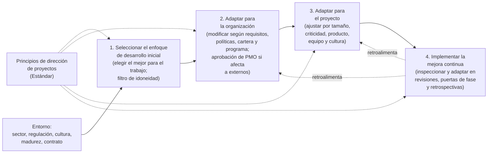
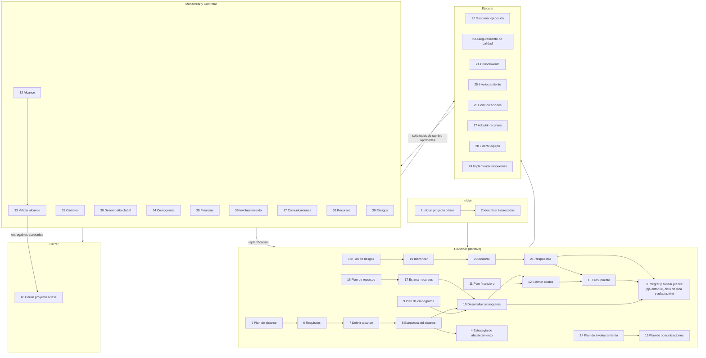

# PMBOK 8: dominios de desempeño, procesos y adaptación

> Archivo de conocimiento de referencia para el skill `pm-knowledge`. Explica **cómo está organizada** la octava edición de la guía (dominios × áreas de enfoque), **qué hace cada uno de los 40 procesos** (propósito, entradas, salidas, herramientas, variante predictiva y adaptativa), **cómo se comprueba** que un dominio funciona (resultados a verificar), **cómo se adapta** cada dominio y el método en su conjunto, y **qué artefacto** debería producir un agente en cada paso usando los nombres de plantilla de los archivos hermanos. Todo está redactado en palabras propias.

---

## 0. Cómo leer este archivo

| Sección | Contenido | Para qué la usa el agente |
|---|---|---|
| 1 | Marco: Guía vs. Estándar; qué cambió en la 8ª edición; qué es un dominio de desempeño y qué es un área de enfoque | Entender la lógica antes de aplicar un proceso |
| 2 | Los siete dominios, uno por subsección: propósito y conceptos, procesos (tablas), métricas de control, adaptación, interacciones, equivalencia PRINCE2 | Ejecutar o revisar la gestión de un proyecto dominio por dominio |
| 3 | Adaptación (tailoring): por qué, qué, el proceso en cuatro pasos, diagnósticos | Decidir cuánto método aplicar a un proyecto concreto |
| 4 | Matriz consolidada: 40 procesos × área de enfoque × dominio | Vista única para planificar la secuencia de trabajo |
| 5 | Reglas operativas para un agente de IA (con el artefacto a producir por proceso) | Comportamiento al generar, revisar o adaptar |
| 6 | Glosario ES/EN | Terminología coherente y bilingüe |
| 7 | Cobertura y límites | Saber qué no cubre este archivo y dónde la extracción es incierta |

Convenciones:

- **ES (EN)**: término en español seguido del inglés en su primera aparición.
- **Área de enfoque**: una de las cinco agrupaciones del ciclo (Iniciar / Planificar / Ejecutar / Monitorear y Controlar / Cerrar). En la 8ª edición no se llaman "grupos de procesos" sino **áreas de enfoque de la dirección de proyectos (Project Management Focus Areas)**; aquí se usan ambas expresiones como sinónimos cuando ayuda a la comprensión.
- **Entradas / Salidas / Herramientas**: la fuente las presenta como **muestras ilustrativas, no exhaustivas ni obligatorias**; todas sus listas terminan en "etcétera". Este archivo recoge las más relevantes y las agrupa; nunca debe leerse como un checklist cerrado.
- **Artefacto Snyder**: nombre del artefacto en los archivos de plantillas hermanos (`plantillas-inicio-y-planes.md`, `plantillas-documentos-registros-reportes.md`). Es un mapeo de este archivo, no de la fuente.
- **PRINCE2**: la equivalencia con prácticas PRINCE2 es una aportación propia para facilitar el método híbrido; la fuente no la incluye.
- **"no determinado en la fuente"**: el material extraído no permite afirmar ese punto; lo que sigue es práctica habitual.

---

## 1. Marco general

### 1.1 Qué es la Guía y cómo se relaciona con el Estándar

La guía (PMBOK Guide) y el estándar para la dirección de proyectos (The Standard for Project Management) son dos piezas complementarias publicadas por el mismo instituto:

| Pieza | Qué aporta | Cómo lo expresa |
|---|---|---|
| **Estándar** | Los **principios** de la dirección de proyectos: normas fundamentales, verdades o valores que orientan la **mentalidad y el comportamiento** de quien dirige y de quien ejecuta | Enunciados de principio (por ejemplo: adoptar una visión holística, centrarse en el valor, integrar la calidad en procesos y entregables, ser líder responsable, construir una cultura empoderada, integrar la sostenibilidad en todas las áreas). También define las cinco áreas de enfoque |
| **Guía** | Las **áreas amplias de trabajo** donde esa mentalidad se demuestra: los dominios de desempeño con sus procesos, entradas, salidas, herramientas y consideraciones de adaptación | Capítulos de dominios, de adaptación, de entradas y salidas, y de herramientas y técnicas |

La relación es jerárquica y no excluyente: los principios **fundamentan** los dominios y dan orientación a cada proceso dentro de ellos. Hay solapamiento conceptual deliberado: el principio dice *cómo pensar y comportarse*; el dominio dice *en qué área de trabajo* se demuestra. Para un agente, la consecuencia práctica es que ningún proceso debe aplicarse de forma mecánica si viola un principio (por ejemplo, producir un cronograma detallado que nadie usa viola el principio de centrarse en el valor).

### 1.2 Estructura de la octava edición

La guía se organiza en una introducción y cuatro bloques:

1. **Dominios de desempeño de la dirección de proyectos (Project Management Performance Domains)**: siete dominios que forman un sistema integrado.
2. **Adaptación (Tailoring)**: qué es, qué se adapta y cómo adaptar un proyecto concreto.
3. **Entradas y salidas (Inputs and Outputs)**: breve descripción alfabética de los activos y artefactos que sirven de entrada o salida a los procesos.
4. **Herramientas y técnicas (Tools and Techniques)**: breve descripción de las técnicas citadas en los procesos.

Los bloques 3 y 4 son catálogos de apoyo; este archivo cubre el 1 y el 2 y solo toma de los catálogos las definiciones imprescindibles para el glosario.

### 1.3 Qué cambió en la octava edición

Lectura propia de la lógica del cambio:

| Aspecto | Ediciones anteriores | Octava edición |
|---|---|---|
| Unidad de organización | Sexta: áreas de conocimiento y grupos de procesos con ITTO (entradas, herramientas y técnicas, salidas). Séptima: principios y dominios de desempeño, sin procesos | **Dominios de desempeño que contienen procesos con ITTO**; se combina el detalle operativo de la sexta con la visión sistémica de la séptima |
| Grupos de procesos | Presentes en la sexta, ausentes en la séptima | **Reintroducidos como "áreas de enfoque"** (Iniciar, Planificar, Ejecutar, Monitorear y Controlar, Cerrar), definidas en el Estándar y usadas en la guía para ubicar cada proceso |
| Dominios | Ocho en la séptima (interesados, equipo, enfoque de desarrollo y ciclo de vida, planificación, trabajo del proyecto, entrega, medición, incertidumbre) | **Siete**, reformulados: Gobernanza, Alcance, Cronograma, Finanzas, Interesados, Recursos, Riesgo. Integración, calidad y medición se absorben en Gobernanza y Alcance; comunicaciones se absorbe en Interesados; adquisiciones pasa a ser una decisión de gobernanza (estrategia de abastecimiento) con un apéndice propio |
| Número de procesos | 49 en la sexta | **40**, declarados como ilustrativos y no prescriptivos |
| Adaptación | Capítulo general en la séptima | Capítulo general **más** una sección de adaptación en **cada** dominio |
| Postura sobre enfoques | Predominio predictivo en la sexta; neutral en la séptima | Neutral con **consideraciones explícitas predictivo / adaptativo / híbrido** en casi todos los procesos |
| Calidad | Área de conocimiento propia en la sexta | Repartida: el **aseguramiento** de calidad (procesos) vive en Gobernanza; el **control** de calidad (entregables) vive en Alcance |

Idea de fondo: la edición quiere ser útil **independientemente del enfoque** de entrega, pero reconoce que un practicante necesita saber *cómo* se hace el trabajo, no solo *qué* resultados buscar. De ahí la vuelta de los procesos.

### 1.4 Qué es un dominio de desempeño

Un **dominio de desempeño (performance domain)** es un conjunto de procesos relacionados que resultan críticos para entregar valor. Propiedades que la guía les atribuye y que condicionan su uso:

- **Interactivos, interrelacionados e interdependientes**: ninguno funciona aislado.
- **Concurrentes**: operan a lo largo de todo el ciclo de vida, sin importar si el valor se entrega al final, periódicamente o de forma continua.
- **Sin ponderación ni orden**: la guía los enumera sin jerarquía (aunque Gobernanza actúa como integrador de los demás).
- **Dependientes del contexto**: la forma en que se relacionan varía con el entorno, pero siempre están presentes.

Cada dominio se presenta con la misma plantilla, que este archivo respeta:

| Subsección en la fuente | Qué contiene | Equivalente en este archivo |
|---|---|---|
| Conceptos clave | Ideas y definiciones que informan cuándo y cómo practicar el dominio | *a. Propósito y conceptos clave* |
| Procesos | Mecánica: nombre, propósito, muestra de ITTO | *b. Procesos del dominio* |
| Consideraciones de adaptación | Qué revisar para ajustar el dominio al proyecto | *d. Adaptación* |
| Interacciones con otros dominios | Solapes y dependencias | *e. Interacciones* |
| Verificación de resultados | Resultados esperados y cómo comprobarlos | *c. Métricas y mecanismos de control* |

### 1.5 Qué es un área de enfoque

Las cinco **áreas de enfoque (focus areas)** son las agrupaciones por momento lógico del trabajo de dirección (no fases del proyecto: un proyecto por fases repite las cinco en cada fase):

| Área de enfoque | Pregunta que responde | Procesos (de los 40) |
|---|---|---|
| Iniciar (Initiating) | ¿Se autoriza esto y para qué? | 2 |
| Planificar (Planning) | ¿Cómo se va a hacer? | 19 |
| Ejecutar (Executing) | ¿Se está haciendo el trabajo y produciendo entregables? | 8 |
| Monitorear y Controlar (Monitoring and Controlling) | ¿Vamos según lo acordado y qué corregimos? | 10 |
| Cerrar (Closing) | ¿Terminamos, transferimos y aprendemos? | 1 |

Observaciones útiles para un agente:

- Solo **Gobernanza** tiene procesos en las cinco áreas; es el único dominio con un proceso de cierre.
- Solo **Gobernanza** e **Interesados** tienen un proceso de inicio.
- **Alcance, Cronograma y Finanzas** no tienen proceso de ejecución propio: su "ejecución" es el proceso de Gobernanza *Gestionar la ejecución del proyecto*.
- La distribución refleja una idea clásica: la mayor parte del esfuerzo intelectual de dirección está en planificar y en controlar.

### 1.6 Visión de conjunto: dominios × áreas de enfoque

| Dominio | Iniciar | Planificar | Ejecutar | Monitorear y Controlar | Cerrar |
|---|---|---|---|---|---|
| Gobernanza | Iniciar proyecto o fase | Integrar y alinear planes; Planificar estrategia de abastecimiento | Gestionar ejecución; Gestionar aseguramiento de calidad; Gestionar conocimiento | Monitorear y controlar desempeño; Evaluar e implementar cambios | Cerrar proyecto o fase |
| Alcance | — | Planificar gestión del alcance; Elicitar y analizar requisitos; Definir alcance; Desarrollar estructura del alcance | — | Monitorear y controlar alcance; Validar alcance | — |
| Cronograma | — | Planificar gestión del cronograma; Desarrollar cronograma | — | Monitorear y controlar cronograma | — |
| Finanzas | — | Planificar gestión financiera; Estimar costos; Desarrollar presupuesto | — | Monitorear y controlar finanzas | — |
| Interesados | Identificar interesados | Planificar involucramiento; Planificar comunicaciones | Gestionar involucramiento; Gestionar comunicaciones | Monitorear involucramiento; Monitorear comunicaciones | — |
| Recursos | — | Planificar gestión de recursos; Estimar recursos | Adquirir recursos; Liderar el equipo | Monitorear y controlar recursos | — |
| Riesgo | — | Planificar gestión de riesgos; Identificar riesgos; Analizar riesgos; Planificar respuestas | Implementar respuestas | Monitorear riesgos | — |

### 1.7 Lógica común a todos los procesos (cómo leer las tablas de la sección 2)

Patrones que se repiten en los 40 procesos y que conviene internalizar para no repetirlos en cada ficha:

- **Entradas casi universales**: el acta de constitución (project charter) en los procesos de planificación; el plan para la dirección del proyecto (project management plan) o alguno de sus componentes; los documentos del proyecto (project documents) pertinentes; los **factores ambientales de la empresa (enterprise environmental factors, EEF)** y los **activos de los procesos de la organización (organizational process assets, OPA)**.
- **Salidas casi universales**: actualizaciones al plan para la dirección del proyecto, actualizaciones a documentos del proyecto, solicitudes de cambio (change requests) y, en los procesos de control, **información de desempeño del trabajo (work performance information)**.
- **Herramientas casi universales**: juicio de expertos, reuniones, recopilación y análisis de datos, habilidades interpersonales y de equipo, sistema de información para la dirección de proyectos (PMIS).
- **Cadena de datos**: *datos* de desempeño del trabajo (brutos, salen de la ejecución) → *información* de desempeño (analizada, sale de los procesos de control) → *informes* de desempeño (comunicables, salen del monitoreo integrado de Gobernanza).
- **Cadena de cambios**: cualquier proceso puede emitir una solicitud de cambio → todas pasan por *Evaluar e implementar cambios* (Gobernanza) → las aprobadas se implementan en *Gestionar la ejecución* y se registran en el registro de cambios (change log).
- **Frecuencia**: la fuente distingue procesos que se hacen "una vez o en puntos predefinidos" (los de planificación y el inicio/cierre), "periódicamente según necesidad" (estimaciones, identificación de interesados, adquisición de recursos) y "a lo largo de todo el proyecto" (los de ejecución y control).

---

## 2. Los siete dominios de desempeño

---

### 2.1 Dominio de Gobernanza (Governance Performance Domain)

#### 2.1.a Propósito y conceptos clave

**Propósito.** La gobernanza es el marco, las funciones y los procesos que orientan las decisiones de dirección para **optimizar la entrega de valor**. Es el dominio **integrador**: absorbe lo que antes se llamaba gestión de la integración (alineación estratégica, toma de decisiones, control de cambios, criterios de éxito), coordina los demás dominios y tiene la autoridad para **cancelar** el proyecto si deja de justificar la inversión. Aplica a cualquier enfoque, con intensidad variable: ligera en adaptativo, moderada o combinada en híbrido, exhaustiva en grandes carteras y proyectos predictivos. Incluye bucles de retroalimentación para revisarse y mejorarse a sí misma.

**Creación de valor como objetivo.** El fin de todo proyecto es generar un valor positivo que justifique el esfuerzo. La gobernanza relaciona cada área de enfoque con ese fin:

| Área de enfoque | Cómo la gobernanza protege el valor |
|---|---|
| Iniciar | Descripción clara del estado final deseado; un caso de negocio articulado alinea prioridades y restricciones |
| Planificar | Toda planificación se hace con las metas en mente; se identifican entregables y actividades que las habilitan |
| Ejecutar | La comprensión compartida de las metas informa decisiones técnicas y motiva al equipo |
| Monitorear y Controlar | El cambio es inevitable; se gobierna para que las adaptaciones sigan creando valor |
| Cerrar | Todo termina: a tiempo, antes (por éxito o por fracaso) o después |

**Escenarios de gobernanza típicos** (cada uno exige una decisión explícita, y el criterio es siempre la propuesta de valor): autorizar un proyecto o fase; replanificar con revisión intencional; expandir o contraer el proyecto (cronograma, presupuesto, umbrales de calidad, cumplimiento) para preservar o capturar valor; **terminar anticipadamente por causa positiva** (el valor ya se logró) o **por causa negativa** (el valor ya no es alcanzable).

**Modelos de gobernanza.** Demasiada gobernanza desperdicia recursos; demasiado poca degrada la alineación estratégica y el desempeño. La guía describe dos polos y un continuo entre ellos:

| Modelo | Quién gobierna | Enfoque típico | Riesgo principal | Mitigación |
|---|---|---|---|---|
| **Estructurado (structured governance)** | Patrocinador ejecutivo, responsable de la PMO, alguna junta de gobernanza, y un director de proyecto que integra los dominios | Predictivo; uno o varios constituyentes internos o externos gobiernan según requisitos organizacionales | Lentitud, burocracia | Umbrales de decisión delegados, indicadores adelantados |
| **Autogobernanza (self-governance)** | El propio equipo; o un grupo de directores de proyecto colectivamente responsable en lugar de un responsable de PMO | Adaptativo; el equipo asegura que se entrega valor | Decisiones fragmentadas, falta de dirección y de rendición de cuentas | Objetivos comunes claros y medibles, indicadores adelantados, mecanismos de retroalimentación |

Puede aplicarse a nivel de organización, cartera, programa o proyecto, y debe diseñarse para el contexto concreto en que se entrega valor.

**Tres componentes de una gobernanza eficaz** (independientes del modelo):

1. **Métricas objetivo** alineadas con las metas estratégicas y que demuestren impacto significativo.
2. **Mecanismos de señalización** (alarmas) sobre esas métricas, idealmente **indicadores adelantados** que digan si el desempeño actual acerca al objetivo.
3. **Mecanismos de retroalimentación** para que quienes deciden evalúen sus decisiones, aprendan y mejoren.

Ejemplos de métricas de buena gobernanza: eficacia de las decisiones de priorización (por ejemplo, retorno de la inversión), calidad de las decisiones para cumplir fechas comprometidas, y si la línea base integrada vigente es realmente la de mayor valor. La guía insiste en que estas son medidas (directas o proxy) de **resultados**, no de **insumos** como la utilización de recursos, el cumplimiento de un estándar o el porcentaje de personas capacitadas.

**Componentes adicionales en entornos predictivos:**

- **Escalamiento (escalation)**: útil en organizaciones jerárquicas donde la autoridad para decidir o para quitar obstáculos persistentes está fuera del equipo.
- **Control de la inversión (investment control)**: exigido donde hay custodia formal de fondos (empresas cotizadas, gobierno, fondos de pensiones); suele incluir evaluación de riesgos y puntos de decisión en los que se confirma si la siguiente ronda de financiación sigue teniendo sentido.

**Conceptos clave del dominio:**

| Concepto | Definición en palabras propias | Uso práctico |
|---|---|---|
| **Indicador adelantado (leading indicator)** | Señal que anticipa un cambio o una tendencia antes de que la desviación cruce el umbral de tolerancia | Preferible siempre que exista; permite actuar sobre la causa raíz y evitar retrabajo. Pueden ser cuantitativos (tamaño del proyecto, elementos en curso en el backlog) o cualitativos (ausencia de proceso de riesgos, interesados no disponibles, criterios de éxito mal definidos) |
| **Indicador rezagado (lagging indicator)** | Medida de entregables o eventos ya ocurridos | Más fácil de medir; sirve para encontrar correlaciones (por ejemplo, variación de cronograma correlacionada con insatisfacción del equipo) que revelan causas no evidentes |
| **Criterios SMART** | Objetivos específicos, medibles, alcanzables, realistas y acotados en el tiempo | Toda métrica de gobernanza y de desempeño debería cumplirlos |
| **Estrategia de abastecimiento (sourcing strategy)** | Decisión de gobernanza sobre qué partes del proyecto se hacen con recursos internos y cuáles se externalizan | Considera impacto en cronograma, alcance, finanzas, capacidad, riesgo. Preguntas guía: ¿la cultura, las habilidades diferenciales y la proximidad favorecen lo interno? ¿la necesidad de habilidades especializadas, suministros, capacidad escalable o variable favorece lo externo? ¿cómo cambia el perfil de riesgo? ¿qué opción beneficia más la propuesta de valor? |
| **Gestión de adquisiciones (procurement management)** | Disciplina complementaria de seleccionar, contratar y supervisar proveedores para el trabajo externalizado | Puede ejecutarla el equipo del proyecto o un departamento de compras; la guía la trata en un apéndice |
| **Disciplinas afines** | Gestión del cambio organizacional, realización de beneficios, gestión del valor, gestión de ingresos | Sus herramientas suelen incorporarse a la gobernanza |

**Decisiones que toma el dominio** (lista propia que resume las elecciones de gobernanza): establecer un marco alineado con la estrategia, las operaciones y la ética; definir roles de decisión, supervisión y control; asegurar comunicación y coordinación entre interesados; monitorear dependencias internas y externas, riesgos, incidentes y escalamientos; evaluar y optimizar el propio marco; equilibrar demandas en competencia; examinar alternativas; adaptar los procesos; gestionar las interdependencias entre dominios; incorporar retroalimentación; y asegurar el cumplimiento legal y regulatorio.

#### 2.1.b Procesos del dominio

Nueve procesos, el dominio más poblado y el único que cubre las cinco áreas de enfoque.

##### 2.1.b.1 Iniciar el proyecto o fase (Initiate Project or Phase)

| Campo | Contenido |
|---|---|
| **Área de enfoque** | Iniciar |
| **Propósito** | Autorizar formalmente el arranque y otorgar al director de proyecto autoridad para aplicar recursos de la organización, mediante un documento (normalmente el acta de constitución) que vincula el proyecto con el caso de negocio y la estrategia. Crea un registro oficial y demuestra el compromiso de la organización |
| **Entradas principales** | Documentos de negocio (caso de negocio, plan de gestión de beneficios); acuerdos (contratos, si hay más de una organización); EEF; OPA |
| **Salidas principales** | Acta de constitución del proyecto (project charter); registro de supuestos (assumption log) |
| **Herramientas y técnicas típicas** | Juicio de expertos; recopilación de datos (tormenta de ideas, grupos focales, entrevistas); habilidades interpersonales (gestión de conflictos, facilitación, gestión de reuniones); reuniones; matriz de asignación de responsabilidades; lienzo del proyecto (project canvas) |
| **Frecuencia** | Una vez, o en puntos definidos del ciclo (por fase) según el enfoque |
| **Predictivo** | Acta formal; identifica y asigna al director de proyecto lo antes posible, idealmente durante la redacción del acta y siempre antes de planificar. En proyectos entre varias organizaciones, el contrato regula la relación externa y el acta crea el compromiso interno para cumplirlo |
| **Adaptativo** | Acta más ligera: desde una hoja de trabajo mínima o una declaración de visión hasta un documento moderado. Responde a un subconjunto de: por qué, quiénes, qué, dónde, cuándo, cómo, quién es el cliente. Da "estructura suficiente" y admite que requisitos y prioridades evolucionen |
| **Reglas** | El acta la redacta el patrocinador o el director en colaboración con la entidad que inicia; el caso de negocio aprobado justifica el porqué y el valor esperado. El acta forma una alianza entre la organización solicitante y la ejecutora |
| **Artefacto Snyder** | Acta de constitución (Project Charter); en adaptativo, Declaración de visión (Project Vision Statement) o Lienzo de arranque (Project Startup Canvas); Registro de supuestos (Assumption Log). Entradas: Caso de negocio (Business Case), Propuesta de proyecto (Project Proposal) |

##### 2.1.b.2 Integrar y alinear los planes del proyecto (Integrate and Align Project Plans)

| Campo | Contenido |
|---|---|
| **Área de enfoque** | Planificar |
| **Propósito** | Consolidar y alinear todos los componentes de plan de los dominios en un plan para la dirección del proyecto único que define cómo se ejecutará, monitoreará, controlará y cerrará |
| **Entradas principales** | Acta de constitución; salidas de los demás procesos de planificación (planes subsidiarios y líneas base); EEF; OPA |
| **Salidas principales** | Plan para la dirección del proyecto (project management plan) |
| **Herramientas y técnicas típicas** | Juicio de expertos; recopilación de datos (tormenta de ideas, listas de verificación, grupos focales, entrevistas); habilidades interpersonales; reuniones; lienzo del proyecto |
| **Frecuencia** | Una vez o en intervalos definidos; con elaboración progresiva |
| **Predictivo** | Plan detallado con todas las líneas base integradas y verificada su alineación; incluye planes auxiliares como el de gestión de cambios o el de gestión de la configuración |
| **Adaptativo** | Plan de alto nivel; el documento puede llamarse plan de gobernanza, de ejecución, de desarrollo o de implementación; lo esencial es que defina de forma transparente el marco de decisión |
| **Reglas** | Al inicio, este proceso fija las **consideraciones de adaptación**, el **enfoque de desarrollo** y el **ciclo de vida**, que son entrada para la planificación de todos los demás dominios. El tiempo de planificación lo dictan las circunstancias: suficiente para avanzar, no más detallado de lo necesario. La salida debe comunicarse a los interesados clave |
| **Artefacto Snyder** | Plan para la dirección del proyecto (Project Management Plan), que integra los trece planes de `plantillas-inicio-y-planes.md`; Hoja de ruta (Project Roadmap) en adaptativo |

##### 2.1.b.3 Planificar la estrategia de abastecimiento (Plan Sourcing Strategy)

| Campo | Contenido |
|---|---|
| **Área de enfoque** | Planificar |
| **Propósito** | Documentar las decisiones de abastecimiento: qué se hace dentro y qué se compra fuera, cómo se seleccionarán las fuentes, qué alcance de trabajo se externaliza y qué tipos de contrato se usarán. Establece qué adquirir, cómo y cuándo |
| **Entradas principales** | Acta; plan para la dirección (planes de alcance, calidad, cronograma, finanzas, recursos; línea base del alcance); documentos (lista de hitos, documentación de requisitos, matriz de trazabilidad, métricas de calidad, requisitos de recursos, asignaciones del equipo, registro de riesgos, registro de interesados); EEF; OPA |
| **Salidas principales** | Plan de estrategia de abastecimiento (sourcing strategy plan): decisiones hacer-o-comprar y criterios de selección de fuentes |
| **Herramientas y técnicas típicas** | Juicio de expertos; investigación de mercado; análisis hacer-o-comprar (make-or-buy); análisis de selección de fuentes; análisis de documentos |
| **Frecuencia** | En planificación; se revisa si cambian las condiciones (la fuente menciona actualizar la estrategia de abastecimiento dentro del monitoreo integrado) |
| **Aplicabilidad** | Solo cuando el proyecto necesita fuentes externas |
| **Ventajas de hacer internamente** (síntesis propia) | Aprovecha experiencia interna disponible; suele ser más barato cuando se requiere innovación sustancial; integra mejor con la ventaja estratégica; más control sobre los entregables |
| **Ventajas de comprar** | Aprovecha experiencia que falta dentro; suele ser más barato para bienes o servicios comunes; libera capacidad y capital para las fortalezas propias; transfiere riesgo de entrega al proveedor; mantiene relaciones con proveedores |
| **Criterios de selección típicos** | Costo, capacidad técnica, desempeño pasado, solidez financiera, cumplimiento de requisitos, alineación con valores o metas de sostenibilidad. Criterios claros dan transparencia y consistencia |
| **Tipos de contrato** | Deben ser coherentes con el enfoque de abastecimiento y considerar complejidad, desempeño de la fuente y exposición al riesgo; el plan incluye cómo gestionar la relación, los riesgos y la comunicación con los proveedores |
| **Participantes** | Equipo del proyecto, compras y área legal; sus responsabilidades se documentan en el plan |
| **Diferencia con Planificar la gestión de recursos** | Este proceso trata de externalizar **trabajo y entregables**; el de Recursos trata de obtener **personas y medios** para el trabajo propio |
| **Artefacto Snyder** | Estrategia de adquisiciones (Procurement Strategy); Criterios de selección de proveedores (Source Selection Criteria); Plan de gestión de las adquisiciones (Procurement Management Plan) |

##### 2.1.b.4 Gestionar la ejecución del proyecto (Manage Project Execution)

| Campo | Contenido |
|---|---|
| **Área de enfoque** | Ejecutar |
| **Propósito** | Liderar y realizar el trabajo definido en el plan e implementar los cambios aprobados para producir los entregables. Alinea el conocimiento de todo el equipo (que supera al de cualquier individuo) hacia los objetivos |
| **Entradas principales** | Plan para la dirección (cualquier componente); documentos (registro de cambios, registro de lecciones, lista de hitos, comunicaciones, cronograma, matriz de trazabilidad, registro de riesgos, informe de riesgos); solicitudes de cambio aprobadas; EEF; OPA |
| **Salidas principales** | Entregables (deliverables); datos de desempeño del trabajo (work performance data); registro de incidentes (issue log); solicitudes de cambio; actualizaciones al plan y a documentos (lista de actividades, supuestos, lecciones, requisitos, riesgos, interesados); actualizaciones a OPA |
| **Herramientas y técnicas típicas** | Juicio de expertos; PMIS; reuniones (en particular reuniones diarias de coordinación) |
| **Frecuencia** | Durante toda la ejecución |
| **Reglas** | Incluye asignar recursos, gestionar su uso eficiente y ajustar planes a partir del análisis de datos de desempeño. Implementa acciones correctivas, preventivas y reparación de defectos. Los datos de desempeño alimentan los procesos de control y las lecciones aprendidas |
| **Calidad en la ejecución** | Dos frentes: (1) calidad del **proceso** de dirección, que es aseguramiento (proceso siguiente); (2) calidad de los **entregables**, que se trata en Alcance (control). En este punto, la calidad consiste en producir según los requisitos de la línea base del alcance |
| **Adaptativo** | La "línea base del alcance" equivale a los requisitos priorizados o al backlog del sprint |
| **Artefacto Snyder** | Registro de incidentes (Issue Log); Reporte de avance del miembro del equipo (Team Member Progress Report); actualizaciones al Registro de cambios (Change Log) y al Registro de lecciones aprendidas (Lessons Learned Register) |

##### 2.1.b.5 Gestionar el aseguramiento de la calidad (Manage Quality Assurance)

| Campo | Contenido |
|---|---|
| **Área de enfoque** | Ejecutar |
| **Propósito** | Asegurar que los **procesos** se ejecutan de forma coherente con las expectativas de los interesados, traduciendo el plan en actividades que incorporan estándares, regulaciones y políticas. Aumenta la probabilidad de cumplir objetivos y detecta procesos ineficaces y causas de mal desempeño |
| **Entradas principales** | Plan para la dirección (en especial el plan de gestión de la calidad); documentos (todos los pertinentes); OPA (políticas, procedimientos, regulaciones) |
| **Salidas principales** | Informes de calidad (quality reports); solicitudes de cambio; actualizaciones al plan y a documentos |
| **Herramientas y técnicas típicas** | Auditorías; listas de verificación; representación de datos (diagramas de afinidad, causa-efecto, diagramas de flujo); toma de decisiones; resolución de problemas; mejora de procesos; análisis de fallos |
| **Frecuencia** | Durante todo el proyecto |
| **Aseguramiento vs. control** | **Aseguramiento**: usar bien los procesos; cumplir estándares para dar confianza en que el resultado final satisfará necesidades; conceptos asociados: regulación, cumplimiento, auditoría. **Control**: crear entregables que cumplan especificaciones y umbrales; conceptos asociados: diseño de producto, pruebas, defectos. El control vive en el dominio de Alcance |
| **Qué logra** | Confianza en que una salida futura cumplirá requisitos; procesos más eficientes y eficaces; mejor gobernanza |
| **Predictivo** | Formal, con la expectativa de que un proceso robusto minimiza variaciones en un proyecto estable |
| **Adaptativo** | Formal o informal según contexto |
| **Quién** | El equipo de dirección, una entidad externa, o ambos |
| **Artefacto Snyder** | Auditoría de calidad (Quality Audit); Plan de gestión de la calidad (Quality Management Plan) como entrada |

##### 2.1.b.6 Gestionar el conocimiento del proyecto (Manage Project Knowledge)

| Campo | Contenido |
|---|---|
| **Área de enfoque** | Ejecutar |
| **Propósito** | Usar el conocimiento existente y crear nuevo para alcanzar los objetivos y contribuir al aprendizaje organizacional. Beneficios: reutilizar conocimiento previo para mejorar el resultado, y capturar el conocimiento creado para operaciones y proyectos futuros |
| **Entradas principales** | Plan para la dirección (todos los componentes); documentos (registro de lecciones, asignaciones del equipo, estructura de desglose de recursos, registro de interesados); entregables; EEF; OPA |
| **Salidas principales** | Registro de lecciones aprendidas (lessons learned register); actualizaciones al plan; actualizaciones a OPA |
| **Herramientas y técnicas típicas** | Juicio de expertos; gestión del conocimiento; gestión de la información; revisiones posteriores a la acción (after-action reviews); post mortem en curso; narración (storytelling); retrospectivas; habilidades interpersonales (escucha activa, facilitación, liderazgo, redes, conciencia política) |
| **Frecuencia** | Durante todo el proyecto, no solo al final |
| **Conocimiento explícito** | Formal y sistemático; codificable en palabras, imágenes o números; fácil de comunicar (manuales, procedimientos, bases de datos, registros). Limitación: carece de contexto y admite interpretaciones distintas |
| **Conocimiento tácito** | Personal, incorporado en la mente de la persona; experiencias, intuición, habilidades prácticas; difícil de articular y transferir. Se comparte con conversación, mentoría, confianza, trabajo cara a cara, sesiones de tormenta de ideas. Objetivo: convertirlo en explícito cuando sea posible |
| **Uso de IA** | Herramientas como bots de entrevista ayudan a capturar ambos tipos; la IA es una fuente de conocimiento relevante pero con riesgos (exposición de información sensible, alucinaciones). El proyecto debe tener **políticas de IA responsable** |
| **Reglas** | Definir desde el inicio cómo y cuándo se harán lecciones aprendidas y retrospectivas, qué información se recoge durante y al cierre, y cómo se pondrá a disposición la información histórica |
| **Artefacto Snyder** | Registro de lecciones aprendidas (Lessons Learned Register); Retrospectiva (Retrospective); Reporte de lecciones aprendidas (Lessons Learned Report) al cierre |

##### 2.1.b.7 Monitorear y controlar el desempeño del proyecto (Monitor and Control Project Performance)

| Campo | Contenido |
|---|---|
| **Área de enfoque** | Monitorear y Controlar |
| **Propósito** | Seguir, revisar e informar el avance global frente a los objetivos del plan; permite a los interesados conocer el estado actual, las acciones tomadas y los pronósticos de costo y cronograma. Evalúa si alguna decisión podría mejorar la propuesta de valor; si implica cambiar una línea base, pasa por control integrado de cambios |
| **Entradas principales** | Plan para la dirección (cualquier componente); documentos (supuestos, bases de estimación, pronósticos de costo, registro de incidentes, lecciones, hitos, informes de calidad, registro e informe de riesgos, pronósticos de cronograma); información de desempeño del trabajo; acuerdos; EEF; OPA |
| **Salidas principales** | Informes de desempeño del trabajo (work performance reports); solicitudes de cambio; actualizaciones al plan; actualizaciones a documentos (pronósticos de costo y cronograma, incidentes, lecciones, riesgos) |
| **Herramientas y técnicas típicas** | Juicio de expertos; análisis de datos (alternativas, costo-beneficio, valor ganado, causa raíz, tendencias, variaciones); toma de decisiones (votación); reuniones; tableros de proyecto (dashboards); controles visuales; radiadores de información |
| **Frecuencia** | Continuo |
| **Monitorear vs. controlar** | Monitorear: recoger, medir y evaluar datos y tendencias para mantener la salud del proyecto y detectar áreas que requieren atención. Controlar: decidir acciones correctivas o preventivas, replanificar y hacer seguimiento hasta resolver |
| **Qué abarca** | Comparar desempeño con el plan; seguir uso de recursos, trabajo completado y presupuesto gastado; demostrar rendición de cuentas; informar a interesados; evaluar si los entregables van camino de producir los beneficios; conversar sobre compensaciones, amenazas, oportunidades y opciones; revisar riesgos y respuestas; asegurar que los entregables cumplirán criterios de aceptación; actualizar la estrategia de abastecimiento |
| **Medición** | Medir cuesta tiempo que podría ir a trabajo productivo: medir **solo lo relevante** y asegurar que las métricas son **accionables** y SMART. Combinar indicadores adelantados y rezagados |
| **Artefacto Snyder** | Reporte de estado del proyecto (Project Status Report); Reporte de análisis de variaciones (Variance Analysis Report); Análisis de valor ganado (Earned Value Analysis); Registro de decisiones (Decision Log) |

**Trampas de la medición** (síntesis propia de las que la fuente advierte):

| Trampa | Qué ocurre | Cómo la evita el agente |
|---|---|---|
| Efecto Hawthorne | Medir algo cambia el comportamiento; medir solo volumen de entregables empuja a producir muchos entregables, no los más valiosos | Elegir métricas de resultado, no de volumen |
| Métrica de vanidad | Muestra datos pero no informa decisiones (visitas a una web vs. nuevos usuarios) | Preguntar qué decisión cambia con la métrica |
| Desmoralización | Metas inalcanzables hunden la moral; las metas ambiciosas son válidas si se reconoce el esfuerzo | Validar factibilidad con el equipo |
| Mal uso | Centrarse en métricas poco importantes, optimizar el corto plazo, hacer actividades fáciles fuera de secuencia para inflar indicadores | Revisar la secuencia lógica y el balance corto/largo plazo |
| Sesgo de confirmación | Ver solo los datos que confirman la opinión previa | Buscar activamente evidencia contraria |
| Correlación vs. causalidad | Inferir que el retraso causa el sobrecosto cuando ambos pueden deberse a mala estimación, mala gestión del cambio o riesgos no gestionados | Explorar causas raíz alternativas antes de concluir |

##### 2.1.b.8 Evaluar e implementar cambios (Assess and Implement Changes)

| Campo | Contenido |
|---|---|
| **Área de enfoque** | Monitorear y Controlar |
| **Propósito** | Gestionar los cambios que afectan alcance del proyecto o del producto, componentes del plan y documentos, ajustando los planes según las recomendaciones de los interesados, desde el inicio hasta el final |
| **Entradas principales** | Plan para la dirección (plan de gestión de cambios, plan de gestión de la configuración, líneas base de alcance, cronograma y costo); documentos (bases de estimación, registro de cambios, matriz de trazabilidad, informe de riesgos); informes de desempeño del trabajo; solicitudes de cambio; EEF; OPA |
| **Salidas principales** | Solicitudes de cambio aprobadas (approved change requests); actualizaciones al plan; actualizaciones a documentos (registro de cambios) |
| **Herramientas y técnicas típicas** | Juicio de expertos; herramientas de control de cambios; análisis de datos (alternativas, costo-beneficio); toma de decisiones (votación, decisión autocrática, análisis multicriterio); reuniones; control integrado de cambios; gestión del backlog |
| **Frecuencia** | Todo el ciclo |
| **Quién puede proponer** | Cualquier interesado, en cualquier momento |
| **Grado de formalidad** | Depende del alcance, la complejidad, los requisitos contractuales y el enfoque de desarrollo |
| **Artefacto Snyder** | Solicitud de cambio (Change Request); Registro de cambios (Change Log); Plan de gestión de cambios (Change Management Plan) |

**Flujo predictivo (en palabras propias):**

1. Antes de que existan líneas base no hay control formal; **una vez establecida la línea base, todo cambio pasa por el proceso formal**.
2. El plan de gestión de la configuración define qué artefactos están bajo control de configuración; cambiarlos exige solicitud formal.
3. La solicitud puede nacer verbal pero **debe documentarse por escrito** y entrar al sistema de cambios; normalmente debe incluir impacto estimado en cronograma y costo antes de aprobarse.
4. Si afecta una línea base, se aplica control integrado de cambios: análisis de impacto sobre alcance, cronograma, finanzas, recursos, interesados y riesgo.
5. Una persona designada (patrocinador, director de proyecto) o una **junta de control de cambios (change control board, CCB)**, también llamada junta de proyecto, decide: **aprobar, rechazar, diferir o pedir más información**; documenta y comunica la decisión.
6. Mientras se espera la decisión, el equipo sigue ejecutando lo planificado y analiza el impacto y los riesgos de aceptar o rechazar.
7. Lo aprobado puede exigir nuevas estimaciones de costo, ajustes de cronograma, requisitos de recursos y evaluaciones de riesgo; puede requerir aprobación adicional del cliente o patrocinador si no están en la CCB.
8. Los resultados del cambio se monitorean para confirmar que produjeron el efecto deseado.

Tipos de solicitud: acción correctiva, acción preventiva, reparación de defecto, actualización.

**Flujo adaptativo:** no hay solicitudes formales sino **gestión del backlog**. Una propuesta de cambio se registra como elemento del backlog; se hace análisis de impacto para fijar su prioridad. No hay "aprobación" explícita: todo puede entrar al backlog; **asignar baja prioridad equivale a diferir**; **no incluirlo o retirarlo equivale a rechazar**.

##### 2.1.b.9 Cerrar el proyecto o fase (Close Project or Phase)

| Campo | Contenido |
|---|---|
| **Área de enfoque** | Cerrar |
| **Propósito** | Finalizar todas las actividades de un proyecto, fase, release, iteración o contrato, con éxito o sin él: archivar información, completar el trabajo planificado, liberar recursos y **confirmar hasta qué punto se logró el valor o la capacidad de generarlo** |
| **Entradas principales** | Acta; plan para la dirección (todos los componentes); documentos (supuestos, bases de estimación, registro de cambios, incidentes, lecciones, hitos, comunicaciones, mediciones de control de calidad, informes de calidad, requisitos, registro e informe de riesgos); entregables aceptados; documentos de negocio (caso de negocio, plan de beneficios); acuerdos; documentación de adquisiciones; OPA |
| **Salidas principales** | Transición del producto, servicio o resultado final; informe final (final report); actualizaciones a documentos (lecciones aprendidas); actualizaciones a OPA |
| **Herramientas y técnicas típicas** | Juicio de expertos; análisis de datos (documentos, regresión, tendencias, variaciones); reuniones |
| **Artefacto Snyder** | Reporte de cierre del proyecto (Project Closeout Report); Reporte de cierre de contrato (Contract Closeout Report); Reporte de lecciones aprendidas (Lessons Learned Report); Auditoría de adquisiciones (Procurement Audit) |

**Cierre predictivo (síntesis propia en tres bloques):**

| Bloque | Actividades |
|---|---|
| Criterios de salida | Documentos y entregables actualizados e incidentes resueltos; valor medible entregado y plan para sostenerlo en operaciones; entregables formalmente aceptados por el cliente; todos los costos cargados; cuentas cerradas; personal reasignado o liberado; excedentes de materiales gestionados; instalaciones y equipos liberados; informes finales según política |
| Cierre contractual | Aceptación formal del trabajo del proveedor; reclamaciones, garantías y avales finalizados; registros actualizados; facturas pagadas; archivo; disputas resueltas o derivadas |
| Actividades adicionales | Recoger y auditar registros; evaluar éxito o fracaso; transferir conocimiento; documentar lecciones; archivar; transferir el producto a la siguiente fase o a operaciones; proponer mejoras a políticas organizacionales; medir satisfacción de interesados; verificar cumplimiento de obligaciones contractuales, regulatorias, legales, sociales y ambientales; identificar riesgos pendientes para aceptar o transferir a operaciones; si hubo terminación anticipada, investigar y documentar las razones |

**Cierre adaptativo (release o iteración):** confirmar que los elementos priorizados del backlog están terminados y cumplen criterios de aceptación; que los entregables fueron revisados y aceptados; revisión final sin incidentes abiertos; sesiones de transferencia de conocimiento; retrospectiva con lecciones y mejoras; discusión de riesgos pendientes a aceptar o transferir a iteraciones siguientes, al cliente o a operaciones.

#### 2.1.c Métricas y mecanismos de control (resultados a verificar)

| Resultado esperado | Cómo se comprueba (en palabras propias) |
|---|---|
| Nivel de supervisión adecuado por parte del liderazgo y de terceros | El equipo sabe que existen procesos, protocolos o acuerdos de equipo acordados; están documentados en la medida necesaria y alineados con políticas, estándares y procedimientos de la organización |
| Procesos de gobernanza vigentes, eficaces y en mejora continua | El equipo conoce y actúa según la estructura de gobernanza (interna, de auditoría/cumplimiento y del cliente); integra la gobernanza de terceros en la propia; en predictivo usa auditorías de cumplimiento o listas de verificación contra estándares; se respetan cajas de tiempo y reuniones |
| Mecanismos de señalización ligados a los resultados objetivo | El equipo seleccionó y usa uno o más mecanismos alineados con la forma en que el proyecto maximiza su valor |
| Lecciones aprendidas y retrospectivas gestionadas durante todo el proyecto | El conocimiento del proyecto y de la organización se combinan para gestionar entregables y valor; las lecciones se incorporan **durante** el proyecto, no solo al final |
| Dirección informada | Hay métricas definidas y seguidas regularmente sobre: estado operativo y avance; recursos previstos e incurridos; riesgos conocidos, respuestas y criterios de escalamiento; supuestos estratégicos y operativos; beneficios realizados; criterios de decisión y su comunicación; control de cambios; cumplimiento de políticas corporativas y legales; gestión de información y comunicaciones; incidentes y sus planes; financiación y desempeño financiero |

Métricas numéricas sugeridas por la fuente para la gobernanza: retorno de la inversión (ROI) como medida de la calidad de la priorización; indicadores de cumplimiento de fechas; indicador de si la línea base integrada vigente es la de mayor valor.

#### 2.1.d Consideraciones de adaptación

- La gobernanza se adapta al sector, la regulación, la organización y el contexto del proyecto; **la adaptación se decide normalmente en Iniciar el proyecto o fase** y puede revisarse de forma iterativa.
- El resultado de la adaptación se registra en el plan para la dirección, en otro documento o en un sistema de registro.
- En predictivo o híbrido, suele gobernar un director de proyecto senior o, en organizaciones grandes, un gestor de cartera, de programa o la PMO.
- **Gobernanza organizacional**: identificar juntas, comités e interesados que participan; definir requisitos de reporte de estado; decidir si participa la PMO; decidir si habrá junta de gobernanza.
- **Autogobernanza guiada**: los equipos adaptativos deciden con autonomía dentro de límites y barandillas claras; las reuniones diarias de coordinación son un mecanismo de autogobernanza; requiere comodidad con la incertidumbre y decisión colaborativa.
- **Adaptación al ciclo de vida**: "justo lo suficiente" en procesos, métodos, plantillas y artefactos; en lean/ágil la gobernanza puede residir solo en los artefactos y eventos del equipo; en predictivo las restricciones internas y externas suelen exigir más. Factores: entorno de negocio, regulación, necesidad de innovación, mercado, tamaño del equipo, incertidumbre, complejidad. Donde hay gobernanza de procesos establecida, la adaptación debe alinearse con la política.

Ejemplos de la fuente, reformulados: (1) con o sin PMO, el director debe centrar la gobernanza en el valor: en una organización pequeña decide con otros líderes; con PMO, se asocia a ella y a otros gestores; (2) un proyecto que exige innovación rápida puede adoptar autogobernanza total sin órgano externo; (3) un proyecto multinacional con múltiples regulaciones necesita gobernanza integrada entre dominios y, para variaciones regionales, gobernanza a nivel de programa o cartera.

#### 2.1.e Interacciones con otros dominios

| Dominio | Naturaleza de la interacción |
|---|---|
| Alcance | La más importante: el valor reside en el alcance; las decisiones de gobernanza sobre el alcance (formales o informales) son pivotales |
| Cronograma | La propuesta de valor suele ser sensible al tiempo; buena gobernanza acelera, mala gobernanza frena |
| Finanzas | Todo proyecto es una inversión sensible al monto invertido; sobrecostos y subejecuciones son asuntos de gobernanza |
| Interesados | Asegura que cada uno participe en el momento adecuado para dar insumos, consejo o trabajo |
| Recursos | Asignar los recursos correctos a las prioridades correctas en el momento correcto, también a nivel organizacional |
| Riesgo | Mitigar amenazas y capturar oportunidades debe alinearse con la estrategia y gestionarse bajo gobernanza clara para optimizar el retorno ajustado a riesgo; una mitigación costosa puede valer la pena si mejora seguridad, cumplimiento o confianza |

#### 2.1.f Equivalencia con PRINCE2 (mapeo propio)

| Elemento PMBOK 8 | Práctica / elemento PRINCE2 más cercano | Comentario |
|---|---|---|
| Dominio de Gobernanza en conjunto | Práctica **Organización (Organizing)** + proceso **Dirigir un proyecto (Directing a Project)** + principio *justificación comercial continua* | PRINCE2 separa el *nivel de dirección* (junta de proyecto) del *nivel de gestión* (director de proyecto); PMBOK los engloba en el modelo de gobernanza |
| Iniciar el proyecto o fase | Procesos **Pre-proyecto / Puesta en marcha (Starting Up)** e **Iniciar un proyecto (Initiating)**; producto *Project Brief* y *PID* | El acta de PMBOK es más ligera que el PID; se parece más al Project Brief |
| Integrar y alinear planes | Documento de inicio del proyecto (**PID**) y práctica **Planes (Plans)** | El PID es el plan integrado de PRINCE2 |
| Planificar estrategia de abastecimiento | Enfoque de gestión comercial (**Commercial Management Approach**) en PRINCE2 7 | PRINCE2 trata al proveedor como rol de la junta de proyecto |
| Gestionar ejecución | Procesos **Controlar una fase (Controlling a Stage)** y **Gestionar la entrega de productos (Managing Product Delivery)**; paquetes de trabajo | |
| Aseguramiento de calidad | Práctica **Calidad (Quality)** y rol de **aseguramiento del proyecto (Project Assurance)** | PRINCE2 distingue aseguramiento del proyecto (de la junta) de aseguramiento de calidad (corporativo) |
| Gestionar conocimiento | **Registro de lecciones (Lessons Log)** e **informe de lecciones**; principio *aprender de la experiencia* | |
| Monitorear y controlar desempeño | Práctica **Progreso (Progress)**: tolerancias, informes de punto de control, informes de desarrollo (highlight reports), excepciones | PRINCE2 añade la *gestión por excepción* con tolerancias por nivel |
| Evaluar e implementar cambios | Práctica **Incidencias (Issues)**: solicitudes de cambio, fuera de especificación, problemas; **autoridad de cambio** y **presupuesto de cambio** | La CCB equivale a la autoridad de cambio delegada por la junta |
| Cerrar proyecto o fase | Proceso **Cerrar un proyecto (Closing a Project)** y **Gestionar un límite de fase (Managing a Stage Boundary)** | PRINCE2 formaliza más el cierre de fase con plan de la siguiente fase y caso de negocio actualizado |
| Terminación anticipada | Cierre prematuro en Cerrar un proyecto; principio de justificación comercial continua | Ambos marcos legitiman cancelar cuando el valor desaparece |

---

### 2.2 Dominio de Alcance (Scope Performance Domain)

#### 2.2.a Propósito y conceptos clave

**Propósito.** El alcance ocupa el lugar central porque **el valor del proyecto deriva del resultado entregado conforme a su alcance**. El dominio asegura que el proyecto incluya **todo el trabajo necesario y solo el necesario**, evitando trabajo que no añade valor, lo que optimiza costo y plazo. En la 8ª edición el dominio también absorbe la **calidad del producto**: los entregables deben cumplir los criterios de aceptación, y los procesos que los producen deben ser eficaces y eficientes, con mejora continua.

**Conceptos clave:**

| Concepto | Definición en palabras propias | Notas de uso |
|---|---|---|
| **Caso de negocio (business case)** | Estudio documentado de viabilidad económica que establece la validez de los beneficios; indica costos, beneficios, cómo se creará valor y los criterios de éxito | Punto de partida de todo proyecto; se referencia también al cierre |
| **Alcance del proyecto (project scope)** | El trabajo realizado para entregar el producto, servicio o resultado con las características especificadas | Encapsula el valor esperado; componente más importante de la línea base. Debe generar un valor que valga el tiempo y los recursos invertidos y, idealmente, maximizarlo |
| **Alcance del producto (product scope)** | Descripción de las características, funciones y atributos del resultado: qué debe ser y qué debe hacer, incluidas sus especificaciones de calidad y desempeño | Se centra en los entregables, no en el trabajo |
| **Requisito (requirement)** | Condición o capacidad que debe estar presente en el resultado para satisfacer una necesidad de negocio | En adaptativo se expresan como historias de usuario priorizadas en un backlog |
| **Línea base del alcance (scope baseline)** | Predictivo: versión aprobada de los documentos formales de alcance (enunciado del alcance + EDT + diccionario de la EDT), modificable solo por control formal de cambios y usada como referencia de comparación. Forma parte de la **línea base para la medición del desempeño (performance measurement baseline, PMB)** junto con las líneas base de cronograma y de costo | Adaptativo: la "línea base" se define al inicio de cada iteración, alineada con los requisitos priorizados por valor esperado; un propietario de producto aprueba cambios de forma dinámica, sin procedimiento formal |
| **Estructura de desglose del trabajo (work breakdown structure, WBS / EDT)** | En predictivo o híbrido, descomposición jerárquica de todo el alcance del trabajo en componentes manejables (paquetes de trabajo) para lograr los objetivos y crear los entregables | Facilita asignar, seguir y medir; da propiedad y responsabilidad por entregable |
| **Diccionario de la EDT (WBS dictionary)** | Detalle de cada componente de la EDT: descripción del alcance, hitos, responsables, recursos, criterios de aceptación | Recomendable en proyectos con entregables complejos o interdependientes |
| **Calidad como característica (quality as a feature)** | La calidad es un atributo integral del alcance e incluye requisitos funcionales y no funcionales (robustez, durabilidad, mantenibilidad) | Se somete a las mismas compensaciones costo/plazo que cualquier elemento del alcance, buscando el mayor valor de vida útil por unidad de inversión |
| **Estructura de desglose del valor (value breakdown structure, VBS)** | Jerarquía que conecta el alcance del proyecto y su valor previsto con el alcance del producto que lo genera. Nivel superior: entregables mayores acordados con los interesados, cada uno con su valor estimado (en unidades de valor o como porcentaje del total; 100 % si es obligatorio). Cada elemento se descompone en subentregables y, mediante la EDT, en trabajo y actividades | Permite priorizar entregables y estimar el **costo de arrastre (drag cost)** de cada elemento de la ruta crítica |
| **Backlog del producto (product backlog)** | Lista dinámica y priorizada de elementos de trabajo y características | Marco adaptativo para gestionar alcance por valor, con repriorización continua |
| **Definición de terminado (definition of done, DoD)** | Lista de criterios que debe cumplir un entregable para considerarse listo para uso del cliente; en adaptativo, comprensión compartida de cuándo una historia, característica o incremento está completo y listo para liberar | Equivalente adaptativo de los criterios de aceptación |

#### 2.2.b Procesos del dominio

Seis procesos: cuatro de planificación y dos de control. No hay proceso de ejecución propio.

##### 2.2.b.1 Planificar la gestión del alcance (Plan Scope Management)

| Campo | Contenido |
|---|---|
| **Área de enfoque** | Planificar |
| **Propósito** | Crear el plan de gestión del alcance que documenta cómo se definirá, validará y controlará el alcance del proyecto y del producto; establece todo el trabajo requerido y elimina el que no añade valor |
| **Entradas principales** | Acta; plan para la dirección; documentos (documentación de requisitos, registro de riesgos, registro de interesados); EEF; OPA |
| **Salidas principales** | Plan de gestión del alcance (scope management plan); plan de gestión de requisitos (requirements management plan) |
| **Herramientas y técnicas típicas** | Juicio de expertos; recopilación de datos (entrevistas, grupos focales, cuestionarios y encuestas); análisis de datos; planificación de pruebas e inspección |
| **Frecuencia** | Una vez o en puntos definidos |
| **Predictivo vs. adaptativo** | El objetivo (entregar valor) es el mismo; en adaptativo el proceso es más iterativo y colaborativo. El plan debe seguir el ciclo de vida elegido |
| **Artefacto Snyder** | Plan de gestión del alcance (Scope Management Plan); Plan de gestión de requisitos (Requirements Management Plan); Plan de gestión de la calidad (Quality Management Plan) si se combina (ver combinación 41 del archivo de plantillas) |

##### 2.2.b.2 Elicitar y analizar requisitos (Elicit and Analyze Requirements)

| Campo | Contenido |
|---|---|
| **Área de enfoque** | Planificar |
| **Propósito** | Determinar, documentar y gestionar las necesidades y requisitos de los interesados sobre características y funciones, para asegurar calidad y valor. Da dirección y punto de partida para definir el producto |
| **Entradas principales** | Acta; acuerdos; caso de negocio; documentos (registro de supuestos, registro de lecciones, registro de interesados); plan para la dirección (plan de gestión de requisitos, plan de gestión del alcance); EEF; OPA |
| **Salidas principales** | Documentación de requisitos (requirements documentation) |
| **Herramientas y técnicas típicas** | Juicio de expertos; toma de decisiones; recopilación de datos (benchmarking, tormenta de ideas, grupos focales, entrevistas, cuestionarios); análisis de datos (análisis de documentos); representación de datos; habilidades interpersonales (técnica de grupo nominal); pensamiento de diseño (design thinking); priorización y ranking; reuniones |
| **Predictivo** | Requisitos documentados de forma exhaustiva al inicio; trazabilidad |
| **Adaptativo** | Requisitos capturados como **historias de usuario** y priorizados en un backlog |
| **Artefacto Snyder** | Documentación de requisitos (Requirements Documentation); Matriz de trazabilidad de requisitos (Requirements Traceability Matrix); Historia de usuario (User Story); Backlog |

##### 2.2.b.3 Definir el alcance (Define Scope)

| Campo | Contenido |
|---|---|
| **Área de enfoque** | Planificar |
| **Propósito** | Desarrollar una descripción detallada o de alto nivel del proyecto, del producto y del valor que se espera entregar, junto con el plan de gestión de la calidad. Identifica los requisitos y estándares de calidad de los entregables y cómo se demostrará su cumplimiento. Asegura que interesados y equipo comprenden el valor que se entregará |
| **Entradas principales** | Acta; registro de supuestos; plan para la dirección; documentación de requisitos; EEF; OPA |
| **Salidas principales** | Enunciado del alcance del proyecto (project scope statement); documentación de requisitos actualizada |
| **Herramientas y técnicas típicas** | Juicio de expertos; toma de decisiones; análisis de datos; descomposición; habilidades interpersonales (facilitación); análisis del producto |
| **Predictivo** | Al inicio del proyecto; los entregables se estructuran en la EDT |
| **Adaptativo / híbrido** | Al inicio de cada iteración; el alcance se considera a alto nivel, representado por la **hoja de ruta del producto** con sus releases; los entregables se definen progresivamente a través del backlog |
| **Artefacto Snyder** | Enunciado del alcance (Project Scope Statement); Plan de gestión de la calidad (Quality Management Plan); Hoja de ruta (Project Roadmap) en adaptativo |

##### 2.2.b.4 Desarrollar la estructura del alcance (Develop Scope Structure)

| Campo | Contenido |
|---|---|
| **Área de enfoque** | Planificar |
| **Propósito** | Subdividir los entregables y el trabajo en componentes más pequeños y manejables; da una visión estratégica del alcance y del valor y alinea al equipo hacia una meta común |
| **Entradas principales** | Plan para la dirección; documentos (enunciado del alcance, documentación de requisitos); cambios aprobados; EEF; OPA |
| **Salidas principales** | Línea base del alcance; EDT; diccionario de la EDT; historias de usuario; backlog del producto |
| **Herramientas y técnicas típicas** | Juicio de expertos; tormenta de ideas; descomposición |
| **Predictivo** | La EDT enuncia objetivos y define entregables; descompone hasta **paquetes de trabajo** fáciles de asignar, seguir y medir; con entregables complejos se añade el diccionario |
| **Adaptativo** | La EDT corresponde al **desglose del backlog del producto**: épicas → características → historias de usuario |
| **Artefacto Snyder** | Diccionario de la EDT (WBS Dictionary); la EDT misma (sin plantilla propia en los archivos hermanos: no determinado en la fuente Snyder; producir como esquema jerárquico o CSV); Backlog; Historia de usuario |

##### 2.2.b.5 Monitorear y controlar el alcance (Monitor and Control Scope)

| Campo | Contenido |
|---|---|
| **Área de enfoque** | Monitorear y Controlar |
| **Propósito** | Seguir el estado del alcance del proyecto y del producto, gestionar los cambios a la línea base del alcance, **medir la calidad de los entregables** y asegurar el cumplimiento de los estándares. Controla cómo se procesan las solicitudes de cambio al enunciado detallado y verifica que alcance y calidad estén alineados con la línea base |
| **Entradas principales** | Plan para la dirección (planes de gestión del alcance y de la calidad); documentos (documentación de requisitos, línea base para la medición del desempeño, documentos de prueba y evaluación de calidad); métricas de calidad; solicitudes de cambio aprobadas; entregables; EEF; OPA |
| **Salidas principales** | Informes de calidad; **entregables verificados (verified deliverables)**; solicitudes de cambio; mediciones de control de calidad; información de desempeño del trabajo; actualizaciones al plan (alcance, calidad) y a documentos (requisitos, lecciones) |
| **Herramientas y técnicas típicas** | Análisis de datos (variaciones, tendencias, causa raíz); revisiones de desempeño; auditorías e inspecciones; pruebas y evaluaciones de producto; representación de datos; automatización de procesos |
| **Nota** | Aquí vive el **control de calidad** (quality control) de la antigua área de conocimiento de calidad: medir y registrar resultados para evaluar si los entregables cumplen expectativas |
| **Predictivo** | Cambios a la línea base por control formal |
| **Adaptativo** | Cambios gestionados en el backlog por el propietario del producto |
| **Artefacto Snyder** | Reporte de análisis de variaciones (Variance Analysis Report); Solicitud de cambio (Change Request); Auditoría de calidad (Quality Audit); actualizaciones a la Matriz de trazabilidad |

##### 2.2.b.6 Validar el alcance (Validate Scope)

| Campo | Contenido |
|---|---|
| **Área de enfoque** | Monitorear y Controlar |
| **Propósito** | Dos objetivos: comprobar los procesos usados para lograr los estándares de calidad, y **formalizar la aceptación** de los entregables completados por parte de los interesados. Objetiva el valor y la calidad y aumenta la probabilidad de aceptación |
| **Entradas principales** | Documentos (documentación de requisitos, línea base del alcance, informes de calidad, datos de desempeño del trabajo, mediciones de control de calidad); entregables verificados; EEF; OPA |
| **Salidas principales** | **Entregables aceptados (accepted deliverables)**; solicitudes de cambio; actualizaciones a documentos (informes de calidad, información de desempeño, requisitos); actualizaciones de lecciones aprendidas |
| **Herramientas y técnicas típicas** | Recopilación y análisis de datos; inspección; toma de decisiones; conversaciones y pruebas con el cliente; análisis de procesos; reuniones de revisión |
| **Secuencia** | Un entregable primero se **verifica** (control de calidad interno, proceso anterior) y luego se **valida** (aceptación formal del cliente, este proceso); los entregables aceptados son entrada del cierre |
| **Predictivo** | Aceptación formal por hito o fase |
| **Adaptativo** | Revisión de sprint o de release con el propietario del producto y los interesados; la definición de terminado opera como criterio |
| **Artefacto Snyder** | Entregables aceptados documentados en el Reporte de estado (Project Status Report) o acta de aceptación (no determinado en la fuente Snyder); Registro de decisiones (Decision Log) para la decisión de aceptación |

#### 2.2.c Métricas y mecanismos de control (resultados a verificar)

| Resultado esperado | Cómo se comprueba |
|---|---|
| Gestión eficaz de cambios | Predictivo: un registro de cambios que muestra los cambios con su impacto en los demás dominios. Adaptativo: el backlog evidencia el ritmo al que se completa alcance, el ritmo al que se añade, y la priorización e inclusión de la retroalimentación de interesados |
| Comprensión clara de los requisitos | Predictivo: pocos cambios a los requisitos iniciales. Requisitos evolutivos: cada iteración tiene requisitos de corto plazo claros y bien definidos, con descubrimiento progresivo (planificación gradual) de los de largo plazo |
| Alineación con objetivos de negocio y estrategia | El caso de negocio, el plan estratégico y los documentos de autorización demuestran que los entregables y los objetivos de negocio están alineados |
| Interesados aceptan y están satisfechos con los entregables | Entrevistas, observación y retroalimentación de usuarios finales; niveles de quejas y devoluciones como indicadores |
| Precisión de la definición del alcance | Porcentaje de elementos de alcance planificados que se entregaron correctamente sobre el total de elementos planificados |
| Desviación del alcance (scope creep) | Proporción de entregables no planificados respecto del total de entregables, expresada en porcentaje. **Nota de extracción**: la fórmula tal como aparece en el material extraído tiene el cociente invertido (total sobre no planificados); este archivo adopta la lectura convencional (no planificados sobre total) y marca el punto como "no determinado con certeza en la fuente" |
| Estabilidad de los requisitos | Proporción de requisitos que no cambiaron respecto del total, en porcentaje. **Misma nota**: el material extraído muestra el cociente invertido; se adopta la lectura convencional |
| Sostenibilidad considerada en el alcance | La EDT o el backlog incluyen actividades para gestionar sostenibilidad (por ejemplo, emisiones de CO2 del proyecto o impacto en biodiversidad local cuando sea significativo) |

#### 2.2.d Consideraciones de adaptación

- **Dependencia de socios externos**: decidir temprano cómo se integra el alcance en los contratos; armonizar las obligaciones contractuales de todos los proveedores y subcontratistas para que sus compromisos de alcance estén sincronizados.
- **Dinámica del entorno**: en mercados volátiles, tecnología cambiante o preferencias de cliente en evolución, el alcance debe ser flexible, con bucles de retroalimentación iterativos que permitan ajustar en tiempo real.
- **Fase de diseño**: sectores como farmacéutica o construcción invierten mucho en el diseño para evitar cambios costosos después; el "rediseño del alcance" durante el diseño permite evaluar la dirección antes de comprometer recursos.
- **Ciclos adaptativos e híbridos**: lo adaptativo refina el alcance en iteraciones; lo híbrido es aún más exigente porque convive una línea base global (alcance, cronograma, costo) con subequipos que iteran sobre historias del backlog; exige adaptar los procesos a la variedad de formas de trabajo.

Ejemplos reformulados: producto nuevo gestionado por backlog donde el equipo entrega solo lo que sirve a las metas principales; app móvil para un mercado desconocido con un **producto mínimo viable (MVP)** y retroalimentación rápida; parque urbano con plazo ajustado y muchos interesados, donde el director invierte más en diseño y maquetas antes de construir.

#### 2.2.e Interacciones con otros dominios

- **Cronograma y Finanzas**: los más obvios; cualquier cambio de alcance los afecta directamente.
- **Gobernanza**: los cambios de alcance deben navegarse dentro de las estructuras de gobernanza porque pueden exigir más presupuesto o recursos y deben justificarse frente a la estrategia.
- **Riesgo**: gestionar riesgo es intrínseco a gestionar alcance; el análisis de riesgos informa impactos sobre el alcance, y **redefinir el alcance es una estrategia válida para mitigar, evitar o transferir riesgos**.
- **Interesados**: definen y priorizan requisitos y fijan los criterios de aceptación.

#### 2.2.f Equivalencia con PRINCE2 (mapeo propio)

| Elemento PMBOK 8 | Práctica / elemento PRINCE2 | Comentario |
|---|---|---|
| Dominio de Alcance | Práctica **Calidad (Quality)** + técnica de **planificación basada en productos (product-based planning)** dentro de la práctica **Planes** | PRINCE2 define el alcance mediante productos, no mediante trabajo |
| Enunciado del alcance | **Descripción del producto del proyecto (Project Product Description)** | |
| EDT + diccionario | **Estructura de desglose de productos (Product Breakdown Structure)** + **descripciones de producto (Product Descriptions)** + diagrama de flujo de productos | La EDT es de trabajo; la PBS es de productos; en la práctica se mapean uno a uno a nivel de entregable |
| Requisitos y criterios de aceptación | **Criterios de aceptación** del cliente y **expectativas de calidad del cliente** en la descripción del producto del proyecto | |
| Plan de gestión de la calidad | **Enfoque de gestión de la calidad (Quality Management Approach)** | |
| Monitorear y controlar alcance (control de calidad) | **Registro de calidad (Quality Register)**; técnica de **revisión de calidad** | |
| Validar alcance | **Aceptación de productos** registrada en el registro de calidad; aceptación final en Cerrar un proyecto | |
| Backlog, DoD | No tienen equivalente nativo; PRINCE2 Agile mapea el backlog a la lista de productos y la DoD a los criterios de calidad | |

---

### 2.3 Dominio de Cronograma (Schedule Performance Domain)

#### 2.3.a Propósito y conceptos clave

**Propósito.** El cronograma es el plan que representa **cómo y cuándo** se entregarán los productos, servicios y resultados definidos en el alcance. Sirve para comunicar, gestionar expectativas y como base para informar desempeño; permite anticipar retrasos y riesgos para actuar a tiempo. El cronograma detallado debe seguir siendo **flexible** a lo largo del proyecto para incorporar lo aprendido, los riesgos mejor entendidos y las actividades que añaden valor; mantenerlo realista es tarea continua.

**Niveles y granularidad.** El cronograma puede definirse a varios niveles; el equipo fija las reglas de granularidad dentro del **modelo de cronograma (schedule model)**. Los niveles varían con el enfoque, el practicante y los requisitos organizacionales. Como los plazos se acortan y los detalles evolucionan, cada vez más practicantes **detallan progresivamente**: primero hitos amplios y actividades clave, luego refinamiento conforme hay más información (**planificación gradual, rolling wave planning**), incluso en proyectos predictivos.

**Conceptos clave:**

| Concepto | Definición en palabras propias |
|---|---|
| **Cronograma del proyecto (project schedule)** | Salida del modelo de cronograma que muestra actividades enlazadas con fechas planificadas, duraciones, hitos y recursos |
| **Duración (duration)** | Número de periodos de trabajo (horas, días, semanas) necesarios para completar una actividad o componente de la EDT con los recursos estimados |
| **Esfuerzo (effort)** | Cantidad de unidades de trabajo (horas-persona, días-persona) necesarias para completar la actividad; distinto de la duración |
| **Hito (milestone)** | Punto o evento significativo en el proyecto, de duración cero |
| **Estimación (estimate)** | Evaluación cuantitativa del valor probable de una variable (esfuerzo, duración) |
| **Línea base del cronograma (schedule baseline)** | Versión aprobada del modelo de cronograma, cambiable solo por control formal y usada como referencia. Rigidez alta en predictivo; flexible o inexistente en adaptativo |
| **Flexibilidad del cronograma** | Capacidad de adaptarse a cambios, gestionar riesgos y optimizar recursos; mejora la moral, apoya la entrega incremental y la calidad |
| **Pronóstico de cronograma (schedule forecast)** | Predicción de fechas futuras basada en avance real, tendencias y demás información disponible; se reemite con cada actualización de desempeño |
| **Duración real (actual duration)** | Tiempo en unidades de calendario entre el inicio real y la fecha de datos (si está en curso) o la fecha de fin real (si terminó) |
| **Diagrama de red del cronograma (project schedule network diagram)** | Representación gráfica de las dependencias lógicas entre actividades; se construye normalmente con software |
| **Dependencias lógicas** | Cuatro tipos: fin-a-inicio (FS), inicio-a-inicio (SS), fin-a-fin (FF), inicio-a-fin (SF). Pueden ajustarse con **adelantos (leads)** y **retrasos (lags)** |
| **Ruta crítica (critical path)** | Secuencia de actividades que determina la duración mínima del proyecto; sus actividades no tienen holgura |
| **Holgura (float)** | Tiempo que una actividad puede retrasarse sin afectar la fecha de fin (holgura total) o a su sucesora (holgura libre) |
| **Reservas de cronograma** | Tiempo añadido para riesgos conocidos (contingencia) o desconocidos (de gestión); ver dominio de Finanzas para la lógica común |
| **Velocidad (velocity)** | En adaptativo, ritmo al que se producen, validan y aceptan entregables por iteración (normalmente de 2 semanas a 1 mes) |

#### 2.3.b Procesos del dominio

Tres procesos. Las antiguas actividades de definir actividades, secuenciar y estimar duraciones se integran como **pasos internos** de Desarrollar el cronograma.

##### 2.3.b.1 Planificar la gestión del cronograma (Plan Schedule Management)

| Campo | Contenido |
|---|---|
| **Área de enfoque** | Planificar |
| **Propósito** | Establecer políticas, procedimientos y documentación para diseñar, desarrollar, gestionar, ejecutar y mantener el cronograma; da dirección sobre cómo se gestionará el cronograma durante todo el proyecto |
| **Entradas principales** | Acta; plan para la dirección (plan de gestión del alcance); enfoque de desarrollo; EEF; OPA |
| **Salidas principales** | Plan de gestión del cronograma (schedule management plan) |
| **Herramientas y técnicas típicas** | Juicio de expertos; análisis de datos (análisis de alternativas); reuniones |
| **Contenido del plan** | Metodología de desarrollo del cronograma; duración de releases e iteraciones; nivel de exactitud; unidades de medida; vínculos con procedimientos organizacionales; mantenimiento del cronograma; **umbrales de control**; reglas de medición del desempeño; formatos de reporte |
| **Predictivo vs. adaptativo** | En adaptativo el plan fija cadencias (longitud de iteración y release) más que metodología de red |
| **Artefacto Snyder** | Plan de gestión del cronograma (Schedule Management Plan); Plan de releases (Release Plan) en adaptativo |

##### 2.3.b.2 Desarrollar el cronograma (Develop Schedule)

| Campo | Contenido |
|---|---|
| **Área de enfoque** | Planificar |
| **Propósito** | Analizar secuencias, duraciones, requisitos de recursos y restricciones para crear un modelo de cronograma que sirva para ejecutar y controlar. Es iterativo: puede exigir revisar estimaciones de duración, de recursos y reservas hasta obtener un cronograma aprobado que sirva de línea base |
| **Entradas principales** | Acta; plan para la dirección (plan de gestión del alcance); enfoque de desarrollo; documentos (atributos y lista de actividades, supuestos, bases de estimación, estimaciones de duración, lecciones, lista de hitos, diagramas de red, asignaciones del equipo, calendarios de recursos, requisitos de recursos, registro de riesgos); acuerdos; EEF; OPA |
| **Salidas principales** | Línea base del cronograma; cronograma del proyecto; datos del cronograma; calendarios del proyecto; solicitudes de cambio; actualizaciones al plan (plan de gestión del cronograma) y a documentos (lista y atributos de actividades, supuestos, bases de estimación, duraciones, lecciones, hitos, diagramas de red, requisitos de recursos, riesgos) |
| **Herramientas y técnicas típicas** | Juicio de expertos; descomposición; planificación gradual; método de diagramación por precedencia; relaciones lógicas; adelantos y retrasos; determinación e integración de dependencias; técnicas de estimación; análisis de reservas; análisis de datos (qué-pasaría-si, simulación, alternativas); votación; análisis de la red; compresión del cronograma; método de la ruta crítica; método de la cadena crítica; optimización de recursos (nivelación); PMIS; planificación de releases ágil |
| **Artefacto Snyder** | Cronograma (sin plantilla propia: producir como Gantt/CSV; no determinado en la fuente Snyder); Estimaciones de esfuerzo y duración (Effort / Duration Estimates) y su Hoja de trabajo (Estimating Worksheet); lista de hitos; Plan de releases |

**Los cuatro pasos de desarrollo del cronograma** (ciclo iterativo, no lineal):

| Paso | Qué se hace | Artefactos del paso | Reglas |
|---|---|---|---|
| **1. Definir actividades** | Identificar y documentar las acciones concretas para producir los entregables; descompone los paquetes de trabajo en actividades que sirven de base para estimar, programar, ejecutar y controlar | Lista de actividades, atributos de actividades, hitos | Un paquete de trabajo puede descomponerse en varias actividades |
| **2. Determinar la secuencia** | Establecer dependencias y relaciones (qué debe terminar antes de qué) para lograr la mayor eficiencia dentro de las restricciones | Diagrama de red | Toda actividad, salvo la primera y la última, debe tener al menos un predecesor y un sucesor con relación lógica apropiada; usar adelantos y retrasos solo para lograr realismo; la secuencia puede fijarse a nivel de cuenta de control, paquete de trabajo o actividad |
| **3. Estimar esfuerzo y duración** | Determinar periodos de trabajo por actividad con los recursos estimados; usa alcance, tipos y niveles de habilidad de recursos, cantidades y calendarios | Estimaciones de duración, bases de estimación | La estimación la da quien mejor conoce el trabajo; se elabora progresivamente conforme mejora la información; la cantidad y pericia de los recursos suele determinar la duración, y cambiar un recurso determinante cambia la duración; algunas tareas tienen duración fija independiente de los recursos (una prueba de 24 horas) |
| **4. Ajustar** | Revisar el borrador frente a secuencia, estimaciones y recursos; si no es aceptable, aplicar técnicas para encontrar alternativas | Cronograma, línea base | Los asignados confirman que sus fechas no chocan con calendarios ni con otros proyectos; se revisan conflictos lógicos y la necesidad de nivelación antes de aprobar; con el borrador es más fácil estimar recursos, y esa estimación puede obligar a más ajuste |

**Técnicas de estimación de duración** citadas: juicio de expertos, Delphi, estimación análoga, paramétrica, PERT, ascendente (bottom-up), planning poker, puntos de historia, tallas de camiseta, entre muchas otras.

**Factores que afectan la estimación de duración** (síntesis propia):

- Restricciones de duración, esfuerzo o número de recursos (duración fija, esfuerzo fijo, recursos fijos), experiencia del equipo, riesgo de la actividad y técnica de análisis de red usada.
- **Ley de rendimientos decrecientes**: aumentar un factor con los demás fijos llega a un punto de incrementos cada vez menores.
- **Número de recursos**: duplicar personas no reduce a la mitad el tiempo; puede alargarlo por transferencia de conocimiento, curva de aprendizaje y coordinación.
- **Avances tecnológicos**: pueden cambiar duración y necesidades de recursos.
- **Documentación**: todos los datos y supuestos de cada estimación se registran.
- **Nivel de descomposición**: la estimación puede hacerse a nivel de cuenta de control, paquete de trabajo o actividad.
- **Sesgos cognitivos**: falacia de la planificación, ilusión de fin de historia, ley de Hofstadter, motivación del equipo.

##### 2.3.b.3 Monitorear y controlar el cronograma (Monitor and Control Schedule)

| Campo | Contenido |
|---|---|
| **Área de enfoque** | Monitorear y Controlar |
| **Propósito** | Seguir el estado del proyecto para actualizar el cronograma y gestionar cambios a la línea base o al cronograma acordado; mantener un cronograma realista durante toda la duración. Requiere conocer el desempeño real o pronosticado a la fecha |
| **Entradas principales** | Plan para la dirección (plan de gestión del cronograma, línea base del alcance, PMB); backlog del producto; documentos (lecciones, calendarios del proyecto, cronograma, calendarios de recursos, registro de riesgos, datos del cronograma); datos de desempeño del trabajo; EEF; OPA |
| **Salidas principales** | Información de desempeño del trabajo; pronósticos de cronograma; solicitudes de cambio; actualizaciones al plan (plan de gestión del cronograma, líneas base de cronograma y costo, PMB) y a documentos (supuestos, bases de estimación, lecciones, cronograma, calendarios de recursos, riesgos, datos del cronograma) |
| **Herramientas y técnicas típicas** | Análisis de datos (valor ganado, gráficos de trabajo pendiente y completado —burndown/burnup—, revisiones de desempeño, tendencias, variaciones, escenarios qué-pasaría-si); ruta crítica; cadena crítica; PMIS; optimización de recursos; adelantos y retrasos; compresión; ramificación y acotamiento; velocidad; reuniones diarias de coordinación; revisiones de sprint; refinamiento del backlog |
| **Regla predictiva** | Cualquier cambio a la línea base solo se aprueba a través de *Evaluar e implementar cambios* (control integrado) |
| **Artefacto Snyder** | Reporte de estado del proyecto; Reporte de análisis de variaciones; Análisis de valor ganado; Solicitud de cambio; Reporte de estado del contratista (Contractor Status Report) cuando hay trabajo contratado |

**Qué hace el control en cada enfoque:**

| Predictivo | Adaptativo |
|---|---|
| Determinar el estado del cronograma | Determinar el estado comparando el trabajo entregado y aceptado con lo estimado para el ciclo transcurrido |
| Influir en los factores que generan cambios | Realizar retrospectivas para corregir y mejorar procesos |
| Reconsiderar las reservas de cronograma necesarias | Repriorizar el trabajo restante (backlog) |
| Determinar si el cronograma global cambió | Determinar la velocidad (ritmo de producción, validación y aceptación por iteración) |
| Gestionar los cambios reales conforme ocurren | Determinar que el cronograma cambió y gestionar los cambios |

**Trabajo contratado**: actualizaciones regulares y por hito de contratistas y proveedores; revisiones de estado y recorridos programados para comprobar que los informes del contratista son exactos y completos.

#### 2.3.c Métricas y mecanismos de control (resultados a verificar)

| Resultado esperado | Cómo se comprueba |
|---|---|
| Enfoques de programación coherentes con los entregables | El cronograma está alineado con el enfoque de desarrollo (predictivo, adaptativo, híbrido) |
| Ciclo de vida en fases que conectan la entrega de valor de principio a fin | El trabajo, de lanzamiento a cierre, está representado en fases con **criterios de salida** apropiados |
| Enfoque holístico de la entrega | El cronograma demuestra planificación integral sin huecos ni desalineaciones |
| Documentación completa | Incluye dependencias, duraciones, asignaciones de recursos e hitos según el enfoque |
| Uso de herramientas y técnicas adecuadas | Se emplearon software de gestión y técnicas como la ruta crítica |
| Interesados involucrados en el desarrollo | Nivel de participación de cliente y equipo; baja participación anticipa un cronograma irreal |
| Amortiguadores suficientes para lo conocido-desconocido | Restricciones y riesgos conocidos están reflejados con holguras, reservas de contingencia o estrategias alternativas de red (planes secundarios) |

Métricas numéricas habituales (del dominio y del valor ganado): variación del cronograma (SV), índice de desempeño del cronograma (SPI), holgura total de la ruta crítica, velocidad y su tendencia, pendiente del burndown, porcentaje de hitos cumplidos en fecha.

#### 2.3.d Consideraciones de adaptación

| Factor | Qué considerar |
|---|---|
| **Ciclo de vida y enfoque** | Predictivo: cronograma definido al inicio, línea base aprobada, cambios poco frecuentes por procedimiento formal; adaptación = cronograma integral con hitos, dependencias y rutas críticas claras. Adaptativo: sprints o iteraciones con horizonte corto; adaptación = cronogramas en cajas de tiempo que absorben cambios de alcance y prioridad. Híbrido: alto nivel predictivo (hitos y entregables clave) con corrientes subordinadas adaptativas o predictivas según su naturaleza; los componentes con alta tasa de cambio usan iteraciones, otros Kanban o ruta crítica |
| **Atributos del producto** | Criticidad y cumplimiento: proyectos muy críticos exigen actualizaciones más detalladas y frecuentes. Tipo y tecnología: tecnología nueva exige programación más iterativa por la incertidumbre |
| **Atributos del equipo** | Tamaño y dispersión geográfica: equipos grandes y distribuidos necesitan herramientas más sofisticadas y actualizaciones regulares. Experiencia: equipos experimentados pueden operar con cronogramas de alto nivel; los inexpertos necesitan planes paso a paso |
| **Cultura** | Tolerancia organizacional a la incertidumbre (cultura adaptativa = cronogramas fluidos; aversa al riesgo = detallados y fijos; la cultura también la marca el sector: farmacéutica estricta, tecnología agresiva). Confianza y compromiso de interesados: alta confianza habilita flexibilidad, baja exige formalidad |
| **Entorno** | Escala (megaproyecto vs. pequeño) y tipo (comercial, gobierno, sin fines de lucro) condicionan detalle y frecuencia; plazos agresivos exigen más rigor |
| **Enfoques y métodos** | Ruta crítica, cadena crítica, programación basada en ubicación (location-based scheduling: asigna cantidades a ubicaciones con tasas de producción, tamaño de cuadrillas, lógica y amortiguadores), Last Planner System, Gantt, Kanban, **programación lean** (minimizar desperdicio y maximizar valor: limitar colas, trabajo "tirado" cuando hay capacidad, sesiones de planificación colaborativa (pull planning) para definir actividades, duraciones y transferencias; pasos: programa maestro, programa de fase, planificación anticipada) |
| **Alineación cronograma-entregables** | Cada elemento de la EDT debe describirse con un cronograma de **nivel de detalle proporcional** para evitar confusión sobre qué se hace y cuándo |

#### 2.3.e Interacciones con otros dominios

- Al inicio se identifican los resultados esperados y se desarrolla un cronograma de alto nivel; según el enfoque, la programación intensiva es inicial y luego se ajusta, o es "justo suficiente" en puntos sucesivos.
- La duración depende de **alcance, costo, recursos y calidad**; cualquiera puede alargarla o acortarla.
- **Alcance, Cronograma y Finanzas** forman un triángulo estrechamente ligado: un cambio en uno afecta a los otros. En paralelo e indirectamente se conectan con **Interesados, Recursos y Riesgo**, y todo opera bajo **Gobernanza**.

#### 2.3.f Equivalencia con PRINCE2 (mapeo propio)

| Elemento PMBOK 8 | Práctica / elemento PRINCE2 | Comentario |
|---|---|---|
| Dominio de Cronograma | Práctica **Planes (Plans)**: plan de proyecto, plan de fase, plan de equipo; **plan de excepción** | PRINCE2 integra cronograma, costo y productos en un único "plan" por nivel |
| Plan de gestión del cronograma | Parte del PID (controles del proyecto) | No existe plan subsidiario separado en PRINCE2 |
| Desarrollar cronograma | Pasos de la práctica Planes: definir y analizar productos, identificar actividades y dependencias, preparar estimaciones, preparar el cronograma, documentar | Muy similar a los cuatro pasos de PMBOK, con el producto como punto de partida |
| Línea base del cronograma | Plan de fase aprobado con sus **tolerancias de tiempo** | |
| Monitorear y controlar cronograma | Práctica **Progreso**: informes de punto de control, informes de desarrollo, informes de excepción; gestión por excepción | PRINCE2 añade el mecanismo de tolerancias y la escalación automática |
| Iteraciones, velocidad | PRINCE2 Agile: timeboxes, burn charts | |

---

### 2.4 Dominio de Finanzas (Finance Performance Domain)

#### 2.4.a Propósito y conceptos clave

**Propósito.** El dominio trata el uso y la asignación de recursos monetarios, internos y externos a la organización ejecutora: costos, financiación y, en algunos casos, la propuesta de valor. Abarca planificar, estimar, presupuestar, financiar, gestionar, medir y controlar costos para que el proyecto **optimice el valor** para la organización. La información oportuna y exacta permite aprender y decidir acciones frente a variaciones reales o previstas.

**Para qué sirven las medidas financieras** (síntesis propia): comparar desempeño con el plan; seguir uso de recursos, trabajo completado y presupuesto gastado; demostrar rendición de cuentas; informar a interesados; pronosticar tendencias (sobrecostos, escasez, ahorros); evaluar retorno, valor a largo plazo e impactos; reforzar la gestión de riesgos para proteger la salud financiera. La guía subraya que **el valor no está en recoger y difundir datos, sino en las conversaciones** sobre cómo usarlos para decidir mejor; el uso de las medidas ocurre en otros dominios (discusiones de equipo e interesados, coordinación del trabajo).

**Conceptos clave:**

| Concepto | Definición en palabras propias | Notas |
|---|---|---|
| **Definición de valor (value definition)** | Cada organización define el valor, tangible o intangible. El tangible suele medirse con retorno de la inversión (ROI), tasa interna de retorno (IRR), periodo de recuperación (payback), retorno sobre activos (ROA) o retorno sobre capital medio empleado (ROACE). También cuentan cumplimiento regulatorio, impacto social y ambiental (personas, planeta), satisfacción del cliente, innovación | A veces gastar más es aceptable porque el valor está en disponer del resultado en una fecha; a veces el proyecto no genera valor por sí solo porque es componente de un programa |
| **Maximización del valor (value maximization)** | El dominio no es solo control de costos: busca que el proyecto entregue el máximo valor, alineado con la estrategia, con indicadores claros (ROI, IRR) y dimensiones no financieras | |
| **Financiación (funding)** | Cómo obtiene dinero el proyecto: presupuestos internos, contratos con clientes, subvenciones, financiación colectiva impulsada por clientes; el practicante puede liderar o apoyar esas actividades antes o durante el proyecto | |
| **Restricciones financieras (financial constraints)** | El presupuesto es la principal pero no la única: tipo de fondos (gasto de capital **CapEx** para adquirir, mejorar y mantener activos físicos; gasto operativo **OpEx** para costos recurrentes de operar), personal interno vs. externo, fondos de uso finalista o por periodo (año fiscal no transferible). En ágil el presupuesto puede asignarse por trimestre y revisarse trimestralmente | |
| **Presupuesto del proyecto (project budget)** | Su construcción depende de OPA, políticas, gobernanza, prácticas de cartera y de gestión financiera, además de regulación, principios contables y estándares del sector. **Dos escenarios**: (a) reservas gestionadas **implícitamente**: presupuesto inicial = estimaciones de paquetes de trabajo + reserva de contingencia + reserva de gestión; (b) reservas gestionadas **explícitamente**: presupuesto inicial = estimaciones de trabajo, con contingencia y gestión administradas aparte | Admite variaciones por preferencia organizacional o influencia externa |
| **Línea base de costos (cost baseline)** | Versión aprobada del presupuesto **distribuido en el tiempo**, cambiable solo por control formal y usada como referencia. Variante A: incluye contingencia, excluye reserva de gestión. Variante B: excluye ambas reservas | La elección debe quedar explícita en el plan de gestión financiera |
| **Reserva (reserve)** | Provisión en el plan para mitigar riesgos de costo o cronograma, con un calificador. **Reserva de contingencia (contingency reserve)**: tiempo o dinero en la línea base para riesgos **identificados** con estrategia de respuesta activa (conocidos-desconocidos); normalmente dentro del presupuesto inicial, aunque puede estar fuera. **Reserva de gestión (management reserve)**: tiempo o dinero que la dirección aparta **además** de la línea base para trabajo imprevisto dentro del alcance (desconocidos-desconocidos); la libera normalmente la alta dirección, en algunas organizaciones el director de proyecto | Ver dominio de Riesgo |
| **Gestión de costos (cost management)** | La fuente principal de costos son los recursos de las actividades; cada decisión puede generar costos posteriores de uso, mantenimiento y soporte, lo que exige pensar en **costo del ciclo de vida**: recortar revisiones de diseño abarata el proyecto pero puede encarecer la operación del producto | |
| **Medición de costos (cost measurement)** | Distintos interesados miden el costo en momentos distintos: al decidir o comprometer la compra, al emitir la orden, al recibir, al incurrir o al registrar contablemente. En muchas organizaciones el análisis financiero del **producto** se hace fuera del proyecto; en otras (instalaciones de capital) debe incluirlo | El plan debe fijar el criterio de medición |

#### 2.4.b Procesos del dominio

Cuatro procesos: tres de planificación y uno de control.

##### 2.4.b.1 Planificar la gestión financiera (Plan Financial Management)

| Campo | Contenido |
|---|---|
| **Área de enfoque** | Planificar |
| **Propósito** | Definir cómo se estimarán, presupuestarán, gestionarán, monitorearán y controlarán los ingresos y gastos del proyecto, alineados con los objetivos y la estrategia |
| **Entradas principales** | Acta; plan para la dirección (plan de gestión del cronograma, plan de gestión de riesgos); documentos; EEF; OPA |
| **Salidas principales** | Plan de gestión financiera (financial management plan); estrategia de financiación (funding strategy) |
| **Herramientas y técnicas típicas** | Juicio de expertos; análisis de datos (alternativas); reuniones |
| **Frecuencia** | Una vez al inicio o en puntos predefinidos |
| **Contenido recomendado** (práctica habitual; no determinado en detalle en la fuente) | Unidades y nivel de precisión; umbrales de control; reglas de medición del desempeño (valor ganado); criterio de medición del costo; tratamiento de reservas (escenario implícito o explícito; qué incluye la línea base); fuentes de financiación y calendario; distinción CapEx/OpEx; formatos de reporte |
| **Predictivo vs. adaptativo** | En adaptativo: presupuestación por periodos (trimestral), financiación continua reevaluada por incremento, contratos que reflejen la cadencia iterativa |
| **Artefacto Snyder** | Plan de gestión de costos (Cost Management Plan) |

##### 2.4.b.2 Estimar los costos (Estimate Costs)

| Campo | Contenido |
|---|---|
| **Área de enfoque** | Planificar |
| **Propósito** | Desarrollar una aproximación del costo de los recursos necesarios para completar el trabajo; determina los recursos monetarios requeridos |
| **Entradas principales** | Plan para la dirección (plan de gestión de la calidad, línea base del alcance); documentos (lecciones, cronograma, requisitos de recursos, registro de riesgos); decisiones hacer-o-comprar; estimación por paquete de trabajo; EEF; OPA |
| **Salidas principales** | Estimaciones de costos (cost estimates); bases de las estimaciones (basis of estimates); actualizaciones a documentos (supuestos, lecciones, riesgos) |
| **Herramientas y técnicas típicas** | Juicio de expertos; estimación análoga; paramétrica; ascendente; de múltiples puntos (tres valores); análisis de datos (alternativas, reservas, costo de la calidad); PMIS; toma de decisiones (votación) |
| **Frecuencia** | Periódicamente según necesidad |
| **Reglas** | Toda estimación lleva su base documentada: supuestos, restricciones, nivel de detalle, rango (por ejemplo ±10 %), nivel de confianza y riesgos que la afectan |
| **Predictivo vs. adaptativo** | En adaptativo se estima por iteración o release a partir del backlog, con técnicas relativas (puntos) convertidas a costo por el costo del equipo por iteración |
| **Artefacto Snyder** | Estimaciones de costos (Cost Estimates); Hoja de trabajo de estimación de costos (Cost Estimating Worksheet) y hoja ascendente (Bottom-up) |

##### 2.4.b.3 Desarrollar el presupuesto (Develop Budget)

| Campo | Contenido |
|---|---|
| **Área de enfoque** | Planificar |
| **Propósito** | Agregar los costos estimados de actividades o paquetes de trabajo para establecer una línea base de costos autorizada contra la cual se monitoreará y controlará el desempeño |
| **Entradas principales** | Plan para la dirección (plan de gestión financiera, plan de gestión de recursos, línea base del alcance); documentos (bases de estimación, estimaciones de costos, cronograma, registro de riesgos); documentos de negocio (caso de negocio, plan de gestión de beneficios); acuerdos; EEF; OPA |
| **Salidas principales** | Línea base de costos; **requisitos de financiación del proyecto (project funding requirements)**; actualizaciones a documentos (estimaciones, cronograma, riesgos) |
| **Herramientas y técnicas típicas** | Juicio de expertos; agregación de costos; análisis de datos (reservas); revisión de información histórica; **conciliación del límite de financiación (funding limit reconciliation)**; financiación |
| **Frecuencia** | Una vez o en puntos predefinidos |
| **Reglas** | La agregación sigue la EDT: actividades → paquetes de trabajo → cuentas de control → proyecto; se añade contingencia para obtener la línea base (según variante) y reserva de gestión para obtener el presupuesto total; la conciliación con el límite de financiación puede obligar a reprogramar trabajo para no exceder los desembolsos disponibles por periodo |
| **Artefacto Snyder** | Presupuesto / línea base de costos (sin plantilla propia: derivar de Cost Estimates agregados por periodo; no determinado en la fuente Snyder) |

##### 2.4.b.4 Monitorear y controlar las finanzas (Monitor and Control Finances)

| Campo | Contenido |
|---|---|
| **Área de enfoque** | Monitorear y Controlar |
| **Propósito** | Supervisar la salud financiera: seguir gastos, actualizar registros, ajustar línea base de costos y pronósticos de ingresos, e implementar acciones correctivas frente a riesgos financieros; mantener la línea base y las proyecciones de ingresos o ahorros asociadas a los resultados; verificar que el proyecto sigue siendo viable financieramente y, si corresponde, que **realiza beneficios financieros** |
| **Entradas principales** | Plan para la dirección (plan de gestión financiera, línea base de costos, PMB); documentos (lecciones, requisitos de financiación); datos de desempeño del trabajo; OPA |
| **Salidas principales** | Información de desempeño del trabajo; **pronósticos de ingresos y costos**; solicitudes de cambio; **propuestas de financiación (funding proposals)**; actualizaciones al plan (plan financiero, línea base de costos, PMB) y a documentos (supuestos, bases de estimación, estimaciones, lecciones, riesgos) |
| **Herramientas y técnicas típicas** | Juicio de expertos; análisis de datos (valor ganado, tendencias, reservas); **índice de desempeño del trabajo por completar (to-complete performance index, TCPI)**; PMIS |
| **Frecuencia** | Durante todo el proyecto |
| **Predictivo vs. adaptativo** | Predictivo: valor ganado completo sobre la PMB. Adaptativo: costo real por iteración vs. presupuesto por iteración, valor entregado por iteración, tasa de consumo (burn rate), reevaluación de la financiación por incremento |
| **Artefacto Snyder** | Análisis de valor ganado (Earned Value Analysis); Reporte de análisis de variaciones; Reporte de estado del proyecto; Solicitud de cambio |

**Vocabulario de valor ganado (earned value management, EVM)** útil para el agente (definiciones estándar, no detalladas en el material extraído más allá de las siglas):

| Sigla | Nombre ES (EN) | Significado |
|---|---|---|
| PV | Valor planificado (planned value) | Presupuesto autorizado para el trabajo programado hasta la fecha |
| EV | Valor ganado (earned value) | Presupuesto autorizado para el trabajo realmente completado |
| AC | Costo real (actual cost) | Costo incurrido por el trabajo completado |
| BAC | Presupuesto hasta la conclusión (budget at completion) | Suma de todo el PV; total de la línea base |
| CV | Variación del costo (cost variance) | EV − AC |
| SV | Variación del cronograma (schedule variance) | EV − PV |
| CPI | Índice de desempeño del costo (cost performance index) | EV ÷ AC |
| SPI | Índice de desempeño del cronograma (schedule performance index) | EV ÷ PV |
| EAC | Estimación a la conclusión (estimate at completion) | Pronóstico del costo total; típicamente BAC ÷ CPI, o AC + (BAC − EV) si las variaciones no se repetirán |
| ETC | Estimación hasta concluir (estimate to complete) | EAC − AC |
| VAC | Variación a la conclusión (variance at completion) | BAC − EAC |
| TCPI | Índice de desempeño del trabajo por completar | (BAC − EV) ÷ (BAC − AC) o ÷ (EAC − AC): eficiencia necesaria en el trabajo restante para cumplir la meta |

#### 2.4.c Métricas y mecanismos de control (resultados a verificar)

| Resultado esperado | Cómo se comprueba |
|---|---|
| El proyecto contribuye a los objetivos de negocio y a la estrategia (maximización del valor) | Parámetros como ROI, valor actual neto (NPV), IRR, análisis costo-beneficio, KPIs, objetivos y resultados clave (OKR), CapEx y OpEx |
| Completitud del proyecto dentro o por debajo del presupuesto | Análisis de variaciones con CV y CPI; cumplimiento de metas financieras con proveedores según contrato |
| Entregables validados según el plan | Aplicar valor ganado y las demás métricas definidas por la organización |
| Se crea valor como inversión o como otro tipo de valor | Métricas definidas en los criterios de éxito del proyecto (por ejemplo, valor potencial futuro) |
| Visibilidad financiera | Análisis de tendencias, análisis gráfico y pronósticos |

#### 2.4.d Consideraciones de adaptación

| Factor | Qué considerar |
|---|---|
| **Producto / sector** | Sectores regulados (financiero, farmacéutico) exigen controles formales de integridad y seguridad de datos financieros (por ejemplo, normas tipo SOX o de protección de datos); los procesos multifase cambian cómo se planifican y siguen las finanzas |
| **Enfoque de desarrollo** | Lo iterativo **aplana la curva de gasto**; se requieren presupuestación por periodos y evaluación continua de la financiación |
| **Estrategia de adquisiciones** | Para decisiones de comprar, elegir el tipo de contrato (precio fijo vs. tiempo y materiales) según distribución del riesgo y certidumbre de costo; alinear procesos financieros con la estrategia de adquisiciones para evitar sobrecostos; a veces se compra porque no existe infraestructura o tecnología interna |
| **Definición de valor** | Varía entre organizaciones; adoptar la de la organización ejecutora |
| **Disponibilidad de recursos** | La escasez de personas o medios eleva costos reales y pronosticados: salarios más altos, capacitación, envíos urgentes, recargos de alquiler, horas extra, gastos generales, penalizaciones por retraso |

Ejemplos reformulados: (1) ciclo adaptativo que exige contratos y presupuestos estructurados según la cadencia de iteraciones; (2) proyecto pequeño con poca flexibilidad financiera que requiere presupuestación conservadora con reservas de contingencia y de gestión; (3) sector público con alta exigencia de rendición de cuentas y aversión al riesgo, donde las reservas se evalúan con mayor colchón por influencia del patrocinador y los interesados.

#### 2.4.e Interacciones con otros dominios

- Finanzas es un pilar: da acceso a los recursos para ejecutar. Sus restricciones impactan directamente a **Gobernanza, Alcance y Cronograma**, y las decisiones de esos dominios afectan a Finanzas en reciprocidad.
- Recibe impacto de **Interesados** (definen presupuestos, deciden financiación, supervisan controles) y de **Riesgo** (los riesgos aumentan o reducen costos; en proyectos externos, generan o pierden ingresos).
- **Recursos**: Estimar recursos y Estimar costos se coordinan estrechamente para que la estimación de recursos sea coherente con el presupuesto.
- Meta global: maximizar la entrega de valor conectando resultados con la estrategia.

#### 2.4.f Equivalencia con PRINCE2 (mapeo propio)

| Elemento PMBOK 8 | Práctica / elemento PRINCE2 | Comentario |
|---|---|---|
| Dominio de Finanzas | Práctica **Caso de negocio (Business Case)** (valor, beneficios, viabilidad) + dimensión de **costo** de la práctica **Planes** + **tolerancias de costo** de la práctica **Progreso** | PRINCE2 no tiene una práctica financiera separada |
| Definición y maximización del valor; ROI, NPV | **Caso de negocio** y **enfoque de gestión de beneficios (Benefits Management Approach)** | PRINCE2 es más explícito en que el valor se confirma después del cierre |
| Plan de gestión financiera | Controles del proyecto en el PID; enfoque de gestión comercial (PRINCE2 7) | |
| Estimar costos / Desarrollar presupuesto | Paso "preparar estimaciones" y "preparar el presupuesto" de la práctica Planes; presupuestos de **cambio** y de **riesgo** | Los presupuestos de riesgo y cambio de PRINCE2 equivalen funcionalmente a la reserva de contingencia |
| Reserva de gestión | Tolerancia de costo retenida a nivel de junta de proyecto o corporativo | Mapeo aproximado |
| Monitorear y controlar finanzas | Práctica **Progreso**: tolerancias de costo, informes de desarrollo, excepciones | PRINCE2 no prescribe valor ganado pero lo admite como técnica |

---

### 2.5 Dominio de Interesados (Stakeholders Performance Domain)

#### 2.5.a Propósito y conceptos clave

**Propósito.** El dominio abarca los procesos y herramientas de **involucramiento de interesados (stakeholder engagement)** desde su identificación hasta el monitoreo de su participación durante todo el ciclo de vida. Son interesados el patrocinador, los miembros del equipo y **todas las personas afectadas, o que creen que pueden verse afectadas**, por el proyecto. En la 8ª edición el dominio **absorbe la gestión de las comunicaciones**. Habilidades clave: negociación y gestión de conflictos; las habilidades interpersonales y de liderazgo son tan importantes como las técnicas, o más.

**Universo de interesados**: individuos, grupos y organizaciones, internos y externos; de un puñado a millones; cambian por fase; su influencia, poder e interés varían con el tiempo. Incluye partidarios, neutrales y **opositores**. Ejemplos por capa (síntesis propia de la figura): externos (proveedores, clientes, usuarios finales, reguladores, comunidades locales, familias); de gobernanza (patrocinador, órganos de gobierno, PMO, comités directivos); internos (director de proyecto, equipo de dirección, equipo del proyecto). La identificación, priorización e involucramiento deben revisarse regularmente, al menos en cada cambio de fase.

**Conceptos clave:**

| Concepto | Definición en palabras propias | Notas |
|---|---|---|
| **Involucramiento de interesados (stakeholder engagement)** | Actividades para identificar y analizar necesidades, gestionar expectativas y comunicaciones y así fomentar el apoyo | Comprender necesidades distintas, involucrar en el momento oportuno, informar bien y comunicar bien |
| **Involucramiento del patrocinador (sponsor engagement)** | El patrocinador tiene autoridad de decisión, asegura recursos y garantiza alineación estratégica. Actividades típicas: iniciar el proyecto y definir objetivos y caso de negocio; aprobar el acta y sus cambios; asignar y empoderar al director; constituir y participar en el comité directivo; aprobar el plan y sus cambios; asegurar la realización de beneficios a largo plazo; proponer la terminación; autorizar la finalización | La investigación citada por la guía señala que **un patrocinador activo es un factor crítico de éxito**; si el patrocinador es ejecutivo, hay que adaptar la comunicación a su forma de trabajar |
| **Satisfacción de interesados (stakeholder satisfaction)** | Debe integrarse en los objetivos del proyecto; se logra con comunicación continua, atención a incidentes al ocurrir, gestión de intereses en conflicto y participación en decisiones | |
| **Involucramiento del equipo (team engagement)** | El equipo es interesado crítico: produce el trabajo y las recomendaciones sobre las que deciden patrocinador e interesados | |
| **Gestión de comunicaciones (communications management)** | Adaptar la forma de comunicar a las necesidades de cada interesado para que tenga la información para decidir y conozca los riesgos de sus acciones | |
| **Decisión basada en datos (data-driven decision-making)** | Obtener decisiones oportunas exige preparar materiales de apoyo y guiar el proceso; la IA (analítica predictiva, visualización) ayuda a recopilar, analizar e interpretar datos y a presentar recomendaciones; se combina con liderazgo | |
| **Gestión de proveedores (vendor and supplier management)** | Aunque las adquisiciones no son núcleo del dominio, el director necesita habilidades de gestión de proveedores; en sectores como construcción son clave | |
| **Niveles de involucramiento** (práctica habitual que la fuente invoca mediante la "matriz de evaluación del involucramiento"; las etiquetas concretas no están determinadas en el material extraído) | Desconocedor (unaware), resistente (resistant), neutral (neutral), de apoyo (supportive), líder (leading); la matriz compara nivel **actual (C)** y **deseado (D)** por interesado | Base del plan de involucramiento |

#### 2.5.b Procesos del dominio

Siete procesos: uno de inicio, dos de planificación, dos de ejecución, dos de control. Es el único dominio además de Gobernanza con proceso de inicio.

##### 2.5.b.1 Identificar a los interesados (Identify Stakeholders)

| Campo | Contenido |
|---|---|
| **Área de enfoque** | Iniciar |
| **Propósito** | Identificar regularmente a los interesados y analizar y documentar sus intereses, participación, interdependencias, influencia e impacto potencial en el éxito; permite enfocar el involucramiento de cada uno. La identificación continua funciona como **estrategia de gestión de riesgos** al evolucionar el entorno |
| **Entradas principales** | Acta; documentos de negocio (caso de negocio, plan de beneficios); plan para la dirección (planes de comunicaciones y de involucramiento); documentos (registro de cambios, registro de incidentes, documentación de requisitos); acuerdos; EEF; OPA |
| **Salidas principales** | Registro de interesados (stakeholder register); solicitudes de cambio; actualizaciones al plan (requisitos, comunicaciones, riesgos, involucramiento) y a documentos (supuestos, incidentes, riesgos) |
| **Herramientas y técnicas típicas** | Juicio de expertos; recopilación de datos (cuestionarios, tormenta de ideas); análisis de datos (análisis de interesados, análisis de documentos); representación de datos (mapeo de interesados: poder/interés, poder/influencia, modelo de prominencia); reuniones |
| **Frecuencia** | Periódicamente, según necesidad; al menos por fase |
| **Predictivo vs. adaptativo** | En adaptativo la identificación se revisa en cada planificación de iteración o release; el propietario del producto representa a muchos interesados |
| **Artefacto Snyder** | Registro de interesados (Stakeholder Register); Análisis de interesados (Stakeholder Analysis) |

##### 2.5.b.2 Planificar el involucramiento de los interesados (Plan Stakeholder Engagement)

| Campo | Contenido |
|---|---|
| **Área de enfoque** | Planificar |
| **Propósito** | Desarrollar estrategias para involucrar a los interesados identificados según sus necesidades, expectativas, intereses, requisitos e impacto potencial; produce un plan accionable de interacción |
| **Entradas principales** | Acta; plan para la dirección (planes de recursos, comunicaciones, riesgos); documentos (supuestos, cambios, incidentes, cronograma, riesgos, registro de interesados); acuerdos; EEF; OPA |
| **Salidas principales** | Plan de involucramiento de los interesados (stakeholder engagement plan) |
| **Herramientas y técnicas típicas** | Juicio de expertos; recopilación de datos (benchmarking); análisis de datos (supuestos y restricciones, causa raíz); toma de decisiones (priorización y ranking); representación de datos (mapas mentales, **matriz de evaluación del involucramiento**); reuniones |
| **Frecuencia** | Periódicamente según necesidad |
| **Artefacto Snyder** | Plan de involucramiento de los interesados (Stakeholder Engagement Plan); puede combinarse con el plan de comunicaciones (combinación 42 del archivo de plantillas) |

##### 2.5.b.3 Planificar la gestión de las comunicaciones (Plan Communications Management)

| Campo | Contenido |
|---|---|
| **Área de enfoque** | Planificar |
| **Propósito** | Planificar cómo comunicar con los interesados dentro y fuera del equipo; se solapa con identificación, análisis, priorización e involucramiento y se alinea con el plan de involucramiento. Las categorías de información (interna/externa, sensible/pública, general/detallada) y las necesidades de cada interesado fundamentan el plan |
| **Entradas principales** | Acta; plan para la dirección (planes de recursos y de involucramiento); documentos (documentación de requisitos, registro de interesados); EEF; OPA |
| **Salidas principales** | Plan de gestión de las comunicaciones (communications management plan); actualizaciones a documentos (cronograma, registro de interesados) |
| **Herramientas y técnicas típicas** | Juicio de expertos; análisis de requisitos de comunicación; tecnología, modelos y métodos de comunicación; habilidades interpersonales (evaluación de estilos de comunicación, conciencia política y cultural); representación de datos (matriz de evaluación del involucramiento); reuniones |
| **Contenido del plan** (de la sección de entradas y salidas de la fuente, en palabras propias) | Requisitos de comunicación por interesado; qué se comunica (idioma, formato, contenido, nivel de detalle); procesos de escalamiento; razón de cada distribución; plazo y frecuencia, y acuse de recibo si aplica; responsable de comunicar y de autorizar información confidencial; receptores y sus necesidades; métodos y tecnologías; recursos (tiempo y presupuesto); método de actualización del plan; glosario; diagramas de flujo de información, lista de informes y plan de reuniones; restricciones legales, tecnológicas o de política; plantillas de reuniones y correos |
| **Artefacto Snyder** | Plan de gestión de las comunicaciones (Communications Management Plan) |

##### 2.5.b.4 Gestionar el involucramiento de los interesados (Manage Stakeholder Engagement)

| Campo | Contenido |
|---|---|
| **Área de enfoque** | Ejecutar |
| **Propósito** | Comunicarse y trabajar con los interesados (incluida la colaboración con patrocinadores) para satisfacer necesidades y expectativas, atender incidentes y fomentar la participación apropiada; aumenta el apoyo y minimiza la resistencia |
| **Entradas principales** | Plan para la dirección (planes de comunicaciones, riesgos, involucramiento, gestión de cambios); documentos (cambios, incidentes, lecciones, registro de interesados, riesgos, informe de estado, cronograma); EEF; OPA |
| **Salidas principales** | Solicitudes de cambio; actualizaciones al plan (comunicaciones, involucramiento) y a documentos (cambios, incidentes, lecciones, registro de interesados) |
| **Herramientas y técnicas típicas** | Juicio de expertos; habilidades de comunicación (retroalimentación); habilidades interpersonales (gestión de conflictos, conciencia cultural, negociación, observación y conversación, conciencia política); **reglas básicas (ground rules)**; reuniones |
| **Frecuencia** | Durante todo el proyecto |
| **Artefacto Snyder** | Registro de incidentes (Issue Log); actualizaciones al Registro de interesados; Acta del equipo (Team Charter) para las reglas básicas |

##### 2.5.b.5 Gestionar las comunicaciones (Manage Communications)

| Campo | Contenido |
|---|---|
| **Área de enfoque** | Ejecutar |
| **Propósito** | Asegurar la recopilación, creación, distribución, almacenamiento, recuperación, gestión, monitoreo y disposición final de la información del proyecto de forma oportuna y apropiada; habilita un flujo eficiente entre equipo e interesados, eligiendo tecnologías, métodos y técnicas y ajustándolos a necesidades cambiantes |
| **Entradas principales** | Plan para la dirección (planes de recursos, comunicaciones, involucramiento); documentos (cambios, incidentes, lecciones, informe de calidad, informe de riesgos, registro de interesados); informes de desempeño del trabajo; EEF; OPA |
| **Salidas principales** | Comunicaciones del proyecto (project communications); actualizaciones al plan y a documentos (incidentes, lecciones, cronograma, riesgos, registro de interesados); actualizaciones a OPA |
| **Herramientas y técnicas típicas** | Tecnología y métodos de comunicación; habilidades de comunicación (competencia comunicativa, retroalimentación, comunicación no verbal, presentaciones); PMIS; **informes del proyecto (project reporting)**; habilidades interpersonales (escucha activa, conflicto, conciencia cultural, gestión de reuniones, redes, conciencia política); reuniones |
| **Frecuencia** | Durante todo el proyecto |
| **Artefacto Snyder** | Reporte de estado del proyecto (Project Status Report); Reporte de riesgos (Risk Report) como comunicación; Reporte de avance del miembro del equipo |

##### 2.5.b.6 Monitorear el involucramiento de los interesados (Monitor Stakeholder Engagement)

| Campo | Contenido |
|---|---|
| **Área de enfoque** | Monitorear y Controlar |
| **Propósito** | Evaluar la eficacia del involucramiento, identificar ajustes para mejorar relaciones y refinar estrategias y planes; mantiene o aumenta la eficacia conforme el proyecto y su entorno cambian |
| **Entradas principales** | Plan para la dirección (planes de recursos, comunicaciones, involucramiento); documentos (incidentes, lecciones, comunicaciones del proyecto, riesgos, registro de interesados); datos de desempeño del trabajo; EEF; OPA |
| **Salidas principales** | Información de desempeño del trabajo; solicitudes de cambio; actualizaciones al plan (recursos, comunicaciones, involucramiento) y a documentos (incidentes, lecciones, riesgos, registro de interesados) |
| **Herramientas y técnicas típicas** | Análisis de datos (alternativas, causa raíz, análisis de interesados); toma de decisiones (multicriterio, votación); representación de datos (matriz de evaluación del involucramiento); habilidades de comunicación (retroalimentación, presentaciones); habilidades interpersonales (escucha activa, conciencia cultural, liderazgo, redes, conciencia política); reuniones |
| **Artefacto Snyder** | Análisis de interesados actualizado; Registro de interesados; Registro de incidentes |

##### 2.5.b.7 Monitorear las comunicaciones (Monitor Communications)

| Campo | Contenido |
|---|---|
| **Área de enfoque** | Monitorear y Controlar |
| **Propósito** | Asegurar que se satisfacen las necesidades de información del proyecto y de sus interesados; flujo óptimo según lo definido en los planes de comunicaciones y de involucramiento |
| **Entradas principales** | Plan para la dirección (planes de recursos, comunicaciones, involucramiento); documentos (incidentes, lecciones, comunicaciones del proyecto); datos de desempeño del trabajo; EEF; OPA |
| **Salidas principales** | Información de desempeño del trabajo; solicitudes de cambio; actualizaciones al plan (comunicaciones, involucramiento) y a documentos (incidentes, lecciones, registro de interesados) |
| **Herramientas y técnicas típicas** | Juicio de expertos; PMIS; representación de datos (matriz de evaluación del involucramiento); habilidades interpersonales (observación y conversación); reuniones |
| **Artefacto Snyder** | Revisión periódica del Plan de gestión de las comunicaciones; Registro de incidentes |

#### 2.5.c Métricas y mecanismos de control (resultados a verificar)

| Resultado esperado | Cómo se comprueba |
|---|---|
| Involucramiento mantenido | Retroalimentación por entrevistas o encuestas; alineación periódica sobre objetivos; indicadores como la puntuación neta de promotores (NPS) |
| Respuestas a riesgos identificadas e implementadas | Revisión del registro de incidentes, el registro de riesgos y el registro de interesados |
| Acuerdo de los interesados con los objetivos | Número de solicitudes de cambio a requisitos; retroalimentación sobre incrementos |
| Comunicaciones gestionadas | Revisión periódica del plan de comunicaciones y adaptación a las necesidades |
| Planes integrados con la perspectiva y las salidas de los proveedores | El plan para la dirección está alineado con la forma de trabajar del proveedor |

Métricas habituales adicionales (práctica, no determinadas en la fuente): brecha entre nivel actual y deseado por interesado; tasa de asistencia a eventos clave; tiempo de respuesta a decisiones solicitadas; número de incidentes abiertos atribuibles a interesados.

#### 2.5.d Consideraciones de adaptación

- **Cultura organizacional**: organizaciones planas usan comunicación abierta e informal; las jerárquicas, enfoques formales; toda la estrategia de comunicación e involucramiento debe reflejar la cultura.
- **Producto**: productos que admiten o requieren enfoques interactivos, incrementales o exploratorios traen su propio marco de interacción (en software: revisiones de producto, sesiones de planificación, retrospectivas, llamados "ceremonias").
- **IA y modelos de lenguaje**: evaluar en cada proyecto cuándo la IA puede asumir tareas o liberar tiempo, en particular para producir artefactos de comunicación con patrocinador, interesados, equipo y proveedores; incluir medidas de seguridad y ética y consultar al equipo de ciberseguridad para confirmar que el riesgo es aceptable.
- **Métodos según preferencia**: correo para actualizaciones formales, mensajería para consultas rápidas, bucles de retroalimentación, reuniones presenciales; ajustar el nivel de detalle al rol de cada interesado.
- **Complejidad**: muchos interesados exigen un plan de comunicaciones más sofisticado; proyectos pequeños tienen menos canales.

Ejemplos reformulados: (1) proyecto ágil con retroalimentación continua sobre características, reuniones diarias y plataformas de colaboración en tiempo real; (2) implantación de un ERP industrial con boletines quincenales por correo y reuniones abiertas mensuales para alinear niveles jerárquicos; (3) proyecto global mediano con actualizaciones multilingües y foros virtuales mensuales para incluir distintas culturas.

#### 2.5.e Interacciones con otros dominios

- Los interesados **permean todo**: definen y priorizan requisitos y alcance, participan y moldean la planificación, fijan criterios de aceptación y calidad, usan los entregables e influyen en la realización de resultados.
- **Riesgo**: algunos interesados reducen la incertidumbre, otros la aumentan; no identificarlos a tiempo o no actualizarlos genera riesgos. Clientes, alta dirección, PMO y gestores de programa se centran en medidas de desempeño.
- **Gobernanza**: habilidades para relacionarse con órganos de gobierno y liderazgo.
- **Finanzas**: los interesados definen presupuestos, deciden financiación y supervisan controles.

#### 2.5.f Equivalencia con PRINCE2 (mapeo propio)

| Elemento PMBOK 8 | Práctica / elemento PRINCE2 | Comentario |
|---|---|---|
| Dominio de Interesados | Práctica **Organización (Organizing)**: enfoque de gestión de las comunicaciones (Communication Management Approach), análisis de interesados; roles de la junta de proyecto (ejecutivo, usuario principal, proveedor principal) | PRINCE2 institucionaliza a los tres grupos de interés primarios como roles de la junta |
| Patrocinador | **Ejecutivo (Executive)** de la junta de proyecto | El ejecutivo es responsable último del caso de negocio |
| Registro de interesados / análisis | Análisis de interesados dentro del enfoque de comunicaciones | |
| Plan de involucramiento + plan de comunicaciones | **Enfoque de gestión de las comunicaciones** | PRINCE2 los fusiona en un solo producto |
| Gestionar / monitorear comunicaciones | Informes de la práctica Progreso (informes de desarrollo, de punto de control, de fin de fase) | |
| Gestionar involucramiento | Actividades de Dirigir un proyecto (dirección ad hoc) y Controlar una fase | |
| Equipo como interesado | Práctica **Personas (People)** de PRINCE2 7 | PRINCE2 7 elevó la gestión de personas a práctica |

---

### 2.6 Dominio de Recursos (Resources Performance Domain)

#### 2.6.a Propósito y conceptos clave

**Propósito.** El dominio trata de cuán eficaz y eficientemente el equipo planifica y utiliza los recursos disponibles. Cubre **recursos humanos** (el equipo) y **recursos físicos o virtuales** (equipos, materiales, suministros, instalaciones, infraestructura, software, entornos de prueba, licencias, servicios, información, documentos), incluida su disponibilidad, utilización y mantenimiento. Gestionar personas exige habilidades distintas de gestionar medios materiales; el dominio cubre ambas.

**Conceptos clave:**

| Concepto | Definición en palabras propias | Notas |
|---|---|---|
| **Director de proyecto (project manager)** | Líder del equipo, responsable de formarlo y hacerlo operar como grupo eficaz: adquirir, gestionar, motivar y empoderar. Debe atender el entorno del equipo, la geografía, las comunicaciones, la gestión del cambio organizacional, la política interna y externa, la cultura y las particularidades de la organización; desarrollar competencias y aumentar satisfacción y motivación; actuar con ética | |
| **Gestor de recursos (resource manager)** | Persona con autoridad de gestión sobre uno o más recursos. El equipo puede no controlar la selección de recursos (convenios colectivos, subcontratistas, matriz organizativa, relaciones de reporte). Recursos internos se **asignan** desde gestores funcionales; externos se obtienen por alianzas, empresas conjuntas o adquisiciones | |
| **Recursos humanos (project team members)** | Personas con roles y responsabilidades asignados que trabajan colectivamente hacia una meta compartida. Involucrarlas en planificación y decisiones aporta pericia y compromiso. Pueden dirigirse de forma **centralizada** (liderazgo descendente de una o pocas personas) o **distribuida** (autoorganización y decisión descentralizada) | |
| **Recursos físicos, materiales o virtuales** | Todo recurso que no es una persona. La organización necesita datos de demanda (actual y futura), configuraciones requeridas y oferta. Proyectos intensivos en medios (ingeniería, construcción) planifican adquisiciones: desde un acuerdo básico de pedido hasta coordinar varias adquisiciones grandes | |
| **Tipos de recurso** (síntesis) | Humanos (internos, externos, virtuales); físicos (equipos, materiales, instalaciones); virtuales (software, licencias, entornos, servicios, información) | |
| **Estructura de desglose de recursos (resource breakdown structure, RBS)** | Jerarquía de recursos por categoría y tipo | Salida de Estimar recursos |
| **Calendario de recursos (resource calendar)** | Disponibilidad de cada recurso por periodo | Entrada clave de Estimar recursos y del cronograma |
| **Acta del equipo (team charter)** | Documento de normas y acuerdos de funcionamiento del equipo | Salida de Planificar la gestión de recursos |
| **Desarrollo del equipo** | Aspectos comunes: visión y objetivos comunicados y referenciados al decidir; roles y responsabilidades comprendidos, con cierre de brechas por capacitación, mentoría o coaching; operaciones del equipo (acta de equipo, normas); orientación al conjunto; crecimiento (identificar fortalezas y áreas de mejora, metas de mejora) | Ver Liderar el equipo |
| **Escalera de Tuckman** | Modelo de etapas de formación de equipos (formación, turbulencia, normalización, desempeño, disolución) | Herramienta citada en Liderar el equipo |

#### 2.6.b Procesos del dominio

Cinco procesos: dos de planificación, dos de ejecución, uno de control.

##### 2.6.b.1 Planificar la gestión de recursos (Plan Resource Management)

| Campo | Contenido |
|---|---|
| **Área de enfoque** | Planificar |
| **Propósito** | Definir cómo estimar, adquirir, liderar y utilizar recursos físicos, virtuales y de equipo; establece el enfoque y el nivel de esfuerzo de gestión según tipo y complejidad del proyecto; planifica la disponibilidad de recursos escasos o en competencia |
| **Entradas principales** | Acta; plan para la dirección (plan de gestión de la calidad, línea base del alcance); documentos (cronograma, documentación de requisitos, registro de riesgos, registro de interesados); EEF; OPA |
| **Salidas principales** | Plan de gestión de recursos (resource management plan); **acta del equipo (team charter)**; actualizaciones a documentos (supuestos, riesgos) |
| **Herramientas y técnicas típicas** | Juicio de expertos; recopilación de datos (entrevistas); análisis de datos (FODA/SWOT); representación de datos (organigramas jerárquicos, **matriz de asignación de responsabilidades**, formatos de texto); teoría organizacional; reuniones; gestión verde de recursos humanos (green HRM); visión basada en recursos (resource-based view) |
| **Frecuencia** | Una vez o en puntos predefinidos |
| **Predictivo vs. adaptativo** | Predictivo: requisitos de recursos definidos temprano y asignados según cronograma. Adaptativo: estructuras que maximizan foco y colaboración (equipos autoorganizados de especialistas generalistas) |
| **Artefacto Snyder** | Plan de gestión de recursos (Resource Management Plan); Matriz de asignación de responsabilidades (RAM); Acta del equipo (Team Charter) |

##### 2.6.b.2 Estimar los recursos (Estimate Resources)

| Campo | Contenido |
|---|---|
| **Área de enfoque** | Planificar |
| **Propósito** | Estimar los recursos de equipo y el tipo y cantidad de recursos físicos o virtuales necesarios; identifica tipo, cantidad y características, anticipa escaseces o excedentes y mejora la gestión de riesgos de asignación |
| **Entradas principales** | Plan para la dirección (planes de recursos y de cronograma, línea base del alcance); documentos (atributos y lista de actividades, supuestos, estimaciones de costos, **calendarios de recursos**, registro de riesgos); cronograma; EEF; OPA |
| **Salidas principales** | Requisitos de recursos (resource requirements); bases de las estimaciones; **estructura de desglose de recursos**; actualizaciones a documentos (atributos de actividades, supuestos, lecciones, riesgos) |
| **Herramientas y técnicas típicas** | Juicio de expertos; estimación ascendente, análoga y paramétrica; análisis de datos (alternativas); PMIS; reuniones; recopilación de datos (entrevistas); inteligencia artificial; analítica predictiva; realidad virtual y aumentada; ramificación y acotamiento; algoritmos genéticos; modelo constructivo de costos (COCOMO) |
| **Frecuencia** | Una vez o en puntos predefinidos |
| **Relación** | Muy ligado al dominio de Cronograma (las duraciones dependen de los recursos) y a Estimar costos |
| **Artefacto Snyder** | Requisitos de recursos (sin plantilla propia: tabla por actividad/paquete; no determinado en la fuente Snyder); Hoja de trabajo de estimación de esfuerzo y duración como insumo |

##### 2.6.b.3 Adquirir los recursos (Acquire Resources)

| Campo | Contenido |
|---|---|
| **Área de enfoque** | Ejecutar |
| **Propósito** | Obtener el equipo y los recursos físicos o virtuales necesarios, a partir de la lista de actividades; orienta la selección y asigna recursos a actividades |
| **Entradas principales** | Plan para la dirección (planes de recursos y de adquisiciones, línea base de costos); documentos (cronograma, calendarios de recursos, requisitos de recursos, registro de interesados); EEF; OPA |
| **Salidas principales** | Asignaciones de recursos físicos o virtuales; **asignaciones del equipo del proyecto (project team assignments)**; calendarios de recursos; solicitudes de cambio; actualizaciones al plan (recursos, línea base de costos) y a documentos (lecciones, cronograma, RBS, requisitos de recursos, riesgos, registro de interesados); actualizaciones a EEF y OPA |
| **Herramientas y técnicas típicas** | Toma de decisiones (análisis multicriterio); habilidades interpersonales (negociación, resolución de problemas); **preasignación**; equipos virtuales |
| **Frecuencia** | Periódicamente según necesidad |
| **Reglas** | El director y el equipo deben colaborar, negociar e influir sobre quienes proveen recursos. No conseguir recursos afecta cronograma, presupuesto, satisfacción del cliente y calidad, y eleva el riesgo; en el peor caso provoca la cancelación. Si un recurso no está disponible (economía, otros proyectos) se puede asignar un **recurso alternativo** con competencias, características o costos distintos, siempre que se reconozcan los riesgos y no se violen criterios legales, regulatorios u obligatorios. El impacto de la indisponibilidad debe documentarse sobre cronograma, presupuesto, riesgos, calidad y planes de capacitación |
| **Artefacto Snyder** | Asignaciones del equipo (en la RAM y el Plan de gestión de recursos); calendarios de recursos; Solicitud de cambio si cambia la línea base de costos |

##### 2.6.b.4 Liderar el equipo (Lead the Team)

| Campo | Contenido |
|---|---|
| **Área de enfoque** | Ejecutar |
| **Propósito** | Guiar, desarrollar y gestionar al equipo para mejorar su desempeño mediante retroalimentación, colaboración, resolución de conflictos o escalamiento; mejora competencias, interacciones y entorno; sigue el desempeño individual, resuelve y escala incidentes y gestiona cambios en el equipo |
| **Entradas principales** | Plan para la dirección (plan de recursos); documentos (incidentes, lecciones, cronograma, calendarios de recursos, acta del equipo, informes de desempeño del trabajo, asignaciones del equipo); evaluaciones de desempeño del equipo; EEF; OPA |
| **Salidas principales** | **Evaluaciones de desempeño del equipo (team performance assessments)**; solicitudes de cambio; actualizaciones al plan (recursos, líneas base de cronograma y costo) y a documentos (incidentes, lecciones, cronograma, calendarios, acta del equipo, asignaciones); actualizaciones a EEF y OPA |
| **Herramientas y técnicas típicas** | Colocación; equipos virtuales; tecnología de comunicación; habilidades interpersonales (gestión de conflictos, influencia, motivación, negociación, construcción de equipo, toma de decisiones, pensamiento crítico, coaching y mentoría, capacitación); resolución de problemas (seis sombreros para pensar); retrospectivas; reconocimiento y recompensas; evaluaciones individuales y de equipo; análisis FODA; reuniones; inteligencia emocional; inteligencia cultural organizacional; liderazgo (distribuido, centralizado, servicial); escalera de Tuckman; PMIS; herramientas de colaboración virtual |
| **Frecuencia** | Durante todo el proyecto |
| **Gestión vs. liderazgo** | Actividades de **gestión**: medios para cumplir objetivos (procesos, planificación, coordinación, medición, monitoreo). Actividades de **liderazgo**: personas (influir, motivar, escuchar, habilitar). El director ajusta su estilo a la disposición y capacidad de cada miembro |
| **Artefacto Snyder** | Acta del equipo (Team Charter); Retrospectiva (Retrospective); evaluaciones de desempeño del equipo (no determinado en la fuente Snyder; documentar en el Reporte de estado o registro propio) |

**Factores de un equipo de alto desempeño** (síntesis propia; meta del liderazgo eficaz):

| Factor | Qué significa |
|---|---|
| Comunicación abierta | Entorno seguro que habilita reuniones productivas, resolución de problemas, confianza y colaboración |
| Comprensión compartida | Propósito y beneficios del proyecto comunes a todos; ligado a la alineación con la misión y estrategia |
| Propiedad compartida | A mayor sentido de propiedad sobre los resultados, mejor desempeño |
| Confianza | Sin confianza en compañeros, director u organización, nadie hace el esfuerzo extra |
| Colaboración | Trabajar como equipo, no en silos ni en competencia, genera ideas más diversas y mejores resultados |
| Adaptabilidad | Ajustar la forma de trabajar al entorno |
| Resiliencia | Recuperarse rápido de incidentes y fallos |
| Empoderamiento, delegación y autonomía | Decidir sobre la forma de trabajar y detalles del entregable, aun con rango limitado, mejora desempeño y satisfacción frente al micromanagement |
| Reconocimiento | Agradecer refuerza los comportamientos positivos |

**Comportamientos que modela el director de proyecto** (síntesis de la fuente): transparencia (en cómo piensa y decide, incluidos sus sesgos); integridad (compartir riesgos, supuestos y bases de estimación, dar malas noticias pronto, informes veraces; señalar defectos potenciales, declarar conflictos de interés, decidir considerando impactos ambientales, de interesados y financieros); respeto por cada persona y su pericia; **diálogo en lugar de debate** (resolver opiniones divergentes buscando una solución que todos acepten, no ganar); apoyo (quitar impedimentos, empatía, escucha activa); coraje (proponer, discrepar de un experto o de la autoridad, probar algo nuevo); celebrar éxitos y victorias rápidas.

##### 2.6.b.5 Monitorear y controlar los recursos (Monitor and Control Resourcing)

| Campo | Contenido |
|---|---|
| **Área de enfoque** | Monitorear y Controlar |
| **Propósito** | Asegurar que los recursos físicos o virtuales asignados estén disponibles según lo planificado, comparar uso planificado vs. real y aplicar correcciones; que estén en el momento y lugar correctos y se liberen cuando ya no se necesitan. **Alcance**: recursos físicos y virtuales; las personas se tratan en Liderar el equipo |
| **Entradas principales** | Plan para la dirección (plan de recursos); documentos (incidentes, lecciones, asignaciones de recursos físicos o virtuales, cronograma, RBS, registro de riesgos); datos de desempeño del trabajo; acuerdos; OPA |
| **Salidas principales** | Información de desempeño del trabajo; solicitudes de cambio; actualizaciones al plan (recursos, líneas base de cronograma y costo) y a documentos (supuestos, incidentes, lecciones, asignaciones, RBS, riesgos) |
| **Herramientas y técnicas típicas** | Análisis de datos (alternativas, costo-beneficio, revisiones de desempeño, tendencias); resolución de problemas; habilidades interpersonales (negociación, influencia); PMIS; mapeo de la cadena de valor (value stream mapping); mejora continua; teoría de restricciones; gráficos de control; ramificación y acotamiento |
| **Frecuencia** | Continuo en todas las fases |
| **Qué abarca** | Monitorear gasto de recursos; detectar y tratar escaseces y excedentes a tiempo; asegurar uso y liberación según plan; informar a interesados sobre incidentes de recursos; influir en los factores que generan cambios de utilización; gestionar los cambios reales |
| **Riesgos de no controlar** | No asegurar equipo o infraestructura crítica a tiempo retrasa la fabricación; pedir materiales de baja calidad daña el producto (retiros, retrabajo); demasiado inventario eleva costos operativos y reduce la ganancia; muy poco inventario impide satisfacer la demanda |
| **Nota** | Las técnicas descritas son las más usadas en proyectos predictivos; hay muchas otras según el área |
| **Artefacto Snyder** | Reporte de estado del proyecto (sección de recursos); Registro de incidentes; Solicitud de cambio |

#### 2.6.c Métricas y mecanismos de control (resultados a verificar)

| Resultado esperado | Cómo se comprueba |
|---|---|
| Propiedad compartida del proyecto | Todos conocen la visión y los objetivos; el equipo se siente dueño de entregables y resultados |
| Equipo de alto desempeño | Confianza y colaboración; adaptación y resiliencia; miembros empoderados; director que empodera y reconoce mientras entrega resultados |
| Utilización eficaz de recursos | Uso real vs. planificado gestionado eficazmente |
| Porcentaje aceptable de inactividad | Tiempo de inactividad total vs. tiempo planificado de recursos en nivel aceptable |
| Equipo productivo | Unidades producidas vs. horas trabajadas, o costo del trabajo realizado vs. tiempo programado, en nivel aceptable; KPIs revisados regularmente |
| Gestión eficiente de recursos físicos o virtuales | Materiales usados, desechos y retrabajo indican uso eficiente |
| Gestión de adquisición de recursos | Procesos de compra, controles de eficiencia, seguimiento de pedido, fabricación y entrega gestionados con éxito |

#### 2.6.d Consideraciones de adaptación

| Factor | Qué considerar |
|---|---|
| **Enfoque de desarrollo y estilo de liderazgo** | Equipos con experiencia en el tipo de proyecto se autogestionan más; cuando el proyecto es nuevo para la organización, más supervisión y liderazgo directivo. Predictivo: recursos planificados y estructurados de antemano, plan detallado, disponibilidad asegurada. Adaptativo: equipos colaborativos y autoorganizados con especialistas generalistas; la colaboración acelera la integración, mejora comunicación y conocimiento compartido y da flexibilidad de asignación; crítica cuando hay alta variabilidad y poco tiempo para asignación centralizada |
| **Madurez de la cultura del equipo** | Equipos formados entre varias organizaciones por contrato tienen roles más formales y menos flexibles; requieren trabajo inicial para crear mentalidad de "un solo equipo". Cada equipo desarrolla su cultura, deliberada (normas) o informal. **Transparencia sobre sesgos** (por ejemplo: "sin Gantt no hay cronograma" vs. "planificar a más de 30 días es perder el tiempo") genera apertura y confianza. El director crea un entorno seguro, respetuoso y sin juicios modelando los comportamientos ya descritos |
| **Contexto del sector** | Métodos de recursos escasos: lean, justo a tiempo, Kaizen, mantenimiento productivo total, teoría de restricciones; adoptar los que la organización ya use |
| **Estructuras de gobernanza organizacional** | El estilo de liderazgo de la alta dirección suele esperarse en el equipo; la estructura define cuánto se centraliza o distribuye la autoridad |
| **Sostenibilidad** | Considerar impacto ambiental y social de toda la cadena de valor (contratación, materiales, transporte, disposición); reducir emisiones, energía renovable, minimizar residuos, impacto positivo en comunidades; gestión verde de recursos humanos |
| **Madurez de los miembros** | Técnicos maduros necesitan menos supervisión que quienes son nuevos en la organización, el equipo o la especialidad |
| **Equipos virtuales** | Difícil replicar la colaboración presencial; usar tecnología para aumentar y mejorar la comunicación |
| **Bienestar** | Agotamiento (burnout) y "renuncia silenciosa" (mínimo esfuerzo, no hablar en reuniones, no ofrecerse, ausentismo); respuestas: salud mental, conciliación, horarios flexibles, gestión del estrés, políticas generosas de descanso |

Ejemplos reformulados: (1) proyecto grande, variable y adaptativo donde la planificación de recursos es menos predecible y requiere acuerdos flexibles y métodos lean; (2) equipo virtual recién formado con problemas de colaboración: sitios de colaboración, sitio del equipo con toda la información, audio y video para reuniones, mensajería continua, tiempo para conocerse, al menos una reunión presencial, y un acta de equipo con formas de trabajo.

#### 2.6.e Interacciones con otros dominios

- Interactúa con todos. **Interesados, Recursos y Riesgo** impactan significativamente el resultado, definido por cronograma, costo y alcance.
- Otros proyectos **compiten por los mismos recursos** en el mismo momento y lugar, lo que afecta costos, cronogramas, riesgos, alcance y calidad.
- **Estimar recursos** se coordina con **Estimar costos** para alinear recursos con presupuesto y restricciones financieras.
- El director integra procesos, conocimiento y personas; su preocupación principal es liderar al equipo hacia los objetivos.

#### 2.6.f Equivalencia con PRINCE2 (mapeo propio)

| Elemento PMBOK 8 | Práctica / elemento PRINCE2 | Comentario |
|---|---|---|
| Dominio de Recursos | Práctica **Personas (People)** (PRINCE2 7) para el equipo; práctica **Organización** para roles; dimensión de recursos de la práctica **Planes** | PRINCE2 trata los recursos físicos dentro del plan, sin práctica propia |
| Plan de gestión de recursos, RAM | Estructura del equipo de gestión del proyecto; descripciones de rol; **paquetes de trabajo** | |
| Acta del equipo | Acuerdos de trabajo del equipo (PRINCE2 7: enfoque de gestión de personas, cultura) | |
| Estimar recursos | Paso "preparar estimaciones" de la práctica Planes | |
| Adquirir recursos | Designar al equipo de gestión (Puesta en marcha) y autorizar paquetes de trabajo (Controlar una fase) | |
| Liderar el equipo | Práctica Personas: liderazgo, cultura, cambio organizacional, colaboración | |
| Monitorear y controlar recursos | Informes de punto de control; tolerancias de recursos (PRINCE2 no las define por defecto pero admite tolerancias adicionales) | |

---

### 2.7 Dominio de Riesgo (Risk Performance Domain)

#### 2.7.a Propósito y conceptos clave

**Propósito.** El dominio representa un enfoque integral para crear **resiliencia del proyecto** gestionando el riesgo: anticipar, prepararse, responder y adaptarse a riesgos y disrupciones para asegurar continuidad y éxito bajo incertidumbre. Postura **proactiva** en la planificación de riesgos identificados, combinada con mecanismos de respuesta **adaptativos y flexibles** si ocurren. Objetivo doble: **aumentar** probabilidad e impacto de los riesgos positivos y **disminuir** los de los negativos.

**Conceptos clave:**

| Concepto | Definición en palabras propias | Notas |
|---|---|---|
| **Riesgo (risk)** | Evento o condición incierta que, si ocurre, tiene efecto positivo o negativo sobre uno o más objetivos. Puede o no materializarse. **Amenaza (threat)**: riesgo dañino (retrasos, sobrecostos, daño reputacional). **Oportunidad (opportunity)**: riesgo beneficioso (cuota de mercado, ahorros, impacto ambiental positivo) | Se describe con la estructura **causa – evento – consecuencia** |
| **Incidente (issue)** | Condición o situación **actual** que puede impactar los objetivos; ya ocurrió y puede requerir acción inmediata. Puede nacer de un riesgo mal gestionado, pero difiere: el incidente está ocurriendo, el riesgo es futuro | Revisar registro de incidentes y de riesgos juntos ayuda a detectar problemas con interesados |
| **Riesgo global (overall risk)** | Efecto de la incertidumbre sobre el proyecto como un todo, derivado de todo lo incierto, incluidos los riesgos individuales. Se responde con las mismas estrategias pero aplicadas al conjunto; si es demasiado alto, la organización puede cancelar | |
| **Clasificación del conocimiento** | **Conocido-conocido**: hechos y requisitos, se gestionan como alcance, no son riesgo. **Conocido-desconocido**: riesgo clásico, hay conocimiento para estimar probabilidad e impacto. **Desconocido-conocido**: hecho oculto, la comunidad lo sabe pero la entidad no. **Desconocido-desconocido**: riesgo emergente, el conocimiento no existe en la esfera de influencia | Base para distinguir reserva de contingencia (conocidos-desconocidos) de reserva de gestión (desconocidos-desconocidos) |
| **Apetito de riesgo (risk appetite)** | Grado de incertidumbre que una organización o persona está dispuesta a aceptar a cambio de una recompensa | Se cuantifica mediante umbrales |
| **Umbral de riesgo (risk threshold)** | Variación aceptable alrededor de un objetivo que refleja el apetito de la organización y los interesados (por ejemplo, ±5 % sobre el costo refleja menor apetito que ±10 %) | |
| **Exposición al riesgo (risk exposure)** | Medida agregada del impacto potencial de todos los riesgos en un momento dado | |
| **Respuesta al riesgo (risk response)** | Acción planificada o implementada para tratar amenazas y oportunidades concretas. Estrategias: para **amenazas**: evitar, mitigar, transferir, aceptar, escalar; para **oportunidades**: explotar, mejorar, compartir, aceptar, escalar | Respuestas contingentes (se activan al cumplirse una condición) y estrategias para el riesgo global |
| **Resiliencia del proyecto (project resilience)** | Capacidad de absorber impactos y recuperarse rápido. Los proyectos sufren disrupciones, eventos de alto impacto y baja probabilidad (cisnes negros) y riesgos emergentes (desconocidos-desconocidos); incorporar resiliencia permite anticipar, responder y recuperar manteniendo la continuidad | El análisis de reservas está ligado a la resiliencia |
| **Ambigüedad (ambiguity)** | Estado de no saber qué esperar o cómo interpretar una situación: muchas opciones, falta de claridad sobre la óptima, eventos confusos, situaciones subjetivas | No siempre escala a riesgo; se resuelve con más información y expertos |
| **Incertidumbre (uncertainty)** | Falta de comprensión sobre asuntos, eventos, caminos o soluciones; trata de probabilidades de acciones, reacciones y resultados; incluye factores emergentes fuera del conocimiento existente | Se trabaja con resolución colaborativa de problemas |

#### 2.7.b Procesos del dominio

Seis procesos: cuatro de planificación, uno de ejecución, uno de control.

##### 2.7.b.1 Planificar la gestión de riesgos (Plan Risk Management)

| Campo | Contenido |
|---|---|
| **Área de enfoque** | Planificar |
| **Propósito** | Definir cómo se realizarán las actividades de riesgo, **desde la concepción del proyecto**, completándose temprano |
| **Entradas principales** | Acta; plan para la dirección (todos los componentes); documentos (registro de interesados); EEF; OPA |
| **Salidas principales** | Plan de gestión de riesgos (risk management plan) |
| **Herramientas y técnicas típicas** | Juicio de expertos; recopilación de datos (entrevistas); análisis de datos (análisis de interesados para determinar apetito); reuniones |
| **Contenido recomendado** (práctica habitual) | Metodología; roles y responsabilidades; financiación (presupuesto de riesgo, reservas); calendario de actividades de riesgo; categorías (estructura de desglose de riesgos); definiciones de probabilidad e impacto; matriz de probabilidad e impacto; apetito y umbrales de los interesados; formatos de reporte; seguimiento y auditoría |
| **Predictivo vs. adaptativo** | Adaptativo: evaluación de riesgos al inicio de cada sprint y revisión al final de cada iteración; backlog ajustado por riesgo |
| **Artefacto Snyder** | Plan de gestión de riesgos (Risk Management Plan); Evaluación de probabilidad e impacto (Probability and Impact Assessment) con sus definiciones de escala |

##### 2.7.b.2 Identificar los riesgos (Identify Risks)

| Campo | Contenido |
|---|---|
| **Área de enfoque** | Planificar |
| **Propósito** | Identificar amenazas y oportunidades, separando riesgos reales de preocupaciones e incidentes; la identificación inicial es incompleta, por lo que es **iterativa** y se adapta a nueva información |
| **Entradas principales** | Plan para la dirección (planes de requisitos, cronograma, finanzas, calidad, recursos, riesgos; líneas base de alcance, cronograma y costo); documentos (supuestos, estimaciones de costos y duración, incidentes, lecciones, requisitos, requisitos de recursos, registro de interesados); acuerdos; EEF; OPA |
| **Salidas principales** | Registro de riesgos (risk register); informe de riesgos (risk report); actualizaciones a documentos (supuestos, incidentes, lecciones) |
| **Herramientas y técnicas típicas** | Juicio de expertos; recopilación de datos (tormenta de ideas, listas de verificación, entrevistas); análisis de datos (causa raíz, supuestos y restricciones, FODA, documentos); habilidades interpersonales (facilitación); **listas de verificación rápida (prompt lists)**; reuniones; inteligencia artificial |
| **Reglas** | Cada riesgo con estructura causa-evento-consecuencia; asignar propietario provisional; no incluir hechos (conocidos-conocidos) ni incidentes |
| **Artefacto Snyder** | Registro de riesgos (Risk Register); Reporte de riesgos (Risk Report); Hoja de datos de riesgo (Risk Data Sheet) para riesgos mayores |

##### 2.7.b.3 Realizar el análisis de riesgos (Perform Risk Analysis)

| Campo | Contenido |
|---|---|
| **Área de enfoque** | Planificar |
| **Propósito** | Analizar riesgos de forma iterativa combinando análisis **cualitativo** (probabilidad e impacto de cada riesgo individual, durante todo el proyecto) y, cuando se requiera, **cuantitativo** (efecto combinado numérico de los riesgos y otras fuentes de incertidumbre sobre los objetivos globales). En la 8ª edición ambos análisis se fusionan en un solo proceso |
| **Entradas principales** | Plan para la dirección (plan de riesgos; líneas base de alcance, cronograma y costo); documentos (supuestos, estimaciones de costos y duración, requisitos de recursos, registro de riesgos, registro de interesados); EEF; OPA |
| **Salidas principales** | Actualizaciones a documentos (supuestos, incidentes, registro de riesgos, informe de riesgos) |
| **Herramientas y técnicas típicas** | Juicio de expertos; recopilación y análisis de datos (entrevistas); habilidades interpersonales (facilitación); categorización de riesgos; análisis de datos (evaluación de probabilidad e impacto, simulaciones, análisis de sensibilidad, árboles de decisión, diagramas de influencia); representación de datos (**matriz de probabilidad e impacto**) |
| **Otros criterios cualitativos** | Grado de impacto sobre los objetivos, manejabilidad, momento del posible impacto, relaciones con otros riesgos, causas o efectos comunes |
| **Cuantitativo** | No siempre necesario; cuando lo es, se repite a lo largo del proyecto; típicamente simulación Monte Carlo sobre cronograma y costo, valor monetario esperado |
| **Artefacto Snyder** | Evaluación de probabilidad e impacto (Probability and Impact Assessment); Registro de riesgos actualizado; Reporte de riesgos |

##### 2.7.b.4 Planificar las respuestas a los riesgos (Plan Risk Responses)

| Campo | Contenido |
|---|---|
| **Área de enfoque** | Planificar |
| **Propósito** | Desarrollar opciones, seleccionar estrategias y acordar acciones para tratar la exposición global y los riesgos individuales; asigna recursos o reservas e inserta actividades en los documentos y en el plan según necesidad; se realiza durante todo el proyecto |
| **Entradas principales** | Plan para la dirección (planes de recursos y de riesgos, línea base de costos); documentos (lecciones, cronograma, asignaciones del equipo, calendarios de recursos, registro e informe de riesgos, registro de interesados); EEF; OPA |
| **Salidas principales** | Solicitudes de cambio; actualizaciones al plan (planes de cronograma, finanzas, calidad, recursos, adquisiciones; líneas base de alcance, cronograma y costo) y a documentos (supuestos, pronósticos de costo, lecciones, cronograma, asignaciones, registro e informe de riesgos) |
| **Herramientas y técnicas típicas** | Juicio de expertos; recopilación de datos (entrevistas); habilidades interpersonales (facilitación); estrategias para amenazas; estrategias para oportunidades; estrategias de respuesta contingente; estrategias para el riesgo global; análisis de datos (alternativas, costo-beneficio); toma de decisiones (multicriterio) |
| **Reglas** | Cada respuesta tiene propietario, acciones, disparador (si es contingente), costo y fecha; las respuestas que añaden trabajo generan actividades en el cronograma y costo en el presupuesto (reserva de contingencia); las respuestas que cambian líneas base pasan por control de cambios |
| **Artefacto Snyder** | Registro de riesgos (campos de respuesta); Hoja de datos de riesgo (Risk Data Sheet); Solicitud de cambio |

##### 2.7.b.5 Implementar las respuestas a los riesgos (Implement Risk Responses)

| Campo | Contenido |
|---|---|
| **Área de enfoque** | Ejecutar |
| **Propósito** | Ejecutar los planes de respuesta acordados para tratar la exposición global, minimizar amenazas y maximizar oportunidades |
| **Entradas principales** | Plan para la dirección (plan de riesgos); documentos (lecciones, registro e informe de riesgos); OPA |
| **Salidas principales** | Solicitudes de cambio; actualizaciones a documentos (incidentes, lecciones, asignaciones del equipo, registro e informe de riesgos) |
| **Herramientas y técnicas típicas** | Juicio de expertos; habilidades interpersonales (influencia); PMIS |
| **Reglas** | El propietario del riesgo ejecuta o delega; las respuestas no ejecutadas son la falla más frecuente de la gestión de riesgos (práctica habitual) |
| **Artefacto Snyder** | Registro de riesgos (estado de la respuesta); Registro de incidentes si el riesgo se materializa |

##### 2.7.b.6 Monitorear los riesgos (Monitor Risks)

| Campo | Contenido |
|---|---|
| **Área de enfoque** | Monitorear y Controlar |
| **Propósito** | Seguir la implementación de respuestas, rastrear riesgos identificados, identificar y analizar nuevos, planificar respuestas para ellos y evaluar la eficacia de respuestas y procesos; asegura que hay propietarios asignados para mantener continuidad y tratar riesgos emergentes |
| **Entradas principales** | Plan para la dirección (plan de riesgos); documentos (incidentes, lecciones, registro e informe de riesgos); datos e informes de desempeño del trabajo |
| **Salidas principales** | Información de desempeño del trabajo; solicitudes de cambio; actualizaciones al plan (cualquier componente) y a documentos (supuestos, incidentes, lecciones, registro e informe de riesgos); actualizaciones a OPA |
| **Herramientas y técnicas típicas** | Análisis de datos (análisis de desempeño técnico, análisis de reservas); **auditorías de riesgo**; reuniones |
| **Artefacto Snyder** | Reporte de riesgos (Risk Report); Auditoría de riesgos (Risk Audit); Registro de riesgos; Reporte de estado del proyecto |

#### 2.7.c Métricas y mecanismos de control (resultados a verificar)

| Resultado esperado | Cómo se comprueba |
|---|---|
| Conciencia del entorno (técnico, social, político, de mercado, económico) | El equipo incorpora consideraciones del entorno al evaluar incertidumbre, riesgos y respuestas |
| Exploración y respuesta proactivas a la incertidumbre | Las respuestas están alineadas con las restricciones de presupuesto, cronograma y desempeño |
| Capacidad de anticipar amenazas y oportunidades y comprender consecuencias de incidentes | Existe un proceso, comprendido por el equipo, para identificar, evaluar, documentar y responder |
| Entrega con mínimo impacto negativo de eventos desconocidos | Reservas vigentes y utilizadas; fechas cumplidas; desempeño presupuestario dentro del umbral de variación |
| Oportunidades realizadas | Mecanismos establecidos para identificar, aprovechar y seguir la realización de oportunidades |
| Uso eficaz de la reserva de contingencia | El equipo previene amenazas de forma proactiva, limitando el consumo de contingencia |
| Resiliencia y recuperación rápida | El equipo conoce el plan de continuidad del negocio o de respuesta a emergencias de la organización; existe un plan de continuidad del proyecto si aplica; hay reserva de gestión para riesgos desconocidos; en crisis el equipo ajusta rápido estructura y procesos |

Métricas habituales adicionales (práctica): exposición total (suma de probabilidad × impacto); tasa de consumo de contingencia vs. avance; número de riesgos nuevos por periodo; proporción de respuestas implementadas en fecha; riesgos materializados que no estaban identificados.

#### 2.7.d Consideraciones de adaptación

| Factor | Qué considerar |
|---|---|
| **Tamaño y complejidad** | ¿Exigen un enfoque detallado o basta uno simplificado? Urgencia y regulación sectorial o gubernamental condicionan la gestión |
| **Apetito y umbral** | Cómo guían o limitan las respuestas, considerando la historia y la aversión al riesgo de la organización |
| **Visión holística** | Impactos y respuestas evaluados a través de cronograma, presupuesto, alcance e interesados |
| **Importancia estratégica** | Oportunidades de ruptura, bloqueos de desempeño o innovaciones mayores elevan el nivel de riesgo |
| **Enfoque de desarrollo** | Predictivo, adaptativo o híbrido determina cadencia y formalidad |
| **Flexibilidad en las respuestas** | Permitir ajustes oportunos sin comprometer metas; comunicación abierta con interesados |
| **Técnicas complementarias** | IA generativa y analítica de datos para identificar y analizar |
| **Planificación de resiliencia** | Planificación de escenarios para disrupciones mayores; alineación con el plan de continuidad del negocio o de emergencias |

Ejemplos reformulados: (1) planta solar a gran escala alineada con objetivos de sostenibilidad: reuniones regulares con interesados clave, evaluaciones periódicas, gestores de riesgo dedicados con modelos de simulación avanzados; (2) software ágil para mercado cambiante: evaluación de riesgos al inicio de cada sprint, revisión con interesados al final de cada iteración, backlog ajustado por riesgo.

#### 2.7.e Interacciones con otros dominios

- **Interesados**: fuentes críticas de información sobre riesgo e incertidumbre; sugieren métodos y ayudan a gestionar; su involucramiento alinea la gestión de riesgos con sus expectativas.
- **Alcance, Cronograma y Finanzas**: en predictivo con alcance estable, las reservas de cronograma gestionan riesgos identificados; en adaptativo el equipo ajusta planes ante nuevos riesgos. Los riesgos pueden ampliar o reducir el alcance, con efecto en cronograma y presupuesto. Finanzas recibe impacto directo: proyectos internos ven costos subir o bajar; externos, ingresos ganados o perdidos.
- La gestión de riesgos eficaz **integra** alcance, cronograma, finanzas, interesados y comunicación.

#### 2.7.f Equivalencia con PRINCE2 (mapeo propio)

| Elemento PMBOK 8 | Práctica / elemento PRINCE2 | Comentario |
|---|---|---|
| Dominio de Riesgo | Práctica **Riesgo (Risk)** | Alta correspondencia conceptual |
| Plan de gestión de riesgos | **Enfoque de gestión del riesgo (Risk Management Approach)** | |
| Apetito y umbral | Apetito de riesgo y **tolerancia de riesgo** (una de las seis dimensiones de tolerancia) | |
| Registro de riesgos | **Registro de riesgos (Risk Register)** | Mismo nombre y función |
| Causa-evento-consecuencia | Causa – evento – efecto | PRINCE2 lo expresa igual |
| Identificar / analizar / planificar / implementar / monitorear | Procedimiento de riesgo: identificar (contexto y riesgos), evaluar (estimar y valorar), planificar, implementar, comunicar | PRINCE2 añade "comunicar" como paso explícito |
| Estrategias de respuesta | Evitar, reducir, transferir, compartir, aceptar, preparar planes de contingencia (amenazas); explotar, mejorar, compartir, aceptar, rechazar (oportunidades) | Vocabulario casi idéntico; PRINCE2 añade "rechazar" para oportunidades |
| Propietario del riesgo | **Propietario del riesgo (risk owner)** y **ejecutor de la acción (risk actionee)** | PRINCE2 separa quien es responsable de quien actúa |
| Reserva de contingencia | **Presupuesto de riesgo (risk budget)** | |
| Incidente vs. riesgo | Práctica **Incidencias (Issues)** separada | Misma distinción |

---

## 3. Adaptación (Tailoring)

### 3.1 Qué es la adaptación

La **adaptación (tailoring)** es la modificación deliberada del enfoque de dirección, la gobernanza y los procesos para alinearlos con el entorno y los objetivos del proyecto. Considera el enfoque de desarrollo, los procesos, el ciclo de vida, los entregables y la forma de involucrar a interesados y equipo. Está **impulsada por los principios** del Estándar, por los valores y por la cultura de la organización: una organización con bajo apetito de riesgo implementará procesos estructurados y mecanismos de supervisión para minimizar la incertidumbre; una con mayor tolerancia priorizará agilidad y autonomía, ajustando el rigor a las necesidades en vez de aplicar un número fijo de procedimientos.

Adaptar es **seleccionar y ajustar conscientemente** múltiples factores para determinar qué elementos son más útiles dado el contexto, las metas, el entorno operativo, la escala y la complejidad. Puede haber límites: políticas organizacionales o contratos que imponen un enfoque específico.

**Demandas en competencia que el proyecto debe equilibrar** (síntesis): entregar lo antes posible; minimizar costos; optimizar el valor entregado; crear entregables y resultados de alta calidad; cumplir regulación y sostenibilidad; satisfacer expectativas diversas; adaptarse al cambio.

### 3.2 Por qué adaptar

- No hay un enfoque único válido para todos los proyectos todo el tiempo: la estructura puede ser extensa o mínima, rigurosa o ligera, exhaustiva o simplificada.
- Variables que influyen: criticidad, escala, duración, complejidad, estándares del sector, cultura, número de interesados, madurez organizacional en dirección de proyectos. El rigor y los controles de un proyecto de reactor nuclear superan con mucho los de un edificio de oficinas; la coordinación de un equipo de 10 personas es mucho menor que la de uno de 200.
- **Demasiado pocos procesos** producen dirección ineficaz; **demasiados** son costosos y derrochadores.
- Beneficios de una adaptación óptima: mayor compromiso del equipo que participó en adaptar; enfoque más orientado al cliente; uso más eficiente de recursos.

### 3.3 Qué se adapta

| Aspecto | Qué implica | Ejemplos |
|---|---|---|
| **Ciclo de vida y enfoque de desarrollo** | Elegir el ciclo de vida y sus fases es adaptación; también elegir el enfoque de desarrollo. Un mismo proyecto puede combinar enfoques por componente: construir un centro de datos puede usar predictivo para la obra física y adaptativo para definir la capacidad de cómputo; visto desde el proyecto es híbrido, aunque cada equipo viva solo su enfoque | Predictivo, adaptativo, híbrido, incremental, iterativo |
| **Procesos** | Decidir qué elementos se **añaden** (condiciones únicas o más rigor), **modifican** (ajustar entradas, salidas, herramientas), **eliminan** (reducir costo o esfuerzo innecesario), **combinan** (fusionar elementos para añadir valor) o **alinean** (consistencia de definición y aplicación) | Fusionar plan de alcance y plan de calidad; eliminar el análisis cuantitativo de riesgos en un proyecto pequeño |
| **Involucramiento (engagement)** | **Personas**: evaluar habilidades del liderazgo y del equipo y su capacidad de adaptarse. **Empoderamiento**: qué responsabilidades y decisiones locales se delegan al equipo; según entorno y capacidades, más autonomía o más supervisión. **Integración**: cómo formar un solo equipo a partir de contribuyentes diversos (contratistas, socios de canal, externos, personal interno) | Equipo autoorganizado vs. dirigido; "un solo equipo" con proveedores |

### 3.4 El proceso de adaptación

El entorno influye enormemente en cómo se ejecuta un proyecto; **antes de adaptar hay que analizar y comprender el entorno**. El proceso tiene cuatro pasos:

#### 3.4.1 Paso 1: seleccionar el enfoque de desarrollo inicial

- El equipo aplica su conocimiento del producto, la cadencia de entrega y las opciones disponibles para elegir el enfoque más apropiado.
- **Filtro de idoneidad (suitability filter)**: no es un método rígido sino una herramienta de decisión que ayuda a analizar las características del proyecto y determinar el mejor ajuste entre predictivo, adaptativo o híbrido. Evalúa criterios de **cultura**, **dinámica del equipo** y **factores del proyecto**, y se combina con otros datos y actividades de decisión. Sirve para estructurar la discusión y la decisión sobre el enfoque inicial.

#### 3.4.2 Paso 2: adaptar para la organización

- Los equipos poseen y mejoran sus procesos, pero la organización puede ofrecer **metodologías y enfoques como punto de partida**, especialmente para proyectos que requieren supervisión; esto habilita procesos repetibles, medición consistente de capacidades y mejora continua.
- Donde hay gobernanza de procesos establecida, la adaptación debe alinearse con la política.
- Consiste en añadir, quitar y reconfigurar elementos para ajustarlos a la organización: de una metodología general y un enfoque de desarrollo general se derivan, por ejemplo, una **metodología para proyectos pequeños** y otra **para proyectos grandes o sensibles**, y de estas, la metodología de cada proyecto concreto.
- Debe considerar el contexto de **programa y cartera**; alinear la adaptación entre proyectos relacionados mejora consistencia y eficiencia.
- **Rol de la PMO**: revisar y aprobar enfoques adaptados en línea con la política. La adaptación que solo afecta al equipo requiere menos supervisión (basta la aprobación del director de proyecto); la que afecta a grupos externos puede requerir aprobación de la PMO, que además aporta ideas y soluciones de otros proyectos. Las PMO evolucionan en forma, función y nombre, pero su constante es alinearse con las prioridades del negocio (habilitar valor, cumplimiento, control de costos, consistencia de entrega) y, cada vez más, actuar como habilitadoras de la ejecución estratégica.
- **Proyectos multiorganización**: cada organización trae procesos, gobernanza y enfoques propios; la adaptación debe hacerse con un enfoque multiorganizacional y la planificación de integración debe armonizar las prácticas adaptadas de cada participante.

#### 3.4.3 Paso 3: adaptar para el proyecto

Tres atributos clave con preguntas guía (reformuladas):

| Atributo | Preguntas que el equipo se hace |
|---|---|
| **Producto o entregable** | ¿Cuánto rigor de proceso y aseguramiento de calidad exige el cumplimiento de estándares? ¿Es un producto tangible y reconocible (un edificio) o intangible (software, un fármaco)? ¿El mercado es regulado, rápido o lento; cómo son competidores e incumbentes? ¿La tecnología es estable o evoluciona rápido con riesgo de obsolescencia? ¿El plazo es de semanas o meses, o de años? ¿Qué probabilidad hay de cambios en los requisitos centrales? ¿Hay elementos confidenciales o clasificados? ¿Puede desarrollarse y obtener retroalimentación de forma incremental e iterativa, o solo se evalúa cerca del final? |
| **Equipo del proyecto** | ¿Cuántas personas a tiempo completo y parcial? ¿Dónde están, remotas o colocadas? ¿Dónde están los grupos de apoyo y los interesados? ¿Tiene el equipo experiencia en el sector, la organización y entre sí; tiene las habilidades, herramientas y tecnología necesarias? ¿Es práctico obtener retroalimentación frecuente y oportuna del cliente o sus representantes? ¿Hay diversidad de habilidades, experiencias y perspectivas que mejore la resolución de problemas y la innovación? |
| **Cultura** | ¿Hay aceptación, apoyo y entusiasmo por el enfoque propuesto (buy-in)? ¿Hay confianza en que el equipo es capaz y está comprometido? ¿Se confía en el equipo y se le apoya para que gestione su entorno, acuerdos y decisiones (empoderamiento)? ¿Los valores y la cultura organizacional se alinean con el enfoque (empoderar vs. especificar y verificar; decisión local vs. decisión externa)? |

Con estas respuestas se toman decisiones sobre involucramiento, procesos y herramientas.

#### 3.4.4 Paso 4: implementar la mejora continua

- La adaptación no es un ejercicio único. Durante la elaboración progresiva, los problemas sobre cómo trabaja el equipo, cómo evoluciona el producto y otros aprendizajes señalan dónde una nueva adaptación mejoraría las cosas.
- **Puntos de revisión, puertas de fase y retrospectivas** son oportunidades para inspeccionar y adaptar el proceso, el enfoque de desarrollo y la frecuencia de entrega.
- Mantener al equipo implicado en mejorar su proceso fomenta orgullo de propiedad y demuestra compromiso con la mejora y la calidad; empoderarlo para encontrar e implementar mejoras demuestra confianza.
- Incluso la forma en que la organización adapta puede adaptarse; la mayoría usa alguno o todos los cuatro pasos.

### 3.5 Adaptar los dominios de desempeño

El trabajo de cada dominio también se adapta a la singularidad del proyecto. Los principios orientan el comportamiento de los practicantes al adaptar los dominios al contexto. Las consideraciones específicas están en la subsección *d* de cada dominio en la sección 2; aquí, una vista resumida:

| Dominio | Palancas de adaptación principales | Señal de que está sobredimensionado | Señal de que está subdimensionado |
|---|---|---|---|
| Gobernanza | Modelo (estructurado ↔ autogobernado), participación de PMO y juntas, requisitos de reporte, formalidad del control de cambios, escalamiento, control de inversión | Esperas largas por aprobaciones; reportes que nadie lee | Decisiones fragmentadas; nadie puede cancelar o replanificar; sorpresas para la dirección |
| Alcance | Profundidad de la definición temprana (fase de diseño), EDT vs. backlog, integración contractual del alcance, bucles de retroalimentación | Documentación de requisitos que caduca antes de usarse | Desviación del alcance sin registro; entregables rechazados |
| Cronograma | Nivel de detalle, planificación gradual, cajas de tiempo, método (CPM, cadena crítica, lean, Kanban), frecuencia de actualización | Cronograma de miles de líneas que no se actualiza | Hitos sin fecha, sin dependencias, sin reservas |
| Finanzas | Variante de línea base y reservas, cadencia presupuestaria (anual ↔ trimestral), tipo de contrato, controles regulatorios | Valor ganado completo en un proyecto de tres semanas | Sin reserva, sin pronóstico, sin criterio de medición del costo |
| Interesados | Formalidad de comunicaciones, canales, frecuencia, ceremonias ágiles, uso de IA, multilingüismo | Boletines que nadie abre | Patrocinador ausente; opositores no identificados |
| Recursos | Estilo de liderazgo (directivo ↔ servicial), autoorganización, normas del equipo, herramientas virtuales, métodos lean, bienestar | Supervisión de un equipo experto | Equipo nuevo sin acta ni normas; recursos críticos no asegurados |
| Riesgo | Profundidad del análisis (cualitativo ↔ cuantitativo), cadencia de revisión (fase ↔ sprint), umbrales, planificación de resiliencia, IA | Simulaciones Monte Carlo para un riesgo trivial | Registro de riesgos vacío o nunca revisado; respuestas no ejecutadas |

### 3.6 Diagnósticos: síntomas y ajustes

Las revisiones periódicas (retrospectivas, lecciones aprendidas) evalúan la eficacia del enfoque actual y señalan dónde adaptar. Los equipos que no hacen retrospectivas pueden apoyarse en incidentes, amenazas, métricas de calidad y retroalimentación de interesados. Tabla de situaciones comunes y sugerencias (reformulada y ampliada con la columna de dominio):

| Síntoma observado | Ajuste de adaptación sugerido | Dominio principal |
|---|---|---|
| Los entregables son de mala calidad | Analizar causas raíz e implementar retroalimentación y aseguramiento de calidad focalizados; priorizar mejoras de proceso sobre más pasos de verificación | Alcance / Gobernanza |
| El equipo no sabe cómo proceder con su trabajo | Evaluar las necesidades concretas y elegir el apoyo adecuado: orientación, mentoría, capacitación, prácticas de intercambio de conocimiento | Recursos |
| El equipo no coopera y trabaja en silos | Actividades de construcción de equipo y reuniones individuales para entender la causa; acciones para fortalecer vínculos y coordinación | Recursos |
| Largas esperas por aprobaciones | Simplificar el proceso: designar personas autorizadas a decidir hasta ciertos umbrales de valor para acortar los tiempos | Gobernanza |
| Demasiado trabajo en curso o desperdicio | Mapeo de la cadena de valor y tableros Kanban para visualizar el trabajo, identificar problemas y encontrar soluciones | Cronograma / Recursos |
| Interesados desinteresados o con retroalimentación negativa | Verificar si reciben información oportuna y relevante; ajustar los métodos de comunicación equilibrando simplicidad y profundidad | Interesados |
| Falta de transparencia sobre el avance | Comprobar que se recogen, analizan, comparten y discuten los datos apropiados en reuniones de equipo e interesados; validar con ellos las medidas | Gobernanza |
| Siguen surgiendo incidentes y riesgos que toman al equipo por sorpresa y lo obligan a reaccionar | Explorar causas raíz para detectar brechas en procesos o actividades del proyecto | Riesgo |

### 3.7 Síntesis del capítulo

Adaptar es ajustar enfoque, gobernanza y procesos al entorno y los objetivos, analizando y modificando personas, procesos y herramientas, en cuatro pasos (elegir enfoque inicial, adaptar para la organización, adaptar para el proyecto, mejorar continuamente). La lideran los interesados del proyecto, con directrices y gobernanza organizacional que aseguran alineación y consistencia entre equipos. No se trata solo de cambiar cosas, sino de **verificar y validar** que lo adaptado es eficaz y está alineado con los resultados.

---

## 4. Matriz consolidada: 40 procesos × área de enfoque × dominio

| N.º | Proceso (ES) | Proceso (EN) | Dominio | Área de enfoque | Salida distintiva | Artefacto Snyder principal |
|---|---|---|---|---|---|---|
| 1 | Iniciar el proyecto o fase | Initiate Project or Phase | Gobernanza | Iniciar | Acta de constitución; registro de supuestos | Project Charter; Assumption Log |
| 2 | Identificar a los interesados | Identify Stakeholders | Interesados | Iniciar | Registro de interesados | Stakeholder Register; Stakeholder Analysis |
| 3 | Integrar y alinear los planes del proyecto | Integrate and Align Project Plans | Gobernanza | Planificar | Plan para la dirección del proyecto | Project Management Plan |
| 4 | Planificar la estrategia de abastecimiento | Plan Sourcing Strategy | Gobernanza | Planificar | Plan de estrategia de abastecimiento | Procurement Strategy; Source Selection Criteria |
| 5 | Planificar la gestión del alcance | Plan Scope Management | Alcance | Planificar | Plan de gestión del alcance; plan de gestión de requisitos | Scope Management Plan; Requirements Management Plan |
| 6 | Elicitar y analizar requisitos | Elicit and Analyze Requirements | Alcance | Planificar | Documentación de requisitos | Requirements Documentation; RTM; User Story |
| 7 | Definir el alcance | Define Scope | Alcance | Planificar | Enunciado del alcance; plan de calidad | Project Scope Statement; Quality Management Plan |
| 8 | Desarrollar la estructura del alcance | Develop Scope Structure | Alcance | Planificar | Línea base del alcance; EDT; diccionario; backlog | WBS Dictionary; Backlog |
| 9 | Planificar la gestión del cronograma | Plan Schedule Management | Cronograma | Planificar | Plan de gestión del cronograma | Schedule Management Plan; Release Plan |
| 10 | Desarrollar el cronograma | Develop Schedule | Cronograma | Planificar | Línea base y cronograma; datos del cronograma | Effort/Duration Estimates; cronograma |
| 11 | Planificar la gestión financiera | Plan Financial Management | Finanzas | Planificar | Plan de gestión financiera; estrategia de financiación | Cost Management Plan |
| 12 | Estimar los costos | Estimate Costs | Finanzas | Planificar | Estimaciones de costos; bases de estimación | Cost Estimates; Cost Estimating Worksheet |
| 13 | Desarrollar el presupuesto | Develop Budget | Finanzas | Planificar | Línea base de costos; requisitos de financiación | Presupuesto (derivado) |
| 14 | Planificar el involucramiento de los interesados | Plan Stakeholder Engagement | Interesados | Planificar | Plan de involucramiento | Stakeholder Engagement Plan |
| 15 | Planificar la gestión de las comunicaciones | Plan Communications Management | Interesados | Planificar | Plan de gestión de las comunicaciones | Communications Management Plan |
| 16 | Planificar la gestión de recursos | Plan Resource Management | Recursos | Planificar | Plan de gestión de recursos; acta del equipo | Resource Management Plan; RAM; Team Charter |
| 17 | Estimar los recursos | Estimate Resources | Recursos | Planificar | Requisitos de recursos; RBS | Requisitos de recursos (tabla) |
| 18 | Planificar la gestión de riesgos | Plan Risk Management | Riesgo | Planificar | Plan de gestión de riesgos | Risk Management Plan; P&I Assessment |
| 19 | Identificar los riesgos | Identify Risks | Riesgo | Planificar | Registro de riesgos; informe de riesgos | Risk Register; Risk Report |
| 20 | Realizar el análisis de riesgos | Perform Risk Analysis | Riesgo | Planificar | Registro e informe de riesgos actualizados | Probability and Impact Assessment |
| 21 | Planificar las respuestas a los riesgos | Plan Risk Responses | Riesgo | Planificar | Solicitudes de cambio; respuestas en el registro | Risk Register; Risk Data Sheet |
| 22 | Gestionar la ejecución del proyecto | Manage Project Execution | Gobernanza | Ejecutar | Entregables; datos de desempeño; registro de incidentes | Issue Log; Team Member Progress Report |
| 23 | Gestionar el aseguramiento de la calidad | Manage Quality Assurance | Gobernanza | Ejecutar | Informes de calidad | Quality Audit |
| 24 | Gestionar el conocimiento del proyecto | Manage Project Knowledge | Gobernanza | Ejecutar | Registro de lecciones aprendidas | Lessons Learned Register; Retrospective |
| 25 | Gestionar el involucramiento de los interesados | Manage Stakeholder Engagement | Interesados | Ejecutar | Solicitudes de cambio; registros actualizados | Issue Log; Stakeholder Register |
| 26 | Gestionar las comunicaciones | Manage Communications | Interesados | Ejecutar | Comunicaciones del proyecto | Project Status Report |
| 27 | Adquirir los recursos | Acquire Resources | Recursos | Ejecutar | Asignaciones del equipo y de recursos; calendarios | RAM; calendarios |
| 28 | Liderar el equipo | Lead the Team | Recursos | Ejecutar | Evaluaciones de desempeño del equipo | Team Charter; Retrospective |
| 29 | Implementar las respuestas a los riesgos | Implement Risk Responses | Riesgo | Ejecutar | Registro de riesgos actualizado | Risk Register |
| 30 | Monitorear y controlar el desempeño del proyecto | Monitor and Control Project Performance | Gobernanza | Monitorear y Controlar | Informes de desempeño del trabajo | Project Status Report; Variance Analysis Report; EVA |
| 31 | Evaluar e implementar cambios | Assess and Implement Changes | Gobernanza | Monitorear y Controlar | Solicitudes de cambio aprobadas; registro de cambios | Change Request; Change Log |
| 32 | Monitorear y controlar el alcance | Monitor and Control Scope | Alcance | Monitorear y Controlar | Entregables verificados; mediciones de control de calidad | Variance Analysis Report; Quality Audit |
| 33 | Validar el alcance | Validate Scope | Alcance | Monitorear y Controlar | Entregables aceptados | Decision Log (aceptación) |
| 34 | Monitorear y controlar el cronograma | Monitor and Control Schedule | Cronograma | Monitorear y Controlar | Pronósticos de cronograma | Status Report; EVA; Contractor Status Report |
| 35 | Monitorear y controlar las finanzas | Monitor and Control Finances | Finanzas | Monitorear y Controlar | Pronósticos de costo e ingresos; propuestas de financiación | Earned Value Analysis |
| 36 | Monitorear el involucramiento de los interesados | Monitor Stakeholder Engagement | Interesados | Monitorear y Controlar | Información de desempeño | Stakeholder Analysis (actualizado) |
| 37 | Monitorear las comunicaciones | Monitor Communications | Interesados | Monitorear y Controlar | Información de desempeño | Communications Management Plan (revisión) |
| 38 | Monitorear y controlar los recursos | Monitor and Control Resourcing | Recursos | Monitorear y Controlar | Información de desempeño | Status Report (recursos) |
| 39 | Monitorear los riesgos | Monitor Risks | Riesgo | Monitorear y Controlar | Información de desempeño; registro actualizado | Risk Report; Risk Audit |
| 40 | Cerrar el proyecto o fase | Close Project or Phase | Gobernanza | Cerrar | Transición del producto; informe final | Project Closeout Report; Contract Closeout Report; Lessons Learned Report |

**Recuento de control**: Iniciar 2 · Planificar 19 · Ejecutar 8 · Monitorear y Controlar 10 · Cerrar 1 = **40**. Por dominio: Gobernanza 9 · Alcance 6 · Cronograma 3 · Finanzas 4 · Interesados 7 · Recursos 5 · Riesgo 6 = **40**.

### 4.1 Vista por área de enfoque (orden de trabajo sugerido para un agente)

---

## 5. Reglas operativas para un agente de IA

Reglas accionables derivadas de la estructura de la guía y de su lógica. Se agrupan por momento. Los nombres de artefactos remiten a los archivos hermanos de plantillas.

### 5.1 Antes de aplicar cualquier proceso

1. **Determina primero el enfoque de desarrollo** (predictivo, adaptativo, híbrido) y el ciclo de vida antes de generar cualquier plan; si el usuario no lo ha dicho, pregúntalo o propón uno usando las preguntas del filtro de idoneidad (producto, equipo, cultura) de la sección 3.4.3 y declara el supuesto.
2. **Registra las decisiones de adaptación** en el plan para la dirección del proyecto (Project Management Plan) o en una sección "Adaptación" del acta: qué procesos se añaden, modifican, eliminan, combinan o alinean, y por qué.
3. **Trata las listas de entradas, salidas y herramientas como menú, no como checklist**: nunca exijas una entrada que el proyecto no tiene; propón la más simple que cumpla el propósito del proceso.
4. **Verifica que exista un caso de negocio (Business Case) o equivalente** antes de producir un acta; si no existe, ofrece producir una Propuesta de proyecto (Project Proposal) o un Caso de negocio mínimo primero.
5. **Elige el nivel de gobernanza por el tamaño del riesgo de equivocarse**, no por el tamaño del proyecto: proyectos pequeños con alta regulación necesitan controles formales; proyectos grandes con equipo experto y confianza alta pueden autogobernarse en parte.
6. **Nunca apliques un proceso que contradiga un principio**: si un artefacto no ayuda a nadie a decidir, no lo produzcas; si una métrica no cambia ninguna decisión, no la propongas.

### 5.2 Al iniciar

7. En *Iniciar el proyecto o fase*, produce el **Acta de constitución (Project Charter)** y el **Registro de supuestos (Assumption Log)**; en adaptativo, ofrece la **Declaración de visión (Project Vision Statement)** o el **Lienzo de arranque (Project Startup Canvas)** como acta ligera que responda por qué, quién, qué, dónde, cuándo, cómo y quién es el cliente.
8. Asegura que el acta **nombra al director de proyecto** y define su autoridad, y que vincula explícitamente el proyecto con el caso de negocio y con un objetivo estratégico.
9. En *Identificar a los interesados*, produce el **Registro de interesados (Stakeholder Register)** y el **Análisis de interesados (Stakeholder Analysis)**; incluye siempre al patrocinador, al equipo, a los opositores conocidos y a los reguladores; programa su revisión al menos en cada cambio de fase.
10. Si el proyecto involucra a más de una organización, señala que el **contrato** regula la relación externa y el acta el compromiso interno; no confundas uno con otro.

### 5.3 Al planificar

11. En *Integrar y alinear los planes*, produce el **Plan para la dirección del proyecto (Project Management Plan)** solo después de que existan (o se hayan descartado explícitamente) los planes subsidiarios; verifica la alineación entre líneas base de alcance, cronograma y costo antes de declararlo integrado.
12. Si hay trabajo externalizado, en *Planificar la estrategia de abastecimiento* produce la **Estrategia de adquisiciones (Procurement Strategy)** con la decisión hacer-o-comprar razonada, y los **Criterios de selección de proveedores (Source Selection Criteria)**; explicita el tipo de contrato y quién (compras, legal) participa.
13. En Alcance, sigue la secuencia **Plan de gestión del alcance → Documentación de requisitos (y Matriz de trazabilidad) → Enunciado del alcance → EDT + Diccionario de la EDT**; en adaptativo, **Hoja de ruta → Backlog → Historias de usuario** con una Definición de terminado explícita.
14. **Incluye la calidad en la definición del alcance**: todo entregable del enunciado del alcance o del diccionario de la EDT debe tener criterios de aceptación; propón el **Plan de gestión de la calidad (Quality Management Plan)**, combinado con el de alcance en proyectos pequeños.
15. Cuando exista una **Estructura de desglose del valor (VBS)** o el usuario quiera priorizar por valor, asigna a cada entregable mayor un valor (absoluto o porcentaje) antes de descomponer en la EDT.
16. En Cronograma, aplica los cuatro pasos (definir actividades → secuenciar → estimar esfuerzo y duración → ajustar) y verifica la regla de red: **toda actividad salvo la primera y la última tiene predecesor y sucesor**. Produce **Estimaciones de esfuerzo y duración (Effort / Duration Estimates)** con su hoja de trabajo y documenta las bases de cada estimación.
17. **Nunca reduzcas una duración a la mitad por duplicar recursos** sin señalar la ley de rendimientos decrecientes y los costos de coordinación; si el usuario lo pide, documenta el riesgo.
18. En Finanzas, produce el **Plan de gestión de costos (Cost Management Plan)** declarando explícitamente la **variante de línea base** (con o sin contingencia) y quién libera la reserva de gestión; luego **Estimaciones de costos (Cost Estimates)** con su hoja de trabajo y, por agregación, el presupuesto y los requisitos de financiación por periodo.
19. Separa siempre **reserva de contingencia** (riesgos identificados, dentro de la línea base por defecto) de **reserva de gestión** (desconocidos, fuera de la línea base); no las mezcles en una sola cifra.
20. En Interesados, produce el **Plan de involucramiento (Stakeholder Engagement Plan)** con nivel actual y deseado por interesado y el **Plan de gestión de las comunicaciones (Communications Management Plan)** con el contenido mínimo de la sección 2.5.b.3; combínalos en un solo documento si hay menos de diez interesados relevantes.
21. En Recursos, produce el **Plan de gestión de recursos (Resource Management Plan)**, la **Matriz de asignación de responsabilidades (RAM)** y el **Acta del equipo (Team Charter)**; en equipos virtuales o multiorganización, el acta del equipo es obligatoria, no opcional.
22. En Riesgo, produce el **Plan de gestión de riesgos (Risk Management Plan)** con apetito y umbrales, la **Evaluación de probabilidad e impacto (Probability and Impact Assessment)** con escalas definidas, y el **Registro de riesgos (Risk Register)** donde cada fila sigue **causa – evento – consecuencia**, tiene propietario y estrategia; usa la **Hoja de datos de riesgo (Risk Data Sheet)** para los riesgos de mayor exposición.
23. **No registres hechos ni incidentes como riesgos**: lo conocido-conocido va al alcance; lo que ya ocurrió va al Registro de incidentes (Issue Log).
24. Propón análisis cuantitativo de riesgos solo si el proyecto es grande, crítico o lo exige el patrocinador; en caso contrario, declara que se omite por adaptación.

### 5.4 Al ejecutar

25. En *Gestionar la ejecución*, mantén el **Registro de incidentes (Issue Log)** y recoge **datos de desempeño del trabajo**; cuando un incidente exija cambiar una línea base, abre una **Solicitud de cambio (Change Request)** en lugar de ajustar el plan directamente.
26. Distingue en toda conversación **aseguramiento** (¿seguimos el proceso correcto?: Auditoría de calidad) de **control** (¿el entregable cumple?: mediciones, pruebas); no uses "QA" para ambos.
27. En *Gestionar el conocimiento*, actualiza el **Registro de lecciones aprendidas (Lessons Learned Register)** durante el proyecto, no solo al cierre; programa **Retrospectivas (Retrospective)** por iteración o por hito, y señala los riesgos de usar IA con información sensible.
28. En *Gestionar las comunicaciones*, produce el **Reporte de estado del proyecto (Project Status Report)** con la cadencia del plan de comunicaciones; adapta el nivel de detalle al rol del destinatario (resumen para el patrocinador, detalle para el equipo).
29. En *Adquirir recursos*, si un recurso requerido no está disponible, propón un **recurso alternativo** y documenta el impacto en cronograma, costo, calidad y riesgo antes de aceptar el cambio.
30. En *Liderar el equipo*, cuando el usuario describa conflicto o bajo desempeño, aplica la escalera de factores de alto desempeño (comunicación abierta, comprensión y propiedad compartidas, confianza, colaboración, adaptabilidad, resiliencia, autonomía, reconocimiento) para diagnosticar antes de recomendar acciones.
31. En *Implementar las respuestas a los riesgos*, verifica que cada respuesta planificada tenga fecha de ejecución y propietario; una respuesta sin ejecutar es un hallazgo, no un estado neutro.

### 5.5 Al monitorear y controlar

32. En *Monitorear y controlar el desempeño*, produce el **Reporte de estado (Project Status Report)**, el **Reporte de análisis de variaciones (Variance Analysis Report)** y, si hay línea base integrada, el **Análisis de valor ganado (Earned Value Analysis)**; combina al menos un indicador adelantado con los rezagados.
33. Antes de proponer una métrica, pásala por las seis trampas (Hawthorne, vanidad, desmoralización, mal uso, confirmación, correlación-causalidad) y por los criterios SMART; descarta la que no supere ambas pruebas.
34. En *Evaluar e implementar cambios*, toda solicitud se **documenta por escrito** en una **Solicitud de cambio (Change Request)** con impacto estimado en alcance, cronograma, costo, recursos, interesados y riesgo, y su disposición (aprobada, rechazada, diferida, más información) se asienta en el **Registro de cambios (Change Log)**; en adaptativo, el equivalente es un elemento del **Backlog** con prioridad.
35. **No permitas cambios a una línea base fuera del control integrado de cambios** en proyectos predictivos; si el usuario quiere "solo actualizar la fecha", explica que eso es un cambio de línea base y ofrece la solicitud.
36. En *Monitorear y controlar el alcance*, distingue **entregable verificado** (pasó control de calidad interno) de **entregable aceptado** (lo aprobó el cliente en *Validar el alcance*); registra la aceptación en el **Registro de decisiones (Decision Log)**.
37. En *Monitorear y controlar el cronograma*, en predictivo reporta variación e índice de cronograma, holgura de la ruta crítica y pronóstico de fin; en adaptativo reporta velocidad, tendencia del burndown o burnup y trabajo restante del backlog. Si hay contratistas, pide el **Reporte de estado del contratista (Contractor Status Report)** por hito.
38. En *Monitorear y controlar las finanzas*, calcula CV, CPI, EAC, ETC, VAC y TCPI cuando exista línea base; declara la fórmula de EAC elegida y por qué; proyecta la financiación requerida por periodo.
39. En *Monitorear el involucramiento* y *Monitorear las comunicaciones*, revisa la brecha entre nivel actual y deseado por interesado y la eficacia de cada canal; propón ajustes al plan de comunicaciones, no más mensajes.
40. En *Monitorear y controlar los recursos*, compara uso real vs. planificado, inactividad, desperdicio y retrabajo; alerta de escaseces antes de que afecten la ruta crítica.
41. En *Monitorear los riesgos*, produce el **Reporte de riesgos (Risk Report)** con exposición global, los riesgos principales, consumo de reservas y riesgos nuevos; programa **Auditorías de riesgo (Risk Audit)** en proyectos largos o críticos.
42. Cuando detectes un **síntoma de la tabla de diagnósticos** (sección 3.6), propón el ajuste de adaptación correspondiente y señala el dominio afectado antes de proponer más controles.

### 5.6 Al cerrar

43. En *Cerrar el proyecto o fase*, produce el **Reporte de cierre del proyecto (Project Closeout Report)**, el **Reporte de lecciones aprendidas (Lessons Learned Report)** y, por cada contrato, el **Reporte de cierre de contrato (Contract Closeout Report)**; verifica los tres bloques del cierre predictivo (criterios de salida, cierre contractual, actividades adicionales) o la lista adaptativa (backlog completado, aceptación, retrospectiva, riesgos transferidos).
44. Confirma explícitamente **hasta qué punto se logró el valor** o la capacidad de generarlo, con referencia al caso de negocio y al plan de beneficios; si el proyecto se cierra antes de tiempo, documenta si fue por causa positiva o negativa y las razones.
45. Lista los **riesgos pendientes** y para cada uno indica si se acepta o se transfiere a operaciones, al cliente o a la siguiente fase.

### 5.7 Reglas transversales de coherencia y conducta

46. Mantén la **cadena datos → información → informes**: nunca presentes un informe de estado sin indicar de qué datos de desempeño proviene.
47. Cuando el usuario mezcle vocabulario PMBOK y PRINCE2, usa las tablas de equivalencia *f* de cada dominio para traducir y declara que el mapeo es aproximado.
48. Cita este archivo como fuente de conceptos, pero nunca atribuyas a la guía fórmulas o etiquetas marcadas aquí como "no determinado en la fuente" o "práctica habitual".
49. Al generar un artefacto, incluye siempre una línea de **adaptación** al final ("Este artefacto se simplificó/amplió porque…") para que la decisión de adaptación quede trazable.
50. Si una recomendación implica usar IA sobre información del proyecto, recuerda la política de IA responsable: confidencialidad, riesgo de alucinación y validación humana de las salidas.

---

## 6. Glosario ES/EN

| Término ES | Término EN | Definición breve en palabras propias |
|---|---|---|
| Acta de constitución del proyecto | Project charter | Documento que autoriza formalmente el proyecto, nombra al director y vincula el trabajo con el caso de negocio |
| Acta del equipo | Team charter | Acuerdo de normas, valores y formas de trabajo del equipo |
| Activos de los procesos de la organización | Organizational process assets (OPA) | Políticas, procedimientos, plantillas e información histórica que la organización pone a disposición del proyecto |
| Adaptación | Tailoring | Ajuste deliberado del enfoque, la gobernanza y los procesos al contexto del proyecto |
| Adelanto / retraso | Lead / lag | Aceleración o espera aplicada a una dependencia entre actividades |
| Alcance del producto | Product scope | Características y funciones del resultado a entregar |
| Alcance del proyecto | Project scope | Trabajo necesario para entregar el producto con las características especificadas |
| Ambigüedad | Ambiguity | Falta de claridad sobre qué esperar o cómo interpretar una situación |
| Amenaza | Threat | Riesgo con efecto negativo potencial |
| Análisis de valor ganado | Earned value analysis (EVA) | Técnica que integra alcance, cronograma y costo para medir desempeño y pronosticar |
| Apetito de riesgo | Risk appetite | Grado de incertidumbre que se está dispuesto a aceptar a cambio de una recompensa |
| Área de enfoque | Focus area | Agrupación del trabajo de dirección por momento: iniciar, planificar, ejecutar, monitorear y controlar, cerrar |
| Aseguramiento de la calidad | Quality assurance | Uso eficaz de los procesos para dar confianza en que el resultado cumplirá los requisitos |
| Backlog del producto | Product backlog | Lista dinámica y priorizada de trabajo y características en enfoques adaptativos |
| Bases de las estimaciones | Basis of estimates | Documentación de supuestos, restricciones, rangos y confianza que sustentan una estimación |
| Caso de negocio | Business case | Estudio de viabilidad económica que justifica el proyecto y define criterios de éxito |
| Conocimiento explícito | Explicit knowledge | Conocimiento codificable y fácil de comunicar |
| Conocimiento tácito | Tacit knowledge | Conocimiento personal, basado en experiencia, difícil de articular |
| Control de calidad | Quality control | Verificación de que los entregables cumplen especificaciones y umbrales |
| Control integrado de cambios | Integrated change control | Evaluación coordinada del impacto de un cambio sobre todos los dominios antes de decidir |
| Costo de arrastre | Drag cost | Costo del valor perdido por el retraso que una actividad de la ruta crítica impone al proyecto |
| Criterios SMART | SMART criteria | Específico, medible, alcanzable, realista, acotado en el tiempo |
| Cronograma del proyecto | Project schedule | Salida del modelo de cronograma con actividades, fechas, duraciones, hitos y recursos |
| Datos de desempeño del trabajo | Work performance data | Observaciones y mediciones brutas recogidas durante la ejecución |
| Definición de terminado | Definition of done (DoD) | Lista de criterios para considerar un entregable listo para el cliente |
| Diccionario de la EDT | WBS dictionary | Detalle de cada componente de la EDT: alcance, hitos, responsables, recursos, criterios de aceptación |
| Dominio de desempeño | Performance domain | Conjunto de procesos relacionados críticos para entregar valor |
| Duración | Duration | Número de periodos de trabajo para completar una actividad |
| Enfoque adaptativo | Adaptive approach | Entrega iterativa e incremental con requisitos en evolución |
| Enfoque híbrido | Hybrid approach | Combinación de elementos predictivos y adaptativos en un mismo proyecto |
| Enfoque predictivo | Predictive approach | Planificación detallada inicial con líneas base y control formal de cambios |
| Entregable aceptado | Accepted deliverable | Entregable validado formalmente por la persona o grupo autorizado |
| Entregable verificado | Verified deliverable | Entregable que superó el control de calidad interno, pendiente de aceptación |
| Enunciado del alcance del proyecto | Project scope statement | Descripción del alcance, entregables, criterios de aceptación y exclusiones |
| Esfuerzo | Effort | Unidades de trabajo necesarias para completar una actividad |
| Estrategia de abastecimiento | Sourcing strategy | Decisión sobre qué hacer dentro y qué externalizar, y cómo |
| Estructura de desglose de recursos | Resource breakdown structure (RBS) | Jerarquía de recursos por categoría y tipo |
| Estructura de desglose del trabajo (EDT) | Work breakdown structure (WBS) | Descomposición jerárquica del alcance total en paquetes de trabajo |
| Estructura de desglose del valor | Value breakdown structure (VBS) | Jerarquía que liga entregables con el valor que cada uno aporta |
| Exposición al riesgo | Risk exposure | Medida agregada del impacto potencial de todos los riesgos |
| Factores ambientales de la empresa | Enterprise environmental factors (EEF) | Condiciones internas o externas no controladas por el equipo que influyen en el proyecto |
| Filtro de idoneidad | Suitability filter | Herramienta de decisión para elegir entre predictivo, adaptativo o híbrido |
| Gasto de capital | Capital expenditure (CapEx) | Fondos para adquirir, mejorar o mantener activos físicos |
| Gasto operativo | Operational expenditure (OpEx) | Fondos para los costos recurrentes de operar |
| Gestión del backlog | Backlog management | Mecanismo adaptativo de incorporar, priorizar y descartar cambios |
| Gobernanza | Governance | Marco, funciones y procesos que orientan las decisiones para optimizar el valor |
| Hito | Milestone | Punto o evento significativo del proyecto, sin duración |
| Holgura | Float | Tiempo que una actividad puede retrasarse sin afectar la fecha de fin |
| Incidente | Issue | Condición actual que impacta o puede impactar objetivos; ya ocurrió |
| Incertidumbre | Uncertainty | Falta de comprensión sobre eventos, caminos o resultados |
| Indicador adelantado | Leading indicator | Señal que anticipa una tendencia antes de cruzar el umbral |
| Indicador rezagado | Lagging indicator | Medida de resultados ya ocurridos |
| Índice de desempeño del costo | Cost performance index (CPI) | Valor ganado dividido por costo real |
| Índice de desempeño del cronograma | Schedule performance index (SPI) | Valor ganado dividido por valor planificado |
| Índice de desempeño del trabajo por completar | To-complete performance index (TCPI) | Eficiencia de costo necesaria en el trabajo restante para cumplir la meta |
| Información de desempeño del trabajo | Work performance information | Datos analizados e integrados, salida de los procesos de control |
| Informe de riesgos | Risk report | Documento sobre el riesgo global, los riesgos principales y la evolución de la exposición |
| Informes de desempeño del trabajo | Work performance reports | Representación comunicable de la información de desempeño para decidir |
| Involucramiento de interesados | Stakeholder engagement | Actividades para identificar, analizar y gestionar expectativas y comunicación |
| Junta de control de cambios | Change control board (CCB) | Grupo formal que aprueba, rechaza o difiere cambios |
| Línea base | Baseline | Versión aprobada de un plan, modificable solo por control de cambios |
| Línea base de costos | Cost baseline | Presupuesto aprobado distribuido en el tiempo, sin reserva de gestión |
| Línea base del alcance | Scope baseline | Enunciado del alcance + EDT + diccionario, aprobados |
| Línea base del cronograma | Schedule baseline | Versión aprobada del modelo de cronograma |
| Línea base para la medición del desempeño | Performance measurement baseline (PMB) | Integración de las líneas base de alcance, cronograma y costo |
| Matriz de asignación de responsabilidades | Responsibility assignment matrix (RAM) | Cuadro que relaciona trabajo con roles y tipo de responsabilidad |
| Matriz de evaluación del involucramiento | Stakeholder engagement assessment matrix | Comparación del nivel de involucramiento actual y deseado por interesado |
| Matriz de probabilidad e impacto | Probability and impact matrix | Cuadrícula para priorizar riesgos por su probabilidad e impacto |
| Matriz de trazabilidad de requisitos | Requirements traceability matrix (RTM) | Cuadro que vincula cada requisito con su origen y con los entregables que lo cumplen |
| Método de la cadena crítica | Critical chain method | Programación que gestiona restricciones de recursos con amortiguadores |
| Método de la ruta crítica | Critical path method (CPM) | Cálculo de la secuencia más larga que determina la duración mínima |
| Modelo de cronograma | Schedule model | Representación del plan de ejecución con actividades, dependencias y recursos, de la que se deriva el cronograma |
| Oportunidad | Opportunity | Riesgo con efecto positivo potencial |
| Paquete de trabajo | Work package | Nivel más bajo de la EDT, con costo y duración estimables |
| Plan de gestión de beneficios | Benefits management plan | Documento sobre cómo y cuándo se obtendrán y medirán los beneficios |
| Plan para la dirección del proyecto | Project management plan | Documento integrado que define cómo se ejecuta, controla y cierra el proyecto |
| Planificación gradual | Rolling wave planning | Detallar el trabajo cercano y dejar el lejano a alto nivel |
| Propietario del riesgo | Risk owner | Persona responsable de monitorear un riesgo y ejecutar su respuesta |
| Registro de cambios | Change log | Lista de solicitudes de cambio con su estado y disposición |
| Registro de incidentes | Issue log | Lista de incidentes con responsable, acción y estado |
| Registro de interesados | Stakeholder register | Lista de interesados con intereses, influencia e impacto |
| Registro de lecciones aprendidas | Lessons learned register | Lista de aprendizajes recogidos durante el proyecto |
| Registro de riesgos | Risk register | Lista de riesgos con análisis, respuesta y propietario |
| Registro de supuestos | Assumption log | Lista de supuestos y restricciones con su estado |
| Requisito | Requirement | Condición o capacidad necesaria para satisfacer una necesidad de negocio |
| Reserva de contingencia | Contingency reserve | Tiempo o dinero para riesgos identificados; dentro de la línea base por defecto |
| Reserva de gestión | Management reserve | Tiempo o dinero para trabajo imprevisto; fuera de la línea base |
| Resiliencia del proyecto | Project resilience | Capacidad de absorber impactos y recuperarse rápido |
| Respuesta al riesgo | Risk response | Acción para tratar una amenaza u oportunidad |
| Retrospectiva | Retrospective | Reunión periódica para reflexionar y mejorar la forma de trabajar |
| Riesgo | Risk | Evento incierto que, si ocurre, afecta positiva o negativamente los objetivos |
| Riesgo global | Overall risk | Efecto de la incertidumbre sobre el proyecto como un todo |
| Sistema de información para la dirección de proyectos | Project management information system (PMIS) | Herramientas para recoger, integrar y difundir información del proyecto |
| Solicitud de cambio | Change request | Propuesta formal de modificar un documento, entregable o línea base |
| Umbral de riesgo | Risk threshold | Variación aceptable alrededor de un objetivo que refleja el apetito |
| Valor ganado | Earned value (EV) | Presupuesto autorizado del trabajo realmente completado |
| Valor planificado | Planned value (PV) | Presupuesto autorizado del trabajo programado |
| Velocidad | Velocity | Cantidad de trabajo aceptado por iteración |

---

## 7. Cobertura y límites

### 7.1 Qué cubre este archivo

- La lógica estructural de la octava edición: relación Guía–Estándar, cambios respecto a ediciones anteriores, definición de dominio de desempeño y de área de enfoque.
- Los **siete dominios** completos: propósito, conceptos clave, los **40 procesos** con propósito, entradas, salidas, herramientas, área de enfoque y variantes predictiva y adaptativa, resultados a verificar, consideraciones de adaptación e interacciones.
- El capítulo de **adaptación**: por qué, qué, los cuatro pasos, adaptación por dominio y la tabla de diagnósticos.
- Una **matriz consolidada** de los 40 procesos, **50 reglas operativas** con el artefacto Snyder a producir en cada proceso, y un glosario de cerca de 100 términos.
- Un **mapeo propio a PRINCE2** por dominio.

### 7.2 Qué no cubre

- Los principios del Estándar en detalle (solo se nombran como fundamento).
- Las secciones de **Entradas y salidas** y **Herramientas y técnicas** de la guía como catálogos; solo se tomaron definiciones puntuales para el glosario (acta, acuerdos, solicitudes de cambio, registro de supuestos, backlog, bases de estimación, plan de beneficios, caso de negocio, registro de cambios, plan de gestión de cambios, plan de comunicaciones).
- Los **apéndices** (PMO, adquisiciones, etc.) más allá de las menciones hechas dentro de los dominios.
- Las fórmulas detalladas de valor ganado tal como pudiera presentarlas la guía: las de la sección 2.4 son las fórmulas estándar de la disciplina, no una transcripción.

### 7.3 Puntos no determinados en la fuente o con extracción incierta

| Punto | Situación | Tratamiento en este archivo |
|---|---|---|
| Fórmulas de desviación del alcance y estabilidad de requisitos | El material extraído muestra los cocientes invertidos respecto de la lectura convencional | Se adopta la lectura convencional y se marca la discrepancia (sección 2.2.c) |
| Etiquetas de los niveles de involucramiento (desconocedor, resistente, neutral, de apoyo, líder) | No aparecen en el material extraído; se infieren del uso de la matriz de evaluación | Marcadas como práctica habitual (sección 2.5.a) |
| Contenido detallado de los planes de gestión financiera y de riesgos | La fuente define el propósito pero el material extraído no detalla el contenido | Marcado como "contenido recomendado (práctica habitual)" |
| Fórmulas de valor ganado | Solo aparecen las siglas en el material extraído | Se dan las fórmulas estándar, señaladas como tales |
| Tablas de interacciones de los dominios de Alcance a Riesgo | La fuente las presenta en prosa; solo Gobernanza tiene tabla | Se reformularon en prosa y listas |
| Figuras (modelo de gobernanza, flujo de cambios, escenarios de presupuesto, clasificación del riesgo, pasos de adaptación) | Extraídas como texto fragmentado | Se reconstruyó el sentido en tablas y en un diagrama Mermaid propio |
| Equivalencias PRINCE2 | No están en la fuente | Mapeo propio, etiquetado como tal en cada subsección *f* |
| Artefactos Snyder sin plantilla propia (EDT, cronograma, presupuesto, requisitos de recursos, evaluaciones de desempeño del equipo, acta de aceptación) | Los archivos hermanos no los incluyen | Marcados como "no determinado en la fuente Snyder" con sugerencia de formato |

### 7.4 Mantenimiento

- Si se incorpora la sección de herramientas y técnicas de la guía, ampliar las columnas de herramientas de cada proceso y el glosario.
- Si se incorporan los apéndices de PMO y adquisiciones, enriquecer las secciones 2.1.b.3 (abastecimiento) y 3.4.2 (rol de la PMO).
- Si cambian los nombres de plantilla en los archivos hermanos, actualizar la columna "Artefacto Snyder" de las fichas y la matriz de la sección 4.
