# PMBOK 8 — El Estándar para la Dirección de Proyectos: sistema de valor, principios y ciclos de vida

> **Convención de lectura.** Este archivo describe *el estándar*, no el libro. Cuando el texto fuente no permite afirmar algo con certeza (por recorte, artefacto de extracción, figura ilegible o ausencia del tema en las páginas leídas), se indica explícitamente «no determinado en la fuente». Los términos del estándar se mantienen en inglés entre paréntesis para facilitar el mapeo con plantillas, herramientas, exámenes y con los archivos PRINCE2 de este mismo paquete.

> **Qué cambió en la 8ª edición (según el prefacio).** Cuatro bloques: (1) definiciones actualizadas de términos básicos (proyecto, dirección de proyectos, valor, éxito) con orientación a valor y a lenguaje traducible; (2) los doce principios de la 7ª edición se consolidan en **seis** principios más accionables; (3) los antiguos cinco Grupos de Procesos (*Process Groups*) vuelven como **Áreas de Enfoque** (*Focus Areas*), ya no como categorías de procesos formales sino como conjuntos de acciones que se pueden cumplir con procesos, prácticas informales o políticas; (4) los dominios de desempeño pasan a ser **siete** e integran las antiguas Áreas de Conocimiento y una selección de 40 procesos no prescriptivos con consideraciones de tailoring. El Estándar (primera parte) cubre los puntos 1–3 y el marco de ciclos de vida; la Guía (segunda parte) cubre el punto 4.

---

## 0. Mapa del archivo

| Sección | Contenido | Para qué la usa el agente |
|---|---|---|
| 1 | Términos y conceptos clave; cartera/programa/proyecto/operaciones; gobernanza organizativa vs. de proyecto | Hablar con precisión; clasificar una iniciativa; ubicar al proyecto en su contexto |
| 2 | Sistema de entrega de valor: componentes, éxito, entorno (EEF/OPA), producto, funciones, roles | Diagnosticar el entorno; asignar responsabilidades; definir criterios de éxito |
| 3 | La mentalidad y los seis principios, con checklists y señales de incumplimiento | Auditar decisiones y comportamientos; orientar recomendaciones |
| 4 | Ciclos de vida: fases, enfoques predictivo/adaptativo/híbrido, criterios de selección, cadencia | Elegir y justificar el enfoque de desarrollo y la cadencia de entrega |
| 5 | Las cinco Áreas de Enfoque y su mapeo a las fases del agente y a PRINCE2 | Organizar el trabajo de gestión por fase y cruzar con PRINCE2 |
| 6 | Tabla de correspondencia PMBOK ↔ PRINCE2 | Trabajar con ambos marcos sin duplicar artefactos |
| 7 | Reglas operativas para el agente | Comportamiento por defecto en cualquier proyecto |
| 8 | Glosario ES/EN | Terminología consistente |
| 9 | Cobertura y límites | Saber qué no está aquí |

---

## 1. Términos y conceptos clave

### 1.1 Propósito y alcance del Estándar

El Estándar ofrece una base común para entender qué es dirigir proyectos y cómo esa dirección facilita los resultados buscados. Se declara aplicable a cualquier sector (empresa, gobierno, sin fines de lucro), geografía, tamaño de organización y enfoque de desarrollo (predictivo, adaptativo o híbrido). Describe el **sistema** dentro del cual operan los proyectos: gobernanza, funciones posibles, entorno, cultura, equipos multifuncionales, relación con carteras y programas, y relación con otras disciplinas de gestión, en particular la gestión de producto.

Idea rectora de toda la edición: las organizaciones ya no esperan de un proyecto únicamente entregables a tiempo y en presupuesto; esperan **resultados** (*outcomes*) que generen **valor**. El Estándar presenta la dirección de proyectos como una competencia estratégica que permite a la organización alinear entregables con la estrategia, competir, sostenerse y crecer, impulsar cambios positivos, responder a cambios del entorno y generar impacto social.

El Estándar reconoce explícitamente el contexto de la década: cambio climático, restricciones de recursos, inestabilidad geopolítica, desigualdad y el avance de la inteligencia artificial, en particular la IA generativa. Sobre la IA, la posición es equilibrada: puede analizar datos, anticipar riesgos, recomendar cursos de acción, automatizar tareas rutinarias y mejorar pronósticos, pero su impacto depende de la calidad de las entradas y de la **supervisión humana**. El rol del director de proyecto se amplía hacia estratega y gestor del cambio.

### 1.2 Definiciones básicas (reformuladas)

| Término (EN) | Definición en palabras propias | Nota para el agente |
|---|---|---|
| Artefacto (*artifact*) | Documento u otro elemento creado durante una cartera, programa o proyecto para ayudar a gestionarlo e informar a equipo, interesados y dirección. | Todo lo que el agente produce (acta, plan, registro, informe) es un artefacto; su existencia se justifica por su utilidad para gestionar, no por sí misma. |
| Beneficio (*benefit*) | Ganancia o activo que la organización u otros interesados obtienen como consecuencia de los resultados entregados. | Se mide después de que el resultado existe; suele materializarse tras el cierre. |
| Resultado (*outcome*) | Consecuencia o efecto final de un proceso o proyecto: los cambios, efectos a largo plazo o valor que los entregables generan. Puede ser positivo (beneficio) o negativo (*disbenefit*, perjuicio). | Evaluar resultados es la forma de saber si el proyecto cumplió su objetivo real, no solo si entregó. |
| Salida (*output*) | Producto, resultado o servicio generado por un proceso; puede alimentar a otro proceso. | Un *output* no es un *outcome*: el software es salida; la productividad que habilita es resultado. |
| Producto (*product*) | Artefacto producido, cuantificable, que puede ser un elemento final o un componente; abarca bienes tangibles e intangibles (digitales, servicios). | «Producto» es término paraguas; en PRINCE2 el uso es similar (productos especialistas y de gestión). |
| Cartera (*portfolio*) | Conjunto de programas, proyectos y operaciones gestionados como grupo para maximizar la entrega de valor y lograr objetivos estratégicos, cumplir obligaciones o generar ingresos. Puede incluir subcarteras. | El nivel donde se decide qué iniciativas existen y con qué prioridad. |
| Programa (*program*) | Grupo de proyectos relacionados y actividades de programa gestionados de forma coordinada para obtener beneficios que no se lograrían gestionándolos por separado. Puede incluir subprogramas. | Un programa no es «un proyecto grande»: su razón de ser es el cambio organizativo y la sinergia. |
| Proyecto (*project*) | Iniciativa **temporal**, en un **contexto único**, emprendida para **crear valor**. Lo temporal implica inicio y fin del trabajo (o de una fase). La unicidad proviene de metas, condiciones del entorno, enfoque, interesados u otras dimensiones. Puede ser independiente o formar parte de una cartera o programa. | Esta definición sustituye a la clásica «esfuerzo temporal para crear un producto, servicio o resultado único»; el énfasis pasa del *entregable único* al *valor en contexto único*. |
| Dirección de proyectos (*project management*) | Aplicación de conocimientos, habilidades, herramientas y técnicas a las actividades del proyecto para alcanzar o superar el valor previsto. «Superar el valor» no legitima el *gold plating* ni la deriva de alcance (*scope creep*); exige decisiones guiadas por valor para que el resultado final satisfaga las necesidades de los interesados. | El agente debe rechazar propuestas de «añadir más» que no se justifiquen en valor. |
| Oficina de dirección de proyectos (*project management office*, PMO) | Entidad organizativa (departamento o equipo) que centraliza actividades relacionadas con la gestión de carteras, programas o proyectos; su alcance varía según la organización. | Suele ser dueña de las políticas, procesos y plantillas (ver OPA, §2.3). El Estándar remite a un apéndice de la Guía para el detalle. |
| Equipo de dirección del proyecto (*project management team*) | Miembros del equipo del proyecto que participan directamente en actividades de dirección. | Puede ser una sola persona (el director) o varias. |
| Director de proyecto (*project manager*) | Persona asignada por la organización ejecutante para liderar al equipo responsable de alcanzar los objetivos; facilita el trabajo del equipo hacia los resultados y gestiona los procesos que los producen. | En algunos contextos el título es «líder de proyecto»; lo que importa es la función, no el título. |
| Éxito del proyecto (*project success*) | Visión de consenso entre beneficiarios previstos, otros interesados y participantes de que el proyecto entregó un valor que **justificó el esfuerzo y el gasto**. | El éxito se juzga por percepción compartida de valor, no solo por cumplimiento de la línea base. |
| Equipo del proyecto (*project team*) | Conjunto de personas que realizan el trabajo del proyecto para lograr sus objetivos. | Incluye a quienes ejecutan y, según la organización, a quienes dirigen. |
| Valor (*value*) | Excedente de beneficios (financieros y no financieros) sobre la inversión, obtenido al alcanzar las metas de una cartera, programa o proyecto. Es percibido de formas distintas por distintos interesados: la empresa lo mide con métricas de negocio (p. ej., ROI); el cliente, como conveniencia; gobiernos y ONG, como impacto social. | Siempre preguntar «¿valor para quién y cómo se medirá?». |
| Sistema de entrega de valor (*value delivery system*) | Conjunto de actividades estratégicas de negocio orientadas a construir, sostener o hacer avanzar una organización. Carteras, programas, proyectos, productos y operaciones pueden formar parte de él; alinea el trabajo con la estrategia. | Es el «contenedor» en el que el agente debe ubicar cada proyecto. |

Para términos no definidos en el Estándar, la fuente remite al glosario de la Guía y al PMI Lexicon of Project Management Terms.

### 1.3 Características de un proyecto

El Estándar desarrolla tres características que distinguen a los proyectos de las operaciones:

**Temporalidad (*temporary*).** El proyecto tiene inicio y fin definidos, aunque sus entregables suelen perdurar. Normalmente termina cuando se cumple al menos una de estas condiciones:

1. Se alcanzaron los objetivos.
2. Un órgano de gobierno, el patrocinador o el equipo determinan que los objetivos no se alcanzarán o no pueden alcanzarse.
3. Se agotaron o dejaron de estar disponibles los recursos (financieros, humanos o físicos).
4. La necesidad desapareció por cambios de estrategia, prioridades o entorno.
5. Se termina por otras razones (legales, regulatorias, de cumplimiento).

> Regla para el agente: las condiciones 2–5 son **cierres legítimos**, no fracasos a ocultar. Un proyecto que ya no genera valor debe proponerse para cierre anticipado (ver principio Focus on Value y Área de Enfoque Closing).

**Contexto único (*unique context*).** Dos proyectos con el mismo objetivo difieren por metas, alcance, duración, ubicación, tecnología, calidad, costos, riesgos, recursos e interesados. Esa unicidad obliga a **adaptar** (*tailor*) la gestión. Ejemplo reformulado: una urbanización con un solo constructor y una sola jurisdicción sigue siendo única casa por casa (distintos compradores, prestamistas, personalizaciones, condiciones del terreno).

**Creación de valor mediante el cambio organizativo.** Desde la perspectiva de negocio, el propósito de un proyecto es mover a la organización de un **estado actual** a un **estado futuro** definido por los interesados clave; a veces por medio de un **estado de transición** con pasos estructurados. Si el proyecto termina bien, la organización llega al estado futuro y obtiene el valor.

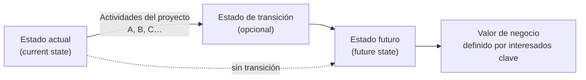

### 1.4 Gobernanza organizativa y gobernanza del proyecto

| Aspecto | Gobernanza organizativa (*organizational governance*) | Gobernanza del proyecto (*project governance*) |
|---|---|---|
| Qué es | Dirección y control de toda la organización mediante políticas, procesos, procedimientos y decisiones para cumplir metas estratégicas y operativas. | Marco **adaptable** que guía las actividades de dirección del proyecto para crear valor mediante un producto, servicio o resultado único alineado con metas organizativas, estratégicas y operativas. |
| Quién la ejerce | Comité ejecutivo o líderes de la organización. | Estructuras propias del proyecto: comité directivo (*steering committee*), juntas de gobernanza, matrices RACI, roles y responsabilidades definidos. |
| De dónde deriva | Leyes del país, regulación del sector, normas de la industria y políticas internas propias del contexto. | De la gobernanza organizativa, instanciada para el proyecto concreto. |
| Qué asegura | Transparencia, supervisión, cumplimiento, resiliencia y adaptabilidad frente a los interesados. | Estructura, sistemas y procesos, roles, modelos de decisión, protocolos de rendición de cuentas y comunicación; alineación con expectativas de interesados. |
| Cómo influye en carteras, programas y proyectos | Impone requisitos legales y de cumplimiento; define responsabilidades éticas, sociales y ambientales; fija políticas operativas, legales, financieras y de riesgo; promueve alineación estratégica a distintos niveles; asegura contribución a misión y visión; facilita decisiones que maximizan valor. | Prioriza iniciativas y asigna recursos en apoyo de la estrategia. Ejemplo reformulado: un comité directivo de un lanzamiento de producto vigila hitos, exige estándares de calidad y resuelve escalamientos. |

Síntesis: la gobernanza organizativa da la dirección y el control **globales**; la del proyecto define los procesos y marcos **específicos** para gestionar bien cada proyecto. Ambas son necesarias para que el proyecto contribuya a la estrategia y se ejecute con éxito. El detalle del dominio Governance está en la Guía (fuera de este archivo).

**Iniciación del proyecto desde la gobernanza.** Los líderes autorizan proyectos para materializar objetivos estratégicos y atender necesidades de interesados. Los detonantes típicos se agrupan en cuatro familias:

- cumplir requisitos regulatorios, legales o sociales;
- satisfacer solicitudes o necesidades de interesados;
- implementar o cambiar estrategias de negocio o tecnológicas;
- crear, mejorar o corregir productos, procesos, organizaciones o servicios.

Todo proyecto debería poder trazarse hasta un objetivo estratégico y un valor de negocio. Si el agente no logra esa trazabilidad, debe señalarlo como riesgo de justificación.

### 1.5 Operaciones y proyectos

La gestión de operaciones (*operations management*) se ocupa de producir bienes y servicios de forma eficiente y continua, transformando entradas (materiales, componentes, energía, trabajo) en salidas (productos, servicios, otros resultados). Es una disciplina distinta de la dirección de proyectos formal. Las operaciones en curso están **fuera** del alcance de un proyecto, pero hay puntos de intersección a lo largo del ciclo de vida del producto:

- al desarrollar nuevos productos o servicios, mejorar ofertas o ampliar la capacidad de producción;
- al mejorar las operaciones de entrega o el propio proceso de desarrollo;
- al final del ciclo de vida del producto (retiro);
- en cada cierre de fase o iteración.

En esos puntos se **transfieren** entregables, personas y conocimiento entre proyecto y operaciones (en ambos sentidos). El Estándar recomienda involucrar a operaciones **desde la planificación temprana**, porque de ello depende la sostenibilidad del resultado. El traspaso (*handover*) a operaciones es el momento en que la organización asume sostener y usar lo que el proyecto produjo.

### 1.6 Relación cartera / programa / proyecto / operaciones

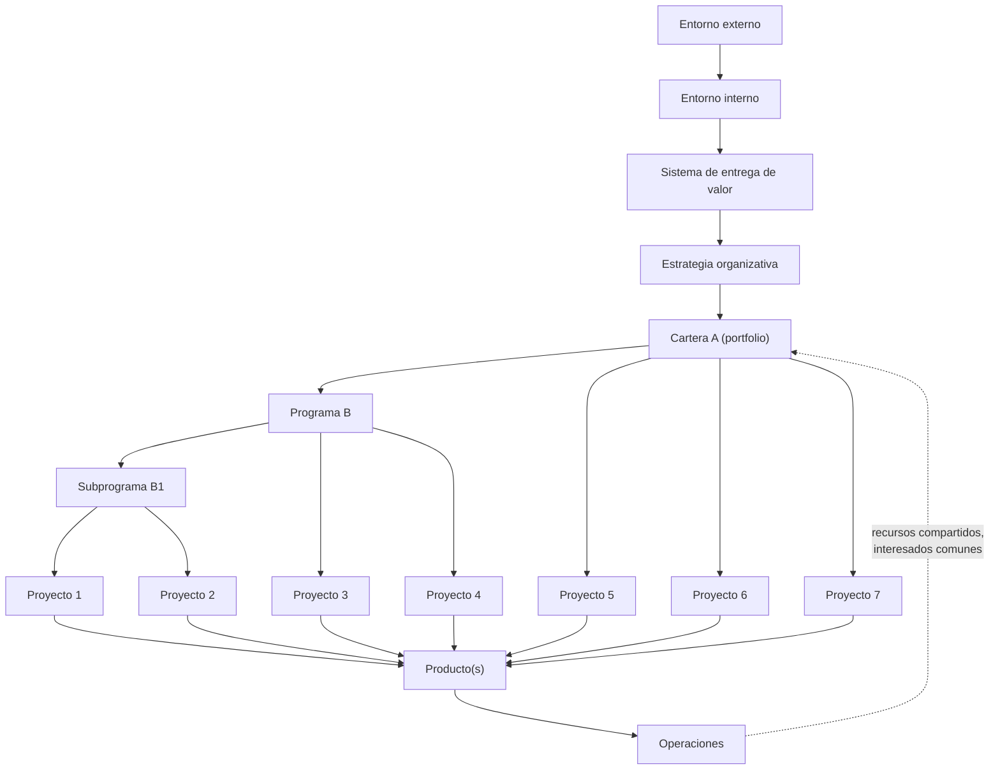

Reglas de relación extraídas del Estándar:

- Un proyecto puede ser independiente o componente de un programa o de una cartera.
- Un programa coordina proyectos relacionados para lograr beneficios no alcanzables por separado; impulsa cambio organizativo significativo, no es solo «tamaño».
- Una cartera selecciona, prioriza, gestiona y optimiza programas y proyectos (y operaciones) en línea con la estrategia, las obligaciones y los objetivos de negocio, con visión holística de la asignación de recursos.
- Carteras, programas, proyectos y operaciones comparten interesados y **compiten por los mismos recursos**; sus responsables deben coordinarse con los líderes operativos para equilibrar asignación y compromiso; de lo contrario, la competencia amenaza los objetivos estratégicos.
- La planificación organizativa y de cartera prioriza según riesgos, financiación y otros criterios; la gobernanza coordinada autoriza recursos humanos, financieros y físicos según desempeño y beneficios esperados.

**Comparación por dimensiones (reformulación de la tabla comparativa del Estándar):**

| Dimensión | Cartera | Programa | Proyecto |
|---|---|---|---|
| Qué es | Grupo de programas, proyectos y operaciones gestionado para maximizar valor, cumplir la estrategia, obligaciones o generar ingresos | Grupo de proyectos y actividades relacionados, coordinados para obtener beneficios conjuntos | Iniciativa temporal en contexto único para crear valor |
| Alcance | Organizativo, alineado con la estrategia | Integra el alcance de sus proyectos y subprogramas | Objetivos definidos, elaborados progresivamente |
| Cambio | Monitoreo y ajuste continuos frente a prioridades estratégicas y entorno | Se adapta para optimizar valor a nivel de programa | Se adapta para habilitar y maximizar la entrega de valor |
| Planificación | Estratégica: prioridades y asignación de recursos entre programas y proyectos | De alto nivel; sigue interdependencias y objetivos del programa | Predictiva, adaptativa o híbrida según requisitos y contexto |
| Monitoreo | Cambios estratégicos y asignación de recursos | Avance de componentes y materialización de beneficios | Salidas y valor (monitoreo y control) |
| Éxito | Valor estratégico entregado, éxito del cambio global, alineación con visión y misión | Capacidad colectiva de entregar beneficios y valor y lograr objetivos estratégicos | Valor entregado que justificó esfuerzo y gasto, incluyendo calidad, oportunidad, cumplimiento presupuestario, sostenibilidad y satisfacción de interesados |

---

## 2. Sistema de entrega de valor

### 2.1 Creación de valor

El Estándar usa «organización» en sentido amplio (agencias públicas, empresas, acuerdos contractuales, joint ventures, ONG, incluso una familia que organiza un viaje). Toda inversión en proyecto debe alcanzar o superar un **umbral objetivo** de valor, financiero o no, tangible o intangible; y ese umbral se evalúa **en su contexto de inversión** (frente a alternativas). La entrega de valor hoy incluye impacto social y metas de sostenibilidad.

**Valor de negocio (*business value*)**: beneficio neto cuantificable, tangible o intangible, que contribuye a la salud de la organización durante el proyecto, al terminar o a largo plazo.

| Ejemplos tangibles | Ejemplos intangibles |
|---|---|
| Activos monetarios, productividad, rentabilidad, patrimonio de accionistas, cuota de mercado, capacidad de infraestructura, utilidad, mejoras ambientales | Reputación y goodwill, marca, beneficio público, conocimiento adquirido, cumplimiento, bienestar de los empleados, conciencia ambiental |

Formas en que un proyecto alcanza o supera el umbral de valor (reformuladas):

- crear un producto, servicio o resultado nuevo que satisface a clientes o usuarios finales;
- entregar dentro de la línea base cuando esa línea base representa un resultado de alto valor;
- contribuir al desarrollo comunitario, la sostenibilidad ambiental y la responsabilidad ética;
- mejorar eficiencia, productividad, eficacia, capacidad de respuesta o bienestar del personal;
- habilitar los cambios de una transición organizativa hacia el estado futuro;
- sostener beneficios de programas, proyectos u operaciones previos y asegurar continuidad.

### 2.2 Componentes del sistema de entrega de valor

Carteras, programas, proyectos, productos y operaciones generan valor individual o colectivamente y forman un sistema integrado para maximizar y sostener el valor en alineación con la estrategia. La gestión de cartera es el **eje que conecta estrategia con ejecución** y optimiza recursos a través de programas, proyectos, productos y operaciones. Las operaciones sostienen e influyen en todo lo demás (p. ej., nómina, cadena de suministro).

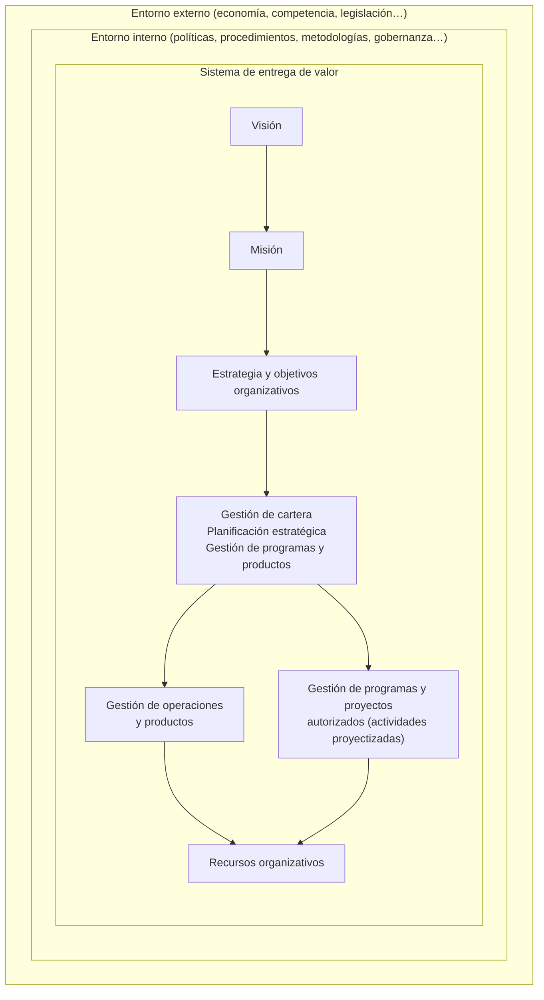

**Cadena de valor (lógica de causa-efecto que el agente debe exigir en todo business case):**

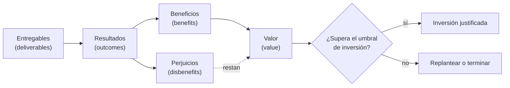

**Flujo de información (reformulación de la figura de ejemplo del Estándar).** El sistema funciona mejor cuando la información y la retroalimentación circulan de forma consistente entre componentes:

| De → A | Qué fluye |
|---|---|
| Alta dirección → Carteras | Estrategia |
| Carteras → Programas y proyectos | Resultados, beneficios y valor deseados |
| Programas y proyectos → Operaciones y productos | Entregables con información de soporte y mantenimiento |
| Operaciones y productos → Programas y proyectos | Información para actualizaciones, correcciones y ajustes |
| Programas y proyectos → Carteras | Información de desempeño y avance |
| Carteras → Alta dirección | Información de desempeño de la cartera |
| Operaciones y productos → Alta dirección / Carteras | Análisis de desempeño de resultados, beneficios y valor |

### 2.3 Cómo se evalúa el éxito de un proyecto

El Estándar exige evaluar **dos dimensiones** y no sacrificar una por la otra:

| Dimensión | Qué mide | Cuándo se puede medir | Ejemplos de criterios |
|---|---|---|---|
| Éxito de los **resultados** del proyecto (*project outcomes*) | Eficacia: si el proyecto materializó el valor previsto | Durante el proyecto, al terminar, o a corto/largo plazo tras el cierre, según producto y proyecto | Metas de ventas, ROI, nuevos clientes, llegar primero al mercado, mejoras tecnológicas o de proceso, cumplimiento de nuevas normas, metas sociales y ambientales |
| Éxito de los **procesos de dirección** (*project management processes*) | Eficiencia: cumplimiento de restricciones de costo, alcance, tiempo y calidad; uso eficaz de recursos; expectativas de interesados atendidas | Durante el proyecto y al cierre | A tiempo, en presupuesto, con la calidad requerida |

Dos casos ilustrativos que el Estándar usa (reformulados): un edificio emblemático de ópera que multiplicó presupuesto y plazo varias veces y aun así se convirtió en patrimonio mundial y atracción masiva (gestión considerada un fracaso; resultado muy superior a lo esperado; habría sido aún mejor entregarlo antes y más barato); y un paso elevado vial bien ejecutado que debió demolerse al año porque no encajaba con el rediseño de un puente adyacente (gestión exitosa; resultado nulo o negativo). Conclusión: una buena gestión asegura ejecución eficiente; el éxito de resultados asegura el valor de negocio; hacen falta ambos.

> Regla para el agente: todo informe de cierre y toda revisión de fase deben reportar **ambas dimensiones** por separado. «Entregamos a tiempo y en presupuesto» no es evidencia de valor.

### 2.4 Entorno del proyecto

Los proyectos operan dentro del entorno interno y externo de la organización; esas influencias pueden ser favorables, desfavorables o neutras sobre características, interesados o equipos, y afectan a la planificación. Se agrupan en dos grandes categorías:

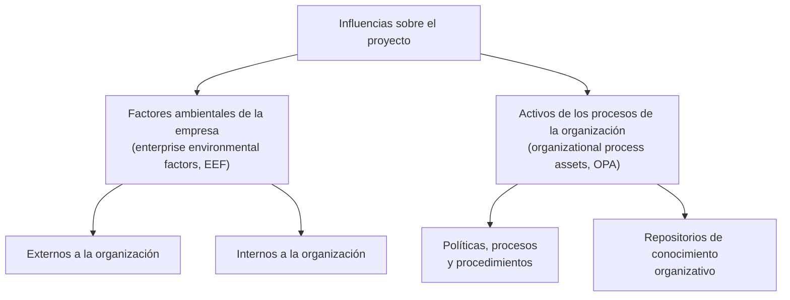

#### 2.4.1 Factores ambientales de la empresa (EEF)

Condiciones **que el equipo no controla directamente** y que afectan, restringen o dirigen el proyecto. Son entradas de muchos procesos, sobre todo de planificación; pueden ampliar o limitar las opciones de gestión e influyen en las necesidades de tailoring y en los resultados.

| EEF internos (ejemplos) | EEF externos (ejemplos) |
|---|---|
| Cultura, estructura y gobernanza (visión, misión, valores, normas, estilos de liderazgo, jerarquía, ética, códigos de conducta) | Condiciones de mercado (competidores, comportamiento del cliente, cuota, marca) |
| Distribución geográfica de instalaciones y recursos (sedes, centros de I+D, atención al cliente, equipos virtuales o híbridos) | Influencias sociales y culturales (clima político, códigos de conducta, percepciones) |
| Infraestructura (instalaciones, equipamiento, canales de telecomunicación, hardware TI, capacidad) | Restricciones legales (leyes locales/nacionales de seguridad, protección de datos, conducta de negocio, empleo, compras) |
| Sistemas de TI (gestión de tareas, costos, cronogramas, configuración, autorización de trabajo) | Investigación académica (estudios de industria, benchmarking, datos empíricos, tendencias) |
| Disponibilidad de recursos (restricciones de contratación y compras, capacidad del personal, acuerdos de colaboración) | Normas gubernamentales o de industria (regulación de productos, producción, ambiente, seguridad, calidad) |
| Capacidad del personal (experiencia, habilidades, competencias, conocimiento especializado) | Consideraciones financieras (tipos de cambio, tasas de interés, inflación, aranceles, impuestos, ubicación) |
| Capacidad financiera de la organización (opciones de financiación externa, fondos adicionales) | Elementos del entorno físico (condiciones de trabajo, clima, geopolítica) |
| | Tecnologías emergentes (IA, automatización, blockchain, IoT) |
| | Regulación de salud y seguridad públicas (protocolos sanitarios, restricciones de viaje, cuarentenas, mandatos de seguridad) |

#### 2.4.2 Activos de los procesos de la organización (OPA)

Planes, procesos, documentos, plantillas y repositorios de conocimiento **propios de la organización ejecutante** que influyen en la gestión del proyecto. Incluyen lecciones aprendidas e información histórica (cronogramas completados, datos de riesgo, datos de valor ganado). Al ser internos, el equipo puede actualizarlos y enriquecerlos. Dos categorías con reglas distintas:

| Categoría | Quién la mantiene | ¿Se actualiza durante el proyecto? | Regla de uso |
|---|---|---|---|
| Políticas, procesos y procedimientos | PMO u otra función externa al proyecto | Normalmente **no**; solo siguiendo la política organizativa | Si la organización lo permite, el equipo **adapta** plantillas, ciclos de vida y listas de verificación a las necesidades del proyecto. |
| Repositorios de conocimiento organizativo | El propio proyecto, de forma continua | **Sí**, a lo largo del proyecto | Se alimentan con desempeño financiero, lecciones, métricas, incidencias y defectos. |

**Políticas, procesos y procedimientos típicos (lista no exhaustiva, reformulada):**

- directrices y criterios de tailoring del conjunto estándar de procesos;
- ciclos de vida de producto y proyecto, métodos y procedimientos (métodos de dirección, métricas de estimación, auditorías de proceso, metas de mejora, listas de verificación, definiciones de proceso);
- plantillas (planes, documentos, registros, formatos de informe, contratos, categorías y enunciados de riesgo, matrices y definiciones de probabilidad e impacto, registro de interesados);
- listas de proveedores preaprobados, modelos de contrato (precio fijo, costos reembolsables, tiempo y materiales), criterios de evaluación de propuestas;
- procedimientos de monitoreo del avance orientados a alcanzar o superar la propuesta de valor, incluida la reoptimización de la línea base cuando convenga;
- procedimientos de control de cambios;
- matrices de trazabilidad;
- procesos de gestión de incidencias y defectos;
- políticas de control de disponibilidad y asignación de recursos;
- procesos para priorizar, aprobar y emitir autorizaciones de trabajo;
- guías, instrucciones de trabajo y procedimientos de medición del desempeño;
- procesos de verificación y validación;
- acuerdos de nivel de servicio (SLA);
- requisitos o guías de cierre del proyecto.

**Repositorios de conocimiento típicos:**

- gestión de la configuración (versiones de componentes, líneas base de normas, políticas, procedimientos y documentos);
- datos financieros (horas, costos incurridos, presupuestos, desviaciones);
- información histórica y lecciones aprendidas (registros, documentación de cierre, decisiones de selección y desempeño de proyectos previos, información de riesgos);
- datos de incidencias y defectos (estado, control, resolución, acciones);
- métricas de procesos y productos;
- archivos de proyectos previos (alcance, costo, cronogramas, líneas base de medición, calendarios, diagramas de red, registros e informes de riesgo, registros de interesados).

> Regla para el agente: al iniciar un proyecto, inventariar qué OPA existen y son obligatorios, cuáles son adaptables y qué repositorios deberá alimentar. Si no hay OPA, el agente los crea a partir de las plantillas del paquete y lo declara.

#### 2.4.3 Estructuras organizativas

No existe una estructura óptima universal; la elección resulta de analizar los tipos disponibles y cómo optimizarlos para esa organización, considerando eficiencia en asignación de recursos, velocidad de decisión, canales de comunicación y distribución de autoridad y responsabilidad. Variables: tamaño, industria, dispersión geográfica, objetivos estratégicos y complejidad de los proyectos.

| Tipo de estructura | Cómo se agrupa el trabajo | Autoridad del director de proyecto | Rol del director de proyecto | Disponibilidad de recursos para el proyecto |
|---|---|---|---|---|
| Orgánica o simple | Flexible; personas trabajando lado a lado | Baja | Parcial; puede no existir como puesto (coordinador) | Baja |
| Funcional (centralizada) | Por tarea o función (ingeniería, manufactura) | Baja | Parcial; puede no existir como puesto | Baja |
| Multidivisional (funciones replicadas por división, poca centralización) | Por producto, proceso productivo, cartera, programa, región o tipo de cliente | Baja | Parcial; puede no existir como puesto | Baja |
| Matricial fuerte | Por función, con la dirección de proyectos como función propia | Moderada a alta | Tiempo completo, puesto designado | Moderada a alta |
| Matricial débil | Por función | Baja | Parcial, como parte de otro puesto | Baja |
| Matricial equilibrada | Por función | Baja a moderada | Parcial; incrustado en las funciones como habilidad | Baja a moderada |
| Orientada a proyectos (compuesta, híbrida) | Por proyecto | Alta a casi total | Tiempo completo, puesto designado | Alta a casi total |
| Virtual / en red | Estructura de red con nodos en puntos de contacto | Baja a moderada | Tiempo completo o parcial | Baja a moderada |
| Híbrida | Mezcla de los anteriores | Mixta | Mixto | Mixta |

> Implicación para el agente: en estructuras funcionales o matriciales débiles, debe planificar más esfuerzo de negociación de recursos y escalamiento vía patrocinador; en estructuras orientadas a proyectos, más atención a la transferencia a operaciones y a la reasignación del equipo al cierre.

### 2.5 Consideraciones de gestión de producto

La gestión de producto (*product management*) integra personas, datos, procesos y sistemas de negocio para crear, desarrollar y mantener un producto o servicio a lo largo de su ciclo de vida. El **ciclo de vida del producto** (*product life cycle*) recorre introducción, crecimiento, madurez y declive/retiro, y es independiente del ciclo de vida del proyecto (que puede ser una de las salidas que lo alimentan).

La gestión de producto puede iniciar programas o proyectos en cualquier punto de ese ciclo para crear o mejorar componentes, funciones o capacidades. El producto inicial puede nacer como entregable de un proyecto; proyectos posteriores añaden, revisan y finalmente retiran.

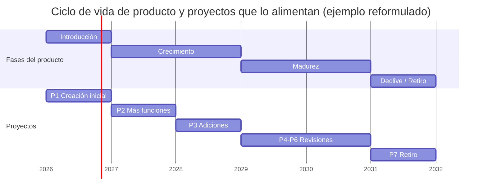

Formas de relación entre cartera, programa, proyecto y producto (reformuladas):

| Patrón | Descripción | Cuándo aparece |
|---|---|---|
| Gestión de programa dentro de un ciclo de vida de producto | Proyectos relacionados, subprogramas y actividades de programa dentro de una o varias fases del producto | Productos muy grandes o de larga vida donde una fase es compleja |
| Gestión de proyecto dentro de un ciclo de vida de producto | La gobernanza de cartera autoriza proyectos puntuales para mejoras o resultados únicos, como actividad continua del negocio | Productos maduros con mejoras periódicas |
| Gestión de producto dentro de una cartera | Todo el ciclo de vida del producto se gestiona dentro de una cartera que alinea inversiones, prioriza y asigna recursos entre líneas de producto | Organizaciones multiproducto |
| Gestión de producto dentro de un programa o proyecto | Responsabilidades de producto definidas como componentes del programa o del proyecto; foco en requisitos y alcance del producto. El soporte continuo es operativo, no se gestiona como proyecto | Proyectos cuyo entregable es un producto |
| Gestión de producto a través de programas y proyectos | El ciclo de vida del producto atraviesa múltiples programas y proyectos y exige coordinación entre ellos | Productos de larga duración |

División de trabajo: la gestión de producto aporta **visión y estrategia** del producto; la gestión de programas y proyectos las materializa gestionando ejecución, dependencias y recursos. Roles puente: el **dueño de producto** (*product owner*) mantiene y prioriza el *backlog* para que el equipo entregue funciones valiosas; el **analista de negocio** (*business analyst*) recoge y documenta requisitos y vela por la alineación entre alcance del proyecto, funcionalidad del producto y necesidades de negocio.

### 2.6 Funciones asociadas a los proyectos

Las personas impulsan la entrega cumpliendo funciones; una función puede ser desempeñada por una persona, un equipo o una combinación de roles. La coordinación puede ser **descentralizada** (equipos autoorganizados, típico de lo adaptativo), **centralizada** (bajo un director de proyecto, típico de lo predictivo) o **mixta/híbrida**. La lista siguiente no es exhaustiva; las funciones que se usan y cómo dependen del proyecto, la organización y el entorno.

| Función (EN) | Qué comprende | Roles que suelen ejercerla | Nota de contexto |
|---|---|---|---|
| Proveer supervisión y coordinación (*provide oversight and coordination*) | Alinear esfuerzos, eliminar obstáculos, mantener el foco; puede abarcar todas las actividades de dirección; consultas con ejecutivos y líderes de unidad; apoyo en análisis de negocio, licitaciones, negociación contractual y business case; seguimiento de materialización de beneficios antes del cierre formal | Director de proyecto (asignado formalmente); scrum master (lidera al equipo para que lo haga por sí mismo) | Se adapta a la organización y a sus carteras y programas |
| Solicitar y gestionar retroalimentación (*solicit and manage feedback*) | Captar perspectivas, expectativas y dirección de los involucrados; revisiones periódicas con cliente, usuario o dueño de producto; a veces un representante del cliente integra el equipo | Cliente, usuario final, dueño de producto, equipo | Mayor necesidad en enfoques adaptativos e híbridos por la ambigüedad; el grado depende de complejidad, madurez del producto e incertidumbre |
| Facilitar y apoyar (*facilitate and support*) | Fomentar participación, colaboración, responsabilidad colectiva y motivación compartida; construir consenso, resolver conflictos, tomar decisiones; coordinar reuniones de forma neutral; acompañar el cambio; dar retroalimentación de desempeño para aprender y mejorar | Director de proyecto, scrum master, líderes de equipo, analistas de negocio, especialistas en gestión del cambio | |
| Realizar el trabajo (*perform work*) | Aportar conocimiento, habilidades y experiencia para producir los entregables; tiempo completo o parcial, presencial o virtual; puede apoyarse en automatización e IA | Miembros del equipo (especialistas o generalistas) | |
| Aplicar pericia (*apply expertise*) | Conocimiento especializado, visión y habilidades en un área; asesoría; detección de incertidumbres y puntos ciegos; evaluación del avance y del éxito | Expertos internos o externos, por todo el proyecto o por periodos | Acelera el avance y mejora precisión y calidad |
| Proveer dirección e insight organizativo (*provide organizational direction and insight*) | Priorizar requisitos o alcance por valor, dependencias y riesgo técnico u operativo; fijar el rumbo del siguiente incremento; comprometer a interesados y clientes en la definición de dirección; maximizar valor y retorno | Gestores de cartera, patrocinadores, dueños de producto | En adaptativo/híbrido, vía ciclos de revisión; en predictivo, vía puntos de control en hitos |
| Proveer recursos (*provide resources*) | Asegurar financiación, recursos físicos, personal y autoridad; abogar por el proyecto ante la alta dirección; asignar personas, equipos y pericia; cubrir brechas durante el ciclo de vida | Gestores de cartera y patrocinadores (aseguran); gestores funcionales y de recursos (asignan) | |

### 2.7 Roles de la dirección de proyectos

El Estándar distingue entre **funciones** (§2.6) y **roles**: muchas organizaciones ejercen las funciones a través de personas o equipos con definiciones de rol propias. Cada rol aporta valor específico y los resultados dependen de esas contribuciones. Como cada empresa y proyecto es único, funciones, roles y responsabilidades pueden diferir.

#### 2.7.1 Equipo de dirección del proyecto (*project management team*) y director de proyecto

- Puede ser solo el director de proyecto o un equipo; el Estándar los trata como sinónimos en esta sección.
- Guía al equipo para lograr metas y entregar valor, con flexibilidad, adaptabilidad y tailoring. Funciones típicas: facilitar y mentorear al equipo; gestionar los procesos que producen los resultados.
- Involucramiento sugerido: desde la iniciación hasta el cierre y, a veces, en el análisis de beneficios posterior. En algunas organizaciones participa antes de la iniciación (evaluación, factibilidad, business case, análisis de negocio, aspectos de gestión de cartera). El nivel de participación se **adapta** a la estructura organizativa, igual que los procesos.
- El título no define la función: un gestor funcional (finanzas, RR. HH.) puede supervisar un proyecto; el puesto puede llamarse «líder de proyecto»; en entornos ágiles, dueño de producto, product manager, scrum master, agile coach, delivery manager, team lead o el propio equipo asumen parte de las responsabilidades de dirección. Lo esencial es que quien ejerza la función adopte los fundamentos de la dirección de proyectos.

**Esferas de influencia (reformulación de la figura del Estándar), del centro hacia afuera:**

1. Miembros del equipo del proyecto.
2. Equipo de dirección del proyecto / director de proyecto.
3. Patrocinador.
4. Gestor de cartera, gestor de programa, PMO.
5. Gestores funcionales y dirección operativa.
6. Clientes, usuarios, socios de negocio, vendedores y proveedores.
7. Agencias regulatorias.

**Interacción con el proyecto.** El equipo de dirección prioriza lo urgente e importante, optimiza recursos y protege hitos críticos; negocia con otros equipos de dirección, gestores de cartera, programa y funcionales por recursos críticos, prioridades de financiación, recepción o distribución de entregables y alineación de objetivos; trabaja con patrocinador, cliente, product manager o dueño de producto en asuntos políticos y estratégicos que afecten al equipo o a la viabilidad o calidad del proyecto o producto. Debe dominar varios estilos de liderazgo y cambiar entre ellos; el Estándar destaca el **liderazgo situacional** (más directivo en fases críticas, más de apoyo cuando conviene la autonomía) sin perder los valores propios.

**Competencias del equipo de dirección (reformulación de la figura y la lista del Estándar):**

| Competencia (EN) | Qué abarca | Ejemplos |
|---|---|---|
| Responsabilidad social (*social responsibilities*) | Decisiones alineadas con el bien común | Devolver a la profesión y a la sociedad; respetar normas éticas, culturales y sociales; buscar el desarrollo propio y la mejora continua |
| Habilidades de poder / interpersonales (*power skills*) | Habilidades con personas, adaptabilidad, inteligencia emocional | Pensamiento crítico, juicio y toma de decisiones; motivación de equipos; negociación y resolución de conflictos |
| Perspicacia de negocio (*business acumen*) | Pensamiento estratégico y alineación con el contexto organizativo | Criterios de selección de proyectos (costo, factibilidad, impacto); conocimiento de la industria; business case y análisis financiero |
| Formas de trabajar (*ways of working*) | Estándares, metodologías y marcos para ejecutar proyectos | Aplicar el enfoque adecuado (predictivo, adaptativo, híbrido); técnicas de ideación; gestión del cambio |
| Resultados (*results*) | Ejecutar y lograr | Resolución de problemas (p. ej., análisis de causa raíz); obtener poder y autoridad dentro de las políticas; manejar la política organizativa (influencia, negociación, autonomía) |

**Desarrollo de competencias.** El equipo de dirección fomenta una cultura de aprendizaje mezclando seniority y pericia para que haya mentoría y coaching; identifica necesidades individuales de aprendizaje e integra el desarrollo en el flujo de trabajo; da retos que estiran habilidades y retroalimentación constructiva; promueve la reflexión y la captura y difusión de lecciones. Esta responsabilidad puede recaer también en gestores funcionales, PMO, jefes de línea o cada persona.

**Impacto de la tecnología.** Herramientas de programación, asignación de recursos, automatización, visualización, optimización y comunicación en tiempo real agilizan todas las fases; IA y aprendizaje automático aportan predicción, asignación de recursos, detección de riesgos e indicadores adelantados y rezagados; la nube permite acceso uniforme y colaboración global. Obligaciones del equipo de dirección: planificar, coordinar, probar o auditar la tecnología; asegurar **exactitud de datos y neutralidad de salidas** (evitar sesgos); monitorear su integración y eficacia; coordinarse con TI en ciberseguridad y protección de la información. En algunas organizaciones esto lo lleva la PMO.

#### 2.7.2 Patrocinador, cliente o dueño de producto (*sponsor, customer, product owner*)

- Aportan **liderazgo de decisión** fuera de la autoridad del equipo de dirección.
- Comunican visión, metas y expectativas de la organización; mantienen la alineación con objetivos de negocio; facilitan decisiones ejecutivas; ayudan a asegurar recursos; abogan por el equipo; resuelven incidencias y eliminan obstáculos que exceden la autoridad del equipo de dirección.
- Son críticos para sostenibilidad y metas ESG (ambientales, sociales y de gobernanza).
- Deben monitorear el avance de forma continua y asesorar al equipo de dirección para que los beneficios se materialicen.
- Su **presencia y grado de involucramiento** aumentan la probabilidad de éxito; su ausencia lo perjudica.

> Regla para el agente: si el patrocinador no está identificado, no está disponible o no decide, registrarlo como riesgo de alta prioridad y escalar; no sustituir sus decisiones.

#### 2.7.3 Equipo del proyecto (*project team*)

Personas que realizan el trabajo y son directamente responsables de los objetivos. Tamaño, composición y nivel de habilidad dependen de tipo, escala, complejidad y madurez organizativa. El grado de involucramiento y coordinación se adapta al proyecto (complejidad, enfoque, nivel de cambio). La coordinación puede ser descentralizada (equipos autogestionados), centralizada (equipo de dirección o director) o híbrida. En cualquier caso, importan el liderazgo de apoyo y el compromiso continuo entre equipo e interesados.

#### 2.7.4 Usuarios finales y otros interesados clave

Diálogo continuo, cuando sea posible, con usuarios finales, influenciadores, clientes, reguladores y otros interesados clave para captar e integrar retroalimentación en todo el ciclo de vida, asegurar alineación mutua y construir credibilidad. Implica **verificación y validación iterativas** frente a necesidades que evolucionan. Priorizar la satisfacción del usuario final reduce el riesgo de entregar algo sin la utilidad esperada.

---

## 3. La mentalidad y los seis principios

### 3.1 Naturaleza de los principios

- Los principios de una profesión orientan estrategia, decisiones y resolución de problemas; estándares y metodologías derivan de ellos.
- En la dirección de proyectos **no son prescriptivos** ni leyes: refuerzan la mentalidad y guían el comportamiento. El Estándar se autodefine como «basado en principios».
- Son amplios: admiten muchas formas de cumplirlos; su aplicación depende del contexto (organización, proyecto, entregables, equipo, interesados).
- Son **complementarios**: ningún principio contradice a otro, aunque en la práctica se solapan.
- Los seis principios describen la **mentalidad** (*mindset*); los dominios de desempeño describen la **mecánica** (*mechanics*). La mentalidad guía la mecánica; la mecánica operacionaliza la mentalidad.

### 3.2 La mentalidad de la dirección de proyectos (*project management mindset*)

Una mentalidad es un conjunto de creencias, modos de pensar y hábitos con los que interpretamos situaciones y la conducta de otros. El Estándar la llama a veces «mentalidad de crecimiento» y la considera fundamental para ejecutar la estrategia, adaptarse, impulsar el cambio y generar valor. Se describe con **tres dimensiones**, cada una integrando dos principios:

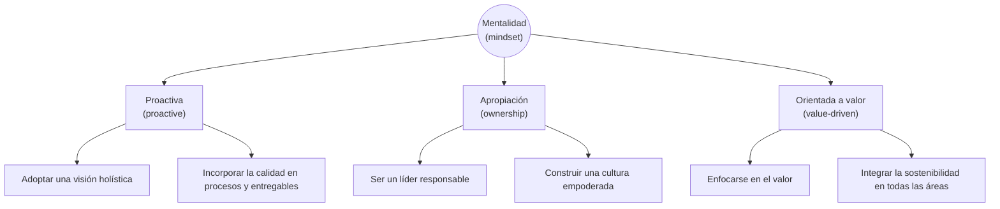

| Dimensión | Qué enfatiza | Principios que integra | Qué habilita |
|---|---|---|---|
| Proactiva (*proactive*) | Pensamiento sistémico y planificación en el nivel adecuado para que los umbrales de calidad estén incorporados en cada fase; anticipar y atender problemas pronto; alinear procesos con necesidades cambiantes | Adopt a Holistic View; Embed Quality Into Processes and Deliverables | Mejora continua, acción anticipada, resiliencia |
| Apropiación (*ownership*) | Rendición de cuentas de los líderes y cultura de equipo de alto desempeño; liderar no es solo decidir sino fomentar responsabilidad y colaboración | Be an Accountable Leader; Build an Empowered Culture | Equipos fuertes y autosuficientes con compromiso compartido |
| Orientada a valor (*value-driven*) | Máximo valor con sostenibilidad integrada en todo el ciclo de vida; alineación con la estrategia y contribución a comunidad y ambiente (triple resultado: personas, beneficio, planeta) | Focus on Value; Integrate Sustainability Within All Project Areas | Resultados impactantes y sostenibles; equilibrio entre éxito medible y metas amplias |

### 3.3 Relación entre principios y dominios de desempeño

Los siete dominios de desempeño (*performance domains*) de la 8ª edición son: **Governance** (gobernanza), **Scope** (alcance, que incluye calidad), **Schedule** (cronograma), **Finance** (finanzas), **Stakeholders** (interesados), **Resources** (recursos) y **Risk** (riesgo). Su detalle está en la Guía. Todos los principios se relacionan con todos los dominios, pero con distinta intensidad:

| Principio | Dominios con conexión más fuerte según el Estándar |
|---|---|
| Adopt a Holistic View | Todos (es el principio integrador) |
| Focus on Value | Governance, Scope, Risk, Schedule, Finance, Stakeholders |
| Embed Quality Into Processes and Deliverables | Governance, Scope, Risk, Schedule, Finance, Stakeholders |
| Be an Accountable Leader | Governance, Stakeholders, Risk |
| Integrate Sustainability Within All Project Areas | Todos |
| Build an Empowered Culture | Todos |

> Nota: aunque la tabla anterior resume la intensidad declarada, cada principio tiene en el Estándar una lista de efectos sobre los **siete** dominios; se recogen abajo, por principio.

---

### 3.4 Principio 1 — Adoptar una visión holística (*Adopt a Holistic View*)

**Qué exige.** Entender y gestionar el proyecto considerando todos sus componentes y sus interdependencias como parte de un sistema mayor (pensamiento sistémico). Ver relaciones en su contexto completo y detectar **patrones**, no fotografías estáticas. La visión holística se mantiene durante todo el ciclo de vida, desde la iniciación hasta el cierre, asegurando integración y alineación en cada etapa.

**Por qué importa.** Permite manejar la complejidad, identificar causas raíz, trazar problemas a su origen y abordar soluciones de forma interdisciplinaria y más innovadora.

**Impacto en el proyecto.** Los proyectos gestionados con visión holística muestran:

- alineación con la estrategia y metas organizativas;
- decisiones integradas, que consideran las distintas perspectivas del ecosistema del proyecto y producen resultados más sostenibles;
- comunicación clara y consistente que mantiene a todos informados y alineados;
- mejor gestión de la incertidumbre (técnicas para identificar progresivamente fuentes de incertidumbre que amenazan la propuesta de valor) y de la complejidad (comprender y simplificar interdependencias, descubrir la simplicidad inherente);
- gestión de riesgos proactiva y pragmática: con visión de conjunto desde el inicio, el equipo decide antes y mejor para mitigar amenazas y aprovechar oportunidades;
- sostenibilidad: todos los aspectos del proyecto contribuyen positivamente o, al menos, su contribución negativa se cuantifica (costo e impacto ambiental de las actividades y de los entregables).

**Cómo se ve en acción (ejemplo reformulado).** Una ONG lanza un proyecto de promoción de salud comunitaria con voluntarios. El enfoque estrecho sería producir materiales educativos y organizar eventos. A mitad de camino descubre una iniciativa del gobierno local con metas similares que ofrece subvenciones a esfuerzos alineados. Con visión holística, el equipo ajusta su comunicación para calificar a la subvención: acepta restricciones adicionales de política y comunicación a cambio de más recursos y mayor alcance, logrando un impacto más duradero.

**Dominios conectados (efecto del principio en cada uno):**

| Dominio | Efecto de la visión holística |
|---|---|
| Governance | Transparencia y rendición de cuentas; decisiones basadas en datos con un alcance de impactos más amplio; maximiza el impacto positivo de la inversión para cartera, programa o proyecto |
| Scope | Alinea todas las actividades con el alcance global y evita *scope creep*; al poner el foco en los **objetivos organizativos** y no solo en los entregables finales, abre la puerta a soluciones más simples, eficaces y duraderas |
| Schedule | Cronogramas más realistas y adaptables al considerar interdependencias; se evalúan los escenarios *what-if* relevantes y los cambios de línea base candidatos según su retorno para el proyecto y su cartera/programa |
| Finance | Presupuesto alineado con prioridades; control de costos; anticipación del impacto financiero de los cambios en el contexto amplio |
| Stakeholders | Participación inclusiva en las decisiones, de departamentos a proveedores y clientes; mayor satisfacción y colaboración |
| Resources | Comprender cómo se integran los componentes para maximizar valor; facilita el flujo de trabajo terminado, evita conflictos de recursos, optimiza su uso en la cartera y empodera al equipo |
| Risk | Identificación y gestión de riesgos a través de todos los dominios, entendiendo sus interdependencias; estrategias de respuesta robustas |

**Checklist para el agente:**

1. ¿He identificado el sistema en el que vive el proyecto (cartera, programa, producto, operaciones, otros proyectos) y sus dependencias?
2. ¿Cada decisión relevante considera efectos sobre alcance, cronograma, finanzas, interesados, recursos y riesgo a la vez, y no solo sobre uno?
3. ¿Busco la causa raíz antes de proponer una solución al síntoma?
4. ¿Monitoreo el entorno (EEF) para detectar oportunidades o amenazas externas al plan actual?
5. ¿Cuantifico la contribución negativa (ambiental, social, operativa) cuando no puedo eliminarla?
6. ¿La comunicación llega a todos los interesados afectados por una decisión, no solo al solicitante?

**Señales de incumplimiento.** Optimización local (un equipo mejora su parte y empeora la de otro); cambios aprobados sin análisis de impacto cruzado; sorpresas por dependencias externas conocidas por alguien pero no registradas; soluciones repetidas a un mismo problema recurrente; el proyecto ignora iniciativas paralelas de la organización con las que compite o podría sumar.

---

### 3.5 Principio 2 — Enfocarse en el valor (*Focus on Value*)

**Qué exige.** Evaluar y ajustar **continuamente** la alineación del proyecto con los objetivos de negocio, los beneficios previstos y el valor. El valor es el indicador último de éxito y el motor del proyecto. Puede describirse con métricas (ROI) o cualitativamente (testimonios, beneficio social); abarca los entregables y sus resultados, especialmente desde la perspectiva de los interesados clave; puede expresarse como contribución financiera, beneficio social o beneficio percibido por el cliente.

**Afirmaciones núcleo del principio (reformuladas):**

- el valor por unidad de inversión es el indicador definitivo de éxito;
- el valor puede materializarse durante el proyecto, al final o después;
- valor y beneficios pueden definirse cuantitativa y/o cualitativamente;
- el equipo se enfoca en resultados que maximizan valor y alcanzan o superan los objetivos de negocio;
- el equipo evalúa el avance y se adapta para maximizar el valor esperado.

**Reglas operativas del principio:**

- La justificación del proyecto y la estrategia organizativa, normalmente en el **business case**, dan al equipo la información para decidir con criterio de valor.
- Los resultados deseados deben describirse con claridad, evaluarse iterativamente y actualizarse mediante puertas de calidad, bucles de retroalimentación y revisiones periódicas.
- Si la desalineación persiste o el proyecto difícilmente entregará el valor previsto, **terminarlo puede ser la mejor opción**.
- Enfocarse en valor significa entregar la funcionalidad y calidad requeridas optimizando flujos con exposición a riesgo aceptable, con los recursos mínimos necesarios y evitando retrabajo y otros desperdicios.
- En proyectos adaptativos sin alcance fijo, el equipo colabora con el cliente para decidir qué funciones merecen la inversión de tiempo y dinero.
- Si el proyecto es parte de un programa, el valor se evalúa a nivel de programa; el valor del proyecto alimenta a la cartera para decidir qué proyectos seleccionar o continuar.
- La evaluación de valor debe considerar el contexto y ciclo de vida completos y el **periodo de recuperación**, que puede ir mucho más allá del cierre.

**Impacto en el proyecto.** Desplazar el foco de los entregables a los resultados permite cumplir la visión o propósito del proyecto. Ejemplo reformulado: un cliente pide un software creyendo que resolverá su necesidad de productividad; el software es la salida, pero no produce productividad por sí mismo; añadir un entregable como capacitación habilita un resultado de mayor valor. Si la salida no habilita el resultado, la propuesta de valor se socava y el proyecto puede resultar más dañino que útil dado lo invertido. Por eso equipo e interesados deben entender tanto el entregable como el resultado que se espera de él.

**Cómo se ve en acción (ejemplo reformulado).** Una empresa despliega un nuevo sistema interno. El enfoque convencional elegiría el producto con más funciones por precio y lo personalizaría para cubrir todas las solicitudes. El enfoque de valor alinea el proyecto con resultados de negocio como adopción y uso; al analizar la cultura (rápida, que prefiere simplicidad), reduce funciones y personalizaciones y logra mayor uso y satisfacción.

**Dominios conectados:**

| Dominio | Efecto del foco en valor |
|---|---|
| Governance | Marcos y procesos que alinean decisiones con los objetivos de valor; gobernanza «a la medida» orientada a entregar valor, no a la burocracia |
| Scope | Definir y controlar el alcance para que todo el trabajo contribuya al valor; gestión continua que evita *scope creep* y *gold plating* |
| Schedule | Gestionar el tiempo para entregar el valor en la fecha objetivo o antes; evitar demoras que lo erosionen |
| Finance | Asignación eficiente; evaluación continua del desempeño financiero contra el business case para confirmar viabilidad y beneficios |
| Stakeholders | Entender necesidades y expectativas para entregar valor **desde su perspectiva**; alinear salidas con resultados deseados |
| Resources | Decidir sobre activos y talento desde la propuesta de valor; p. ej., si no se puede contratar especialistas, formar al equipo existente |
| Risk | Respuesta a amenazas y oportunidades pragmática en eficacia, eficiencia y transparencia |

**Checklist para el agente:**

1. ¿Existe un business case (o justificación equivalente) con resultados y beneficios esperados, y está vigente?
2. ¿Cada entregable del plan se vincula explícitamente a un resultado y a un beneficio?
3. ¿Cada solicitud de cambio se evalúa por su efecto en el valor, y no solo en costo y plazo?
4. ¿Está definido quién mide el valor, con qué métrica y en qué momento (incluido después del cierre)?
5. ¿He revisado la alineación con la estrategia en cada puerta de fase o revisión periódica?
6. ¿He planteado la opción de terminar o replantear cuando la justificación se debilita?

**Señales de incumplimiento.** El business case no existe o nadie lo ha abierto desde la aprobación; el éxito se reporta solo como cumplimiento de la triple restricción; se aceptan funciones «porque las pidió alguien» sin beneficio asociado; se defiende la continuación de un proyecto inviable por lo ya invertido; no hay dueño de los beneficios tras el cierre; el equipo no sabe explicar qué cambiará en la organización gracias al entregable.

---

### 3.6 Principio 3 — Incorporar la calidad en procesos y entregables (*Embed Quality Into Processes and Deliverables*)

**Qué exige.** Mantener un foco constante en alcanzar **umbrales de calidad objetivo** tanto en los entregables como en los procesos que los producen, para lograr resultados que cumplan los objetivos y las necesidades, requisitos y criterios de aceptación de los interesados relevantes.

**Definición de calidad (reformulada).** Grado en que las características inherentes de un entregable o proceso ayudan a alcanzar o superar los objetivos del proyecto; incluye satisfacer necesidades explícitas o implícitas de clientes e interesados de manera habitual y con eficiencia igual o superior a la meta. Se mide por conformidad con criterios de aceptación, la **definición de terminado** (*definition of done*, DoD), aptitud para el uso (*fitness for use*) y eficiencia global. Los umbrales de calidad suelen referirse al alcance, pero también pueden aplicarse a cronograma y costo cuando la propuesta de valor es sensible a ellos.

**Fundamentos.** Mejora continua y eliminación de desperdicios: refinar procesos, optimizar recursos, detectar áreas de mejora de forma proactiva en entregables y flujos.

**Dimensiones de la calidad (aplicables a entregables y procesos):**

| Dimensión | Pregunta que responde |
|---|---|
| Desempeño (*performance*) | ¿Funciona como lo pretenden equipo e interesados? |
| Conformidad (*conformity*) | ¿Cumple especificaciones y es apto para el uso? |
| Fiabilidad (*reliability*) | ¿Mantiene la consistencia necesaria para lograr los resultados? |
| Resiliencia (*resilience*) | ¿Soporta fallos imprevistos y se recupera rápido? |
| Satisfacción (*satisfaction*) | ¿Genera retroalimentación valiosa de clientes/usuarios, incluida usabilidad y experiencia? |
| Uniformidad (*uniformity*) | ¿Hay paridad entre salidas o flujos similares? |
| Eficiencia (*efficiency*) | ¿Produce el máximo con el mínimo de entradas? |
| Sostenibilidad (*sustainability*) | ¿Contribuye positivamente a lo económico, social y ambiental? |
| Cumplimiento (*compliance*) | ¿Respeta regulación, normas de industria y normas organizativas? |

**Medición.** Métricas y criterios de aceptación basados en especificaciones (atributo necesario en un entregable para cumplir un objetivo). La calidad se vincula a los criterios de aceptación del producto descritos en el acta de constitución (*project charter*), el enunciado de trabajo (*statement of work*, SOW) u otros documentos clave. En proyectos que evolucionan por experimentación, los criterios se actualizan y refinan; su validación en el proceso de aceptación es esencial. Calidad del proceso: capacitación, inspecciones, pruebas, revisiones y auditorías, con el fin de **prevenir** y detectar errores manteniendo el flujo de trabajo terminado.

**Impacto en el proyecto.** Objetivo de las actividades de calidad: que lo entregado cumpla los objetivos del cliente y de los interesados, minimizando desperdicio y maximizando la probabilidad del resultado. Produce: entregables que llegan a su punto de entrega sin demoras innecesarias; menos retrabajo y desperdicio de material por detección y prevención tempranas. El objetivo es el mismo con requisitos definidos al inicio o elaborados progresivamente. Resultados positivos: entregables aptos para el propósito que cumplen criterios y expectativas; entrega oportuna y mejor control de costos; menos retrabajo, descartes y quejas; mejor integración de la cadena de suministro y productividad; mayor moral del equipo; menor impacto ambiental (menos consumo y emisiones por retrabajo o viajes); mejores decisiones y mejora continua.

**Cómo se ve en acción (ejemplo reformulado).** Una empresa expande su servicio de transporte mayorista a un mercado regional desconocido. El enfoque convencional cumpliría las especificaciones gubernamentales de envío y la regulación. El enfoque de calidad investiga las expectativas del sistema de interesados más amplio (distribuidores, minoristas) y descubre que los clientes de alto valor tienen estándares más estrictos que el regulador en embalaje, tiempos o manipulación. Al atenderlos, cumple la ley y supera expectativas, con mejor entrada al mercado.

**Dominios conectados:**

| Dominio | Efecto de incorporar la calidad |
|---|---|
| Governance | Transparencia y rendición de cuentas; las estructuras aseguran estándares de calidad y priorizan la calidad en las decisiones |
| Scope | Conexión especialmente fuerte: gestionar alcance implica gestionar calidad; los entregables deben cumplir requisitos, normas y especificaciones dentro de sus límites, evitando retrabajo |
| Schedule | Revisar completitud y corrección de prácticas y artefactos de cronograma; integrar revisiones de calidad como hitos; **desplazar la calidad a la izquierda** (*shift-left*), lo antes posible en el ciclo de vida |
| Finance | Controlar costos previniendo retrabajo y desperdicio; alinear gestión financiera con objetivos de calidad |
| Stakeholders | Cumplir expectativas integrando retroalimentación continua; más satisfacción, colaboración y credibilidad |
| Resources | Asignar recursos adecuados (personal calificado, herramientas) para sostener los umbrales de calidad |
| Risk | Gestión proactiva de riesgos de calidad; anticipar y mitigar defectos e incumplimientos |

**Checklist para el agente:**

1. ¿Cada entregable tiene criterios de aceptación medibles y una definición de terminado acordada con quien acepta?
2. ¿Las actividades de calidad (revisiones, pruebas, inspecciones) están en el plan y en el cronograma, lo más temprano posible?
3. ¿Se registran defectos, retrabajo y sus causas para alimentar la mejora continua?
4. ¿Los procesos de gestión también se revisan (auditorías, retrospectivas), no solo el producto?
5. ¿Los criterios de aceptación se actualizan cuando el aprendizaje del proyecto los cambia, y se vuelven a validar?
6. ¿Las expectativas de calidad incluyen a los interesados más exigentes, no solo el mínimo regulatorio?

**Señales de incumplimiento.** Aceptación «por confianza» sin criterios escritos; pruebas y revisiones comprimidas al final; retrabajo recurrente sin análisis de causa; indicadores solo de avance, ninguno de calidad; el equipo no puede decir qué significa «terminado»; incidencias de calidad descubiertas por el usuario final.

---

### 3.7 Principio 4 — Ser un líder responsable (*Be an Accountable Leader*)

**Qué exige.** Demostrar comportamientos de liderazgo y rendir cuentas: guiar al equipo con integridad, tomar decisiones responsables y fomentar una cultura de confianza y responsabilidad. Rendir cuentas significa asumir la propiedad de los objetivos de negocio del proyecto y de las acciones y decisiones; al aceptar o tomar (*pull*) trabajo, se es responsable de su ejecución.

**Por qué los proyectos lo necesitan especialmente.** A diferencia de las operaciones, con roles estables, los proyectos reúnen organizaciones, departamentos, funciones o proveedores que no interactúan habitualmente, con apuestas y expectativas más altas; muchos gestores, ejecutivos y contribuyentes intentan influir, lo que genera confusión y conflicto. Los proyectos de alto desempeño muestran más comportamientos de liderazgo, y de más personas.

**Características del líder responsable:**

| Característica | Descripción reformulada |
|---|---|
| Integridad, honestidad y equidad | Exigibles a todos; principios morales que guían decisiones difíciles orientadas al bien común; construyen confianza |
| Autoconciencia | Conectar sentimientos, pensamientos y acciones; conocer motivos, valores y fortalezas para construir relaciones que logren resultados |
| Respeto, humildad y disponibilidad | Apertura a la retroalimentación; trabajar **para** el equipo, atender sus necesidades y quitar barreras (base del liderazgo de servicio) |
| Flexibilidad y adaptabilidad | Adaptar el estilo a la situación y la audiencia sin perder los valores centrales |
| Liderazgo compartido | El liderazgo no pertenece a un rol; en distintos momentos lo ejerce un miembro del equipo, un interesado o un profesional; los proyectos de alto desempeño tienen muchas personas liderando. **Liderazgo ≠ autoridad**: la autoridad es la posición de control otorgada por la organización; el liderazgo es inspirar y motivar con el ejemplo |

**Afirmaciones núcleo (reformuladas).** Los líderes influyen, inspiran y motivan; rinden cuentas de sus actos; lideran con el ejemplo; demuestran responsabilidad, respeto, equidad y honestidad; adaptan su estilo a la situación; fomentan **seguridad psicológica**; cualquier profesional, interesado o miembro del equipo puede ejercer liderazgo.

**Impacto en el proyecto.** El director influye con su conducta en todos los involucrados mediante liderazgo, comunicación, decisión, inteligencia emocional, resolución de problemas, compromiso de interesados y pensamiento estratégico; su estilo moldea dinámica, motivación y desempeño. Los líderes responsables buscan valor más allá del trabajo del proyecto: promueven el crecimiento de otros líderes e impacto positivo en su esfera. Resultados: mejor desempeño del equipo, más confianza y moral, mejores decisiones, mayor confianza de los interesados, resiliencia ante dificultades.

**Cómo se ve en acción (ejemplo reformulado).** En un megaproyecto público con varios proveedores surge un conflicto entre equipos de distintos proveedores por los turnos acordados. El enfoque convencional haría cumplir las políticas laborales contractuales y dejaría a cada proveedor resolver el malestar de su gente. El enfoque de liderazgo responsable convoca conversaciones entre proveedores para entender la causa raíz y acordar ajustes aceptables, resolviendo el conflicto y eliminando una fricción que habría dañado calidad y productividad.

**Dominios conectados:**

| Dominio | Efecto del liderazgo responsable |
|---|---|
| Governance | Decisiones transparentes y éticas; los líderes asumen dirección y resultados y sostienen las estructuras de gobernanza |
| Scope | Afrontar y resolver desacuerdos de alcance de modo que unan a los interesados en torno a la propuesta de valor |
| Schedule | Cronogramas fiables nacen de conversaciones colaborativas entre equipo, alta dirección e interesados; el líder asegura que participen los adecuados y que haya alineación sobre actividades y artefactos |
| Finance | No ignorar ni tratar con descuido lo financiero; gestionar la presión cuando se escrutan costos o se aplican reservas |
| Stakeholders | Comprometer e influir en interesados y patrocinadores para asegurar y mantener el apoyo |
| Resources | La autoconciencia mejora relaciones; gestionar recursos con responsabilidad e integridad |
| Risk | Adaptarse a amenazas y oportunidades; integridad y rendición de cuentas para que el riesgo se gestione protegiendo y mejorando el valor |

**Checklist para el agente:**

1. ¿Las decisiones que propongo nombran a un responsable único (accountable) y quedan registradas con su justificación?
2. ¿Escalo lo que excede mi autoridad en lugar de decidirlo tácitamente, y declaro mis supuestos?
3. ¿Reporto malas noticias (desviaciones, riesgos materializados, errores propios) de forma temprana y sin suavizarlas?
4. ¿Promuevo que otros miembros del equipo tomen el liderazgo en sus áreas, en lugar de centralizar todo?
5. ¿Las conversaciones sobre cronograma y costos incluyen a quienes harán el trabajo?
6. ¿Trato los conflictos buscando la causa raíz y una solución conjunta, no solo aplicando la regla?

**Señales de incumplimiento.** Nadie es dueño de una decisión o lo son «todos»; desviaciones conocidas que no se informan hasta que son irreversibles; culpabilización de proveedores o áreas en lugar de resolver; cronogramas impuestos sin consulta a quienes ejecutan; el equipo no plantea problemas por miedo (ausencia de seguridad psicológica); el líder cambia de valores según la audiencia.

---

### 3.8 Principio 5 — Integrar la sostenibilidad en todas las áreas del proyecto (*Integrate Sustainability Within All Project Areas*)

**Qué exige.** Integrar de forma consistente prácticas de sostenibilidad en todas las áreas y fases del proyecto; directores, equipos y patrocinadores son **conjuntamente responsables**. Sostenibilidad: satisfacer las necesidades presentes sin comprometer la capacidad de las generaciones futuras de satisfacer las suyas. Implica adoptar tecnología de manera responsable e identificar y mitigar sistemáticamente impactos adversos sobre organización, comunidad y ambiente.

**Afirmaciones núcleo (reformuladas).** Considerar personas, planeta, sociedad y valor al realizar actividades del proyecto; abordar impactos ambientales, sociales y económicos, el bienestar de las personas a nivel global, el uso prudente de recursos naturales y la implementación de estrategias sostenibles; el principio se manifiesta en los niveles táctico, operativo y estratégico.

**Jerarquía de estrategias frente a externalidades (pirámide de sostenibilidad, de menos a más deseable):**

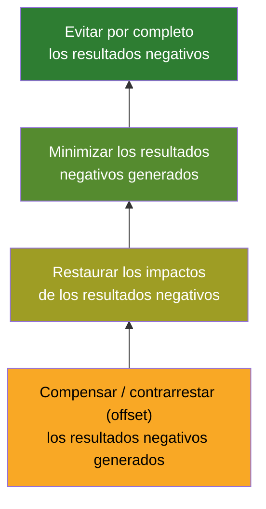

> Regla para el agente: al evaluar una opción con impacto negativo, proponer primero cómo evitarlo; si no es posible, minimizarlo; luego restaurar; y solo como último recurso compensar. Registrar en qué nivel queda cada impacto.

**Beneficios para la organización (reformulados):**

| Categoría | Ejemplos |
|---|---|
| Organizativos | Satisfacción, desempeño, retención y reclutamiento del personal; mejores relaciones con accionistas e interesados; mejores respuestas a riesgos; resiliencia y aprendizaje; mejor gobernanza y cumplimiento; menos litigios; más valor de marca y reputación |
| Operativos | Innovación en procesos internos; productividad por reducción de desperdicio; diseño para la sostenibilidad |
| Financieros | Ahorro directo por menos material y energía; menores costos operativos y de capital; mayor valor de la acción; acceso a inversores de finanzas sostenibles |
| Clientes e interesados | Satisfacción e innovación por escucha activa; crecimiento de cuota por demanda de productos sostenibles; reputación; nuevos mercados |

**Impacto en el proyecto.** Los requisitos de sostenibilidad pueden venir ya en los EEF (estrategias corporativas de sostenibilidad o de gestión de la información). Afecta de la iniciación al cierre: los KPI de sostenibilidad pueden incluirse en el enunciado de alcance, el acta de constitución, el business case, los contratos u otros documentos autorizantes, y su cumplimiento se monitorea en planificación, ejecución y cierre. Requisitos para instaurar la sostenibilidad:

- perspectiva social de los proyectos y sus resultados;
- compromiso amplio de interesados, con enfoque de «gestión **para** los interesados»;
- liderazgo responsable (ético) del equipo y de los interesados;
- foco holístico en el valor generado desde la perspectiva de la audiencia amplia (creación y distribución del valor).

**Ampliación de la orientación (reformulación de la figura del Estándar).** La sostenibilidad amplía dos ejes de la dirección de proyectos:

| Orientación | Interesados considerados | Horizonte temporal |
|---|---|---|
| Orientada al cumplimiento (*compliance-oriented*) | Patrocinadores y equipo | Ciclo de vida del proceso |
| Orientada al logro (*achievement-oriented*) | Todos los interesados influyentes | Ciclo de vida del entregable |
| Orientada a la sostenibilidad (*sustainability-oriented*) | Comunidad, sociedad y posteridad | Ciclo de vida de los resultados |

**Desafíos reconocidos.** (1) Amplía el alcance de la gestión (más horizonte, más interesados) y puede elevar costo y complejidad; las metas de sostenibilidad deben estar en los documentos formales (business case) y ser confirmadas por el patrocinador; si no lo están, el director igualmente debe propiciar la conversación. (2) **Riesgos de sostenibilidad** cuando no se equilibran lo social, económico y ambiental: priorizar costo sobre ambiente, ignorar impactos comunitarios, subestimar requisitos regulatorios; consecuencias en resultados, satisfacción y reputación. (3) No hay criterios universales de sostenibilidad; cada proyecto necesita un enfoque a medida y herramientas que den al equipo la información para gestionarla.

**Cómo se ve en acción (ejemplos reformulados).** En construcción, ignorar la sostenibilidad lleva a elegir el material más barato con daño ambiental y a la salud; aplicarla implica planificar los materiales, elegir fuentes de menor impacto o inspiradas en la naturaleza (madera en edificios urbanos, hormigón reciclado) e involucrar a las comunidades locales, sin dejar de atender el valor y la tasa interna de retorno. En tecnología: reducir consumo y desperdicio con herramientas adecuadas, buscar impacto social positivo (acceso a educación y salud), seleccionar materiales sostenibles y minimizar huella de carbono.

**Dominios conectados:**

| Dominio | Efecto de integrar sostenibilidad |
|---|---|
| Governance | Canal transparente y colaborativo con la gobernanza; metas de sostenibilidad incorporadas a las prácticas de gobernanza para beneficios ambientales y sociales de largo plazo |
| Scope | Comunicación abierta que recalibra el alcance (añadir, ajustar calidad, quitar); consideraciones de sostenibilidad embebidas en el alcance para cumplir o superar metas y normas |
| Schedule | Ideas para acelerar, ralentizar o detener actividades según oportunidades; decisiones de calendario que minimizan huella de carbono y uso de recursos |
| Finance | Puede requerir financiación adicional pero también reducir amenazas financieras; incluir beneficios «verdes» en requisitos; planificación financiera con inversiones sostenibles de ahorro a largo plazo |
| Stakeholders | Estrategias de compromiso que incluyen educación y colaboración en sostenibilidad para alinear a todas las partes |
| Resources | Priorizar materiales y prácticas sostenibles; personas con las habilidades necesarias y cultura de aprendizaje |
| Risk | Identificar y mitigar amenazas ambientales y sociales de largo plazo (regulatorias, societales); la sostenibilidad también abre oportunidades de innovación y eficiencia |

**Checklist para el agente:**

1. ¿El business case o el acta incluyen metas o KPI de sostenibilidad (ambientales, sociales, económicos) confirmados por el patrocinador? Si no, ¿he abierto la conversación?
2. ¿He identificado las externalidades negativas del proyecto y, para cada una, el nivel de la pirámide (evitar, minimizar, restaurar, compensar)?
3. ¿El registro de riesgos incluye riesgos de sostenibilidad (regulación, comunidad, reputación, recursos naturales)?
4. ¿Las decisiones de compras, materiales, viajes y tecnología consideran el impacto ambiental y social, y no solo el precio?
5. ¿El análisis de interesados incluye a la comunidad y a quienes vivirán con los resultados después del cierre?
6. ¿El cierre reporta el cumplimiento de las metas de sostenibilidad junto con costo, plazo y alcance?

**Señales de incumplimiento.** «Sostenibilidad» aparece solo como palabra en la presentación y no en requisitos, criterios de aceptación o KPI; el único criterio de selección de proveedores es el precio; no hay interesados comunitarios o regulatorios en el registro; los impactos negativos se asumen como inevitables sin evaluar alternativas; el proyecto optimiza su propio ciclo de vida sin considerar el del resultado.

---

### 3.9 Principio 6 — Construir una cultura empoderada (*Build an Empowered Culture*)

**Qué exige.** Construir una cultura que fomente la colaboración proactiva y la unidad en torno a objetivos compartidos, con interesados y equipos de habilidades, conocimientos y experiencias diversas. Requiere **confianza mutua** entre interesados y equipo y **plena claridad** sobre roles individuales, responsabilidades, acuerdos de equipo y procesos guía, de modo que la interacción produzca sinergias.

**Afirmaciones núcleo (reformuladas).** Los interesados determinan el éxito; interesados y miembros del equipo deben estar empoderados en múltiples dimensiones; un entorno colaborativo permite aportar ideas y recomendaciones libre y proactivamente; los equipos motivados y empoderados se relacionan activamente con los interesados clave porque saben que estos influyen mucho en desempeño y resultados.

**Impacto en el proyecto.** Los interesados están influidos por las culturas de las organizaciones involucradas y por el entorno; dentro de esas influencias, los equipos crean sus propias normas y pueden personalizar sus marcos organizativos para lograr la meta. Áreas que el principio habilita:

| Área | Qué implica |
|---|---|
| Diversidad | Equipos con personal interno, contratistas, voluntarios o terceros, algunos por periodos cortos; integrarlos presenta desafíos, pero una cultura que honra la diversidad gestiona mejor los conflictos y enriquece las perspectivas |
| Definición de procesos | El equipo define procesos que permitan completar tareas y asignaciones, y se compromete con otros interesados para entender, considerar, comunicar y responder a sus intereses, necesidades y opiniones |
| Habilidades interpersonales | Iniciativa, integridad, honestidad, colaboración, respeto, empatía, confianza; junto con la participación de interesados de principio a fin, abren el camino al éxito |
| Conocimiento de las estructuras organizativas | Conocer configuraciones y relaciones entre tareas y procedimientos; adaptar marcos que sincronicen las contribuciones individuales |
| Acuerdos de equipo (*team agreements*) | Parámetros de conducta y normas de trabajo establecidos por el propio equipo y sostenidos por compromisos individuales y colectivos; se crean **al inicio** del proyecto |

**Cómo se ve en acción (ejemplos reformulados).** Un equipo con dificultades de compromiso de interesados por complejidad territorial y diversidad: una cultura empoderada hace que los interesados se sientan vistos e incluidos desde el inicio y les da pautas para aportar valor y participar. Equipos remotos y virtuales: estilos de trabajo, husos horarios y falta de contacto presencial dificultan colaboración y relaciones; la cultura empoderada da a todos la oportunidad de construir y colaborar, resolver diferencias y gestionar conflictos proactivamente.

**Dominios conectados:**

| Dominio | Efecto de la cultura empoderada |
|---|---|
| Governance | Enfoque proactivo y colaborativo con el equipo de gobernanza; canal transparente con la dirección; alineación con menos desviaciones y confusión |
| Scope | Comunicación abierta que recalibra el alcance y los requisitos de calidad a las necesidades cambiantes |
| Schedule | Los equipos empoderados proponen acelerar, ralentizar o detener actividades para aprovechar oportunidades |
| Finance | Ayudan a reducir o eliminar gastos no planificados aplicando pasos, requisitos o restricciones que aumentan el foco en valor; identificación de metas de largo plazo para materializar beneficios |
| Stakeholders | El equipo establece, influye o define el nivel y carácter del compromiso con interesados dentro y fuera de la organización |
| Resources | El equipo restringe o habilita el acceso a recursos físicos según requisitos; igual para personas con habilidades, conocimiento y experiencia; promueve cultura de aprendizaje |
| Risk | El equipo define los umbrales de riesgo del proyecto y participa en las actividades de gestión de riesgo |

**Checklist para el agente:**

1. ¿Existen acuerdos de equipo escritos (normas de trabajo, comunicación, decisión, conflicto) desde el inicio?
2. ¿Cada rol conoce sus responsabilidades y sus límites de autoridad (p. ej., RACI o equivalente)?
3. ¿El equipo tiene espacio y canal para proponer cambios de alcance, calendario o enfoque, y se les da respuesta?
4. ¿La diversidad del equipo (interna, externa, remota, temporal) está considerada en la integración y comunicación?
5. ¿Los umbrales de riesgo y los procesos de trabajo se definieron **con** el equipo y no solo para él?
6. ¿Hay prácticas de aprendizaje (retrospectivas, lecciones) y se actúa sobre ellas?

**Señales de incumplimiento.** Decisiones operativas que siempre suben al director; miembros que desconocen qué hacen otros o quién decide; «eso no es mi trabajo» como respuesta frecuente; contratistas o remotos tratados como externos sin acceso a información; conflictos que se cronifican; nadie propone mejoras porque «no las escuchan».

---

### 3.10 Vista integrada: principios → preguntas de auditoría rápida

| Principio | Pregunta única de auditoría | Evidencia mínima esperada |
|---|---|---|
| Visión holística | ¿Se decidió mirando todo el sistema? | Análisis de impacto cruzado en cada cambio; mapa de dependencias |
| Foco en valor | ¿Sabemos qué valor entrega esto y a quién? | Business case vigente; trazabilidad entregable → resultado → beneficio |
| Calidad embebida | ¿Está definido «terminado» y se comprueba temprano? | Criterios de aceptación; plan de calidad; registro de defectos y lecciones |
| Líder responsable | ¿Hay un dueño visible de cada decisión y resultado? | Registro de decisiones; escalamientos documentados; informes honestos |
| Sostenibilidad | ¿Medimos y gestionamos impactos sobre personas, planeta y sociedad? | KPI de sostenibilidad; pirámide aplicada a externalidades; riesgos ESG |
| Cultura empoderada | ¿El equipo puede y quiere decidir y proponer? | Acuerdos de equipo; roles claros; propuestas del equipo registradas y respondidas |

---

## 4. Ciclos de vida del proyecto

### 4.1 Definición y los cinco factores

El **ciclo de vida del proyecto** (*project life cycle*) es la serie de actividades y/o fases que un proyecto atraviesa desde su inicio hasta su cierre. Es el marco fundacional para gestionarlo y aplica cualquiera sea el trabajo o el enfoque de desarrollo adoptado. El Estándar lo explora a través de cinco factores:

1. Fases del proyecto.
2. Enfoques de desarrollo (predictivo, adaptativo, híbrido).
3. Consideraciones para elegir el enfoque.
4. Cadencia de entrega.
5. Áreas de Enfoque de la dirección de proyectos (antes Grupos de Procesos).

### 4.2 Fases del proyecto (*project phases*)

Una **fase** es un conjunto de actividades lógicamente relacionadas que culmina en uno o más entregables y/o resultados. Las fases pueden ser **secuenciales, transicionales o solapadas**, y un proyecto puede combinar tipos; cada fase puede contener una o más etapas del ciclo de vida. El ciclo de vida del proyecto es **independiente** del ciclo de vida del producto (que puede ser parte de los resultados que el proyecto produce).

**Atributos de una fase** (medibles y propios de cada fase): nombre, número, duración, requisitos de recursos, **criterios de entrada** y **criterios de salida**.

**Puertas de fase (*phase gates*).** Revisión al final de una fase y antes de la siguiente (también llamada *stage gate*, revisión de puerta, revisión de iteración o revisión de punto de decisión) para comprobar que se lograron los resultados o criterios de salida. Los criterios de salida pueden ligarse a criterios de aceptación de entregables, obligaciones contractuales, metas de desempeño u otras medidas tangibles; los de entrada, a disponibilidad de recursos, verificación de viabilidad y alineación con las metas organizativas. Se compara desempeño y avance con los documentos de proyecto y de negocio que fijan expectativas, y se toma una decisión. Resultados posibles de una puerta (reformulados):

| Decisión | Significado |
|---|---|
| Continuar a la siguiente fase | Criterios cumplidos; sigue según plan |
| Continuar con modificaciones | Se avanza con cambios al plan, alcance o enfoque |
| Terminar el proyecto o la fase | Se cierra (anticipadamente si corresponde) |
| Permanecer en la fase | Faltan criterios; se sigue trabajando antes de pasar |
| Repetir la fase o parte de ella | Se rehace lo necesario |
| Aparcar temporalmente el proyecto | Se suspende para atender otra iniciativa urgente |

Las puertas pueden colocarse también **al inicio** de cada fase (*pre-phase gates*) para confirmar alineación, recursos y planificación suficientes y riesgos atendidos antes de avanzar; es un punto de control adicional.

**Ciclos de vida estándar y flexibilidad.** Las organizaciones con muchos proyectos suelen adoptar unos pocos ciclos de vida estándar; el director y el equipo pueden tener que asesorar a la dirección sobre el más adecuado, o les puede venir prescrito. Si no hay estándar, lo definen para cada proyecto. El ciclo de vida debe ser lo bastante flexible para alcanzar o superar los objetivos protegiendo la propuesta de valor. La flexibilidad incluye: elegir el enfoque o mezcla de enfoques; identificar los tipos de procesos y actividades a realizar; ajustar atributos de actividades, fases o procesos (nombre, duración, criterios de entrada y salida).

**Comportamiento típico de variables a lo largo de una fase genérica:**

| Variable | Patrón habitual | Matiz |
|---|---|---|
| Costo y dotación de personal | Bajos al inicio, crecen durante el trabajo y caen rápidamente al final de la fase o proyecto | Típico de escenarios predictivos |
| Riesgo e incertidumbre | Máximos al inicio y decrecen conforme se toman decisiones y se aceptan entregables | Aplica a cualquier ciclo de vida |
| Costo de los cambios | Bajo al inicio y creciente con el tiempo | Inverso al riesgo (ver diagrama) |
| Influencia de los interesados sobre el cambio | En algunos escenarios, máxima al inicio (pueden añadir valor sin gran impacto en costo y plazo) y decreciente hacia el final; en otros, se fomenta su participación activa durante la ejecución para confirmar que el valor se entrega según sus expectativas | La retroalimentación consistente permite detectar riesgos e impactos antes |

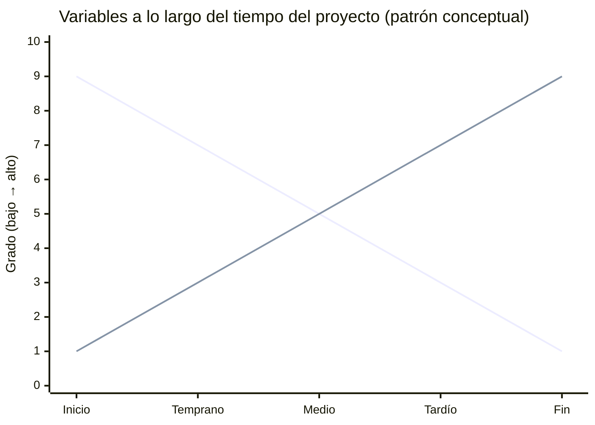

### 4.3 Enfoques de desarrollo (*development approaches*)

El **enfoque de desarrollo** es el medio para crear y hacer evolucionar el producto, servicio o resultado durante el ciclo de vida, y define cómo se gestionará y ejecutará el proyecto. No confundir con la **fase de desarrollo**, que es la etapa del ciclo de vida donde se crean y prueban los entregables. Los tres enfoques habituales forman un **espectro**: predictivo en un extremo, adaptativo en el otro, híbrido como mezcla; hacia la derecha el trabajo es cada vez más iterativo e incremental.

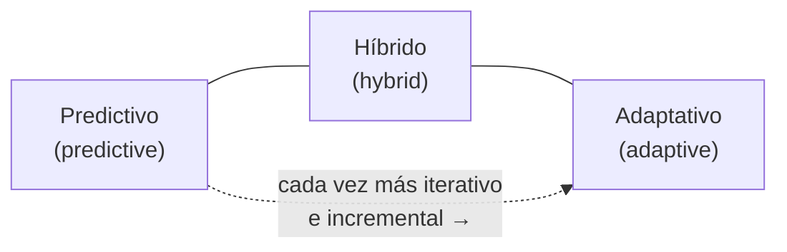

**Quién elige.** Normalmente el director de proyecto en consulta con el equipo de dirección, evaluando la naturaleza del proyecto para fijar el marco y la forma de trabajar. Factores principales: requisitos, alcance, plazo y metas; cultura y necesidades de la organización; nivel de involucramiento de interesados, perfil de riesgo, consideraciones tecnológicas y complejidad del contexto.

**Línea base integrada (*integrated baseline*).** Con requisitos claros y estables, el enfoque predictivo fija las líneas base de cronograma y costo a partir del alcance a entregar; las tres juntas forman la línea base integrada. Con requisitos poco claros o más complejidad e incertidumbre, se necesita más retroalimentación (del cliente o usuario final); el enfoque adaptativo revisa el trabajo periódicamente, a menudo en cadencia de **bloques de tiempo** (*timeboxes*), e incorpora la retroalimentación conforme la línea base integrada evoluciona; al final de cada bloque se revisan los requisitos implementados y se planifica el siguiente. El alcance se entrega de forma adaptativa en función de los bloques, el equipo y el presupuesto.

**Triángulo invertido (*inverted triangle*) — opciones de restricciones en enfoques adaptativos.** Los proyectos necesitan variar un conjunto de restricciones para operar con otras fijas:

| Restricción fija | Restricciones variables | Cómo se absorben los cambios inesperados |
|---|---|---|
| Alcance | Presupuesto y cronograma | Ajustando presupuesto o plazo |
| Presupuesto | Alcance (y plazo según el caso) | Variando el alcance |
| Cronograma | Alcance (y presupuesto según el caso) | Variando el alcance |

> Regla para el agente: en un proyecto adaptativo, hacer explícito desde el inicio **qué está fijo y qué es variable**; sin ese acuerdo, cualquier cambio se convierte en conflicto.

#### 4.3.1 Enfoque predictivo (*predictive approach*)

También llamado cascada (*waterfall*), guiado por plan (*plan-driven*) o tradicional.

**Cuándo es óptimo:**

- el alcance puede estabilizarse temprano; alcance, cronograma, costo, recursos, requisitos de calidad y riesgos se definen en fases tempranas y se espera que permanezcan estables;
- proyectos grandes con inversión significativa o supervisión regulatoria, que requieren control de cambios robusto y reevaluación planificada entre fases;
- cuando el costo de iterar supera con mucho su valor (p. ej., la fase de construcción de una obra);
- entornos muy regulados (p. ej., salud) con puertas de fase exigidas por el regulador para autorizar el avance (un fármaco o dispositivo médico debe demostrar suficiente promesa antes de seguir).

**Qué permite:** capturar certidumbre fiable temprano y hacer gran parte de la planificación por adelantado.

**Ciclo de vida predictivo de ejemplo (reformulado):** Factibilidad → Diseño → Construcción → Verificación → Transferencia → Cierre.

**Variante incremental dentro del enfoque predictivo.** Cuando el alcance global se entiende y planifica por adelantado pero conviene entregar por partes (tamaño, complejidad, riesgo), el proyecto se divide en fases o incrementos; cada uno entrega una parte del producto y se apoya en el anterior añadiendo funciones o completando partes. Los incrementos pueden ser secuenciales o solaparse y sus fases internas pueden diferir. Los interesados obtienen valor antes, pero **alcance y plazo globales siguen siendo mayormente fijos** y se mantiene la planificación estructurada y el control de cambios. Ejemplo de ciclo: Concepto → [Plan → Diseño → Construcción] × incremento 1, 2, 3 → Cierre.

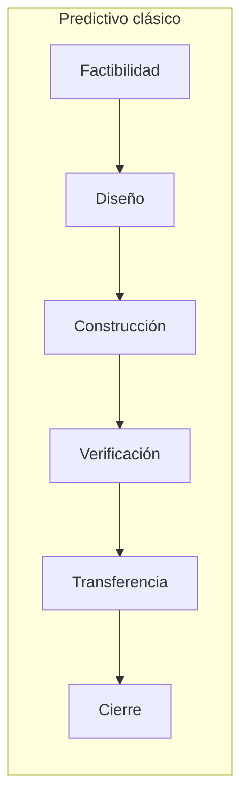

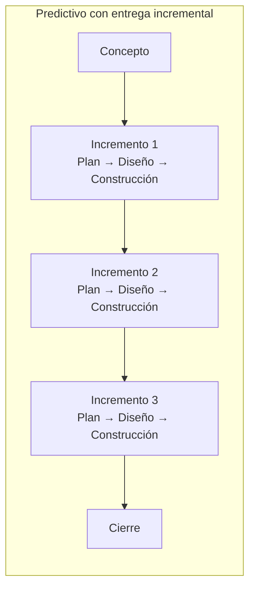

#### 4.3.2 Enfoque adaptativo (*adaptive approach*)

También llamado guiado por el cambio (*change-driven*) o ágil (*agile*).

**Cuándo es útil:** requisitos y solución técnica con alta incertidumbre y volatilidad, con alta probabilidad de cambiar significativamente. Se establece una **visión clara** al inicio y los requisitos conocidos se elaboran, cambian o reemplazan progresivamente según retroalimentación, entorno o eventos.

**Iterativo e incremental.** Lo iterativo refina y mejora mediante ciclos repetidos (**iteraciones**); lo incremental entrega el producto en segmentos usables (**incrementos**) que aportan valor y se acumulan hasta completar el producto. Los enfoques adaptativos pueden ser ambas cosas.

**Agilidad vs. enfoque.** La agilidad es una mentalidad más amplia que un marco de desarrollo; los enfoques ágiles pueden considerarse adaptativos. Algunos métodos ágiles usan iteraciones de 1 a 4 semanas con demostración de lo logrado al final de cada una; todo el equipo participa en la planificación a varios niveles; en cada iteración el equipo determina el alcance alcanzable a partir de los requisitos priorizados en el **backlog** de producto, estima el trabajo y lo desarrolla en colaboración.


**Programación basada en flujo (*flow-based scheduling*).** Varias metodologías adaptativas optimizan el flujo de trabajo a través del sistema: maximizar el flujo de entregables según capacidad de recursos, materiales y otras entradas; minimizar desperdicio de tiempo y recursos; maximizar eficiencia y rendimiento. Fuentes típicas: el método **Kanban** (gestión visual del flujo que limita el trabajo en curso, *work in process*, WIP, con base lean y entrega continua sin sobrecargar al equipo) y la **teoría de restricciones** (identificar y atender el factor limitante más significativo).

**Métodos por amplitud y profundidad.** Conviene distinguir métodos para un solo equipo de los diseñados para escala. Unos cubren más **amplitud** del ciclo de vida del proyecto o producto; otros más **profundidad** (detalle o prescripción de la guía). Ejemplos citados en la figura del Estándar (sin que este archivo los describa): Scrum, XP, Kanban, FDD, Crystal, Scrum of Scrums, LeSS, SAFe, DSDM, Agile UP, Lean. Distinción adicional: un **método** es una forma sistemática de hacer algo (pasos para un resultado); un **kit de herramientas** (*tool kit*) es una colección de herramientas, técnicas y recursos para apoyar varios métodos, con flexibilidad de elección según contexto. PMI Disciplined Agile (DA) está diseñado como kit de herramientas.

**Tipos de proyecto para los que lo adaptativo encaja bien:**

| Tipo | Por qué |
|---|---|
| Proyectos de diseño y desarrollo de nuevos productos | Requisitos no definidos por completo al inicio; se esperan entregas parciales y cambios |
| Nuevo producto orientado a mercado (app móvil, servicio web) | Las funciones finales se refinan según las necesidades del mercado |
| Proyectos digitales / software | Naturaleza dinámica; no todo software lo requiere, pero sí los de alcance cambiante, alta incertidumbre y necesidad de entrega temprana o incremental |

#### 4.3.3 Enfoque híbrido (*hybrid approach*)

Combinación de elementos adaptativos y predictivos. Apropiado cuando hay incertidumbre o riesgo en los requisitos (p. ej., el diseño de una casa a medida: se itera en el diseño; una vez cerrado, construir se itera como mucho una vez), cuando los entregables se pueden **modularizar**, o cuando distintos equipos desarrollan distintos entregables. Ejemplo: software desarrollado de forma adaptativa que debe instalarse en un centro de datos construido de forma predictiva. Las fases de un mismo proyecto pueden abordarse de forma distinta; un flujo principal con un enfoque y flujos subsidiarios con otro.

El Estándar afirma que **la mayoría de los proyectos actuales se benefician de un híbrido**; centrarse exclusivamente en un extremo no responde a la variedad de desafíos; el híbrido da flexibilidad para adaptarse manteniendo control sobre lo predecible.

**Cuatro patrones habituales:**

| Patrón | Descripción | Ejemplo reformulado |
|---|---|---|
| Adaptativo seguido de despliegue predictivo | Desarrollo iterativo temprano; luego un *rollout* planificado | Prototipado ágil de una solución, luego implantación por sedes con plan fijo |
| Adaptativo y predictivo en simultáneo durante todo el ciclo | Dos flujos paralelos con enfoques distintos | Edificio inteligente: obra civil predictiva + sistemas TI adaptativos |
| Mayormente predictivo con componente adaptativo | Un elemento adaptativo pequeño dentro de un proyecto predictivo | Historia clínica electrónica: infraestructura predictiva; interfaz de usuario adaptativa |
| Mayormente adaptativo con componente predictivo | Elementos predictivos para satisfacer restricciones de negocio | Producto digital ágil con una fase regulatoria planificada |

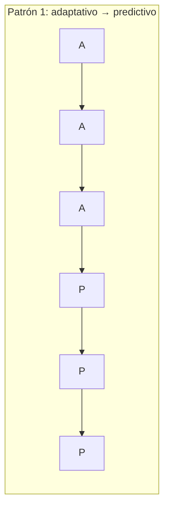

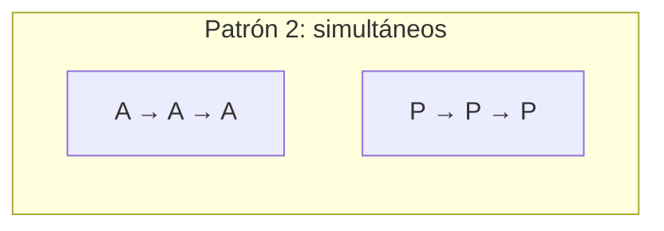

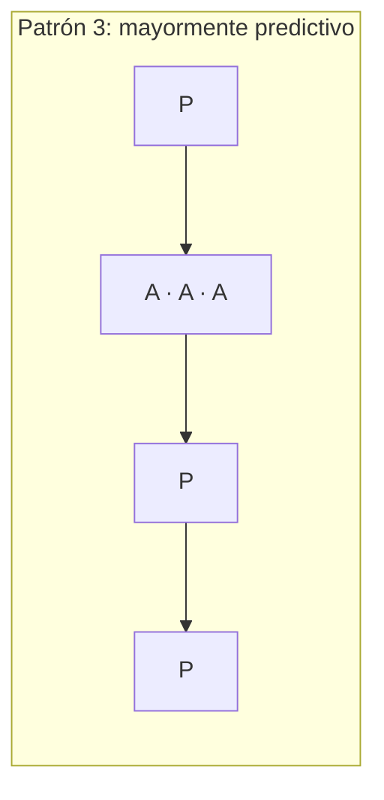

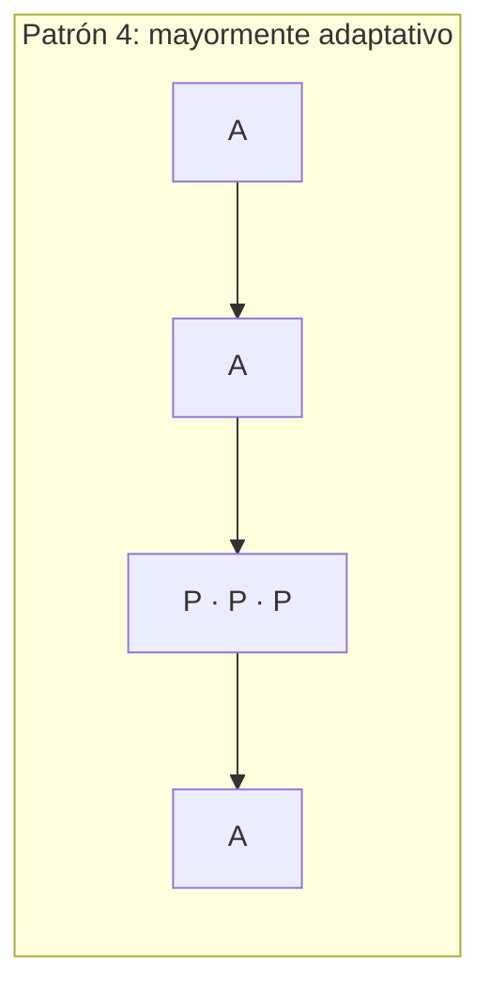

**Niveles híbridos según el kit DA (citados por el Estándar):**

| Nivel | Contribución dominante | Uso del otro enfoque |
|---|---|---|
| Híbrido nivel 1 | Predictivo | Elementos adaptativos para aliviar puntos de dolor concretos |
| Híbrido nivel 2 | Ambos contribuyen significativamente | Equilibrio |
| Híbrido nivel 3 | Adaptativo | Elementos predictivos para satisfacer restricciones de negocio |

### 4.4 Consideraciones para seleccionar el enfoque de desarrollo

Los factores se agrupan en tres categorías: **entregables**, **proyecto** y **organización**. Su diversidad implica que a menudo conviven varios enfoques dentro de un mismo proyecto para distintos entregables.

#### 4.4.1 Factores del entregable

| Factor | Empuja hacia predictivo cuando… | Empuja hacia adaptativo cuando… |
|---|---|---|
| Grado de innovación | La solución es conocida | Se requiere innovación tecnológica o de modelo de negocio nueva o compleja |
| Certeza de requisitos | Los requisitos son conocidos y fáciles de definir | Son inciertos o emergentes |
| Estabilidad del alcance | El alcance se mantiene estable en la ejecución | El alcance es inestable |
| Facilidad de cambio | Incorporar cambios es difícil o costoso por la naturaleza del entregable | Cambiar es barato |
| Opciones de entrega | Debe entregarse como un todo | Puede entregarse por componentes o elaborarse progresivamente (ver cadencia) |
| Riesgo | — | Hay incertidumbre y riesgo que gestionar con aprendizaje |
| Requisitos de seguridad | Requisitos de seguridad rigurosos exigen planificación anticipada para cumplimiento | — |
| Retroalimentación | Poca ganancia esperable de retroalimentación frecuente | Alto valor esperado de retroalimentación frecuente de usuarios e interesados |
| Regulación | Fuerte supervisión regulatoria con procesos, documentación y demostración exigidos | — |

#### 4.4.2 Factores del proyecto

| Factor | Implicación |
|---|---|
| Interesados | Lo adaptativo exige involucramiento significativo y continuo de los interesados |
| Restricciones de cronograma | Si hay valor en entregar algo temprano aunque no esté terminado → iterativo/adaptativo; si hay una fecha final fija que cumplir → predictivo ayuda a enfocar la planificación en el plazo |
| Incertidumbre de financiación | Con financiación incierta, lo adaptativo o iterativo puede generar más valor (se entrega valor con lo disponible) |
| Tamaño y complejidad | Los enfoques más flexibles convienen a proyectos grandes y complejos con requisitos cambiantes |
| Experiencia y habilidades del equipo | Lo adaptativo se beneficia de equipos con fuerte comunicación, colaboración y resolución de problemas |
| Interdependencias | Depender de otros proyectos, departamentos o funciones para decisiones, componentes o recursos es un factor a considerar al entregar de forma iterativa |

#### 4.4.3 Factores de la organización

| Factor | Implicación |
|---|---|
| Estructura organizativa | Estructuras funcionales fijas y jerárquicas tienden a lo predictivo (líneas de autoridad); estructuras en red, a lo adaptativo o híbrido |
| Cultura | Cultura de dirigir y controlar con medición contra líneas base → predictivo; cultura que acepta la incertidumbre, los equipos autogestionados, la flexibilidad y la innovación → adaptativo |
| Capacidad organizativa | Políticas, formas de trabajar, estructuras de reporte y actitudes deben estar alineadas con el método; el grado de establecimiento de los procesos de dirección afecta la fiabilidad y predictibilidad del enfoque elegido |
| Tamaño y ubicación del equipo | Lo adaptativo funciona mejor con equipos pequeños (algunos marcos recomiendan entre 3 y 9 personas); en predictivo e híbrido el tamaño depende más de requisitos y complejidad del alcance; algunos métodos adaptativos piden colocalización, aunque el trabajo remoto puede mejorar eficiencia y foco para algunas personas y equipos |

#### 4.4.4 Flujo de decisión para elegir el enfoque (elaboración propia a partir de los factores del Estándar)

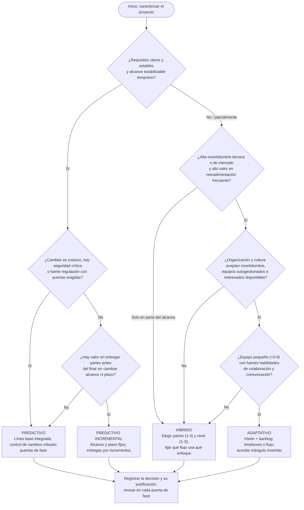

**Tabla de decisión complementaria (puntuación orientativa, elaboración propia):**

| Criterio | Puntuar 1 (predictivo) | Puntuar 2 (híbrido) | Puntuar 3 (adaptativo) |
|---|---|---|---|
| Certeza de requisitos | Alta | Media | Baja |
| Estabilidad del alcance | Alta | Media | Baja |
| Costo del cambio en el entregable | Alto | Medio | Bajo |
| Regulación / seguridad | Fuerte | Moderada | Débil |
| Valor de la retroalimentación frecuente | Bajo | Medio | Alto |
| Disponibilidad de interesados | Baja | Media | Alta |
| Cultura organizativa | Dirigir y controlar | Mixta | Autogestión e innovación |
| Tamaño del equipo | Grande | Medio | Pequeño |
| Presión por entrega temprana de valor | Baja | Media | Alta |

Lectura: suma ≤ 13 → predictivo (evaluar incremental si hay valor en entregas parciales); 14–21 → híbrido (decidir patrón por flujo de trabajo); ≥ 22 → adaptativo. La puntuación orienta la conversación; no sustituye al juicio ni al acuerdo con el patrocinador. Si distintos entregables puntúan distinto, el proyecto es híbrido por construcción.

### 4.5 Cadencia de entrega (*delivery cadence*)

Según el enfoque elegido, un proyecto puede tener:

| Cadencia | Descripción | Ejemplo reformulado | Enfoque habitual |
|---|---|---|---|
| Entrega única (*single delivery*) | Todos los resultados al final | Reingeniería de un proceso que se despliega al final | Predictivo |
| Entregas múltiples (*multiple deliveries*) | Varios componentes o elaboraciones entregados en distintos momentos; pueden ser secuenciales (desarrollo de un fármaco: preclínica, fases clínicas 1-2-3, registro, lanzamiento) o independientes y en paralelo (actualizar la seguridad de un edificio: barreras, credenciales, teclados); en todos los casos deben completarse para lograr los objetivos de negocio | Fármaco; seguridad de edificio | Predictivo incremental, híbrido |
| Entregas periódicas (*periodic deliveries*) | Como las múltiples pero en calendario fijo y regular (mensual, quincenal) | Software con entregas internas cada 2 semanas y liberaciones periódicas al mercado | Adaptativo |
| Entrega continua (*continuous delivery*) | Entrega incremental de valor a producción de forma permanente, con incrementos probados y validados siempre listos para producción; automatización y flujo continuo desde la priorización del backlog hasta el despliegue; despliegues frecuentes con riesgo mínimo y gran capacidad de respuesta al cliente y al mercado | Producto digital con despliegue frecuente | Adaptativo (flujo) |

> Regla para el agente: la cadencia es una decisión explícita del plan, ligada al enfoque y a cuándo los interesados necesitan empezar a obtener valor; debe constar en el acta o en el plan de gestión del proyecto.

---

## 5. Las cinco Áreas de Enfoque de la dirección de proyectos (*Project Management Focus Areas*)

### 5.1 Qué son y qué no son

- Describen las **acciones fundamentales** que ocurren en cualquier proyecto, sea predictivo, adaptativo o híbrido: Iniciar (*Initiating*), Planificar (*Planning*), Ejecutar (*Executing*), Monitorear y Controlar (*Monitoring and Controlling*) y Cerrar (*Closing*).
- Se implementan con **procesos formales, prácticas informales, políticas, procedimientos o técnicas**; por eso ya no se llaman Grupos de Procesos.
- Pueden ser iterativas, continuas y/o solapadas; se realizan cuando se planifica o cuando se necesita, en el proyecto completo y/o en cada fase.
- Se presentan en secuencia pero en la práctica se **solapan e interactúan dinámicamente**.
- **No son fases del proyecto**, aunque algunos nombres coincidan o una fase consista mayormente en acciones de un Área. Si el proyecto tiene fases, las cinco Áreas interactúan **dentro de cada fase**.
- Son independientes del área de aplicación (marketing, TI, contabilidad) y de la industria (construcción, aeroespacial, telecomunicaciones), y del enfoque: todos los enfoques las honran de algún modo.
- Se cruzan con los dominios de desempeño de maneras específicas descritas en la Guía (fuera de este archivo).
- Adaptarlas a cada proyecto permite planificar, ejecutar y controlar con eficacia en alineación con metas organizativas y expectativas de interesados.

### 5.2 Límites del proyecto (reformulación de la figura del Estándar)

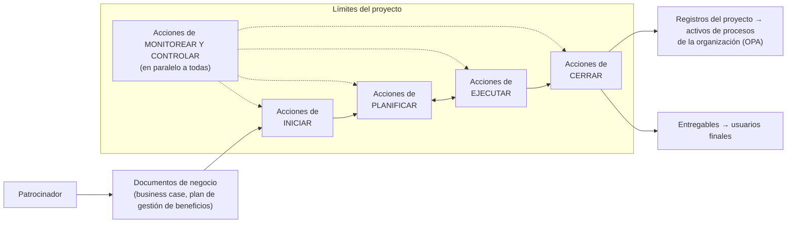

### 5.3 Las cinco Áreas en detalle

#### 5.3.1 Iniciar (*Initiating*)

| Aspecto | Contenido |
|---|---|
| Propósito | Definir un nuevo proyecto o una nueva fase; alinear las expectativas de los interesados con el propósito del proyecto; informarles del alcance y objetivos; alinear a los interesados clave y acordar cómo su participación ayuda a cumplir sus expectativas |
| Actividades típicas | Autorización formal del proyecto o fase; definición del alcance inicial; compromiso de recursos financieros iniciales; identificación de los interesados que influirán en el resultado; asignación de roles de dirección; en algunas organizaciones, participación del director en el business case y la definición de beneficios |
| Entradas destacadas | **Documentos de negocio** (*business documents*): se originan fuera del proyecto y entran como insumo; ejemplos: business case y plan de gestión de beneficios (*benefits management plan*). El patrocinador debe aportar en ellos la información mínima para que el director pueda empezar |
| Salidas típicas | Acta de constitución del proyecto (*project charter*); registro de interesados (*stakeholder register*) |
| Quién lo hace | Varía: el director; un equipo de dirección más amplio redactando el acta; o el trabajo preliminar lo hace el patrocinador, la PMO, un comité de cartera u otro grupo |
| Beneficio clave | Solo se autorizan proyectos alineados con la estrategia y con business case, beneficios e interesados considerados desde el inicio; involucrar a patrocinadores, clientes e interesados crea una comprensión compartida de los criterios de éxito y aumenta alineación y satisfacción |

#### 5.3.2 Planificar (*Planning*)

| Aspecto | Contenido |
|---|---|
| Propósito | Establecer el alcance previsto del esfuerzo, definir y refinar los objetivos y desarrollar el curso de acción para alcanzarlos |
| Actividades típicas | Desarrollar artefactos como el backlog de producto o el plan de gestión del proyecto; bucles de retroalimentación para análisis adicional; replanificar cuando aparecen cambios; planificación progresiva, iterativa o por **oleadas** (*rolling wave*) según fase y enfoque |
| Concepto clave | **Elaboración progresiva** (*progressive elaboration*): el refinamiento continuo del plan; la planificación es iterativa y continua |
| Diferencia por enfoque | Lo muy predictivo **concentra la planificación al inicio** (con actualizaciones posteriores habituales); lo muy iterativo hace una planificación breve de alto nivel al inicio (**roadmapping**) seguida de planificación y replanificación frecuentes. Nota del Estándar: aun cuando el alcance vaya a cambiar mucho y el análisis detallado de trade-offs alcance/plazo/costo parezca inútil, suele ser crucial discutir cuán sensible es la propuesta de valor a duraciones o fechas concretas y a exceder un umbral de inversión |
| Salidas típicas | **Plan de gestión del proyecto** (*project management plan*): la colección de conocimiento y artefactos que describe el curso de acción; en algunas organizaciones se somete a aprobación formal y es la referencia autorizada de cómo se gestionará el proyecto; backlog de producto; hoja de ruta |
| Beneficio clave | Definir el curso de acción para completar con éxito el proyecto o fase; cuando el equipo de dirección está orientado y confiado en el curso de acción, está listo para ejecutar |

#### 5.3.3 Ejecutar (*Executing*)

| Aspecto | Contenido |
|---|---|
| Propósito | Completar el trabajo de forma consistente con el curso de acción acordado |
| Actividades típicas | Coordinar recursos; gestionar el compromiso de los interesados; realizar las actividades del proyecto y otras tareas |
| Regla | El plan **puede y debe cambiarse** siempre que el cambio mejore la propuesta de valor del proyecto |
| Dónde se nota el enfoque | Es el Área donde la elección predictivo/adaptativo/híbrido se hace más evidente |
| Salidas típicas | Entregables; datos de desempeño del trabajo; solicitudes de cambio; actualizaciones de documentos (inferido del flujo general; el Estándar no enumera salidas en esta sección: no determinado en la fuente) |
| Beneficio clave | Ejecución enfocada en alcanzar la propuesta de valor representada por la línea base integrada |

#### 5.3.4 Monitorear y Controlar (*Monitoring and Controlling*)

| Aspecto | Contenido |
|---|---|
| Propósito | Seguir, medir, revisar y regular el avance y el desempeño; identificar dónde se requieren cambios al plan; iniciarlos |
| Monitorear incluye | Comparar datos de desempeño; producir medidas de desempeño; comparar real vs. planificado; reportar y difundir información de desempeño |
| Controlar incluye | Analizar variaciones; evaluar tendencias para mejorar procesos; evaluar alternativas; recomendar correcciones de rumbo |
| Ritmo | Medición y análisis a intervalos regulares, en eventos apropiados o ante condiciones excepcionales; si hay variaciones, el equipo de dirección identifica acciones correctivas que se **negocian y acuerdan** con los interesados apropiados |
| Esfuerzo según enfoque | Con plan estable, esfuerzo bastante constante durante la ejecución; con cambios frecuentes y significativos (típico adaptativo), esfuerzo menos uniforme |
| Alcance | Controla el trabajo de cada fase y del proyecto como un todo; se realiza **en paralelo** con las demás Áreas; no es un área separada e independiente |
| Beneficio clave | Asegurar que el proyecto sigue en camino de cumplir las expectativas |

#### 5.3.5 Cerrar (*Closing*)

| Aspecto | Contenido |
|---|---|
| Propósito | Completar o cerrar formalmente un proyecto, fase o contrato; o terminar un proyecto antes de completarlo |
| Actividades típicas | Verificar que las acciones específicas de las otras Áreas se completaron antes de declarar el cierre; transición a operaciones; verificación del logro de salidas, resultados y beneficios; archivo de registros en los OPA; suspensión o cierre anticipado cuando cancelar es la mejor forma de maximizar el retorno (o de minimizar un retorno que se volvió negativo) |
| Salidas típicas | Entregables transferidos a usuarios finales; registros del proyecto incorporados a los activos de procesos de la organización |
| Beneficio clave | Fases, proyectos y contratos se cierran adecuadamente y transitan a operaciones de modo que se alcancen o superen los objetivos de negocio; verificar salidas, resultados y beneficios es esencial para confirmar el valor y las expectativas |

### 5.4 Cómo se interrelacionan

**Patrón predictivo (reformulación de la figura del Estándar).** Dentro de un proyecto o fase, el nivel de esfuerzo de cada Área varía: Iniciar concentra esfuerzo al comienzo; Planificar crece y decae temprano; Ejecutar domina la parte central; Monitorear y Controlar se mantiene durante todo el recorrido; Cerrar crece al final. En un ejemplo de obra, las fases técnicas (ingeniería, compras, construcción, puesta en marcha, entrega) se superponen a ese patrón de Áreas.

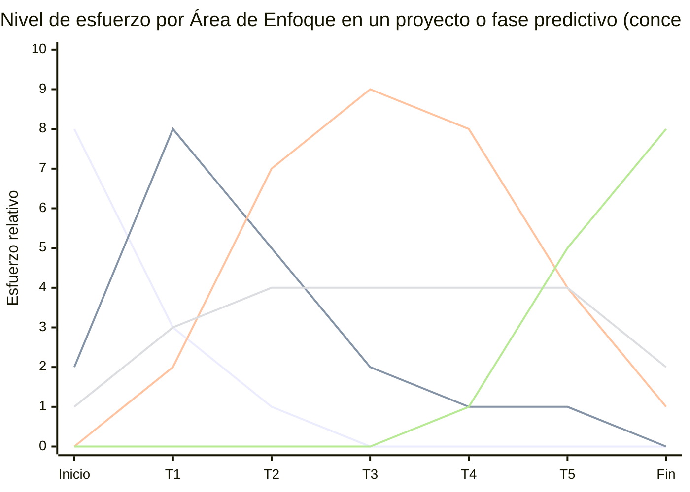

**Patrón adaptativo.** Las cinco Áreas no son lineales ni secuenciales ni ocurren todas a la vez: interactúan dentro de **iteraciones cortas**, solapándose; cada Área se revisita regularmente para refinar y ajustar con datos reales, retroalimentación y necesidades cambiantes. Secuencia conceptual: Iniciar → [Planificar → Ejecutar → Monitorear y Controlar] por iteración, repetido → Cerrar.

```mermaid
flowchart LR
    I["Iniciar"] --> IT1
    subgraph IT1["Iteración 1"]
        P1["Planificar"] --> E1["Ejecutar"]
        MC1["Monitorear y<br/>Controlar"] -.-> P1 & E1
    end
    IT1 --> IT2
    subgraph IT2["Iteración 2"]
        P2["Planificar"] --> E2["Ejecutar"]
        MC2["Monitorear y<br/>Controlar"] -.-> P2 & E2
    end
    IT2 --> IT3["Iteración n…"] --> C["Cerrar"]
```

### 5.5 Mapeo a las fases del agente y a los procesos PRINCE2

El paquete de habilidades organiza el trabajo del agente en **cuatro fases** (Inicio, Planificación, Control y seguimiento, Cierre) más una capa transversal de **Dirección** (decisiones del patrocinador / junta del proyecto). El mapeo siguiente es **elaboración propia**; no proviene del Estándar ni del manual PRINCE2.

| Área de Enfoque PMBOK 8 | Fase del agente | Procesos PRINCE2 7 relacionados | Qué hace el agente en esa intersección |
|---|---|---|---|
| Iniciar (*Initiating*) | **Inicio** | Starting up a project (SU) · Initiating a project (IP) · Directing a project (DP: autorizar iniciación, autorizar el proyecto) | Verificar mandato y business case; redactar acta de constitución / brief y PID; registro de interesados; obtener autorización formal del patrocinador/junta |
| Planificar (*Planning*) | **Planificación** (inicial y por fase/etapa) | Initiating a project (IP: planes y enfoques) · Managing a stage boundary (SB: plan de la siguiente etapa) · Práctica Plans | Plan de gestión del proyecto / plan de proyecto y de etapa; backlog o hoja de ruta; líneas base o acuerdos de triángulo invertido; elaboración progresiva en cada límite de etapa |
| Ejecutar (*Executing*) | **Control y seguimiento** (el agente coordina, no produce el entregable especialista) | Controlling a stage (CS: autorizar y recibir paquetes de trabajo) · Managing product delivery (MP) | Autorizar paquetes de trabajo; coordinar recursos; gestionar compromiso de interesados; registrar avance y entregables aceptados |
| Monitorear y Controlar (*Monitoring and Controlling*) | **Control y seguimiento** | Controlling a stage (CS: revisar estado, incidencias, riesgos, escalar) · Managing a stage boundary (SB: evaluar etapa, actualizar business case) · Práctica Progress · Directing a project (DP: dar dirección continua) | Informes de estado/highlight; análisis de variaciones y tendencias; gestión de excepciones y escalamiento; solicitudes de cambio; revisión de puertas de fase / límites de etapa |
| Cerrar (*Closing*) | **Cierre** | Closing a project (CP) · Directing a project (DP: autorizar cierre) | Verificar aceptación y transferencia a operaciones; evaluar resultados y procesos de dirección por separado; lecciones a los OPA; plan de revisión de beneficios; cierre anticipado cuando corresponda |
| (Transversal) decisiones del patrocinador en todas las Áreas | **Dirección** | Directing a project (DP) completo | Preparar la decisión para el patrocinador/junta; nunca sustituirla; registrar la decisión y su justificación |

Notas de mapeo:

- PMBOK no separa «ejecutar» de «controlar» en fases distintas: ocurren en paralelo. En el modelo del agente ambas viven en **Control y seguimiento**, porque el agente coordina y controla mientras los especialistas ejecutan (equivalente a la distinción PRINCE2 entre CS y MP).
- PRINCE2 **Starting up a project** ocurre antes de que exista el proyecto formal; en PMBOK, el trabajo previo a la iniciación lo hacen patrocinador, PMO o cartera (documentos de negocio). El agente trata SU como la parte temprana de **Inicio**.
- Los límites de etapa (SB) combinan Planificar (siguiente etapa) y Monitorear/Controlar (evaluar la actual); en PMBOK equivalen a una **puerta de fase**.
- PMBOK incluye cerrar **contratos** y **fases**, no solo el proyecto; PRINCE2 lo cubre en SB (fin de etapa) y CP (fin de proyecto).

```mermaid
flowchart LR
    subgraph PMBOK["PMBOK 8 — Áreas de Enfoque"]
        A1["Iniciar"] --> A2["Planificar"] --> A3["Ejecutar"] --> A5["Cerrar"]
        A4["Monitorear y Controlar"] -.-> A1 & A2 & A3 & A5
    end
    subgraph AG["Fases del agente"]
        F1["Inicio"] --> F2["Planificación"] --> F3["Control y seguimiento"] --> F4["Cierre"]
        F0["Dirección (transversal)"] -.-> F1 & F2 & F3 & F4
    end
    subgraph P2["PRINCE2 7 — Procesos"]
        SU["SU"] --> IP["IP"] --> CS["CS ⇄ MP"] --> CP["CP"]
        SB["SB"] -.-> CS
        DP["DP"] -.-> SU & IP & CS & SB & CP
    end
    A1 -.-> F1 -.-> SU
    A2 -.-> F2 -.-> IP
    A3 -.-> F3 -.-> CS
    A4 -.-> F3 -.-> SB
    A5 -.-> F4 -.-> CP
    F0 -.-> DP
```

---

## 6. Tabla de correspondencia PMBOK 8 ↔ PRINCE2 7

> **Advertencia.** Este mapeo es **elaboración propia** del paquete; ni PMI ni PeopleCert publican una equivalencia oficial. Los marcos tienen naturaleza distinta: PMBOK 8 es un estándar **descriptivo** basado en principios y dominios (qué considerar); PRINCE2 7 es un **método** prescriptivo basado en principios, prácticas y procesos (qué hacer y quién). Las correspondencias indican dónde se refuerzan y dónde uno cubre lo que el otro deja abierto. Para el detalle de PRINCE2, ver los archivos compañeros.

### 6.1 Principios vs. principios

| Principio PMBOK 8 | Principio(s) PRINCE2 7 más cercanos | Relación | Dónde se complementan |
|---|---|---|---|
| Adopt a Holistic View | Tailor to suit the project (adaptar al contexto); Manage by stages (visión del todo en etapas); Define roles, responsibilities and relationships | Parcial: PRINCE2 no tiene un principio de pensamiento sistémico explícito; lo logra con el contexto del proyecto y las etapas | PMBOK aporta el enfoque de sistema y de interdependencias; PRINCE2 aporta la mecánica de etapas y límites para revisar el todo |
| Focus on Value | Ensure continued business justification | Fuerte | PRINCE2 exige business case vivo y revisado en cada límite de etapa; PMBOK amplía a valor no financiero, social y a la medición post-cierre |
| Embed Quality Into Processes and Deliverables | Focus on products (productos definidos con criterios de calidad); Learn from experience (mejora continua) | Fuerte | PRINCE2 operacionaliza con descripciones de producto y la práctica Quality; PMBOK añade las nueve dimensiones de calidad y el *shift-left* |
| Be an Accountable Leader | Define roles, responsibilities and relationships; Manage by exception (rendición de cuentas con tolerancias) | Parcial | PRINCE2 fija la rendición de cuentas en la estructura (junta, ejecutivo, PM); PMBOK la fija en el comportamiento (integridad, liderazgo compartido, seguridad psicológica) |
| Integrate Sustainability Within All Project Areas | No hay principio equivalente; PRINCE2 7 trata la sostenibilidad como **aspecto de desempeño** y en el contexto del proyecto, con metas de sostenibilidad en el business case y el enfoque de gestión de la sostenibilidad en el PID | Parcial | Ambos piden metas de sostenibilidad formales confirmadas por el patrocinador/ejecutivo; PMBOK añade la pirámide de estrategias (evitar → compensar) |
| Build an Empowered Culture | Define roles, responsibilities and relationships; Manage by exception (delegación con tolerancias); elemento Personas (cultura, colaboración, liderazgo) | Fuerte en el elemento Personas | PRINCE2 7 introdujo un capítulo de personas que coincide con este principio; PMBOK añade acuerdos de equipo y diversidad explícita |
| (sin equivalente directo PMBOK: el Estándar no tiene principio de «aprender») | Learn from experience | — | PMBOK lo cubre dentro de calidad (mejora continua), OPA (repositorios de lecciones) y el Área Cerrar |
| (sin equivalente directo PMBOK) | Manage by exception | — | PMBOK lo cubre en gobernanza (modelos de decisión, umbrales de riesgo definidos por el equipo) y en Monitorear y Controlar (variaciones negociadas con interesados) |

### 6.2 Áreas de Enfoque vs. procesos

| Área de Enfoque PMBOK 8 | Procesos PRINCE2 7 | Comentario |
|---|---|---|
| Initiating | Starting up a project (SU); Initiating a project (IP); Directing a project (DP: autorizar iniciación y autorizar el proyecto) | PRINCE2 divide en dos: pre-proyecto (SU: brief, enfoque, plan de etapa de iniciación) e iniciación (IP: PID). El acta de constitución PMBOK ≈ brief + mandato; el plan de gestión PMBOK ≈ PID |
| Planning | Initiating a project (IP: planes y enfoques de gestión); Managing a stage boundary (SB: plan de siguiente etapa); práctica Plans | PRINCE2 fuerza replanificar en cada límite de etapa, lo que equivale a elaboración progresiva planificada |
| Executing | Controlling a stage (CS: autorizar paquetes de trabajo, recibir productos terminados); Managing product delivery (MP) | PRINCE2 separa la gestión (CS) de la entrega especialista (MP) mediante paquetes de trabajo |
| Monitoring and Controlling | Controlling a stage (CS: revisar estado, incidencias y riesgos, informes highlight, escalar excepciones); Managing a stage boundary (SB: informe de fin de etapa, actualizar business case); Directing a project (DP: dar dirección continua); práctica Progress | La gestión por excepción de PRINCE2 estructura cuándo escalar; PMBOK deja el umbral a la gobernanza del proyecto |
| Closing | Closing a project (CP); Directing a project (DP: autorizar cierre); SB para cierre de etapa | Ambos exigen verificar aceptación, transferir a operaciones, lecciones y plan de revisión de beneficios; ambos contemplan el cierre prematuro |

### 6.3 Dominios de desempeño vs. prácticas

> Los dominios de desempeño se describen en la Guía (fuera de este archivo); aquí solo se nombran para completar el mapa.

| Dominio de desempeño PMBOK 8 | Práctica(s) PRINCE2 7 | Comentario |
|---|---|---|
| Governance | Business case (justificación); Organisation (estructura, roles); Progress (gestión por excepción, controles) | La gobernanza PMBOK reparte entre tres prácticas PRINCE2; el proceso DP es su encarnación operativa |
| Scope (incluye calidad) | Plans (planificación basada en productos, descripciones de producto); Quality (criterios, revisión de calidad, aceptación); Issues (control de cambios de alcance) | PMBOK 8 integra calidad en alcance; PRINCE2 las separa en dos prácticas |
| Schedule | Plans (cronograma del plan de proyecto, de etapa y de equipo); Progress (tolerancias de tiempo, informes) | PRINCE2 no detalla técnicas de cronograma; PMBOK sí (en la Guía) |
| Finance | Business case (costos, beneficios, inversión); Plans (presupuesto, reservas); Progress (tolerancias de costo) | Ambos vinculan lo financiero a la justificación |
| Stakeholders | Organisation (interesados, enfoque de comunicación); elemento Personas (liderazgo, cultura, colaboración) | PRINCE2 7 trasladó gran parte a Personas |
| Resources | Organisation (roles, equipos); Plans (recursos del plan); elemento Personas (equipos, capacidad) | PMBOK incluye recursos físicos y humanos; PRINCE2 reparte entre organización y planes |
| Risk | Risk (procedimiento de gestión de riesgos, registro, tolerancias, respuestas) | Correspondencia muy directa |
| (sin dominio propio; cubierto en Governance) | Issues (incidencias y control de cambios) | PMBOK 8 trata las incidencias y los cambios dentro de gobernanza y de Monitorear y Controlar |

### 6.4 Artefactos equivalentes (orientativo)

| PMBOK 8 (Estándar y Guía) | PRINCE2 7 | Uso en el paquete del agente |
|---|---|---|
| Business case; benefits management plan (documentos de negocio) | Business case; benefits management approach | Un solo business case con sección de gestión de beneficios |
| Project charter | Project mandate + project brief | Acta de constitución / brief (ver plantillas-inicio-y-planes.md) |
| Project management plan | Project initiation documentation (PID) | PID / plan de gestión del proyecto |
| Stakeholder register | Parte del enfoque de comunicación y del registro de interesados en organización | Registro de interesados |
| Phase gate / gate review | Límite de etapa (stage boundary) y autorización de etapa | Revisión de puerta de fase / fin de etapa |
| Work performance reports | Highlight report; checkpoint report; end stage report | Informe de estado (ver plantillas-documentos-registros-reportes.md) |
| Change request | Request for change / issue report | Solicitud de cambio |
| Lessons learned repository (OPA) | Lessons log; lessons report | Registro de lecciones |
| Final report / project closeout | End project report | Informe de cierre |

---

## 7. Reglas operativas para un agente de IA

Las reglas siguientes traducen el Estándar en comportamiento por defecto. Si una regla choca con una instrucción explícita del usuario o del patrocinador, el agente lo señala y sigue la instrucción, dejando constancia.

### 7.1 Contexto y justificación

1. **Ubicar siempre el proyecto en su sistema de entrega de valor.** Antes de planificar, identificar cartera, programa, producto y operaciones afectadas, y la estrategia a la que contribuye. Si no hay trazabilidad a un objetivo estratégico, registrarlo como riesgo de justificación.
2. **Exigir la cadena entregable → resultado → beneficio → valor.** Cada entregable del plan debe nombrar el resultado que habilita y el beneficio esperado; cada beneficio, su métrica, su dueño y el momento de medición (incluso tras el cierre).
3. **Distinguir salida de resultado en todo informe.** Nunca reportar un entregable aceptado como valor logrado.
4. **Evaluar el éxito en dos dimensiones separadas**: resultados (eficacia, valor) y procesos de dirección (eficiencia: alcance, tiempo, costo, calidad). Reportar ambas en cada puerta de fase y en el cierre.
5. **Proponer el cierre o replanteo cuando la justificación se debilita**, citando cuál de las cinco condiciones de fin de proyecto aplica. No defender la continuación por lo ya invertido.
6. **Inventariar EEF y OPA al inicio.** Listar factores internos y externos que restringen o habilitan; identificar qué políticas, plantillas y procesos son obligatorios, cuáles adaptables y qué repositorios se deben alimentar. Si no existen OPA, usar las plantillas del paquete y declararlo.
7. **Adaptar (tailor) explícitamente.** Toda desviación de un ciclo de vida, plantilla o proceso estándar de la organización se documenta con su justificación.

### 7.2 Gobernanza y roles

8. **Identificar al patrocinador (o cliente / dueño de producto) con nombre y autoridad.** Si no existe, no está disponible o no decide, registrar riesgo alto y escalar. El agente **nunca** toma decisiones que corresponden al patrocinador; las prepara.
9. **Definir roles, responsabilidades y límites de autoridad por escrito** (RACI o equivalente) antes de ejecutar; incluir quién acepta cada entregable.
10. **Separar gobernanza organizativa de gobernanza del proyecto.** Registrar qué políticas, regulación y responsabilidades vienen impuestas desde la organización y qué estructura de decisión (comité, junta, umbrales) se establece para este proyecto.
11. **Involucrar a operaciones desde la planificación.** Identificar al receptor operativo de cada entregable y planificar la transferencia de productos, personas y conocimiento.
12. **Registrar cada decisión relevante** con fecha, responsable, alternativas consideradas y justificación en valor; las decisiones de puerta de fase usan el menú de seis resultados (continuar, continuar con cambios, terminar, permanecer, repetir, aparcar).

### 7.3 Principios en la práctica

13. **Analizar impacto cruzado en cada cambio** (alcance, cronograma, finanzas, interesados, recursos, riesgo, sostenibilidad) antes de recomendar aprobarlo o rechazarlo.
14. **Buscar causa raíz** ante problemas recurrentes antes de proponer acciones correctivas.
15. **Definir criterios de aceptación medibles y una definición de terminado** para cada entregable, acordados con quien acepta; planificar revisiones y pruebas lo más temprano posible (*shift-left*).
16. **Registrar defectos, retrabajo y lecciones** y proponer mejoras de proceso, no solo correcciones de producto.
17. **Comunicar malas noticias de forma temprana y completa**; nunca ocultar ni suavizar desviaciones, riesgos materializados o errores propios.
18. **Incluir metas o KPI de sostenibilidad** en acta, business case o plan; si el patrocinador no las define, dejar constancia de haberlo planteado. Para cada externalidad negativa, indicar el nivel de la pirámide (evitar, minimizar, restaurar, compensar).
19. **Incluir riesgos de sostenibilidad** (regulatorios, comunitarios, reputacionales, de recursos) en el registro de riesgos.
20. **Promover acuerdos de equipo al inicio** (normas de trabajo, comunicación, decisión, conflicto) y verificar que el equipo tiene canal para proponer cambios y recibe respuesta.
21. **Definir umbrales de riesgo y procesos de trabajo con el equipo**, no solo para el equipo.

### 7.4 Ciclo de vida y enfoque

22. **Elegir y justificar el enfoque de desarrollo** usando los factores de entregable, proyecto y organización (flujo de §4.4.4); registrar la decisión en el acta o plan y revisarla en cada puerta de fase.
23. **Permitir enfoques distintos por entregable.** Si los factores difieren entre entregables, declarar el proyecto híbrido y especificar el patrón (1–4) y qué flujo usa qué enfoque.
24. **En enfoques adaptativos, acordar el triángulo invertido**: qué restricción es fija (alcance, presupuesto o plazo) y cuáles varían; sin ese acuerdo no iniciar la ejecución.
25. **Definir fases con criterios de entrada y salida** y puertas de fase (al final y, si conviene, al inicio); documentar los criterios antes de empezar la fase.
26. **Declarar la cadencia de entrega** (única, múltiple, periódica, continua) y ligarla a cuándo los interesados necesitan empezar a obtener valor.
27. **No confundir Áreas de Enfoque con fases.** Dentro de cada fase, verificar que las cinco Áreas están cubiertas (aunque sea con prácticas informales).
28. **Planificar con elaboración progresiva.** En predictivo, plan detallado al inicio con actualizaciones controladas; en adaptativo, hoja de ruta de alto nivel y replanificación por iteración; en ambos casos, discutir la sensibilidad de la propuesta de valor a fechas y a umbrales de inversión.

### 7.5 Control, cierre y conocimiento

29. **Monitorear a intervalos regulares, en eventos definidos y ante excepciones**; comparar real vs. plan; analizar variaciones y tendencias; proponer correcciones que se negocian con los interesados apropiados, no se imponen.
30. **Ajustar el plan cuando mejore la propuesta de valor**, siguiendo el control de cambios acordado; no congelar el plan por principio ni cambiarlo sin registro.
31. **Al cerrar (proyecto, fase o contrato), verificar**: aceptación formal de entregables, transferencia a operaciones realizada, evaluación de resultados y de procesos de dirección, lecciones archivadas en los OPA, plan de medición de beneficios con dueño, y liberación ordenada de recursos.
32. **Tratar el cierre anticipado como un resultado legítimo de gobernanza**, con la misma disciplina de aceptación, transferencia y lecciones.
33. **Alimentar los repositorios de conocimiento durante todo el proyecto** (lecciones, métricas, incidencias, defectos, desempeño financiero), no solo al final.

### 7.6 Comunicación y uso de tecnología

34. **Mantener el flujo de información del sistema de valor**: hacia arriba (desempeño y avance a cartera/patrocinador), hacia operaciones (entregables con información de soporte) y desde operaciones (necesidades de ajuste).
35. **Diálogo continuo con usuarios finales e interesados clave**, con verificación y validación iterativas; registrar la retroalimentación y qué se hizo con ella.
36. **Al usar IA o automatización para analizar o recomendar**, declarar la fuente de datos, verificar su exactitud, vigilar sesgos y mantener la supervisión humana en las decisiones; coordinar con TI la protección de la información.
37. **Usar la terminología del Estándar en los artefactos** (con el equivalente PRINCE2 cuando el proyecto use ambos marcos) y evitar duplicar documentos equivalentes (§6.4).
38. **Cuando una afirmación no pueda sustentarse en el Estándar ni en PRINCE2**, etiquetarla como criterio propio del agente o del paquete.

---

## 8. Glosario ES/EN

| Español | English | Definición breve (palabras propias) |
|---|---|---|
| Acta de constitución del proyecto | Project charter | Documento que autoriza formalmente el proyecto o fase y recoge alcance inicial, objetivos, roles y criterios de aceptación de alto nivel |
| Activos de los procesos de la organización | Organizational process assets (OPA) | Planes, procesos, políticas, plantillas y repositorios de conocimiento propios de la organización que influyen en la gestión del proyecto |
| Acuerdos de equipo | Team agreements | Normas de conducta y de trabajo definidas por el propio equipo al inicio y sostenidas por compromiso individual y colectivo |
| Adaptación | Tailoring | Ajustar enfoque, procesos, plantillas y gobernanza al contexto específico del proyecto |
| Analista de negocio | Business analyst | Rol que recoge y documenta requisitos y alinea alcance del proyecto, funcionalidad del producto y necesidad de negocio |
| Aptitud para el uso | Fitness for use | Medida de calidad: el entregable sirve para el propósito previsto |
| Área de Enfoque | Focus Area | Cada uno de los cinco conjuntos de acciones de dirección (iniciar, planificar, ejecutar, monitorear y controlar, cerrar); antes, Grupos de Procesos |
| Artefacto | Artifact | Documento u otro elemento creado para ayudar a gestionar e informar |
| Backlog de producto | Product backlog | Lista priorizada de requisitos o elementos de trabajo en enfoques adaptativos |
| Beneficio | Benefit | Ganancia o activo obtenido por la organización u otros interesados a partir de los resultados |
| Bloque de tiempo | Timebox | Periodo fijo de trabajo al final del cual se revisa lo hecho y se planifica el siguiente |
| Business case | Business case | Documento de negocio que justifica la inversión: necesidad, opciones, costos, beneficios, riesgos |
| Cadencia de entrega | Delivery cadence | Patrón temporal de entregas: única, múltiple, periódica o continua |
| Calidad | Quality | Grado en que las características de un entregable o proceso ayudan a alcanzar o superar los objetivos |
| Cartera | Portfolio | Conjunto de programas, proyectos y operaciones gestionado como grupo para maximizar valor estratégico |
| Ciclo de vida del producto | Product life cycle | Fases de un producto: introducción, crecimiento, madurez, declive/retiro |
| Ciclo de vida del proyecto | Project life cycle | Serie de actividades y/o fases desde el inicio hasta el cierre del proyecto |
| Cierre anticipado | Early closure / termination | Finalizar el proyecto antes de completarlo cuando ya no se justifica |
| Control de cambios | Change control | Procedimiento para evaluar, aprobar o rechazar y registrar cambios al plan o a las líneas base |
| Criterios de aceptación | Acceptance criteria | Condiciones que un entregable debe cumplir para ser aceptado |
| Criterios de entrada / salida | Entrance / exit criteria | Condiciones para entrar en una fase o para darla por completada |
| Definición de terminado | Definition of done (DoD) | Lista acordada de condiciones para considerar completo un elemento de trabajo |
| Deriva de alcance | Scope creep | Crecimiento no controlado del alcance sin ajuste de tiempo, costo o valor |
| Director de proyecto | Project manager | Persona asignada para liderar al equipo responsable de alcanzar los objetivos |
| Documentos de negocio | Business documents | Documentos que se originan fuera del proyecto y lo alimentan: business case, plan de gestión de beneficios |
| Dominio de desempeño | Performance domain | Cada una de las siete áreas de la mecánica de la dirección de proyectos (gobernanza, alcance, cronograma, finanzas, interesados, recursos, riesgo) |
| Dueño de producto | Product owner | Rol que mantiene y prioriza el backlog para maximizar el valor entregado |
| Elaboración progresiva | Progressive elaboration | Refinamiento continuo del plan conforme se dispone de más información |
| Enfoque adaptativo | Adaptive approach | Enfoque iterativo e incremental guiado por retroalimentación, para alta incertidumbre |
| Enfoque de desarrollo | Development approach | Medio para crear y hacer evolucionar el producto: predictivo, adaptativo o híbrido |
| Enfoque híbrido | Hybrid approach | Combinación de elementos predictivos y adaptativos |
| Enfoque predictivo | Predictive approach | Enfoque con alcance, plazo y costo definidos temprano y cambio controlado; cascada, guiado por plan |
| Entrega continua | Continuous delivery | Entrega incremental permanente a producción con incrementos siempre listos |
| Entregable | Deliverable | Producto, resultado o capacidad verificable que el proyecto produce |
| Equipo de dirección del proyecto | Project management team | Miembros del equipo que realizan actividades de dirección |
| Equipo del proyecto | Project team | Personas que realizan el trabajo del proyecto |
| Estado actual / futuro / de transición | Current / future / transition state | Situación de la organización antes, después y durante el cambio que el proyecto produce |
| Éxito del proyecto | Project success | Consenso de que el proyecto entregó valor que justificó esfuerzo y gasto |
| Factores ambientales de la empresa | Enterprise environmental factors (EEF) | Condiciones internas o externas no controladas por el equipo que afectan al proyecto |
| Fase del proyecto | Project phase | Conjunto de actividades relacionadas que culmina en entregables o resultados |
| Gestión de operaciones | Operations management | Producción eficiente y continua de bienes y servicios |
| Gestión de producto | Product management | Integración de personas, datos, procesos y sistemas para crear y mantener un producto en su ciclo de vida |
| Gobernanza del proyecto | Project governance | Marco adaptable de estructura, roles, procesos y decisión para dirigir el proyecto |
| Gobernanza organizativa | Organizational governance | Dirección y control de la organización mediante políticas, procesos y decisiones |
| Gold plating | Gold plating | Añadir características no solicitadas que no aportan valor justificado |
| Incremento | Increment | Segmento usable del producto que aporta valor y se acumula con los anteriores |
| Interesado | Stakeholder | Persona o grupo que afecta o es afectado por el proyecto |
| Iteración | Iteration | Ciclo repetido de trabajo para refinar y mejorar el producto |
| Kanban | Kanban | Método visual de gestión de flujo que limita el trabajo en curso |
| Línea base integrada | Integrated baseline | Conjunto de líneas base de alcance, cronograma y costo |
| Liderazgo compartido | Shared leadership | Ejercicio del liderazgo por distintas personas según el momento, independiente de la autoridad |
| Liderazgo de servicio | Servant leadership | Estilo centrado en servir al equipo, atender sus necesidades y quitar barreras |
| Liderazgo situacional | Situational leadership | Adaptar el estilo de liderazgo a la situación, el equipo y la tarea |
| Mentalidad de la dirección de proyectos | Project management mindset | Conjunto de creencias y hábitos descrito por tres dimensiones y seis principios |
| Oficina de dirección de proyectos | Project management office (PMO) | Entidad que centraliza actividades de gestión de carteras, programas o proyectos |
| Patrocinador | Sponsor | Persona que provee recursos, apoyo y decisiones ejecutivas, y es responsable de los beneficios |
| Perjuicio | Disbenefit | Resultado negativo o pérdida derivado del proyecto |
| Pirámide de sostenibilidad | Sustainability pyramid | Jerarquía de estrategias ante externalidades: compensar < restaurar < minimizar < evitar |
| Plan de gestión de beneficios | Benefits management plan | Documento de negocio que define cómo y cuándo se medirán los beneficios |
| Plan de gestión del proyecto | Project management plan | Conjunto de artefactos que describe el curso de acción para gestionar el proyecto |
| Principio | Principle | Guía no prescriptiva que orienta la mentalidad y el comportamiento |
| Producto | Product | Artefacto producido y cuantificable, tangible o intangible, final o componente |
| Programa | Program | Grupo de proyectos y actividades relacionados gestionados para beneficios conjuntos |
| Programación basada en flujo | Flow-based scheduling | Optimizar el flujo de trabajo según capacidad, minimizando desperdicio |
| Proyecto | Project | Iniciativa temporal en un contexto único emprendida para crear valor |
| Puerta de fase | Phase gate / stage gate | Revisión y decisión al final (o inicio) de una fase sobre si continuar |
| Registro de interesados | Stakeholder register | Artefacto que identifica a los interesados y su información relevante |
| Resultado | Outcome | Consecuencia o efecto final que generan los entregables; puede ser positivo o negativo |
| Salida | Output | Producto, resultado o servicio generado por un proceso |
| Seguridad psicológica | Psychological safety | Entorno donde las personas pueden plantear problemas e ideas sin temor |
| Sistema de entrega de valor | Value delivery system | Conjunto de actividades estratégicas (carteras, programas, proyectos, productos, operaciones) que crean valor alineado con la estrategia |
| Sostenibilidad | Sustainability | Satisfacer necesidades presentes sin comprometer a las generaciones futuras; dimensiones ambiental, social y económica |
| Transferencia a operaciones | Handover / transition to operations | Paso de entregables, personas y conocimiento del proyecto a la operación |
| Triángulo invertido | Inverted triangle | Modelo de restricciones adaptativas: fijar una (alcance, presupuesto o plazo) y variar las otras |
| Triple resultado | Triple bottom line | Personas, beneficio y planeta como medida conjunta de valor |
| Umbral de valor | Value threshold | Retorno mínimo (financiero o no) que justifica la inversión en el proyecto |
| Valor | Value | Excedente de beneficios sobre la inversión, percibido de forma distinta por cada interesado |
| Valor de negocio | Business value | Beneficio neto cuantificable, tangible o intangible, para la organización |
| Verificación y validación | Verification and validation | Comprobar que el entregable cumple especificaciones (verificar) y satisface la necesidad (validar) |

---

## 9. Cobertura y límites

### 9.1 Qué cubre este archivo

- La totalidad del **Estándar para la Dirección de Proyectos** incluido en el PMBOK 8 (Secciones 1–4): propósito, términos, elementos fundacionales, sistema de entrega de valor, entorno, gestión de producto, funciones, roles, mentalidad, los seis principios con sus tres subsecciones cada uno, fases, enfoques de desarrollo, criterios de selección, cadencia y las cinco Áreas de Enfoque.
- El resumen de cambios de la 8ª edición (prefacio).
- Elaboraciones propias claramente etiquetadas: checklists y señales de incumplimiento por principio, flujo y tabla de decisión de enfoque, mapeo a las fases del agente, correspondencia con PRINCE2 7, reglas operativas, glosario.

### 9.2 Qué queda fuera (pertenece a la Guía o a otros archivos)

| Tema | Dónde está en el libro | Estado en este paquete |
|---|---|---|
| Los siete dominios de desempeño (conceptos clave, procesos, tailoring, interacciones, verificación de resultados) | Guía, Sección 2 | Fuera de este archivo; solo se nombran |
| Los 40 procesos con entradas, herramientas y salidas | Guía, Secciones 2, 4 y 5 | Fuera de este archivo |
| Tailoring (proceso, qué adaptar, diagnósticos) | Guía, Sección 3 | Fuera de este archivo; aquí solo la regla general de adaptar |
| Mapa Áreas de Enfoque ↔ dominios de desempeño | Guía, Tabla 2-1 | No determinado en la fuente leída |
| Apéndices: PMO, inteligencia artificial, adquisiciones, evolución del PMBOK, refinamiento de principios (tabla de 12 → 6) | Guía, Apéndices X2–X5 | Fuera de este archivo |
| Glosario oficial del PMBOK 8 | Guía | El glosario de §8 es propio |
| Detalle del método PRINCE2 7 | Manual PRINCE2 7 | Ver archivos compañeros prince2-*.md |

### 9.3 Puntos no determinados en la fuente

- Las figuras del Estándar (sistema de valor, flujo de información, esferas de influencia, competencias, pirámide de sostenibilidad, patrones híbridos, interacción de Áreas de Enfoque) se extrajeron como texto fragmentado; sus reformulaciones aquí son interpretaciones razonables de los rótulos legibles, no reproducciones.
- La figura de competencias del equipo de dirección era ilegible en la extracción; la lista de cinco competencias proviene del texto que la acompaña.
- El Estándar no enumera salidas específicas por Área de Enfoque salvo ejemplos (acta, registro de interesados, backlog, plan de gestión); las salidas típicas de Ejecutar en §5.3.3 son inferencia del paquete.
- La correspondencia exacta de los doce principios de la 7ª edición con los seis de la 8ª está en un apéndice de la Guía no incluido en las páginas leídas.
- El Estándar remite a la Guía para el detalle del dominio Governance, de la gestión de interesados y de recursos; esos detalles no están aquí.

### 9.4 Cómo usar este archivo con los demás del paquete

1. Para **vocabulario y principios**, este archivo es la referencia PMBOK; para el equivalente PRINCE2, prince2-principios-personas-procesos.md.
2. Para **elegir enfoque y cadencia**, usar §4.4.4 y §4.5 de este archivo; PRINCE2 no prescribe enfoque de desarrollo, solo exige declararlo en el PID.
3. Para **artefactos concretos**, usar las plantillas del paquete (plantillas-inicio-y-planes.md, plantillas-documentos-registros-reportes.md) y la tabla de equivalencias de §6.4 para no duplicar.
4. Para **auditar un proyecto**, recorrer las checklists de §3 (principios) y las reglas de §7; cruzar con las señales de incumplimiento de los archivos PRINCE2 cuando el proyecto use ambos marcos.
5. Cuando el usuario pregunte por un **dominio de desempeño, un proceso o una técnica** del PMBOK 8, indicar que corresponde a la Guía y que no está cubierto en esta referencia, salvo que exista otro archivo del paquete que lo trate.
