# PRINCE2 7 — Prácticas I: Caso de negocio, Organización, Planes y Calidad

> Archivo de conocimiento de referencia. Todo el contenido está escrito en palabras propias a partir del método; cuando la fuente no permite determinar un detalle, se indica explícitamente "no determinado en la fuente".

## Índice

1. [Las prácticas: qué son y cómo se aplican](#1-las-prácticas-qué-son-y-cómo-se-aplican)
2. [Práctica: Caso de negocio (Business case)](#2-práctica-caso-de-negocio-business-case)
3. [Práctica: Organización (Organizing)](#3-práctica-organización-organizing)
4. [Práctica: Planes (Plans)](#4-práctica-planes-plans)
5. [Práctica: Calidad (Quality)](#5-práctica-calidad-quality)
6. [Reglas operativas para un agente de IA](#6-reglas-operativas-para-un-agente-de-ia)
7. [Glosario ES/EN](#7-glosario-esen)
8. [Cobertura y límites](#8-cobertura-y-límites)

---

## 1. Las prácticas: qué son y cómo se aplican

### 1.1 Qué es una práctica

Una **práctica** (practice) es una faceta de la gestión de proyectos que debe atenderse de manera continua y coherente durante todo el ciclo de vida del proyecto, no solo en un momento puntual. Cada práctica exige un tratamiento específico de su faceta para que los **procesos** (processes) del método funcionen. Dicho de otro modo: los procesos describen *cuándo* ocurre algo en el flujo del proyecto; las prácticas describen *cómo* se trata ese algo en profundidad.

Ejemplo de continuidad: la justificación del proyecto no se escribe una vez y se archiva; se revisa y actualiza cada vez que aparecen cuestiones o riesgos que puedan alterarla.

La fortaleza del método está en la integración de las siete prácticas entre sí y con los procesos.

### 1.2 Las siete prácticas y la pregunta que responde cada una

| Práctica (ES) | Práctica (EN) | Pregunta que responde | Idea central |
|---|---|---|---|
| Caso de negocio | Business case | ¿Por qué? | Convertir una idea con valor potencial en una propuesta de inversión viable y definir cómo se verificará el éxito. |
| Organización | Organizing | ¿Quién? | Estructura temporal de responsabilidad y rendición de cuentas; representación de negocio, usuario y proveedor. |
| Planes | Plans | ¿Cómo? ¿Cuánto? ¿Cuándo? | Planes por niveles de gestión, base de la comunicación y el control. |
| Calidad | Quality | ¿Qué? | Pasar de una idea en bruto a atributos de calidad entendidos por todos y asegurar que se cumplan. |
| Riesgo | Risk | ¿Y si...? | Gestión de la incertidumbre inherente a lo nuevo. |
| Cuestiones | Issues | ¿Y ahora qué? | Evaluar y responder a problemas, solicitudes de cambio y fuera de especificación. |
| Progreso | Progress | ¿Dónde estamos? ¿Hacia dónde vamos? ¿Seguimos? | Viabilidad continua de los planes, monitoreo y escalamiento. |

Este archivo cubre las cuatro primeras.

### 1.3 Cómo se aplican las prácticas

- **Todas las prácticas se aplican en todo proyecto**, pero su intensidad varía según escala, riesgo, personas y organizaciones involucradas, y complejidad. Esa variación es la que mantiene la coherencia con los siete principios.
- El vehículo principal de aplicación son los **enfoques de gestión** (management approaches): documentos que fijan procedimientos, técnicas, estándares y responsabilidades para una faceta (por ejemplo, el enfoque de gestión de beneficios).
- El método **no prescribe** el formato, la extensión ni el canal de publicación de esos procedimientos. Pueden ir desde unos párrafos hasta un manual. Quien decide el nivel de documentación es la **junta de proyecto** (project board), dentro de las políticas de la organización.
- Factores que determinan el grado de control y, por tanto, de formalidad y frecuencia de monitoreo, revisión, reporte y decisión:
  - importancia, riesgo y urgencia del proyecto;
  - organizaciones involucradas y su relación (p. ej., cliente–proveedor);
  - pertenencia a un programa o portafolio;
  - adaptaciones ya hechas a roles, procesos y terminología.
- El margen de libertad puede ir desde estándares corporativos prescriptivos hasta amplia autonomía del equipo de gestión del proyecto.

### 1.4 Productos de gestión (management products)

Un **producto de gestión** (management product) es la información necesaria para gestionar el proyecto (a diferencia de los productos especialistas, que son lo que el proyecto entrega al usuario). Puede materializarse como documento, registro en un sistema de información, tablero, etc. El manual ofrece esquemas sugeridos de contenido y orientación de adaptación en su Apéndice A (fuera del alcance de este archivo).

Dos productos de gestión atraviesan casi todas las prácticas:

#### 1.4.1 Documentación de inicio del proyecto (project initiation documentation, PID)

- **Qué es**: el paquete de información que se compila durante la etapa de inicio para obtener la autorización del proyecto y que después sirve de base para su gestión. Puede ser un único documento de referencia o un conjunto de documentos y sistemas.
- **Para qué sirve** (tres usos):
  1. Asegurar que el proyecto tiene una base sólida antes de pedir a la junta un compromiso mayor.
  2. Ser el punto de comparación contra el que junta y gerente evalúan progreso, cuestiones y viabilidad.
  3. Ser la fuente única de referencia para quien se incorpora a la organización temporal.
- **Carácter contractual**: junto con el plan de etapa, funciona como el "contrato" entre el gerente de proyecto y la junta.
- **Componentes** (cada uno se detalla en la práctica correspondiente):

| Componente | Contenido en pocas palabras | Práctica dueña |
|---|---|---|
| Definición del proyecto | Contexto, objetivos, resultados deseados, alcance e inclusiones/exclusiones, restricciones y supuestos, usuarios e interesados, interfaces | Caso de negocio / general |
| Enfoque del proyecto | Solución y método de entrega elegidos para la opción de negocio seleccionada, considerando el entorno operativo | Planes / general |
| Caso de negocio | Justificación y opción seleccionada con costos, riesgos y beneficios estimados | Caso de negocio |
| Estructura del equipo de gestión del proyecto | Organigrama de quién participa | Organización |
| Descripciones de roles | Qué hace cada rol | Organización |
| Enfoques de gestión | Procedimientos, técnicas, estándares y responsabilidades para: cambio, beneficios, comercial, comunicación, datos, cuestiones, calidad, riesgo y sostenibilidad | Varias |
| Plan de proyecto | Cómo y cuándo se alcanzan los objetivos: productos mayores, actividades, recursos y personas; línea base de progreso | Planes |
| Adaptación de PRINCE2 | Resumen de cómo se adaptó el método (p. ej., cambios de terminología, procedimientos alternativos) | General |

- **Ciclo de vida**: es un producto **vivo**. Al final de cada etapa se revisa cada componente y, si corresponde, se actualiza y se vuelve a fijar como línea base. La versión usada para autorizar el proyecto **se conserva intacta** para evaluar el desempeño al cierre.

#### 1.4.2 Registro del proyecto (project log)

- **Qué es**: el registro vivo de actividades y progreso: cuestiones, lecciones, productos, calidad, riesgos y otros eventos formales o informales. Contiene tanto la situación actual como el histórico.
- **Composición** (puede ser un documento único o, más habitualmente, varios registros separados):
  - registro de cuestiones (issue register);
  - registro de lecciones (lessons log);
  - registro de productos (product register);
  - registro de calidad (quality register);
  - registro de riesgos (risk register);
  - diario (daily log) para lo demás.
- **Datos comunes a cada entrada**: identificador único, fecha de alta, quién la registró, fecha de última actualización, estado, clasificación cuando aplique y detalle.

### 1.5 Formato común de los capítulos de práctica

Cada práctica del manual sigue la misma estructura, que este archivo replica:

1. Propósito.
2. Guía para su uso y gestión eficaz.
3. Técnicas que la sustentan. Hay dos tipos:
   - **Técnicas propias de PRINCE2** (p. ej., planificación basada en productos). Omitirlas o sustituirlas **es una adaptación del método** y debe documentarse en la PID.
   - **Técnicas de apoyo** (p. ej., VAN, RACI, Gantt). Pueden omitirse o sustituirse libremente **sin** que ello cuente como adaptación.
4. Aplicación de la práctica según contexto: organizacional, comercial, método de entrega, sostenibilidad y escala.
5. Productos de gestión que la sustentan.
6. Foco de los roles clave.
7. Relación con los principios.

> **Regla práctica**: si un procedimiento alternativo reemplaza a una técnica propia de PRINCE2 (gestión del caso de negocio en cuatro pasos, diseño organizacional en cinco pasos, planificación basada en productos, gestión de calidad en tres pasos), hay que dejar constancia en la sección de adaptación de la PID.

---

## 2. Práctica: Caso de negocio (Business case)

### 2.1 Propósito y conceptos clave

#### 2.1.1 Propósito

Establecer los mecanismos para juzgar si el proyecto **es y sigue siendo** deseable, viable y alcanzable, de modo que las decisiones sobre continuar invirtiendo tengan fundamento.

Las organizaciones hacen proyectos para lograr mejoras medibles. En proyectos de cumplimiento normativo, el "beneficio" se mide contra las consecuencias de no actuar.

#### 2.1.2 Cadena de valor: de salidas a objetivos de negocio

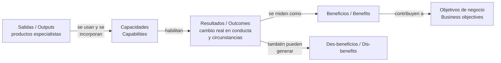

Definiciones en palabras propias:

| Término | Definición propia |
|---|---|
| **Salida** (output) | Entregable tangible o intangible de una actividad. En PRINCE2 son los productos especialistas que servirán para habilitar el cambio. |
| **Capacidad** (capability) | El conjunto completo de salidas necesarias para que un resultado sea posible. Una salida aislada rara vez basta. |
| **Resultado** (outcome) | Lo que efectivamente cambia en el mundo real cuando se usan las salidas: conductas, procesos, circunstancias. |
| **Beneficio** (benefit) | Mejora medible derivada de un resultado, percibida como ventaja por la organización que invierte y que aporta a uno o más objetivos de negocio. |
| **Des-beneficio** (dis-benefit) | Deterioro medible derivado de un resultado, percibido como negativo por la organización que invierte. A diferencia del riesgo, es una consecuencia **esperada**, no incierta. |
| **Objetivo de negocio** (business objective) | Resultado medible que evidencia avance en la estrategia de la organización y al que el proyecto debe contribuir. |

#### 2.1.3 Los tres atributos de la justificación

Todo proyecto necesita una **justificación de negocio** (business justification), que suele documentarse en un caso de negocio. La justificación responde tres preguntas:

| Atributo | Pregunta | Qué se evalúa |
|---|---|---|
| **Deseable** (desirable) | ¿Vale la pena? | Balance entre costos, beneficios y riesgos. |
| **Viable** (viable) | ¿Podemos entregarlo? | Capacidad real de producir los productos. |
| **Alcanzable** (achievable) | ¿Servirá? | Probabilidad de que el uso de los productos produzca los resultados y beneficios previstos. |

La justificación no es solo contable: es la relación entre el valor percibido de los resultados y los recursos empleados, y la elección del enfoque que ofrezca el mejor valor global. Un proyecto puede ser deseable y viable pero no alcanzable (por ejemplo, entregable a tiempo y asequible, pero con un producto que no llegará a su audiencia); en ese caso, hay que redefinir el alcance o detenerse.

Si la justificación deja de ser válida, el proyecto **se detiene o se cambia**. Esto es la aplicación directa del principio de justificación de negocio continua.

#### 2.1.4 Tolerancias asociadas

- **Tolerancia de beneficios** (benefits tolerance): desviación permitida en las metas de beneficio antes de escalar al siguiente nivel de gestión. Se documenta en el caso de negocio.
- **Tolerancia de sostenibilidad** (sustainability tolerance): desviación permitida en las metas de sostenibilidad antes de escalar. También se documenta en el caso de negocio.

### 2.2 Guía de aplicación efectiva

#### 2.2.1 Ciclo de vida del caso de negocio

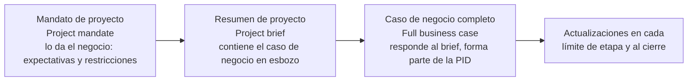

- **Caso de negocio en esbozo** (outline business case): se elabora al arrancar, a partir del mandato, con la información justa para que la junta confirme la justificación y autorice la etapa de inicio. Vive dentro del resumen de proyecto (project brief). Otros marcos lo llaman "caso estratégico en esbozo".
- **Caso de negocio completo** (full business case): el esbozo refinado durante la etapa de inicio, cuando costos, plazos, productos, riesgos y metas ya se entienden mejor. Otros marcos lo llaman "detallado" o "final".
- Sigue refinándose etapa a etapa a medida que se incurre en costos reales, se logran (o no) beneficios y mejora la información.

#### 2.2.2 Reglas de buena práctica (caso de negocio)

1. Empezar siempre por un esbozo suficiente para decidir si vale la pena invertir en planificar; no exigir precisión que aún no existe.
2. Refinar el esbozo a caso completo durante el inicio; no autorizar el proyecto con un caso en esbozo.
3. Mantener control de versiones: las versiones anteriores deben poder consultarse para comparar.
4. Hacer visible y explícita la cadena salidas → resultados → beneficios a todo el equipo; de lo contrario el equipo se concentra en producir salidas y pierde el propósito.
5. Recordar que muchos proyectos "tienen éxito" en entrega y fracasan como inversión porque los productos no se usan o el cambio no se arraiga.
6. Identificar los productos que son **habilitadores** de otros productos que sí generan beneficio.
7. Alinear resultados y beneficios con los objetivos de negocio, incluidos los objetivos ESG (ambientales, sociales y de gobernanza) si la organización los tiene.
8. Fijar metas de sostenibilidad y sus tolerancias en el caso de negocio, referenciando los compromisos ESG corporativos.
9. Expresar todo beneficio en términos **medibles**; si no es medible, no puede demostrarse ni evaluarse el valor por dinero.
10. Documentar monto y calendario de los beneficios previstos, y la tolerancia sobre esas metas (por ejemplo, un rango porcentual de mejora).
11. Verificar los beneficios previstos **como mínimo al final de cada etapa**; si salen de tolerancia, escalar.
12. Considerar los **siete aspectos de desempeño** (beneficios, costo, tiempo, calidad, alcance, riesgo, sostenibilidad) y sus intercambios: subir una meta de calidad suele impactar costo, tiempo o sostenibilidad.
13. Si no puede construirse un caso de negocio dentro de las tolerancias de los siete aspectos, la justificación es cuestionable.
14. Incluir no solo los costos de desarrollar el producto, sino los cambios en costos operativos tras el cierre, según la política de la organización.
15. Valorar los des-beneficios e incorporarlos a la evaluación de inversión; no confundirlos con riesgos.
16. Explorar opciones **incluso en proyectos obligatorios** (regulatorios): hay distintas maneras de cumplir, y deben compararse.
17. Tomar "no hacer nada distinto" como opción base para cuantificar las demás.
18. El ejecutivo rinde cuentas del caso de negocio durante el proyecto; el usuario sénior rinde cuentas de que los beneficios se concreten (incluso después del cierre).
19. Prever desde el inicio quién financiará y ejecutará las mediciones de beneficio después del cierre, cuando la organización temporal ya no exista.
20. Aplicar análisis de sensibilidad para detectar dependencia excesiva de un beneficio concreto y proteger ese beneficio en planificación, control y riesgo.
21. Cuando los productos se liberan de forma iterativa, algunos beneficios pueden confirmarse **durante** el proyecto; programar revisiones de beneficios intermedias.
22. Reexaminar y actualizar la previsión de beneficios no realizados en cada límite de etapa.

#### 2.2.3 Cuándo se verifica el caso de negocio

| Quién | Momento | Finalidad |
|---|---|---|
| Junta de proyecto | Fin del arranque (starting up) | Autorizar la etapa de inicio |
| Junta de proyecto | Fin del inicio (initiating) | Autorizar el proyecto |
| Junta de proyecto | Fin de cada etapa | Autorizar la siguiente etapa y la continuidad |
| Junta de proyecto | Al evaluar un plan de excepción | Autorizar la etapa revisada |
| Gerente de proyecto | Al evaluar progreso, riesgos y cuestiones | Determinar impacto sobre la justificación |
| Gerente de proyecto | Etapa final / cierre | Evaluar desempeño y probabilidad de beneficios |
| Gerente de proyecto | Al consultar interesados | Detectar cambios de metas (p. ej., nuevos objetivos de sostenibilidad) |

### 2.3 Técnicas

#### 2.3.1 Técnica PRINCE2 de gestión del caso de negocio (cuatro pasos)

Es la técnica **propia** del método; sustituirla por un procedimiento corporativo exige documentarlo como adaptación en la PID.

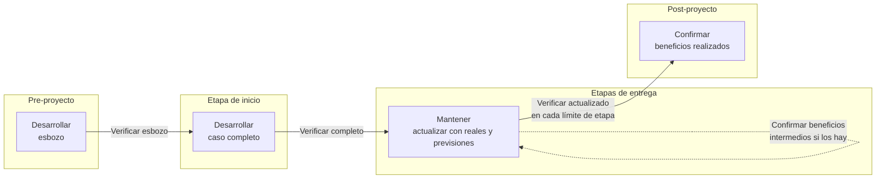

| Paso | Para qué sirve | Entradas | Salidas | Cuándo |
|---|---|---|---|---|
| **Desarrollar** (develop) | Explorar opciones y reunir la información que permita decidir la inversión | Mandato; resumen de proyecto; estimaciones de planes; riesgos | Caso en esbozo (en el brief); caso completo (en la PID); enfoque de beneficios; enfoque de sostenibilidad | Arranque e inicio |
| **Verificar** (check) | Evaluar si el proyecto sigue valiendo la pena | Caso vigente; progreso; riesgos; cuestiones; nueva información | Decisión de continuar, cambiar o detener | Puntos de decisión clave (límites de etapa, excepciones) y de forma continua por el gerente |
| **Mantener** (maintain) | Mantener el caso al día con reales y previsiones | Productos entregados, costos reales, beneficios logrados, metas actualizadas | Caso de negocio actualizado y versionado | Fin de cada etapa |
| **Confirmar** (confirm) | Comprobar que los beneficios se han logrado o se lograrán | Enfoque de beneficios; mediciones; evidencia del usuario sénior | Resultados de revisiones de beneficios; acciones correctivas | Límites de etapa (beneficios intermedios) y, sobre todo, post-proyecto |

**Desarrollar en detalle: las tres opciones de negocio**

Toda inversión admite al menos tres opciones de negocio (business options):

| Opción | Significado | Uso |
|---|---|---|
| No hacer nada distinto | Mantener el statu quo | Siempre la primera; línea base para cuantificar las demás |
| Hacer lo mínimo | Intervención mínima suficiente | Compara costo/beneficio incremental |
| Hacer más que lo mínimo | Intervención ambiciosa | Compara el beneficio adicional que compra la inversión adicional |

La diferencia entre las opciones es exactamente el beneficio que la inversión compra. La pregunta a responder: para este nivel de inversión, ¿los beneficios esperados son más deseables, viables y alcanzables que en las otras opciones? Al principio puede haber muchas opciones; se van reduciendo para examinar pocas en detalle.

Formato recomendado para presentar opciones: tabla con columnas *Opción / Ventajas / Desventajas (incluidos costos y límites de alcance)* y una recomendación razonada en términos de valor por dinero y alineación con la misión.

**Verificar en detalle**: el caso de la opción elegida se reevalúa en deseabilidad, viabilidad y alcanzabilidad porque un riesgo o cambio nuevo puede justificar cambiar de opción.

**Mantener en detalle**: al cierre de cada etapa, el gerente incorpora datos de progreso (productos entregados, costos, beneficios realizados) y las últimas previsiones de beneficios y metas de desempeño.

**Confirmar en detalle**:
- Durante el proyecto: revisiones de beneficios en límites de etapa para los beneficios previstos dentro del proyecto; el usuario sénior confirma y el gerente los reporta en informes de fin de etapa y de fin de proyecto.
- Después del proyecto: el negocio pide al usuario sénior evidencia de cómo se realizó cada beneficio asignado, define acciones correctivas para los no logrados, revisa el desempeño del producto en operación y detecta efectos colaterales (positivos o negativos) como lecciones.
- Responsabilidad: el ejecutivo asegura que las revisiones se planifiquen y ejecuten; al cerrar el proyecto, la responsabilidad de las revisiones post-proyecto pasa al negocio (concretamente al usuario sénior), porque hay que financiarlas y dotarlas.

#### 2.3.2 Evaluación de inversión (investment appraisal)

- **Para qué sirve**: comparar los costos de desarrollar, operar y mantener el producto del proyecto con el valor de los beneficios a lo largo del tiempo, considerando riesgos.
- **Alcance de costos**: costos del proyecto (producir los productos **y** gestionar el proyecto) más costos continuos de operación y mantenimiento.
- **Selección**: la organización suele tener preferencias (p. ej., reglas contables del sector público).
- **Técnicas habituales**:

| Técnica | Qué calcula (en palabras propias) | Cuándo es útil |
|---|---|---|
| Costo del ciclo de vida completo (whole life costs) | Costo total de implementar más los costos incrementales de transición, operación y mantenimiento | Siempre que haya costos operativos relevantes tras el cierre |
| Beneficios netos (net benefits) | Valor total de beneficios menos costos de implementación, transición y operación, en un período definido | Comparación directa de opciones |
| Retorno de la inversión (ROI) | Ganancias o ahorros como porcentaje de la inversión inicial | Comunicación ejecutiva simple |
| Período de recuperación (payback) | Tiempo hasta recuperar el efectivo y recursos invertidos | Cuando la liquidez o la rapidez de retorno importan |
| Valor actual neto (NPV / VAN) | Valor acumulado a una fecha, descontando flujos futuros con una tasa (el dinero futuro vale menos; a una tasa de ~6 % el valor se reduce a la mitad en unos 12 años) | Inversiones con beneficios diferidos en el tiempo |
| Tasa interna de retorno (IRR / TIR) | Tasa de descuento a la que el VAN es cero | Comparar rentabilidad relativa |
| Análisis de opciones (options analysis) | Puntuar cada opción contra criterios ponderados; la comparación por pares ayuda a preseleccionar | Decisiones multicriterio, no solo financieras |
| Análisis de sensibilidad (sensitivity analysis) | Variar factores de entrada (costo, plazo, calidad, alcance, riesgos) para hallar el punto en que las salidas (costos operativos, beneficios, riesgos de negocio) dejan de justificar la inversión | Medir la robustez del caso; p. ej., viable en cuatro meses pero no en seis |

- **Pasos genéricos**: (1) definir el período de evaluación; (2) listar costos del proyecto, de transición y operativos; (3) listar beneficios y des-beneficios cuantificados con su calendario; (4) aplicar la(s) técnica(s) elegida(s) por la organización; (5) probar sensibilidad; (6) documentar supuestos.
- **Advertencia**: cuando el propósito primario es de sostenibilidad y los beneficios llegan en 20–30 años (p. ej., una defensa contra inundaciones), los métodos de flujo descontado castigan el valor futuro y pueden no servir; hay que adaptar el método de evaluación.

#### 2.3.3 Modelo multi-caso (multi-case model)

Evaluar la inversión desde varias perspectivas, no solo la financiera, para una visión redondeada de deseabilidad, viabilidad y alcanzabilidad:

| Perspectiva | Pregunta |
|---|---|
| Estratégica | ¿Cuáles son los impulsores del cambio y cómo encaja la inversión en la estrategia? |
| Económica | ¿Qué opción ofrece el mejor valor, incluyendo consideraciones sociales, ambientales y de sostenibilidad? |
| Financiera | ¿Es asequible? ¿Cómo se financia y cuál es el flujo de caja en la vida del proyecto y del producto? |
| Implementación y comercial | ¿Pueden los proveedores entregar la opción preferida y existen arreglos robustos para lograrlo? |

Una inversión robusta satisface todas las perspectivas. La organización puede añadir casos propios (p. ej., un caso ambiental).

#### 2.3.4 Escenarios mejor / esperado / peor para beneficios

- **Para qué sirve**: en entregas iterativas-incrementales con tiempo y costo fijos y alcance flexible, expresar los beneficios como **rango** ligado al alcance entregado, no como una cifra única.
- **Cómo**:

| Escenario | Alcance supuesto | Beneficios |
|---|---|---|
| Mejor caso | Se entregan requisitos imprescindibles, deseables y opcionales (must / should / could) | Máximos |
| Caso esperado | Imprescindibles y deseables | Intermedios |
| Peor caso | Solo imprescindibles | Mínimos; **aun así el proyecto debe seguir siendo viable** |

- **Cuándo usarla**: proyectos ágiles o con alta incertidumbre de alcance; también sirve para fijar tolerancias de beneficio.

#### 2.3.5 Mapeo de beneficios (benefits mapping)

El manual no describe una técnica formal con este nombre en los capítulos cubiertos (no determinado en la fuente). Lo que sí establece es la cadena salidas → capacidades → resultados → beneficios → objetivos de negocio, y recomienda hacerla visible. Una forma práctica compatible con el método es un diagrama en el que cada producto se vincula a la capacidad que habilita, al resultado que produce y al beneficio medible correspondiente, señalando los productos habilitadores y los des-beneficios. La estructura de desglose de productos y el diagrama de flujo de productos (práctica de planes) pueden usarse para identificar **cuándo** las salidas empezarán a afectar resultados y permitir medir beneficios tempranos.

#### 2.3.6 Sostenibilidad en el caso de negocio

- Muchas organizaciones alinean sus metas con los 17 Objetivos de Desarrollo Sostenible de la ONU y fijan metas ESG propias.
- Las metas de sostenibilidad del proyecto deben alinearse con esas metas corporativas y documentarse en el caso de negocio con sus tolerancias.
- La sostenibilidad puede ser un **criterio de intercambio en el análisis de opciones**: por ejemplo, con un presupuesto finito de emisiones asignado al proyecto, se comparan alternativas de diseño por emisiones, costo y riesgo tecnológico, y se puede descartar la opción de menor huella si introduce un riesgo inaceptable por falta de madurez.

### 2.4 Aplicación según contexto

| Contexto | Cómo se adapta la práctica |
|---|---|
| **Organizacional** | Alinear con políticas y estándares corporativos (difieren entre sector público y privado). Si el proyecto está en un **programa**, el programa suele definir el enfoque, entregar un caso en esbozo y agregar el caso del proyecto al suyo; el caso del proyecto se reduce a alcance, presupuesto, plazos, lista de beneficios con tolerancia, metas de sostenibilidad con tolerancia, contribución a los resultados del programa y razones de la opción elegida. Los beneficios suelen gestionarse a nivel de programa. |
| **Comercial** | Cliente y proveedor tienen justificaciones propias y pueden necesitar casos de negocio separados; parte de cada uno puede ser confidencial. El cliente verifica viabilidad y riesgos dados los proveedores elegidos; el proveedor verifica que el trabajo le resulte rentable. El ejecutivo garantiza la compatibilidad alineando los tres intereses en la junta. |
| **Método de entrega** | En iterativo-incremental se necesita más detalle sobre tolerancias de beneficio, prioridades, plazos y secuencia de alcance; usar escenarios mejor/esperado/peor; entender cómo la entrega incremental afecta la viabilidad y permite beneficios tempranos; con alta incertidumbre, probar supuestos rápido. El caso evoluciona mucho más que en un proyecto lineal-secuencial. |
| **Sostenibilidad** | Ver 2.3.6. |
| **Escala** | Proyectos pequeños pueden fusionar brief y caso de negocio en un solo documento simple. Proyectos grandes pueden requerir estudios detallados (p. ej., impacto ambiental). |

### 2.5 Productos de gestión de la práctica

#### 2.5.1 Resumen de proyecto (project brief)

| Aspecto | Detalle |
|---|---|
| **Propósito** | Dar una base completa y firme para iniciar el proyecto; es lo que la junta aprueba para autorizar la etapa de inicio. |
| **Composición** | **Definición del proyecto**: antecedentes, objetivos, resultados deseados, alcance y exclusiones, restricciones y supuestos, tolerancias de proyecto, usuarios y otros interesados conocidos. **Caso de negocio en esbozo**: por qué se necesita el proyecto y qué opción de negocio se elige. **Descripción del producto del proyecto**: expectativas de calidad del usuario y criterios de aceptación. **Enfoque del proyecto**: cómo se entregará la opción elegida. **Estructura del equipo de gestión y descripciones de roles**: quién, en qué rol, con qué delegación y reporte. **Referencias** a documentos asociados. |
| **Quién** | Lo prepara el gerente de proyecto (con el ejecutivo); lo aprueba la junta de proyecto al autorizar el inicio. |
| **Cuándo** | Se crea en el proceso de arranque (starting up a project). Sus contenidos se refinan y se absorben en la PID durante el inicio; no se mantiene después. |
| **Criterios de calidad del documento** | Suficiente para decidir si vale la pena invertir en la etapa de inicio; coherente con el mandato; opción de negocio explícita; criterios de aceptación al menos descriptivos con compromiso de precisarlos; roles clave nombrados. |

#### 2.5.2 Caso de negocio (business case)

| Aspecto | Detalle |
|---|---|
| **Propósito** | Documentar la justificación: costos estimados frente a beneficios esperados, compensados por riesgos; y explicar cómo y cuándo se medirán los beneficios. |
| **Composición** | **Resumen ejecutivo**: puntos clave, beneficios importantes y retorno. **Razones**: por qué el proyecto y cómo habilita objetivos de negocio. **Opciones de negocio**: análisis y recomendación razonada, con supuestos. **Beneficios y des-beneficios esperados**: medibles, contra la situación previa, con tolerancias de beneficio. **Metas de sostenibilidad**: con tolerancias. **Tiempo**: duración del proyecto y período de realización de beneficios. **Costos**: del proyecto, de operación y mantenimiento, y arreglos de financiación. **Evaluación de inversión**: beneficios y des-beneficios agregados frente a costos del proyecto y operativos incrementales. **Riesgos mayores**: amenazas y oportunidades clave con impacto y respuestas. **Referencias**. |
| **Quién** | Lo desarrolla el gerente de proyecto por delegación del ejecutivo; el ejecutivo rinde cuentas; el usuario sénior aporta resultados y beneficios; el proveedor sénior confirma viabilidad y costos; aseguramiento del proyecto verifica alineación y cumplimiento; soporte mantiene línea base y control de cambios; lo aprueba la junta. |
| **Cuándo** | Esbozo en arranque (dentro del brief); completo en inicio (parte de la PID); actualizado al fin de cada etapa, ante excepciones y al cierre; revisado post-proyecto en revisiones de beneficios. |
| **Criterios de calidad** | Beneficios medibles con línea base y tolerancia; incluye des-beneficios valorados; costos operativos considerados; opción "no hacer nada distinto" presente; coherencia con los siete aspectos de desempeño y sus tolerancias; versionado; evaluación de inversión conforme a la política corporativa. |

#### 2.5.3 Enfoque de gestión de beneficios (benefits management approach)

| Aspecto | Detalle |
|---|---|
| **Propósito** | Definir las acciones de gestión y las revisiones de beneficios que asegurarán que se logren los resultados y se confirme la realización de beneficios. Es parte de la PID. |
| **Composición** | **Alcance**: qué beneficios se gestionan y miden. **Procedimientos de realización**: acciones para asegurar resultados, incluidas las que hará el negocio tras el cierre (p. ej., entrega de un plan de realización de beneficios). **Medición**: cómo y cuándo se miden los beneficios y cuál es la línea base. **Guía de tolerancia de beneficios**: complementa las tolerancias del caso de negocio. **Desempeño del producto**: cómo se revisará el producto en operación. **Responsabilidades**: incluido quién rinde cuentas por cada beneficio. **Recursos** (p. ej., estudios). **Herramientas y técnicas** (p. ej., un simulador). **Estándares** aplicables a las medidas. **Referencias**. |
| **Quién** | Lo crea el gerente de proyecto en el proceso de inicio; lo aprueba el ejecutivo (puede requerir aprobación del negocio si este participará en las revisiones); lo acuerda el usuario sénior; aseguramiento del proyecto asesora y verifica cumplimiento de políticas. Puede ser gestionado por el proyecto o por el negocio, y normalmente sobrevive al proyecto. |
| **Cuándo** | Creado en inicio, presentado con la solicitud de autorización del proyecto; actualizado al fin de cada etapa; traspasado al negocio al cierre. |
| **Criterios de calidad** | Cada beneficio tiene dueño, medida, línea base, fecha y método; incluye revisiones intermedias si hay beneficios durante el proyecto; define recursos y financiación post-cierre; coherente con el caso de negocio. |

#### 2.5.4 Enfoque de gestión de sostenibilidad (sustainability management approach)

| Aspecto | Detalle |
|---|---|
| **Propósito** | Definir acciones, revisiones y controles para alcanzar las metas de desempeño de sostenibilidad del proyecto. Es parte de la PID. |
| **Composición** | **Alcance**: qué metas de sostenibilidad se gestionan y miden. **Medición**: cómo, cuándo y contra qué línea base. **Responsabilidades**: incluido quién rinde cuentas por medir el logro de las metas. **Recursos**. **Herramientas y técnicas**. **Estándares** aplicables. **Referencias**. |
| **Quién** | Lo desarrolla el gerente de proyecto; lo aprueba el ejecutivo; lo acuerda el usuario sénior; aseguramiento del proyecto verifica cumplimiento con políticas. |
| **Cuándo** | Creado en inicio; actualizado al fin de cada etapa. |
| **Criterios de calidad** | Metas trazables a los objetivos ESG corporativos; tolerancias coherentes con el caso de negocio; mediciones verificables; responsabilidad post-cierre definida. |

### 2.6 Foco de cada rol en la práctica

| Rol | Foco en el caso de negocio |
|---|---|
| **Capa de negocio** (business layer) | Emite el mandato; fija estándares del caso; hace responsable al usuario sénior de los beneficios post-proyecto; rinde cuentas del enfoque de beneficios después del cierre; fija la tolerancia de beneficios a nivel proyecto. |
| **Ejecutivo** (project executive) | Rinde cuentas del caso durante el proyecto; aprueba y responde por los enfoques de beneficios y sostenibilidad (salvo que los gestione el negocio); fija tolerancia de beneficios por etapa; supervisa que el caso sea viable y esté alineado con objetivos; mantiene el proyecto deseable, viable y alcanzable; asegura la financiación; valida que los beneficios del usuario sénior y los costos/métodos del proveedor sénior representen valor por dinero. |
| **Usuario sénior** (senior user) | Rinde cuentas de especificar resultados y beneficios; acuerda los enfoques de beneficios y sostenibilidad; responde por la realización de beneficios y por que los productos generen los resultados; confirma beneficios realizados o realizables; aporta datos de beneficio real vs previsto en revisiones. |
| **Proveedor sénior** (senior supplier) | Rinde cuentas del caso de negocio del proveedor (si existe); confirma que los productos pueden entregarse al costo previsto y son viables. |
| **Gerente de proyecto** (project manager) | Desarrolla el caso y los enfoques de beneficios y sostenibilidad por delegación; evalúa impacto de cuestiones y riesgos en la viabilidad; actualiza los tres al fin de cada etapa; informa desempeño al cierre; consulta a interesados por cambios de metas. |
| **Gerente de equipo** (team manager) | Aplica los procedimientos de beneficios acordados en su paquete de trabajo, si los hay. |
| **Aseguramiento del proyecto** (project assurance) | Verifica alineación con objetivos de negocio; asesora sobre los enfoques de beneficios y sostenibilidad y confirma a la junta su cumplimiento con políticas; monitorea el caso frente a eventos externos y progreso; vigila finanzas por cuenta del negocio; revisa el impacto de cambios al plan y de cambios potenciales sobre el caso; asegura que se reevalúe constantemente el valor por dinero. |
| **Soporte de proyecto** (project support) | Mantiene línea base y control de cambios del caso y de ambos enfoques; avisa al gerente de cambios en productos que afecten el caso. |

### 2.7 Relación con los principios

| Principio | Cómo lo materializa esta práctica | Resultado |
|---|---|---|
| Justificación de negocio continua | Crear y mantener un caso que se verifica en deseabilidad, viabilidad y alcanzabilidad | Confianza en que la inversión vale la pena |
| Aprender de la experiencia | Usar lecciones previas para construir la justificación | Caso informado por la experiencia |
| Definir roles, responsabilidades y relaciones | Aclarar quién desarrolla, mantiene y responde por el caso y los beneficios | Expectativas claras |
| Gestionar por etapas | Verificar la justificación en cada límite de etapa | Inversión justificada a lo largo del proyecto |
| Gestionar por excepción | Medir el impacto de cuestiones y riesgos sobre el caso y escalar cuando se prevé exceder tolerancias | Decisiones informadas y oportunas |
| Enfocarse en productos | Asegurar que los productos conducen a los resultados y beneficios requeridos | Beneficios alcanzables |
| Adaptar al proyecto | Dimensionar la formalidad del desarrollo, aprobación y revisión del caso | Gobernanza del caso proporcionada |

### 2.8 Adaptación (tailoring) del caso de negocio

| Situación | Recomendación |
|---|---|
| **Proyecto pequeño o de bajo valor** | Un único documento que combine brief y caso de negocio; evaluación de inversión simple (p. ej., beneficios netos y payback); revisiones de beneficios ligeras pero con dueño nombrado. |
| **Proyecto ágil / iterativo-incremental** | Beneficios como rango ligado al alcance (peor/esperado/mejor); tiempo y costo fijos, alcance flexible; revisiones de beneficios en cada límite de etapa o liberación; caso que evoluciona con el backlog; validar supuestos cuanto antes con incrementos reales. |
| **Con proveedores externos** | Caso del cliente y caso del proveedor separados; identificar qué partes son confidenciales; el ejecutivo verifica compatibilidad; los costos del proveedor y su viabilidad los confirma el proveedor sénior; considerar el costo de gestión contractual dentro de los costos del proyecto. |
| **Dentro de un programa** | Caso reducido a lo que el programa no cubre; beneficios gestionados por el programa; el enfoque de beneficios del proyecto se integra en el plan de realización de beneficios del programa. |
| **Proyecto con fin de sostenibilidad** | Sustituir o complementar el flujo descontado con evaluación multi-caso; metas y tolerancias de sostenibilidad explícitas; presupuesto de emisiones como restricción de opciones. |

---

## 3. Práctica: Organización (Organizing)

### 3.1 Propósito y conceptos clave

#### 3.1.1 Propósito

Definir y establecer la estructura de **rendición de cuentas** (accountability) y **responsabilidades** del proyecto: el "quién".

Los proyectos son ecosistemas complejos con relaciones que cambian continuamente, y son transversales a las estructuras de línea, que por eso no sirven para dirigirlos. De ahí el principio de definir roles, responsabilidades y relaciones dentro de una estructura que represente los intereses de negocio, usuario y proveedor.

#### 3.1.2 Conceptos clave

| Término | Definición propia |
|---|---|
| **Rol** (role) | Función asignada a una persona o grupo **dentro de un proyecto concreto**. No es el cargo que esa persona tiene fuera del proyecto. PRINCE2 define roles y responsabilidades, no tareas uno a uno por persona; los roles pueden compartirse o combinarse con límites, pero **toda responsabilidad debe quedar asignada**. |
| **Los tres intereses del proyecto** (three project interests) | Negocio (business), usuario (user) y proveedor (supplier). El método reconoce muchos otros interesados (reguladores, grupos de interés), pero solo estos tres se integran en la gobernanza y gestión del proyecto. |
| **Junta de proyecto** (project board) | Órgano que rinde cuentas al negocio por el éxito del proyecto y tiene autoridad para dirigirlo dentro del remit fijado por el negocio. Reúne los tres intereses. |
| **Ecosistema organizacional** (organizational ecosystem) | Las organizaciones permanentes, con sus estructuras y gobernanza corporativa, de donde provienen las personas y a donde vuelven los productos. |
| **Ecosistema de proyecto** (project ecosystem) | La organización temporal del proyecto, entidad distinta del ecosistema organizacional, que debe diseñarse, desarrollarse, ajustarse y finalmente disolverse hacia el ecosistema organizacional. |
| **Estructura del equipo de gestión del proyecto** (project management team structure) | Junta de proyecto, gerente de proyecto, gerentes de equipo, aseguramiento del proyecto y soporte de proyecto. |
| **Equipo de proyecto** (project team) | Todas las personas que dedican tiempo al proyecto (incluye miembros de equipo y roles de gestión). |
| **Estructura de desglose del trabajo** (work breakdown structure, WBS) | Jerarquía de todo el trabajo del proyecto; enlaza la estructura de desglose de productos con los paquetes de trabajo. |
| **Modelo de entrega** (delivery model) | Arreglos organizacionales y comerciales para cumplir los objetivos dadas las restricciones y las capacidades de negocio, usuario y proveedor. Se describe en el enfoque de gestión comercial y se refleja en la estructura del equipo. |
| **Autoridad de cambio** (change authority) | Persona o grupo al que la junta delega la aprobación de solicitudes de cambio y fuera de especificación dentro de límites; distinto del gerente de proyecto; se documenta en el enfoque de gestión de cuestiones. |

#### 3.1.3 Los tres intereses

| Interés | Qué representa | Rol que lo representa |
|---|---|---|
| **Negocio** | La necesidad que origina el proyecto y su justificación continua como valor por dinero | Ejecutivo (project executive) |
| **Usuario** | Quienes definen requisitos, usarán los productos, se verán afectados por ellos o los operarán y mantendrán; pueden estar dentro o fuera de la organización | Usuario sénior (senior user) |
| **Proveedor** | Quienes aportan las habilidades y conocimiento para producir los productos; internos o externos | Proveedor sénior (senior supplier) |

El principio de gestión por excepción permite que estas tres perspectivas decidan en capas, dejando cada decisión en el nivel más local donde hay conocimiento y capacidad.

#### 3.1.4 Los cuatro niveles organizacionales

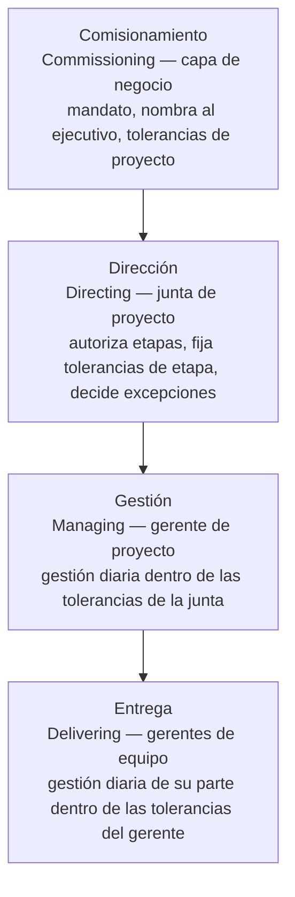

| Nivel | Responsabilidades principales |
|---|---|
| **Comisionamiento (capa de negocio)** | Emitir el mandato; identificar al ejecutivo; fijar las tolerancias de nivel proyecto; decidir sobre cualquier desvío que las exceda. |
| **Dirección (junta de proyecto)** | Representar negocio, usuario y proveedor; rendir cuentas del éxito; autorizar inicio y fin de cada etapa fijando sus tolerancias (personas, plazos, recursos, sostenibilidad); decidir sobre desvíos que excedan o se prevea que excedan las tolerancias de etapa; comunicarse con el negocio y los interesados según el enfoque de comunicación. |
| **Gestión (gerente de proyecto)** | Gestión diaria dentro de las restricciones de la junta; gestionar las relaciones para que se produzcan los productos conforme a los objetivos estratégicos y a las metas acordadas de calidad, sostenibilidad, tiempo, costo, alcance, beneficios y riesgo. |
| **Entrega (gerentes y miembros de equipo)** | Gestión y decisiones diarias de su parte dentro de las restricciones del gerente; co-creación con otros equipos del ecosistema. |

Los tres niveles inferiores constituyen el equipo de gestión del proyecto; el nivel de comisionamiento está fuera del proyecto.

#### 3.1.5 Estructura del equipo de gestión del proyecto

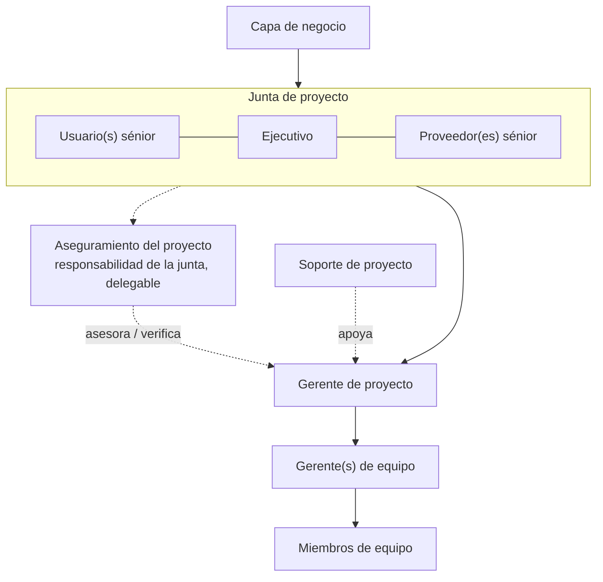

Líneas sólidas: autoridad. Líneas punteadas: aseguramiento y apoyo/asesoría. El usuario sénior proviene del negocio o de la comunidad de usuarios; el proveedor sénior, de la(s) organización(es) proveedora(s).

### 3.2 Guía de aplicación efectiva

#### 3.2.1 Los roles, uno por uno

**Ejecutivo (project executive)**
- Nombrado por el negocio como **punto único de rendición de cuentas**; esa rendición de cuentas no se delega.
- Asegura la financiación, es responsable del caso de negocio y de la justificación continua, y gobierna alineado con la estrategia, incluido el pensamiento de largo plazo (impactos ambientales y sociales).
- Solo puede haber **un** ejecutivo; **no** puede combinarse con el rol de gerente de proyecto.
- Si la organización usa trabajo compartido de puestos (job-sharing), sigue habiendo correspondencia uno a uno entre el puesto y el rol; hay que explicitar en la descripción de rol y en la PID cómo se mantiene el punto único de rendición de cuentas.

**Usuario sénior (senior user)**
- Representa a la comunidad de usuarios; rinde cuentas del enfoque para captar requisitos y de la especificación de beneficios.
- Responsable de: lograr adhesión de los usuarios; monitorear productos contra requisitos; demostrar al negocio que los beneficios van por buen camino; controlar cambios a requisitos y beneficios; lograr la transferencia y adopción de los productos y la realización de beneficios tras el cierre.
- Debe asegurar compromiso continuo de personas de su comunidad, incluso más allá del proyecto.
- Puede haber más de uno si la comunidad de usuarios es compleja, pero el número debe mantenerse al mínimo.
- Conviene que provenga de un área afectada por el cambio, porque confirmará beneficios después del cierre.

**Proveedor sénior (senior supplier)**
- Representa a quienes entregan los productos; asegura compromiso continuo de personas y recursos del lado proveedor.
- Rinde cuentas de la **calidad de los productos entregados por los proveedores** y de la **integridad técnica** del proyecto.
- Normalmente representa también a quienes mantendrán los productos tras el cierre; si el mantenimiento lo da el negocio (p. ej., TI interna) u otro proveedor, ese interés puede representarlo el usuario sénior. Lo que importa es que operación, servicio y soporte estén representados desde el principio.
- Puede haber más de uno, al mínimo.
- Durante una licitación, puede nombrarse temporalmente a alguien del cliente (p. ej., de compras) hasta que haya proveedor adjudicado.

**Junta de proyecto (project board)**
- Obligatoria en todo proyecto; compuesta por ejecutivo, usuario sénior y proveedor sénior.
- En proyectos pequeños, el ejecutivo puede asumir también el rol de usuario sénior **o** el de proveedor sénior. **No se recomienda** combinar usuario sénior y proveedor sénior en la misma persona: conflicto de interés y pérdida de representación.
- Autoridad y responsabilidad dentro de las tolerancias de proyecto fijadas por el negocio (mandato).
- Crea el entorno para el éxito: financiación, personas y recursos suficientes; bucles de retroalimentación claros; aseguramiento independiente del gerente; estrategia reflejada en el caso de negocio; alineación con compromisos ESG; tolerancias de etapa para la gestión por excepción; reglas, restricciones, valores compartidos y perspectivas para decidir en todos los niveles; tolerancias y presupuesto de cambio; seguridad y bienestar del equipo; cohesión social; relaciones en la interfaz entre ecosistema organizacional y de proyecto.
- Necesita autoridad proporcional a la naturaleza y escala del proyecto y credibilidad en el ecosistema.

**Gerente de proyecto (project manager)**
- Autoridad para dirigir el proyecto en nombre de la junta dentro de tolerancias y restricciones; gestión diaria.
- Gestiona y delega trabajo a gerentes o miembros de equipo; fija tolerancias y restricciones de paquete de trabajo; asegura decisiones alineadas con la guía de la junta; gestiona relaciones (incluidos aseguramiento y junta); vela por seguridad, bienestar y sostenibilidad del enfoque.
- Puede asumir también gerente de equipo y soporte, o delegarlos a miembros del equipo, según escala y capacidad.
- Como foco único, **no debe compartirse ni combinarse** con otros roles (misma regla de job-sharing que el ejecutivo).

**Gerente de equipo (team manager)**
- Entrega el trabajo asignado mediante un **paquete de trabajo** (work package), dentro de tolerancias acordadas con el gerente y conforme al enfoque comercial.
- Responsable de: entregar productos según especificación; fijar tolerancias para sus miembros; decisiones alineadas con la guía del gerente; relaciones dentro del equipo y con otros equipos, gerente, aseguramiento y soporte; seguridad, bienestar y sostenibilidad del equipo.
- Quién puede serlo: un especialista del proveedor (p. ej., el ingeniero jefe de una disciplina); o un equipo ágil **colectivamente**, nombrando un punto único de contacto para el gerente de proyecto. Esta última forma es una adaptación aceptable a nivel de equipo.

**Aseguramiento del proyecto (project assurance)**
- Cada miembro de la junta rinde cuentas del aseguramiento de su área: aseguramiento de negocio, de usuario y de proveedor.
- La junta decide cómo se hará, con claridad de roles e interacciones. Puede hacerlo el propio miembro, alguien del negocio o un tercero externo.
- **Nunca** puede asignarse al gerente de proyecto, gerentes de equipo, miembros del equipo ni soporte de proyecto. Si se delega, el miembro de la junta sigue rindiendo cuentas.

**Soporte de proyecto (project support)**
- Servicios: administración, facilitación de reuniones y talleres, asesoría en herramientas, apoyo en planificación, riesgo, cuestiones y cambios.
- Es responsabilidad del gerente de proyecto; puede delegarse a proveedores, personas o grupos del negocio, o miembros del equipo. Una oficina de proyectos (PMO / P3O) puede cumplirlo.
- Ayuda a integrar el ecosistema: retroalimentación para mejorar formas de trabajo, dirección emergente, cohesión.
- **Debe mantenerse separado del aseguramiento** para preservar la independencia de este.

#### 3.2.2 Reglas de buena práctica (organización)

1. Asignar **todas** las responsabilidades; los roles pueden combinarse, las responsabilidades no pueden quedar huérfanas.
2. Un solo ejecutivo; nunca ejecutivo + gerente de proyecto en la misma persona.
3. Mantener la separación gerente de proyecto ↔ ejecutivo ↔ aseguramiento en todo proyecto, por pequeño que sea.
4. Evitar que una misma persona sea usuario sénior y proveedor sénior.
5. Mantener la junta lo más pequeña posible, pero con los tres intereses representados.
6. Representar desde el inicio a quien operará y mantendrá los productos (normalmente vía proveedor sénior; a veces vía usuario sénior).
7. Nunca asignar aseguramiento a gerente de proyecto, gerentes de equipo, miembros o soporte; separar soporte de aseguramiento.
8. Dejar claro, para cada decisión, quién está autorizado y dentro de qué tolerancias; registrarlo en descripciones de rol y enfoques de gestión durante el inicio.
9. Revisar las autoridades delegadas en cada límite de etapa y cuando cambie una tolerancia o una persona autorizada.
10. Usar una WBS cuando haya varios paquetes de trabajo, especialmente con mezcla de internos y externos; omitirla en proyectos de un solo paquete con equipo pequeño.
11. No mezclar personal interno y externo en un mismo paquete de trabajo: un acuerdo interno y un contrato externo tienen naturaleza y relaciones distintas; gestionarlos por separado.
12. Planificar durante el inicio los cambios de estructura previstos por etapa (p. ej., pasar de un equipo de diseño liderado por el cliente a un equipo de entrega liderado por el proveedor) y los recursos para esas transiciones.
13. Definir con claridad, en la interfaz con la organización permanente, quién retiene la gestión de personas (desempeño, recompensas, bienestar), qué decisiones siguen vías de gobernanza corporativa, qué políticas y formas de trabajo aplican, y cómo y cuándo entran y salen las personas del proyecto.
14. Hacer coincidir responsabilidades con capacidad y capacidad disponible; cubrir brechas con contratación, préstamo de recursos o formación.
15. Establecer bucles de retroalimentación para detectar brechas de capacidad o problemas relacionales a tiempo.
16. Identificar temprano los obstáculos para incorporar las nuevas capacidades al trabajo cotidiano; aparecen como riesgos y cuestiones, y fijan expectativas realistas de cuándo llegarán los beneficios.
17. Aprovechar los puntos de transición de capacidades como límites de etapa y como momento para revisar la estructura, los roles y el enfoque comercial.
18. Alinear el enfoque comercial con los cambios de equipo (p. ej., contratos a plazo fijo alineados con etapas).
19. En la transición final, cerrar tres frentes: productos aceptados y con dueños operativos; personas reincorporadas o gestionadas según contrato; aprendizaje compartido.
20. Si el gerente de proyecto proviene del proveedor, el cliente debe reforzar el aseguramiento (p. ej., nombrando a alguien propio).
21. Con más de tres o cuatro proveedores, representar a todos en la junta mediante el gestor de contratos o un contratista principal.
22. Aclarar las diferencias entre títulos de puesto y nombres de rol (un "project manager" del proveedor puede ser gerente de equipo en el proyecto).
23. Ubicar el riesgo en la parte del ecosistema más capaz de gestionarlo; que el modelo de entrega lo refleje.
24. Incorporar la sostenibilidad en descripciones de rol, requisitos y caso de negocio, con responsables nombrados, incluida la gestión posterior al cierre; fomentar diversidad de perspectivas y compras éticas.
25. Dar a la junta la posibilidad de delegar aprobaciones de cambio a una autoridad de cambio cuando el volumen de solicitudes lo exija.

### 3.3 Técnicas

#### 3.3.1 Técnica PRINCE2 de diseño y desarrollo organizacional (cinco pasos)

Técnica **propia** del método; un procedimiento corporativo alternativo debe documentarse como adaptación en la PID. Aborda cultura, colaboración, relaciones y eficacia del equipo de manera proactiva.

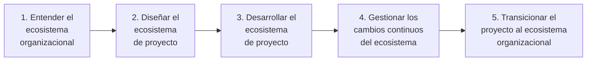

| Paso | Para qué | Qué se hace | Entradas | Salidas | Responsable |
|---|---|---|---|---|---|
| **1. Entender el ecosistema organizacional** | Diseñar bien la organización temporal y cómo se diferenciará de la permanente | Mapear estructuras y gobernanza existentes; definir las interfaces: gestión de personas, decisiones sujetas a gobernanza corporativa, políticas y formas de trabajo aplicables, entradas y salidas de personal | Mandato; políticas corporativas; estructura de las organizaciones participantes | Acuerdos de interfaz documentados en el enfoque del proyecto y la PID | Ejecutivo con apoyo del gerente |
| **2. Diseñar el ecosistema de proyecto** | Organizar trabajo y personas para los objetivos | Definir estructura de equipos; personas y recursos necesarios; prácticas de trabajo integradas; conductas y cultura. Considerar necesidades por etapa, contexto, habilidades y capacidad; prever estructuras distintas por etapa y los recursos para transitar entre ellas | WBS; enfoque de gestión comercial; habilidades disponibles | Estructura del equipo de gestión; descripciones de rol; en la PID | Ejecutivo (responsable del diseño), apoyado por el gerente; puede delegarse internamente o a un especialista externo |
| **3. Desarrollar el ecosistema de proyecto** | Implementar el diseño y hacerlo evolucionar | Onboarding (inducción, visitas, certificación); evaluaciones de habilidades; formación; team building; cultura propia del proyecto; planificación de sucesión; offboarding con captura de lecciones; usar el enfoque de gestión del cambio también hacia adentro (p. ej., al incorporar un proveedor clave); identificar e influir en los influenciadores internos | Diseño; personas asignadas | Equipo operativo y con capacidades | Ejecutivo apoyado por el gerente; requiere personas con habilidades especializadas |
| **4. Gestionar los cambios continuos** | Mantener capacidad y relaciones a lo largo del ciclo de vida | Bucles de retroalimentación; ajustar responsabilidades a capacidad; incorporar habilidades; coaching; mover personas dentro y fuera según el enfoque comercial; procedimiento de cambio robusto que considere impactos en el ecosistema; identificar barreras a la adopción de capacidades; revisar estructura en límites de etapa | Retroalimentación; cambios de etapa; cuestiones y riesgos | Estructura, roles y enfoque comercial actualizados | Gerente de proyecto |
| **5. Transicionar al ecosistema organizacional** | Cerrar bien | Productos aceptados con dueños operativos para desarrollo futuro, monitoreo de beneficios, operación y mantenimiento; personas reincorporadas o liquidadas según contrato; lecciones y conocimientos compartidos | Productos aceptados; equipo; registro de lecciones | Traspaso completo | Junta de proyecto |

#### 3.3.2 Modelos de entrega (delivery models)

- **Para qué sirve**: decidir cómo el proyecto obtendrá las personas y recursos que no existen en la organización (o que no conviene desarrollar a largo plazo): reforzar con externos o externalizar parte o toda la entrega.
- **Espectro**: desde *cliente delgado* (thin client: los proveedores hacen casi toda la entrega y gran parte de la gestión) hasta *cliente grueso* (thick client: el negocio hace casi todo).
- **Dimensiones de decisión** por cada bloque de trabajo o habilidad:

| Dimensión | Opciones | Implicación |
|---|---|---|
| Procedencia | Interno / externo / mixto | Capacidades y relaciones muy distintas |
| Base contractual (si externo) | Por **producto** o por **mano de obra** (labour) | Por mano de obra: el cliente sigue siendo responsable del desempeño del trabajo. Por producto: el proveedor responde por su desempeño |
| Grado de aseguramiento interno | Alto / delegado a expertos externos | Alto cuando el proyecto es muy singular o político; externo cuando el trabajo es estándar o la junta carece de capacidad técnica para desafiar al equipo |
| Asignación de riesgo | A quien mejor pueda gestionarlo | Criterio rector del modelo |

- **Pasos**: (1) listar bloques de trabajo/habilidades a partir de la WBS; (2) decidir interno/externo/mixto por bloque; (3) para externos, decidir producto vs mano de obra; (4) definir aseguramiento; (5) documentar en el enfoque de gestión comercial y reflejar en la estructura del equipo.
- **Formato**: tabla con columnas *Trabajo o habilidad / Interno o externo / Producto o mano de obra / Notas* (p. ej., gerente de proyecto externo por mano de obra con transferencia de habilidades; aseguramiento interno por un comité de riesgo; consultas mixtas por producto; comunicaciones internas).
- **Quién decide**: la junta, en consulta con el gerente de proyecto.

#### 3.3.3 Matriz RACI

- **Para qué sirve**: hacer explícitas relaciones y autoridades para actividades o decisiones del ecosistema más amplio, más allá de los roles centrales ya definidos por el método.
- **Letras**:

| Letra | Significado | Regla |
|---|---|---|
| R — Responsable (responsible) | Quien(es) ejecuta(n) la tarea | Puede haber varios |
| A — Rinde cuentas (accountable) | El único "dueño" de la tarea | Exactamente uno |
| C — Consultado (consulted) | Cuyo aporte se requiere | Comunicación bidireccional |
| I — Informado (informed) | A quien se informa del progreso o fin | Comunicación unidireccional |

- **Pasos**: (1) listar actividades/decisiones en filas; (2) listar roles en columnas; (3) asignar letras; (4) verificar que cada fila tenga exactamente una A y al menos una R; (5) revisar sobrecargas por columna; (6) validar con los involucrados.
- **Beneficios**: claridad de propiedad y de responsabilidad de entrega, mejor trabajo en equipo, formato visual que elimina vacíos y confusiones.
- **Cuándo usarla**: cuando intervienen muchas personas con responsabilidades diferentes en una misma tarea; en interfaces entre organizaciones; para procesos (el manual la usa para las actividades de cada proceso).

#### 3.3.4 Estructura de desglose del trabajo (WBS) como herramienta organizativa

- Vincula los paquetes de trabajo con la estructura de desglose de productos y ayuda a decidir cómo estructurar equipos y sus fronteras.
- Útil con varios paquetes de trabajo, y especialmente con mezcla interno/externo: para internos muestra el esfuerzo; para externos sirve para redactar el enunciado de trabajo (statement of work).
- Prescindible en proyectos de un solo paquete con equipo pequeño.

#### 3.3.5 Análisis de interesados y planificación de la comunicación

El manual trata estos temas en el capítulo de personas (People, cap. 3) y en el enfoque de gestión de la comunicación, que **no forman parte de la fuente de este archivo** (no determinado en la fuente). Lo que sí consta en los capítulos cubiertos:
- El usuario sénior contribuye al análisis de interesados y asesora sobre los influenciadores clave de su comunidad; el proveedor sénior, sobre aspectos de personas de los equipos proveedores (seguridad, salud, bienestar).
- Soporte de proyecto asiste en análisis de interesados y en actividades de comunicación.
- La junta se comunica con el negocio y los interesados afectados según lo acordado en el enfoque de gestión de la comunicación.
- El gerente de proyecto prepara y actualiza el enfoque de gestión de la comunicación y el de gestión del cambio; el ejecutivo los aprueba; usuario y proveedor sénior los acuerdan; aseguramiento verifica su cumplimiento con políticas.

### 3.4 Aplicación según contexto

| Contexto | Cómo se adapta la práctica |
|---|---|
| **Organizacional (programa/portafolio)** | Integrar estructuras de programa y proyecto con líneas de responsabilidad claras de arriba abajo, sin duplicaciones y con revisiones eficientes (p. ej., juntas con miembros comunes que alinean límites de etapa y hacen evaluaciones conjuntas). Opciones: el gerente de programa como ejecutivo de uno o más proyectos; una única junta que dirige varios proyectos, varias juntas, o combinación; el gestor de cambio de negocio del programa como usuario sénior (o con voz en su nombramiento) o como ejecutivo; una oficina de programa como soporte de todos los proyectos. Muchas actividades de gestión del cambio pueden coordinarse a nivel programa. |
| **Comercial** | Tender puentes entre formas de trabajo y gobernanza de varias organizaciones; considerar política interna, asignación de riesgo y recompensa, historial de entrega y competencia por recursos. Variantes: gerente de proyecto del cliente con gerentes de equipo del proveedor; gerente de proyecto del proveedor con aseguramiento reforzado del cliente; junta conjunta con ejecutivo del cliente y un proveedor sénior por proveedor; junta separada del proveedor para sus paquetes de trabajo, con relación definida con la del cliente; muchos proveedores representados por el gestor de contratos o un contratista principal; proveedor temporal durante la licitación. Incluir o no a proveedores externos en la junta es también una decisión cultural sobre el riesgo de divulgar asuntos comerciales. Formato intermedio: proveedores presentes en la primera parte de la reunión de junta (estado de diseño y entrega) y ausentes en la segunda (caso de negocio interno). |
| **Método de entrega** | Mapear los roles del método de entrega a los de PRINCE2: a veces basta cambiar terminología (p. ej., *product owner* ≈ usuario sénior); otras hay que añadir roles y definir su relación. Definir cómo el gerente de proyecto se relaciona con equipos que usan métodos distintos (híbridos). Con equipos autoorganizados, decidir quién sostiene el rol de gerente de equipo: el scrum master, el equipo colectivamente, o reparto entre miembros, product owner y scrum master. La gestión por excepción es la pieza que hace compatibles PRINCE2 y lo iterativo-incremental. |
| **Sostenibilidad** | El ejecutivo responde por la alineación con objetivos ESG, ODS, cero neto, residuos, reutilización, desmantelamiento. Responsabilidad clara de sostenibilidad en caso de negocio, requisitos y descripciones de rol, incluida la gestión post-cierre. El enfoque comercial debe asegurar compras éticas y métricas coherentes. Puede ampliarse la junta con representantes de la comunidad afectada en rol de usuario sénior. |
| **Escala** | Grande/complejo: varios usuarios o proveedores sénior (manteniendo la junta pequeña); autoridad de cambio delegada para no saturar a la junta. Pequeño/simple: una persona con varios roles, respetando la separación gerente ↔ ejecutivo ↔ aseguramiento. |

### 3.5 Productos de gestión de la práctica

#### 3.5.1 Enfoque de gestión comercial (commercial management approach)

| Aspecto | Detalle |
|---|---|
| **Propósito** | Describir procedimientos, técnicas, estándares y responsabilidades para asegurar, atender y mantener todos los acuerdos comerciales que el proyecto necesita: sondeo de mercado, compras, gestión de contratos. Parte de la PID. |
| **Composición** | **Alcance**: relaciones comerciales necesarias (acuerdos con usuarios, contratos con proveedores). **Modelo de entrega**: qué partes de la WBS entregan proveedores externos y en qué base. **Recursos** para sondeo, compras y contratos. **Responsabilidades**. **Herramientas y técnicas** (p. ej., sistemas de licitación o de gestión contractual). **Estándares** (políticas comerciales, marcos de compra existentes). **Referencias**. |
| **Quién** | Lo prepara y actualiza el gerente de proyecto; lo aprueba el ejecutivo; lo acuerdan usuario sénior y proveedor sénior (este último si corresponde); aseguramiento asesora y confirma cumplimiento; soporte asiste; los gerentes de equipo aplican sus procedimientos. |
| **Cuándo** | Creado en inicio; revisado en límites de etapa y ante cambios significativos de equipo o de proveedores. |
| **Criterios de calidad** | Modelo de entrega explícito por bloque de trabajo; base contractual clara (producto vs mano de obra); riesgo asignado a quien puede gestionarlo; prevé transiciones de personal alineadas con etapas; coherente con compras éticas y metas de sostenibilidad. |

#### 3.5.2 Estructura del equipo de gestión del proyecto (project management team structure)

| Aspecto | Detalle |
|---|---|
| **Propósito** | Definir quién participa, sus relaciones y cómo trabajarán juntos; puede incluir personal clave externo al equipo. Parte de la PID. |
| **Composición** | **Organigrama** con líneas de reporte. **Resumen de autoridad y responsabilidades**: niveles de gestión, decisiones que cada uno puede tomar, ante quién responde y quién lo asegura (posible formato matricial). **Prácticas de trabajo**: co-ubicación o trabajo remoto. **Información de apoyo**: otras personas clave y relaciones. |
| **Quién** | Diseñada por el gerente de proyecto; confirmada y aprobada por el ejecutivo, que confirma los nombramientos. |
| **Cuándo** | Esbozo en el brief (arranque); completa en la PID (inicio); revisada en cada límite de etapa y en los puntos de transición de capacidades. |
| **Criterios de calidad** | Tres intereses representados; un solo ejecutivo; separación gerente/ejecutivo/aseguramiento; aseguramiento no asignado a roles prohibidos; estructuras por etapa previstas si cambian; coherente con WBS y enfoque comercial. |

#### 3.5.3 Descripciones de roles (role descriptions)

| Aspecto | Detalle |
|---|---|
| **Propósito** | Describir cada rol del equipo de gestión y sus responsabilidades específicas. Parte de la PID. |
| **Composición** | **Rol** (nombre). **Autoridad**: qué puede aprobar. **Responsabilidades**. **Rinde cuentas ante**: a quién reporta. **Información de apoyo**: dedicación parcial o completa; combinación con otros roles. |
| **Quién** | Las prepara el gerente de proyecto; las confirma el ejecutivo. El Apéndice B del manual (fuera de este archivo) reúne las responsabilidades base por rol. |
| **Cuándo** | Esbozo en arranque; completas en inicio; actualizadas en límites de etapa o cuando cambian autoridades o personas. |
| **Criterios de calidad** | Autoridades y tolerancias explícitas; incluye responsabilidades de sostenibilidad; refleja arreglos de job-sharing si existen; sin solapamientos ni vacíos respecto a otros roles. |

#### 3.5.4 Otros enfoques mencionados (comunicación, cambio, cuestiones)

La práctica refiere al **enfoque de gestión de la comunicación** (communication management approach), al **enfoque de gestión del cambio** (change management approach) y al **enfoque de gestión de cuestiones** (issue management approach, donde se documenta la autoridad de cambio). Su composición se describe en otros capítulos del manual no incluidos en la fuente de este archivo (no determinado en la fuente).

### 3.6 Foco de cada rol en la práctica

| Rol | Foco en organización |
|---|---|
| **Capa de negocio** | Nombra al ejecutivo (y a veces al gerente); aporta estándares de comunicación corporativos; entrega información al proyecto según el enfoque de comunicación. |
| **Ejecutivo** | Nombra al gerente si no lo hizo el negocio; confirma con el gerente el diseño organizacional y aprueba la estructura del equipo; confirma nombramientos; aprueba los enfoques comercial, de comunicación y de cambio; revisa el enfoque del proyecto y el modelo de entrega por compatibilidad con objetivos ESG. |
| **Usuario sénior** | Asegura participación adecuada de los usuarios; acuerda los tres enfoques; contribuye al análisis de interesados; asesora sobre influenciadores clave. |
| **Proveedor sénior** | Asegura participación adecuada de los proveedores; acuerda los tres enfoques (comercial si corresponde); asesora sobre personas del lado proveedor (salud, seguridad, bienestar). |
| **Gerente de proyecto** | Prepara y actualiza los tres enfoques; diseña, revisa y actualiza estructura y WBS; prepara descripciones de rol; mantiene un ecosistema sano y el bienestar del equipo. |
| **Gerente de equipo** | Gestiona a sus miembros y su bienestar; asesora sobre la elección de miembros; aplica los procedimientos de comunicación, cambio y comerciales de su paquete. |
| **Aseguramiento del proyecto** | Asesora sobre selección de miembros y sobre los tres enfoques; confirma a la junta su cumplimiento con políticas; asegura su implementación (p. ej., conducta correcta de los procedimientos comerciales). |
| **Soporte de proyecto** | Asiste en onboarding/offboarding, análisis de interesados, comunicación, gestión del cambio y actividades comerciales. |

### 3.7 Relación con los principios

| Principio | Cómo lo materializa esta práctica | Resultado |
|---|---|---|
| Justificación de negocio continua | Un ejecutivo del negocio con autoridad y disponibilidad que responde por el proyecto | Adaptación a necesidades cambiantes y decisiones alineadas con el caso |
| Aprender de la experiencia | Lecciones aplicadas a estructura, WBS y salud del ecosistema | Personas correctas en roles correctos en el momento correcto |
| Definir roles, responsabilidades y relaciones | Estructura explícita que todos conocen | Sin duplicaciones ni vacíos; relaciones positivas dentro y fuera |
| Gestionar por etapas | Revisar y adaptar estructura, roles y enfoques en los límites de etapa | Habilidades adecuadas desplegadas en cada etapa |
| Gestionar por excepción | Empoderar a quien está mejor situado para decidir | Decisiones oportunas, más rendición de cuentas y propiedad |
| Enfocarse en productos | Usuarios representados y gestión del cambio entendida | Productos aceptados y puestos en operación con beneficios |
| Adaptar al proyecto | Equipo proporcional a necesidades y capacidades | Estructura del tamaño correcto con las habilidades necesarias |

### 3.8 Adaptación (tailoring) de la organización

| Situación | Recomendación |
|---|---|
| **Proyecto pequeño** | Ejecutivo que asume usuario sénior o proveedor sénior (no ambos); gerente que asume gerente de equipo y soporte; aseguramiento hecho por los propios miembros de la junta; sin WBS si hay un solo paquete; descripciones de rol de unas líneas. Mantener siempre la separación gerente/ejecutivo/aseguramiento. |
| **Proyecto ágil** | Product owner alineado a usuario sénior; equipo autoorganizado como gerente de equipo colectivo con punto único de contacto; conservar nombres de roles ágiles dentro del equipo; usar gestión por excepción para dar autonomía dentro de límites; añadir roles nuevos solo si no mapean bien, y definir su relación con los roles PRINCE2. |
| **Con proveedores externos** | Decidir modelo de entrega por bloque de trabajo (interno/externo; producto/mano de obra); proveedor sénior por proveedor o representación agregada si son más de tres o cuatro; aseguramiento del cliente reforzado si el gerente es del proveedor; contratos que prevean transiciones por etapa; no mezclar internos y externos en el mismo paquete; aclarar títulos vs roles; definir relación entre la junta del proveedor (si existe) y la del cliente. |
| **Dentro de un programa** | Reutilizar roles de programa (gerente de programa como ejecutivo, gestor de cambio de negocio como usuario sénior, oficina de programa como soporte); alinear límites de etapa con revisiones de programa; evitar duplicar reportes. |
| **Grande y complejo** | Varios usuarios/proveedores sénior al mínimo; autoridad de cambio delegada; estructuras distintas por etapa planificadas en inicio; especialistas en diseño organizacional. |

---

## 4. Práctica: Planes (Plans)

### 4.1 Propósito y conceptos clave

#### 4.1.1 Propósito

Facilitar la **comunicación** y el **control** definiendo los productos a entregar (el "qué") y los medios para entregarlos (quién, cómo, dónde, y estimaciones de cuándo y cuánto) de modo que se satisfaga el caso de negocio (el "por qué").

Un plan integra tres perspectivas: lo que el usuario espera (productos y beneficios), lo que el equipo de gestión considera el enfoque más eficaz, y el respaldo del negocio (financiación, personas y recursos).

#### 4.1.2 Conceptos clave

| Término | Definición propia |
|---|---|
| **Plan** (plan) | Propuesta que describe qué, dónde, cuándo, cómo y quién para el proyecto completo o una parte. Tipos: plan de proyecto, plan de etapa, plan de equipo y plan de excepción. |
| **Alcance** (scope) | La suma de los productos y de las actividades de entrega y de gestión representadas por un plan aprobado, sus descripciones de producto y sus descripciones de paquete de trabajo. Lo que no está en un producto de gestión aprobado no está en el alcance. |
| **Línea base** (baseline) | Versión aprobada de un plan contra la que se mide progreso y se evalúan cuestiones. Sin plan aprobado no hay punto de referencia para controlar alcance, beneficios, calidad, riesgos, cuestiones ni progreso. |
| **Deslizamiento de alcance** (scope creep) | Cambios no controlados del alcance. Señal de alarma: actividades o productos de un plan de etapa que no pueden rastrearse a un elemento del plan de proyecto. |
| **Horizonte de planificación** (planning horizon) | Período que puede planificarse con confianza razonable. Más allá, las estimaciones incorporan incertidumbre que a su vez genera riesgo. Horizonte largo → plan de alto nivel; horizonte corto → plan detallado. |
| **Etapa** (stage / management stage) | Partición del proyecto delimitada por puntos de decisión parar/seguir de la junta. Las etapas **no se solapan**. |
| **Paquete de trabajo** (work package) | Conjunto de actividades de entrega, personas y recursos estrechamente relacionados que produce al menos un producto final o intermedio. Es un acuerdo entre gerente de proyecto y gerente de equipo, exista o no contrato. |
| **Planificación basada en productos** (product-based planning) | Técnica propia de PRINCE2: primero identificar los productos requeridos y luego derivar de ellos actividades, estimaciones, cronograma y presupuesto. |
| **Descripción del producto del proyecto** (project product description) | Descripción de los productos mayores o resultados del proyecto, con expectativas de calidad del usuario, criterios y métodos de aceptación. |
| **Estructura de desglose de productos** (product breakdown structure, PBS) | Jerarquía de todos los productos que un plan debe producir. |
| **Descripción de producto** (product description) | Propósito, formato, composición, origen, especificaciones de calidad y responsabilidades de un producto. |
| **Diagrama de flujo de productos** (product flow diagram, PFD) | Secuencia de producción e interdependencias de los productos de la PBS. |
| **Producto intermedio** (intermediate product) | Producto necesario como insumo de otro pero no destinado al usuario (p. ej., un prototipo). |
| **Producto externo** (external product) | Producto del que depende el plan pero que está fuera de su alcance (lo produce otro). |
| **Dependencia** (dependency) | Un producto depende de otro. **Interna**: entre dos productos del proyecto (el equipo la controla). **Externa**: con un producto o actividad fuera del alcance (control incompleto). |
| **Cronograma** (schedule) | Representación gráfica del plan (p. ej., Gantt) con secuencia de tareas y asignación de recursos. |
| **Recurso** (resource) | Bienes, servicios, equipos, materiales, instalaciones y financiación necesarios para un plan. |
| **Holgura** (float / slack) | Tiempo que una actividad puede retrasarse sin afectar la fecha final del plan. |
| **Camino crítico** (critical path) | Secuencia de actividades de inicio a fin con la menor holgura total; cualquier retraso en ella retrasa el plan. |
| **Cadena crítica** (critical chain) | Secuencia de tareas que, **dados los recursos disponibles**, impide acortar el plan; corrige la debilidad del camino crítico, que ignora límites de recursos. |
| **Tolerancias de plan** | Tiempo, costo, alcance (y también beneficios, calidad, riesgo, sostenibilidad): desviación permitida antes de escalar al siguiente nivel. |

#### 4.1.3 Qué permite entender un plan

| Dimensión | Contenido |
|---|---|
| Por qué | Requisitos impulsores del usuario y beneficios esperados |
| Qué | Productos, criterios de aceptación y especificaciones de calidad |
| Cómo | Método de entrega y restricciones |
| Cuándo | Secuencia y duración estimada de actividades |
| Dónde | Ubicaciones e instalaciones de entrega y aceptación |
| Quién | Habilidades, responsabilidades y organización del equipo |
| Cuánto | Costo estimado de productos y de actividades de entrega y gestión |
| Además | Riesgos de la entrega; cuestiones que afectan la precisión o el realismo del plan |

### 4.2 Guía de aplicación efectiva

#### 4.2.1 Niveles de plan

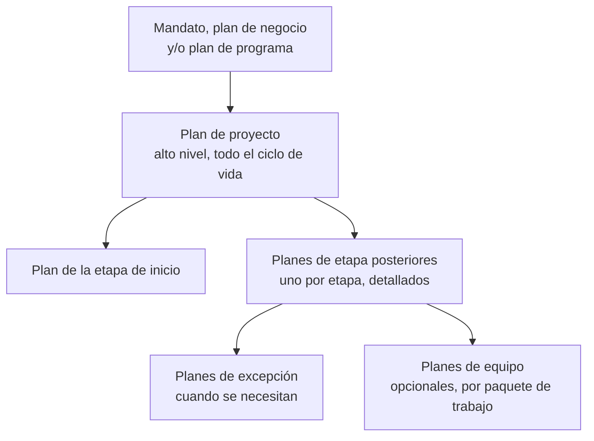

Todos los planes comparten la **misma estructura**; difieren en propósito, alcance y nivel de detalle. Cualquier plan debe dar al equipo de gestión confianza en que es una evaluación realista de los productos a entregar y el trabajo necesario.

| Plan | Qué es | Quién lo crea | Cuándo | Quién aprueba | Detalle |
|---|---|---|---|---|---|
| **Plan de proyecto** (project plan) | Plan de alto nivel con productos mayores y cuándo, cómo y a qué costo se entregan; da confianza a la junta de que se cumplirá el caso de negocio y al equipo de que el enfoque es viable dentro de recursos y tolerancias. Identifica número de etapas y sus límites, y los paquetes de trabajo propuestos (nivel superior de la WBS), indicando si cada uno se entrega secuencial o iterativamente | Gerente de proyecto | Durante el inicio; baselined al aprobarse; actualizado y re-baselined en límites de etapa con aprobación de la junta | Junta de proyecto (ejecutivo) | Meses o semanas; personas por tipo de habilidad |
| **Plan de etapa** (stage plan) | Plan detallado que sirve de base para el control diario del gerente durante una etapa. Debe ser trazable al plan de proyecto. Incluye PBS de la etapa y WBS de la etapa (actividades principales, personas y recursos) | Gerente de proyecto | El de la etapa de inicio, durante el arranque; los siguientes, cerca del final de la etapa anterior (así se producen cerca de la ejecución, viven poco y aprovechan el desempeño de etapas previas) | Junta de proyecto | Días; personas por nombre si es posible |
| **Plan de equipo** (team plan) | Base para organizar y controlar el trabajo de un equipo al ejecutar uno o más paquetes de trabajo. **Opcional**. Útil cuando el equipo es una organización temporal con gente de distintas áreas. Un tablero Kanban puede sustituirlo | Gerente de equipo | Al aceptar el paquete de trabajo | Gerente de proyecto (según lo acordado en el paquete) | Tareas y personas asignadas |
| **Plan de excepción** (exception plan) | Sigue a un informe de excepción y explica cómo responderá el proyecto dentro de la etapa. Según el impacto puede limitarse a acciones de remediación (p. ej., inspecciones más frecuentes ante una excepción de calidad). Si la resolución requiere acciones fuera de la etapa, hay que cambiar el plan de proyecto. **No existen** planes de excepción para planes de equipo | Gerente de proyecto | Cuando la junta decide tratar la excepción dentro de la etapa | Junta (excepción de etapa) o capa de negocio (excepción de proyecto) | Igual al plan que reemplaza |

#### 4.2.2 Etapas: cuántas y de qué longitud

Dividir el proyecto en etapas es equilibrar: método de entrega (iterativo-incremental o lineal-secuencial), secuencia de actividades, tipo de personas y recursos, número y momento de decisiones clave, cantidad de riesgo manejable, y hasta dónde es sensato planificar.

**Número de etapas**

| Factor | Efecto |
|---|---|
| Más etapas | Más control, pero cada límite cuesta esfuerzo de gestión |
| Proyecto simple, productos conocidos, método maduro | Pueden bastar **dos** etapas: inicio + una de entrega |
| Proyecto grande, productos complejos, métodos mixtos | Varias etapas de entrega, cada una con sus productos y límites; permite refinar estimaciones y reconfirmar justificación |
| Iterativo-incremental | Varias etapas de entrega en las que criterios de calidad y aceptación se refinan en paralelo con los productos usando un backlog |
| Eventos externos | Alinear límites con el ciclo presupuestario anual u otros hitos de la organización |

**Longitud de etapas**

| Criterio | Regla |
|---|---|
| Complejidad | Muchas actividades y dependencias → etapas más cortas para evitar excepciones |
| Riesgo | Insertar límites donde los riesgos puedan revisarse antes de comprometer recursos mayores |
| Horizonte de planificación | Mucha incertidumbre en estimaciones → etapas cortas para refinar en el siguiente plan |
| Puntos de decisión | Alinear límites con decisiones críticas de la junta (p. ej., continuar tras un prototipo) o del negocio (ciclo de planificación) |
| Programa | Alinear fin de etapa con fin de tramo (tranche) del programa |

Las etapas no tienen que ser uniformes: una etapa de diseño o prototipado puede ser mucho más corta que la de construcción. Con alta incertidumbre de alcance, etapas de un mes pueden ser apropiadas, redefiniendo alcance en cada límite y entregando un incremento usable en cada etapa después de las de inicio y diseño.

**Etapas y paquetes de trabajo**
- Las etapas **no se solapan**: parten el proyecto con decisiones parar/seguir y mantienen la alineación con el caso de negocio.
- Los paquetes de trabajo, en cambio, pueden correr en paralelo y solaparse, agrupados por método de entrega, habilidades o relaciones entre organizaciones.
- Buena práctica: evitar paquetes que **crucen un límite de etapa**, porque la decisión del límite puede generar retrabajo o desperdicio. Cuando sea inevitable (p. ej., compra de artículos de largo plazo de entrega), revisar su estado en el proceso de gestión del límite de etapa.

#### 4.2.3 Tolerancias en la planificación

- Identificar qué restricción manda: un proyecto **dirigido por cronograma** (schedule-driven) tendrá tolerancia de tiempo estrecha o cero; uno **dirigido por recursos** (resource-driven) tendrá tolerancia de costo estrecha o cero.
- Las siete tolerancias (beneficios, tiempo, costo, calidad, alcance, riesgo, sostenibilidad) existen en cada nivel de plan. Su amplitud relativa comunica qué restricción prevalece.
- Ejemplo de tolerancia de alcance: en un producto nuevo para la organización, admitir cierto nivel de soporte inicial y capacitación tras la aceptación para suavizar la transición.
- Las tolerancias **se estrechan con el tiempo**: en el inicio, con estimaciones gruesas, pueden ser amplias (p. ej., ±40 %); al pasar a la etapa siguiente con mejor información, se reducen (p. ej., ±20 %).
- Las técnicas de priorización ayudan a fijar tolerancias de alcance.
- Incluir con cada estimación un **nivel de confianza**: a mayor confianza, menos variaciones inesperadas y tolerancias más realistas.

#### 4.2.4 Reglas de buena práctica (planes)

1. Planificar solo hasta donde se pueda con confianza razonable; detallar el resto en planes de etapa sucesivos.
2. Combinar siempre un plan de proyecto de alto nivel con un plan de etapa detallado de la etapa en curso.
3. Toda actividad o producto de un plan subordinado debe rastrearse a un elemento del plan de proyecto; lo que no se rastrea es deslizamiento de alcance.
4. Empezar por los productos, nunca por las actividades.
5. Verificar que la PBS no omite productos necesarios ni incluye innecesarios.
6. Incluir en PBS y PFD los productos intermedios y los externos, además de los finales.
7. Dar al PFD un inicio y un fin claros, y un detalle proporcional al costo, duración y escala.
8. Consultar a expertos en la materia para PBS, PFD, descripciones de producto y estimaciones.
9. Documentar toda dependencia del PFD en la descripción del paquete de trabajo correspondiente.
10. Sin solapamientos entre paquetes de trabajo (costos innecesarios y conflictos) y sin vacíos entre PFD, PBS y el conjunto de paquetes.
11. Considerar un paquete de trabajo de gestión del proyecto por etapa, aunque no esté en el presupuesto, para documentar las tareas de gestión y relacionarlas con hitos.
12. Incluir en el cronograma de etapa **todos** los paquetes de trabajo de la etapa.
13. Estimar personas (habilidades, esfuerzo, cuándo y dónde), recursos, duraciones, costos, beneficios y riesgos; con nivel de confianza.
14. Tratar el plan como borrador hasta decidir cómo se tratarán los riesgos que contiene; registrar los riesgos en el registro de riesgos.
15. Incluir en el presupuesto: costos de actividades (personas, equipos, materiales, instalaciones), costos de gestión, presupuesto de riesgo, presupuesto de cambio y tolerancias de costo. Los presupuestos de riesgo y cambio son opcionales según el valor del control adicional frente a su costo.
16. Mostrar la holgura en el cronograma; holgura cero en todo el plan significa alto riesgo de excepción de tiempo.
17. Usar la holgura y la flexibilidad de recursos para evitar excepciones ajustando tiempos.
18. Preparar un documento narrativo que explique el plan: dependencias, tolerancias, monitoreo y control, presupuestos, riesgos clave y supuestos; en el plan de proyecto, además, etapas y decisiones de la junta.
19. Hacer el plan de etapa siguiente cerca del fin de la etapa actual, con lo aprendido.
20. Incluir hitos de compras (órdenes, pagos por hitos) alineados con etapas.
21. Exigir trazabilidad de los planes del proveedor al plan del cliente (acuerdos espalda con espalda) y derechos de inspección y auditoría; preparar versiones no confidenciales para compartir.
22. Reflejar en los planes las dependencias hacia y desde otros proyectos del programa.
23. Considerar la sostenibilidad del producto (ciclo de vida completo, incluida disposición), de la entrega (combustible, residuos; tolerancias de sostenibilidad) y de los beneficios (requisitos como formación y soporte continuo).
24. Dimensionar el esfuerzo de planificación al costo y la importancia del proyecto (puede llegar al 10 % o más del costo total); en proyectos simples, el cronograma puede ser una lista de hitos o una diapositiva.
25. En proyectos plurianuales, preparar planes que faciliten la orientación y continuidad ante rotación del equipo.

### 4.3 Técnicas

#### 4.3.1 Técnica PRINCE2 de planificación (planificación basada en productos)

Técnica **propia** del método; un procedimiento alternativo debe documentarse como adaptación en la PID. No es estrictamente secuencial: estimar y programar suelen ir juntos y de forma colaborativa; el presupuesto conviene hacerlo cuando descripciones, paquetes y cronograma están maduros. Se repite para plan de proyecto, de etapa, de equipo y de excepción.

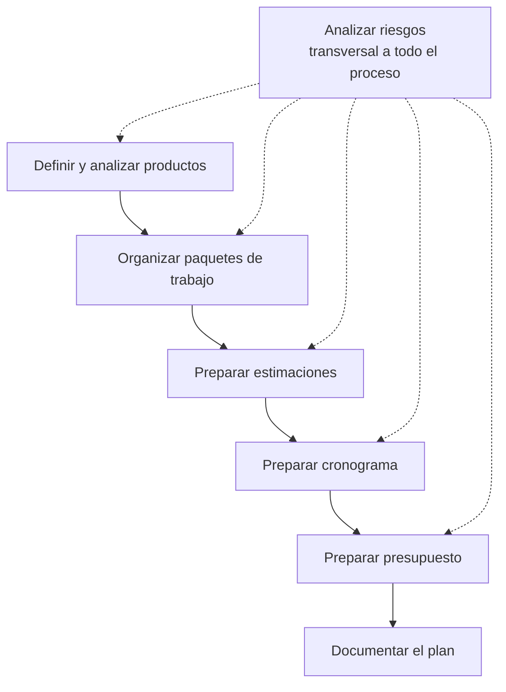

##### Paso 1 — Definir y analizar productos (cuatro subpasos)

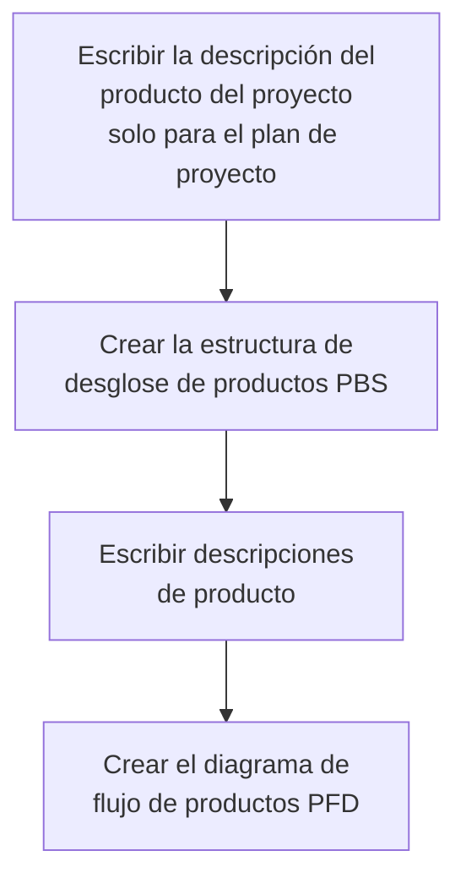

**1a. Descripción del producto del proyecto**
- *Para qué*: confirmar que están identificados todos los productos mayores necesarios para los resultados esperados por el usuario, sin faltantes ni sobrantes; fijar expectativas de calidad, criterios y métodos de aceptación.
- *Cuándo*: en el arranque, dentro del brief; se refina en el inicio. Solo aplica al plan de proyecto.
- *Reglas*: criterios de aceptación en términos objetivamente medibles cuando sea posible; si no, enunciados descriptivos con compromiso explícito en el brief de traducirlos a criterios precisos en las descripciones de producto. Esto permite acordar tolerancias de calidad y entendimiento común entre gerente y junta. Pueden explorarse soluciones y enfoques alternativos a alto nivel.

**1b. Estructura de desglose de productos (PBS)**
- *Para qué*: describir los productos y sus componentes esenciales de forma jerárquica; agrupar requisitos relacionados (p. ej., todo lo de fontanería junto, separado de acabados); agrupar por método de compra o entrega (el terreno se adquiere de forma distinta a como se construye la casa).
- *Cómo*: partir del producto del proyecto; dividir en productos mayores; subdividir hasta el nivel en que el proyecto puede ejercer control; añadir productos externos (de los que se depende pero no se producen) marcándolos como tales; considerar **estados** del mismo producto cuando cada estado tenga especificaciones de calidad propias (diseño → construcción → acabado).
- *Salida*: jerarquía que alimenta descripciones, PFD, WBS y paquetes.

Ejemplo genérico (no tomado del manual):

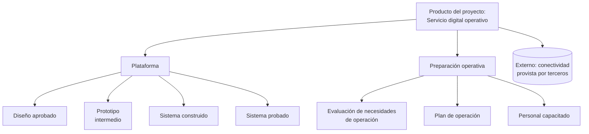

**1c. Descripciones de producto**
- *Para qué*: detallar requisitos de los productos mayores hasta un nivel que permita estimar y programar de forma realista; incluir requisitos de cómo se adquieren, desarrollan, prueban, usan y soportan tras la aceptación.
- *Cómo*: el gerente elicita requisitos de los usuarios y consulta a expertos; puede ser iterativo. En lineal-secuencial, detalle suficiente para estimar con confianza; en iterativo-incremental, un nivel alto puede bastar para arrancar la etapa en que se desarrollarán, con los detalles emergiendo en paralelo.
- *Regla*: priorizar las especificaciones de calidad de cada producto (los deseos de los usuarios chocan con restricciones, p. ej., una opción de alto consumo energético frente a límites de sostenibilidad).
- *Cuándo*: en el inicio para los productos del plan de proyecto; en cada límite de etapa para los de la etapa siguiente; en cuanto se identifica la necesidad de un producto.

**1d. Diagrama de flujo de productos (PFD)**
- *Para qué*: mostrar la secuencia de producción y las dependencias entre productos; conduce naturalmente a identificar actividades y da la base para estimar y programar; permite al gerente y al usuario sénior ver cuándo las salidas empezarán a producir resultados y medir beneficios.
- *Cómo*: colocar un nodo "inicio" y un nodo "fin"; ubicar cada producto de la PBS (intermedios, finales y externos) y dibujar flechas de dependencia; identificar qué puede hacerse en paralelo (p. ej., asegurar inquilinos mientras se construye) y qué debe esperar (no construir hasta tener servicios básicos); puede colorearse por etapa de finalización.
- *Con quién*: expertos en entrega y aceptación.

Ejemplo genérico con los productos de la PBS anterior:

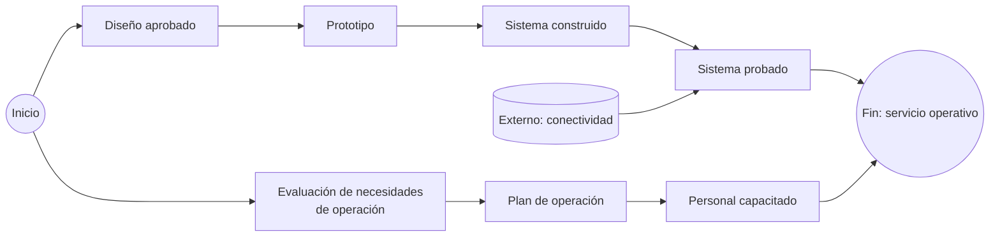

##### Paso 2 — Organizar paquetes de trabajo
- El PFD ayuda a decidir si la entrega será lineal-secuencial o iterativa-incremental.
- Decidido el método, identificar las actividades de entrega de cada producto y agruparlas en paquetes de trabajo que combinen personas, recursos y actividades estrechamente relacionados y produzcan al menos un producto final o intermedio.
- Registrar dependencias (internas y externas) en la descripción del paquete.
- Verificar: sin solapamientos entre paquetes; la totalidad de los paquetes cubre todo el alcance de entrega.
- Opcional: un paquete de gestión del proyecto por etapa.
- La WBS mapea paquetes a equipos o proveedores; permite describir costos laborales por tipo de habilidad, esfuerzo y duración; apoya los planes de equipo detallando tareas y asignaciones. Opcional en proyectos simples.

##### Paso 3 — Preparar estimaciones
Qué se estima: personas (habilidades, esfuerzo, cuándo y dónde), recursos (materiales, equipos, instalaciones, accesos, recursos naturales, dinero), duración de actividades, costo de personas y recursos (tarifas, salarios, precios unitarios), beneficios (valor de los resultados) y riesgos (proximidad, probabilidad, velocidad, impacto y costo de respuestas). Siempre con nivel de confianza.

##### Paso 4 — Preparar cronograma
- Capturar secuencia, interrelaciones y duración de paquetes y tareas. Todos los paquetes de la etapa deben estar.
- Descomponer: paquete → actividades → tareas; por tarea, personas y recursos, esfuerzo y duración.
- Elaborar más detalle en los planes de etapa a medida que se entiende mejor el esfuerzo.

##### Paso 5 — Preparar presupuesto
Listar personas y recursos y calcular costos. Componentes: costos de actividades (producir, entregar, gestionar), presupuesto de riesgo (opcional), presupuesto de cambio (opcional) y tolerancias de costo. Puede documentarse en varios componentes (tiempo de un laboratorio de pruebas en el cronograma; capital en el presupuesto).

##### Paso transversal — Analizar riesgos
Examinar el plan a medida que se detalla; registrar riesgos en el registro de riesgos; el plan sigue siendo borrador hasta decidir cómo tratar los riesgos inherentes; modificar el plan según esas decisiones.

##### Paso 6 — Documentar el plan
Cronograma y presupuesto pueden vivir en sistemas separados; PBS, PFD y WBS en documento, hoja de cálculo o herramienta gráfica; elementos múltiples en herramientas colaborativas. Conviene un documento narrativo de alto nivel con: dependencias internas y externas, tolerancias propuestas, requisitos de monitoreo y control, presupuestos, riesgos clave, supuestos; y, en el plan de proyecto, etapas y decisiones planificadas de la junta.

#### 4.3.2 Técnicas de apoyo: priorización

- *Para qué*: casi nunca hay dinero, tiempo o recursos para todo lo deseado, aunque esté justificado; hay que priorizar alcance, criterios de aceptación y especificaciones, y entregar lo máximo justificado. Ayuda a definir tolerancias de alcance.
- *Opciones*:

| Técnica | Idea |
|---|---|
| MoSCoW | Clasificar criterios como imprescindible (must), deseable (should), opcional (could) o excluido por ahora (won't) |
| Backlog de producto | Secuencia en que las funcionalidades estarán disponibles o los criterios se cumplirán |
| Comparación por pares | Preferencias relativas entre criterios |
| Modelo Kano | Características esenciales, de desempeño y "deleitadoras" según satisfacción del cliente |
| Matriz de Eisenhower | Dos dimensiones contrapuestas (importancia vs urgencia; valor vs facilidad) |

#### 4.3.3 Técnicas de apoyo: programación (scheduling)

| Técnica | Qué es | Cuándo |
|---|---|---|
| **Diagrama de Gantt** | Barras de duración de tareas contra el tiempo | Muchas actividades e hitos; compatible con herramientas |
| **Hoja de cálculo** | Lista de paquetes y tareas con fechas | Proyectos simples; difícil de mantener si hay muchos cambios |
| **Lista de verificación de productos** (product checklist) | Productos mayores con fechas clave planificadas y reales | Resumen de desempeño de entrega a lo largo del ciclo de vida |
| **Tablero de flujo de actividades** (activity flow board) | Cómo cada producto o componente avanza por el flujo de trabajo (Kanban) | Iterativo-incremental |

Análisis de red:
- **Holgura**: identificarla por actividad; holgura cero generalizada = alto riesgo.
- **Camino crítico**: secuencia con menor holgura total; cualquier retraso en él retrasa el plan. Debilidad: ignora límites de recursos.
- **Cadena crítica**: secuencia que, con los recursos disponibles, impide acortar el plan (p. ej., prohibición de obra en fines de semana).
- **Uso**: tratar cambios en camino crítico o cadena crítica como excepciones potenciales; evitar excepciones ajustando actividades dentro de la holgura o flexibilidad de recursos.
- **Nivelación de recursos** (resource levelling): el manual, en la fuente cubierta, no la nombra como técnica; el concepto afín es la cadena crítica y el ajuste con holgura y flexibilidad de recursos (no determinado en la fuente más allá de esto).

#### 4.3.4 Técnicas de apoyo: estimación

| Técnica | Cómo funciona | Cuándo conviene |
|---|---|---|
| **Descendente** (top-down) | Estimar con alta confianza los productos y paquetes mayores y repartir hacia abajo en PBS/WBS | Iterativo-incremental con etapas y sprints de tiempo y recursos fijos |
| **Ascendente** (bottom-up) | Estimar los elementos de nivel más bajo y agregar | Elementos bien entendidos que se combinan de forma nueva |
| **Comparativa** (análoga) | Basarse en proyectos similares o información de mercado | Materiales, productos o trabajo bien conocidos |
| **Paramétrica** | Modelos con datos empíricos (p. ej., por unidad o tamaño) | Sectores con modelos de estimación maduros (construcción) |
| **Analítica de datos** | Analítica descriptiva (características de una tarea) y predictiva (propensión a resultados) | Cuando hay datos del proyecto, del negocio o de un fideicomiso de datos |
| **Juicio experto por consenso** | Delphi, planning poker | Participación de expertos; incertidumbre alta |

En proyectos grandes se combinan varias técnicas y puede recurrirse a especialistas en estimación de costos.

#### 4.3.5 Gestión de dependencias

- Clasificar cada dependencia como interna (control del equipo) o externa (control incompleto).
- Mostrar todas en el PFD y documentarlas en la descripción del paquete afectado.
- Las externas incluyen productos de otros proyectos del programa: incorporarlas al plan.
- Para paquetes que dependen de compras de largo plazo, revisar su estado en cada límite de etapa.
- Las dependencias externas son una fuente natural de riesgos; registrarlas también en el registro de riesgos cuando corresponda.

### 4.4 Aplicación según contexto

| Contexto | Cómo se adapta la práctica |
|---|---|
| **Organizacional** | Cumplir procedimientos (p. ej., presupuesto conforme a reglas de inversión de capital); en el sector público, requisitos regulatorios y transparencia en registros; incorporar requisitos regulatorios a las descripciones de producto y añadir revisiones de cumplimiento en planes de etapa. En un programa, el equipo de programa puede apoyar o liderar la planificación, aportar plantillas y planificadores dedicados, imponer etapas estándar y fijar alineación con hitos de tramo; el plan de programa indica qué productos del proyecto usan otros proyectos. |
| **Comercial** | Alinear paquetes con el proveedor responsable; reflejarlo en contrato cuando sea externo; exigir trazabilidad del plan del proveedor al del cliente y alineación con criterios de aceptación aprobados por la junta (acuerdo espalda con espalda); definir cómo se producen los planes del proveedor y qué derechos de inspección y auditoría tiene el cliente; el plan del proveedor debe tener suficientes hitos para que el gerente del cliente mantenga el suyo; preparar versiones no confidenciales; incluir hitos de compras y pagos por etapa; la licitación puede ocupar una etapa propia. |
| **Método de entrega** | **Lineal-secuencial**: la mayor parte del esfuerzo de planificación va al arranque e inicio; productos conocidos y métodos maduros; proyectos similares ayudan a fijar horizonte, productos, paquetes y etapas; estimaciones de alta confianza; el plan de proyecto rara vez cambia salvo excepción de proyecto. **Iterativo-incremental**: foco en cuánto cabe en un período fijo (sprint, timebox); tolerancias por iteración que fijan tiempo y costo y flexibilizan alcance; descripción del producto del proyecto en términos de resultados y beneficios; historias de usuario, épicas y backlog en lugar de descripciones de producto; longitud de liberaciones o timeboxes definida como etapas; recursos estimados por etapa y presupuesto de proyecto; backlog y flujo combinados en una herramienta colaborativa (Kanban) que sustituye al plan de equipo y se construye con todo el equipo; revisión del plan en cada ciclo. |
| **Sostenibilidad** | Tres frentes: sostenibilidad del **producto** (impacto ambiental en todo el ciclo de vida, incluida disposición); de la **entrega** (decisiones de paquetes y etapas que afectan el clima; tolerancias de sostenibilidad para combustible y residuos); de los **beneficios** (requisitos para sostener beneficios tras el cierre, como formación y soporte). |
| **Escala** | **Duración**: más larga → más adaptación a cambios externos e internos, mayor presupuesto de cambio, rotación de equipo; planes que faciliten la orientación. **Tamaño del equipo**: grande y disperso → más soporte y herramientas accesibles. **Complejidad**: pocos productos → documentos y herramientas simples; muchos → herramienta de programación especializada. **Novedad**: productos o métodos nuevos → poca experiencia para estimar; alta incertidumbre; prototipado o enfoque iterativo. **Costo**: planificación proporcional al costo total; puede superar el 10 %. Un proyecto de seis meses y baja complejidad puede bastarse con un único plan de proyecto; uno plurianual necesita plan de proyecto + planes de etapa detallados. |

### 4.5 Productos de gestión de la práctica

#### 4.5.1 Plan (plan de proyecto, de etapa, de equipo, de excepción)

| Aspecto | Detalle |
|---|---|
| **Propósito** | Proponer qué, dónde, cuándo, cómo y por quién se realizará el proyecto (o una parte). Aprobado, es la línea base para medir progreso y evaluar cuestiones. |
| **Composición** | **Alcance** del plan (proyecto, etapa, equipo o excepción). **Dependencias**: productos o actividades externas de las que depende. **Supuestos y prerrequisitos**: sobre qué se basa y qué debe establecerse o mantenerse para que funcione. **Lecciones incorporadas**: de proyectos similares previos. **Productos a entregar**: PBS, PFD y descripciones de producto dentro del alcance. **Trabajo a realizar**: WBS y descripciones de paquete de trabajo. **Presupuesto**: costos, incluido presupuesto de riesgo y de cambio. **Cronograma**: etapas y actividades, duraciones y secuencia (p. ej., Gantt). **Metas y tolerancias**: alcance, costo y tiempo del nivel del plan; planes de etapa y equipo pueden añadir sostenibilidad y riesgo. **Arreglos de monitoreo, control y reporte**: cómo se monitorea y controla, procedimientos y responsabilidades de reporte. |
| **Quién** | Ver tabla de niveles de plan (4.2.1). Soporte asiste en la compilación, aporta pericia en herramientas y hace línea base, almacenamiento y distribución. Aseguramiento revisa factibilidad frente a metas y tolerancias y el impacto de cambios sobre el negocio y el caso. Usuario y proveedor sénior asesoran, verifican coherencia desde su perspectiva y comprometen recursos (p. ej., personal operativo para pruebas y formación; desarrolladores y maquinaria). |
| **Cuándo** | Ver 4.2.1. |
| **Criterios de calidad** | Trazable al nivel superior; PBS/PFD/paquetes sin vacíos ni solapamientos; estimaciones con nivel de confianza; riesgos analizados y tratados; tolerancias explícitas y coherentes con la restricción dominante; dependencias externas identificadas; supuestos documentados; lecciones incorporadas; aprobado por el nivel correspondiente. |

#### 4.5.2 Descripción del producto del proyecto (project product description)

| Aspecto | Detalle |
|---|---|
| **Propósito** | Describir los productos mayores del proyecto y su finalidad, con expectativas de calidad del usuario, criterios y métodos de aceptación. Creada en el arranque y refinada en el inicio. |
| **Composición** | **Propósito**: qué cumplirán los productos y quién los usará. **Productos mayores**. **Derivación**: en qué se basan (productos existentes, requisito de nueva capacidad). **Expectativas de calidad del usuario**: calidad esperada y estándares y procedimientos a aplicar. **Criterios de aceptación**: lista **priorizada** de criterios que deben cumplirse para que el usuario acepte. **Métodos y responsabilidades de aceptación**: cómo se confirmará y quién decide. **Tolerancias de calidad a nivel proyecto**: aplicables a los criterios de aceptación. |
| **Quién** | La elabora el gerente de proyecto consultando interesados; el usuario sénior aporta expectativas y criterios y la aprueba; el ejecutivo la aprueba; el proveedor sénior la aprueba si corresponde. |
| **Cuándo** | Arranque (en el brief); refinada en inicio (en la PID); los criterios se traducen a especificaciones en las descripciones de producto. |
| **Criterios de calidad** | Identifica todos los productos mayores; criterios medibles o con compromiso de precisión; prioridad explícita; estándares y sistemas de gestión de calidad de negocio, usuario y proveedor indicados; mediciones útiles para juzgar aceptabilidad; tolerancias de calidad. |

#### 4.5.3 Descripción de paquete de trabajo (work package description)

| Aspecto | Detalle |
|---|---|
| **Propósito** | Describir cómo se producirán y entregarán uno o más productos; transferir formalmente la responsabilidad del trabajo a un gerente o miembro de equipo. |
| **Composición** | **Descripción del trabajo**: enunciado de trabajo y WBS asociada. **Gerente de equipo o persona autorizada**. **Descripciones de producto** asociadas. **Técnicas y procedimientos**: cómo debe hacerse. **Requisitos de control de cambios**: control de líneas base de proyecto y producto dentro del paquete. **Restricciones**: horas autorizadas, seguridad, protección. **Monitoreo, control y reporte**. **Metas y tolerancias**: alcance, costo y tiempo del paquete. **Referencias** a planes superiores. **Aprobación**: quién aprueba los productos terminados. **Acuerdo**: registro de la autorización inicial y la finalización, entre gerente de proyecto y gerente de equipo. |
| **Quién** | La prepara el gerente de proyecto con ayuda del gerente de equipo; la acuerdan ambos; soporte la baseline y distribuye. |
| **Cuándo** | Al autorizar el trabajo (normalmente al inicio de la etapa o cuando el PFD lo indique); se cierra al completarse. |
| **Criterios de calidad** | Dependencias del PFD registradas; sin solapar con otros paquetes; produce al menos un producto final o intermedio; no mezcla personal interno y externo; tolerancias coherentes con el plan de etapa; refleja requisitos del enfoque comercial, de calidad y de sostenibilidad. |

#### 4.5.4 Descripción de producto y WBS

La **descripción de producto** se detalla en la práctica de calidad (5.5.1), donde el manual la ubica. La **WBS** se trata en 3.3.4 y 4.3.1 (paso 2).

### 4.6 Foco de cada rol en la práctica

| Rol | Foco en planes |
|---|---|
| **Capa de negocio** | Fija tolerancias de proyecto (en el mandato o confirmadas para el brief); aprueba planes de excepción cuando se prevé exceder tolerancias de proyecto; aporta estándares de planificación. |
| **Ejecutivo** | Aprueba el plan de proyecto; fija tolerancias de cada etapa y aprueba planes de etapa; aprueba planes de excepción de etapa; compromete personas y recursos del negocio (p. ej., finanzas, sistemas). |
| **Usuario sénior** | Asesora y asiste en planes de proyecto y etapa; vigila coherencia con la perspectiva del usuario; compromete personas y recursos de usuario (personal operativo para formación y pruebas, entorno de pruebas). |
| **Proveedor sénior** | Asesora y asiste en planes de proyecto y etapa y en descripciones de paquete; vigila coherencia desde el proveedor; compromete personas y recursos del proveedor (desarrolladores, maquinaria). |
| **Gerente de proyecto** | Diseña los planes; prepara y actualiza plan de proyecto, planes de etapa y descripciones de paquete; decide cómo aplicar etapas y pasos de entrega; ordena acciones correctivas cuando se prevé exceder tolerancias de paquete; prepara planes de excepción tras la decisión de la junta. |
| **Gerente de equipo** | Ayuda a preparar descripciones de paquete; prepara planes de equipo y cronogramas por paquete. |
| **Aseguramiento del proyecto** | Revisa factibilidad de planes de etapa y proyecto frente a metas y tolerancias; revisa cambios al plan de proyecto por impacto en el negocio o el caso. |
| **Soporte de proyecto** | Asiste en compilar planes y descripciones; aporta pericia (herramientas de planificación); baseline, almacena y distribuye los planes y descripciones de paquete. |

### 4.7 Relación con los principios

| Principio | Cómo lo materializa esta práctica | Resultado |
|---|---|---|
| Justificación de negocio continua | Alinear metas de desempeño del plan con el caso y dar estimaciones para que la junta confirme viabilidad | Planes alineados con la estrategia y entregables dentro de tolerancias |
| Aprender de la experiencia | Lecciones de proyectos previos y de etapas anteriores aplicadas a la planificación; compartir lecciones de planificación | Mejor capacidad de entrega y de planificar proyectos futuros |
| Definir roles, responsabilidades y relaciones | Roles específicos por plan; organizar por paquetes y equipos según contexto y método | Rendición de cuentas clara sobre el desempeño del plan |
| Gestionar por etapas | Etapas que respetan horizontes de planificación y se alinean con decisiones clave | Etapas y tolerancias realistas y apropiadas al negocio |
| Gestionar por excepción | Niveles de plan con metas y tolerancias propias | Decisión y escalamiento eficientes por nivel |
| Enfocarse en productos | Todo plan parte de los productos requeridos y la forma más eficaz de entregarlos | Comunicación eficaz y sin trabajo ni productos innecesarios |
| Adaptar al proyecto | Solo las actividades y planes que el enfoque y contexto requieren | Equilibrio entre gestión, entrega y recursos |

### 4.8 Adaptación (tailoring) de los planes

| Situación | Recomendación |
|---|---|
| **Proyecto pequeño** | Dos etapas (inicio + entrega); un solo plan de proyecto que haga de plan de etapa; cronograma como lista de hitos u hoja de cálculo; sin WBS ni planes de equipo; PBS y PFD simples; presupuestos de riesgo y cambio integrados en la tolerancia de costo; descripciones de producto breves pero con criterios de aceptación. |
| **Proyecto ágil** | Timeboxes o liberaciones como etapas (incluso de un mes); tolerancias que fijan tiempo y costo y flexibilizan alcance; descripción del producto del proyecto en resultados y beneficios; backlog, épicas e historias en lugar de descripciones de producto detalladas; Kanban en lugar de plan de equipo; descripción de producto para el MVP; revisión del plan en cada ciclo; MoSCoW para tolerancias de alcance. |
| **Con proveedores externos** | Paquetes alineados a proveedores y reflejados en contratos; acuerdos espalda con espalda con trazabilidad al plan del cliente y a los criterios de aceptación; derechos de inspección y auditoría; versiones no confidenciales del plan; hitos de compras y pagos; etapa de licitación separada; proveedor temporal en la junta durante la compra. |
| **Dentro de un programa** | Etapas estándar del programa; planificadores y plantillas del programa; hitos de etapa alineados a tramos; dependencias con otros proyectos en el plan. |
| **Alta novedad o incertidumbre** | Etapas cortas; prototipado como producto intermedio; estimaciones por rangos con nivel de confianza; tolerancias amplias que se estrechan etapa a etapa; enfoque iterativo. |

---

## 5. Práctica: Calidad (Quality)

### 5.1 Propósito y conceptos clave

#### 5.1.1 Propósito

Documentar los requisitos del usuario sobre los productos del proyecto y establecer los medios para cumplirlos. La calidad trata de que los productos satisfagan requisitos y expectativas del usuario **y** permitan realizar los beneficios. La calidad se construye en todo momento, no se prueba al final.

Actividades sistemáticas del método:
1. Confirmar explícitamente expectativas de calidad y criterios de aceptación del usuario en la descripción del producto del proyecto.
2. Identificar los productos hasta el nivel en que el proyecto puede ejercer control.
3. Definir cada producto en una descripción de producto con sus especificaciones de calidad, las técnicas con que se verificará y las responsabilidades.
4. Aplicar y rastrear esas técnicas durante todo el proyecto.

#### 5.1.2 Conceptos clave

| Término | Definición propia |
|---|---|
| **Calidad** (quality) | Grado en que las características inherentes de un producto, servicio, proceso, persona, organización, sistema o recurso cumplen sus requisitos. |
| **Expectativas de calidad del usuario** (user's quality expectations) | Enunciado sobre la calidad esperada del producto del proyecto, **recogido en la descripción del producto del proyecto**. En PRINCE2 el término se reserva a lo que figura allí; otras expectativas de interesados no cuentan como tales. |
| **Requisito** (requirement) | Necesidad o expectativa **documentada en un producto de gestión aprobado**. Lo documentado y aprobado es alcance; lo que no, no lo es. Esta distinción es la base del control. |
| **Criterios de aceptación** (acceptance criteria) | Lista priorizada de criterios que el producto del proyecto debe cumplir para que el usuario lo acepte; definiciones medibles de atributos. Se enuncian en la descripción del producto del proyecto; los posee el negocio y los aprueba la junta en su nombre; suelen expresarse como capacidades funcionales esperadas. |
| **Especificaciones de calidad** (quality specifications) | Medidas que aplicará el control de calidad y niveles que debe alcanzar el producto terminado. Se enuncian en las descripciones de producto; derivan de las expectativas del usuario y del contexto de negocio u operativo (regulación, políticas, prácticas existentes). |
| **Tolerancia de calidad** (quality tolerance) | Desviación permitida en la calidad de un producto antes de escalar. Se fija a nivel proyecto en la descripción del producto del proyecto y a nivel producto en cada descripción de producto, a partir de criterios y especificaciones priorizados. |
| **Planificación de la calidad** (quality planning) | Captar especificaciones de calidad de los productos y generar las descripciones de producto y el enfoque de gestión de la calidad. Previene defectos y reduce el costo y riesgo del control. |
| **Control de calidad** (quality control) | Procedimientos para monitorear productos y sus actividades de desarrollo o entrega, determinar si cumplen estándares y encontrar formas de minimizar causas de desempeño insatisfactorio. Empieza cuando se aprueba la descripción de producto y se registra en el registro de productos. |
| **Aseguramiento de la calidad** (quality assurance) | Actividad planificada y sistemática que da confianza en que los productos cumplirán sus especificaciones cuando se controlen. La realiza típicamente el negocio, **independiente del equipo de proyecto**. Verifica que las técnicas de planificación y control sean suficientes. |
| **Aseguramiento del proyecto** (project assurance) — *no confundir* | Responsabilidad de la junta para confirmar que el proyecto se conduce correctamente; independiente del gerente de proyecto pero **no** del proyecto. El aseguramiento de la calidad se centra en productos y es externo al equipo. |
| **Productor** (producer) | Persona o grupo que desarrolla el producto. |
| **Revisor** (reviewer) | Persona o grupo que evalúa si el producto cumple criterios o especificaciones. **Siempre independiente del productor**. |
| **Autoridad de aceptación** (acceptance authority) | Quien decide si el producto es aceptable. Puede ser la junta, que puede delegarlo para algunos productos; la delegación se documenta en el enfoque de gestión de la calidad. |
| **Registro de productos** (product register) | Componente del registro del proyecto que lista los productos a entregar y registra su aceptación. |
| **Registro de calidad** (quality register) | Componente del registro del proyecto que lista todas las actividades de control de calidad planificadas o realizadas y alimenta los informes de fin de etapa y fin de proyecto. |
| **Requisito funcional** | Cómo debe funcionar y usarse el producto ("aptitud para el propósito"). |
| **Requisito no funcional** | Características inherentes como seguridad, rendimiento, fiabilidad, usabilidad ("aptitud para el uso"). |

#### 5.1.3 Calidad basada en productos

- El principio de enfoque en productos es el eje: los requisitos (expectativas, necesidades y deseos sobre productos, resultados y beneficios) se traducen en criterios de aceptación y especificaciones de calidad de productos concretos y de sus actividades de entrega. Así se evita gastar en trabajo no trazable a la justificación de negocio.
- Ningún proyecto satisface todos los requisitos: hay que priorizarlos y acordarlos de forma controlada.
- La trazabilidad especificaciones ↔ controles ↔ productos evita conflictos por expectativas no cumplidas.
- Cuanto mayor el alcance y la duración, más grande y dinámico el conjunto de requisitos; hay que **anticipar cambios de requisitos**. La gestión de requisitos es continua y es la primera parte del enfoque de calidad basado en productos.
- Corregir temprano es más barato que corregir en pruebas finales o en operación.

### 5.2 Guía de aplicación efectiva

#### 5.2.1 Los tres elementos de la gestión de la calidad

| Elemento | Qué implica | Quién |
|---|---|---|
| **Planificación de la calidad** | Identificar productos mayores y documentarlos con expectativas y criterios en la descripción del producto del proyecto; elicitar requisitos y detallarlos como especificaciones en descripciones de producto; desarrollar el enfoque de gestión de la calidad; obtener aprobación de la junta como línea base | Gerente de proyecto con interesados; aprueba la junta |
| **Control de calidad** | Aplicar el enfoque durante la entrega; evaluar cuestiones de calidad y levantar excepciones cuando corresponda; obtener la aceptación de los productos | Gerentes de equipo, revisores, autoridad de aceptación; coordinación del gerente de proyecto |
| **Aseguramiento de la calidad** | Comprobar que las técnicas de planificación y control bastan para confirmar que los requisitos pueden cumplirse | Función del negocio, independiente del equipo |

#### 5.2.2 Planificación de la calidad en detalle

**Expectativas del usuario**: se documentan en la descripción del producto del proyecto durante el arranque (parte del brief). Aun a alto nivel, debe identificar: todos los productos mayores; expectativas de calidad y criterios de aceptación; estándares y procedimientos aplicables, incluido en qué medida se usan los sistemas de gestión de calidad del negocio, del usuario y del proveedor; mediciones útiles para juzgar aceptabilidad; tolerancias de calidad. Esta cobertura evita que las descripciones de producto introduzcan requisitos fuera del alcance aprobado.

**Tolerancias de calidad**: como nunca hay recursos para todo, el gerente acuerda con interesados y junta una priorización de criterios y especificaciones; esa priorización permite fijar tolerancias y gestionar por excepción.

**Describir productos**: la descripción de producto se produce en cuanto se identifica la necesidad del producto; en lineal-secuencial, durante el inicio y en cada límite de etapa; en iterativo-incremental, evoluciona con el producto y se refina con retroalimentación de prototipos o versiones tempranas. Debe incluir las necesidades de quienes operarán y mantendrán el producto. Al aprobarse por la junta se registra en el registro de productos y pasa a ser línea base; se cambia solo de forma controlada, idealmente al aproximarse la siguiente etapa.

**Sostenibilidad del producto**: incluir en las descripciones requisitos de sostenibilidad como especificaciones o criterios: impacto ambiental del producto y características que sostengan sus beneficios durante su vida útil; considerar el desmantelamiento si pesa en el impacto total.

**Responsabilidades de calidad**: cada descripción de producto nombra productor, revisor (independiente del productor) y autoridad de aceptación (junta o delegado según el enfoque).

**Calidad en planes subordinados**: los eventos de control (pruebas, etc.) pueden detallarse en planes de etapa y equipo para estimar y programar mejor; pero no deben introducir requisitos no trazables a las descripciones de producto y del producto del proyecto. Cambios a la PID originados en planificación de bajo nivel se tratan por el enfoque de gestión de cuestiones.

#### 5.2.3 Control de calidad en detalle

- Es una serie de actividades por producto, con varias técnicas; empieza con la aprobación de la descripción de producto.
- Producto nuevo con métodos de diseño o producción nuevos → evaluar prototipo y método inicial antes de producir a escala. Producto maduro o comercial → puede bastar inspección en la entrega.
- Las técnicas se describen en el enfoque de gestión de la calidad.
- El registro de calidad arranca con la aprobación de cada descripción y se actualiza con resultados resumidos; compara lo planificado (enfoque y descripciones) con lo realmente hecho; es información clave de auditoría y aseguramiento.
- El control requiere colaboración entre gerente, aseguramiento y expertos (internos o externos); las actividades que necesitan especialistas deben estar en WBS, cronograma y presupuesto.
- Resultado típico: aprobado / no aprobado. Si falla pero es probable que apruebe, puede repetirse la actividad. Si no puede aprobar, revisar contra tolerancias y especificaciones; las excepciones de tolerancia de calidad y los fuera de especificación se tratan con la técnica de gestión de cuestiones.
- Las lecciones del ciclo de calidad van al registro de lecciones.

#### 5.2.4 Aseguramiento de la calidad en detalle

- Se centra en que las medidas de control sean las adecuadas para evaluar los productos contra sus especificaciones.
- Ocurre durante todo el ciclo de vida, del arranque al cierre.
- Lo realiza típicamente una función del negocio, independiente del equipo de gestión del proyecto.

#### 5.2.5 Reglas de buena práctica (calidad)

1. Toda necesidad que deba cumplirse debe estar escrita en un producto de gestión aprobado; si no está, no es requisito ni alcance.
2. Capturar expectativas y criterios de aceptación al arrancar, en la descripción del producto del proyecto; no esperar al inicio.
3. Priorizar criterios y especificaciones; usar la prioridad para fijar tolerancias de calidad.
4. Traducir cada expectativa en especificaciones medibles: cuantitativas (números) o cualitativas bien acotadas (p. ej., "fácil de usar" acompañado del perfil y formación del usuario previsto).
5. Distinguir requisitos funcionales y no funcionales; no olvidar los no funcionales (rendimiento, seguridad, fiabilidad).
6. Incorporar en las especificaciones las necesidades de operación y mantenimiento posteriores a la aceptación.
7. Incluir requisitos de sostenibilidad del producto como especificaciones o criterios.
8. Nombrar productor, revisor independiente y autoridad de aceptación en cada descripción de producto.
9. Documentar en el enfoque cualquier delegación de la autoridad de aceptación.
10. Registrar en el registro de productos cada descripción aprobada; el control de calidad del producto arranca en ese momento.
11. Alta de la actividad de control en el registro de calidad al aprobar la descripción; actualizar con fechas reales y resultados.
12. Verificar que las actividades de control que requieren especialistas estén en WBS, cronograma y presupuesto.
13. No introducir requisitos nuevos vía planes de etapa o equipo; si surgen, tramitar como cuestión.
14. Tratar fallos no recuperables como excepción de calidad o fuera de especificación por la gestión de cuestiones; no "ajustar" la especificación informalmente.
15. Mantener separados aseguramiento de calidad (negocio, sobre productos) y aseguramiento del proyecto (junta, sobre la conducción del proyecto).
16. Elegir técnicas de control según madurez del producto: verificación y prototipos para lo nuevo; inspección o certificación para lo comercial.
17. Probar en el lugar que reduce más riesgo y costo (p. ej., en la planta del proveedor antes que en el sitio del usuario), y en vivo cuando haya que confirmar aptitud operativa.
18. La aceptación combina revisión de la información de control del proyecto y una revisión independiente contra expectativas y criterios; transfiere propiedad del proyecto o proveedor a la junta en nombre del usuario.
19. Evitar especificaciones y criterios excesivamente estrictos: encarecen el proyecto sin proporción; el objetivo es compensar el costo de fallos con planificación y control adecuados.
20. Alinear criterios contractuales de calidad y aceptación con los de las descripciones; que no se contradigan.
21. Capturar lecciones de calidad y usarlas en la planificación de calidad de la etapa siguiente.
22. En ágil, usar descripciones de producto para el MVP y definiciones de "listo" y "hecho" estándar en el enfoque.

### 5.3 Técnicas

#### 5.3.1 Técnica PRINCE2 de gestión de la calidad (tres pasos)

Técnica **propia** del método, articulada en torno al enfoque en productos; una alternativa corporativa (procedimientos propios de diseño, desarrollo y pruebas) debe documentarse como adaptación en la PID.

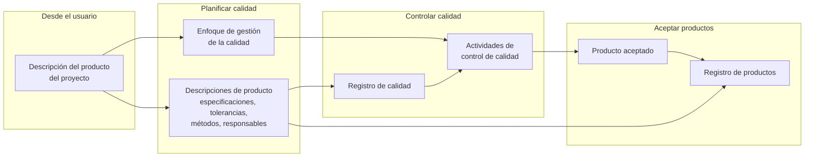

| Paso | Para qué | Entradas | Actividades | Salidas |
|---|---|---|---|---|
| **1. Planificar la calidad** (planning quality) | Fijar qué se exige y cómo se comprobará | Descripción del producto del proyecto (expectativas, criterios, estándares, tolerancias) | **Reunir aportes del usuario**; **crear descripciones de producto** (unas pocas expectativas pueden convertirse en decenas de especificaciones por producto; lograr consenso sobre medidas eficaces; identificar productor, revisor y autoridad de aceptación); **describir el enfoque de gestión de la calidad** (cómo se organiza, ejecuta, monitorea y reporta el control; explicación concisa de la planificación hecha; estándares, procedimientos, herramientas, registros, roles) | Descripciones de producto y enfoque aprobados → línea base; descripciones registradas en registro de calidad (para monitorear control) y en registro de productos (para monitorear entrega y aceptación) |
| **2. Controlar la calidad** (controlling quality) | Comprobar que los productos cumplen | Enfoque aprobado; descripciones; registro de calidad | Ejecutar las actividades de control; registrar resultado (aprobado/no aprobado); repetir si se espera que apruebe; si no puede aprobar, revisar contra tolerancias → gestión de cuestiones; registrar lecciones | Registro de calidad actualizado; información para informes de fin de etapa y proyecto |
| **3. Aceptar productos** (accepting products) | Transferir propiedad | Resultados de control; expectativas y criterios | La autoridad nombrada en la descripción revisa la información de control del proyecto y realiza una revisión independiente contra expectativas y criterios | Producto aceptado; registro de productos actualizado; propiedad transferida a la junta en nombre del usuario |

#### 5.3.2 Técnicas de apoyo: tipos de verificación, prueba e inspección

| Técnica | Qué confirma | Cuándo ocurre | Esfuerzo y requisitos | Mejor para |
|---|---|---|---|---|
| **Verificación** (verification) | Que los productos intermedios (p. ej., el diseño) reflejan especificaciones y criterios, y que el método de entrega sigue buenas prácticas | Durante diseño y desarrollo, antes de que exista el producto | Especialistas en el producto o método | Productos nuevos; reducir riesgo temprano |
| **Validación** (validation) | Que el producto cumple especificaciones y criterios | Durante pruebas o cuando el producto ya existe | Especialistas; puede requerir pruebas independientes | Confirmación formal antes de aceptar |
| **Prototipado** (prototyping) | Retroalimentación temprana de funcionalidad; comprensión de problemas de producción a escala | Antes de la producción completa | Produce un producto intermedio; integral a lo iterativo-incremental (a veces llamado beta); incluye pruebas A/B con versiones alternativas | Alta novedad; ágil |
| **Pruebas** (testing) | Comportamiento del producto, sus componentes o parte de su funcionalidad en condiciones representativas del uso | En varios momentos y lugares | Probar en la planta del proveedor reduce costos y demoras en el sitio del usuario; pruebas en vivo confirman aptitud operativa | Productos con funcionalidad compleja |
| **Inspección** (inspection) | Conformidad con especificaciones y criterios | En el punto de entrega | Bajo esfuerzo | Commodities y productos comerciales listos para usar |
| **Certificación** (certification) | Prueba documental de que el producto o el proveedor cumple requisitos industriales o regulatorios | En el punto de entrega | El menor esfuerzo | Solo productos comerciales listos para usar |

Conocer tipo, momento, lugar y recursos de cada técnica es esencial para planificar (WBS, cronograma, presupuesto).

#### 5.3.3 Revisión de calidad (quality review)

El manual, en los capítulos cubiertos, menciona que las **revisiones de calidad** evalúan si un producto está completo, cumple estándares y satisface sus especificaciones, y que un producto complejo puede necesitar varias en distintos puntos de su desarrollo. No describe en esta sección un procedimiento formal con roles de revisión (presidente, presentador, revisores, administrador) ni pasos (preparación, reunión, seguimiento): **no determinado en la fuente**. Un agente puede estructurar una revisión como: (1) distribuir el producto y su descripción a revisores independientes del productor; (2) recoger observaciones contra cada especificación; (3) reunión de revisión para acordar resultado y acciones; (4) registrar resultado, acciones y fecha en el registro de calidad; (5) verificar el cierre de acciones antes de la aceptación. Esta estructura es una propuesta compatible con el método, no texto del manual.

#### 5.3.4 Criterios de aceptación y especificaciones: cómo escribirlos

- **Criterios de aceptación** (nivel proyecto): lista priorizada; preferentemente medibles; si descriptivos, compromiso de traducirlos; expresados como capacidades que el negocio espera tener al aceptar; con tolerancias de calidad asociadas.
- **Especificaciones de calidad** (nivel producto):
  - *Cuantitativas*: números verificables (capacidad para N personas; procesamiento en ≤ X segundos).
  - *Cualitativas*: descripciones acotadas con contexto (perfil del usuario, formación previa) para no ser vagas.
  - Clasificar en funcionales (qué hace y cómo se usa) y no funcionales (seguridad, rendimiento, fiabilidad, usabilidad).
  - Restricciones sobre **cómo** se desarrolla o entrega el producto van también en la descripción del paquete de trabajo.
- Ejemplo (propio): funcional — "permitir autenticar a quien intenta ingresar"; no funcional — "procesar cada registro en no más de 10 segundos".

#### 5.3.5 Registro de calidad: uso como herramienta

Formato típico (un renglón por actividad de control):

| ID actividad | ID producto | Producto | Método | Productor | Revisor | Aprobador | Revisión planificada | Revisión real | Aprobación planificada | Aprobación real | Resultado |
|---|---|---|---|---|---|---|---|---|---|---|---|
| 1 | 109 | Plan de pruebas de estacionamiento | Inspección | Persona A | Persona B | Persona C | fecha | fecha | fecha | fecha | Aprobado |
| 2 | 112 | Bomba de agua | Prueba de rendimiento | Persona D | Persona E | Persona F | fecha | fecha | fecha | fecha | No aprobado |
| 3 | 112 | Bomba de agua | Prueba de mantenimiento | Persona G | Persona B | Persona F | fecha | fecha | fecha | fecha | Aprobado |

Lecturas útiles: desfase planificado/real por actividad; productos con fallos repetidos; carga por revisor; cobertura (todo producto del registro de productos debe tener al menos una actividad).

### 5.4 Aplicación según contexto

| Contexto | Cómo se adapta la práctica |
|---|---|
| **Organizacional** | Empezar por averiguar si el negocio o programa tiene un sistema de gestión de calidad obligatorio y pericia de aseguramiento. Con varias organizaciones (usuario y proveedor separados), cada una puede tener su sistema y su aseguramiento; reflejar roles y capacidades de cada una en el enfoque. En un programa o portafolio, su enfoque de calidad suele determinar el del proyecto; documentar solo lo específico. Estándares externos (entornos regulados) aplican a productos y a actividades de entrega; reflejarlos en descripciones de producto y de paquete. |
| **Comercial** | Descripciones y enfoque deben considerar la función del contrato: acceso a instalaciones del proveedor, derecho del aseguramiento del cliente a inspeccionar o probar de forma independiente, transparencia del proveedor sobre su propio control y reporte. La aceptación tiene dos planos: contractual (del proveedor al cliente, regida por el contrato) y de proyecto (por la junta, regida por la PID); la primera puede ser prerrequisito de la segunda; evitar contradicciones entre criterios contractuales y los de las descripciones. Distinguir claramente roles de control de calidad y aceptación contractual de la aceptación del proyecto en su conjunto. |
| **Método de entrega — lineal-secuencial** | Más información disponible → descripciones y especificaciones detalladas con alta confianza para estimar y programar; aun así habrá cambios; la secuencia de entrega se diseña para resolver temprano lo incierto; cambios externos (p. ej., nueva regulación) se tratan por control de cambios: una nueva funcionalidad demandada es una solicitud de cambio al alcance; una nueva exigencia regulatoria es una solicitud de cambio a los estándares de calidad; ambas se evalúan antes de planificar la etapa siguiente. |
| **Método de entrega — iterativo-incremental** | Especificaciones y criterios no se fijan al aprobar la PID; son metas a alcanzar en iteraciones (sprints). La descripción del producto del proyecto puede escribirse como historias de usuario de alto nivel con criterios de aceptación; alternativamente, requisitos en un backlog priorizado que se revisa cada iteración; los criterios de aceptación determinan si una historia está terminada. Descripción de producto para el **producto mínimo viable** (MVP): versión con lo justo para ser usable, obtener retroalimentación y refinar; buena forma de demostrar los principios con entrega ágil. El enfoque puede incluir definiciones estándar de "hecho" (definition of done) y "listo" (definition of ready). Ejemplo de secuencia: imprescindibles en un timebox, mejoras (deseables y opcionales) en el siguiente tras un piloto. |
| **Sostenibilidad** | Dos caras: capacidad de la organización de sostener los beneficios tras la entrega (sostenibilidad del producto) y expectativas sobre el impacto ambiental del proyecto y sus productos (sostenibilidad ambiental). Ambas a alto nivel en la descripción del producto del proyecto; las especificaciones de sostenibilidad del producto derivan de la cadena de suministro y de cómo el negocio lo usará y soportará; las ambientales pueden requerir referenciar estándares regulatorios o de orientación. |
| **Escala** | La calidad siempre cuesta; el enfoque busca compensar el costo potencial de fallos con planificación y control adecuados; especificaciones demasiado estrictas disparan el costo. Pocos productos con métodos conocidos → estándares existentes e inspección en la entrega; una sola ronda de pruebas de aceptación de usuario; enfoque de calidad dentro de un cuaderno de proyecto que agrupa todos los enfoques. Producto nuevo con muchos componentes y entrega en varias etapas → inversión significativa en control y múltiples revisiones de calidad; documento de enfoque independiente y completo; actividades como inspecciones de diseño técnico, pruebas unitarias, de integración, de rendimiento, funcionales y de aceptación de usuario, todas en el registro de calidad. |

### 5.5 Productos de gestión de la práctica

#### 5.5.1 Descripción de producto (product description)

| Aspecto | Detalle |
|---|---|
| **Propósito** | Describir propósito, composición, origen y especificaciones de calidad de un producto. Se produce en la fase de planificación, lo antes posible tras identificar la necesidad del producto. |
| **Composición** | **Identificador**: nombre o código único si hay muchos productos. **Versión** de la descripción. **Propósito**: para qué sirve, cómo y quién lo usará. **Composición**: componentes o partes. **Formato**: apariencia estándar a la que debe ajustarse, si existe. **Derivado de**: fuente (diseño, producto comercial, sistema a actualizar o reemplazar, enunciado de beneficios esperados). **Especificaciones de calidad**: requisitos funcionales y no funcionales con sus medidas. **Enfoque de desarrollo o producción y habilidades requeridas**: cómo se espera producir; habilidades, instalaciones o equipos especiales. **Asignado a**: persona o equipo que lo crea. **Tolerancia de calidad**: rangos en que las especificaciones clave pueden variar y seguir siendo aceptables. **Métodos y habilidades de calidad requeridos**: verificación, prueba, inspección, etc., y habilidades para ejecutarlos. **Responsabilidades**: productor, revisor y autoridad de aceptación. |
| **Quién** | Las desarrolla el gerente de proyecto para los productos clave, consultando interesados y expertos, con ayuda de los gerentes de equipo; el usuario sénior aprueba las de productos especialistas; el proveedor sénior acuerda las de productos especialistas clave y las técnicas y herramientas; aseguramiento las revisa; soporte mantiene el registro de productos. Aprobación final por la junta (o según delegación en el enfoque). |
| **Cuándo** | En el inicio para los productos del plan de proyecto; en cada límite de etapa para la etapa siguiente; en ágil, evolucionan con el producto. Cambios controlados, preferentemente al aproximarse la siguiente etapa. |
| **Criterios de calidad del documento** | Especificaciones medibles (o cualitativas acotadas); funcionales y no funcionales; incluye necesidades de operación y mantenimiento y de sostenibilidad; revisor independiente del productor; autoridad de aceptación nombrada; métodos de calidad definidos y presupuestados; tolerancia de calidad explícita; trazable a la descripción del producto del proyecto; versionada y registrada en el registro de productos. |

#### 5.5.2 Enfoque de gestión de la calidad (quality management approach)

| Aspecto | Detalle |
|---|---|
| **Propósito** | Describir técnicas y estándares de calidad a aplicar y roles y responsabilidades para alcanzar especificaciones y criterios de aceptación durante el proyecto. Parte de la PID. |
| **Composición** | **Alcance**: qué productos y trabajo cubre. **Procedimientos de gestión de la calidad**: actividades de planificación y control (p. ej., procedimiento de aceptación); cualquier desviación de los estándares del negocio, destacada y justificada. **Responsabilidades**: para planificación y control, incluidas las de aseguramiento del proyecto entre usuario, negocio y organizaciones de soporte. **Recursos**: para planificación, control y aseguramiento (p. ej., equipos de prueba). **Herramientas y técnicas**: sistemas y su uso; técnicas como pruebas, inspección, prototipado. **Estándares**: aplicables, incluida la composición y formato del registro de calidad y otros registros. **Referencias**: p. ej., sistemas de gestión de calidad del negocio o del proveedor. |
| **Quién** | Lo prepara el gerente de proyecto consultando interesados; lo aprueba el ejecutivo; lo acuerdan usuario sénior y proveedor sénior; aseguramiento asesora, confirma cumplimiento con políticas y asegura su implementación. |
| **Cuándo** | En el inicio, en paralelo con las primeras descripciones de producto; línea base con la PID; revisado en límites de etapa. |
| **Criterios de calidad del documento** | Enfocado en cómo se organizará, ejecutará, monitoreará y reportará el control (con explicación concisa de la planificación); delegaciones de aceptación explícitas; identifica expertos necesarios para planificación y control; coherente con sistemas de calidad del negocio, usuario y proveedor; incluye definiciones de "hecho" y "listo" si es ágil; dimensionado al riesgo y novedad del producto. |

#### 5.5.3 Registro de calidad (quality register)

| Aspecto | Detalle |
|---|---|
| **Propósito** | Resumir todas las actividades de gestión de la calidad planificadas o realizadas; lo usan gerente y aseguramiento para revisar progreso. Parte del registro del proyecto. |
| **Composición** | **Identificador de calidad**: referencia única de la actividad. **Identificador de producto**. **Método de calidad**. **Fechas**: planificadas y reales. **Responsabilidades**: personas o funciones y sus roles. **Resultado**: aprobado/no aprobado y respuesta prevista en caso de fallo. **Registros**: documentos asociados y su ubicación. |
| **Quién** | Lo prepara y mantiene soporte de proyecto; lo alimentan gerentes de equipo con el estado de calidad; lo consultan gerente y aseguramiento. |
| **Cuándo** | Alta de entradas al aprobar cada descripción de producto; actualización con cada actividad realizada; insumo de informes de fin de etapa y de fin de proyecto. |
| **Criterios de calidad** | Cobertura total de productos registrados; fechas reales completas; resultados con acción asociada en fallos; trazabilidad a registros de evidencia; formato conforme a lo definido en el enfoque. |

#### 5.5.4 Registro de productos (product register)

| Aspecto | Detalle |
|---|---|
| **Propósito** | Listar todos los productos requeridos por un plan y su estado. Parte del registro del proyecto. |
| **Composición** | **Identificador de producto**. **Fechas**: aprobación de la descripción y aceptación del producto. **Estado**: p. ej., en desarrollo, aceptado; versión actual. **Referencias**: enlace a la descripción de producto. |
| **Quién** | Lo prepara y mantiene soporte de proyecto; se actualiza con la aprobación de descripciones (gerente/junta) y con las aceptaciones (autoridad de aceptación). |
| **Cuándo** | Alta al aprobar la descripción; actualización en cada cambio de estado y en la aceptación. |
| **Criterios de calidad** | Coincide con la PBS del plan vigente; cada producto enlaza a una descripción aprobada; estados actualizados; fechas de aceptación registradas. |

### 5.6 Foco de cada rol en la práctica

| Rol | Foco en calidad |
|---|---|
| **Capa de negocio** | Aporta detalles del sistema de gestión de calidad corporativo y estándares aplicables; fija la tolerancia de calidad a nivel proyecto; aporta pericia de aseguramiento de la calidad. |
| **Ejecutivo** | Aprueba la descripción del producto del proyecto y el enfoque de gestión de la calidad; fija tolerancia de calidad por etapa; confirma la aceptación del producto del proyecto. |
| **Usuario sénior** | Aporta expectativas de calidad y criterios de aceptación; aprueba la descripción del producto del proyecto; acuerda el enfoque; aprueba descripciones de productos especialistas; aporta personas y recursos para actividades de calidad de usuario y aceptación; acepta el producto del proyecto y rinde cuentas de esa aceptación. |
| **Proveedor sénior** | Aprueba la descripción del producto del proyecto si corresponde; acuerda el enfoque; acuerda descripciones de productos especialistas clave; acuerda técnicas y herramientas de calidad en descripciones de producto y de paquete; aporta personas y recursos para actividades de calidad del proveedor. |
| **Gerente de proyecto** | Consulta interesados para captar expectativas y criterios en la descripción del producto del proyecto; prepara el enfoque; prepara y mantiene descripciones de producto; asegura que los gerentes de equipo aplican los controles acordados; desarrolla descripciones de productos clave. |
| **Gerente de equipo** | Ayuda con descripciones de producto y de paquete; produce los productos conforme a sus descripciones; aplica los procedimientos de calidad del paquete: gestiona controles, reúne registros de calidad, informa estado al gerente. |
| **Aseguramiento del proyecto** | Asesora sobre el enfoque; confirma a la junta su cumplimiento con políticas; revisa descripciones de producto; asesora sobre expertos de calidad adecuados; asegura a la junta la implementación del enfoque (conducta correcta de los procedimientos). |
| **Soporte de proyecto** | Apoyo administrativo a los controles; prepara y mantiene registro de productos y registro de calidad; ayuda a los equipos a aplicar los procedimientos. |

### 5.7 Relación con los principios

| Principio | Cómo lo materializa esta práctica | Resultado |
|---|---|---|
| Justificación de negocio continua | Un enfoque que diseña y entrega productos con las especificaciones que el caso exige | Productos que logran resultados y se mantienen alineados con la estrategia |
| Aprender de la experiencia | Lecciones del control de calidad aplicadas a la planificación de etapas siguientes | Mejora continua del enfoque y de la capacidad organizacional |
| Definir roles, responsabilidades y relaciones | Roles de calidad explícitos en la organización del proyecto | Rendición de cuentas clara en planificación, control y aseguramiento |
| Gestionar por etapas | Controles y técnicas alineados con etapas y sus límites | Detección temprana de problemas; menos retrabajo |
| Gestionar por excepción | Tolerancias de calidad aprobadas por la junta en la PID | Decisiones y reporte de excepciones eficientes |
| Enfocarse en productos | Toda planificación y control de calidad basados en los productos | Comunicación eficaz y sin conflictos por expectativas |
| Adaptar al proyecto | Solo las actividades de calidad que el método de entrega y el producto requieren | Equilibrio entre calidad, entrega y recursos |

### 5.8 Adaptación (tailoring) de la calidad

| Situación | Recomendación |
|---|---|
| **Proyecto pequeño** | Enfoque de calidad de unos párrafos dentro de un cuaderno de proyecto común a todos los enfoques; apoyarse en estándares existentes; inspección en la entrega y una única ronda de pruebas de aceptación de usuario; registro de calidad y de productos en una misma hoja; descripciones de producto breves con criterios medibles y responsables. |
| **Proyecto ágil** | Descripción del producto del proyecto como historias de alto nivel con criterios de aceptación o backlog priorizado; descripción de producto para el MVP; definiciones de "listo" y "hecho" en el enfoque; especificaciones refinadas por retroalimentación de prototipos e incrementos; criterios de aceptación como condición de "terminado" por historia; prototipado y pruebas A/B como técnicas centrales; imprescindibles primero, refinamientos después. |
| **Con proveedores externos** | Contrato que garantice acceso a instalaciones, derecho a inspección y pruebas independientes y transparencia del control del proveedor; distinguir aceptación contractual (contrato) de aceptación del proyecto (PID); alinear criterios contractuales con las descripciones; proveedor sénior rinde cuentas de la calidad de lo entregado por proveedores; pruebas en planta del proveedor para reducir costos en sitio. |
| **Entorno regulado** | Estándares externos en descripciones de producto y de paquete; expertos cualificados para redactar especificaciones; revisiones de cumplimiento en planes de etapa; certificación como evidencia cuando aplique. |
| **Producto nuevo y complejo** | Enfoque independiente y completo; verificación de diseño, prototipos, pruebas unitarias, de integración, de rendimiento, funcionales y de aceptación; varias revisiones de calidad por producto; aseguramiento de la calidad del negocio activo desde el arranque. |
| **Dentro de un programa** | Adoptar el enfoque de calidad del programa y documentar solo lo específico; registros compatibles con los del programa. |

---

## 6. Reglas operativas para un agente de IA

Reglas accionables, formuladas como condiciones y acciones, para que un agente que asiste en gestión de proyectos aplique estas cuatro prácticas con coherencia. "Debe" indica obligación del método; "conviene" indica buena práctica.

### 6.1 Reglas generales (aplican a las cuatro prácticas)

1. Antes de producir cualquier producto de gestión, verificar si el proyecto ya definió adaptaciones en la PID (terminología, procedimientos alternativos, roles combinados) y respetarlas.
2. Si el usuario pide sustituir una técnica propia del método (gestión del caso de negocio en cuatro pasos, diseño organizacional en cinco pasos, planificación basada en productos, gestión de calidad en tres pasos), recordar que eso es una adaptación y proponer anotarla en la sección de adaptación de la PID.
3. Si pide sustituir una técnica de apoyo (VAN, RACI, Gantt, Delphi, MoSCoW), hacerlo sin más trámite.
4. En todo producto de gestión, incluir los datos comunes de registro cuando sea un registro (identificador, fecha de alta, autor, fecha de actualización, estado, clasificación, detalle).
5. Nunca presentar un texto genérico como si fuera específico del proyecto: pedir o inferir los datos del contexto (mandato, brief, PID) y marcar los vacíos.
6. Ante una pregunta sobre un detalle que la fuente no cubre, decirlo explícitamente ("no determinado en la fuente") en lugar de inventarlo.
7. Dimensionar siempre la propuesta a escala, riesgo, complejidad y novedad del proyecto; ofrecer la versión mínima viable del producto de gestión y la versión completa.
8. Recordar al final de cada etapa la revisión de todos los componentes de la PID (caso de negocio, enfoques, estructura, roles, plan de proyecto) y la conservación de la versión de autorización original.

### 6.2 Caso de negocio

1. Si existe mandato pero no brief, proponer un **caso de negocio en esbozo** con: razones, opción de negocio seleccionada, beneficios esperados en términos medibles y riesgos principales; no pretender precisión que aún no existe.
2. Si se solicita autorizar el proyecto con solo un caso en esbozo, señalar que la autorización del proyecto requiere el caso completo.
3. Al redactar beneficios, exigir para cada uno: medida, línea base, meta, fecha, dueño y tolerancia. Rechazar beneficios no medibles o reformularlos.
4. Incluir siempre la opción "no hacer nada distinto" como primera opción y base de comparación.
5. Incluir al menos tres opciones de negocio (no hacer nada distinto, mínimo, más que el mínimo), incluso en proyectos obligatorios.
6. Presentar opciones en tabla *Opción / Ventajas / Desventajas* con recomendación razonada.
7. Separar des-beneficios (consecuencias esperadas) de riesgos (inciertos); valorar los des-beneficios en la evaluación de inversión.
8. Incluir costos operativos y de mantenimiento posteriores al cierre, además de los del proyecto y de su gestión.
9. Elegir la técnica de evaluación de inversión según la política de la organización; si no se conoce, ofrecer beneficios netos y payback como mínimo, y VAN/TIR si hay beneficios diferidos.
10. Si el propósito primario es de sostenibilidad y los beneficios llegan en décadas, advertir que el flujo descontado puede no ser adecuado y proponer el modelo multi-caso.
11. Ejecutar un análisis de sensibilidad conceptual: identificar el beneficio o supuesto del que más depende el caso y proponer medidas para protegerlo.
12. En proyectos ágiles, expresar los beneficios como rango peor/esperado/mejor ligado a MoSCoW y verificar que el peor caso siga siendo viable.
13. Al evaluar cualquier cuestión o riesgo, preguntar explícitamente por su impacto sobre deseabilidad, viabilidad y alcanzabilidad.
14. Al cierre de etapa, actualizar el caso con reales (productos, costos, beneficios) y previsiones, y conservar la versión anterior.
15. Si un beneficio previsto cae fuera de tolerancia, recomendar escalar al nivel correspondiente (junta o negocio).
16. Al preparar el enfoque de gestión de beneficios, definir qué revisiones ocurren durante el proyecto y cuáles después, quién las financia y quién rinde cuentas tras el cierre (usuario sénior).
17. Si el proyecto está en un programa, reducir el caso a lo que el programa no cubre y vincular el enfoque de beneficios al plan de realización del programa.
18. En contexto comercial, recordar que el proveedor tiene su propio caso de negocio y que el ejecutivo debe asegurar la compatibilidad; no mezclar información confidencial de uno en el documento del otro.
19. Verificar que las metas de sostenibilidad del caso referencien objetivos ESG de la organización y tengan tolerancia.
20. Al proponer una decisión de la junta en un límite de etapa, incluir siempre un veredicto explícito sobre la justificación: continuar / cambiar / detener.

### 6.3 Organización

1. Al diseñar una estructura, verificar la lista de control: un solo ejecutivo; ejecutivo ≠ gerente de proyecto; usuario sénior ≠ proveedor sénior; aseguramiento no asignado a gerente, gerentes de equipo, miembros ni soporte; soporte ≠ aseguramiento.
2. Si el usuario propone combinar ejecutivo y gerente de proyecto, rechazar la combinación y explicar por qué.
3. Si propone combinar usuario sénior y proveedor sénior, desaconsejarlo y proponer alternativa (ejecutivo + uno de ellos).
4. Para cada rol, producir una descripción con: nombre, autoridad (qué aprueba), responsabilidades, ante quién rinde cuentas, dedicación y combinaciones.
5. Verificar que **todas** las responsabilidades de los roles estén asignadas a alguien, aunque los roles se combinen.
6. Confirmar que operación y mantenimiento posteriores estén representados (proveedor sénior o usuario sénior).
7. Si hay más de tres o cuatro proveedores, proponer representación agregada (gestor de contratos o contratista principal).
8. Si el gerente de proyecto es del proveedor, proponer aseguramiento reforzado del cliente.
9. Durante una licitación, proponer un proveedor sénior temporal del cliente.
10. Antes de proponer una WBS, comprobar si hay más de un paquete de trabajo o mezcla interno/externo; si no, omitirla.
11. Nunca proponer un paquete de trabajo que mezcle personal interno y externo.
12. Al definir el modelo de entrega, producir la tabla *Trabajo / Interno-externo / Producto-mano de obra / Notas* y señalar quién asume el riesgo en cada fila.
13. Al construir una RACI, validar exactamente una A por fila y al menos una R; señalar columnas sobrecargadas.
14. Al mapear roles ágiles, proponer product owner → usuario sénior y definir quién sostiene el rol de gerente de equipo (scrum master, equipo colectivo con punto de contacto, o reparto).
15. Si se prevén cambios de estructura por etapa, documentarlos en la PID con los recursos de transición.
16. En cada límite de etapa, proponer revisar estructura, descripciones de rol, autoridades delegadas y los enfoques comercial, de comunicación y de cambio.
17. Si cambia una tolerancia o una persona autorizada, proponer revisar las autoridades delegadas.
18. Cuando la junta reciba muchas solicitudes de cambio, proponer una autoridad de cambio con límites explícitos documentada en el enfoque de gestión de cuestiones.
19. Incluir responsabilidades de sostenibilidad en las descripciones de rol y definir quién las gestiona tras el cierre.
20. Al cerrar, verificar los tres frentes de transición: productos con dueño operativo, personas reincorporadas o liquidadas por contrato, lecciones compartidas.
21. Al aplicar la técnica de cinco pasos, empezar siempre por las interfaces con la organización permanente (gestión de personas, gobernanza, políticas, entradas y salidas de personal).
22. Si se detectan brechas de capacidad, proponer una de tres respuestas: reasignar responsabilidades, incorporar habilidades externas, o formar/coaching.

### 6.4 Planes

1. Empezar todo plan por los productos: no aceptar una lista de actividades como punto de partida sin antes derivar la PBS.
2. Para el plan de proyecto, producir primero la descripción del producto del proyecto; para los demás niveles, omitir ese subpaso.
3. Generar PBS → descripciones de producto → PFD en ese orden; incluir productos intermedios y externos; marcar externos visualmente.
4. Verificar que el PFD tenga un único inicio y un único fin y que cada producto de la PBS aparezca en él.
5. Derivar paquetes de trabajo del PFD; comprobar que no se solapan, que cubren todo el alcance y que cada uno produce al menos un producto.
6. Registrar toda dependencia del PFD en la descripción del paquete afectado; clasificarla como interna o externa.
7. Señalar como riesgo cualquier dependencia externa relevante y proponer su alta en el registro de riesgos.
8. Evitar paquetes que crucen límites de etapa; si es inevitable, marcarlos para revisión en el límite.
9. Acompañar cada estimación con un nivel de confianza y la técnica usada (descendente, ascendente, comparativa, paramétrica, analítica, consenso experto).
10. Proponer tolerancias amplias al inicio y estrechas después; preguntar cuál es la restricción dominante (cronograma, recursos) antes de fijarlas.
11. Incluir en el presupuesto costos de actividades, costos de gestión, presupuesto de riesgo y de cambio (si se usan) y tolerancia de costo.
12. Marcar el plan como borrador hasta que se hayan decidido las respuestas a sus riesgos.
13. Calcular o pedir la holgura; advertir cuando el camino crítico tenga holgura cero generalizada; proponer uso de holgura y flexibilidad de recursos antes de escalar.
14. Si hay restricciones de recursos relevantes, considerar la cadena crítica además del camino crítico.
15. Producir un documento narrativo del plan con: dependencias, tolerancias, monitoreo y control, presupuestos, riesgos clave, supuestos; en el plan de proyecto, etapas y decisiones de la junta.
16. Verificar trazabilidad: cada elemento del plan de etapa debe apuntar a un elemento del plan de proyecto; marcar lo que no, como deslizamiento de alcance potencial.
17. Preparar el plan de la etapa siguiente cerca del final de la actual, incorporando desempeño y lecciones.
18. Para decidir etapas, aplicar los criterios de número (control vs costo de gestión) y longitud (complejidad, riesgo, horizonte, decisiones, programa); proponer dos etapas para proyectos simples.
19. En ágil: definir timeboxes como etapas; tolerancias que fijan tiempo y costo; backlog en lugar de descripciones detalladas; Kanban en lugar de plan de equipo; describir el producto del proyecto por resultados y beneficios.
20. En comercial: exigir trazabilidad del plan del proveedor al del cliente, hitos suficientes, derechos de inspección y auditoría, versiones no confidenciales, hitos de compras y pagos.
21. Incluir consideraciones de sostenibilidad en tres niveles: producto (ciclo de vida), entrega (tolerancias para combustible/residuos) y beneficios (formación y soporte continuo).
22. Proponer un paquete de trabajo de gestión del proyecto por etapa para hacer visibles las tareas de gestión.
23. Dimensionar la herramienta de programación: lista de hitos u hoja de cálculo para pocos productos; herramienta especializada para muchos.
24. Al recibir un informe de excepción, preparar el plan de excepción solo para el ámbito de la etapa; si la respuesta excede la etapa, proponer cambio al plan de proyecto.
25. No producir planes de excepción para planes de equipo.
26. En planes de etapa, incluir la PBS y la WBS de la etapa con personas y recursos por actividad.
27. Priorizar alcance con MoSCoW, backlog, pares, Kano o Eisenhower, y usar la prioridad para fijar tolerancias de alcance.

### 6.5 Calidad

1. Al arrancar, redactar la descripción del producto del proyecto con: propósito, productos mayores, derivación, expectativas de calidad, criterios de aceptación priorizados, métodos y responsables de aceptación y tolerancias de calidad.
2. Si un criterio de aceptación no es medible, aceptarlo como descriptivo solo con compromiso explícito de precisarlo en las descripciones de producto.
3. Tratar como requisito únicamente lo escrito en un producto de gestión aprobado; si el usuario menciona una expectativa no documentada, proponer documentarla (y tramitarla como cuestión si altera la línea base).
4. Para cada producto, generar una descripción con los campos completos, incluyendo productor, revisor y autoridad de aceptación; rechazar que productor y revisor sean la misma persona.
5. Convertir expectativas en especificaciones medibles; cuando sean cualitativas, añadir el contexto que las haga evaluables (perfil de usuario, formación).
6. Clasificar especificaciones en funcionales y no funcionales y comprobar que existan ambas.
7. Incluir en las especificaciones las necesidades de operación y mantenimiento y los requisitos de sostenibilidad del producto.
8. Al aprobarse una descripción, proponer el alta del producto en el registro de productos y de sus actividades de control en el registro de calidad.
9. Elegir métodos de control según madurez: verificación y prototipos para lo nuevo; validación y pruebas para funcionalidad compleja; inspección y certificación para lo comercial.
10. Verificar que las actividades de control con especialistas estén en WBS, cronograma y presupuesto.
11. Mantener el registro de calidad con fechas planificadas y reales, responsables, resultado y evidencia; proponer repetir una actividad fallida solo si es razonable esperar que apruebe.
12. Si un producto no puede aprobar, evaluar contra tolerancias y especificaciones y derivar a la gestión de cuestiones como excepción de calidad o fuera de especificación; nunca relajar la especificación informalmente.
13. Registrar las lecciones de calidad en el registro de lecciones y usarlas al planificar la siguiente etapa.
14. Distinguir siempre aseguramiento de calidad (negocio, independiente del equipo, sobre productos) de aseguramiento del proyecto (junta, independiente del gerente, sobre la conducción).
15. Documentar en el enfoque cualquier delegación de la autoridad de aceptación.
16. No introducir requisitos nuevos a través de planes de etapa o equipo; derivar a cuestiones cualquier cambio a la línea base.
17. En contexto comercial, revisar que el contrato prevea acceso, inspección, pruebas independientes y transparencia del control del proveedor, y que los criterios contractuales no contradigan las descripciones.
18. Distinguir aceptación contractual (proveedor → cliente) de aceptación del proyecto (junta en nombre del usuario) y su secuencia.
19. En ágil, incluir en el enfoque las definiciones de "listo" y "hecho", escribir la descripción del MVP y usar criterios de aceptación como condición de terminado por historia.
20. Cuando el enfoque de calidad del programa exista, documentar solo lo específico del proyecto.
21. Advertir cuando las especificaciones parezcan desproporcionadamente estrictas para el valor del producto.
22. Al preparar informes de fin de etapa o de proyecto, extraer del registro de calidad el resumen de actividades planificadas vs realizadas y sus resultados.
23. En entornos regulados, incorporar estándares externos a descripciones de producto y de paquete, y revisiones de cumplimiento en los planes de etapa.
24. Al aceptar un producto, exigir dos evidencias: la información de control del proyecto y una revisión independiente contra expectativas y criterios.

---

## 7. Glosario ES/EN

| Español | Inglés | Definición breve (propia) |
|---|---|---|
| Aceptación | Acceptance | Decisión formal de que un producto cumple sus criterios; transfiere propiedad a la junta en nombre del usuario. |
| Alcance | Scope | Productos y actividades de entrega y gestión representados por un plan aprobado y sus descripciones. |
| Alcanzable | Achievable | Que el uso de los productos probablemente generará los resultados y beneficios previstos. |
| Aseguramiento de la calidad | Quality assurance | Actividad del negocio, independiente del equipo, que da confianza en que los controles bastan para cumplir especificaciones. |
| Aseguramiento del proyecto | Project assurance | Responsabilidad de la junta de confirmar que el proyecto se conduce correctamente; independiente del gerente. |
| Autoridad de aceptación | Acceptance authority | Quien decide si un producto es aceptable. |
| Autoridad de cambio | Change authority | Persona o grupo con delegación de la junta para aprobar cambios dentro de límites. |
| Beneficio | Benefit | Mejora medible derivada de un resultado, percibida como ventaja por quien invierte. |
| Cadena crítica | Critical chain | Secuencia de tareas que, con los recursos disponibles, impide acortar el plan. |
| Camino crítico | Critical path | Secuencia de actividades con la menor holgura total. |
| Capa de negocio | Business layer | Nivel de comisionamiento: emite el mandato, nombra al ejecutivo, fija tolerancias de proyecto. |
| Capacidad | Capability | Conjunto completo de salidas necesario para un resultado. |
| Caso de negocio | Business case | Justificación documentada: costos vs beneficios, compensados por riesgos, con forma de medir beneficios. |
| Caso de negocio completo | Full business case | Versión detallada aprobada al autorizar el proyecto; parte de la PID. |
| Caso de negocio en esbozo | Outline business case | Versión inicial dentro del resumen de proyecto. |
| Control de calidad | Quality control | Procedimientos para monitorear productos y actividades y determinar conformidad. |
| Criterios de aceptación | Acceptance criteria | Lista priorizada de condiciones para que el usuario acepte el producto del proyecto. |
| Cronograma | Schedule | Representación gráfica del plan con secuencia de tareas y recursos. |
| Dependencia | Dependency | Relación en que un producto depende de otro; interna o externa. |
| Des-beneficio | Dis-benefit | Deterioro medible derivado de un resultado, percibido como negativo. |
| Descripción de paquete de trabajo | Work package description | Cómo se producirán y entregarán productos; acuerdo gerente de proyecto–gerente de equipo. |
| Descripción de producto | Product description | Propósito, composición, origen, especificaciones de calidad y responsabilidades de un producto. |
| Descripción del producto del proyecto | Project product description | Productos mayores, expectativas de calidad, criterios y métodos de aceptación del proyecto. |
| Deseable | Desirable | Que el balance costos–beneficios–riesgos es favorable. |
| Deslizamiento de alcance | Scope creep | Cambios no controlados del alcance. |
| Diagrama de flujo de productos | Product flow diagram (PFD) | Secuencia de producción e interdependencias de los productos de la PBS. |
| Documentación de inicio del proyecto | Project initiation documentation (PID) | Paquete de información que autoriza y gobierna el proyecto; "contrato" gerente–junta. |
| Ecosistema de proyecto | Project ecosystem | Organización temporal del proyecto. |
| Ecosistema organizacional | Organizational ecosystem | Organizaciones permanentes de las que procede y a las que vuelve el proyecto. |
| Ejecutivo | Project executive | Punto único de rendición de cuentas por el proyecto; representa al negocio. |
| Enfoque de gestión | Management approach | Procedimientos, técnicas, estándares y responsabilidades para una faceta de gestión. |
| Enfoque de gestión comercial | Commercial management approach | Cómo se aseguran y mantienen los acuerdos comerciales; incluye el modelo de entrega. |
| Enfoque de gestión de beneficios | Benefits management approach | Acciones y revisiones para lograr resultados y confirmar beneficios. |
| Enfoque de gestión de la calidad | Quality management approach | Técnicas, estándares y roles para alcanzar especificaciones y criterios de aceptación. |
| Enfoque de gestión de sostenibilidad | Sustainability management approach | Acciones, revisiones y controles para alcanzar metas de sostenibilidad. |
| Especificaciones de calidad | Quality specifications | Medidas y niveles que un producto terminado debe cumplir; en la descripción de producto. |
| Estructura de desglose de productos | Product breakdown structure (PBS) | Jerarquía de todos los productos de un plan. |
| Estructura de desglose del trabajo | Work breakdown structure (WBS) | Jerarquía del trabajo; enlaza PBS con paquetes de trabajo. |
| Estructura del equipo de gestión del proyecto | Project management team structure | Junta, gerente, gerentes de equipo, aseguramiento y soporte, con sus relaciones. |
| Etapa | Stage | Partición del proyecto delimitada por decisiones de la junta; no se solapan. |
| Evaluación de inversión | Investment appraisal | Comparación de costos (proyecto y operación) con el valor de los beneficios en el tiempo. |
| Expectativas de calidad del usuario | User's quality expectations | Enunciado de calidad esperada, recogido en la descripción del producto del proyecto. |
| Gerente de equipo | Team manager | Responsable de entregar un paquete de trabajo dentro de tolerancias. |
| Gerente de proyecto | Project manager | Gestión diaria del proyecto por cuenta de la junta. |
| Holgura | Float / slack | Tiempo que una actividad puede retrasarse sin afectar el fin del plan. |
| Horizonte de planificación | Planning horizon | Período planificable con confianza razonable. |
| Junta de proyecto | Project board | Órgano que rinde cuentas al negocio y dirige el proyecto; ejecutivo, usuario sénior, proveedor sénior. |
| Justificación de negocio | Business justification | Razón de ser del proyecto; deseable, viable y alcanzable. |
| Mandato de proyecto | Project mandate | Encargo del negocio que activa el arranque y fija expectativas y restricciones. |
| Modelo de entrega | Delivery model | Arreglos organizacionales y comerciales (interno/externo; producto/mano de obra). |
| Objetivo de negocio | Business objective | Resultado medible que evidencia avance estratégico. |
| Opciones de negocio | Business options | Alternativas de inversión: no hacer nada distinto, mínimo, más que el mínimo. |
| Paquete de trabajo | Work package | Conjunto de actividades, personas y recursos que produce uno o más productos. |
| Plan | Plan | Propuesta de qué, dónde, cuándo, cómo y quién. |
| Plan de equipo | Team plan | Plan opcional para ejecutar paquetes de trabajo. |
| Plan de etapa | Stage plan | Plan detallado para el control diario de una etapa. |
| Plan de excepción | Exception plan | Plan que responde a un informe de excepción dentro de la etapa. |
| Plan de proyecto | Project plan | Plan de alto nivel de productos mayores, cuándo, cómo y a qué costo. |
| Planificación basada en productos | Product-based planning | Técnica que parte de los productos requeridos para derivar el plan. |
| Planificación de la calidad | Quality planning | Captar especificaciones y generar descripciones de producto y enfoque de calidad. |
| Práctica | Practice | Faceta de gestión de proyectos que se aplica de forma continua en el ciclo de vida. |
| Producto de gestión | Management product | Información necesaria para gestionar el proyecto. |
| Producto externo | External product | Producto del que depende el plan pero que no produce el proyecto. |
| Producto intermedio | Intermediate product | Producto insumo de otro, no destinado al usuario. |
| Productor | Producer | Quien desarrolla un producto. |
| Proveedor sénior | Senior supplier | Representa a quienes entregan los productos; responde por su calidad e integridad técnica. |
| Recurso | Resource | Bienes, servicios, equipos, materiales, instalaciones y financiación de un plan. |
| Registro de calidad | Quality register | Lista de actividades de control planificadas y realizadas, con resultados. |
| Registro de productos | Product register | Lista de productos de un plan con su estado y aceptación. |
| Registro del proyecto | Project log | Conjunto de registros vivos: cuestiones, lecciones, productos, calidad, riesgos, diario. |
| Requisito | Requirement | Necesidad o expectativa documentada en un producto de gestión aprobado. |
| Resultado | Outcome | Cambio real que se produce al usar las salidas. |
| Resumen de proyecto | Project brief | Base firme para iniciar el proyecto; contiene el caso en esbozo. |
| Revisor | Reviewer | Quien evalúa si un producto cumple; independiente del productor. |
| Rol | Role | Función asignada en un proyecto concreto, distinta del cargo. |
| Salida | Output | Entregable de una actividad; producto especialista. |
| Soporte de proyecto | Project support | Servicios administrativos y de apoyo; separado del aseguramiento. |
| Tolerancia | Tolerance | Desviación permitida antes de escalar (beneficios, tiempo, costo, calidad, alcance, riesgo, sostenibilidad). |
| Usuario sénior | Senior user | Representa a los usuarios; responde por requisitos, beneficios y adopción. |
| Viable | Viable | Que los productos pueden efectivamente entregarse. |

---

## 8. Cobertura y límites

### 8.1 Qué cubre este archivo

- Capítulo 4 del manual: definición de práctica, aplicación, los dos productos de gestión transversales (PID y registro del proyecto) y la estructura común de los capítulos.
- Capítulo 5 (caso de negocio): propósito, cadena salidas–resultados–beneficios, deseable/viable/alcanzable, ciclo de vida, técnica de cuatro pasos, evaluación de inversión, modelo multi-caso, escenarios de beneficios, contextos de aplicación, cuatro productos de gestión (brief, caso de negocio, enfoque de beneficios, enfoque de sostenibilidad), roles y principios.
- Capítulo 6 (organización): tres intereses, cuatro niveles, estructura del equipo, los roles uno a uno con sus reglas de combinación, WBS, técnica de cinco pasos, modelos de entrega, RACI, contextos, tres productos de gestión (enfoque comercial, estructura del equipo, descripciones de rol), roles y principios.
- Capítulo 7 (planes): propósito, niveles de plan, etapas (número, longitud, relación con paquetes), tolerancias, planificación basada en productos con sus seis pasos y los cuatro subpasos de definición de productos, priorización, programación (Gantt, hoja, lista de productos, tablero; holgura, camino crítico, cadena crítica), estimación (seis técnicas), contextos, tres productos de gestión (plan, descripción del producto del proyecto, descripción de paquete de trabajo), roles y principios.
- Capítulo 8 (calidad): terminología, calidad basada en productos, planificación/control/aseguramiento, técnica de tres pasos, seis tipos de técnica de verificación y prueba, contextos, cuatro productos de gestión (descripción de producto, enfoque de calidad, registro de calidad, registro de productos), roles y principios.
- Reglas operativas para un agente, glosario bilingüe y este apartado.

### 8.2 Qué no cubre o cubre parcialmente

| Tema | Situación |
|---|---|
| Prácticas de riesgo, cuestiones y progreso (caps. 9–11) | Fuera de alcance; se mencionan solo cuando las cuatro prácticas cubiertas remiten a ellas (presupuesto de riesgo, gestión de cuestiones para excepciones de calidad, autoridad de cambio). |
| Procesos (caps. 12–19) | Fuera de alcance; se nombran los procesos de arranque, inicio, dirección, control de etapa, gestión de límite de etapa y cierre solo como referencias temporales. |
| Capítulo 3 (personas), análisis de interesados, enfoque de gestión de la comunicación y enfoque de gestión del cambio | No incluidos en la fuente; indicados como "no determinado en la fuente". Solo se recogen las responsabilidades que las prácticas cubiertas asignan a los roles sobre estos enfoques. |
| Enfoque de gestión de cuestiones y composición de la autoridad de cambio | Solo mencionados; detalle en el capítulo 10, fuera de la fuente. |
| Apéndice A (esquemas de productos de gestión) y Apéndice B (responsabilidades por rol) | No incluidos; las composiciones recogidas aquí provienen de los recuadros de los capítulos 4–8. |
| Procedimiento formal de revisión de calidad con roles (presidente, presentador, revisor, administrador) | No descrito en la fuente; la estructura sugerida en 5.3.3 es una propuesta compatible, no contenido del manual. |
| Nivelación de recursos como técnica nombrada | No aparece como tal en la fuente; se cubre el concepto afín (cadena crítica, ajuste con holgura y flexibilidad de recursos). |
| Mapeo de beneficios como técnica formal | No descrito en la fuente; se ofrece una formulación práctica derivada de la cadena de valor del método. |
| Esquemas de informes (fin de etapa, fin de proyecto, informe de excepción) | Solo referenciados como destinatarios de información del registro de calidad y del caso de negocio; su composición no está en la fuente. |
| Ejemplos y escenarios del manual | No reproducidos; cuando se ilustra algo, se usan ejemplos genéricos propios. |

### 8.3 Advertencias de uso

- Los nombres de los siete aspectos de desempeño (beneficios, costo, tiempo, calidad, alcance, riesgo, sostenibilidad) se asumen del capítulo 1 del manual, referenciado por la fuente pero no incluido en ella.
- Las traducciones al español son propias y buscan consistencia interna; otros textos en español pueden usar variantes (p. ej., "fase de gestión" por "etapa", "comité de dirección" por "junta de proyecto", "beneficio negativo" por "des-beneficio"). Cuando se trabaje con documentación de un cliente, adoptar su terminología y registrarla como adaptación.
- Este archivo describe el método; no sustituye el juicio sobre el contexto de un proyecto concreto ni la consulta del manual oficial cuando se requiera la formulación exacta.
