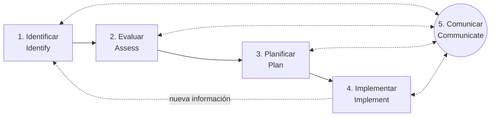
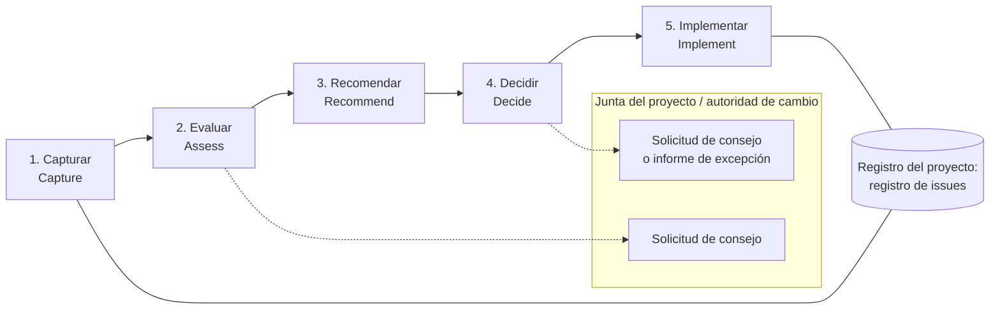
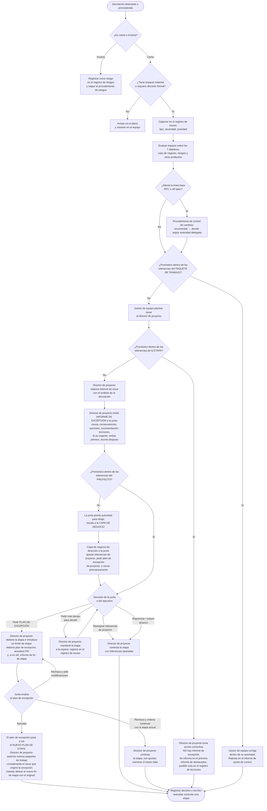

# PRINCE2 7 — Riesgo, Issues y Progreso + Productos de gestión

> **Cómo usar este archivo.** Está pensado para que un agente de IA que asiste a un director de proyecto (project manager) pueda: (a) explicar los conceptos de las tres prácticas de control; (b) ejecutar o guiar sus procedimientos paso a paso; (c) redactar o revisar los productos de gestión con la composición correcta; (d) decidir cuándo escalar; y (e) adaptar la formalidad al contexto. Cuando una afirmación no pudo verificarse en el texto fuente se marca como **"no determinado en la fuente"**.

## 0. Mapa del documento

| Sección | Contenido |
|---|---|
| 1 | Marco común: las prácticas, los siete objetivos de desempeño, los cuatro niveles de gestión y la gestión por excepción |
| 2 | Práctica de **Riesgo** (Risk) |
| 3 | Práctica de **Issues** (Issues, incluye control de cambios) |
| 4 | Práctica de **Progreso** (Progress) |
| 5 | Apéndice A consolidado: los 16 productos de gestión |
| 6 | Flujo de decisión de excepciones (Mermaid) |
| 7 | Reglas operativas para un agente de IA |
| 8 | Glosario ES/EN |
| 9 | Cobertura y límites |

---

## 1. Marco común a las tres prácticas

### 1.1 Las prácticas de control dentro del método

PRINCE2 7 organiza el "qué hay que gestionar de forma continua" en siete prácticas (practices). Tres de ellas —Riesgo, Issues y Progreso— forman el núcleo de **control** del proyecto: miran la incertidumbre futura (riesgo), los hechos ya ocurridos que exigen decisión (issues) y la comparación entre lo planificado y lo real (progreso). Las tres comparten:

- un **enfoque de gestión** (management approach) que se documenta en la documentación de inicio del proyecto (project initiation documentation, PID) y describe procedimiento, técnicas, estándares, roles y momentos;
- uno o más **registros** (records) dentro del **registro del proyecto** (project log);
- **informes** (reports) que fluyen de abajo hacia arriba entre niveles de gestión;
- una tabla de **foco por rol** para los siete roles clave;
- una relación explícita con los **siete principios** del método;
- guía de **adaptación** (tailoring) por contexto organizacional, comercial, método de entrega, sostenibilidad y escala.

### 1.2 Los siete objetivos de desempeño

Toda medición de progreso, toda evaluación de impacto de un issue y toda estimación de impacto de un riesgo se expresa contra los mismos siete objetivos de desempeño del proyecto (performance targets):

| # | Objetivo (EN) | Objetivo (ES) | Qué mide |
|---|---|---|---|
| 1 | Benefits | Beneficios | Valor medible que la organización obtiene del resultado |
| 2 | Time | Tiempo | Fechas de finalización de productos, etapas y proyecto |
| 3 | Cost | Costo | Presupuesto consumido y pronosticado |
| 4 | Quality | Calidad | Cumplimiento de especificaciones y criterios de aceptación |
| 5 | Scope | Alcance | Conjunto de productos a entregar |
| 6 | Sustainability | Sostenibilidad | Métricas de sostenibilidad comprometidas en el caso de negocio |
| 7 | Risk | Riesgo | Exposición agregada a amenazas (y oportunidades) |

Para cada objetivo se fija un **objetivo** (target) y una **tolerancia** (tolerance): la desviación permitida sin tener que pedir una decisión al nivel superior. La tolerancia es el instrumento que hace operativa la **gestión por excepción** (manage by exception).

### 1.3 Los cuatro niveles de gestión

| Nivel | Quién | Qué controla | Tolerancias que recibe | A quién escala |
|---|---|---|---|---|
| Capa de negocio (business layer) | Dirección corporativa, programa o portafolio | El proyecto como inversión | Define las del proyecto | — |
| Dirección (directing) | Junta del proyecto (project board) | El proyecto dentro de tolerancias de proyecto | Tolerancias de proyecto | Capa de negocio |
| Gestión (managing) | Director de proyecto (project manager) | La etapa dentro de tolerancias de etapa | Tolerancias de etapa | Junta del proyecto |
| Entrega (delivering) | Gestor de equipo (team manager) | El paquete de trabajo dentro de sus tolerancias | Tolerancias de paquete de trabajo | Director de proyecto |

La regla general: cada nivel delega tolerancias al nivel inferior, recibe informes de progreso de él y sólo interviene cuando se **pronostica** que esas tolerancias serán superadas. Pronóstico, no hecho consumado: la excepción se declara cuando la proyección indica que se superará el margen, no cuando ya se superó.

### 1.4 Estructura de cada práctica en este documento

Para cada práctica se sigue el mismo esquema:

a. Propósito y conceptos clave
b. Guía de aplicación efectiva (reglas)
c. Técnicas con pasos
d. Productos de gestión de la práctica
e. Foco de roles
f. Relación con los principios
g. Adaptación (tailoring)

---

## 2. Práctica de Riesgo (Risk)

### 2.a Propósito y conceptos clave

#### Propósito

Identificar, evaluar y controlar la incertidumbre que podría afectar los objetivos del proyecto, de modo que la organización tome decisiones informadas y aumente su probabilidad de éxito. La práctica reconoce que ningún proyecto está libre de riesgo: el objetivo no es eliminarlo sino mantenerlo dentro de lo que la organización está dispuesta a asumir.

El enfoque está alineado con la norma internacional de gestión de riesgos (ISO 31000) y con sus variantes regionales, de modo que puede adaptarse a requisitos locales.

#### Definición operativa de riesgo

Un **riesgo** (risk) es un evento o conjunto de eventos inciertos que, si ocurrieran, afectarían el logro de los objetivos. Se mide combinando dos magnitudes: la **probabilidad** de que ocurra y la **magnitud de su impacto** sobre los objetivos.

Dos consecuencias prácticas de esta definición:

1. Si no hay incertidumbre, no hay riesgo: un hecho ya ocurrido es un **issue**, no un riesgo. Esta es la regla de clasificación más importante entre las prácticas de Riesgo e Issues.
2. Si la incertidumbre no afecta a ningún objetivo definido, tampoco hay riesgo que gestionar. Por eso el primer paso del procedimiento es acordar qué objetivos están "en riesgo".

#### Amenaza y oportunidad

| Concepto | EN | Significado |
|---|---|---|
| Amenaza | Threat | Evento incierto con efecto negativo sobre los objetivos |
| Oportunidad | Opportunity | Evento incierto con efecto positivo sobre los objetivos |

Ambas se gestionan con el mismo procedimiento y el mismo registro. Una misma fuente de incertidumbre (por ejemplo, la variación de un tipo de cambio) puede generar dos riesgos distintos, uno de pérdida y otro de ganancia, y conviene registrarlos por separado porque pueden requerir respuestas diferentes.

#### Vocabulario de medición del riesgo

| Término ES | Término EN | Definición en palabras propias |
|---|---|---|
| Probabilidad | Risk probability | Estimación de la chance de que el evento ocurra; suele estimarse por verosimilitud o frecuencia |
| Impacto | Risk impact | Efecto estimado sobre los objetivos si el riesgo se materializa; debe medirse en las mismas unidades que el objetivo afectado (días, moneda, puntos de calidad) |
| Proximidad | Risk proximity | Qué tan cerca en el tiempo podría ocurrir |
| Velocidad | Risk velocity | Qué tan rápido se sentiría el impacto una vez ocurrido |
| Exposición | Risk exposure | Grado en que un objetivo está "en riesgo"; concepto neutro, puede ser positivo o negativo |
| Riesgo residual | Residual risk | La probabilidad e impacto máximos realistas que quedan después de aplicar la respuesta |
| Riesgo secundario | Secondary risk | Riesgo nuevo que aparece como consecuencia de implementar una respuesta |

#### Vocabulario de gobernanza del riesgo

| Término ES | Término EN | Definición en palabras propias | Quién lo fija |
|---|---|---|---|
| Apetito de riesgo | Risk appetite | Cantidad y tipo de riesgo que la organización está dispuesta a asumir para alcanzar sus objetivos | Capa de negocio |
| Tolerancia de riesgo | Risk tolerance | Umbral medible del rango aceptable de resultados para cada objetivo en riesgo, en las mismas unidades con que se mide ese objetivo | Capa de negocio (proyecto); junta (etapa); director de proyecto (paquete de trabajo) |
| Presupuesto de riesgo | Risk budget | Suma de dinero reservada para financiar respuestas concretas a amenazas y oportunidades, incluyendo planes de contingencia | Capa de negocio (proyecto); junta (etapa) |
| Propietario del riesgo | Risk owner | Persona responsable de gestionar, monitorear y controlar un riesgo concreto, incluida la implementación de sus respuestas | Director de proyecto / junta |
| Propietario de la acción | Risk action owner (risk actionee) | Persona que ejecuta una acción de respuesta concreta y mantiene informado al propietario del riesgo | Propietario del riesgo |

Relación entre los tres primeros: el **apetito** es una actitud cualitativa de la organización; la **tolerancia** la traduce en umbrales cuantitativos por objetivo; el **presupuesto** es el dinero que respalda las respuestas. La tolerancia de riesgo del proyecto se documenta en el caso de negocio y se detalla en el enfoque de gestión de riesgos.

#### Cultura de riesgo y sesgos de decisión

La práctica insiste en que la cultura organizacional condiciona la calidad de la gestión de riesgos. Una cultura favorable trata el riesgo como insumo normal de toda decisión. Los **sesgos de decisión** (decision bias) son atajos mentales que, aunque útiles en lo cotidiano, degradan la identificación y evaluación de riesgos. Los cuatro que el método destaca:

| Sesgo | EN | Efecto sobre la gestión de riesgos | Contramedida sugerida |
|---|---|---|---|
| Optimismo | Optimism bias | Se descuentan las amenazas asumiendo que "todo saldrá bien" | Datos de proyectos comparables; pre-mortem |
| Aversión a la pérdida | Loss aversion | Se sobrevalora evitar pérdidas frente a capturar ganancias; se ignoran oportunidades | Registrar oportunidades explícitamente |
| Pensamiento de grupo | Groupthink | Se prioriza la cohesión social sobre la opinión disidente o la decisión correcta | Facilitación externa; revisión independiente |
| Proximidad | Proximity bias | Lo cercano en el tiempo parece más grave que lo lejano, aunque este último sea mayor | Evaluar proximidad como atributo separado del impacto |

### 2.b Guía de aplicación efectiva (reglas)

Las siguientes reglas resumen lo que el método considera una gestión de riesgos eficaz. Están numeradas para que el agente pueda referirlas.

**R-01. Primero los objetivos, después los riesgos.** No se identifican riesgos hasta tener una comprensión compartida de los objetivos que están en juego. Sin ese paso, se registran incertidumbres que no afectan a nada medible.

**R-02. Toda incertidumbre relevante se captura y describe.** Cualquier miembro del proyecto, de la organización o cualquier interesado puede plantear un riesgo, en cualquier momento. Se anota en el registro de riesgos (risk register) apenas se detecta; el detalle se completa en pasos posteriores.

**R-03. Describir con la tríada causa–evento–efecto.** Una expresión clara de riesgo separa: la **causa** (la situación o factor que lo origina; no es el riesgo en sí, es su disparador), el **evento** (la incertidumbre propiamente dicha, la amenaza u oportunidad) y el **efecto** (el impacto sobre los objetivos si ocurre). Esta estructura evita confundir causas con riesgos y riesgos con impactos.

**R-04. Evaluar cada riesgo al menos por probabilidad e impacto.** Y, cuando aporte valor, por proximidad y velocidad. Las escalas de valoración se fijan en el enfoque de gestión de riesgos y las aprueba el ejecutivo del proyecto.

**R-05. Medir el impacto en las unidades del objetivo afectado.** Si el objetivo se mide en semanas, el impacto se expresa en semanas; si en moneda, en moneda. Esto permite comparar el impacto con la tolerancia.

**R-06. Priorizar.** No todos los riesgos merecen el mismo esfuerzo. La matriz probabilidad–impacto y la línea de tolerancia separan los que el director de proyecto puede gestionar de los que deben referirse a la junta.

**R-07. Mirar también el perfil agregado.** Además de cada riesgo individual, hay que entender la **exposición total** del proyecto y compararla con el apetito de la organización y con la tolerancia de riesgo. Si la exposición agregada excede el apetito, se planifican acciones de control adicionales.

**R-08. Vincular la exposición con la justificación de negocio.** La viabilidad del caso de negocio se reevalúa a la luz de la exposición al riesgo. Un proyecto puede dejar de ser justificable no por un riesgo aislado sino por la suma de ellos.

**R-09. Toda respuesta tiene un propietario del riesgo y, si corresponde, propietarios de acción.** Un riesgo sin dueño no se gestiona. El propietario debe ser la persona más capaz de gestionarlo, no la más disponible; y hay que evitar concentrar demasiados riesgos en una sola persona.

**R-10. La respuesta debe justificarse por su costo frente al cambio en la exposición.** Se compara el costo de la respuesta con la reducción del valor monetario esperado (probabilidad × impacto financiero) antes y después de aplicarla. Si el costo es menor que la reducción, la respuesta normalmente vale la pena.

**R-11. Las respuestas se incorporan al plan del nivel correspondiente.** Una respuesta que no está en el plan de etapa o en el paquete de trabajo no tiene recursos ni fecha, y por tanto no se ejecuta.

**R-12. Para riesgos significativos, definir indicadores de alerta temprana y planes de contingencia.** Saber qué señal indica que el riesgo se está materializando, y qué se hará si ocurre.

**R-13. Implementar, monitorear y corregir.** Las respuestas planificadas se ejecutan, se revisa su eficacia y se ajustan cuando no dan el resultado esperado.

**R-14. Identificar riesgos secundarios.** Toda respuesta puede crear riesgos nuevos; se tratan como cualquier otro riesgo.

**R-15. Si un riesgo se reduce en lugar de eliminarse, evaluar el residual.** Si el residual sigue siendo significativo, combinar más de una respuesta.

**R-16. Escalar no es fracasar.** Un riesgo se escala a la junta cuando su gestión excede el ámbito de influencia del equipo, cuando su materialización afectaría de forma material la justificación de negocio, cuando pertenece al programa, o cuando la respuesta haría superar las tolerancias acordadas. Cuanto antes se escala, más tiempo hay para actuar.

**R-17. Comunicar de forma continua.** La información de riesgos se difunde mediante los informes del método (informe de punto de control, de destacados, de fin de etapa, de excepción, de issue y de fin de proyecto) y por los canales que indique el enfoque de gestión de la comunicación. La comunicación es también una fuente de detección de nuevos riesgos.

**R-18. Proteger el presupuesto de riesgo.** No es dinero libre del director de proyecto; el enfoque de gestión de riesgos debe definir quién autoriza su uso y cómo. Conviene incluir una provisión para riesgos aún no identificados.

**R-19. Distinguir escala del proyecto de magnitud del impacto.** Un proyecto pequeño puede detener toda la organización si sale mal. El rigor de la gestión de riesgos se calibra por el impacto potencial, no sólo por el tamaño.

**R-20. Alinear la cadencia con el método de entrega.** Una revisión mensual de riesgos no sirve en un equipo con iteraciones de dos semanas. El método no exige formato ni periodicidad concretos; exige que sean adecuados al ritmo del proyecto.

**R-21. Revisar cruzadamente registros de riesgo e issues.** Periódicamente se verifica que el registro de riesgos no contenga hechos ciertos (que deberían ser issues) y que el registro de issues no contenga incertidumbres (que deberían ser riesgos).

**R-22. Las categorías de riesgo ayudan a identificar y a asignar propietarios.** Clasificar por tipo (sostenibilidad, ciberseguridad, integración, regulatorio, etc.) facilita detectar riesgos por área y elegir al propietario con competencia en esa área.

### 2.c Técnicas

#### 2.c.1 Procedimiento PRINCE2 de gestión de riesgos (cinco pasos)

El método propone un procedimiento de cinco pasos, derivado de la guía de gestión de riesgos del mismo editor (Management of Risk). Los pasos son iterativos: cuando aparece nueva información se vuelve a pasos anteriores. El quinto paso, comunicar, opera en paralelo con todos los demás. Si el proyecto forma parte de un programa con su propio procedimiento, puede usarse ese, documentándolo como decisión de adaptación en la PID.

**Paso 1 — Identificar (Identify)**

*1a. Definir contexto y objetivos.* Reunir información suficiente para que todos entiendan qué objetivos están en riesgo y para diseñar un enfoque de gestión de riesgos proporcionado. Factores que condicionan ese enfoque:

- expectativas de calidad del usuario;
- número de organizaciones involucradas y sus relaciones;
- necesidades de los interesados;
- importancia, complejidad y escala del proyecto;
- método de entrega (lineal-secuencial, iterativo-incremental, híbrido);
- supuestos realizados;
- entorno regulatorio y de gobernanza de la organización;
- políticas, estándares y procedimientos corporativos;
- pertenencia a un programa.

Las fuentes típicas de esta información son el mandato del proyecto, el resumen del proyecto (project brief) y la descripción del producto del proyecto.

*1b. Identificar amenazas y oportunidades.* Con el contexto claro, se buscan incertidumbres que afecten esos objetivos. Se registran de inmediato en el registro de riesgos usando la tríada causa–evento–efecto. Técnicas de apoyo: listas de verificación, PESTLE, SWOT, exploración de horizonte, diagramas causa-efecto, pre-mortem, datos de proyectos anteriores.

**Paso 2 — Evaluar (Assess)**

*2a. Priorizar riesgos.* Para cada riesgo estimar:

- probabilidad de ocurrencia;
- impacto sobre cada objetivo afectado, en sus unidades;
- impacto sobre el plan de etapa, el plan de proyecto y el caso de negocio;
- cómo puede variar ese impacto a lo largo del proyecto (proximidad, velocidad);
- si el equipo del proyecto es el mejor situado para gestionarlo o debe escalarse a la junta, al programa o a la organización.

El registro de riesgos se actualiza con estas estimaciones.

*2b. Evaluar el perfil combinado.* Sumar el efecto de todos los riesgos para saber si la exposición total está dentro del apetito definido por la organización y aplicado por la junta. Si lo excede, hay que planificar controles. Esta evaluación alimenta directamente la revisión de la justificación de negocio.

**Paso 3 — Planificar (Plan)**

Elegir y evaluar respuestas para eliminar o reducir amenazas y maximizar oportunidades (ver tabla de respuestas más abajo). Reglas:

- la respuesta elegida se incorpora al plan del nivel adecuado;
- para riesgos importantes, definir además indicadores de alerta temprana y un plan para cuando el riesgo ocurra;
- identificar el órgano más adecuado para gestionar el riesgo (puede no ser el equipo del proyecto);
- si el riesgo está dentro de las tolerancias, decide el director de proyecto; si no, se escala a la junta; según la tolerancia de riesgo, la junta puede a su vez escalar a la organización.

**Paso 4 — Implementar (Implement)**

Ejecutar las respuestas planificadas, revisar su eficacia y corregir donde no cumplan lo esperado. Confirmar que cada riesgo tiene propietario del riesgo y propietario(s) de acción identificados y de acuerdo. Ambos roles pueden recaer en la misma persona.

**Paso 5 — Comunicar (Communicate)**

Difundir continuamente información sobre amenazas y oportunidades dentro del ecosistema del proyecto y, cuando corresponda, hacia interesados externos. Los canales formales son los informes del método; pueden complementarse con boletines, tableros, radiadores de información, hilos de discusión o reuniones informativas, según el enfoque de gestión de la comunicación. La red de contactos y fuentes de información es también el mecanismo por el que se detectan riesgos nuevos o cambios en los existentes.

#### 2.c.2 Matriz probabilidad–impacto y línea de tolerancia

La **matriz de riesgos** (risk matrix) es una cuadrícula con la probabilidad en un eje y el impacto en el otro, con escalas típicamente de cinco niveles (muy bajo a muy alto). Cada riesgo se ubica en una celda por su identificador. Características:

- es una **fotografía** de un momento dado; comparar fotografías sucesivas muestra tendencias (un riesgo que migra de "probabilidad baja" a "probabilidad media" está empeorando);
- se traza una **línea de tolerancia de riesgo** (risk tolerance line): los riesgos por encima y a la derecha de esa línea son los que la organización no tolerará salvo circunstancias especiales, y por tanto el director de proyecto debe referirlos a la junta;
- amenazas y oportunidades pueden distinguirse con marcadores diferentes en la misma matriz.

Procedimiento para el agente:

1. Obtener del enfoque de gestión de riesgos las escalas de probabilidad e impacto y la posición de la línea de tolerancia.
2. Ubicar cada riesgo abierto por su valoración actual.
3. Listar los que quedan en la zona no tolerable y verificar que cada uno esté escalado o tenga una decisión registrada de la junta.
4. Comparar con la matriz del período anterior y señalar movimientos.

#### 2.c.3 Valor monetario esperado y análisis cuantitativo

**Valor monetario esperado** (expected monetary value, EMV): producto de la probabilidad estimada por el impacto financiero más probable. Se usa para:

- justificar una respuesta: `beneficio de la respuesta = EMV_antes − EMV_después`; si el costo de la respuesta es menor que esa diferencia, la respuesta se justifica;
- dimensionar el presupuesto de riesgo: en proyectos simples, suma de costos de las respuestas planificadas; en proyectos complejos, cuidar que la agregación de costos ponderados no quede distorsionada por unos pocos riesgos muy grandes.

Ejemplo numérico ilustrativo (no proviene de la fuente):

| Concepto | Antes | Después |
|---|---|---|
| Probabilidad | 40 % | 10 % |
| Impacto financiero | 50 000 | 50 000 |
| EMV | 20 000 | 5 000 |
| Reducción de EMV | | 15 000 |
| Costo de la respuesta | | 8 000 |
| ¿Se justifica? | | Sí (8 000 < 15 000) |

**Análisis cuantitativo** (quantitative risk assessment): técnicas de modelado estadístico (por ejemplo, simulación de Monte Carlo) que calculan la exposición agregada y el efecto de la incertidumbre sobre los objetivos. Dos variantes nombradas:

- análisis cuantitativo de costo (quantitative risk cost analysis): efecto sobre el presupuesto;
- análisis cuantitativo de cronograma (quantitative risk schedule analysis): efecto sobre las fechas.

Advertencia que el método hace explícita: el conjunto de respuestas al riesgo consume atención del equipo; demasiada actividad de respuesta puede desviar el foco de la entrega.

#### 2.c.4 Catálogo de respuestas al riesgo

| Respuesta (ES) | Respuesta (EN) | Aplica a | Qué hace | Consideraciones |
|---|---|---|---|---|
| Evitar | Avoid | Amenaza | Convierte la incertidumbre en certeza eliminando la causa o el riesgo completo | A veces sin costo (replanificando); si hay costo, debe justificarse |
| Explotar | Exploit | Oportunidad | Hace cierta la oportunidad introduciendo el factor que la provoca | Espejo de "evitar" |
| Reducir (mitigar) | Reduce (mitigate) | Amenaza | Acción inmediata para bajar probabilidad y/o impacto | Compromete costos ahora; justificar contra el cambio en el residual |
| Mejorar | Enhance | Oportunidad | Acción inmediata para subir probabilidad y/o impacto positivo | Espejo de "reducir" |
| Transferir | Transfer | Principalmente amenaza | Traspasa parte del riesgo a un tercero (seguro, cláusulas contractuales) | El asegurador asume el costo pero no el impacto en otros objetivos (por ejemplo, el retraso); algunos elementos no son transferibles aunque su gestión se delegue; la transferencia de oportunidades es rara |
| Compartir | Share | Ambas | Varias partes (típicamente en una cadena de suministro) reparten pérdidas y ganancias según una fórmula | Rara vez se comparte totalmente (reputación y marca siempre quedan con el principal); fomenta colaboración |
| Aceptar | Accept | Ambas | Se asume conscientemente el riesgo sin gastar ahora en gestionarlo | No cambia el residual; inadecuada si la exposición supera la tolerancia |
| Preparar planes de contingencia | Prepare contingent plans | Ambas | Se planifica qué hacer si el riesgo ocurre, pero no se actúa hasta entonces | Suele acompañar a "aceptar"; también sirve como plan de reserva (fallback) para cualquier otra respuesta que pueda fallar |

Reglas de combinación:

- Un riesgo puede recibir varias respuestas (por ejemplo, reducir + reducir + transferir).
- Si tras reducir el residual sigue siendo alto, agregar otra respuesta.
- Cada respuesta puede generar riesgos secundarios que se registran aparte.
- Aplicar una respuesta puede, además, reducir o eliminar otros riesgos relacionados.

#### 2.c.5 Propietario del riesgo y propietario de la acción

| Aspecto | Propietario del riesgo (risk owner) | Propietario de la acción (risk action owner / actionee) |
|---|---|---|
| Responsabilidad | Gestión integral del riesgo: monitoreo, control, implementación de respuestas | Ejecución de una acción concreta de respuesta |
| Alcance | Un riesgo | Una o varias acciones de uno o varios riesgos |
| Relación | Dirige | Reporta avance al propietario del riesgo |
| ¿Misma persona? | Frecuentemente sí; se separan cuando la acción escapa al control directo del propietario | |
| Criterio de asignación | La persona más capaz de gestionar ese riesgo; evitar sobrecargar a una sola | Quien tiene autoridad y medios para ejecutar la acción |

Caso típico de separación: el director de proyecto es propietario de una oportunidad comercial, pero la acción de negociar los términos con un tercero corresponde a un responsable de alianzas, que es el propietario de la acción.

#### 2.c.6 Presupuesto de riesgo

- Se delimita (ring-fence) dentro del presupuesto del proyecto una suma destinada a financiar respuestas a riesgos y planes de contingencia.
- Se compone del agregado de costos de las respuestas planificadas más una provisión para riesgos aún no identificados.
- El enfoque de gestión de riesgos define los mecanismos de acceso y control; no debe tratarse como reserva general de gasto.
- La capa de negocio fija el presupuesto de riesgo del proyecto; el ejecutivo del proyecto el de cada etapa.
- Los riesgos de sostenibilidad (eventos climáticos extremos, resiliencia de la cadena de suministro) deben tener su costo de respuesta incluido en este presupuesto.

#### 2.c.7 Técnicas de apoyo

| Técnica | EN | Identificar | Evaluar | Planificar | Implementar | Descripción breve |
|---|---|---|---|---|---|---|
| Diagramas causa-efecto | Cause and effect (fishbone / Ishikawa) | ✔ | | | | Despliega los múltiples factores que podrían llevar a que un riesgo ocurra; permite atacar la causa raíz |
| Exploración de horizonte / PESTLE / SWOT | Horizon scanning / PESTLE / SWOT | ✔ | | ✔ | ✔ | PESTLE revisa factores políticos, económicos, sociales, tecnológicos, legales y ambientales externos; SWOT cruza fortalezas y debilidades internas con oportunidades y amenazas; la exploración de horizonte mira tendencias emergentes de más largo plazo |
| Listas de verificación | Prompt lists | ✔ | | | | Listas estructuradas (PESTLE/SWOT, estructura de desglose de riesgos, listas derivadas de lecciones de proyectos similares) para no omitir categorías |
| Pre-mortem | Pre-mortem analysis | ✔ | ✔ | ✔ | | Se imagina un futuro en que el proyecto ya fracasó (o triunfó) y se razona hacia atrás qué pasos lo causaron |
| Modelo del queso suizo | Swiss cheese model | | | ✔ | | Un riesgo se materializa sólo si fallan varias capas de control a la vez; sirve para juzgar si los controles son suficientes |
| Uso de datos | Use of data | ✔ | ✔ | ✔ | ✔ | Analítica sobre proyectos o productos comparables para estimar probabilidad, impacto y prioridad; automatización (RPA) para asignación, monitoreo, reporte y escalado |

El enfoque de gestión de riesgos debe indicar cuáles de estas técnicas se usarán en el proyecto.

### 2.d Productos de gestión de la práctica de Riesgo

#### Enfoque de gestión de riesgos (Risk management approach)

| Atributo | Detalle |
|---|---|
| Tipo | Componente de la PID (producto de línea base) |
| Propósito | Describir cómo se gestionará el riesgo en el proyecto: procedimiento, técnicas, estándares y responsabilidades |
| Lo crea | Director de proyecto, consultando a los interesados |
| Lo asesora/revisa | Aseguramiento del proyecto (project assurance): verifica cumplimiento de políticas corporativas |
| Lo aprueba | Ejecutivo del proyecto (approve); usuario senior y proveedor senior lo acuerdan (agree) |
| Cuándo se crea | Proceso de inicio del proyecto (initiating a project), como parte de la PID |
| Cuándo se actualiza | En límites de etapa y ante excepciones, con el resto de la PID |

**Composición (en palabras propias):**

| Campo | Qué contiene |
|---|---|
| Alcance | A qué se aplica este enfoque |
| Procedimiento de gestión de riesgos | Las actividades (por ejemplo, identificar, evaluar, planificar, implementar, comunicar); toda desviación respecto del estándar corporativo se señala y justifica |
| Guía sobre tolerancia de riesgo | Detalle adicional sobre los umbrales de tolerancia de riesgo definidos en el caso de negocio |
| Momentos de las actividades formales | Cuándo se realizan revisiones formales (por ejemplo, al cierre de cada etapa) |
| Responsabilidades | Quién hace qué, incluidos propietarios de riesgo y de acción |
| Recursos | Medios necesarios para la gestión de riesgos (por ejemplo, equipamiento de prueba) |
| Herramientas y técnicas | Sistemas a usar y cómo; técnicas específicas (pre-mortem, etc.) |
| Estándares | Escalas de valoración de probabilidad, impacto, proximidad y velocidad; composición y formato del registro de riesgos y demás registros |
| Referencias | Documentos o sistemas relacionados (por ejemplo, el sistema de riesgos corporativo o del proveedor) |

**Criterios de calidad (derivados del propósito y de las reglas de la práctica):**

- Las escalas de valoración son inequívocas y están alineadas con las unidades de los objetivos.
- La tolerancia de riesgo es coherente con el apetito declarado por la capa de negocio.
- Define cómo y quién autoriza el uso del presupuesto de riesgo.
- La cadencia de revisión es compatible con el método de entrega.
- Toda desviación del estándar corporativo está justificada.
- Indica rutas de escalado al programa o a la organización cuando corresponda.

#### Registro de riesgos (Risk register)

| Atributo | Detalle |
|---|---|
| Tipo | Registro (record), parte del registro del proyecto (project log) |
| Propósito | Mantener la lista de riesgos identificados (amenazas y oportunidades), con su estado e historial |
| Lo crea | Director de proyecto con soporte del proyecto (project support), en el inicio del proyecto; antes de eso, los riesgos se anotan en el diario (daily log) |
| Lo mantiene | Soporte del proyecto (preparar y mantener); director de proyecto (establecer y mantener) |
| Lo revisa | Director de proyecto, aseguramiento del proyecto, junta (en informes) |
| Cuándo se actualiza | Continuamente; formalmente en controlar una etapa, gestionar la entrega de productos, gestionar el límite de etapa y cerrar el proyecto |

**Composición (en palabras propias):**

| Campo | Qué contiene |
|---|---|
| Identificador | Referencia única |
| Descripción | Resumen de causa, evento y efecto |
| Probabilidad | Estimación de la chance de ocurrencia |
| Impacto | Estimación del efecto sobre los objetivos |
| Proximidad | Cuándo podría ocurrir |
| Velocidad | Con qué rapidez impactaría |
| Respuestas | Acciones elegidas |
| Probabilidad e impacto residuales planificados | Valores esperados si las respuestas funcionan |
| Propietario del riesgo | Quién gestiona el riesgo |
| Propietario(s) de acción | Quién ejecuta cada respuesta |
| Fechas relevantes | Registro, última revisión, vencimiento de acciones |
| Registros asociados | Documentos vinculados y su ubicación |

**Criterios de calidad:**

- Cada entrada tiene propietario del riesgo asignado.
- La descripción distingue causa, evento y efecto.
- Las valoraciones usan las escalas del enfoque de gestión de riesgos.
- No contiene hechos ciertos (serían issues).
- Las fechas de última revisión son recientes respecto de la cadencia acordada.
- Las respuestas registradas aparecen en el plan correspondiente.

### 2.e Foco de roles en la práctica de Riesgo

| Rol | Foco (en palabras propias) |
|---|---|
| Capa de negocio (business layer) | Proveer política, estándares y marco corporativo de riesgos; definir el apetito de riesgo del proyecto; fijar tolerancia y presupuesto de riesgo a nivel de proyecto |
| Ejecutivo del proyecto (project executive) | Aprobar el enfoque de gestión de riesgos y validar que sea adecuado al apetito de la organización; fijar las escalas de impacto, proximidad y velocidad; fijar tolerancia y presupuesto de riesgo por etapa; asegurar que se gestionen los riesgos al caso de negocio y los de sostenibilidad; decidir sobre riesgos escalados priorizando la justificación de negocio; escalar a la organización cuando corresponda |
| Usuario senior (senior user) | Asegurar la gestión de riesgos que afectan a los usuarios (beneficios, operación, mantenimiento); acordar el enfoque; decidir sobre riesgos escalados priorizando la protección de los beneficios |
| Proveedor senior (senior supplier) | Asegurar la gestión de riesgos del lado proveedor (entrega de productos); acordar el enfoque; decidir sobre riesgos escalados priorizando la integridad de la solución completa |
| Director de proyecto (project manager) | Preparar y mantener el enfoque consultando a los interesados; asegurar que los gestores de equipo apliquen el procedimiento acordado en sus paquetes de trabajo; establecer y mantener el registro de riesgos; garantizar identificación, evaluación y control durante todo el proyecto |
| Gestor de equipo (team manager) | Aplicar el procedimiento de riesgos acordado en su paquete de trabajo; participar en identificación, evaluación y control |
| Aseguramiento del proyecto (project assurance) | Asesorar al director de proyecto sobre el enfoque; confirmar a la junta que el enfoque cumple las políticas; revisar respuestas propuestas cuando se le pida; auditar que la práctica se ejecute conforme al enfoque |
| Soporte del proyecto (project support) | Soporte administrativo a los controles de riesgo; preparar y mantener el registro de riesgos; ayudar al equipo a aplicar el procedimiento |
| Todos | Actuar como propietario de acción para los riesgos que se les asignen |

### 2.f Relación con los principios

| Principio | Cómo lo apoya la práctica de Riesgo | Resultado |
|---|---|---|
| Justificación de negocio continua | Evalúa si los riesgos afectan de forma material el caso de negocio | Confianza en que la inversión vale la pena con un nivel de riesgo aceptable |
| Aprender de la experiencia | Usa lecciones previas para identificar y gestionar riesgos | Respuestas fundadas en experiencia real |
| Definir roles, responsabilidades y relaciones | Aclara quién identifica, gestiona y reporta riesgos en cada capa | Expectativas claras |
| Gestionar por etapas | Las decisiones de límite de etapa se informan con el perfil de riesgo; las etapas formalizan puntos de "seguir / detener" | La inversión sigue alineada y el riesgo se mantiene aceptable |
| Gestionar por excepción | Empodera a quienes mejor pueden gestionar cada riesgo; escala los que se pronostica que superarán tolerancias | Riesgos tratados en el nivel adecuado |
| Enfocarse en los productos | Entiende los riesgos de definir, desarrollar y entregar productos especializados y de gestión | Claridad sobre amenazas y oportunidades al producto |
| Adaptar al proyecto | El enfoque y los procedimientos se dimensionan al tipo, tamaño y complejidad | Gestión eficiente alineada con estándares de la organización |

### 2.g Adaptación (tailoring) de la práctica de Riesgo

| Dimensión | Consideraciones |
|---|---|
| Contexto organizacional | Alinear con políticas, estándares, técnicas, herramientas y marcos de competencias corporativos o del programa/portafolio; alinear con normas sectoriales (por ejemplo, salud y seguridad). Si hay programa, el enfoque define qué tipos de riesgo se gestionan en el proyecto y cuándo se escalan al programa; conviene que todos los proyectos usen la misma plantilla de registro, categorías, niveles y umbrales |
| Contexto comercial | Puede haber más de un registro de riesgos, porque algunas partes no quieren hacer visibles sus riesgos a las demás. En un registro conjunto, definir con cuidado de quién es cada riesgo (en un contrato a precio fijo, el sobrecosto golpea al proveedor y el retraso al cliente) y nombrar propietario en consecuencia |
| Método de entrega | La cadencia y el formato deben acompañar el ritmo: en agile, el registro puede ser una pizarra revisada en la reunión diaria. El propio método de entrega mitiga o refuerza riesgos: agile evita la sobre-especificación temprana pero puede derivar en cambios descontrolados; lineal da sensación de control pero puede alienar usuarios. El enfoque debe reconocer estas diferencias |
| Sostenibilidad | Evaluar riesgos a las metas de sostenibilidad del trabajo del proyecto y del producto; incluir el costo de respuesta en el presupuesto de riesgo; registrar y comunicar riesgos de sostenibilidad como cualquier otro |
| Escala | El rigor se gradúa por tamaño, complejidad **y** por impacto potencial (separados). Proyecto simple: el director de proyecto hace casi todo, registro en lista o planilla. Proyecto complejo: gestor de riesgos dedicado, sistema especializado. En todos los casos, el enfoque debe ser comprendido por todos y no generar burocracia innecesaria |

---

## 3. Práctica de Issues (Issues)

### 3.a Propósito y conceptos clave

#### Propósito

Recoger y evaluar los **issues** y controlar los **cambios** a la línea base del proyecto. En PRINCE2 la gestión de issues **incluye** el control de cambios (change control): no son dos prácticas, sino una, en la que el cambio es una de las posibles consecuencias de un issue.

Dos ideas de fondo:

- Cuanto mayor el alcance y más larga la duración, más probable es que el proyecto deba reaccionar a issues y cambios. El cambio no es algo que evitar; es algo que gestionar de forma **responsiva pero controlada**.
- La gestión de issues es el corazón de la función de monitoreo. Si alguien en el equipo filtra o censura issues, el proyecto pierde capacidad de respuesta. Por eso la regla es: **no juzgar un issue antes de evaluarlo**.

#### Definiciones operativas

| Término ES | Término EN | Definición en palabras propias |
|---|---|---|
| Issue | Issue | Evento relevante para el proyecto que requiere consideración de la gestión. Puede plantearlo cualquier persona en cualquier momento |
| Cambio | Change | Modificación de cualquiera de los productos aprobados que forman la línea base. No entra en la línea base hasta que lo aprueba quien tiene la autoridad delegada |
| Línea base del proyecto | Project baseline | Las versiones aprobadas vigentes de los productos de gestión y de los productos del proyecto que están bajo control de cambios |
| Control de cambios | Change control | Proceso por el cual los cambios que podrían afectar la línea base se identifican, evalúan y luego se aprueban, rechazan o difieren |
| Autoridad de cambio | Change authority | Persona o grupo a quien la junta delega la decisión sobre determinados cambios |
| Presupuesto de cambio | Change budget | Dinero, o conjunto de restricciones autorizadas, reservado en un plan para financiar cambios; lo administra quien tiene la autoridad delegada |
| Concesión | Concession | Fuera de especificación que la junta (o la autoridad delegada) acepta sin acción correctiva; obliga a actualizar la línea base |

#### Tipología de issues

El método recomienda clasificar todo issue en uno de cinco tipos. La clasificación acelera la evaluación y, acumulada, revela patrones (si se repite un tipo, probablemente otra parte de la gestión del proyecto no funciona).

| Tipo (ES) | Tipo (EN) | Definición en palabras propias | Ejemplo típico | Tratamiento |
|---|---|---|---|---|
| Problema o preocupación | Problem or concern | *Problema*: impacto negativo inmediato. *Preocupación*: hay que evaluar todavía su oportunidad e impacto | Falla el disco de respaldos; una persona clave anuncia su salida | Resolver dentro de tolerancias si se puede; si no, escalar. Muchos se tratan informalmente en el diario |
| Evento externo | Event external to the project | Hecho fuera del control del proyecto que podría afectarlo | Un proveedor quiebra; cambia una regulación | Analizar impacto; puede derivar en cambio o excepción. Exige monitorear el entorno regularmente |
| Oportunidad de negocio | Business opportunity | Consecuencia positiva no prevista para el proyecto o la organización usuaria | Baja fuerte del precio de un insumo; nuevo equipo con mejor funcionalidad | Evaluar; conviene pedir opinión a la junta porque sus efectos suelen exceder al proyecto |
| Solicitud de cambio | Request for change (RFC) | Propuesta de modificar la línea base. Debe identificar los productos afectados, justificar el cambio y, si tiene costo, indicar la fuente de financiación (presupuesto de cambio o fondos adicionales) | Cambiar el logotipo de un producto por uno nuevo corporativo | Siempre por el procedimiento de control de cambios, aunque esté dentro de las tolerancias |
| Fuera de especificación | Off-specification | Producto que no cumple, o no podrá cumplir, su especificación de calidad. Ocurre por falla del proveedor o porque la especificación resulta inalcanzable | Menos plazas de estacionamiento que las requeridas | Siempre por control de cambios: se acepta como concesión (y se cambia la línea base) o se rechaza y se corrige |

Regla de frontera con Riesgo: al clasificar, preguntar si el hecho es **cierto**. Si todavía es incierto, es un riesgo y se transfiere al registro de riesgos. Y a la inversa, el registro de riesgos no debe contener hechos ya ocurridos.

#### Issues formales e informales

| | Issue formal | Issue informal |
|---|---|---|
| Dónde se registra | Registro de issues (issue register), abierto a consulta | Diario (daily log) del director de proyecto o del gestor de equipo |
| Cuándo | Tiene impacto material sobre la etapa o el proyecto, o requiere decisión fuera de la autoridad de quien lo detecta, o es RFC / fuera de especificación | No tiene impacto material, o puede resolverlo directamente el equipo, o su contenido exige discreción |
| Criterio de juicio | Capturar demasiado como formal inunda al equipo de decisiones triviales; filtrar demasiado oculta problemas. Lo más eficaz es detectar temprano, cuando aún se resuelve dentro de tolerancias | Varias anotaciones informales que parecen insignificantes pueden, al reunirlas, revelar un issue o riesgo nuevo |

Nota: una RFC sencilla y dentro de las tolerancias del director de proyecto **sigue siendo formal** y va al registro de issues, porque modifica la línea base.

#### Componentes del enfoque de gestión de issues

El enfoque (approach) cubre cinco bloques:

1. **Líneas base** (baselines): qué está sujeto a control de cambios.
2. **Resolución de issues** (issue resolution): cómo se identifican, capturan, evalúan y recomiendan.
3. **Control de cambios** (change control): cómo se controlan los cambios a la línea base.
4. **Delegación de autoridad** (delegating authority): cómo la junta reparte hacia abajo la autoridad de decidir cambios.
5. **Presupuesto de cambio** (change budget): dinero reservado en el plan para cambios.

### 3.b Guía de aplicación efectiva (reglas)

**I-01. Nada se juzga antes de evaluarse.** Cualquier issue planteado se captura y se evalúa; rechazarlo sin evaluación equivale a censurarlo.

**I-02. Todo issue se clasifica en uno de los cinco tipos.** Y se verifica que no sea en realidad un riesgo (incertidumbre).

**I-03. Las líneas base se definen al nivel de componente independientemente liberable.** Se descompone el producto hasta el nivel en que una parte puede liberarse, instalarse, reemplazarse o modificarse por separado; ahí se establece la línea base. El nivel de control crece con la importancia del proyecto y la complejidad de las relaciones entre productos.

**I-04. Cada producto y cada versión tienen identificador único.** Y el registro del proyecto (en su componente registro de productos) guarda versión, estado y relaciones con otros productos.

**I-05. Un cambio aprobado genera una nueva versión.** Cada aprobación e implementación de cambio crea una versión nueva y rastreable del producto, vinculada a la decisión de la autoridad correspondiente.

**I-06. Ningún sistema debe permitir cambios sin la aprobación requerida.** Y todos deben dejar pista de auditoría. Los productos de gestión pueden gestionarse como documentos con versión y fecha de aprobación; los especializados pueden requerir un sistema dedicado.

**I-07. Verificar periódicamente que el estado real de los productos coincide con el autorizado.** Mediante revisiones o auditorías, típicamente al fin de cada etapa y del proyecto.

**I-08. El enfoque de gestión de issues se prepara después de las descripciones de producto y de paquete de trabajo.** Porque depende del "qué" (productos) y del "cómo" (actividades de entrega).

**I-09. Los issues se revisan en todas las revisiones del proyecto.** Desde reuniones de estado hasta revisiones de límite de etapa; la revisión de issues nuevos y abiertos no es opcional.

**I-10. La captura debe tener mínima carga administrativa.** Los issues llegan por cualquier canal formal o informal; el director de proyecto garantiza que la conversión a registro sea eficiente.

**I-11. La evaluación responde tres preguntas.** ¿Qué tipo de issue es? ¿Afecta al proyecto? Si afecta, ¿cómo?

**I-12. La evaluación de issues mayores es integrada.** Los siete objetivos de desempeño están interrelacionados; un issue importante rara vez afecta uno solo. Hay que evaluar el impacto sobre objetivos y tolerancias aprobados, sobre el caso de negocio y sobre otros productos o paquetes de trabajo.

**I-13. Ofrecer más de una opción a la junta cuando sea posible.** Y hacer explícitas las consecuencias de aprobar y de rechazar. A menudo hay intercambios posibles entre requisitos o tolerancias (mejor desempeño a cambio de más plazo).

**I-14. Rechazar y no hacer nada es una respuesta válida.** Todo issue se evalúa, pero no todo issue requiere un cambio.

**I-15. Evaluar de forma colaborativa.** Reunir aportes de varios miembros del equipo e interesados, en especial cuando el impacto u opciones trascienden el proyecto.

**I-16. Pedir orientación a la junta antes de completar la evaluación es legítimo.** Para confirmar prioridad o severidad antes de desarrollar opciones.

**I-17. Una RFC identifica qué productos cambia, por qué y con qué dinero.** Fuente de financiación: presupuesto de cambio o fondos adicionales.

**I-18. Una fuera de especificación aceptada es una concesión y cambia la línea base.** Una rechazada obliga a buscar corrección: presupuesto de cambio, plan de excepción o remedio contractual.

**I-19. La junta es la autoridad última, pero debe delegar lo suficiente.** La mayoría de los cambios nacen a nivel de paquete de trabajo; si no hay autoridad delegada allí, la junta se convierte en cuello de botella. Delegar en demasiados roles diluye la alineación con la justificación de negocio.

**I-20. Autoridad delegada sin presupuesto de cambio es inútil.** Quien puede aprobar un cambio debe tener de dónde financiarlo. El presupuesto puede ser dinero o un conjunto de restricciones dentro de las cuales se admiten intercambios (por ejemplo, formación presencial o virtual mientras se forme al mismo número de personas en el mismo plazo).

**I-21. Las decisiones y acciones se registran en el registro de issues.** Y los cambios aprobados se reflejan en los productos de gestión afectados y en el registro de productos.

**I-22. Un issue que llevará la etapa fuera de tolerancia se convierte en excepción.** Se escribe un informe de issue para analizar los datos y luego un informe de excepción para la junta (ver práctica de Progreso).

**I-23. Registrar lecciones a partir de issues.** La gestión de issues es una de las fuentes principales de lecciones.

**I-24. Vigilar el entorno externo con regularidad.** Los eventos externos (regulatorios, de proveedores, de sostenibilidad) sólo se detectan si alguien los mira; en proyectos con alto componente de sostenibilidad conviene asignar formalmente esa vigilancia.

### 3.c Técnicas

#### 3.c.1 Procedimiento PRINCE2 de gestión de issues y control de cambios (cinco pasos)

Como en Riesgo, puede sustituirse por un procedimiento de programa, documentándolo como adaptación en la PID. El registro de issues es el soporte de todos los pasos. En los pasos de evaluación y recomendación puede pedirse consejo a la junta; en el de decisión, si la autoridad delegada no alcanza, se escala con un informe de excepción.

**Paso 1 — Capturar (Capture)**

| Actividad | Detalle |
|---|---|
| Determinar el tipo | Problema/preocupación, evento externo, oportunidad de negocio, RFC o fuera de especificación. Verificar que no sea un riesgo |
| Determinar severidad y prioridad | Con las escalas definidas en el enfoque (las fija el ejecutivo del proyecto) |
| Registrar | Formal: registro de issues. Informal: diario. Si se requiere análisis detallado, abrir un informe de issue |

**Paso 2 — Evaluar (Assess)**

| Actividad | Detalle |
|---|---|
| Analizar impacto | Sobre objetivos y tolerancias aprobados, sobre el caso de negocio, sobre el perfil de riesgo, sobre otros productos y paquetes de trabajo |
| Revisar severidad y prioridad | A la luz del análisis; puede pedirse confirmación a la junta |
| Considerar el contexto de tolerancias | Un proyecto con tolerancias estrechas puede tener que limitar los tipos de issue que considera; algunos issues son sólo informativos |

**Paso 3 — Recomendar (Recommend)**

| Actividad | Detalle |
|---|---|
| Identificar opciones | Varias, cuando sea posible |
| Evaluar opciones | Para cada una, ventaja obtenida (menor costo, tiempo o riesgo; más beneficio; mejor calidad o alcance) frente a impacto de implementación (costo y duración de la opción; riesgo de la opción) |
| Recomendar | A la persona o grupo con autoridad; explicitar consecuencias tanto de aprobar como de rechazar |

**Paso 4 — Decidir (Decide)**

| Actividad | Detalle |
|---|---|
| Verificar autoridad | Si excede la autoridad delegada, escalar (informe de excepción si implica superar tolerancias) |
| Decidir | Aprobar, rechazar, pedir plan de excepción o pedir más información (ver tabla siguiente) |

Opciones de decisión según el tipo de propuesta de cambio:

| Propuesta | Decisión | Qué hay que considerar |
|---|---|---|
| Solicitud de cambio | Aprobar | Cómo se financia: presupuesto de cambio, reducción de alcance en otra parte, o fondos adicionales |
| Solicitud de cambio | Rechazar | ¿Sigue siendo válida la justificación de negocio y se obtendrán los beneficios si no se hace el cambio? |
| Solicitud de cambio | Pedir plan de excepción | Adecuado cuando el problema proviene de especificaciones de calidad o criterios de aceptación demasiado exigentes y podría resolverse ajustando tolerancias |
| Solicitud de cambio | Pedir más información | Difiere la decisión; razonable cuando los impactos de aprobar/rechazar son complejos |
| Fuera de especificación | Aceptar (concesión) | Impacto sobre justificación y beneficios; se actualiza la línea base y se anota la concesión |
| Fuera de especificación | Rechazar | Cómo se corrige: presupuesto de cambio, plan de excepción o remedio contractual (si el proveedor es responsable) |

**Paso 5 — Implementar (Implement)**

| Actividad | Detalle |
|---|---|
| Ejecutar la acción correctiva | Por el gestor de equipo o el director de proyecto según corresponda |
| Actualizar registros | Registro de issues (decisión, estado, fechas), registro de productos (nueva versión), productos de gestión afectados |
| Actualizar la línea base | Si corresponde; conservar archivo de versiones reemplazadas |

#### 3.c.2 Autoridad de cambio y delegación

Criterios para diseñar la delegación (se documentan en el enfoque de gestión de issues):

| Situación | Diseño recomendado |
|---|---|
| Pocos cambios previstos | La junta conserva toda la autoridad |
| Muchos cambios previstos | La junta delega parte de las decisiones a una autoridad de cambio (puede ser el director de proyecto, un comité, o niveles escalonados) |
| Cambios que nacen en paquetes de trabajo (la mayoría) | Asegurar autoridad delegada suficiente a nivel de paquete de trabajo para no escalar todo |
| Proyectos grandes y complejos | Delegar en varios niveles del equipo de gestión, con parámetros (por ejemplo, umbrales de costo o severidad) por nivel |
| Agile / iterativo-incremental | La junta retiene autoridad sobre productos de gestión; delega a los equipos la autoridad sobre características y funcionalidad de los productos especializados; puede admitirse el intercambio de características (trading/swapping) para mantenerse en tolerancia |

Riesgos de mal diseño: poca delegación → la junta frena el avance y decide cosas que otros deciden mejor; demasiada delegación o repartida en demasiados roles → se diluye la alineación con la justificación de negocio y se erosionan los beneficios.

#### 3.c.3 Presupuesto de cambio

- Debe acompañar a toda autoridad delegada.
- Puede asignarse a nivel de proyecto, de etapa o de paquete de trabajo (lo documenta el enfoque).
- La capa de negocio aprueba el de proyecto (si existe); el ejecutivo del proyecto decide si hace falta y de cuánto, y fija el de etapa.
- Puede expresarse como dinero o como restricciones autorizadas dentro de las cuales se admiten intercambios.
- En proyectos lineales conviene disponibilizar una porción mayor en etapas tardías, cuando cualquier cambio es caro; en etapas tempranas (diseño), tolerancias más laxas permiten absorber cambios baratos.

#### 3.c.4 Líneas base y gestión de configuración

Decisiones que todo proyecto debe tomar, independientemente de su tamaño:

1. **Nivel de línea base**: hasta qué granularidad se controlan versiones.
2. **Identificación**: esquema de identificadores únicos de producto y versión.
3. **Información a mantener** en el registro del proyecto: versiones, estado, relaciones.
4. **Autoridades** necesarias para aprobar y establecer líneas base.
5. **Procedimiento** para capturar y gestionar issues y cambios.

Requisitos de cualquier sistema de gestión de líneas base:

- impide introducir cambios sin la aprobación del nivel correcto;
- registra una pista de auditoría de todos los cambios;
- conserva archivo de versiones anteriores;
- el registro de productos refleja la aprobación e implementación de cada cambio.

#### 3.c.5 Técnicas de apoyo para resolución de problemas

| Técnica | EN | Para qué sirve | Cuándo usarla |
|---|---|---|---|
| Análisis de causa raíz | Root cause analysis | Descomponer un problema en sus causas y distinguir las primarias de las derivadas | Problemas recurrentes o de alto impacto |
| Análisis de Pareto | Pareto analysis | Identificar las pocas causas que explican la mayor parte de los efectos (regla 80/20) | Cuando hay muchas causas posibles y ninguna es obviamente dominante |
| Análisis causa-efecto | Cause and effect (Ishikawa) | Ordenar causas posibles en categorías que divergen del problema | Para estructurar una discusión de equipo |
| Análisis de modos de falla | Failure mode analysis | Enumerar todas las fallas posibles de un producto o proceso y evaluar sus consecuencias | Requiere que exista una versión del producto (prototipo o final) |
| Cinco porqués | Five whys | Encadenar preguntas "¿por qué?" para bajar capas del problema | Cuando no hay estadísticas detalladas o no hacen falta |

Condición de eficacia: aplicarlas sistemáticamente y en equipo.

### 3.d Productos de gestión de la práctica de Issues

#### Enfoque de gestión de issues (Issue management approach)

| Atributo | Detalle |
|---|---|
| Tipo | Componente de la PID (producto de línea base) |
| Propósito | Describir cómo se capturan y reportan los issues y cómo se evalúan y controlan los cambios a la línea base |
| Lo crea | Director de proyecto, consultando a los interesados y acordando el nivel de línea base de los productos |
| Lo asesora | Aseguramiento del proyecto |
| Lo aprueba | Ejecutivo del proyecto (approve); usuario senior y proveedor senior lo acuerdan (agree) |
| Cuándo | Inicio del proyecto, después de las descripciones de producto y de paquete de trabajo; se revisa en límites de etapa |

**Composición (en palabras propias):**

| Campo | Qué contiene |
|---|---|
| Alcance | A qué se aplica |
| Elementos de la línea base | Lista de productos de gestión que forman la línea base |
| Procedimiento de reporte y resolución de issues | Cómo se plantean, reportan y resuelven; desviaciones del estándar corporativo justificadas |
| Procedimiento de control de cambios | Cómo se solicitan, deciden, incorporan y verifican los cambios; desviaciones justificadas |
| Presupuesto de cambio | Monto autorizado y asignaciones por etapa o paquete de trabajo |
| Momentos de las actividades formales | Cuándo y con qué frecuencia se revisan y deciden issues |
| Responsabilidades | Roles, incluida la delegación de autoridad de cambio |
| Herramientas y sistemas | Por ejemplo, sistema de control de versiones |
| Estándares | Escalas de prioridad y severidad; composición y formato del registro de issues y demás registros de control de cambios |
| Referencias | Documentos o productos relacionados |

**Criterios de calidad:**

- Define sin ambigüedad qué productos están bajo control de cambios y a qué nivel.
- La delegación de autoridad está acompañada de presupuesto de cambio.
- Las escalas de severidad y prioridad están aprobadas por el ejecutivo.
- El procedimiento de cambio deja pista de auditoría y versión.
- Es coherente con los procedimientos contractuales si hay proveedores externos.
- Define quién vigila el entorno externo cuando la sostenibilidad o la regulación son relevantes.

#### Registro de issues (Issue register)

| Atributo | Detalle |
|---|---|
| Tipo | Registro, parte del registro del proyecto |
| Propósito | Anotar todos los issues formales planteados durante el ciclo de vida, con estado actual y fecha de cierre |
| Lo crea | Director de proyecto con soporte del proyecto, en el inicio del proyecto |
| Lo mantiene | Director de proyecto, asistido por soporte del proyecto |
| Lo actualizan | Director de proyecto y soporte (controlar una etapa, límite de etapa, cierre); gestor de equipo y soporte (gestionar la entrega de productos) |
| Acceso | Abierto por defecto; puede restringirse si el proyecto maneja contenidos sensibles o des-beneficios |

**Composición (en palabras propias):**

| Campo | Qué contiene |
|---|---|
| Identificador | Referencia única |
| Descripción | Resumen del issue |
| Tipo | Problema, preocupación, evento externo, oportunidad de negocio, RFC, fuera de especificación |
| Gradación | Prioridad y severidad |
| Propietario del issue | Responsable |
| Decisión | Qué se decidió; para una fuera de especificación, si se aceptó y el resumen de la concesión |
| Estado | Por ejemplo: registrado, revisado, en acción, escalado, resuelto |
| Fechas relevantes | Planteado, última revisión, vencimiento de acciones, resuelto |
| Registros asociados | Documentos y su ubicación (incluido el informe de issue si existe) |

**Criterios de calidad:**

- Todo issue tiene tipo, gradación y propietario.
- Las decisiones registradas identifican a la autoridad que decidió.
- Los estados reflejan el flujo del procedimiento.
- No contiene incertidumbres (serían riesgos).
- Los issues escalados tienen enlace a su informe de issue y, si corresponde, de excepción.

#### Informe de issue (Issue report)

| Atributo | Detalle |
|---|---|
| Tipo | Informe (report), orientado a eventos |
| Propósito | Describir el impacto de un issue sobre la línea base, identificar formas de resolverlo (o de tratar una fuera de especificación) y recomendar una decisión |
| Lo crea | Director de proyecto o gestor de equipo (controlar una etapa) |
| Lo asesora | Aseguramiento del proyecto |
| Lo decide | La autoridad correspondiente: director de proyecto, autoridad de cambio o junta (que puede a su vez escalar a la organización) |
| Cuándo | Sólo para issues que requieren análisis detallado o decisión formal; no todas las entradas del registro necesitan uno |
| Formato | Lo define el enfoque de gestión de issues: documento, planilla, base de datos, entrada en herramienta |

**Composición (en palabras propias):**

| Campo | Qué contiene |
|---|---|
| Identificador | Mismo que en el registro |
| Identificador(es) de producto | Productos afectados |
| Fecha de planteo | Cuándo se registró |
| Tipo de issue | Uno de los cinco |
| Gradación | Severidad y prioridad, si se usan |
| Descripción | Origen, causa e impacto |
| Análisis de impacto | Sobre la línea base (objetivos, tolerancias, caso de negocio, otros productos) |
| Opciones | Formas en que el proyecto, el usuario o el proveedor podrían responder |
| Recomendación | La decisión que propone el director de proyecto o el gestor de equipo |
| Decisión | Lo resuelto; para una fuera de especificación, la aceptación y resumen de la concesión |

**Criterios de calidad:**

- El análisis de impacto cubre los siete objetivos de desempeño relevantes, no sólo tiempo y costo.
- Presenta más de una opción cuando es posible, cada una con ventaja e impacto de implementación.
- La recomendación explicita consecuencias de aprobar y de rechazar.
- Si es RFC, indica la fuente de financiación.
- Si es fuera de especificación, indica si se propone concesión o corrección y cómo se financiaría.

### 3.e Foco de roles en la práctica de Issues

| Rol | Foco (en palabras propias) |
|---|---|
| Capa de negocio | Proveer políticas, estándares y procedimientos corporativos de issues y cambios; aprobar el presupuesto de cambio del proyecto (si existe); responder a consultas y a issues escalados por el ejecutivo |
| Ejecutivo del proyecto | Decidir si hace falta presupuesto de cambio de proyecto y de cuánto; fijar el de etapa; decidir si y dónde se delega autoridad de cambio; aprobar el enfoque y fijar las escalas de severidad y prioridad; responder consultas del director de proyecto y decidir issues escalados priorizando la justificación de negocio |
| Usuario senior | Responder consultas y decidir issues escalados priorizando los beneficios esperados; acordar el enfoque |
| Proveedor senior | Responder consultas y decidir issues escalados priorizando la integridad de la solución; acordar el enfoque |
| Director de proyecto | Preparar y mantener el enfoque, acordando el nivel de línea base; gestionar los procedimientos de issues y cambios (con soporte); asegurar que los gestores de equipo apliquen los procedimientos de sus paquetes de trabajo; mantener el registro de issues; implementar acciones correctivas |
| Gestor de equipo | Aplicar los procedimientos acordados en su paquete de trabajo; implementar acciones correctivas |
| Aseguramiento del proyecto | Asesorar sobre el enfoque; confirmar a la junta su conformidad con las políticas; asesorar en la evaluación y resolución; revisar informes de issue y de excepción cuando se le pida; auditar que la práctica se ejecute conforme al enfoque |
| Soporte del proyecto | Administrar los procedimientos: mantener el registro de issues y la línea base; ayudar a preparar informes de issue; ayudar al equipo a aplicar los procedimientos |

### 3.f Relación con los principios

| Principio | Cómo lo apoya la práctica de Issues | Resultado |
|---|---|---|
| Justificación de negocio continua | Todo issue y cambio se evalúa por su impacto en el caso de negocio | El proyecto sigue alineado con la estrategia |
| Aprender de la experiencia | La gestión de issues captura lecciones y las usa para responder | Productos y actividades evolucionan de forma controlada con la retroalimentación |
| Definir roles, responsabilidades y relaciones | Roles explícitos para issues y control de cambios | Rendición de cuentas clara sobre la línea base |
| Gestionar por etapas | Issues y cambios se identifican y revisan dentro de las etapas y en sus límites | Detección temprana; se evita el costo del cambio descontrolado |
| Gestionar por excepción | Autoridad y procedimiento definidos | El director de proyecto gestiona issues y decide dentro de su autoridad, escalando sólo excepciones |
| Enfocarse en los productos | Issues y cambios se vinculan a la línea base de productos | Trazabilidad de cambios y enlace claro con productos |
| Adaptar al proyecto | Sólo el nivel de control de cambios que exigen importancia, complejidad, método de entrega y características del producto | Equilibrio entre control y capacidad de respuesta |

### 3.g Adaptación (tailoring) de la práctica de Issues

| Dimensión | Consideraciones |
|---|---|
| Contexto organizacional | Incorporar políticas, estándares y procedimientos corporativos o externos. Si hay programa/portafolio, puede ser obligatorio usar su capacidad común de gestión de issues y su sistema de control de cambios, sus reglas de evaluación y sus criterios de escalado al programa |
| Contexto comercial | El contrato puede imponer procedimientos de control de cambios. Los proveedores suelen tener su propio enfoque y herramientas; si deben participar en el del proyecto (registro, herramientas), debe estar pactado en el contrato. Un enfoque colaborativo (proveedor absorbe costo, cliente concede plazo sin penalidad) es posible cuando ambas partes valoran la relación |
| Método de entrega — lineal | Se asume que el número y magnitud de cambios decrece con el avance, porque cambiar tarde es caro. Tolerancias amplias en etapas tempranas (diseño), estrictas en etapas tardías (construcción) con mayor presupuesto de cambio disponible. La velocidad de evaluación y escalado es crítica para evitar efectos dominó |
| Método de entrega — iterativo-incremental | Issues y cambios son intrínsecos al método; ciclos cortos los resuelven rápido y el backlog evoluciona. Puede bastar con asegurar captura, evaluación y decisión consistentes con trazabilidad a la descripción del producto del proyecto. Alternativa: la junta retiene autoridad sobre productos de gestión y delega a los equipos la de características; se admite intercambiar características para mantenerse en tolerancia. Agile permite cambios tardíos que acercan el producto a las expectativas del usuario cuando los productos no pueden definirse en detalle al inicio |
| Sostenibilidad | Fuente frecuente de issues y cambios externos (regulación, capacidad de proveedores). Si es un aspecto central, asignar a alguien la vigilancia de fuentes externas |
| Escala | Considerar: tamaño y diversidad de interesados (proyecto pequeño: el director de proyecto solo; grande: soporte dedicado); madurez y volatilidad de las especificaciones (productos novedosos o complejos → mucho más esfuerzo); herramientas (en software, issues y cambios pueden vivir en un único entorno integrado); sensibilidad (si hay des-beneficios o interesados afectados negativamente, controlar el acceso al registro). Proyecto simple: issues en una diapositiva revisada semanalmente. Proyecto complejo: enfoque documentado, registro en sistema corporativo, notificaciones automáticas a la junta, evaluación con expertos e informe independiente |

---

## 4. Práctica de Progreso (Progress)

### 4.a Propósito y conceptos clave

#### Propósito

La práctica de Progreso tiene tres finalidades:

1. establecer mecanismos para **monitorear y comparar** lo realmente logrado contra lo planificado;
2. producir un **pronóstico** (forecast) sobre el cumplimiento de los objetivos y la viabilidad continuada del proyecto;
3. **controlar las desviaciones** que generan una excepción.

El control de progreso mide lo real contra los siete objetivos de desempeño (beneficios, tiempo, costo, calidad, alcance, sostenibilidad, riesgo) y alimenta decisiones como aprobar una etapa o un paquete de trabajo, escalar una desviación o cerrar el proyecto prematuramente. Se ejerce a tres niveles: paquete de trabajo, etapa y proyecto.

#### Definiciones operativas

| Término ES | Término EN | Definición en palabras propias |
|---|---|---|
| Progreso | Progress | Medida del grado de logro de los objetivos de un plan |
| Pronóstico | Forecast | Predicción construida a partir de datos históricos y patrones pasados |
| Excepción | Exception | Situación en la que se **pronostica** una desviación más allá de las tolerancias acordadas entre director de proyecto y junta (o entre junta y capa de negocio) |
| Tolerancia | Tolerance | Desviación permitida respecto del objetivo de un plan sin necesidad de escalar al nivel superior |
| Control orientado a eventos | Event-driven control | Control que se dispara cuando ocurre un hecho concreto (fin de etapa, aprobación de la PID, creación de un informe de excepción, cierre del ejercicio fiscal) |
| Control orientado al tiempo | Time-driven control | Control que ocurre a intervalos periódicos predefinidos (informes de destacados, informes de punto de control) |
| Lección | Lesson | Información que facilita el futuro de este u otros proyectos y promueve aprender de la experiencia; puede ser positiva o negativa |
| Etapa de gestión | (Management) stage | Tramo del proyecto que la junta autoriza de una vez; sus límites son puntos de decisión |
| Etapa técnica | Technical stage | Agrupación de trabajo por especialidad o técnica (diseño, construcción). La distinción formal frente a la etapa de gestión **no está determinada en la fuente** analizada (pertenece al capítulo de Planes); aquí sólo se consigna que los límites de etapa de gestión son puntos de decisión de la junta y no necesariamente coinciden con fases técnicas |
| Plan de excepción | Exception plan | Plan que reemplaza al plan que se pronostica fuera de tolerancia, para el resto de la etapa (o del proyecto) |

#### El ciclo planificar–hacer–verificar–actuar

La práctica se asienta sobre el ciclo PDCA (Deming/Shewhart):

| Fase | Qué significa en el control de progreso |
|---|---|
| Planificar (Plan) | Entender la situación y definir cómo responder |
| Hacer (Do) | Ejecutar los pasos concretos |
| Verificar (Check) | Validar resultados e identificar acciones adicionales |
| Actuar (Act) | Aplicar nuevas acciones, mejora continua |

El ciclo integra además los aspectos de control de las otras prácticas (por ejemplo, riesgos).

#### Gestión por excepción: niveles y tolerancias

El proyecto se gestiona por excepción entre **cuatro niveles** contra **siete tipos de tolerancia**. Cada nivel:

- recibe un plan y tolerancias del nivel superior;
- reporta progreso real y pronosticado hacia arriba con un formato y frecuencia acordados;
- escala cuando pronostica que superará sus tolerancias.

| Nivel | Plan que ejecuta | Tolerancias que recibe | Reporta con | Escala mediante |
|---|---|---|---|---|
| Capa de negocio | — | Define las del proyecto | — | — |
| Junta del proyecto | Plan de proyecto | De proyecto | Informe de estado/excepción de proyecto a la capa de negocio (formato y frecuencia acordados con ella) | Referencia a la capa de negocio cuando se pronostica superar tolerancias de proyecto |
| Director de proyecto | Plan de etapa | De etapa | Informe de destacados / informe de excepción a la junta | Issue + informe de excepción a la junta |
| Gestor de equipo | Descripción de paquete de trabajo | De paquete de trabajo | Informe de punto de control / issue al director de proyecto | Issue al director de proyecto |

Consecuencia clave: si se pronostica superar las tolerancias de **proyecto**, la junta **pierde la autoridad** para dirigir el proyecto y debe referir la decisión a la capa de negocio.

#### Los siete tipos de tolerancia por nivel

| Tolerancia | Cómo se expresa | Nivel proyecto | Nivel etapa | Nivel paquete de trabajo | Nivel producto |
|---|---|---|---|---|---|
| Beneficios | Rango sobre los beneficios objetivo | Caso de negocio | Plan de etapa | No aplica | No aplica |
| Tiempo | ± tiempo sobre fechas de finalización | Plan de proyecto | Plan de etapa | Descripción de paquete de trabajo | No aplica |
| Costo | ± sobre el presupuesto planificado | Plan de proyecto | Plan de etapa | Descripción de paquete de trabajo | No aplica |
| Calidad | Rango sobre metas de calidad | Descripción del producto del proyecto (criterios de aceptación) | No se define en bloque; por producto | No se define en bloque; por producto | Descripción de producto (especificaciones de calidad) |
| Alcance | Variación permitida del conjunto de productos | Plan de proyecto | Plan de etapa | Descripción de paquete de trabajo | No aplica |
| Sostenibilidad | Límites sobre las métricas acordadas | Caso de negocio | Plan de etapa | Descripción de paquete de trabajo | Descripción de producto |
| Riesgo | Límite sobre el valor agregado de las amenazas | Caso de negocio | Plan de etapa | Descripción de paquete de trabajo | No aplica |

Notas del método sobre esta tabla:

- La tolerancia de **calidad** no se resume por etapa ni por paquete de trabajo: vive en cada descripción de producto dentro del alcance del plan.
- La tolerancia de **alcance**, si se usa, se expresa como nota o referencia a la estructura de desglose de productos; es especialmente útil a nivel de etapa o paquete de trabajo en métodos iterativo-incrementales (agile).
- Tolerancias de **riesgo** y **sostenibilidad** más específicas pueden fijarlas la junta al autorizar una etapa, o el director de proyecto al autorizar paquetes de trabajo (sobre todo con proveedores externos).
- Las tolerancias pueden **priorizarse**: una organización que compite por velocidad puede dar ±25 % de costo pero sólo ±1 mes de tiempo, de modo que un desvío temporal pequeño ya obliga a escalar.

#### Tipos de control

| | Orientado a eventos (event-driven) | Orientado al tiempo (time-driven) |
|---|---|---|
| Disparador | Un hecho: fin de etapa, PID completa, informe de excepción, hito, cierre fiscal | Un calendario: semanal, quincenal, mensual |
| Ejemplos | Informe de fin de etapa, informe de excepción, autorización de paquete de trabajo, revisión de descripción de producto al alcanzar un hito | Informe de destacados, informe de punto de control, reunión mensual de junta |
| Ventaja | Eficiencia: el equipo se reúne cuando hace falta, no por rutina | Previsibilidad y ritmo |

Síntesis del método: **monitorear** es una actividad basada en tiempo; **controlar** (decidir) es una actividad basada en eventos; **reportar** es ambas cosas.

### 4.b Guía de aplicación efectiva (reglas)

**P-01. Definir niveles de gestión y tolerancias antes de empezar a controlar.** Sin tolerancias no hay gestión por excepción posible.

**P-02. Las tolerancias se fijan para los siete objetivos**, no sólo tiempo y costo, y en el producto de gestión que corresponde a cada nivel (tabla anterior).

**P-03. Sólo se puede controlar al nivel de detalle del plan.** Si se exigen informes semanales, el plan de etapa debe decir qué se logra cada semana.

**P-04. Usar ambos tipos de control.** Eventos para decidir; tiempo para monitorear; ambos para reportar.

**P-05. Alinear los controles con el calendario de gobernanza de la organización.** Identificar primero cuándo la capa de negocio necesita decisiones y diseñar los controles del proyecto para encajar en esos momentos.

**P-06. Analizar tendencias, no sólo estado.** Una etapa puede ir bien en productos completados y mal en issues acumulados sin resolver o en productos que fallaron pruebas y no se retestearon. Cruzar registro de issues, registro de calidad y registro de productos.

**P-07. El registro de productos es la fuente de verdad del estado de los productos.** Comparar su contenido con el estado físico real de los productos da aseguramiento sobre el progreso.

**P-08. La frecuencia de reporte refleja el nivel de control necesario y puede variar.** Equipo experimentado → menos frecuencia; equipo nuevo → más frecuencia hasta ganar confianza. La junta acuerda la frecuencia y el director de proyecto la registra en la PID.

**P-09. El método no prescribe composición, formato ni presentación de los informes.** Deben considerar los enfoques de calidad, riesgo e issues y, si hay programa, sus requisitos de monitoreo. Un tablero electrónico con datos agregados es un informe válido.

**P-10. Pronosticar siempre.** La excepción se define por pronóstico; esperar a que la desviación ocurra es inútil y contraproducente. Usar el desempeño pasado del proyecto y de proyectos comparables.

**P-11. Escalar en cuanto el pronóstico indica superación de tolerancia.** Paquete de trabajo → issue al director de proyecto. Etapa → informe de issue + informe de excepción a la junta. Proyecto → la junta refiere a la capa de negocio.

**P-12. Una excepción resuelta dentro de las tolerancias de etapa no requiere informe de excepción**, pero sí se reporta en el siguiente informe de destacados y puede anotarse en el registro de lecciones.

**P-13. Para excepciones urgentes, primero verbal, después por escrito.** El informe de excepción puede comunicarse oralmente en primera instancia y formalizarse luego en el formato acordado.

**P-14. Las lecciones se capturan durante todo el proyecto**, no sólo al final: en reuniones, retrospectivas, informes, cuando ocurren issues, en reuniones individuales, en espacios colaborativos.

**P-15. Analizar cada lección con cinco preguntas en orden.** ¿Qué esperábamos que ocurriera? ¿Qué ocurrió realmente? ¿Qué funcionó y por qué? ¿Qué no funcionó y por qué? ¿Qué hay que hacer distinto o repetir?

**P-16. El diario es el lugar de las acciones pequeñas y los issues informales.** Y de observaciones que, acumuladas, pueden revelar un issue o riesgo.

**P-17. Cultura abierta y sin culpa.** El reporte de progreso honesto requiere transparencia y ausencia de castigo por informar malas noticias.

**P-18. El enfoque de datos y tecnología digital define qué sistemas y datos soportan el control.** Incluidos tableros, analítica, escenarios "qué pasaría si", datos de referencia externos y automatización.

**P-19. El reporte de sostenibilidad se integra en el reporte ordinario.** No es un flujo paralelo; las actividades del plan deben generar los datos de sostenibilidad igual que los de las otras tolerancias, de modo que la evidencia de cumplimiento sea un subproducto del control de progreso.

**P-20. Al diseñar un plan de excepción, intentar alinear el nuevo fin de etapa con el original.** Así las evaluaciones de fin de etapa previstas por la junta no deben reprogramarse.

**P-21. El pronóstico y la revisión de progreso se hacen contra los siete objetivos y contra la justificación de negocio**, no sólo contra el cronograma.

**P-22. Adaptar la formalidad a la escala.** En proyectos simples puede bastar un correo estructurado como informe de destacados; en proyectos complejos con muchos interesados hacen falta informes estructurados o sistemas.

### 4.c Técnicas

#### 4.c.1 Fijación de tolerancias

Procedimiento recomendado para el agente:

1. Identificar, para el nivel que se planifica (proyecto, etapa, paquete de trabajo), el producto de gestión donde viven las tolerancias (tabla 4.a).
2. Para cada uno de los siete objetivos, preguntar al nivel superior: ¿cuál es el objetivo? ¿cuánta desviación acepta sin que lo consulten? ¿tiene prioridad relativa frente a los otros objetivos?
3. Expresar la tolerancia en las unidades del objetivo (± días, ± moneda o %, lista de productos opcionales, rango de métrica de sostenibilidad, límite de exposición a amenazas, rango de beneficios).
4. Verificar coherencia hacia arriba: la suma de tolerancias de etapa no debe exceder la de proyecto; la de paquete de trabajo cabe dentro de la de etapa.
5. Registrar las tolerancias en el plan o descripción correspondiente y en la PID.
6. Acordar formato y frecuencia de reporte en ese mismo acto.

#### 4.c.2 Procedimiento PRINCE2 de gestión de excepciones (seis pasos)

Puede sustituirse por el de un programa (documentándolo en la PID). Aunque habla de "informes", sistemas y datos pueden cumplir la misma función.

| Paso | Nivel | Qué ocurre | Producto / registro implicado |
|---|---|---|---|
| 1 | Entrega → Gestión | El gestor de equipo pronostica, a partir de los datos del paquete de trabajo, que uno o más productos lo sacarán de tolerancia. Plantea un **issue** al director de proyecto. Si el director de proyecto puede resolverlo dentro de las tolerancias de etapa, **no hay informe de excepción**: se reporta en el siguiente informe de destacados y, si cabe, se anota una lección | Registro de issues; eventualmente informe de issue |
| 2 | Gestión → Dirección | Si el issue llevará la etapa (o el proyecto) fuera de tolerancia, el director de proyecto crea un **informe de excepción** con situación, opciones y recomendación, y lo envía a la junta o al ejecutivo con los datos de apoyo | Informe de excepción |
| 3 | Dirección | La junta/ejecutivo elige entre: (a) reasignar tolerancias del proyecto para absorber la desviación de etapa; (b) repriorizar requisitos (reducir o redefinir alcance) para volver a tolerancia; (c) pedir más tiempo para decidir; (d) aceptar el informe y pedir un **plan de excepción**; (e) si la excepción supera tolerancias de proyecto, escalar a la capa de negocio, que dará dirección a la junta y ésta al director de proyecto | Decisión de la junta |
| 4 | Gestión | Si se pidió plan de excepción, el director de proyecto detiene la etapa actual, introduce un **límite de etapa** y produce el plan de excepción, ajustando lo que corresponda de la PID. Puede producirse también un informe de fin de etapa si la etapa avanzó lo suficiente para que sea útil | Plan de excepción; PID actualizada; informe de fin de etapa (opcional) |
| 5 | Dirección | La junta evalúa el plan de excepción y puede: rechazarlo y pedir modificaciones; rechazarlo y ordenar continuar con la etapa actual (quizá con ajustes menores); o aprobarlo y devolverlo para ejecución | Plan de excepción aprobado/rechazado |
| 6 | Gestión → Entrega | El plan de excepción se convierte en el nuevo plan de etapa. El director de proyecto autoriza los nuevos paquetes de trabajo teniendo en cuenta el issue que originó la excepción. Conviene alinear el nuevo fin de etapa con el original. Un diagrama de flujo de productos ayuda a mostrar dependencias y secuencia a la junta | Nuevo plan de etapa; descripciones de paquete de trabajo |

#### 4.c.3 Revisión del progreso: cadena de informes

| Informe | De → a | Tipo | Para qué sirve |
|---|---|---|---|
| Informe de punto de control (checkpoint report) | Gestor de equipo → director de proyecto | Tiempo | Estado del paquete de trabajo / plan de equipo |
| Informe de destacados (highlight report) | Director de proyecto → junta | Tiempo | Estado de la etapa y del proyecto |
| Informe de lecciones (lessons report) | Según contexto | Eventos o tiempo | Revisión detallada de una lección, de una etapa o del proyecto |
| Informe de issue (issue report) | Según contexto | Eventos | Revisión formal de una RFC, fuera de especificación, oportunidad o problema |
| Informe de excepción (exception report) | Director de proyecto → junta | Eventos | Avisar que se pronostica superar tolerancias de etapa o proyecto y pedir dirección |
| Informe de fin de etapa (end stage report) | Director de proyecto → junta | Eventos | Desempeño de la etapa y solicitud de aprobación para la siguiente |
| Informe de fin de proyecto (end project report) | Director de proyecto → junta | Eventos | Desempeño del proyecto, recomendaciones y solicitud de cierre |

Procedimiento de revisión de progreso de una etapa (controlar una etapa):

1. Recibir informes de punto de control en la frecuencia de cada paquete de trabajo (o consultarlos en modo "pull" desde tableros del equipo, en agile).
2. Actualizar el plan de etapa con el avance real.
3. Revisar el registro del proyecto completo: issues abiertos y tendencia, calidad (pruebas fallidas no retesteadas), productos (estado vs. físico), riesgos (movimientos en la matriz), lecciones nuevas.
4. Pronosticar el resto de la etapa y del proyecto contra los siete objetivos y tolerancias.
5. Decidir: ¿dentro de tolerancia? → acciones correctivas dentro de autoridad; ¿fuera? → procedimiento de excepción.
6. Reportar: informe de destacados en la cadencia acordada; informe de excepción si corresponde.
7. Anotar acciones pequeñas en el diario; lecciones en el registro de lecciones.

#### 4.c.4 Pronóstico (forecasting)

- Es el componente esencial de la gestión por excepción: la excepción se declara por pronóstico.
- Insumos: desempeño del proyecto hasta la fecha, desempeño de otros proyectos de la organización o externos (clases de referencia), los siete objetivos.
- Los datos se filtran, consolidan y analizan para predecir riesgos y resultados y para confirmar la justificación de negocio continuada.
- Herramientas: sistemas integrados con escenarios "qué pasaría si"; analítica predictiva con datos externos (por ejemplo, un fideicomiso de datos como clase de referencia). El enfoque de datos y tecnología digital indica cuáles se usan.

#### 4.c.5 Técnicas de apoyo

| Técnica | EN | Qué es | Cuándo encaja |
|---|---|---|---|
| Tableros | Dashboards | Representación agregada de mucha información de decisión con tablas y gráficos (incluidos semáforos RAG). Puede hacer las veces de informe de destacados | Cualquier proyecto con datos en sistema; audiencias por nivel (dirigir, gestionar, entregar) según el enfoque de datos |
| Reunión diaria | Daily stand-up | Reunión breve de todo el equipo, hoy frecuentemente virtual, con tres preguntas: qué hice desde ayer, qué haré hoy, qué problemas tengo. Genera conciencia compartida y ayuda oportuna entre pares | Equipos de entrega; puede ser el canal de informe de punto de control |
| Gestión del valor ganado | Earned value management (EVM) | Línea base integrada de alcance, cronograma y costo; compara productos completados y costo/tiempo reales contra estimaciones; permite evaluar objetivamente el pasado y pronosticar costo y duración totales. La planificación basada en productos de PRINCE2 provee los datos | Proyectos donde se necesita pronóstico cuantitativo integrado |
| Revisión por pares | Peer review | Personas con experiencia en gestión de proyectos ajenas al equipo evalúan el proyecto; también entre expertos sobre un producto. Las técnicas concretas las define el enfoque de gestión de calidad | Puntos de decisión importantes; aseguramiento independiente |
| Gráficos de avance | Burn charts (burn-down / burn-up) | Líneas de trabajo restante (burn-down) o completado (burn-up), actualizadas con frecuencia (incluso diaria) dentro de una caja de tiempo. Detectan problemas de estimación temprano y motivan al equipo | Agile / iterativo-incremental |
| Retrospectiva | Retrospective | Revisión centrada en la **forma de trabajar**, no en lo producido. Debe planificarse, estructurarse y facilitarse; invitar a las personas correctas (equipo, quizá soporte), facilitador independiente, pocos temas accionables, formatos variados y herramientas visuales | Fin de iteración o de etapa |
| Tablero Kanban | Kanban board | Sistema visual que limita el trabajo en curso (WIP); columnas por estado por las que las tarjetas avanzan de izquierda a derecha; muestra bloqueos y flujo irregular. Funciona como tablero de control del equipo | Equipos de entrega; puede ser formato de informe de punto de control o de destacados |

#### 4.c.6 Anatomía de un informe de destacados tipo tablero

El método ilustra un informe de destacados de una página que combina ocho bloques; sirve como plantilla orientativa:

1. **Identificación**: proyecto, patrocinador, director de proyecto, período.
2. **Semáforo RAG por objetivo** (general, beneficios, costo, tiempo, calidad, alcance, sostenibilidad/carbono, riesgo), este período vs. período anterior.
3. **Logros del período y logros previstos para el siguiente.**
4. **Decisiones y cambios pendientes** que la junta debe tomar.
5. **Issues y riesgos críticos** (los de mayor exposición, típicamente en rojo), en aplicación de la gestión por excepción.
6. **Comentario del director de proyecto**: evaluación crítica y subjetiva del estado, incluida la "ruta hacia verde" si algo está en ámbar o rojo.
7. **Finanzas**: presupuesto, costo real, costo pronosticado, variación y comentario.
8. **Hitos**: fecha base, fecha actual, variación y comentario por hito.

#### 4.c.7 Límites de etapa y lecciones

- El límite de etapa es el control orientado a eventos por excelencia: la junta decide seguir, cambiar o detener.
- En el límite se revisan y actualizan los productos de línea base (caso de negocio, plan de proyecto, PID), se produce el informe de fin de etapa, el plan de la siguiente etapa (o plan de excepción) y, si corresponde, un informe de lecciones.
- Las lecciones se incorporan al plan siguiente (campo "lecciones incorporadas" del plan).
- El informe de lecciones puede emitirse en cualquier momento, no sólo al final; suele integrarse en el informe de fin de etapa o de fin de proyecto; puede haber varios dirigidos a distintas organizaciones (usuario, proveedor, negocio).

### 4.d Productos de gestión de la práctica de Progreso

#### Enfoque de gestión de datos y tecnología digital (Digital and data management approach)

| Atributo | Detalle |
|---|---|
| Tipo | Componente de la PID (producto de línea base) |
| Propósito | Describir (1) cómo se usará la tecnología digital para apoyar la gestión del proyecto (controles) y el trabajo del proyecto (por ejemplo, gemelos digitales), y (2) cómo se crearán, usarán y gestionarán los datos y la información en todo el ecosistema del proyecto, durante el ciclo de vida y después |
| Lo crea | Director de proyecto, consultando a los interesados |
| Lo asesora | Aseguramiento del proyecto |
| Lo aprueba | Ejecutivo del proyecto (perspectiva de negocio, por ejemplo, tratamiento de datos heredados al cierre); usuario senior lo acuerda (datos para operación y mantenimiento); proveedor senior lo acuerda (tecnología especializada, datos a transferir) |
| Cuándo | Inicio del proyecto; se revisa en límites de etapa |

**Composición (en palabras propias):**

| Campo | Qué contiene |
|---|---|
| Alcance | Qué datos se gestionan |
| Requisitos de tecnología digital | Análisis de la tecnología necesaria para automatizar y facilitar la gestión del proyecto y para el trabajo especializado; puede reutilizar sistemas de la organización o de proveedores, o requerir nuevos |
| Requisitos de gestión de datos | Análisis que responde: qué datos se necesitan o se crearán; de dónde vienen; dónde se guardan; cómo se protegen; qué privacidad requieren; cómo se analizan, curan y presentan; quién tiene acceso y cómo se garantiza integridad; cómo se asegura la calidad; qué pasa con los datos al terminar |
| Procedimientos | Procedimientos de gestión digital y de datos derivados del análisis |
| Responsabilidades | Roles asociados |
| Momentos de actividades formales | Implementación de sistemas, auditorías de datos, salas de datos para compras |
| Herramientas y sistemas | Por ejemplo, IA para pronóstico |
| Estándares | Estándares digitales y de datos aplicables |
| Referencias | Documentos relacionados |

**Criterios de calidad:**

- Responde las preguntas de gestión de datos (origen, custodia, seguridad, privacidad, acceso, calidad, destino final).
- Define qué audiencias (dirigir, gestionar, entregar) acceden a qué tableros.
- Cubre el tratamiento de datos tras el cierre.
- Es coherente con las políticas corporativas y los contratos con proveedores.

#### Diario (Daily log)

| Atributo | Detalle |
|---|---|
| Tipo | Registro, parte del registro del proyecto |
| Propósito | Anotar issues informales, acciones requeridas y eventos significativos que no capturan otros productos; funciona como diario del director de proyecto; durante la puesta en marcha sirve de repositorio de issues y riesgos hasta que existan los registros |
| Lo crea | Director de proyecto en la puesta en marcha (starting up a project) |
| Quién más | Puede haber más de uno: los gestores de equipo pueden llevar el suyo para sus paquetes de trabajo |
| Cuándo se anota | Cuando el director de proyecto o gestor de equipo lo considere; a menudo a partir de pensamientos, conversaciones y observaciones |

**Composición:** entrada (descripción del issue informal, acción, evento o nota) y fecha (registro, evaluación o acción).

**Criterios de calidad:** las entradas con impacto material se promueven al registro de issues o de riesgos; las acciones tienen marca de completado; se revisa periódicamente buscando patrones.

#### Registro de lecciones (Lessons log)

| Atributo | Detalle |
|---|---|
| Tipo | Registro, parte del registro del proyecto |
| Propósito | Repositorio de lecciones aplicables a este proyecto o a futuros; recibe lecciones de otros proyectos (insumo para enfoques y planes) y las generadas internamente (buenas y malas) |
| Lo crea | Director de proyecto en la puesta en marcha (si procede) |
| Lo mantiene | Director de proyecto con soporte del proyecto |
| Lo actualizan | Todos los procesos posteriores a la puesta en marcha |

**Composición (en palabras propias):**

| Campo | Qué contiene |
|---|---|
| Identificador | Referencia única |
| Descripción | Resumen y detalle: efecto (por ejemplo, impacto financiero positivo o negativo), causa o disparador conocido, si hubo indicadores de alerta temprana, si antes se había identificado como riesgo, recomendaciones |
| Tipo | De equipo, de proyecto, de capa de negocio |
| Propietario | Quien debe accionar el aprendizaje (equipo, proyecto u organización) |
| Gradación | Prioridad y severidad |
| Estado | Registrada, revisada, aprendizaje accionado por el proyecto, aprendizaje accionado por la organización |
| Fechas relevantes | Planteada, última revisión, vencimiento de acciones, resuelta |
| Registros asociados | Documentos y ubicación |

**Criterios de calidad:** cada lección responde las cinco preguntas de análisis; tiene propietario; distingue entre lo que aplica a este proyecto y lo que se transfiere.

#### Informe de punto de control (Checkpoint report)

| Atributo | Detalle |
|---|---|
| Tipo | Informe, orientado al tiempo |
| Propósito | Informar al director de proyecto el estado del paquete de trabajo con la frecuencia definida en la descripción del paquete |
| Lo crea | Gestor de equipo (gestionar la entrega de productos) |
| Lo revisa | Director de proyecto (controlar una etapa) |
| Formatos admitidos | Oral (presencial, teléfono, asistencia del director de proyecto a la reunión diaria); presentación en revisión de progreso; documento, correo o mensaje en aplicación; tablero o entrada en herramienta; cartel o tablero Kanban |

**Composición (en palabras propias):**

| Campo | Qué contiene |
|---|---|
| Resumen ejecutivo | Síntesis del gestor de equipo |
| Período | Período cubierto |
| Seguimientos | Pendientes de informes anteriores (completados o sin resolver) |
| Este período | Productos en desarrollo; productos completados; actividades de calidad realizadas; lecciones identificadas |
| Próximo período | Productos a desarrollar; productos a completar; actividades de calidad previstas |
| Estado de tolerancias del paquete | Desempeño contra tolerancias (reales y pronóstico de costo, tiempo, alcance) |
| Issues y riesgos | Novedades asociadas al paquete de trabajo |

**Criterios de calidad:** se emite en la frecuencia pactada; el pronóstico contra tolerancias es explícito; cualquier desvío pronosticado ya se planteó como issue.

#### Informe de destacados (Highlight report)

| Atributo | Detalle |
|---|---|
| Tipo | Informe, orientado al tiempo |
| Propósito | Dar a la junta (y quizá a otros interesados) un resumen del estado de la etapa en los intervalos que ella defina |
| Lo crea | Director de proyecto (controlar una etapa) |
| Lo confirma | Aseguramiento del proyecto |
| Lo revisa | Junta del proyecto (dirigir un proyecto) |
| Formatos admitidos | Presentación a la junta; documento o correo; tablero o entrada en herramienta; cartel o tablero Kanban |

**Composición (en palabras propias):**

| Campo | Qué contiene |
|---|---|
| Resumen ejecutivo | Síntesis del director de proyecto |
| Período | Período cubierto |
| Seguimientos | Pendientes de informes anteriores |
| Este período | Avance real de paquetes de trabajo (pendientes de autorización, en ejecución, completados; con datos de órdenes de compra y facturación si los ejecutan proveedores externos); productos completados; productos planificados no iniciados o no completados (alerta temprana de posible desvío de tiempo); acciones correctivas tomadas |
| Próximo período | Avance pronosticado de paquetes de trabajo (a autorizar, en ejecución, a completar; con datos comerciales si aplica); productos a completar; acciones correctivas a completar |
| Estado de tolerancias de etapa y proyecto | Desempeño contra tolerancias (reales y pronóstico de costo y tiempo, como mínimo) |
| Issues y riesgos clave | Resumen de issues y riesgos reales o potenciales, incluida la lista de RFC y fuera de especificación planteadas, accionadas o pendientes en el período |
| Lecciones (si procede) | Qué fue bien, qué fue mal, recomendaciones para la organización; tomado del registro de lecciones o de informes de lecciones |

**Criterios de calidad:** cubre los siete objetivos (no sólo tiempo y costo); distingue hecho de pronóstico; señala explícitamente las decisiones que necesita de la junta; es coherente con registros de issues, riesgos y productos; respeta la cadencia pactada.

#### Informe de lecciones (Lessons report)

| Atributo | Detalle |
|---|---|
| Tipo | Informe, orientado a eventos o al tiempo |
| Propósito | Compartir lecciones y disparar acciones para que queden incorporadas en la forma de trabajar de la organización destinataria |
| Lo crea | Director de proyecto (límite de etapa, cierre) |
| Lo asesora/confirma | Aseguramiento del proyecto (en el cierre confirma que lecciones y acciones de seguimiento están asignadas) |
| Lo revisa/comunica | Junta del proyecto; director de proyecto y ejecutivo revisan informes de lecciones previos en la puesta en marcha |
| Cuándo | En cualquier momento; no esperar al final; suele integrarse en el informe de fin de etapa o de fin de proyecto; puede haber varios por organización (usuario, proveedor, negocio) |
| Formatos | Oral; presentación en revisión; documento o correo; tablero o entrada en herramienta |

**Composición (en palabras propias):**

| Campo | Qué contiene |
|---|---|
| Resumen ejecutivo | Síntesis de la lección |
| Descripción (lecciones de paquete de trabajo, etapa o proyecto) | Qué fue bien, qué fue mal, recomendaciones para este u otros proyectos |
| Descripción (lección específica) | Efecto (por ejemplo, impacto financiero), causa o disparador si está probado, indicadores de alerta temprana, si fue identificada previamente como riesgo, recomendaciones |

#### Informe de excepción (Exception report)

| Atributo | Detalle |
|---|---|
| Tipo | Informe, orientado a eventos |
| Propósito | Informar a la junta que un plan de etapa o de proyecto se pronostica fuera de tolerancia y ofrecer opciones y recomendación |
| Lo crea | Director de proyecto (controlar una etapa) |
| Lo asesora | Aseguramiento del proyecto (revisa impactos sobre el caso de negocio cuando se le pide) |
| Lo decide | Junta del proyecto (responde o escala a la capa de negocio) |
| Formatos | Presentación; documento o correo; tablero o entrada en herramienta. Para urgencias: oral primero, luego en el formato acordado |

**Composición (en palabras propias):**

| Campo | Qué contiene |
|---|---|
| Identificador | Referencia única de la excepción |
| Fecha | Emisión |
| Descripción | Resumen de la excepción |
| Causa | Qué provocó la desviación respecto del plan vigente |
| Consecuencias | Implicaciones para el proyecto y la organización si no se atiende |
| Opciones | Alternativas disponibles y efecto de cada una sobre el caso de negocio, los riesgos y las tolerancias |
| Recomendación | Cuál se recomienda y por qué |
| Lecciones | Qué se aprende de la excepción para este u otros proyectos |

**Criterios de calidad:** se emite al pronosticar, no al constatar; las opciones incluyen al menos una que no requiera plan de excepción (por ejemplo, reasignar tolerancias o reducir alcance) cuando sea viable; cuantifica el impacto por objetivo; identifica qué nivel tiene autoridad para decidir.

#### Informe de fin de etapa (End stage report)

| Atributo | Detalle |
|---|---|
| Tipo | Informe, orientado a eventos |
| Propósito | Resumir el progreso a la fecha y la situación general, con información suficiente para que la junta decida qué hacer a continuación |
| Lo crea | Director de proyecto (gestionar el límite de etapa; también puede producirse en una excepción) |
| Lo confirma | Aseguramiento del proyecto |
| Lo revisa | Junta del proyecto |
| Formatos | Presentación; documento o correo; tablero o entrada en herramienta |

**Composición (en palabras propias):**

| Campo | Qué contiene |
|---|---|
| Resumen ejecutivo | Síntesis del director de proyecto |
| Revisión de desempeño | Caso de negocio, objetivos del proyecto, objetivos de la etapa, desempeño del equipo, actividades de calidad, estado de productos, entrega escalonada de productos (si la hubo), lecciones |
| Recomendaciones de acciones de seguimiento | Acciones que debe tomar la organización tras la entrega escalonada de productos durante la etapa |
| Issues y riesgos clave | Resumen de reales y potenciales, con lista de RFC y fuera de especificación del período |
| Pronóstico | Para la siguiente etapa y para el proyecto, contra objetivos y tolerancias |

#### Informe de fin de proyecto (End project report)

| Atributo | Detalle |
|---|---|
| Tipo | Informe, orientado a eventos |
| Propósito | Revisar cómo se desempeñó el proyecto contra la versión de la PID con la que fue autorizado |
| Lo crea | Director de proyecto (cerrar un proyecto) |
| Lo confirma | Aseguramiento del proyecto |
| Lo revisa | Junta del proyecto |
| Formatos | Presentación; documento o correo; tablero o entrada en herramienta |

**Composición (en palabras propias):**

| Campo | Qué contiene |
|---|---|
| Resumen ejecutivo | Síntesis del director de proyecto |
| Revisión de desempeño | Caso de negocio, objetivos del proyecto, desempeño del equipo |
| Revisión de productos | Productos, concesiones y fuera de especificación, entrega del producto del proyecto, lecciones |
| Recomendaciones de acciones de seguimiento | Acciones posteriores al proyecto para la organización o los proveedores |

### 4.e Foco de roles en la práctica de Progreso

| Rol | Foco (en palabras propias) |
|---|---|
| Capa de negocio | Fijar las tolerancias de proyecto y documentarlas en el mandato; definir requisitos y estándares de reporte (periodicidad de informes de destacados, contenidos específicos como seguridad); decidir sobre informes de excepción cuando se pronostica superar tolerancias de proyecto |
| Ejecutivo del proyecto | Fijar tolerancias de etapa; aprobar el enfoque de datos y tecnología digital desde la perspectiva de negocio; asegurar que el progreso hacia el resultado siga siendo coherente desde esa perspectiva; decidir sobre informes de excepción de etapa; recomendar a la capa de negocio qué hacer si se pronostica superar tolerancias de proyecto; rendir cuentas por el reporte de sostenibilidad y por compartir lecciones con la organización |
| Usuario senior | Acordar el enfoque de datos desde la perspectiva de usuario (datos para operación y mantenimiento); definir requisitos de reporte de sostenibilidad del usuario; vigilar coherencia del progreso con el resultado esperado |
| Proveedor senior | Acordar el enfoque de datos desde la perspectiva de proveedor (tecnología especializada; datos a recibir y a transferir); responsabilidad por reporte de sostenibilidad del proveedor; vigilar coherencia del progreso |
| Director de proyecto | Preparar y mantener el enfoque de datos; asegurar que los gestores de equipo apliquen los procedimientos de datos de sus paquetes; autorizar paquetes de trabajo y fijar sus tolerancias; establecer y mantener el registro del proyecto; monitorear el progreso contra planes de etapa; producir informes de lecciones, destacados, excepción, fin de etapa y fin de proyecto; responsabilidad por reporte de sostenibilidad del proyecto; emitir informes de excepción cuando se pronostica superar tolerancias de etapa o proyecto |
| Gestor de equipo | Acordar paquetes de trabajo con el director de proyecto; aplicar procedimientos de datos; producir informes de punto de control; reporte de sostenibilidad del equipo; notificar al director de proyecto cualquier desvío pronosticado de tolerancias del paquete; informar a soporte sobre issues, riesgos, lecciones, actividades de calidad y productos completados |
| Aseguramiento del proyecto | Asesorar sobre el enfoque de datos y confirmar su conformidad; confirmar el progreso de etapa y proyecto contra tolerancias; contrastar el caso de negocio con el progreso y eventos externos; revisar informes de excepción por impacto sobre el caso de negocio; auditar las prácticas de datos |
| Soporte del proyecto | Ayudar a implementar el enfoque de datos; administrar herramientas de planificación, control y reporte; ayudar a compilar, difundir y archivar informes; ayudar a mantener el registro del proyecto |

### 4.f Relación con los principios

De los siete principios, **gestionar por excepción** es el más estrechamente ligado a esta práctica.

| Principio | Cómo lo apoya la práctica de Progreso | Resultado |
|---|---|---|
| Justificación de negocio continua | Verifica la viabilidad del caso de negocio en límites de etapa y en excepciones | Decisiones más adecuadas sobre la viabilidad |
| Aprender de la experiencia | Identifica lecciones a partir del control; aplica pronóstico basado en datos | Menos issues y riesgos evitables; estimaciones más precisas |
| Definir roles, responsabilidades y relaciones | Claridad sobre quién reporta qué y a quién | Decisiones oportunas sobre información verificada |
| Gestionar por etapas | Autoriza el proyecto etapa por etapa y evalúa el progreso según ellas | Entrega en tramos manejables; más control de recursos |
| Gestionar por excepción | Fija tolerancias, delega autoridad hacia abajo, escala pronósticos de desvío hacia arriba | Decisiones en el nivel correcto; control orientado a eventos |
| Enfocarse en los productos | Conoce el estado de cada producto y del producto del proyecto | El progreso se mide por productos entregados, no por tiempo transcurrido |
| Adaptar al proyecto | Define controles (eventos y tiempo) y tolerancias proporcionados a riesgo, complejidad y tamaño | Nivel de control adecuado y comprendido por todos |

### 4.g Adaptación (tailoring) de la práctica de Progreso

| Dimensión | Consideraciones |
|---|---|
| Contexto organizacional | Identificar primero el calendario de gobernanza de la capa de negocio y alinear los controles del proyecto con él. Un programa o portafolio suele dictar controles, procedimientos, tolerancias y tiempos comunes |
| Contexto comercial | El contrato restringe la libertad del director de proyecto y del gestor de equipo; los contratos deben promover buena relación y la adaptación debe respetarlos. Desde el proveedor, el ciclo de vida debe contemplar actividades precontractuales (calificación, diseño y costeo, oferta, negociación) y postproyecto (garantía, mantenimiento) |
| Método de entrega — iterativo-incremental | Medir cuánto del requisito se cumple al final de cada iteración, más que cuánto falta para terminar productos; las tolerancias se fijan en consonancia. La entrega frecuente de productos que cumplen especificaciones es la fuente principal de progreso y base de pronóstico. Reporte menos formal: Kanban, gráficos de avance; informe de punto de control en modo "pull" (el director de proyecto consulta los tableros del equipo) |
| Método de entrega — lineal | Foco en cuándo se completarán los productos de la etapa y a qué costo, para que la junta tenga base sólida para autorizar la etapa siguiente |
| Sostenibilidad | Recoger datos de los aspectos de sostenibilidad definidos como factores críticos de éxito y verificar que se mantienen dentro de tolerancias. Donde hay regulación, el control de progreso debe generar la evidencia de cumplimiento; el ejecutivo puede pedir una auditoría con asesoramiento de aseguramiento de calidad. El reporte de sostenibilidad se integra al ordinario, no se duplica |
| Escala | Proyecto simple: análisis de datos simplificado; roles combinados (ejecutivo sin junta plena); informe de destacados como correo estructurado. Preguntas útiles: ¿hacen falta todos los productos de gestión? ¿pueden combinarse? ¿pueden distribuirse los datos de otra forma? ¿pueden los interesados acceder directamente a los datos según el enfoque de datos? Proyecto complejo: más interesados con requisitos de reporte distintos → informes estructurados o sistemas. La frecuencia de reporte la acuerda la junta y se registra en la PID |

---

## 5. Apéndice A consolidado: los 16 productos de gestión

### 5.1 Principios de uso de los productos de gestión

El Apéndice A del manual ofrece **esquemas** (outlines) de descripción de producto, no descripciones completas: elementos como el método de calidad varían por proyecto. Reglas de uso que el método hace explícitas:

- Los productos de gestión **no tienen que ser documentos de texto**: pueden ser diapositivas, planillas, datos en sistemas que se consolidan en pantalla o como salida.
- Los informes pueden ser correos, actas, carteles o una entrada en el diario; si un informe es verbal, su contenido se recoge después en otro informe.
- En proyectos simples pueden **combinarse** productos con propósitos afines; en proyectos grandes pueden **dividirse** para facilitar su mantenimiento.
- La composición **no es un índice**: es la lista de lo que el producto suele cubrir; el orden puede cambiar, se pueden quitar partes irrelevantes o añadir otras.
- Una organización puede adaptar estos esquemas para construir su propio método basado en PRINCE2.

### 5.2 Tres tipos de producto de gestión

| Tipo | EN | Qué son | Cuántos |
|---|---|---|---|
| Línea base | Baseline | Definen aspectos del proyecto y, una vez aprobados, quedan bajo control de cambios | 7 |
| Informes | Reports | Fotografías del estado de algún aspecto en un momento dado | 7 |
| Registros | Records | Productos dinámicos que mantienen información de progreso; colectivamente forman el registro del proyecto | 1 (con 6 componentes) |

Evolución de los productos de línea base: el **mandato** del proyecto (que no es un producto de gestión PRINCE2, sino el disparador externo) alimenta el **resumen del proyecto** (creado en la puesta en marcha; incluye el caso de negocio preliminar y la descripción del producto del proyecto), que a su vez se expande en la **PID** (compilada en el inicio; incluye los enfoques de gestión, el caso de negocio completo y el plan de proyecto). Los productos de línea base se revisan y posiblemente actualizan al final de cada etapa o ante una excepción.

### 5.3 Tabla consolidada

Abreviaturas de procesos: **SU** = puesta en marcha (starting up a project); **DP** = dirigir un proyecto (directing a project); **IP** = iniciar un proyecto (initiating a project); **CS** = controlar una etapa (controlling a stage); **MP** = gestionar la entrega de productos (managing product delivery); **SB** = gestionar el límite de etapa (managing a stage boundary); **CP** = cerrar un proyecto (closing a project).

| Ref. | Nombre EN | Nombre ES propuesto | Tipo | Propósito en una línea | Se crea en | Se actualiza / revisa en | Quién aprueba o decide |
|---|---|---|---|---|---|---|---|
| A1 | Business case | Caso de negocio | Línea base | Documentar la justificación del proyecto comparando costos estimados, beneficios esperados y riesgos, e indicar cómo y cuándo se medirán los beneficios | SU (versión preliminar, director de proyecto y ejecutivo) → IP (versión completa, director de proyecto) | SB (evaluar/actualizar); CP (comparación final real vs. línea base); CS y MP lo consultan | Junta del proyecto (aprueba versión inicial y actualizaciones; verifica progreso contra metas; confirma costos y beneficios reales al cierre). Aseguramiento asesora y confirma |
| A2 | Checkpoint report | Informe de punto de control | Informe | Estado del paquete de trabajo para el director de proyecto, con la frecuencia pactada | MP (gestor de equipo) | CS (revisión por el director de proyecto) | No requiere aprobación; lo revisa el director de proyecto |
| A3 | End project report | Informe de fin de proyecto | Informe | Revisar el desempeño del proyecto contra la PID con la que se autorizó | CP (director de proyecto) | — | Junta del proyecto (revisa); aseguramiento confirma |
| A4 | End stage report | Informe de fin de etapa | Informe | Resumir progreso y situación para que la junta decida cómo continuar | SB (director de proyecto) | — | Junta del proyecto (revisa); aseguramiento confirma |
| A5 | Exception report | Informe de excepción | Informe | Avisar a la junta que un plan de etapa o proyecto se pronostica fuera de tolerancia, con opciones y recomendación | CS (director de proyecto) | — | Junta del proyecto (responde o escala a la capa de negocio); aseguramiento asesora |
| A6 | Highlight report | Informe de destacados | Informe | Resumen periódico del estado de la etapa para la junta | CS (director de proyecto) | — | Junta del proyecto (revisa); aseguramiento confirma |
| A7 | Issue report | Informe de issue | Informe | Describir el impacto de un issue sobre la línea base, opciones y recomendación | CS (director de proyecto o gestor de equipo) | — | Director de proyecto / autoridad de cambio / junta (decide o escala a la organización); aseguramiento asesora |
| A8 | Lessons report | Informe de lecciones | Informe | Compartir lecciones y disparar acciones para incorporarlas a la forma de trabajar | SB y CP (director de proyecto) | SU (revisión de informes previos por director de proyecto y ejecutivo) | Junta del proyecto (revisa y comunica); aseguramiento asesora y, al cierre, confirma que lecciones y acciones estén asignadas |
| A9 | Plan | Plan (de proyecto, de etapa, de excepción, de equipo) | Línea base | Proponer qué, dónde, cuándo, cómo y quién; una vez aprobado, línea base para medir progreso y evaluar issues | SU (plan de la etapa de inicio); IP (plan de proyecto); SB (plan de etapa siguiente / de excepción); MP (plan de equipo) | SB (verificar/actualizar plan de proyecto); CP (revisión); CS (aprobación y verificación de planes de equipo) | Junta (plan de proyecto, planes de etapa, planes de excepción); director de proyecto (planes de equipo); aseguramiento asesora |
| A10 | Product description | Descripción de producto | Línea base | Describir propósito, composición, origen y especificaciones de calidad de un producto | IP (director de proyecto) | SB (crear/actualizar para la etapa siguiente) | Junta del proyecto; aseguramiento asesora |
| A11 | Project brief | Resumen del proyecto | Línea base | Dar una base completa y firme para iniciar el proyecto | SU (director de proyecto y ejecutivo) | IP (revisión; desde entonces queda absorbido en la PID) | Junta del proyecto |
| A12 | Project initiation documentation | Documentación de inicio del proyecto (PID) | Línea base | Dar dirección y alcance al proyecto; junto con el plan de etapa, es el "contrato" entre director de proyecto y junta | IP (ensamblada por el director de proyecto) | CS (revisión); MP (revisión por gestor de equipo; los enfoques pueden referenciarse en paquetes de trabajo); SB (revisión/actualización); CP (revisión) | Junta del proyecto; aseguramiento asesora |
| A13 | Project log | Registro del proyecto (diario, registro de issues, registro de lecciones, registro de productos, registro de calidad, registro de riesgos) | Registros | Capturar los registros cambiantes de issues, lecciones, productos, calidad, riesgos y acciones informales; histórico y actual | SU (diario y, si procede, registro de lecciones); IP (resto de registros) | CS, MP, SB, CP (revisión y actualización continua por director de proyecto, gestor de equipo y soporte) | No requiere aprobación formal; lo mantienen director de proyecto y soporte |
| A14 | Project product description | Descripción del producto del proyecto | Línea base | Describir los productos principales, su propósito, expectativas de calidad del usuario, criterios y métodos de aceptación | SU (director de proyecto) | IP (actualización); SB (revisión/actualización); CP (revisión) | Junta del proyecto; aseguramiento asesora y confirma |
| A15 | Work package description | Descripción de paquete de trabajo | Línea base | Describir cómo se producirán y entregarán uno o más productos; traspasa formalmente la responsabilidad a un gestor de equipo | CS (director de proyecto) | CS (revisión/actualización); MP (aceptación, revisión y verificación por el gestor de equipo) | Director de proyecto emite; gestor de equipo acepta (acuerdo bilateral) |
| — | Risk management approach, Issue management approach, Digital and data management approach (y los demás enfoques: benefits, change, commercial, communication, quality, sustainability) | Enfoques de gestión | Línea base (componentes de la PID) | Describir procedimientos, técnicas, estándares y responsabilidades de cada práctica | IP | SB | Ejecutivo del proyecto aprueba; usuario senior y proveedor senior acuerdan; aseguramiento asesora |

Nota de conteo: el manual habla de 16 productos de gestión. La numeración A1–A15 cubre quince; el decimosexto corresponde a los **enfoques de gestión** tratados como componentes de la PID (la fuente los describe dentro de cada práctica y los lista como parte de A12). **Esta interpretación del conteo no está determinada explícitamente en el extracto de la fuente.**

### 5.4 Composición de los productos no detallados en las secciones anteriores

#### A1 Caso de negocio (Business case)

| Campo | Qué contiene |
|---|---|
| Resumen ejecutivo | Puntos clave: beneficios importantes y retorno de la inversión |
| Razones | Por qué se emprende el proyecto y cómo habilita objetivos de negocio |
| Opciones de negocio | Análisis de opciones y recomendación razonada |
| Beneficios y des-beneficios esperados | En términos medibles contra la situación previa; incluye **tolerancias de beneficios** |
| Metas de sostenibilidad | Metas concretas que el proyecto debe cumplir; incluye **tolerancias de sostenibilidad** |
| Plazos | Período de ejecución del proyecto y período de realización de beneficios |
| Costos | Costos del proyecto, costos de operación y mantenimiento, y fuentes de financiación |
| Evaluación de la inversión | Compara beneficios y des-beneficios agregados con costos de proyecto y operación para valorar la inversión |
| Riesgos principales | Resumen de los riesgos clave, impacto probable y respuestas; aquí se ancla la **tolerancia de riesgo** del proyecto |

Formato: el caso de negocio preliminar forma parte del resumen del proyecto; el completo, de la PID; puede ser documento independiente o sección.

#### A9 Plan (Plan)

| Campo | Qué contiene |
|---|---|
| Alcance | Qué cubre el plan (proyecto, etapa, equipo, excepción) |
| Dependencias | Productos o actividades externas de las que depende |
| Supuestos y prerrequisitos | Supuestos de base y condiciones que deben mantenerse |
| Lecciones incorporadas | Lecciones de proyectos similares revisadas y reflejadas en el plan |
| Productos a entregar | Estructura de desglose de productos, diagrama de flujo de productos y descripciones de producto dentro del alcance |
| Trabajo a realizar | Estructura de desglose del trabajo y descripciones de paquete de trabajo asociadas |
| Presupuesto | Costos, **incluidos presupuesto de riesgo y presupuesto de cambio** |
| Cronograma | Etapas y actividades, duraciones y secuencia (por ejemplo, diagrama de Gantt); puede ser una lista de productos con fechas de estado clave (borrador listo, inspeccionado, aprobado) |
| Objetivos y tolerancias | Objetivos de desempeño y desviaciones permitidas de alcance, costo y tiempo al nivel del plan; los planes de etapa y de equipo pueden incluir además tolerancias de sostenibilidad y riesgo |
| Monitoreo, control y reporte | Cómo se monitoreará y controlará; procedimientos y responsabilidades de reporte |

Formatos: documento, planilla, diapositivas, mapa mental (independiente o sección de la PID); entrada en herramienta de planificación.

#### A10 Descripción de producto (Product description)

| Campo | Qué contiene |
|---|---|
| Identificador | Nombre o identificador único |
| Versión | Versión actual de la descripción |
| Propósito | Para qué sirve el producto, cómo y quién lo usará |
| Composición | Partes o componentes |
| Derivado de | Origen (diseño, producto comercial, sistema existente a mejorar, declaración de beneficios) |
| Especificaciones de calidad | Requisitos funcionales y no funcionales con sus medidas |
| Enfoque de desarrollo y habilidades | Cómo se producirá; habilidades, instalaciones o equipos especiales |
| Tolerancia de calidad | Rangos admisibles de las especificaciones clave |
| Métodos y habilidades de calidad | Verificación, prueba, inspección; habilidades para ejecutarlas |
| Responsabilidades | Productor, revisor y autoridad de aceptación |

Formatos: documento, diapositivas, cuaderno, mapa mental; entrada en herramienta; historia de usuario en agile.

#### A11 Resumen del proyecto (Project brief)

| Campo | Qué contiene |
|---|---|
| Definición del proyecto | Antecedentes, objetivos, resultados deseados, alcance y exclusiones, restricciones y supuestos, **tolerancias del proyecto**, usuarios y otros interesados conocidos |
| Caso de negocio preliminar | Razones y opción seleccionada (ver A1) |
| Descripción del producto del proyecto | Expectativas de calidad del usuario y criterios de aceptación (ver A14) |
| Enfoque del proyecto | Cómo se entregará la opción elegida |
| Estructura del equipo de gestión y descripciones de rol | Responsabilidades de los miembros |
| Referencias | Documentos relacionados |

Formatos: documento, diapositivas, cuaderno, mapa mental; conjunto de fuentes en herramienta.

#### A12 Documentación de inicio del proyecto (Project initiation documentation, PID)

Tres usos: (1) asegurar una base sólida antes de que la junta comprometa recursos mayores; (2) servir de documento base para evaluar progreso, issues y viabilidad; (3) ser la referencia única para quien se incorpora a la organización temporal.

| Campo | Qué contiene |
|---|---|
| Definición del proyecto | Contexto, objetivos, resultados, alcance (inclusiones y exclusiones), restricciones y supuestos, usuarios e interesados, interfaces |
| Enfoque del proyecto | Solución y método de entrega elegidos, considerando el entorno operativo de destino |
| Caso de negocio | Justificación y opción elegida (ver A1) |
| Estructura del equipo de gestión | Quién participa, relaciones, personal clave externo |
| Descripciones de rol | Responsabilidades de cada rol |
| Enfoques de gestión | Beneficios, cambio (organizacional), comercial, comunicación, datos y tecnología digital, issues, calidad, riesgo, sostenibilidad |
| Plan de proyecto | Cómo y cuándo se lograrán los objetivos (ver A9) |
| Adaptación de PRINCE2 | Resumen de cómo se adaptó el método, incluidos cambios de terminología |

Formatos: documento único, índice de documentos o documento con referencias cruzadas; conjunto de fuentes en herramienta.

#### A13 Registro del proyecto (Project log) — componentes no detallados antes

El registro del proyecto puede ser un registro integrado (riesgos, acciones, decisiones, supuestos, issues, lecciones) o una colección de registros independientes en formatos distintos. Formatos: documento, planilla, cuaderno o base de datos; notas adhesivas en un cartel; arrastre en actas de reuniones de progreso; entrada en herramienta. Su formato deriva de los enfoques de gestión.

**Registro de productos (Product register)**

| Campo | Qué contiene |
|---|---|
| Identificador de producto | Referencia |
| Fechas | Aprobación de la descripción de producto; aceptación del producto |
| Estado | Por ejemplo, en desarrollo, en aceptación; número de versión vigente |
| Referencias | Enlace a la descripción de producto |

Propósito: listar todos los productos requeridos por un plan y su estado. Es la fuente de datos para el estado de productos, para verificar la línea base y para comparar estado registrado contra estado físico.

**Registro de calidad (Quality register)**

| Campo | Qué contiene |
|---|---|
| Identificador de calidad | Referencia de la actividad |
| Identificador de producto | Producto sometido a la actividad |
| Método de calidad | Técnica usada |
| Fechas | Planificadas y reales |
| Responsabilidades | Personas o funciones involucradas y sus roles |
| Resultado | Aprobado o fallido; respuesta si falló |
| Registros asociados | Documentos y ubicación |

Propósito: resumir todas las actividades de calidad planificadas y realizadas; lo usan director de proyecto y aseguramiento al revisar progreso.

(Los componentes diario, registro de issues, registro de lecciones y registro de riesgos se detallaron en las secciones 2.d, 3.d y 4.d.)

#### A14 Descripción del producto del proyecto (Project product description)

| Campo | Qué contiene |
|---|---|
| Propósito | Qué cumplirán los productos del proyecto y quién los usará |
| Productos principales | Descripción de los productos mayores a entregar |
| Derivado de | Base de los productos (productos existentes, nueva capacidad requerida) |
| Expectativas de calidad del usuario | Calidad esperada y estándares/procedimientos para lograrla |
| Criterios de aceptación | Lista priorizada de criterios que deben cumplirse para la aceptación del usuario |
| Métodos y responsabilidades de aceptación | Cómo se confirma la aceptación y quién decide |
| Tolerancias de calidad de nivel proyecto | Tolerancias aplicables a los criterios de aceptación |

Formatos: documento, diapositivas, cuaderno, mapa mental; entrada en herramienta.

#### A15 Descripción de paquete de trabajo (Work package description)

| Campo | Qué contiene |
|---|---|
| Descripción del trabajo | Enunciado del trabajo y estructura de desglose asociada |
| Gestor de equipo o persona autorizada | Responsable del paquete |
| Descripciones de producto | Las asociadas al paquete |
| Técnicas y procedimientos | Requisitos sobre cómo hacer el trabajo |
| Requisitos de control de cambios | Cómo se controlan las líneas base del proyecto y del producto dentro del alcance del paquete |
| Restricciones | Límites (horas autorizadas, seguridad, etc.) |
| Monitoreo, control y reporte | Cómo se monitorea, controla y reporta el paquete (frecuencia y formato del informe de punto de control) |
| Objetivos y tolerancias | Desviaciones permitidas de alcance, costo y tiempo (y, si se fijan, de riesgo y sostenibilidad) |
| Referencias | Planes de nivel superior aplicables |
| Aprobación | Quién aprueba los productos completados |
| Acuerdo | Registro de la autorización inicial y de la finalización, entre director de proyecto y gestor de equipo |

Formatos: documento, diapositivas, cuaderno o mapa mental entregado al gestor de equipo; conversación, reunión o taller; correo o mensaje en aplicación; entrada en herramienta. La formalidad varía: puede ser instrucción oral si el equipo trabaja directamente bajo el director de proyecto (aunque escribirlo evita malentendidos y enlaza con la evaluación de desempeño); debe ser instrucción escrita formal, conforme al contrato, cuando lo ejecuta un proveedor externo.

### 5.5 Matriz de relaciones entre productos de las tres prácticas

| Evento | Registro que se toca | Informe que se genera | Producto de línea base afectado |
|---|---|---|---|
| Se identifica un riesgo | Registro de riesgos | Se menciona en el siguiente informe de punto de control / destacados | Plan (si la respuesta requiere recursos) |
| Un riesgo se materializa | Registro de riesgos (cierre) → registro de issues (apertura) | Informe de issue; eventualmente informe de excepción | Plan, caso de negocio |
| Se detecta un issue informal | Diario | — | — |
| Se detecta un issue formal | Registro de issues | Informe de issue si requiere análisis | — |
| Se aprueba una RFC | Registro de issues (decisión); registro de productos (nueva versión) | — | Descripción de producto, plan, PID |
| Se acepta una fuera de especificación | Registro de issues (concesión); registro de productos | — | Descripción de producto |
| Se pronostica desvío de paquete de trabajo | Registro de issues | Issue al director de proyecto; informe de punto de control | Descripción de paquete de trabajo |
| Se pronostica desvío de etapa | Registro de issues | Informe de issue + informe de excepción | Plan de excepción → nuevo plan de etapa; PID |
| Se pronostica desvío de proyecto | Registro de issues | Informe de excepción (junta → capa de negocio) | Plan de excepción de proyecto; caso de negocio; PID |
| Fin de etapa | Todos los registros revisados | Informe de fin de etapa; informe de lecciones | Caso de negocio, plan de proyecto, PID, plan de etapa siguiente |
| Fin de proyecto | Todos los registros cerrados | Informe de fin de proyecto; informe de lecciones | Caso de negocio (versión final) |

---

## 6. Flujo de decisión de excepciones

El diagrama integra el procedimiento de gestión de excepciones (práctica de Progreso), el procedimiento de issues (práctica de Issues) y las opciones de decisión de la junta, desde que se detecta una desviación hasta la decisión final sobre el plan de excepción.

Lectura rápida del diagrama para el agente:

| Nivel donde se detecta | Umbral que se compara | Si está dentro | Si se pronostica fuera |
|---|---|---|---|
| Paquete de trabajo | Tolerancias del paquete de trabajo | Gestor de equipo corrige e informa por punto de control | Issue al director de proyecto |
| Etapa | Tolerancias de etapa | Director de proyecto corrige; informa por destacados | Informe de issue + informe de excepción a la junta |
| Proyecto | Tolerancias de proyecto | Junta decide (reasignar, repriorizar, esperar, pedir plan de excepción) | Junta escala a la capa de negocio y actúa según su dirección |

---

## 7. Reglas operativas para un agente de IA

Estas reglas traducen el método a comportamientos concretos que un agente puede ejecutar o verificar. Se agrupan por práctica y por tipo de acción. Los umbrales numéricos entre corchetes son **valores por defecto configurables** sugeridos por este documento, no prescripciones del manual (el método deja escalas y umbrales a cada proyecto).

### 7.1 Clasificación y registro

**A-01.** Ante cualquier evento reportado, aplicar primero la prueba de certeza: si **podría** ocurrir → riesgo; si **ocurrió o es seguro** → issue. Nunca registrar el mismo evento en ambos registros al mismo tiempo; si un riesgo se materializa, cerrarlo en el registro de riesgos (estado "ocurrido") y abrir el issue vinculándolo.

**A-02.** Redactar toda descripción de riesgo con la estructura **causa → evento → efecto**, en una o dos frases, y rechazar descripciones que sólo nombren la causa ("falta de personal") o sólo el efecto ("retraso").

**A-03.** Medir el impacto de cada riesgo en las **unidades del objetivo afectado** (días, moneda, puntos de métrica) y, cuando haya más de un objetivo afectado, registrar un impacto por objetivo.

**A-04.** Clasificar todo issue en exactamente uno de los cinco tipos (problema/preocupación, evento externo, oportunidad de negocio, solicitud de cambio, fuera de especificación) antes de evaluarlo.

**A-05.** Decidir formal vs. informal con tres preguntas: ¿impacta de forma material en etapa o proyecto? ¿modifica la línea base? ¿requiere decisión de alguien distinto de quien lo detectó? Si cualquiera es "sí" → registro de issues; si todas son "no" → diario.

**A-06.** Toda RFC y toda fuera de especificación son **siempre formales**, aunque estén dentro de la autoridad del director de proyecto.

**A-07.** No cerrar un riesgo ni un issue sin propietario asignado, decisión registrada y fecha de cierre.

**A-08.** Al final de cada período de reporte, revisar el diario buscando [3 o más] anotaciones relacionadas con un mismo tema; si se encuentran, proponer promoverlas a issue o riesgo.

### 7.2 Evaluación y umbrales

**A-09.** Ubicar cada riesgo abierto en la matriz probabilidad–impacto definida en el enfoque de gestión de riesgos. Todo riesgo por encima de la línea de tolerancia debe tener registrada una decisión de la junta o estar escalado; si no, alertar.

**A-10.** Para cada respuesta propuesta con costo, calcular `EMV_antes − EMV_después` y compararlo con el costo de la respuesta; si el costo es mayor, señalar que la respuesta no se justifica económicamente y pedir otra justificación (regulatoria, reputacional) o una alternativa.

**A-11.** Recalcular la **exposición agregada** (suma de EMV de amenazas menos suma de EMV de oportunidades, o el indicador que defina el enfoque) en cada revisión y compararla con la tolerancia de riesgo del nivel correspondiente; si la supera, tratarla como pronóstico de excepción en la dimensión riesgo.

**A-12.** Al evaluar un issue mayor, documentar el impacto sobre los **siete** objetivos de desempeño, aunque para varios sea "sin impacto", para evidenciar que se consideraron.

**A-13.** Para cada issue formal, presentar [al menos dos] opciones a la autoridad decisora, incluida la opción "rechazar y no hacer nada" con sus consecuencias.

**A-14.** Comparar siempre el **pronóstico**, no el valor real acumulado, contra la tolerancia. Un paquete que gastó el 60 % del presupuesto con el 50 % del trabajo hecho está en pronóstico de exceder si la tendencia se mantiene; calcular la proyección antes de declarar que está "dentro".

**A-15.** Umbral de alerta temprana sugerido: cuando el pronóstico consuma [≥ 80 %] de la tolerancia de cualquier objetivo, marcar en ámbar y mencionarlo explícitamente en el próximo informe; cuando se pronostique superar el 100 %, marcar en rojo e iniciar el procedimiento de excepción.

### 7.3 Escalado

**A-16.** Escalar al nivel inmediatamente superior **en cuanto exista un pronóstico** de superar tolerancias, sin esperar confirmación del desvío ni la siguiente reunión programada. Para urgencias, recomendar comunicación verbal inmediata seguida del informe escrito.

**A-17.** Respetar la cadena: gestor de equipo → director de proyecto (issue); director de proyecto → junta (informe de issue + informe de excepción); junta → capa de negocio (cuando se pronostica superar tolerancias de proyecto). No saltar niveles salvo que el enfoque lo prevea.

**A-18.** Si el director de proyecto puede resolver un issue dentro de las tolerancias de etapa, **no** generar informe de excepción; registrar la acción correctiva y asegurarse de que aparezca en el siguiente informe de destacados.

**A-19.** Escalar un riesgo (no sólo un issue) cuando: la respuesta excede el ámbito de influencia del equipo; su materialización afectaría de forma material el caso de negocio; es un riesgo común del programa; o la respuesta haría superar tolerancias.

**A-20.** Al escalar una decisión de cambio, verificar primero si la autoridad de cambio delegada y su presupuesto de cambio alcanzan; sólo si no alcanzan, elevar a la junta.

**A-21.** Cuando la junta pida un plan de excepción, recordar al director de proyecto que debe detener la etapa actual, introducir un límite de etapa y considerar alinear el nuevo fin de etapa con el original.

### 7.4 Qué registrar en cada momento

**A-22.** Cada entrada de registro de riesgos debe tener completos: identificador, descripción (causa/evento/efecto), probabilidad, impacto, proximidad, velocidad (si el enfoque lo usa), respuesta(s), residual planificado, propietario del riesgo, propietario(s) de acción, fechas (registro, última revisión, vencimientos) y referencias.

**A-23.** Cada entrada de registro de issues debe tener completos: identificador, descripción, tipo, gradación, propietario, decisión, estado, fechas (planteo, última revisión, vencimientos, resolución) y referencias.

**A-24.** Toda decisión de cambio aprobada debe reflejarse en tres lugares: registro de issues (decisión), registro de productos (nueva versión) y producto de gestión afectado (descripción de producto, plan, PID).

**A-25.** Toda concesión (fuera de especificación aceptada) debe generar una actualización de la descripción de producto correspondiente; si no la hay, alertar.

**A-26.** Al cerrar una excepción, anotar al menos una lección en el registro de lecciones respondiendo las cinco preguntas (esperado, ocurrido, qué funcionó, qué no, qué cambiar o repetir).

**A-27.** En cada límite de etapa, verificar que el estado de los productos en el registro de productos coincide con el estado real (auditoría de configuración) y reportar discrepancias.

**A-28.** Marcar como "obsoleta" cualquier entrada de registro cuya fecha de última revisión supere la cadencia de revisión definida en el enfoque [por defecto: un período de reporte].

### 7.5 Cómo redactar un informe de destacados

**A-29.** Estructura mínima en este orden: identificación y período → semáforo RAG por los siete objetivos con comparación al período anterior → logros del período → logros previstos → decisiones pendientes que necesita de la junta → issues y riesgos críticos → comentario del director de proyecto (incluida "ruta hacia verde" para todo lo que no esté en verde) → finanzas (presupuesto, real, pronóstico, variación, comentario) → hitos (fecha base, fecha actual, variación, comentario) → lecciones si procede.

**A-30.** Distinguir siempre **hecho** (lo completado) de **pronóstico** (lo que se espera), con verbos y columnas separadas.

**A-31.** Incluir la lista de RFC y fuera de especificación planteadas, decididas y pendientes en el período, aunque sea "ninguna".

**A-32.** Reportar contra las tolerancias de etapa **y** de proyecto, no sólo contra el plan de etapa.

**A-33.** Limitar el informe a una página o pantalla equivalente; lo que no quepa va a anexos o a enlaces a los registros. El criterio de inclusión es la gestión por excepción: lo que necesita atención o decisión de la junta.

**A-34.** No introducir en el informe de destacados información que contradiga los registros; si hay diferencia, corregir primero el registro.

**A-35.** Ajustar la frecuencia a lo acordado en la PID; si el equipo es nuevo o hay señales de riesgo, proponer a la junta aumentar la frecuencia de forma temporal.

### 7.6 Cómo redactar un informe de excepción

**A-36.** Contenido obligatorio: identificador, fecha, descripción, causa, consecuencias de no actuar (para el proyecto y para la organización), opciones con efecto de cada una sobre caso de negocio, riesgos y tolerancias, recomendación razonada, lecciones.

**A-37.** Incluir, siempre que sea viable, al menos una opción que no requiera plan de excepción (reasignar tolerancias, reducir o redefinir alcance) y una que sí; indicar para cada opción si la decisión está dentro de la autoridad de la junta o requiere a la capa de negocio.

**A-38.** Cuantificar cada opción en las unidades de los objetivos afectados (días, moneda, productos excluidos, métrica de sostenibilidad, exposición a riesgo).

### 7.7 Adaptación y sanidad del método

**A-39.** Antes de proponer una cadencia, consultar el método de entrega: para iteraciones de dos semanas, proponer revisiones de riesgo e issues integradas en las ceremonias existentes (reunión diaria, revisión, retrospectiva), no reuniones mensuales adicionales.

**A-40.** Antes de proponer un formato, consultar la escala: para proyectos simples, sugerir productos combinados (por ejemplo, un único registro integrado y un informe de destacados en formato correo); para complejos, productos separados y, si existen, tableros del sistema corporativo.

**A-41.** Cuando el usuario pida "todo el detalle PRINCE2" en un proyecto pequeño, recordar que la adaptación es un principio del método y que la burocracia innecesaria es una desviación, no una virtud.

**A-42.** Si el proyecto está en un programa, preguntar primero si existen procedimientos de riesgo, issues o excepciones del programa que deban usarse en lugar de los del método; si se usan, registrarlo como decisión de adaptación en la PID.

**A-43.** Verificar en cada revisión que el reporte de sostenibilidad está integrado al ordinario y no en un flujo paralelo; si falta la dimensión sostenibilidad en el semáforo, alertar.

**A-44.** Cuando el agente detecte señales de sesgo (todos los riesgos valorados como "bajos", ausencia total de oportunidades, ningún riesgo escalado en varios períodos, o un único propietario para la mayoría de los riesgos), señalarlo explícitamente y sugerir una técnica correctiva (pre-mortem, revisión por pares, redistribución de propietarios).

---

## 8. Glosario ES/EN

| Término ES | Término EN | Definición breve |
|---|---|---|
| Aceptar (riesgo) | Accept | Asumir conscientemente un riesgo sin gastar ahora en gestionarlo |
| Alcance | Scope | Conjunto de productos que entrega un plan |
| Amenaza | Threat | Evento incierto con impacto negativo |
| Análisis de causa raíz | Root cause analysis | Descomposición de un problema en causas primarias y secundarias |
| Análisis de Pareto | Pareto analysis | Identificación de las pocas causas que explican la mayoría de los efectos |
| Análisis de modos de falla | Failure mode analysis | Enumeración sistemática de fallas posibles y sus consecuencias |
| Apetito de riesgo | Risk appetite | Cantidad y tipo de riesgo que la organización está dispuesta a asumir |
| Aseguramiento del proyecto | Project assurance | Rol que verifica, en nombre de la junta, que el proyecto se gestiona conforme a los enfoques y políticas |
| Autoridad de cambio | Change authority | Persona o grupo con autoridad delegada por la junta para aprobar cambios |
| Capa de negocio | Business layer | Nivel corporativo, de programa o portafolio que encarga el proyecto y fija sus tolerancias |
| Caso de negocio | Business case | Justificación del proyecto por costos, beneficios y riesgos |
| Cambio | Change | Modificación de un producto aprobado de la línea base |
| Cinco porqués | Five whys | Técnica de preguntas encadenadas para profundizar en un problema |
| Compartir (riesgo) | Share | Repartir pérdidas y ganancias de un riesgo entre varias partes |
| Concesión | Concession | Fuera de especificación aceptada sin corrección |
| Control de cambios | Change control | Proceso de identificar, evaluar y aprobar, rechazar o diferir cambios a la línea base |
| Control orientado a eventos | Event-driven control | Control que se dispara por un hecho concreto |
| Control orientado al tiempo | Time-driven control | Control que ocurre a intervalos periódicos |
| Descripción de paquete de trabajo | Work package description | Producto que traspasa formalmente trabajo a un gestor de equipo |
| Descripción de producto | Product description | Producto que define propósito, composición y calidad de un producto |
| Descripción del producto del proyecto | Project product description | Descripción de los productos principales, expectativas de calidad y criterios de aceptación |
| Des-beneficio | Dis-benefit | Consecuencia negativa medible percibida por algún interesado |
| Diario | Daily log | Registro informal de issues, acciones y eventos del director de proyecto o gestor de equipo |
| Director de proyecto | Project manager | Responsable de la gestión diaria dentro de las tolerancias de la junta |
| Documentación de inicio del proyecto | Project initiation documentation (PID) | Conjunto que define dirección y alcance; "contrato" entre director de proyecto y junta |
| Ejecutivo del proyecto | Project executive | Responsable último del proyecto en la junta; representa al negocio |
| Enfoque de gestión | Management approach | Documento de la PID que describe procedimientos, técnicas, estándares y responsabilidades de una práctica |
| Enfoque de gestión de datos y tecnología digital | Digital and data management approach | Cómo se usan la tecnología digital y los datos en el proyecto |
| Enfoque de gestión de issues | Issue management approach | Cómo se capturan issues y se controlan cambios |
| Enfoque de gestión de riesgos | Risk management approach | Cómo se gestiona el riesgo en el proyecto |
| Etapa (de gestión) | (Management) stage | Tramo del proyecto autorizado por la junta de una vez |
| Evento externo | External event | Issue originado fuera del control del proyecto |
| Evitar (riesgo) | Avoid | Eliminar la causa o el riesgo completo |
| Excepción | Exception | Pronóstico de desviación más allá de la tolerancia acordada |
| Explotar (oportunidad) | Exploit | Hacer cierta una oportunidad |
| Exposición al riesgo | Risk exposure | Grado en que un objetivo está en riesgo |
| Fuera de especificación | Off-specification | Producto que no cumple o no cumplirá su especificación de calidad |
| Gestión del valor ganado | Earned value management | Técnica que integra alcance, cronograma y costo para medir y pronosticar |
| Gestión por excepción | Manage by exception | Principio de delegar con tolerancias y escalar sólo desvíos pronosticados |
| Gestor de equipo | Team manager | Responsable de entregar los productos de un paquete de trabajo |
| Gráfico de avance | Burn chart (burn-down / burn-up) | Gráfico de trabajo restante o completado en una caja de tiempo |
| Indicador de alerta temprana | Early warning indicator | Señal que anticipa la materialización de un riesgo o un desvío |
| Informe de destacados | Highlight report | Informe periódico del director de proyecto a la junta |
| Informe de excepción | Exception report | Informe del director de proyecto a la junta ante pronóstico de desvío de tolerancias |
| Informe de fin de etapa | End stage report | Informe de desempeño de la etapa y solicitud de continuar |
| Informe de fin de proyecto | End project report | Informe de desempeño del proyecto contra la PID autorizada |
| Informe de issue | Issue report | Análisis detallado de un issue con opciones y recomendación |
| Informe de lecciones | Lessons report | Informe que difunde lecciones y dispara acciones |
| Informe de punto de control | Checkpoint report | Informe periódico del gestor de equipo al director de proyecto |
| Issue | Issue | Evento relevante que requiere consideración de la gestión |
| Junta del proyecto | Project board | Órgano de dirección: ejecutivo, usuario senior, proveedor senior |
| Lección | Lesson | Información que facilita aprender de la experiencia, positiva o negativa |
| Límite de etapa | Stage boundary | Punto de decisión entre etapas; proceso que lo gestiona |
| Línea base del proyecto | Project baseline | Versiones aprobadas vigentes de los productos bajo control de cambios |
| Mandato del proyecto | Project mandate | Disparador externo de la puesta en marcha; contiene tolerancias de proyecto |
| Matriz de riesgos | Risk matrix | Cuadrícula probabilidad–impacto con línea de tolerancia |
| Mejorar (oportunidad) | Enhance | Aumentar probabilidad o impacto positivo de una oportunidad |
| Mitigar | Mitigate | Sinónimo de reducir una amenaza |
| Oportunidad | Opportunity | Evento incierto con impacto positivo |
| Oportunidad de negocio | Business opportunity | Issue con consecuencias positivas no previstas |
| Paquete de trabajo | Work package | Conjunto de información para producir uno o más productos, acordado entre director de proyecto y gestor de equipo |
| Plan de contingencia | Contingent plan | Plan preparado para actuar sólo si el riesgo ocurre |
| Plan de excepción | Exception plan | Plan que reemplaza al que se pronostica fuera de tolerancia |
| Plan de reserva | Fallback plan | Plan alternativo si la respuesta principal falla |
| Pre-mortem | Pre-mortem | Técnica de imaginar el fracaso o éxito futuro y razonar sus causas |
| Presupuesto de cambio | Change budget | Dinero o restricciones reservadas para financiar cambios |
| Presupuesto de riesgo | Risk budget | Dinero reservado para financiar respuestas a riesgos |
| Probabilidad | Probability | Chance estimada de que un riesgo ocurra |
| Problema / preocupación | Problem / concern | Issue con impacto negativo inmediato / issue cuyo impacto aún debe evaluarse |
| Progreso | Progress | Medida del logro de los objetivos de un plan |
| Pronóstico | Forecast | Predicción basada en datos históricos y patrones |
| Propietario de la acción | Risk action owner (actionee) | Quien ejecuta una acción de respuesta a un riesgo |
| Propietario del riesgo | Risk owner | Quien gestiona integralmente un riesgo |
| Proveedor senior | Senior supplier | Miembro de la junta que representa a quienes entregan |
| Proximidad | Proximity | Cercanía temporal de un riesgo |
| Reducir (riesgo) | Reduce | Bajar probabilidad y/o impacto de una amenaza |
| Registro de calidad | Quality register | Registro de actividades de calidad planificadas y realizadas |
| Registro de issues | Issue register | Registro de issues formales, estado y cierre |
| Registro de lecciones | Lessons log | Repositorio de lecciones del proyecto y de otros |
| Registro de productos | Product register | Lista de productos de un plan y su estado y versión |
| Registro de riesgos | Risk register | Registro de amenazas y oportunidades identificadas |
| Registro del proyecto | Project log | Conjunto de todos los registros (diario, issues, lecciones, productos, calidad, riesgos) |
| Resumen del proyecto | Project brief | Base para iniciar el proyecto, creada en la puesta en marcha |
| Retrospectiva | Retrospective | Revisión centrada en la forma de trabajar |
| Reunión diaria | Daily stand-up | Reunión breve diaria del equipo con tres preguntas |
| Riesgo | Risk | Evento incierto que, si ocurre, afecta los objetivos |
| Riesgo residual | Residual risk | Riesgo que permanece tras aplicar la respuesta |
| Riesgo secundario | Secondary risk | Riesgo creado por una respuesta a otro riesgo |
| Semáforo RAG | RAG status | Indicador rojo–ámbar–verde |
| Sesgo de decisión | Decision bias | Atajo mental que distorsiona la evaluación |
| Solicitud de cambio | Request for change (RFC) | Propuesta de modificar la línea base |
| Soporte del proyecto | Project support | Rol administrativo que mantiene registros y herramientas |
| Sostenibilidad | Sustainability | Séptimo objetivo de desempeño, con metas y tolerancias en el caso de negocio |
| Tablero | Dashboard | Representación agregada y visual de información de decisión |
| Tablero Kanban | Kanban board | Tablero visual de flujo de trabajo con límites de trabajo en curso |
| Tolerancia | Tolerance | Desviación permitida de un objetivo sin escalar |
| Tolerancia de riesgo | Risk tolerance | Umbral medible del rango aceptable de un objetivo en riesgo |
| Transferir (riesgo) | Transfer | Traspasar parte del riesgo a un tercero |
| Usuario senior | Senior user | Miembro de la junta que representa a quienes usarán el producto y obtendrán beneficios |
| Valor monetario esperado | Expected monetary value (EMV) | Probabilidad × impacto financiero |
| Velocidad | Velocity | Rapidez con que un riesgo impactaría tras ocurrir |

---

## 9. Cobertura y límites

### 9.1 Qué cubre este archivo

- Capítulo 9 (Riesgo): propósito, definiciones, guía (planificación, análisis, control, cultura), procedimiento de cinco pasos, catálogo de respuestas, propietarios, presupuesto de riesgo, técnicas de apoyo, aplicación por contexto, dos productos de gestión, foco de roles y relación con principios.
- Capítulo 10 (Issues): propósito, definiciones, los cinco componentes del enfoque, tipología de issues, procedimiento de cinco pasos, tabla de decisiones, técnicas de resolución de problemas, aplicación por contexto, tres productos de gestión, foco de roles y relación con principios.
- Capítulo 11 (Progreso): propósito, definiciones, ciclo PDCA, niveles y siete tolerancias, tipos de control, revisión y reporte, lecciones, pronóstico, escalado por nivel, procedimiento de excepciones de seis pasos, técnicas de apoyo, aplicación por contexto, nueve productos de gestión, foco de roles y relación con principios.
- Apéndice A: principios de uso, tres tipos de producto, esquemas de los quince productos numerados con composición, uso por proceso y formatos admitidos.

### 9.2 Qué no cubre o cubre parcialmente

| Tema | Situación |
|---|---|
| Capítulos 1–8 y 12–20 del manual (principios, personas, caso de negocio, organización, planes, calidad, procesos, apéndices B–D) | Fuera del alcance de esta síntesis; se mencionan sólo cuando las tres prácticas los referencian |
| Composición detallada de los enfoques de gestión de beneficios, cambio organizacional, comercial, comunicación, calidad y sostenibilidad | Sólo se nombra su propósito tal como lo lista la PID; su composición está en otros capítulos |
| Distinción formal entre etapa de gestión y etapa técnica | No determinada en la fuente analizada; se incluye una nota conceptual |
| Conteo exacto de los "16 productos de gestión" | El Apéndice A numera A1–A15; la interpretación de que los enfoques de gestión constituyen el decimosexto no está determinada explícitamente en la fuente |
| Escalas numéricas de probabilidad, impacto, severidad y prioridad | El método las deja a cada proyecto; los valores de este documento son ejemplos |
| Umbrales de las reglas operativas (sección 7) | Son propuestas de este documento marcadas entre corchetes, no prescripciones del manual |
| Figuras del manual (matriz de riesgos, ciclo PDCA, delegación de tolerancias, técnica de excepciones, informe de destacados de ejemplo, gráfico de avance, tablero Kanban) | Se describieron conceptualmente y, donde aportaba, se reconstruyeron como diagramas Mermaid propios |
| Escenarios ilustrativos del manual (organizaciones ficticias) | Omitidos deliberadamente; se sustituyeron por descripciones genéricas de la situación que ilustraban |

### 9.3 Nota sobre originalidad y uso

Este archivo es una elaboración propia del método descrito en la obra citada. No reproduce texto, listas ni tablas literales del manual; las composiciones de productos se reformularon campo por campo y los procedimientos se reescribieron como pasos operativos. Para la terminología oficial, el texto exacto de las definiciones y el material de certificación, debe consultarse la obra original de PeopleCert.
