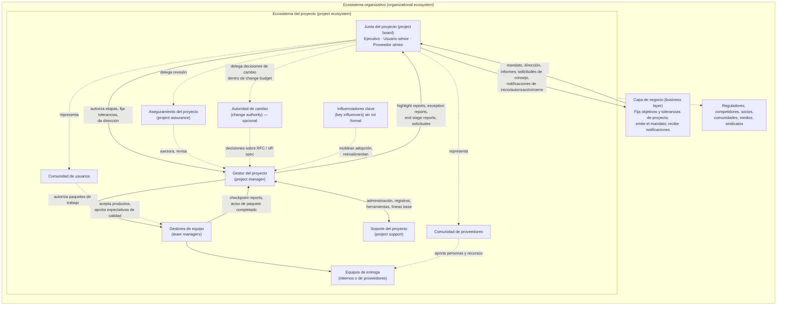
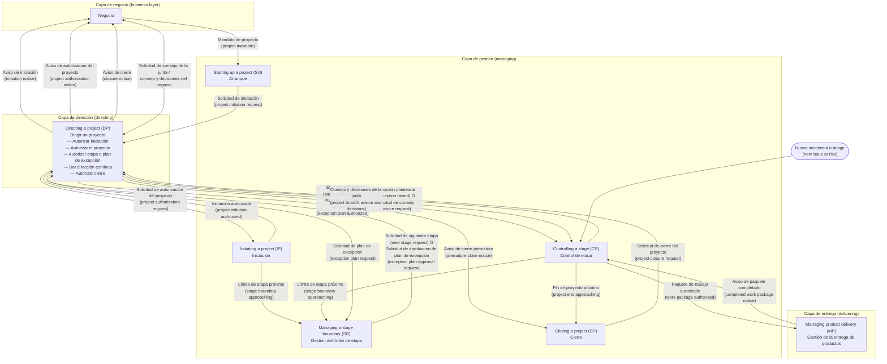

# PRINCE2 7 — Principios, personas y procesos

> **Convención de lectura.** Este archivo describe *el método*, no el libro. Cuando el texto fuente no permite afirmar algo con certeza (por recorte, artefacto de extracción o ausencia del tema en las páginas leídas), se indica explícitamente «no determinado en la fuente». Los términos estándar del método se mantienen en inglés entre paréntesis para facilitar el mapeo con plantillas, herramientas y exámenes.

---

## 1. Qué es un proyecto y qué es gestionarlo según el método

### 1.1 Los cinco elementos integrados

PRINCE2 7 se organiza en cinco elementos que se usan juntos, nunca por separado:

| Elemento | Qué aporta | Dónde se trata en el método |
|---|---|---|
| Principios (*principles*) | Obligaciones orientadoras; si no se cumplen las siete, el proyecto no es un proyecto PRINCE2. | Capítulo 2 |
| Personas (*people*) | Quiénes trabajan en el proyecto, quiénes son afectados por él y cómo se relacionan entre sí. | Capítulo 3 |
| Prácticas (*practices*) | Siete aspectos de la gestión que deben aplicarse de forma continua: business case, organización, planes, calidad, riesgo, incidencias (*issues*) y progreso. | Capítulos 4–11 |
| Procesos (*processes*) | Siete conjuntos de actividades que cubren el ciclo de vida completo, desde antes del arranque hasta el cierre. | Capítulos 12–19 |
| Contexto del proyecto (*project context*) | Las condiciones organizativas, comerciales, de método de entrega, de sostenibilidad y de escala a las que se adapta el método. | Capítulo 1 y a lo largo del libro |

Regla de integración: las prácticas garantizan que los principios se apliquen durante los procesos, de una manera específica al contexto y a las personas del ecosistema del proyecto.

### 1.2 Lo que el método deja fuera deliberadamente

- **Aspectos especialistas del trabajo**: ingeniería, diseño, construcción, desarrollo de software, modelo comercial o ciclo de vida técnico. PRINCE2 no los prescribe; los integra en un entorno controlado separando la *gestión* del proyecto del *trabajo especialista*.
- **Técnicas detalladas de gestión**: planificación de releases, historias de usuario, Kanban, timeboxing, retrospectivas, camino crítico, valor ganado, etc. Se citan como apoyo pero no se documentan, salvo las técnicas propias del método (por ejemplo, la planificación basada en productos). Si se sustituye o añade una técnica, debe quedar explicado en la documentación de inicio del proyecto (*project initiation documentation*, PID).

### 1.3 Definición de proyecto

Un **proyecto** (*project*) es una organización temporal creada para entregar uno o más productos de negocio conforme a un business case acordado.

Las organizaciones equilibran dos necesidades que compiten: mantener la operación corriente (*business as usual*, BAU) y transformarla para seguir siendo competitivas (*business change*). Los proyectos son el vehículo de la segunda.

Cinco rasgos distinguen un proyecto de la operación corriente:

| Rasgo | Significado operativo | Consecuencia para quien gestiona |
|---|---|---|
| Cambio (*change*) | El proyecto existe para introducir un cambio. | Siempre hay personas afectadas fuera del equipo; hay que gestionar la transición. |
| Temporalidad (*temporary*) | Tiene inicio y fin definidos; al terminar, la operación continúa en su nueva forma. | Debe planificarse el cierre y la devolución de recursos desde el principio. |
| Transversalidad (*cross-functional*) | Reúne personas de distintas funciones y a veces de distintas organizaciones. | Surgen tensiones entre perspectivas y motivaciones (p. ej. cliente–proveedor). |
| Unicidad (*unique*) | Aunque se parezca a otros, cada proyecto difiere en equipo, cliente, producto, lugar o plazo. | No se puede confiar solo en la rutina; hay que aprender de la experiencia. |
| Incertidumbre (*uncertainty*) | Los rasgos anteriores generan más amenazas y oportunidades que la operación. | El riesgo es inherente y debe gestionarse de forma explícita. |

### 1.4 Definición de gestión de proyectos

La **gestión de proyectos** (*project management*) es la aplicación de métodos, herramientas, técnicas y competencias para que el proyecto alcance sus objetivos. Su finalidad es reducir y gestionar la ambigüedad: unir a las partes para aclarar objetivos y formas de trabajo, y controlar el trabajo especialista que crea los productos. Comprende planificar, delegar, monitorizar y controlar todos los aspectos del proyecto, además de motivar a las personas involucradas, dentro de las metas de desempeño esperadas.

Problemas típicos que el método pretende resolver:

- Ambigüedad sobre quién es responsable de qué (falta de rendición de cuentas).
- Ambigüedad o conflicto sobre qué se entregará, a qué coste y cuándo; expectativas irreales.
- Recursos no disponibles o reasignados a la operación corriente.
- Dificultad para estimar esfuerzo, duración y coste.
- Cambio no controlado (*scope creep*).
- Dificultad para mantener informados, comprometidos y motivados al equipo y a los interesados.

### 1.5 Las siete metas de desempeño (*performance targets*)

Una **meta de desempeño** fija el nivel de éxito esperado contra el que se juzgará la gestión del proyecto. Las siete son la base de todo el control del método, y a cada una se le asocia una **tolerancia** (*tolerance*): el margen de desviación permitido antes de escalar.

| Meta | Pregunta que responde | Nota práctica |
|---|---|---|
| Beneficios (*benefits*) | ¿Por qué hacemos esto y para quién? | Debe entenderse qué se necesita lograr para justificar la inversión. |
| Costes (*costs*) | ¿Es asequible? | El presupuesto puede verse afectado por muchos factores; hay que vigilar sub- y sobre-gasto. |
| Tiempo (*time*) | ¿Cuándo empieza, cuándo se entregan los productos clave, cuándo termina? | — |
| Calidad (*quality*) | ¿El resultado es apto para su propósito? | Terminar a tiempo y en coste no consuela si el producto no sirve. |
| Alcance (*scope*) | ¿Qué se entrega exactamente? | Debe haber acuerdo explícito; no se entrega más de lo acordado. |
| Sostenibilidad (*sustainability*) | ¿Qué impacto tienen el trabajo y los productos sobre su entorno? | Novedad de la 7ª edición; se interpreta a la luz de los 17 ODS de la ONU salvo que el negocio defina otra cosa. |
| Riesgo (*risk*) | ¿Cuánto riesgo está dispuesto a asumir el negocio? | Sin apetito de riesgo compartido, el equipo puede ser demasiado prudente o temerario. |

Las prioridades se expresan a través de las tolerancias: una meta prioritaria recibe tolerancia estrecha y otra menos crítica, tolerancia amplia. Acordar metas y tolerancias es prerrequisito para explorar opciones y fijar el enfoque del proyecto.

### 1.6 El contexto del proyecto

El método no presupone ningún contexto concreto, pero describe cinco dimensiones habituales para orientar la aplicación y adaptación.

#### 1.6.1 Contexto organizativo

Tres intereses están presentes en todo proyecto; cada uno puede estar dentro o fuera de la misma organización:

| Término | Definición operativa |
|---|---|
| Negocio (*business*) | La organización que emite el mandato del proyecto y dentro de cuya estructura se gobierna. Siempre que el método dice «el negocio» se refiere a esta organización. También es responsable de materializar los beneficios tras el cierre. |
| Usuario (*user*) | La organización que usará los productos para obtener los beneficios esperados. Interna o externa al negocio. |
| Proveedor (*supplier*) | La organización que aporta experiencia, personas y recursos para construir los productos. Interna o externa. |
| Cliente (*customer*) | Solo se usa cuando hay relación comercial entre negocio y proveedor; en ese caso el negocio es el cliente. |

El proyecto puede ser autónomo (reportando a la línea de la unidad de negocio), formar parte de un **programa** (*programme*) o de un **portafolio** (*portfolio*). Las decisiones de negocio se toman en el marco de la estrategia, objetivos y políticas de la organización que lo encarga.

#### 1.6.2 Contexto comercial

Cuando existe una relación comercial, el trabajo puede dividirse en elementos, algunos entregados por proveedores bajo contrato (resultado de un proceso de compras) y otros por áreas internas (TI, instalaciones). Los proveedores pueden a su vez subcontratar, creando jerarquías de relaciones comerciales: un cliente con un contratista principal, o varios clientes y varios proveedores, cada uno con su propia justificación de negocio. El contrato describe cómo colaborarán las partes, y sus derechos y obligaciones deben reflejarse en la forma de gestionar el proyecto.

#### 1.6.3 Método de entrega (*delivery method*)

| Método | Descripción | Ejemplo típico |
|---|---|---|
| Lineal-secuencial (*linear-sequential*) | Los pasos de entrega ocurren en secuencia; el producto se pone a disposición durante o al final del proyecto. | Construcción: requisitos y diseño antes de construir. |
| Iterativo-incremental (*iterative-incremental*) | Requisitos, diseño, desarrollo y pruebas se repiten iterativamente a lo largo del ciclo de vida. Suele llamarse «ágil». | Desarrollo de producto digital. |
| Híbrido (*hybrid*) | Parte del proyecto usa un método y parte el otro. | Infraestructura lineal + portal de usuario iterativo. |

PRINCE2 provee el entorno de control para cualquiera de ellos; la separación entre gestión y trabajo especialista es lo que lo permite. La guía complementaria para entornos ágiles es *PRINCE2 Agile*.

#### 1.6.4 Contexto de sostenibilidad

El negocio probablemente tiene objetivos y compromisos de sostenibilidad que el proyecto debe respetar o a los que debe contribuir. El método los integra mediante: una meta de desempeño específica, responsabilidades en los roles, contenido en planes e informes, la práctica de business case y actividades de proceso que confirman requisitos de sostenibilidad. «Sostenibilidad» puede significar impacto ambiental, coste de ciclo de vida, resiliencia operativa, o ser el propósito mismo del proyecto.

#### 1.6.5 Escala

La escala es relativa a la organización; es más útil pensar en *simple vs. complejo* que en *pequeño vs. grande*, en función del riesgo e importancia percibidos frente a la operación corriente. Palancas de adaptación a la escala:

1. Arreglos de gobernanza entre capa de negocio, junta del proyecto, gestor del proyecto y equipos.
2. Asignación de roles a personas (combinar roles en proyectos simples, dividirlos en complejos).
3. Formalidad y nivel de detalle de los productos de gestión.
4. Formalidad de los controles (frecuencia de informes y revisiones).
5. Selección e integración de los enfoques de gestión (p. ej. comercial, de cambio).
6. Número de etapas y paquetes de trabajo.
7. Fijación de metas de desempeño y sus tolerancias.

### 1.7 Beneficios declarados del método

Probado, universal, flexible, lenguaje común, orientado a resultados (viabilidad del business case por encima de «terminar por terminar»), mejora de la madurez organizativa e integración con las guías de programas, portafolios y riesgo del mismo editor.

---

## 2. Los siete principios

Los **principios** (*PRINCE2 principles*) son las obligaciones orientadoras que determinan si un proyecto se gestiona genuinamente con PRINCE2 y aseguran una aplicación y adaptación eficaces. Un proyecto que aplica los siete principios es un **proyecto PRINCE2** (*PRINCE2 project*). Los principios no prescriben *qué* hacer en cada caso: dan al equipo criterios para decidir *cómo* usar el método.

La figura de adaptación del método distingue dos acciones:

- **Aplicar** (*apply*): usar el método tal cual, decidiendo asignación de roles, número de etapas, número de equipos o paquetes de trabajo, tolerancias y técnicas de apoyo.
- **Adaptar** (*tailor*): cambiar el método, por ejemplo usando terminología alternativa o sustituyendo una técnica PRINCE2 por otra equivalente.

Ambas decisiones se documentan en la PID (enfoques de gestión), el plan de proyecto, los planes de etapa y los planes de equipo. Los factores que influyen son externos al proyecto (contexto organizativo: sector, capacidad, cultura, políticas; contexto de sostenibilidad: impulsores y prioridades; contexto comercial: contratos, relaciones) e internos (método de entrega: ciclo de vida, técnicas, terminología; escala: complejidad, duración).

### 2.1 Asegurar la justificación continua del negocio (*ensure continued business justification*)

**Qué exige.** Debe existir una razón justificable para iniciar el proyecto, y esa justificación debe seguir siendo válida y revalidarse durante todo el ciclo de vida. Si deja de serlo, el proyecto debe detenerse de forma controlada. La justificación guía la toma de decisiones para mantener alineación con los beneficios buscados y los objetivos de negocio.

Matices importantes:

- Los proyectos obligatorios (legislación, regulación) también requieren justificar el *enfoque* elegido como la mejor relación valor-coste.
- Cada parte involucrada necesita su propio equilibrio entre beneficios, costes y riesgos. En un proyecto comercial, el proveedor puede justificar su participación con beneficios no financieros (referencia comercial, experiencia en nueva tecnología).
- En proyectos co-propiedad (varias agencias, varias organizaciones), si una parte pierde su justificación debe considerar retirarse; las obligaciones contractuales informan cómo hacerlo.
- Cancelar un proyecto que ya no se justifica es una contribución positiva: libera fondos y recursos para otros más valiosos.
- Tras el cierre, debe revisarse si los beneficios se materializaron lo suficiente y qué lecciones quedan.
- Sin rigor en la justificación, las organizaciones acumulan portafolios con objetivos inconsistentes o duplicados.

**Cómo se comprueba en la práctica.**

- Existe un business case (en esbozo al arrancar; completo al final de la iniciación) aprobado por la junta del proyecto.
- El business case se actualiza al final de cada etapa y cuando hay excepciones, y la junta lo revisa antes de autorizar cada etapa.
- Las decisiones sobre cambios e incidencias se evalúan en términos de su impacto sobre el business case.
- Al cierre, se compara el resultado real/forecast con el esbozo original y se dejan planificadas las revisiones de beneficios post-proyecto.

**Señales de incumplimiento.**

- El proyecto avanza por inercia o por compromiso político sin que nadie pueda explicar qué beneficio produce.
- El business case no se ha tocado desde la aprobación inicial.
- Se aprueban cambios de alcance sin analizar su efecto sobre coste, beneficio y riesgo.
- Nadie es responsable de medir los beneficios después del cierre.
- Se considera «fracaso» cerrar un proyecto que dejó de ser viable.

**Checklist para un agente.**

1. ¿Puedo localizar el business case vigente y su fecha de última aprobación?
2. ¿La versión vigente refleja los costes, plazos y riesgos del plan de proyecto actual?
3. En cada puerta de etapa, ¿he verificado que la junta reconfirmó la viabilidad antes de autorizar?
4. Ante un cambio o excepción, ¿he cuantificado su impacto sobre beneficios, costes y riesgos?
5. ¿Existe un enfoque de gestión de beneficios (*benefits management approach*) con revisiones post-proyecto asignadas a alguien del negocio?
6. Si la justificación se perdió, ¿he propuesto el cierre prematuro en lugar de «salvar» el proyecto?

### 2.2 Aprender de la experiencia (*learn from experience*)

**Qué exige.** El equipo busca, registra e implementa activamente mejoras a partir de lecciones de proyectos anteriores y de las que surgen durante el propio proyecto; las aplica en el futuro y las comparte. La unicidad de cada proyecto implica que el equipo temporal puede no tener experiencia directa, de ahí la necesidad de aprender de otros.

El aprendizaje ocurre en tres momentos:

| Momento | Qué hacer |
|---|---|
| Al arrancar | Revisar proyectos previos o similares (incluso de organizaciones externas, sobre todo si el proyecto es «el primero» de su tipo para el negocio). |
| Durante | Incluir lecciones en informes y revisiones, especialmente al fin de cada etapa; buscar oportunidades de mejora inmediata. La retrospectiva ágil es un ejemplo de técnica. |
| Al cerrar | Compartir las lecciones ganadas con quienes puedan aprovecharlas. |

Reglas adicionales:

- La base del aprendizaje son los datos: definir qué datos se necesitan, cómo se analizarán y qué pasará con ellos durante y después del proyecto.
- Las personas aprenden de maneras distintas (observando, experimentando); la forma de compartir debe adaptarse.
- Se aprende tanto de errores como de aciertos.
- Identificar lecciones es responsabilidad de todos, no solo del gestor.
- Una lección que no se usa para mejorar es solo «lección identificada», no «lección aprendida».
- En proyectos pequeños co-ubicados, basta con conversarlo en reuniones de equipo; en proyectos grandes y distribuidos pueden requerirse vídeos explicativos, kits para gestores de equipo, talleres por subgrupos, pilotos, simulaciones o ensayos de puesta en marcha.

**Cómo se comprueba.** Existe un registro de lecciones (*lessons log*) creado en el arranque; las lecciones se consultan antes de diseñar el equipo, el business case, los planes y los controles; los informes de fin de etapa (*end stage report*) y de fin de proyecto (*end project report*) contienen lecciones; se emite un informe de lecciones (*lessons report*) al cerrar o cuando se justifica antes.

**Señales de incumplimiento.** El lessons log está vacío o solo tiene entradas al final; se repiten errores de proyectos anteriores de la misma organización; las lecciones se recogen pero nunca se traducen en acciones; no hay datos para sustentar estimaciones futuras.

**Checklist para un agente.**

1. Antes de proponer un plan o enfoque, ¿he consultado lecciones de proyectos similares (internos y externos)?
2. ¿He creado o actualizado el lessons log con lecciones y acciones asociadas?
3. ¿Incluyo lecciones en cada informe de fin de etapa y en el de fin de proyecto?
4. ¿He convertido cada lección relevante en una acción concreta con responsable?
5. ¿Está definido qué datos del proyecto se conservan al cierre y para qué?

### 2.3 Definir roles, responsabilidades y relaciones (*define roles, responsibilities, and relationships*)

**Qué exige.** El proyecto tiene roles y responsabilidades definidos y acordados dentro de una estructura organizativa que representa los intereses de negocio, usuario y proveedor; además, el equipo de gestión construye y mantiene relaciones con y entre los interesados internos y externos. Por eso «personas» es uno de los cinco elementos del método.

Puntos clave:

- Los **interesados** (*stakeholders*) pueden ser individuos o grupos, internos (comité de empresa, consejo de sostenibilidad, propietarios, jefes de departamento, otros equipos de proyecto) o externos (sindicatos, clientes, proveedores, comunidades, grupos de interés, bancos, medios).
- Los tres intereses primarios (negocio, usuario, proveedor) deben estar representados eficazmente en el equipo de gestión del proyecto; esto se refleja en el diseño de la junta del proyecto (*project board*).
- Definir roles es difícil porque los proyectos son transversales, multiorganización, con recursos a tiempo parcial y dispersos; las líneas de mando de la operación corriente no suelen servir.
- La asignación de roles debe ser clara, inequívoca y aceptada; se necesita una **estructura explícita del equipo de gestión del proyecto** (*project management team structure*) y un medio eficaz de comunicación entre sus miembros.
- En un programa, el gestor de cambio de negocio (*business change manager*) del programa puede ejercer de ejecutivo o de usuario sénior en la junta; la oficina del programa puede dar soporte al proyecto; la autoridad de diseño del programa puede autorizar cambios a nivel de proyecto. Hay que acordar quién asume cada rol y con qué autoridad.
- El número de interesados y el grado de impacto determinan el estilo de implicación: pocos interesados con alto impacto → trato individual; muchos interesados con impactos variados → combinación de trato personalizado y canales masivos (encuestas, correos).
- En equipos de desarrollo ágil, el rol de gestor de equipo (*team manager*) puede ser ejercido colectivamente por el equipo.

**Cómo se comprueba.** Hay un organigrama del equipo de gestión con descripciones de rol aprobadas; cada rol tiene un titular que lo ha aceptado; cada miembro sabe a quién rinde cuentas, de qué es responsable y cuáles son las líneas de informe; la estructura se revisa en cada límite de etapa.

**Señales de incumplimiento.** Decisiones que nadie toma o que toman dos personas distintas; un rol de la junta vacante o ejercido por alguien sin autoridad real; el gestor del proyecto actúa como ejecutivo; nadie representa a los usuarios; los proveedores no están en la junta aunque entreguen productos críticos.

**Checklist para un agente.**

1. ¿Existe una estructura del equipo de gestión con los tres intereses representados en la junta?
2. ¿Cada rol tiene descripción escrita y titular que la aceptó explícitamente?
3. ¿Están separadas claramente las funciones de ejecutivo y gestor del proyecto?
4. ¿He identificado interesados fuera de la estructura formal y cómo se les involucra?
5. En cada límite de etapa, ¿he revisado si los roles siguen siendo adecuados a las personas disponibles?

### 2.4 Gestionar por excepción (*manage by exception*)

**Qué exige.** El proyecto establece límites de autoridad delegada mediante tolerancias de desempeño respecto a sus planes. Una **tolerancia** (*tolerance*) es la desviación permitida, por encima y por debajo del objetivo del plan, para beneficios, coste, tiempo, calidad, alcance, sostenibilidad y riesgo, sin necesidad de escalar al siguiente nivel de gestión. Se aplica a nivel de proyecto, etapa y equipo.

El método construye la rendición de cuentas mediante tres mecanismos:

1. **Delegar autoridad** de un nivel al siguiente fijando tolerancias en las siete metas para cada nivel (proyecto, etapa, equipo).
2. **Controles** para que, si se *prevé* que se excederán las tolerancias, se marque como **excepción** (*exception*) y se escale de inmediato al nivel superior para que decida.
3. **Aseguramiento** (*assurance*) para que cada nivel confíe en que los controles de excepción funcionan.

Ejemplos de tolerancia por meta:

| Meta | Ejemplo de tolerancia |
|---|---|
| Beneficios | Rango de ±2 % sobre el incremento de ingresos modelado. |
| Coste | Margen de sobre/subgasto sobre el presupuesto (en horas-persona y dinero). |
| Tiempo | Margen de adelanto/retraso sobre la fecha objetivo del plan de proyecto, de etapa o del paquete de trabajo. |
| Calidad | Variación admisible sobre un criterio de aceptación (p. ej. profundidad de resistencia al agua ±5 m). |
| Alcance | Entregar todos los «must-have» y al menos cierto porcentaje de «should/could-have». |
| Sostenibilidad | Operar dentro de cierto porcentaje de una meta de emisiones; porcentaje de mano de obra local. |
| Riesgo | Límite al coste agregado de amenazas y al coste de cualquier amenaza individual, como porcentaje del presupuesto. |

Beneficios de la regla: uso eficiente del tiempo de la alta dirección sin perder control; decisiones en el nivel correcto; alerta temprana. El decisor puede aceptar la desviación y sus consecuencias o actuar para eliminarla o reducirla.

Casos especiales:

- En entregas iterativas con timeboxes se fija tiempo y coste y se varía alcance: las tolerancias de tiempo y coste son estrechas y la de alcance, amplia.
- En relación comercial, las tolerancias se reflejan en el contrato; si el gestor prevé un retraso que no cabe en tolerancia, alerta rápidamente a la junta aunque el contrato prevea remedios económicos, porque el retraso afecta a los interesados.
- Revisar tolerancias al final de cada etapa permite adaptar la siguiente etapa a un entorno cambiante.

**Cómo se comprueba.** Las tolerancias están escritas en el business case (beneficios, sostenibilidad), en los planes (tiempo, coste, alcance, riesgo, calidad) y en las descripciones de paquete de trabajo; hay un procedimiento de escalado desde gestor de equipo → gestor de proyecto → junta → capa de negocio; existen informes de excepción (*exception report*) cuando procede; la junta no celebra reuniones de progreso rutinarias, sino que decide en puntos definidos y ante excepciones.

**Señales de incumplimiento.** La junta pide reuniones semanales de seguimiento; el gestor del proyecto oculta desviaciones hasta que son irrecuperables; no hay tolerancias escritas o solo hay de tiempo y coste; las tolerancias de equipo son idénticas a las de etapa (no hay delegación real); se escala cualquier problema menor.

**Checklist para un agente.**

1. ¿Están definidas tolerancias para las siete metas en los niveles de proyecto, etapa y paquete de trabajo?
2. Ante una desviación, ¿he comprobado si el *pronóstico* excede la tolerancia del nivel en que me encuentro?
3. Si sí, ¿he notificado de inmediato al nivel superior (aviso temprano) y preparado el informe de excepción?
4. Si no, ¿he tomado acción correctiva dentro de mi autoridad y la he registrado?
5. ¿He evitado escalar lo que puedo resolver y evitado resolver lo que debo escalar?

### 2.5 Gestionar por etapas (*manage by stages*)

**Qué exige.** El proyecto se planifica, monitoriza y controla etapa por etapa. Una **etapa** (*stage*) es la sección del proyecto que el gestor gestiona en nombre de la junta en un momento dado. Todo proyecto tiene al menos dos etapas: una de iniciación (*initiation stage*) y al menos una más; muchos se benefician de más.

Ventajas:

- Adaptabilidad a cambios del proyecto o del contexto.
- Puntos de revisión y decisión en los que la junta evalúa la viabilidad a intervalos definidos.
- Las decisiones clave se toman antes del trabajo detallado que las implementa.
- Permite esperar a influencias externas (ciclo presupuestario, legislación pendiente).
- Facilita gestionar por excepción, delegando autoridad al gestor etapa a etapa.

Factores para elegir las etapas: minimizar la exposición al riesgo a lo largo del ciclo de vida; tamaño y complejidad (etapas cortas = más control; largas = menos esfuerzo de la dirección); decisiones y puntos de control significativos (inversión, negocio, técnica); políticas y estándares del sector o del negocio.

Regla de autorización: la junta autoriza **una etapa cada vez** y delega el control diario, dentro de tolerancias, al gestor. Mientras la etapa se prevea dentro de tolerancia, el gestor puede ajustar lo que necesite. La junta solo autoriza la siguiente etapa si hay justificación de negocio y fondos suficientes; si no, decide si recuperar el proyecto o cerrarlo prematuramente.

Compatibilidad con ágil: los sprints o timeboxes pueden usarse en lugar de paquetes de trabajo; el gestor define cuántos sprints caben en cada etapa, y así se respeta el principio.

**Cómo se comprueba.** Existe un plan de proyecto con etapas definidas y una puerta de decisión formal al final de cada una; hay un plan de etapa detallado solo para la etapa en curso; la junta emite una autorización explícita antes de que empiece cada etapa; el proceso de gestión del límite de etapa se ejecuta al final de cada etapa salvo la última.

**Señales de incumplimiento.** El proyecto tiene una sola etapa «de ejecución» de varios años; se planifica al detalle todo el proyecto al inicio; las etapas empiezan sin autorización escrita de la junta; se confunden etapas de gestión con fases técnicas sin punto de decisión.

**Checklist para un agente.**

1. ¿El proyecto tiene al menos una etapa de iniciación y una etapa de entrega con puerta de decisión entre ambas?
2. ¿Las fronteras de etapa coinciden con decisiones de inversión, negocio o técnica significativas?
3. ¿Solo existe plan detallado para la etapa en curso (y el siguiente se prepara cerca del límite)?
4. ¿Cada etapa comenzó con una autorización explícita de la junta tras revisar el informe de fin de etapa?
5. ¿He reconsiderado el número y longitud de etapas cuando cambió el riesgo o la complejidad?

### 2.6 Enfocarse en los productos (*focus on products*)

**Qué exige.** El proyecto se centra en definir y entregar productos, en particular sus expectativas de calidad de usuario y requisitos. Un **producto** (*product*) es una entrada o salida, tangible o intangible, que puede describirse de antemano, crearse y probarse. Hay cuatro tipos:

| Tipo | Qué es | Ejemplo |
|---|---|---|
| Productos de gestión (*management products*) | Documentos o información para gestionar el proyecto. | Business case, plan, informe de fin de etapa. |
| Productos especialistas (*specialist products*) | Lo que el usuario necesita para obtener beneficios. En el libro se les llama simplemente «productos». | Una aplicación, un edificio, una campaña. |
| Producto del proyecto (*project product*) | La salida total del proyecto, descrita en la descripción del producto del proyecto (*project product description*). | El centro comercial listo para abrir. |
| Productos externos (*external products*) | Desarrollados fuera del control del proyecto pero de los que este depende. | La publicación de una norma. |

«Productos del proyecto» (*project products*, en plural) se refiere al conjunto de productos especialistas y de gestión creados durante el proyecto.

Por qué importa: un proyecto orientado a productos es más eficiente que uno orientado a actividades; su propósito es satisfacer expectativas de los interesados conforme a la justificación de negocio, y eso exige entendimiento común de los productos y de sus criterios de aprobación. El enfoque en productos:

- Garantiza que solo se hace trabajo que contribuye a un producto acordado.
- Ayuda a controlar el *scope creep*: todo cambio se evalúa por su efecto sobre los productos y el business case.
- Reduce insatisfacción y disputas de aceptación al acordar al inicio qué se producirá.
- Facilita pausar, cerrar o reanudar el proyecto en puntos de producto completado.

Las **descripciones de producto** (*product descriptions*) son la base para estimar esfuerzo, recursos, dependencias y calendario, y sostienen casi todo el método: planificación, responsabilidades, informes de progreso, calidad, control de cambios, aceptación y riesgo.

Escala: en un proyecto simple puede bastar una única descripción del producto del proyecto; en proyectos ágiles las descripciones pueden tomar la forma de requisitos, características, épicas e historias de usuario; en proyectos complejos se descompone en subproductos hasta el nivel donde se entiende cómo se obtiene, desarrolla y aprueba cada uno. Cuanto más se desciende, más técnico se vuelve y más difícil para la junta juzgar; por eso el proveedor debe tener experiencia para definir productos en cada nivel y el negocio debe establecer un aseguramiento con conocimiento suficiente.

**Cómo se comprueba.** Existe descripción del producto del proyecto con expectativas de calidad y criterios de aceptación; cada producto a entregar en la etapa tiene descripción de producto con criterios de calidad y responsables de aprobación; los paquetes de trabajo referencian productos, no solo tareas; el registro de productos (*product register*) se actualiza con el estado y aprobación de cada producto.

**Señales de incumplimiento.** Los planes son listas de actividades sin productos identificables; nadie sabe quién aprueba cada entregable; las disputas de aceptación surgen al final; se hace trabajo que no mapea a ningún producto.

**Checklist para un agente.**

1. ¿Puedo nombrar el producto del proyecto y sus criterios de aceptación?
2. Para cada paquete de trabajo, ¿están identificados los productos, sus criterios de calidad y quién los aprueba?
3. Ante cualquier tarea propuesta, ¿puedo decir a qué producto contribuye? Si no, ¿la he cuestionado?
4. Ante una solicitud de cambio, ¿la he traducido a impacto sobre productos y business case?
5. ¿El registro de productos refleja el estado real (aprobado, en desarrollo, con concesión, no iniciado)?

### 2.7 Adaptar al proyecto (*tailor to suit the project*)

**Qué exige.** El método se aplica y adapta al entorno, tamaño, complejidad, importancia, método de entrega, capacidad del equipo y nivel de riesgo del proyecto. La adaptación busca que:

- El método sea apropiado al proyecto (p. ej. alineado con procesos de RR. HH., finanzas y compras que lo gobiernan).
- Los controles sean proporcionales a escala, complejidad, importancia, método de entrega, capacidad y riesgo (p. ej. frecuencia y formalidad de informes y revisiones).

Reglas de la adaptación:

- Requiere decisiones proactivas de la junta y del gestor. Puede incluir ajustar terminología a la de las organizaciones involucradas o sustituir técnicas del método por procedimientos equivalentes ya en uso.
- La gestión eficaz necesita **información (no necesariamente documentos) y decisiones (no necesariamente reuniones)**.
- Sin adaptación se cae en dos extremos: gestión «robótica» (seguir el método sin pensar) o gestión «heroica» (no seguirlo en absoluto).
- El **gestor del proyecto es responsable** de proponer la adaptación, consultando lecciones y estándares; la **junta es responsable final** (*accountable*) y la aprueba al final de la etapa de iniciación y cada vez que se proponga cambiar los enfoques de gestión.
- La adaptación se recoge en la PID para que todos entiendan cómo se usa el método y cómo cumplir sus responsabilidades.
- La adaptación debe ser coherente con los siete principios y conservar la integridad del método.

Ejemplo de adaptación en relación comercial con proveedor ágil: mapear terminología entre PRINCE2 y el método del proveedor; añadir roles de experto de dominio del cliente y del proveedor al equipo ágil; añadir un coach; adoptar rituales ágiles (daily stand-up, radiadores de información); definir procedimientos sobre sprints vs. paquetes de trabajo e historias de usuario vs. descripciones de producto.

**Cómo se comprueba.** La PID tiene una sección que explica la adaptación y sus razones; los enfoques de gestión están dimensionados al proyecto; la terminología usada en el proyecto está mapeada a la del método; la junta aprobó la adaptación explícitamente.

**Señales de incumplimiento.** Se generan todos los productos de gestión «porque lo dice el método» en un proyecto de tres semanas; se omiten controles esenciales alegando «agilidad»; la adaptación no está escrita; se cambia la adaptación sin aprobación de la junta.

**Checklist para un agente.**

1. ¿He registrado en la PID qué se aplica tal cual, qué se adapta y por qué?
2. ¿Cada producto de gestión que propongo responde a una necesidad de información o decisión real?
3. ¿La adaptación respeta los siete principios (ninguno queda anulado)?
4. ¿La junta aprobó la adaptación al final de la iniciación y cada cambio posterior?
5. ¿He empezado simple y elaborado solo cuando surgió la necesidad?

### 2.8 Resumen de los principios para uso rápido

| Principio | Pregunta de control de un agente | Producto o mecanismo que lo encarna |
|---|---|---|
| Justificación continua | ¿Sigue valiendo la pena? | Business case, benefits management approach, puertas de etapa. |
| Aprender de la experiencia | ¿Qué ya sabemos y qué aprendimos? | Lessons log, lessons report, informes de fin de etapa/proyecto. |
| Roles, responsabilidades y relaciones | ¿Quién decide, quién hace, quién es consultado? | Estructura del equipo de gestión, descripciones de rol, RACI. |
| Gestión por excepción | ¿Estamos dentro de tolerancia? | Tolerancias, highlight report, exception report, exception plan. |
| Gestión por etapas | ¿Autorizó la junta esta etapa? | Plan de proyecto, planes de etapa, end stage report. |
| Enfoque en productos | ¿Qué producto produce esto y quién lo aprueba? | Project product description, product descriptions, product register. |
| Adaptar al proyecto | ¿Está el método dimensionado a este proyecto? | Sección de adaptación de la PID, enfoques de gestión. |

---

## 3. Personas

### 3.1 Contexto: ecosistemas y decisiones

El propósito de un proyecto es entregar cambio, y el cambio afecta a las rutinas, responsabilidades y actividades de las personas en su operación corriente. El desempeño del proyecto depende de la capacidad del equipo, la fortaleza de sus relaciones y de las personas impactadas por el cambio. «Personas» cubre tanto a quienes trabajan en el proyecto como a quienes se ven afectados por él.

Dos definiciones estructurales:

| Término | Definición operativa |
|---|---|
| Ecosistema organizativo (*organizational ecosystem*) | Los elementos internos de una organización (plantilla, consejo, propietarios, otros interesados) más sus relaciones externas (clientes, socios, proveedores, reguladores, competidores). |
| Ecosistema del proyecto (*project ecosystem*) | Los elementos del negocio involucrados o directamente impactados por el proyecto, junto con los usuarios y proveedores asociados. |

Reglas de contexto:

- Las organizaciones son ecosistemas complejos de relaciones cambiantes; los proyectos cambian a las organizaciones aunque no sea su propósito principal.
- Todos los niveles de liderazgo deben crear una cultura de proyecto que motive.
- Las decisiones deben tomarse cerca de donde reside el conocimiento relevante; se escalan solo si hace falta considerar el impacto en otras partes del ecosistema del proyecto u organizativo, o gestionar implicaciones políticas más amplias.
- Los tres intereses (negocio, usuario, proveedor) pueden situarse en distinta proporción dentro del ecosistema del proyecto o del organizativo; entender dónde están ayuda a decidir cómo se representan y cómo se les involucra.

### 3.2 Liderar el cambio con éxito

**Gestión del cambio** (*change management*): el medio por el que una organización transita del estado actual al estado objetivo. Ambos estados se describen como rutinas, responsabilidades, relaciones, culturas y capacidades; puede haber estados intermedios.

El método lo aborda con un **enfoque de gestión del cambio** (*change management approach*), parte de la PID. Para decidir su nivel de detalle se considera: qué decisiones apoya, qué habilidades se necesitan durante y después de la transición, qué áreas del ecosistema se verán impactadas, qué relaciones clave hay que considerar, cómo evoluciona la cultura y cómo se hará la transición (formación, transferencia de conocimiento desde el equipo, contratación).

Contenido de alto nivel del enfoque de gestión del cambio: alcance del cambio y exclusiones; descripción de estados actual, intermedios y objetivo; características de cada estado (rutinas, prácticas, procesos, cultura, responsabilidades, estructura, capacidades) resaltando las que cambian; actividades habilitadoras antes, durante y después de la transición (consulta, pruebas, formación, línea de ayuda); recursos y responsabilidades para esas actividades; herramientas y técnicas; estándares aplicables; referencias.

**Interesados e influenciadores clave.** Un **interesado** (*stakeholder*) es cualquier individuo, grupo u organización que puede afectar o ser afectado por el proyecto, o que percibe que lo es. Los **influenciadores clave** (*key influencers*) son los interesados en la interfaz entre el proyecto y el ecosistema organizativo; identificarlos es fundamental. Dónde buscarlos:

- Altos directivos.
- Personas de las comunidades de usuario, proveedor u operación que toman decisiones y hacen tareas del día a día.
- Cuellos de botella por donde fluyen información, conocimiento y dinero (controladores documentales, expertos técnicos, gestores comerciales); se descubren preguntando a la gente de las áreas impactadas quién sabe cómo funcionan realmente las cosas.
- Quienes moldean la percepción de la mayoría: por su red son los que más influyen en la adopción de los productos y la materialización de beneficios; conviene entender sus perspectivas y restricciones.
- Las personas con quienes el equipo de gestión necesita trabajar más estrechamente.

Los influenciadores cambian a lo largo del proyecto. La forma de establecer el proyecto debe favorecer la construcción de relaciones a través de interfaces: reuniones regulares y grupos de trabajo que construyan entendimiento compartido de perspectivas, datos y conocimiento.

**Cultura** (*culture*): el conjunto de actitudes, valores, metas y formas de trabajo compartidas que caracterizan a un grupo. Reglas:

- Al inicio la cultura del proyecto refleja la de la organización; después puede emerger una cultura propia, que debe seguir alineada con el ecosistema organizativo.
- El **entendimiento compartido** del proyecto, desarrollado con los influenciadores clave, se captura en el **resumen del proyecto** (*project brief*). Junto con las obligaciones legales y regulatorias y los compromisos del negocio (p. ej. sostenibilidad), guía la toma de decisiones multinivel.
- Las formas de trabajo derivadas del entendimiento compartido se recogen en los enfoques de gestión.
- El entendimiento compartido debe verificarse al final de cada etapa y cuando cambian los influenciadores clave.
- El incumplimiento persistente de los procesos del proyecto suele indicar que las formas de trabajo acordadas se han desalineado de la cultura emergente; antes de atribuirlo a mal comportamiento, hay que explorar la desconexión y hacer evolucionar las formas de trabajo.

### 3.3 Liderar equipos con éxito

Definiciones:

| Término | Definición operativa |
|---|---|
| Colaboración (*collaboration*) | Personas de todo el ecosistema del proyecto trabajando juntas por los objetivos del proyecto. |
| Co-creación (*co-creation*) | Forma específica de colaboración que involucra a usuarios e influenciadores clave en el diseño de productos y formas de trabajo, para asegurar su adopción. |
| Liderazgo (*leadership*) | Motivar a las personas para lograr los objetivos; en proyectos se logra mejor colaborando, persuadiendo, influyendo y co-creando, gestionando relaciones clave y buscando retroalimentación regular. |
| Gestión (*management*) | Instruir la ejecución de tareas conforme a formas de trabajo acordadas; co-crear esas formas de trabajo aumenta mucho la disposición a ser gestionado. |

Realidades que todo líder de proyecto debe asumir:

1. La estructura de poder real no siempre coincide con la formal, aunque el gestor tenga autoridad dentro de las tolerancias.
2. Por la temporalidad y las múltiples líneas de reporte, el gestor depende de influir y motivar mediante intereses alineados y habilidades relacionales, además de un propósito compartido.
3. Los roles PRINCE2 no coinciden con los títulos de puesto.
4. Los miembros tienen prioridades que compiten con el proyecto.
5. Miembros del equipo pueden ser más sénior que el gestor, lo que genera tensión jerárquica.
6. Algunos factores de motivación (remuneración, carrera) están fuera del alcance del gestor.

**Liderar a través de fronteras organizativas.** Personas del negocio sin rol formal contribuyen directamente (definiendo, asegurando, aceptando productos) o indirectamente (formando a su gente, cambiando formas de trabajo, integrando productos). Cuando esas actividades están fuera del alcance del proyecto, hay que dejar claras las dependencias, quién las hace, cómo se financian y cómo se monitorizan; si no, el proyecto se retrasa o no logra beneficios. Se requiere **inteligencia cultural**: equipos que se adapten para interactuar, límites claros dentro de los que flexibilizar, condiciones para el éxito, conciencia de las múltiples perspectivas (inteligencia emocional) y de las restricciones de tiempo y atención de cada persona.

**Construir equipos eficaces.** Se necesita diversidad de capacidades, competencias y perspectivas ajustada al proyecto. Rara vez se puede elegir a todos; hay que conocer las competencias reales, identificar brechas y mitigarlas (formación, redistribuir responsabilidades). Las mismas competencias se ejercen distinto según la persona y según con quién trabaja. Los equipos temporales deben aprender rápido a trabajar juntos; ejercicios estructurados de autoconocimiento y comprensión de otras perspectivas aceleran la confianza. Roles y responsabilidades deben reflejar capacidad, autoridad y disponibilidad real, mirarse a través de las relaciones clave y revisarse cuando esas relaciones cambian.

**Seguridad psicológica** (*psychological safety*): todos los miembros deben sentirse aceptados, respetados y capaces de expresar puntos de vista divergentes sin temor; crearla es responsabilidad de todos en el día a día, cuidando el bienestar mutuo. El equipo también necesita espacio para experimentar, inspeccionar, adaptar y autoorganizarse.

Mecanismos de PRINCE2 que apoyan al equipo:

| Mecanismo | Qué aporta al equipo |
|---|---|
| Plan de proyecto | Explica las metas y da sentido de propósito; permite responder a los interesados. |
| Estructura del equipo de gestión y descripciones de rol | Clarifican estructura, roles, responsabilidades y relaciones; revelan necesidades de coaching (p. ej. influir, manejar resistencia). |
| Enfoque de gestión de la comunicación | Explica cómo los miembros se apoyan y cómo se desarrollan relaciones entre grupos. |
| PID | Recoge las formas de trabajo acordadas, empoderando al equipo a centrarse en resultados. |
| Planificación basada en productos | Logra acuerdo sobre qué satisface al usuario y aclara dependencias y secuencia. |

**Cohesión social.** Se construye con encuentros regulares y con propósito que generen confianza a través de silos; con la gestión deliberada de relaciones clave durante todo el proyecto para resistir los obstáculos; y, si es posible, con co-ubicación que permita relaciones orgánicas informales. En equipos virtuales o híbridos hacen falta medidas adicionales: sincronizar días de co-ubicación de personas clave, dejar tiempo para conversaciones no estructuradas en línea, jornadas fuera, herramientas de colaboración virtual, e incentivos para encuentros presenciales.

### 3.4 Comunicación

Los proyectos generan cambio y por ello están bajo escrutinio y expuestos a malentendidos sobre su propósito e impacto. Sin un enfoque claro de comunicación surgen barreras, porque la gente defiende la situación actual o intenta limitar el impacto percibido.

El **enfoque de gestión de la comunicación** (*communication management approach*) forma parte de la PID. Su propósito es definir medios y frecuencia de comunicación y de recepción de retroalimentación con todo el ecosistema del proyecto, estableciendo un flujo de información controlado y **bidireccional**. Contenido de alto nivel: alcance de la comunicación gestionada; análisis de interesados (afectados por el resultado o por el proceso, y quienes pueden influir en el éxito o fracaso); calendario y procedimientos por grupo (propósito, frecuencia, canales, mensajes); responsabilidades; recursos (asuntos públicos, comunicación interna); herramientas (plataformas, analítica, automatización); estándares (compromiso público, ética); referencias.

Reglas prácticas:

- Comunicar es tanto **escuchar** como emitir: entender percepciones y preocupaciones antes de que se conviertan en riesgos mayores, y adaptar mensajes a cada grupo. Los mensajes genéricos rara vez funcionan.
- Trabajar con influenciadores clave de usuarios, proveedores y negocio para incorporar perspectivas, crear bucles de retroalimentación y adaptar mensajes; dejar que ayuden a dar forma a la comunicación.
- La mayor parte de la comunicación ocurre fuera de los canales formales: aceptarlo, dar información en múltiples formatos fáciles de compartir y abrir múltiples vías de retroalimentación.
- Equipos **co-ubicados**: la información fluye orgánicamente; vigilar que fluya por todo el ecosistema y reconectar a quien quede aislado.
- Equipos **remotos**: enfoque más deliberado y estructurado; reservar tiempo para escucha no estructurada; aclarar cómo fluye la información; acordar tiempo estructurado y no estructurado para relaciones clave.
- Equipos **híbridos**: evitar que surjan grupos «más dentro» y «más fuera» según su ubicación.
- El enfoque evoluciona con el proyecto. En proyectos complejos y de amplio impacto puede ser útil una **fase silenciosa** (*quiet phase*) en la que se trabaja con un grupo reducido de influenciadores y se minimiza la comunicación amplia hasta que el proyecto está mejor definido, para evitar desinformación y rumores (crítico en proyectos políticamente sensibles).
- No basta con los informes periódicos para saber cómo va el proyecto: los informes sufren sesgo (la gente ajusta inconscientemente lo que comunica a lo aceptable o deseable). Un entorno abierto reduce el sesgo, pero hacen falta vías adicionales: relaciones con influenciadores y monitoreo de la salud de las relaciones clave.
- Los **focos de resistencia** indican dónde concentrar la comunicación: escuchar las preocupaciones revela malentendidos y permite resolverlos.

### 3.5 Las personas en el centro del método

Las tres actividades centradas en personas (liderar el cambio, liderar equipos, comunicar) no son independientes: atraviesan todo el método.

**Personas y principios:**

| Principio | Dimensión humana |
|---|---|
| Justificación continua | La justificación debe satisfacer a los tres intereses; alcanzar ese alineamiento lleva tiempo y depende de la dinámica de relaciones; lo que cuenta como justificación puede cambiar al cambiar los roles. La justificación es también percepción: la comunicación muestra progreso y valor. |
| Aprender de la experiencia | Hay conocimiento visible (libros, lecciones capturadas) y conocimiento oculto en el ecosistema; comportamientos, cultura y relaciones se aprenden socialmente, no documentándolos. |
| Gestión por etapas | Los límites de etapa suelen marcar cambios de influenciadores y relaciones; son buenos momentos para revisar la alineación del plan con cómo interactúa la gente, revisar las competencias necesarias para la siguiente etapa y cambiar personas, incluso en la junta. |
| Gestión por excepción | Decidir donde está el conocimiento; escalar cuando la decisión afecta a otras áreas o requiere otras perspectivas. El grado de delegación depende de la confianza en las relaciones clave y se adapta a las capacidades de cada persona (más autonomía a quien demuestra competencia; más instrucción y coaching a quien aún no la tiene). |
| Enfoque en productos | Co-crear productos y descripciones con negocio, usuario y proveedor une perspectivas, mejora la adopción, reduce riesgos de traspaso y considera operación y mantenimiento. |
| Adaptar | Adaptar el método a las personas y organizaciones, no al revés; la adaptación depende de la madurez, que evoluciona con el tiempo. |

**Personas y prácticas:** la práctica de organización explica cómo se estructura el equipo temporal para representar a los tres intereses; todas las prácticas incorporan la dimensión humana (p. ej. el business case requiere perspectivas de las tres comunidades para construir entendimiento común).

**Personas y procesos:** los procesos se organizan en cuatro capas (negocio, dirección, gestión, entrega) y describen cómo las personas interactúan entre capas.

### 3.6 Reglas prácticas de personas para un agente

1. Antes de proponer una estructura de equipo, identifica dónde se sitúan negocio, usuario y proveedor respecto al ecosistema del proyecto y del organizativo.
2. Toma o propón decisiones en el nivel donde está el conocimiento; escala solo si hay impacto cruzado o político.
3. Captura el entendimiento compartido en el project brief y vuelve a validarlo en cada límite de etapa y cuando cambie un influenciador clave.
4. Trata el incumplimiento persistente de un proceso como síntoma de desalineación cultural, no como falta disciplinaria, hasta demostrar lo contrario.
5. Co-crea descripciones de producto, planes y formas de trabajo con quienes van a usarlas; la adopción depende de ello.
6. Diseña roles según capacidad, autoridad y disponibilidad reales, y revisa roles cuando cambien las relaciones clave.
7. Documenta dependencias con trabajo fuera del alcance (quién lo hace, cómo se financia, cómo se monitoriza).
8. Protege la seguridad psicológica: ante una incidencia o riesgo, pregunta si la gente se siente segura para reportar.
9. Completa el enfoque de comunicación al final, porque debe incluir las comunicaciones requeridas por los demás enfoques.
10. Escucha tanto como informas; busca canales de retroalimentación alternativos a los informes formales.
11. Considera una fase silenciosa en proyectos sensibles hasta que la definición sea estable.
12. En equipos remotos o híbridos, planifica explícitamente tiempo no estructurado y evita ciudadanías de primera y segunda clase por ubicación.
13. Gradúa la delegación según la confianza y competencia demostradas por cada persona.
14. Interpreta los focos de resistencia como mapa de dónde comunicar más y mejor.
15. Monitoriza la salud y el bienestar del equipo como parte del control de etapa, y revísalos en los informes de fin de etapa y de proyecto.
16. En el cierre, planifica la salida ordenada (*off-boarding*) de las personas y una forma de reconocimiento.

### 3.7 Modelo de «ecosistema del proyecto»: roles y relaciones

Lectura del modelo:

- Las flechas continuas son el flujo formal de autoridad (hacia abajo) e información (hacia arriba) entre las cuatro capas: negocio → dirección → gestión → entrega.
- Las flechas punteadas son relaciones de representación, delegación o influencia que el método reconoce pero que no son líneas de mando.
- Los influenciadores clave pueden estar en cualquier parte del ecosistema organizativo; identificar los que están en la interfaz con el proyecto es tarea permanente del gestor.
- Los tres intereses (negocio, usuario, proveedor) pueden estar mayoritariamente dentro o fuera del ecosistema del proyecto según el caso; eso determina cómo se representan en la junta y cómo se les involucra.

---
## 4. Modelo de procesos

### 4.1 Qué es un proceso y cómo se describe

Un **proceso** (*process*) es un conjunto estructurado de actividades que define la secuencia de acciones, con sus entradas y salidas, para alcanzar un objetivo concreto. PRINCE2 define siete procesos que, en conjunto, cubren dirigir, gestionar y entregar un proyecto. Cada proceso se compone de **actividades** (*activities*), que pueden ejecutarse en secuencia o en paralelo; cada actividad agrupa **acciones recomendadas** orientadas a un resultado.

Cada capítulo de proceso sigue el mismo formato: propósito, objetivos, contexto (incluyendo tabla de entradas/actividades/salidas), actividades, responsabilidades (RACI), y aplicación de las prácticas al proceso. En los diagramas, un **disparador** (*trigger*) es un evento o decisión que inicia un proceso; la flecha indica qué proceso se dispara; si la flecha va a la capa de negocio, sirve para notificar o solicitar; un disparador doble indica alternativas.

### 4.2 Las cuatro capas de gestión

| Capa | Quién | Proceso principal |
|---|---|---|
| Negocio (*business layer*) | La organización que encarga el proyecto; fija objetivos y tolerancias de proyecto y hace responsable a la junta. | Fuera de los procesos del proyecto; emite el mandato y recibe notificaciones. |
| Dirección (*directing*) | Junta del proyecto. | Directing a project. También participa en Starting up a project. |
| Gestión (*managing*) | Gestor del proyecto (con soporte). | Starting up, Initiating, Controlling a stage, Managing a stage boundary, Closing. |
| Entrega (*delivering*) | Gestores de equipo y equipos. | Managing product delivery. |

### 4.3 El recorrido del proyecto (*PRINCE2 journey*)

| Fase del ciclo de vida | Qué ocurre | Procesos activos |
|---|---|---|
| Pre-proyecto | Alguien tiene una idea o necesidad; el negocio emite un **mandato de proyecto** (*project mandate*), que puede ir desde una instrucción verbal hasta una definición bien justificada. Se confirma si el proyecto es valioso y viable; se nombran ejecutivo y gestor; se crean el project brief y el plan de la etapa de iniciación. La junta decide si iniciar. | Starting up a project; Directing a project (autorizar iniciación). |
| Etapa de iniciación | Se planifica al nivel de detalle apropiado, se establecen enfoques y controles, se desarrolla el business case completo y el medio para revisar beneficios. Se planifica en detalle la siguiente etapa. La junta revisa la PID y decide autorizar el proyecto y la siguiente etapa. La PID se preserva como línea base original. | Initiating a project; Managing a stage boundary; Directing a project (autorizar proyecto y etapa). |
| Etapas siguientes | La junta delega el control diario etapa por etapa; el gestor controla contra el plan, informa mediante **highlight reports**, asigna paquetes de trabajo a gestores de equipo, que informan con **checkpoint reports**. Al acercarse el fin de etapa, el gestor reporta desempeño, actualiza el business case y planifica la siguiente etapa; la junta decide autorizar. | Controlling a stage; Managing product delivery; Managing a stage boundary; Directing a project. |
| Etapa final | Hacia el final se dispara el cierre. La junta se asegura de que los receptores pueden poseer y usar los productos y que el negocio puede asumir la propiedad del producto del proyecto. Se archiva documentación, se evalúa el desempeño contra el plan original, se liberan recursos y se confirman o revisan las revisiones de beneficios post-proyecto. | Controlling a stage; Closing a project; Directing a project (autorizar cierre). |
| Post-proyecto | La mayoría de beneficios se materializan después; se ejecutan una o más revisiones de beneficios según el **benefits management approach**, que indica cómo, cuándo y quién. | Ninguno del proyecto; responsabilidad del negocio. |

Reglas estructurales:

- Siempre hay al menos dos etapas: la de iniciación y una final; puede haber cualquier número intermedio.
- Starting up a project es usado tanto por la capa de dirección como por la de gestión.
- Managing a stage boundary se usa por primera vez al final de la etapa de iniciación y se repite al final de cada etapa salvo la final; también se usa para preparar planes de excepción, en cualquier momento incluida la etapa final.
- Controlling a stage y Managing product delivery pueden usarse ya en la etapa de iniciación, sobre todo en proyectos grandes o complejos.

### 4.4 Diagrama del modelo de procesos con disparadores

### 4.5 Etapas de gestión y puertas de decisión

| Puerta de decisión | Quién decide | Qué revisa | Resultado posible |
|---|---|---|---|
| Autorizar la iniciación (*authorize initiation*) | Junta del proyecto (puede delegarse revisión al aseguramiento; la junta sigue siendo responsable final). Puede hacerse sin reunión formal si todos están de acuerdo y el ejecutivo da instrucción documentada. | Project brief, esbozo del business case, descripción del producto del proyecto, plan de la etapa de iniciación. | Autorizar la etapa de iniciación con tolerancias; o no iniciar. |
| Autorizar el proyecto (*authorize the project*) | Junta del proyecto. Puede hacerse en paralelo con la autorización de la primera etapa de entrega. | PID completa, business case completo, plan de proyecto, benefits management approach, enfoques y controles. | Autorizar la entrega y confirmar tolerancias de proyecto; o instruir cierre prematuro. |
| Autorizar una etapa o plan de excepción (*authorize a stage or exception plan*) | Junta del proyecto. En contextos de programa, portafolio o negocio, la liberación de fondos puede recaer en un nivel superior al ejecutivo; por eso esta actividad puede tratarse como proceso separado en un modelo adaptado. | End stage report, plan de la siguiente etapa o plan de excepción, plan de proyecto y business case actualizados. | Aprobar el plan; pedir revisión del plan rechazado; o instruir cierre prematuro. |
| Dar dirección continua (*give ongoing direction*) | Junta, colectiva o individualmente. | Solicitudes de consejo, highlight reports, issue reports, exception reports, cambios externos, cambios en la composición de la junta. | Consejo; decisión sobre incidencia escalada (aceptar/rechazar; para off-spec: rechazar o conceder); decisión sobre excepción (pedir plan de excepción, aceptar desviación, cerrar); tratar un cambio de mandato como solicitud de cambio o como cierre prematuro + nuevo proyecto. |
| Autorizar el cierre (*authorize project closure*) | Junta (puede requerir refrendo del negocio). Última actividad de la junta antes de disolverse. | PID original vs. actual, end project report, benefits management approach actualizado, business case confirmado. | Emitir notificación de cierre con fecha límite para cargar costes; ordenar retirada de infraestructura y salida ordenada del equipo. |

Regla de niveles de excepción:

- Excepción a nivel de **paquete de trabajo**: la gestiona el gestor del proyecto en Controlling a stage (el gestor de equipo le plantea la incidencia).
- Excepción a nivel de **etapa**: se escala a la junta; si la junta lo pide, el gestor prepara un plan de excepción que, al aprobarse, sustituye al plan en excepción y se convierte en la nueva línea base.
- Desviación a nivel de **proyecto**: requiere aprobación del negocio.

---

## 5. Los siete procesos

Convenciones de las tablas RACI de esta sección: **R** = responsable de hacerlo (*responsible*); **A** = responsable final/único dueño (*accountable*, no delegable); **C** = consultado; **I** = informado. Columnas: Negocio (capa de negocio), Ejec. (ejecutivo del proyecto), US (usuario sénior), PS (proveedor sénior), GP (gestor del proyecto), GE (gestor de equipo), Aseg. (aseguramiento del proyecto), Sop. (soporte del proyecto). Las tablas reflejan la asignación estándar del método; la adaptación puede moverlas siempre que se mantenga un único punto de *accountability* por actividad.

### 5.1 Arranque de un proyecto (*Starting up a project*, SU)

#### Propósito

Asegurar que existen los prerrequisitos para iniciar el proyecto, respondiendo a la pregunta: ¿tenemos un proyecto viable y que valga la pena? Las actividades ocurren *antes* de la decisión explícita de iniciar. No debe hacerse nada hasta que se defina la información fundamental para decidir sobre el encargo, se asignen y doten los roles clave y exista una base para la planificación detallada. El proceso sirve tanto para impedir que ideas mal concebidas lleguen a iniciarse como para avanzar las viables; por eso es un proceso ligero comparado con la iniciación: lo mínimo necesario para decidir si merece la pena iniciar.

#### Objetivos

- Que haya justificación de negocio para iniciar (en un **esbozo de business case**, *outline business case*).
- Que existan las autoridades necesarias para iniciar (asignar personas, asegurar recursos).
- Que haya información suficiente para definir y confirmar el alcance (en un **project brief**).
- Que se hayan evaluado enfoques alternativos y acordado el **enfoque del proyecto** (*project approach*).
- Que se nombre a las personas que harán el trabajo de iniciación o asumirán roles de gestión significativos.
- Que el trabajo de la etapa de iniciación esté planificado (en un **plan de etapa**).
- Que no se pierda tiempo iniciando sobre supuestos poco sólidos de alcance, plazos, criterios de aceptación o restricciones.

#### Disparadores de entrada

- **Mandato de proyecto** (*project mandate*), emitido por la autoridad responsable del negocio que encarga el proyecto (puede provenir de un comité ejecutivo, una unidad funcional u operativa, un programa, un portafolio o un cliente). El término cubre cualquier información que dispare el proyecto: un estudio de viabilidad, una solicitud de propuesta recibida por un proveedor, etc. Debe aportar los términos de referencia y al menos identificar al ejecutivo prospectivo.
- Entrada de revisión: informes de lecciones previos.

#### Contexto operativo

- Si el proyecto es parte de un programa, el programa suele aportar el project brief y nombrar a parte o toda la junta, lo que elimina mucho trabajo de este proceso; el gestor debe validar lo recibido y recomendar modificaciones si procede.
- La preparación del esbozo del business case y el ensamblado del project brief son actividades paralelas e iterativas que requieren interacción frecuente entre gestor, junta e interesados. Cuanto mejor se capturan los requisitos aquí, más tiempo se ahorra después evitando incidencias, excepciones y replanificación.
- Puede que al principio no esté claro qué salida producirá el proyecto; al menos debe estar claro qué problema de negocio se resuelve o qué resultado se busca.
- Conviene co-crear esbozo de business case, project brief y plan de iniciación con usuarios e interesados prospectivos para aumentar comprensión y compromiso.

#### Actividades

| # | Actividad | Para qué sirve | Acciones clave | Producto de gestión que crea/actualiza |
|---|---|---|---|---|
| 1 | Nombrar al ejecutivo y al gestor del proyecto (*appoint the project executive and project manager*) | Sin un decisor con autoridad que represente al negocio no se puede hacer nada; el ejecutivo es prerrequisito para que el proyecto esté justificado. El gestor permite la gestión diaria en nombre del ejecutivo. | El negocio revisa el mandato y aclara ambigüedades; el negocio identifica y nombra al ejecutivo; el ejecutivo nombra al gestor (puede necesitar acuerdo del negocio); el gestor crea el registro diario. | **Daily log** (crear). |
| 2 | Evaluar lecciones previas (*assess previous lessons*) | Lecciones de otros proyectos (internos y externos) sobre procesos, técnicas, herramientas y personas influyen en el diseño del equipo, el esbozo del business case, el brief y el plan de iniciación. | Revisar lecciones de proyectos similares (incl. auditorías y revisiones); consultar a personas o equipos con experiencia (externos si el negocio no ha hecho algo así antes); un taller puede ayudar; crear el lessons log si procede. | **Lessons log** (crear). |
| 3 | Preparar el esbozo del business case (*prepare the outline business case*) | Vista de alto nivel que sirve de base acordada para el business case completo de la iniciación. | El ejecutivo lo desarrolla a partir del mandato y de lo que se sabe, consultando al usuario sénior si ya está nombrado, entendiendo cómo contribuye a los objetivos de negocio; el gestor consulta a usuario sénior, proveedor sénior y ejecutivo para definir qué se entregará y crea la descripción del producto del proyecto; se revisan los riesgos del daily log y los que afectan a la viabilidad se resumen en el esbozo. | **Outline business case** (crear); **project product description** (crear). |
| 4 | Nombrar al equipo de gestión del proyecto (*appoint the project management team*) | Tener a las personas correctas con autoridad, responsabilidad y conocimiento para decidir a tiempo, reflejando los tres intereses, y capaces de formar un equipo de alto rendimiento. Todos deben entender quién rinde cuentas a quién, quién es responsable de qué y cuáles son las líneas de informe y comunicación. | El gestor revisa el lessons log, diseña la estructura del equipo y prepara descripciones de rol; el ejecutivo, consultando a usuario sénior y gestor, identifica, selecciona y nombra al equipo; el gestor acuerda prácticas de trabajo y comunicación para la iniciación y registra riesgos nuevos. | Estructura del equipo de gestión y descripciones de rol (dentro del **project brief**); project log (riesgos). |
| 5 | Seleccionar el enfoque del proyecto (*select the project approach*) | Antes de planificar hay que decidir cómo se abordará el trabajo. | Responder: ¿desarrollo interno o contratado (modelo de entrega)? ¿modificar algo existente o construir desde cero? ¿producto comercial estándar (COTS) o a medida? ¿qué método de entrega (incremental/ágil o lineal)? ¿cómo soporta el enfoque los requisitos de sostenibilidad? Capturar estándares y prácticas del usuario y del proveedor que apliquen; evaluar soluciones posibles y elegir el enfoque que entrega el producto del proyecto y logra el esbozo del business case; definir requisitos de adaptación conocidos; registrar incidencias y riesgos. | **Project approach** (dentro del project brief). |
| 6 | Ensamblar el project brief (*assemble the project brief*) | Dar al proyecto un punto de partida común y bien definido. | Confirmar estado actual (antecedentes, trabajo previo); confirmar objetivos y resultados deseados; confirmar alcance, exclusiones y tolerancias de proyecto; identificar restricciones y supuestos; identificar usuarios e interesados; revisar estructura del equipo para detectar roles o competencias adicionales y preparar descripciones de rol; identificar dependencias con otros proyectos; documentar todo en el brief; registrar incidencias y riesgos. | **Project brief** (crear). |
| 7 | Planificar la etapa de iniciación (*plan the initiation stage*) | Iniciar consume tiempo y recursos; debe planificarse y aprobarse para que no sea un trabajo sin rumbo. Si hay programa, verificar la fecha de fin de iniciación contra los planes del programa. Decidir qué procesos PRINCE2 se aplicarán durante la iniciación (p. ej. usar Controlling a stage y Managing product delivery). | Decidir los controles de gestión adecuados para la iniciación según el enfoque del proyecto; identificar restricciones de tiempo y coste y producir el plan de etapa según la técnica de planificación del método; revisar riesgos del project log y su impacto en el plan; actualizar el log. | **Stage plan** para la etapa de iniciación (crear). |
| 8 | Solicitar la iniciación del proyecto (*request project initiation*) | Cerrar el proceso presentando la justificación formal a la junta. | Informar a la junta sobre esbozo de business case, producto del proyecto, enfoque, nombramientos, y actividades y controles de la iniciación; solicitar formalmente autoridad para iniciar y asegurar personas y recursos. | Disparador **project initiation request** → Directing a project. |

#### Responsabilidades por rol

| Actividad | Negocio | Ejec. | US | PS | GP | GE | Aseg. | Sop. |
|---|---|---|---|---|---|---|---|---|
| Nombrar ejecutivo y gestor | A/R (nombra al ejecutivo) | R (nombra al gestor) | — | — | — | — | — | — |
| Evaluar lecciones previas | C | A | — | — | R | — | — | — |
| Preparar esbozo del business case | C | A/R | C (si ya nombrado) | C (si ya nombrado) | R | — | — | — |
| Nombrar al equipo de gestión | A | R | — | — | — | — | — | — |
| Seleccionar el enfoque | — | A | C | C | R | C (si ya identificado) | C | — |
| Ensamblar el project brief | — | A | C | C | R | — | C | C |
| Planificar la etapa de iniciación | — | A | C | C | R | I (si participará) | C | C |
| Solicitar la iniciación | — | A | C | C | R | I | C | I |

Nota: la responsabilidad final de nombrar ejecutivo y gestor recae en el negocio, que además nombra directamente al ejecutivo; el ejecutivo nombra al gestor.

#### Salidas y criterios de completitud

El proceso está completo cuando:

- Existen ejecutivo y gestor nombrados, y una estructura de equipo de gestión con roles aceptados para la iniciación.
- Existe un esbozo de business case que muestra una contribución clara a los objetivos de negocio y resume los riesgos clave de viabilidad.
- Existe una descripción del producto del proyecto con expectativas de calidad del usuario, criterios de aceptación y estándares conocidos.
- Existe un project brief que incluye definición del proyecto, enfoque, estructura del equipo, tolerancias y riesgos/incidencias de alto nivel conocidos, e hitos conocidos.
- Existe un plan de la etapa de iniciación con productos, trabajo, plazos, costes y tolerancias de etapa.
- Se ha emitido la solicitud de iniciación a la junta.

#### Aplicación de las prácticas en este proceso

- Business case: en esbozo, dentro del brief, a partir del mandato, lecciones y consulta con negocio y usuarios prospectivos.
- Organización: negocio nombra ejecutivo y gestor; estos diseñan la estructura y nombran a quienes iniciarán.
- Planes: hitos conocidos en el brief; el enfoque informará el método de entrega y el plan de proyecto; el número de etapas puede identificarse ya; plan de etapa de iniciación.
- Calidad: expectativas de calidad del usuario y estándares conocidos en la descripción del producto del proyecto; se refinan después.
- Riesgo e incidencias: de alto nivel, en el brief.
- Progreso: tolerancias de proyecto conocidas en el brief (se refinan después); tolerancias de la etapa de iniciación en el plan de etapa.

#### Adaptación típica

| Contexto | Adaptación |
|---|---|
| Proyecto pequeño / simple | Las actividades pueden combinarse, dividirse o ejecutarse en paralelo, cuidando la integridad de la conexión con Directing a project al pedir la iniciación. Esbozo de business case y brief pueden ser muy breves; la descripción del producto del proyecto puede ser el único producto descrito. Si el gestor aún no está nombrado, el ejecutivo (o alguien designado por él) puede crear los productos de gestión; el ejecutivo tampoco tiene que redactar personalmente el esbozo del business case. Debe mantenerse un único punto de *accountability* por rol. |
| Proyecto ágil | El enfoque del proyecto declara el método iterativo-incremental; se decide ya si se usarán sprints en lugar de paquetes de trabajo y backlog/historias en lugar de descripciones de producto; el gestor de equipo puede ser el equipo. El brief sigue siendo necesario como punto de partida común. |
| Programa | El programa aporta el brief y nombra parte o toda la junta; el gestor valida y propone ajustes; la fecha de fin de iniciación se contrasta con el plan del programa; el programa puede proveer soporte (PMO) y autoridad de cambio. |

---

### 5.2 Dirigir un proyecto (*Directing a project*, DP)

#### Propósito

Permitir que la junta del proyecto sea responsable final del éxito del proyecto tomando las decisiones clave y ejerciendo el control global, mientras delega la gestión diaria al gestor del proyecto.

#### Objetivos

- Que haya autoridad para iniciar el proyecto.
- Que haya autoridad para entregar el producto del proyecto.
- Que se provea dirección y control de gestión apropiados durante toda la vida del proyecto.
- Que el proyecto siga siendo viable.
- Que la capa de negocio tenga conexión con el proyecto.
- Que haya autoridad para cerrar el proyecto.
- Que los planes para materializar beneficios post-proyecto se gestionen y revisen.

#### Disparadores de entrada

| Disparador | Procedencia | Actividad que activa |
|---|---|---|
| Project initiation request | Starting up a project | Autorizar la iniciación |
| Project authorization request | Initiating a project | Autorizar el proyecto |
| Next stage request / exception plan approval request | Managing a stage boundary | Autorizar una etapa o plan de excepción |
| Advice request / exception raised | Controlling a stage | Dar dirección continua |
| Advice and decisions from the business | Capa de negocio | Dar dirección continua |
| Project closure request | Closing a project | Autorizar el cierre |

El proceso comienza al completarse Starting up a project y dura hasta el cierre.

#### Contexto operativo

- Cubre las actividades de la junta, no el día a día del gestor. La junta **gestiona por excepción**: monitoriza mediante informes y controla mediante un número reducido de puntos de decisión. No deberían hacer falta otras reuniones de progreso, porque el gestor informará de cualquier excepción.
- Los niveles de autoridad y los procesos de decisión deben estar claramente definidos y empoderar al gestor y a los gestores de equipo.
- Debe haber flujo bidireccional de información entre junta y capa de negocio; la junta garantiza la alineación permanente con la estrategia del negocio y actúa como canal de comunicación (cómo lo hace se documenta en el communication management approach).
- La junta debe dar una dirección **unificada**; si no logra una visión única, el riesgo de fracaso crece porque el gestor podría actuar sobre prioridades contradictorias. En ese caso decide el ejecutivo.
- El proceso evita tanto que la junta se sobrecargue de gestión operativa como que microgestione al gestor.
- La junta da también consejo informal; es bidireccional: la junta informa al gestor de asuntos externos y el gestor pide consejo cuando lo necesita.
- En cada actividad, la junta puede delegar tareas de revisión y evaluación al aseguramiento del proyecto, pero **la junta sigue siendo responsable final**.

#### Actividades

| # | Actividad | Para qué sirve | Acciones clave de la junta | Producto de gestión que aprueba/crea |
|---|---|---|---|---|
| 1 | Autorizar la iniciación (*authorize initiation*) | Iniciar cuesta tiempo y dinero; esta decisión asegura que la inversión en iniciación vale la pena. Puede tomarse con o sin reunión formal, siempre que todos estén de acuerdo y el ejecutivo dé instrucción documentada. | Comprobar que el enfoque se alinea con las políticas del negocio; revisar y aprobar project brief y descripción del producto del proyecto; comprobar que el esbozo del business case muestra viabilidad y alineación estratégica; revisar y aprobar el plan de la etapa de iniciación y **fijar sus tolerancias**; informar a interesados y sedes afectadas de que el proyecto se inicia y pedir apoyo logístico; autorizar al gestor a proceder. | Outline business case, project brief, project product description, stage plan de iniciación (aprobados); **initiation notice** → negocio; disparador **project initiation authorized** → IP. |
| 2 | Autorizar el proyecto (*authorize the project*) | Decidir si proceder con el resto del proyecto. Puede hacerse en paralelo con la autorización de la primera etapa de entrega. Si no se autoriza, el proyecto debe cerrarse prematuramente. | Confirmar que existe un business case robusto y viable; que el plan de proyecto y el benefits management approach demuestran capacidad de entregar el business case; que los enfoques y controles soportan la entrega del plan. Revisar y aprobar la PID; **confirmar tolerancias de proyecto**; confirmar que se revisaron lecciones; confirmar que se revisaron riesgos y que las respuestas a amenazas y oportunidades son adecuadas; obtener o comprometer personas y recursos (se entregan al gestor etapa a etapa); notificar al negocio e interesados; autorizar al gestor a entregar, o instruir cierre prematuro. | PID y business case (aprobados); **project authorization notice** → negocio. |
| 3 | Dar dirección continua (*give ongoing direction*) | Guía informal y respuestas a solicitudes en cualquier momento; especialmente frecuente en la iniciación y cerca de los límites de etapa. Puede darse colectiva o individualmente. | Responder a solicitudes informales de consejo; ante una incidencia escalada, decidir (si es **off-specification**: rechazarla —el equipo o proveedor debe completar el producto— o conceder una **concesión** —se acepta el producto incompleto—); ante un exception report, decidir (incl. pedir un **exception plan**); ante un highlight report, revisar y actuar; ante consejo o decisiones del negocio, notificar al gestor los cambios. Si el negocio revisa el mandato: tratarlo como solicitud de cambio (replanificar etapa o proyecto) o detener, cerrar prematuramente y arrancar un nuevo proyecto (posiblemente más costoso). Considerar el impacto en todos los interesados identificados en el communication management approach. | PID (actualizada si procede, aprobada); disparadores **exception plan request** → SB, **project board's advice and decisions** → CS, **premature close notice** → CP. |
| 4 | Autorizar una etapa o plan de excepción (*authorize a stage or exception plan*) | Una etapa solo comienza cuando la junta lo dice. La junta revisa el desempeño de la etapa actual y aprueba el plan de la siguiente; ocurre antes de cada etapa. | Revisar y aprobar el end stage report; revisar el plan de etapa o de excepción propuesto; decidir aprobarlo, pedir al gestor que revise el plan rechazado, o instruir cierre prematuro; comunicar el estado del proyecto al negocio y mantener informados a los interesados según el communication management approach. | End stage report, stage plan de la siguiente etapa, project plan y business case actualizados (aprobados); disparador **stage authorized / exception plan authorized** → CS. |
| 5 | Autorizar el cierre del proyecto (*authorize project closure*) | El cierre controlado es tan importante como el arranque controlado. Hay que evaluar la PID y el plan de proyecto, en su versión original y actual, para saber si se lograron los objetivos, cómo se desvió el proyecto de su base inicial y que no tiene nada más que aportar. Sin ello, el riesgo es un cierre descontrolado sin traspaso completo, pérdida del foco en beneficios y equipo no liberado. Última actividad de la junta antes de disolverse; puede requerir refrendo del negocio. | Revisar PID original y actual; revisar y aprobar el end project report; asegurar que las revisiones de beneficios post-proyecto del benefits management approach cubren el desempeño del producto en operación (para detectar efectos colaterales beneficiosos o adversos); revisar y aprobar el benefits management approach actualizado y **transferir su responsabilidad al negocio** (incluye recursos más allá del proyecto); confirmar el business case comparando beneficios, costes y riesgos reales y previstos contra el esbozo original; emitir la **notificación de cierre** según el communication management approach, avisando a quienes dieron infraestructura y recursos que pueden retirarlos e indicando fecha límite de cargo de costes; asegurar la salida ordenada de los miembros restantes. | End project report, benefits management approach (aprobados); business case (confirmado); **closure notice** → negocio. |

#### Responsabilidades por rol

| Actividad | Negocio | Ejec. | US | PS | GP | GE | Aseg. | Sop. |
|---|---|---|---|---|---|---|---|---|
| Autorizar la iniciación | I | A/R | — | — | — | — | — | — |
| Autorizar el proyecto | I | A/R | C | C | I | I | C | I |
| Dar dirección continua | C | A/R (asuntos de negocio) | R (asuntos de usuario) | R (asuntos de proveedor) | C/I | I | C | I |
| Autorizar etapa o plan de excepción | I | A/R | C | C | I | I | C | I |
| Autorizar el cierre | I | A/R | C | C | I | I | C | I |

#### Salidas y criterios de completitud

Cada actividad se completa con una decisión explícita y documentada de la junta y el disparador correspondiente hacia el proceso de gestión afectado o la notificación a la capa de negocio. El proceso en su conjunto se completa cuando se ha emitido la notificación de cierre y la junta se disuelve.

#### Aplicación de las prácticas en este proceso

- Business case: la junta aporta para que sea deseable, viable y alcanzable y alineado con la estrategia; revisa el esbozo para autorizar iniciación, el completo para autorizar proyecto y etapas, y lo confirma al cierre; aprueba benefits y sustainability management approaches; acuerda con el negocio las tolerancias de proyecto para beneficios y sostenibilidad y fija las de etapa.
- Organización: los tres intereses están representados por líderes con autoridad y credibilidad; la junta aprueba estructura, descripciones de rol, enfoques comercial, de comunicación y de cambio, y confirma el modelo de entrega.
- Planes: revisa planes y método de entrega por alineación con business case, estrategia e hitos; aprueba enfoque, plan de proyecto, cada plan de etapa y de excepción; compromete fondos, personas y recursos.
- Calidad: el usuario sénior aporta expectativas de calidad y criterios de aceptación; la junta es responsable del aseguramiento desde las tres perspectivas; aprueba descripción del producto del proyecto, descripciones de producto y quality management approach; acuerda tolerancia de calidad de proyecto con el negocio y fija la de producto.
- Riesgo: considera riesgos de alto nivel antes de autorizar iniciación y los del business case antes de autorizar proyecto y etapas; acuerda tolerancia de riesgo de proyecto y fija la de etapa; confirma que el nivel global de riesgo es aceptable; aprueba el risk management approach.
- Incidencias: aprueba el issue management approach; responde a tiempo a issue reports; decide si delegar una **autoridad de cambio** (*change authority*) y establecer un **presupuesto de cambio** (*change budget*).
- Progreso: aprueba el digital and data management approach; acuerda tolerancias de tiempo, coste y alcance de proyecto y fija las de etapa; se satisface del progreso revisando highlight reports a la frecuencia acordada; responde a exception reports y considera si hace falta exception plan; aprueba el end project report e informa al negocio del cierre.

#### Adaptación típica

| Contexto | Adaptación |
|---|---|
| Proyecto pequeño / simple | El ejecutivo es responsable de todas las actividades, aunque el trabajo lo hagan otros; las decisiones pueden tomarse sin reunión formal si hay acuerdo e instrucción documentada. Lo que **no** se adapta: el gestor nunca toma decisiones ni da aprobaciones que corresponden al ejecutivo; ambos roles deben mantenerse separados. |
| Proyecto ágil | El highlight report puede sustituirse por un sistema «pull» donde la junta consulta los gráficos de progreso que mantienen gestor y equipos; las tolerancias priorizan tiempo y coste fijos y alcance variable. Las puertas de etapa se mantienen. |
| Programa / portafolio | La decisión en los límites de etapa, en particular la liberación de fondos, puede corresponder a un nivel superior al ejecutivo; la actividad «autorizar una etapa o plan de excepción» puede modelarse como proceso separado. Las decisiones de cambio pueden delegarse a la autoridad de diseño del programa. |

---

### 5.3 Iniciar un proyecto (*Initiating a project*, IP)

#### Propósito

Establecer bases sólidas para el proyecto, permitiendo que el negocio entienda el trabajo necesario para entregar el producto del proyecto antes de comprometer gasto o recursos significativos.

#### Objetivos

Lograr un entendimiento común de:

- Las razones del proyecto, los beneficios esperados y los riesgos asociados (en un **business case** completo).
- El alcance y los productos a entregar.
- Cómo y cuándo se entregarán y a qué coste.
- Quién participa en la toma de decisiones.
- Cómo se logrará la calidad requerida.
- Cómo se establecerán y controlarán las líneas base.
- Cómo se identificarán, evaluarán y controlarán riesgos e incidencias.
- Cómo se monitorizará y controlará el progreso.
- Quién necesita información, en qué formato y cuándo.
- Cómo aplica el proyecto las políticas, métodos y guías del negocio.

#### Disparadores de entrada

- **Project initiation authorized** (desde Directing a project).
- Entradas de revisión: project brief, project log, descripción del producto del proyecto, plan de la etapa de iniciación.

#### Contexto operativo

- Todas las partes deben tener claro qué se pretende lograr, por qué, cómo y cuáles son sus responsabilidades, para que haya compromiso genuino.
- El gestor crea el conjunto de productos de gestión al nivel de control que la junta haya especificado, y debe acordar con la junta **cómo revisará y aprobará** esos productos: uno a uno según estén listos, o todos juntos como conjunto.
- Si la relación usuario–proveedor es comercial, todas las actividades requieren consideración adicional, porque riesgos, recompensas y razones difieren para el usuario (cliente) y el proveedor.
- La iniciación es donde se decide principalmente la adaptación. Es mejor **empezar simple y elaborar según haga falta**, que montar un entorno de gestión para un gran proyecto hipotético; las necesidades de adaptación emergen durante la iniciación.
- Algunos proyectos son demasiado complejos para definir completamente su salida al final de la iniciación; en esos casos es común tener etapas de investigación de opciones, y la iniciación solo se usa al inicio de la primera etapa para establecer el entorno de gestión y control.

#### Actividades

| # | Actividad | Para qué sirve | Acciones clave del gestor | Producto de gestión que crea/actualiza |
|---|---|---|---|---|
| 1 | Acordar los requisitos de adaptación (*agree tailoring requirements*) | Reconocer factores internos y externos que afectan a la entrega. El negocio puede tener ya un marco estándar basado en PRINCE2 adaptado; cómo se aplicará y adaptará debe documentarse y acordarse. | Revisar el brief para ver el enfoque de adaptación esbozado; buscar lecciones sobre adaptación; definir requisitos de adaptación en la PID incluyendo controles relacionados; consultar al aseguramiento; pedir aprobación a la junta (que puede preferir revisarlo luego con toda la PID). | Sección de adaptación de la **PID**. |
| 2 | Acordar los enfoques de gestión (*agree the management approaches*) | Los enfoques derivan de estrategias, estándares o prácticas del negocio con las que el proyecto debe cumplir, y de las expectativas de calidad y sostenibilidad del usuario. Una vez definidos, es posible establecer controles y crear el plan de proyecto. Pueden hacerse en paralelo, pero el de **comunicación se completa último** porque debe incluir las comunicaciones que requieren los demás. | Revisar la adaptación y sus implicaciones; revisar el brief por estrategias, estándares o prácticas aplicables (incl. contractuales); buscar lecciones; revisar el project log por incidencias y riesgos; actualizar el log; consultar al aseguramiento; pedir aprobación. | Nueve **management approaches** (crear): gestión del cambio, comunicación, sostenibilidad, beneficios, comercial, calidad, riesgo, incidencias, digital y datos. |
| 3 | Establecer los controles del proyecto (*establish project controls*) | Acordar el nivel de control que la junta requiere tras la iniciación y el que el gestor requiere sobre los gestores de equipo, y establecer los mecanismos. Los controles permiten gestionar de forma eficaz y proporcional a escala, riesgo, complejidad e importancia, y son prerrequisito para gestionar por excepción. Muchos controles ya están *definidos* en los enfoques pero no *establecidos*; aquí se establecen y se verifica que forman un conjunto coherente. Controles típicos: frecuencia y formato de comunicación entre capas; número de etapas; mecanismos de captura y análisis de incidencias; tolerancias de autoridad delegada; cómo se monitoriza la autoridad delegada; mecanismos de escalado. | Confirmar el método de entrega y sus implicaciones; revisar la adaptación; revisar los enfoques para identificar controles; buscar lecciones; revisar riesgos e incidencias del log (el riesgo agregado afecta a la escala y rigor del control); confirmar y documentar los límites de etapa; asignar cada nivel de decisión al nivel de gestión apropiado; establecer procedimientos de decisión (posiblemente adaptando un sistema de calidad existente); incorporar autoridad y responsabilidad de decisión a la estructura del equipo y descripciones de rol (finalizar roles no asignados, reasignar, rediseñar el equipo si hace falta); confirmar tolerancias de proyecto y procedimientos de escalado (gestor de equipo → gestor → junta → negocio); resumir controles en la PID; consultar al aseguramiento; actualizar el log; pedir aprobación. Participa el soporte del proyecto. | Sección de controles de la **PID**; estructura del equipo y descripciones de rol (actualizadas). |
| 4 | Preparar el plan de proyecto (*prepare the project plan*) | Antes de comprometer gasto mayor hay que establecer plazos, recursos y personas; el plan de proyecto es necesario para preparar el benefits management approach y para que la junta controle. No se planifica en solitario: se co-crea con usuarios y proveedores; los talleres de planificación ayudan a identificar productos, detalles y dependencias. | Confirmar método de entrega e implicaciones; revisar brief por alcance y requisitos de planificación; revisar adaptación; buscar lecciones; revisar riesgos e incidencias; identificar herramientas de planificación y control y documentar su uso; elegir métodos de estimación; revisar los enfoques por recursos, estándares, métodos y costes; crear la **estructura de desglose de productos** (*product breakdown structure*), escribir descripciones de producto de los componentes principales y el **diagrama de flujo de productos** (*product flow diagram*), e incluirlos en el plan; identificar arreglos de transición a operación (si el producto requerirá mantenimiento, planificar un acuerdo de servicio entre soporte y usuario e incluirlo como producto del plan); considerar actualizar la descripción del producto del proyecto si cambiaron los criterios de aceptación; crear/actualizar registros del **product register** para cada producto; identificar y confirmar personas y recursos, su disponibilidad, aceptación y compromiso; incluir actividades, recursos y tiempos de los controles; decidir formato y presentación del plan según audiencia (p. ej. una lista de verificación de productos puede bastar para la junta); consultar al aseguramiento; actualizar el log; pedir aprobación. | **Project plan** (crear); product descriptions; project product description (actualizar si procede); **product register** (crear/actualizar). |
| 5 | Preparar el business case completo (*prepare the full business case*) | Actualizar el esbozo con tiempos y costes estimados del plan de proyecto y riesgos agregados del log. Se co-crea con el ejecutivo. Lo usará la junta para autorizar el proyecto y será la base del control continuo de viabilidad. | Revisar el brief por requisitos de formato y contenido del negocio; buscar lecciones; crear un business case más detallado con la información adicional; actualizar el log; consultar al aseguramiento; pedir aprobación. | **Business case** (crear versión completa). |
| 6 | Ensamblar la PID (*assemble the project initiation documentation*) | Un punto focal donde toda la información sobre qué, por qué, quién, cómo, dónde, cuándo y cuánto se reúne para acuerdo de los interesados clave y como guía para los involucrados. La PID agrega muchos productos de gestión; **no es necesariamente un único documento**: puede ser una colección de documentos, un libro de trabajo o el contenido de una herramienta. La versión usada para autorizar el proyecto debe quedar como **línea base bajo control de cambios** para comparar después el desempeño real con las previsiones originales. | Extraer y revisar información del brief; incluir o referenciar estructura del equipo y descripciones de rol, business case, enfoques y plan de proyecto; incluir o referenciar controles y resumir la adaptación; ensamblar; **cruzar la información** de los distintos elementos para verificar compatibilidad; consultar al aseguramiento; preparar la siguiente etapa (dispara Managing a stage boundary). | **PID** (crear); project log (actualizar); disparador **stage end approaching** → SB. |
| 7 | Solicitar la autorización del proyecto (*request project authorization*) | Terminar la iniciación pidiendo a la junta la autorización para entregar; la justificación formal está en el business case y la PID. | Compartir con la junta la versión final del business case, la PID y el plan de proyecto; solicitar formalmente autoridad para entregar y asegurar personas y recursos. | Disparador **project authorization request** → DP. |

#### Responsabilidades por rol

| Actividad | Negocio | Ejec. | US | PS | GP | GE | Aseg. | Sop. |
|---|---|---|---|---|---|---|---|---|
| Acordar requisitos de adaptación | — | A | C | C | R | C | C | I |
| Acordar los enfoques de gestión | — | A | C | C | R | C | C | I |
| Establecer los controles | — | A | C | C | R | C | C | I |
| Preparar el plan de proyecto | — | A | C | C | R | C | C | C |
| Preparar el business case completo | — | A | C | C | R | C | C | I |
| Ensamblar la PID | — | C | C | C | A | C | C | R |
| Solicitar la autorización | I | A | C | C | R | I | C | I |

Nota: en el ensamblado de la PID el gestor es responsable final y el soporte del proyecto es quien ejecuta; es la única actividad del método donde el soporte figura como R.

#### Salidas y criterios de completitud

El proceso está completo cuando:

- Existen los nueve enfoques de gestión aprobados (o pendientes de aprobación conjunta en la PID).
- Los controles están establecidos como conjunto coherente: límites de etapa, tolerancias de proyecto, procedimientos de escalado y de decisión, frecuencias de informe.
- Existe un plan de proyecto con PBS, descripciones de producto, PFD, etapas, recursos comprometidos y arreglos de transición.
- Existe un business case completo coherente con el plan y el riesgo agregado.
- La PID está ensamblada, cruzada y lista para ser línea base; el registro de productos, el de calidad, el de riesgos y el de incidencias han sido creados.
- Se ha preparado el plan de la siguiente etapa (vía Managing a stage boundary) y se ha emitido la solicitud de autorización a la junta.

#### Aplicación de las prácticas en este proceso

- Business case: del esbozo al completo; se desarrollan benefits y sustainability management approaches, que alimentan los controles.
- Organización: se detalla la autoridad delegada por capa; se nombra e incorpora al resto del equipo; se considera una estructura de desglose de trabajo para organizar equipos y decidir qué se contrata; se crean los enfoques de comunicación, cambio y comercial.
- Planes: PBS y PFD a partir de la descripción del producto del proyecto; el plan define las etapas; se crea el product register.
- Calidad: descripciones de producto; se actualiza la del producto del proyecto si procede; las especificaciones de calidad alimentan el quality management approach; se crea el quality register.
- Riesgo: risk management approach; risk register con categorías y escala de valoración definidas en el enfoque; se registran y evalúan los riesgos del business case y del plan; se considera un **presupuesto de riesgo** (*risk budget*).
- Incidencias: issue management approach; issue register; se considera un presupuesto de cambio.
- Progreso: digital and data management approach; los controles de todos los enfoques quedan establecidos; highlight reports durante la iniciación.

#### Adaptación típica

| Contexto | Adaptación |
|---|---|
| Proyecto pequeño / simple | Las actividades pueden combinarse, dividirse o ejecutarse en paralelo. La cantidad de productos de gestión puede parecer excesiva; empezar simple. La PID puede ser un documento breve o un espacio en una herramienta. El gestor es responsable de los productos de gestión pero puede asignar tareas a quien convenga (el soporte puede venir de una oficina de programa). |
| Proyecto ágil | Los enfoques reflejan trabajo por sprints, backlog e historias; las descripciones de producto pueden ser épicas/historias; el quality management approach recoge la definición de «hecho» y las prácticas de prueba del equipo; las tolerancias fijan tiempo y coste y flexibilizan alcance. |
| Programa | El programa puede imponer enfoques, plantillas y controles estándar; parte de la autoridad de decisión reside en el programa; el benefits management approach se integra con el del programa. |
| Proyecto de alta incertidumbre | Si no puede definirse la salida al terminar la iniciación, se diseñan etapas de investigación de opciones; la iniciación solo establece el entorno de gestión y control. |

---

### 5.4 Controlar una etapa (*Controlling a stage*, CS)

#### Propósito

Asignar trabajo, monitorizarlo, manejar incidencias, informar del progreso a la junta y tomar acciones correctivas para que la etapa permanezca dentro de las tolerancias fijadas por la junta.

#### Objetivos

- Mantener la atención en la entrega de los productos de la etapa; monitorizar cualquier desviación respecto a los productos y el método de entrega acordados al inicio de la etapa, para evitar cambio no controlado.
- Controlar riesgos e incidencias.
- Mantener el business case bajo revisión.
- Que los productos acordados para la etapa cumplan las expectativas de calidad y sean aceptados.
- Que el equipo de gestión se concentre en entregar dentro de las tolerancias.

Principio de estilo: dar a los gestores de equipo toda la libertad posible mediante tolerancias, para minimizar escalados; del mismo modo, el gestor negocia sus propias tolerancias con la junta para tener libertad de actuar y aprender. El gestor actúa como **facilitador**, no como controlador.

#### Disparadores de entrada

| Disparador | Procedencia | Actividad que activa |
|---|---|---|
| Stage authorized / exception plan authorized | Directing a project | Autorizar un paquete de trabajo |
| New issue or risk | Cualquiera (negocio, proyecto, interesados) | Capturar incidencias y riesgos |
| Completed work package notice | Managing product delivery | Recibir un paquete de trabajo completado |
| Project board's advice | Directing a project | Evaluar el estado de la etapa |

Entradas de revisión: PID, planes de equipo, plan de etapa, descripciones de paquete de trabajo, checkpoint reports, highlight report anterior, project log, plan de proyecto.

#### Contexto operativo

- Es la gestión diaria del gestor del proyecto, usada en cada etapa. Normalmente se usa por primera vez tras la autorización del proyecto, pero puede usarse en la iniciación en proyectos grandes o complejos.
- Las **descripciones de paquete de trabajo** (*work package descriptions*) definen, asignan y controlan el trabajo y fijan tolerancias para los gestores de equipo. Si el gestor del proyecto ejerce también de gestor de equipo, deben usarse igualmente para controlar el trabajo de cada miembro; en ese caso las referencias al gestor de equipo se leen como referencias al miembro asignado.
- El control de una etapa es un **ciclo**: autorizar trabajo → monitorizar progreso (incl. aceptar paquetes completados) → revisar la situación (incl. calidad de productos) y disparar nuevos paquetes → informar a la junta a la frecuencia acordada → observar, evaluar y manejar incidencias y riesgos → tomar acciones correctivas para permanecer en tolerancia.
- Hacia el final de la última etapa se dispara Closing a project; hacia el final de las demás, Managing a stage boundary.
- La relación gestor–soporte–gestores de equipo debe ser colaborativa: el gestor no delega tareas sino que facilita para mejorar la apropiación.

#### Actividades

| # | Actividad | Para qué sirve | Acciones clave del gestor | Producto de gestión que crea/actualiza |
|---|---|---|---|---|
| 1 | Autorizar un paquete de trabajo (*authorize a work package*) | Equilibrar la autonomía de las personas con la coordinación de cuándo empieza y termina el trabajo. El trabajo solo comienza y continúa con el consentimiento del gestor; de lo contrario sería caótico. Un paquete cubre uno o más productos; si un producto requiere más de un paquete, se descompone en subproductos con sus descripciones. Disparadores: autorización de etapa, aprobación de plan de excepción, nuevo paquete requerido tras evaluar el estado de la etapa, acción correctiva. Sirve para autorizar nuevos paquetes o enmendar existentes. | Examinar PID y plan de etapa para determinar los paquetes requeridos; definir cada paquete; construir relación de trabajo con el gestor de equipo; **co-crear** y revisar la descripción del paquete con el gestor de equipo, confirmar que la acepta y autorizar el inicio (en ágil, la co-creación puede incluir al equipo y al product owner); revisar el plan de equipo (si el contexto comercial impide ver su contenido, usar el extracto de hitos) y actualizar el plan de etapa con los tiempos; actualizar el project log con el contenido de los paquetes y con las actividades de calidad planificadas; consultar al aseguramiento sobre los revisores de calidad seleccionados; actualizar el log según los enfoques. | **Work package description** (crear, enmendar, aprobar); project log (actualizar); disparador **work package authorized** → MP. |
| 2 | Evaluar el estado de un paquete de trabajo (*evaluate work package status*) | Evaluación regular del estado de cada paquete, con frecuencia y formalidad alineadas a la frecuencia de informe definida en la descripción del paquete y soportada por el plan de etapa. | Para cada paquete en curso: conversar informalmente con el gestor de equipo para mantener la relación y conocer sus incidencias y riesgos; recopilar y revisar el **checkpoint report**; actualizar el project log si procede; actualizar el plan de etapa con reales, previsiones y ajustes. | Project log, **stage plan** (actualizar). |
| 3 | Recibir un paquete de trabajo completado (*receive completed work package*) | A toda asignación de trabajo debe corresponder una confirmación de que se completó y aprobó. | Confirmar que el gestor de equipo completó el trabajo definido (o, en ágil, entregó las características acordadas para el timebox); comprobar en el quality register que las revisiones de calidad necesarias están completas; asegurar que cada producto obtuvo la aprobación requerida (según las responsabilidades de calidad y sostenibilidad de su descripción); confirmar que el product register se actualizó para cada producto aprobado; marcar el paquete como completado en el plan de etapa. | Project log, stage plan (actualizar). |
| 4 | Evaluar el estado de la etapa (*evaluate stage status*) | La etapa se descontrola si no se revisa a tiempo; hay que equilibrar planificar hacia delante con reaccionar. Para decidir con fundamento hay que comparar lo ocurrido con lo esperado y lo que puede ocurrir (incl. incidencias y riesgos), con un flujo constante de información y sistemas de monitoreo simples y robustos. Ocurre a la frecuencia del plan de etapa, por consejo de la junta, o como parte del análisis de una nueva incidencia o riesgo. | Revisar el progreso y decidir si hacen falta acciones; revisar el project log; actualizar el plan de etapa si la evaluación agregada cambia las previsiones; confirmar si se transfirió propiedad de algún producto a los usuarios como **traspaso por fases** (puede haber varios traspasos en el ciclo de vida); decidir si revisar lecciones ahora o más adelante; **preparar la siguiente etapa** si se acerca el fin (indicado por plan de etapa, log o hito) → dispara SB; **preparar el cierre** si se acerca el fin de la etapa final → dispara CP. | Project log (actualizar); disparadores **stage end approaching** → SB y **project end approaching** → CP (este último, según la tabla de la fuente, se dirige a Directing a project; el diagrama del proceso de cierre lo muestra como entrada de Closing a project; se asume que notifica a ambos). |
| 5 | Capturar incidencias y riesgos (*capture issues and risks*) | Incidencias y riesgos surgen de forma desestructurada y deben capturarse de forma consistente y fiable; cualquier miembro del negocio, del proyecto u otros interesados puede plantearlos. La **seguridad psicológica** del equipo es esencial para que se reporten. Antes de decidir, cada uno se registra en el project log y se evalúa su impacto. | Riesgo: registrar y gestionar según el risk management approach. Incidencia: registrar y gestionar según el issue management approach. Si hace falta acción correctiva, pedir consejo a la junta o escalar; **antes**, revisar el estado de la etapa para tener visión de conjunto. | Project log (actualizar); **issue reports** (crear si procede); disparador **request for advice** → DP. |
| 6 | Tomar acción correctiva (*take corrective action*) | Incluso cambios que parecen manejables dentro de tolerancia deben hacerse de forma consistente y racional. Objetivo: seleccionar e implementar acciones que resuelvan desviaciones del plan dentro de las tolerancias de etapa y proyecto. Se dispara al evaluar el estado de la etapa; suele implicar manejar consejo de la junta e incidencias planteadas por gestores de equipo. | Recopilar información sobre la desviación; identificar soluciones posibles y elegir la más apropiada; disparar la acción autorizando un paquete de trabajo (nuevo o enmendado); actualizar los registros del product register de los productos afectados (cambios requeridos, productos nuevos); actualizar el issue report si procede; actualizar el project log; actualizar el plan de etapa. | Project log, stage plan, product register, issue report (actualizar); work package description (vía actividad 1). |
| 7 | Escalar incidencias y riesgos (*escalate issues and risks*) | La etapa no debe exceder las tolerancias acordadas con la junta. El gestor solo puede tomar acción correctiva o mantener el statu quo mientras la etapa (o el proyecto) se prevea dentro de tolerancia. Aplica cuando ninguna acción correctiva dentro de su autoridad evitaría salirse de tolerancia; cubre cualquier tipo de incidencia o riesgo, o agregaciones de ellos. Recomendado en **dos pasos**: aviso temprano a la junta de la excepción prevista, y después el exception report con la información de soporte. Escalar es buena práctica, no fracaso: cuanto antes, más tiempo para corregir. El gestor ejecuta la decisión de la junta. | Examinar el plan de etapa para definir el alcance de la desviación y los productos inacabados, y qué pasaría si continuara; evaluar la seguridad psicológica del equipo para ver si hacen falta acciones; examinar el plan de proyecto para el estado global y el efecto de la desviación (contra la línea base actual de la PID); determinar opciones de recuperación y evaluarlas contra el business case; evaluar el impacto de las opciones sobre el plan de etapa (considerando quién tiene competencias para evaluar); presentar situación, opciones y recomendación a la junta en un **exception report**; la junta decide (puede apoyar o rechazar la recomendación). | **Exception report** (crear); disparador **exception raised** → DP. |
| 8 | Informar aspectos destacados (*report highlights*) | Dar a la junta información resumida del estado de etapa y proyecto, y distribuir otra información a los interesados, a la frecuencia documentada en el communication management approach y definida por la junta. | Reunir información de checkpoint reports, project log y revisiones significativas del plan de etapa en el periodo (procede de evaluar el estado de la etapa); listar las acciones correctivas tomadas en el periodo (demuestra a la junta que el gestor actúa dentro de tolerancia); revisar el highlight report anterior; producir el del periodo actual; distribuirlo. En ágil puede ser un sistema «pull»: la junta consulta los gráficos de progreso mantenidos por gestor y equipos. | **Highlight report** (crear para cada periodo). |

#### Responsabilidades por rol

| Actividad | Negocio | Ejec. | US | PS | GP | GE | Aseg. | Sop. |
|---|---|---|---|---|---|---|---|---|
| Autorizar un paquete de trabajo | — | A | — | — | R | C | C | C |
| Evaluar estado de un paquete | — | A | — | — | R | C | C | C |
| Recibir paquete completado | — | — | — | — | A | R | C | I |
| Evaluar el estado de la etapa | — | A | C | C | R | C | C | C |
| Capturar incidencias y riesgos | — | A | — | — | R (nivel de etapa) | R (nivel de equipo) | C | C |
| Tomar acción correctiva | — | A | C | C | A (de las acciones del GE) / R (de las propias) | R (nivel de equipo) | — | I |
| Escalar incidencias y riesgos | — | A | C | C | R | I | — | I |
| Informar aspectos destacados | — | A | C | C | R | C | C | C |

#### Salidas y criterios de completitud

Una etapa está bajo control cuando: todos los paquetes de trabajo en curso tienen descripción aprobada y aceptada por el gestor de equipo; cada paquete completado tiene sus productos aprobados y reflejados en el product register y en el quality register; el plan de etapa refleja reales y previsiones actualizados; cada incidencia y riesgo está en el project log con evaluación de impacto; los highlight reports se han emitido a la frecuencia acordada; toda desviación fuera de tolerancia prevista se escaló con exception report. El proceso termina para la etapa cuando se emite «stage end approaching» (→ SB) o «project end approaching» (→ CP), y para el proyecto cuando el cierre se autoriza.

#### Aplicación de las prácticas en este proceso

- Business case: se verifica regularmente la viabilidad; si no, se informa a la junta; los requisitos de benefits y sustainability management approaches se incluyen en las descripciones de paquete.
- Organización: se aplican los enfoques de comunicación, cambio y comercial y sus requisitos van en los paquetes; se monitoriza la salud y bienestar del equipo.
- Planes: se crean o actualizan descripciones de paquete; se actualiza el product register y los planes de etapa y proyecto.
- Calidad: se aplica el quality management approach; se crean o actualizan descripciones de producto; se actualiza el quality register con actividades planificadas y reales.
- Riesgo: se aplica el risk management approach; se actualiza el risk register y se ejecutan o completan respuestas.
- Incidencias: se aplica el issue management approach; se actualiza el issue register; se crean issue reports para las que requieren escalado, análisis o acción.
- Progreso: se aplica el digital and data management approach; se actualizan daily log y lessons log; highlight reports a la frecuencia requerida; exception reports para lo que no cabe en tolerancia.

#### Adaptación típica

| Contexto | Adaptación |
|---|---|
| Proyecto pequeño / simple | El gestor del proyecto puede ser también gestor de equipo; aun así usa descripciones de paquete para controlar el trabajo de cada persona. Las descripciones de paquete pueden referenciar extractos del plan de etapa, del plan de proyecto o de la PID para evitar duplicar contenido. El gestor es responsable de los productos de gestión pero puede delegar tareas conservando la responsabilidad (p. ej. el contenido especialista de una descripción de paquete lo redacta el gestor de equipo o un especialista; el gestor asegura que se define, revisa y asegura). |
| Proyecto ágil | Paquetes de trabajo ↔ timeboxes/sprints; co-creación de la descripción del paquete con equipo y product owner; completitud = características acordadas entregadas en el timebox; checkpoint y highlight reports por «pull» desde tableros Kanban o gráficos burn-down. |
| Contexto comercial | El gestor puede no tener derecho a ver el plan de equipo del proveedor; usa el extracto de hitos. El nivel de detalle de la descripción de paquete depende de la relación negocio–proveedor. |
| Programa | Sin cambios estructurales; la frecuencia de highlight reports y los umbrales de escalado pueden venir impuestos por el programa. |

---
### 5.5 Gestionar la entrega de productos (*Managing product delivery*, MP)

#### Propósito

Controlar el vínculo entre el gestor del proyecto y el gestor de equipo, acordando los requisitos de aceptación, ejecución, informe y entrega de los productos especialistas. El gestor de equipo coordina un área de trabajo que entrega uno o más de los productos especialistas que componen el producto del proyecto. Los gestores de equipo pueden ser internos o externos a la organización que ejecuta el proyecto.

#### Objetivos

- Que el trabajo sobre los productos asignados al equipo esté autorizado y acordado.
- Que los gestores de equipo y sus equipos tengan claro qué producir y cuál es el esfuerzo, coste y plazo esperados.
- Que los productos planificados se entreguen según las expectativas de calidad y dentro de las tolerancias.
- Que se dé al gestor del proyecto información de progreso precisa a la frecuencia acordada, para gestionar expectativas.

Principio de estilo: el gestor de equipo debe recibir suficiente libertad para hacer su trabajo y entregar lo pedido; eso se formaliza mediante las tolerancias de la descripción del paquete y la confianza del gestor del proyecto. La microgestión no mejora el proyecto; genera frustración y retrasos.

#### Disparadores de entrada

- **Work package authorized** (desde Controlling a stage).
- Entradas de revisión: descripción del paquete de trabajo, plan de equipo, project log.

#### Contexto operativo

- Este proceso mira el proyecto desde la perspectiva del gestor de equipo; Controlling a stage lo mira desde la del gestor del proyecto.
- El gestor de equipo asegura que el equipo crea y entrega productos: aceptando paquetes autorizados; manteniendo las relaciones de desarrollo, operación y mantenimiento identificadas en la descripción del paquete; creando un **plan de equipo** (*team plan*) para los paquetes asignados (puede hacerse en paralelo con el plan de etapa del gestor); desarrollando los productos según los métodos de desarrollo especificados; demostrando que cada producto cumple sus criterios de calidad mediante los métodos de la descripción de producto; obteniendo aprobación de las autoridades identificadas en la descripción de producto; entregando los productos al gestor del proyecto según los procedimientos del paquete.
- Cuando el proyecto usa proveedores externos que no usan PRINCE2, este proceso define la relación de trabajo requerida entre el gestor de equipo y el método del proyecto. El paquete puede ser parte de un contrato; la formalidad del plan de equipo varía desde anexar un cronograma a la descripción del paquete hasta un plan completo con formato similar a un plan de etapa.
- Los paquetes de trabajo no son necesariamente pequeños: todos los principios aplican a un paquete igual que a un proyecto, por lo que un paquete grande requiere gobernanza y control adecuados y a menudo un gestor de equipo con competencias de gestión de proyectos. Un gestor de equipo puede crear una jerarquía de paquetes menores para sus miembros, adaptando el proceso para controlar los niveles inferiores; el gestor de nivel superior responde por todo el paquete ante el gestor del proyecto.
- La relación gestor de equipo–miembros debe ser colaborativa (facilitar la apropiación, no asignar tareas).
- Quién crea, actualiza y aprueba una descripción de paquete puede cambiar si gestor de proyecto y gestor de equipo están de acuerdo en su contenido.

#### Actividades

| # | Actividad | Para qué sirve | Acciones clave del gestor de equipo | Producto de gestión que crea/actualiza |
|---|---|---|---|---|
| 1 | Aceptar un paquete de trabajo (*accept a work package*) | Debe haber acuerdo entre gestor del proyecto y gestor de equipo sobre qué se entregará antes de asignar el paquete: requisitos de informe, restricciones, procedimientos, y si los requisitos son razonables y alcanzables. | Revisar la descripción del paquete para entender qué entregar y cuándo; producir un plan de equipo que muestre qué productos pueden completarse dentro de las restricciones (p. ej. dentro del timebox en ágil); comprobar en la descripción el procedimiento para actualizar el project log; consultar al aseguramiento si hacen falta revisores adicionales por producto y actualizar el log; consultar al aseguramiento (de proveedor) que el plan de equipo es viable y conforme a los estándares del proveedor; obtener la aprobación necesaria del plan de equipo (en relación comercial puede ser inapropiado que el gestor del proyecto lo revise y apruebe; en ese caso lo hace el proveedor sénior); revisar los riesgos contra el plan de equipo e informar al gestor del proyecto de riesgos nuevos o modificados (si la descripción del paquete lo permite, registrarlos directamente en el project log); **acordar entregar** el paquete. | **Team plan** (crear/actualizar); project log (si procede). |
| 2 | Ejecutar un paquete de trabajo (*execute a work package*) | El trabajo se ejecuta y monitoriza conforme a los requisitos del paquete autorizado. El gestor de equipo solo puede continuar o tomar acción correctiva mientras el paquete se prevea dentro de las tolerancias fijadas por el gestor del proyecto; en cuanto se prevea exceder, debe **plantear una incidencia** al gestor del proyecto, que elegirá el curso de acción. La seguridad psicológica del equipo es esencial. | Gestionar el desarrollo de los productos según la descripción del paquete y los arreglos del plan de equipo; notificar al gestor del proyecto incidencias, riesgos o lecciones nuevas y ejecutar lo que este requiera; notificar las actividades de calidad completadas y actualizar el quality register; obtener aprobaciones de los productos completados y actualizar el product register. | Project log (actualizar: quality register, product register); **productos especialistas** (crear). |
| 3 | Evaluar un paquete de trabajo (*evaluate a work package*) | El gestor de equipo revisa e informa del progreso al gestor del proyecto en cada periodo definido en la descripción del paquete. | Revisar descripción del paquete y plan de equipo para confirmar el progreso esperado del periodo; revisar issue register, risk register, quality register, product register (incl. registros de aprobación) y lessons log en lo relativo al paquete; informar el estado al gestor del proyecto mediante un **checkpoint report** (en ágil puede ser «pull» desde tableros Kanban o gráficos burn-down). En contexto comercial, el gestor de equipo de un proveedor puede tener sus propios registros distintos del project log; el soporte del proyecto puede ayudarle aportando la información del project log relativa a su paquete. | **Checkpoint report** (crear por periodo); project log (actualizar). |
| 4 | Notificar la finalización del paquete (*notify work package completion*) | Así como la autorización fue aceptada, la finalización debe comunicarse al gestor del proyecto. | Comprobar en la descripción del paquete el procedimiento para entregar los productos completados y seguirlo; revisar los registros de aprobación para verificar que todos los productos del paquete están aprobados; actualizar el plan de equipo marcando el paquete como completo; revisar el project log por lecciones e incidencias o riesgos pendientes del paquete; informar al gestor del proyecto del estado de los productos entregados y del desempeño contra lo acordado, resaltando incidencias pendientes (p. ej. off-specifications) o riesgos; notificar la finalización. | Team plan (actualizar); paquete de trabajo (completo); disparador **completed work package notice** → CS. |

#### Responsabilidades por rol

| Actividad | Negocio | Ejec. | US | PS | GP | GE | Aseg. | Sop. |
|---|---|---|---|---|---|---|---|---|
| Aceptar un paquete de trabajo | — | — | — | — | A | R | — | I |
| Ejecutar un paquete de trabajo | — | — | — | — | A | R | C | C |
| Evaluar un paquete de trabajo | — | — | — | — | A | R | C | C |
| Notificar la finalización | — | — | — | — | A | R | C | I |

#### Salidas y criterios de completitud

Un paquete de trabajo está completo cuando: todos los productos que define han sido producidos conforme a sus descripciones de producto; cada producto ha superado las actividades de calidad especificadas y estas constan en el quality register; cada producto tiene aprobación de la autoridad designada en su descripción, registrada en el product register; los productos se han entregado según el procedimiento del paquete; el plan de equipo lo marca como completo; las incidencias, riesgos y lecciones pendientes se han comunicado; y se ha emitido la notificación de finalización al gestor del proyecto. Si queda algún producto fuera de especificación, debe constar como off-specification planteada (no se da por completo en silencio).

#### Aplicación de las prácticas en este proceso

- Business case: se cumplen los requisitos de beneficios y sostenibilidad definidos en el paquete.
- Organización: se cumplen los requisitos de comunicación, cambio y comercial del paquete; el plan de equipo incluye estructura, nombramientos y arreglos de trabajo del equipo; se monitoriza la salud y bienestar del equipo.
- Planes: plan de equipo para los paquetes solicitados; product register actualizado con el estado de los productos del plan de equipo.
- Calidad: se cumplen los requisitos de calidad del paquete; se desarrollan y entregan los productos especialistas; quality register actualizado con actividades planificadas y reales.
- Riesgo: se cumplen los requisitos de riesgo del paquete; risk register actualizado a nivel de equipo; escalado al gestor del proyecto cuando corresponde.
- Incidencias: ídem a nivel de equipo; escalado cuando corresponde.
- Progreso: se cumplen los requisitos de datos del paquete; checkpoint reports a la frecuencia acordada; lessons log actualizado con lecciones de equipo.

#### Adaptación típica

| Contexto | Adaptación |
|---|---|
| Proyecto pequeño / simple | El gestor del proyecto puede asumir el rol de gestor de equipo. Las actividades pueden combinarse, separarse o ejecutarse en paralelo cuidando la integridad de la conexión con Controlling a stage. El plan de equipo es opcional y puede reducirse a un cronograma anexo a la descripción del paquete. |
| Proyecto ágil | El paquete coincide con un timebox/sprint; el equipo puede ejercer colectivamente el rol de gestor de equipo; el plan de equipo es el sprint backlog o equivalente; los checkpoint reports son tableros y gráficos consultados por «pull»; la completitud se juzga por las características acordadas para el timebox. Los controles y medidas de monitoreo deben ser apropiados al método especialista y compatibles con los enfoques de gestión del proyecto. |
| Contexto comercial / proveedor externo | El paquete es parte de un contrato; el gestor del proyecto puede no revisar el plan de equipo (lo aprueba el proveedor sénior) y recibe un extracto de hitos; el gestor de equipo del proveedor puede mantener registros propios separados del project log; el aseguramiento del proveedor verifica conformidad con los estándares del proveedor. |
| Paquetes grandes | Jerarquía de paquetes y de gestores de equipo con su propia estructura de informe; el gestor de nivel superior responde por el conjunto ante el gestor del proyecto. |

---

### 5.6 Gestionar el límite de una etapa (*Managing a stage boundary*, SB)

#### Propósito

Permitir que el gestor del proyecto dé a la junta información suficiente para: revisar el éxito de la etapa actual; preparar el plan de la siguiente etapa; revisar el plan de proyecto actualizado; y confirmar la justificación de negocio continua y la aceptabilidad de los riesgos. Por eso se ejecuta al final, o cerca del final, de cada etapa.

Además, cuando un exception report indica que la etapa o el proyecto se prevé fuera de tolerancia, la junta puede pedir que se replanifique la etapa (y posiblemente el proyecto); el resultado es un **plan de excepción** (*exception plan*) que se somete a aprobación igual que un plan de etapa. Las excepciones son el segundo disparador de este proceso.

#### Objetivos

- Asegurar a la junta que todos los productos del plan de etapa actual se completaron y aprobaron.
- Preparar el plan de la siguiente etapa o un plan de excepción.
- Revisar y, si es necesario, actualizar la PID: en particular business case, plan de proyecto, expectativas de calidad del usuario, enfoques de gestión, estructura del equipo y descripciones de rol.
- Dar a la junta la información para evaluar la viabilidad continua del proyecto.
- Registrar información o lecciones útiles para etapas posteriores u otros proyectos.
- Solicitar autorización para comenzar la siguiente etapa.

Para excepciones, los objetivos son similares, más preparar el plan de excepción y pedir aprobación para que sustituya al plan de proyecto o de etapa vigente.

#### Disparadores de entrada

| Disparador | Procedencia |
|---|---|
| Stage boundary approaching | Initiating a project (al final de la iniciación) o Controlling a stage (al final de cualquier etapa salvo la final) |
| Exception plan request | Directing a project (tras un exception report) |

Entradas de revisión: PID, plan de proyecto, project log, exception report (si procede), business case, communication management approach.

#### Contexto operativo

- El proceso se apoya en la división del proyecto en etapas. Todo proyecto, grande o pequeño, debe asegurar que sus productos entregarán los beneficios buscados, por sí mismos o como parte de un programa o portafolio. La justificación se reconfirma al final de cada etapa; si hace falta, el proyecto se redirige o se detiene para no malgastar tiempo y dinero.
- Los proyectos pueden torcerse o verse afectados por factores externos que invalidan la justificación. Un indicador temprano de posible fracaso es la previsión del gestor de que alguna tolerancia de etapa o proyecto se excederá; por eso hace falta un mecanismo de acción correctiva.
- **Una decisión positiva de no continuar no es un fracaso.** Lo que sí es un fracaso es dar información insuficiente que impida a la junta decidir con fundamento, porque puede llevar a una decisión equivocada o innecesariamente tardía.
- El proceso es el vehículo para implementar el procedimiento de excepción.
- Aunque un plan de excepción se produce antes del límite de etapa planificado, su aprobación por la junta **marca un límite de etapa** para la etapa revisada.
- Las actividades de cierre deben planificarse como parte del plan de la etapa final.

#### Actividades

| # | Actividad | Para qué sirve | Acciones clave del gestor | Producto de gestión que crea/actualiza |
|---|---|---|---|---|
| 1 | Preparar el plan de la siguiente etapa (*prepare the next stage plan*) | El plan de la siguiente etapa se produce cerca del final de la actual. No se planifica en solitario: se consulta a la junta, el aseguramiento, los gestores de equipo y posiblemente otros interesados; cuantas más personas adecuadas participan, más robusto el plan. | Revisar los componentes de la PID y actualizarlos si procede, comprobando requisitos de planificación de los enfoques (puede requerir consultar a la junta sobre cambios); revisar el lessons log por lecciones aplicables; revisar el plan de proyecto por hitos de la etapa; producir el plan de etapa; producir descripciones de producto para los productos de la etapa; crear o actualizar registros del product register; actualizar el project log con incidencias y riesgos nuevos o modificados; actualizar el quality register con las actividades de calidad planificadas, incluyendo fechas objetivo de revisión y aprobación. | **Stage plan** de la siguiente etapa (crear); **product descriptions** (crear); PID (actualizar si procede); project log (actualizar). |
| 2 | Preparar el plan de excepción, si se requiere (*prepare the exception plan*) | Si una etapa o el proyecto se prevé fuera de tolerancia, deja de contar con la aprobación de la junta. La junta pide el plan de excepción en respuesta a un exception report. | Registrar en el project log la solicitud de la junta; revisar y actualizar la PID si procede; revisar lecciones aplicables; revisar hitos del plan de proyecto; **producir el plan de excepción**; producir o actualizar descripciones de producto para la etapa revisada; crear o actualizar registros del product register; actualizar el project log con incidencias y riesgos; actualizar el log con actividades de calidad planificadas y fechas objetivo. | **Exception plan** (crear); product descriptions (crear/actualizar); project log (actualizar); disparador **exception plan approval request** → DP (vía actividad 6). |
| 3 | Actualizar el plan de proyecto (*update the project plan*) | La junta usa el plan de proyecto para medir progreso durante todo el proyecto. Se actualiza con el progreso de la etapa que termina, con las previsiones de duración y coste del plan de excepción, o con el plan de la etapa que empieza. Los costes y fechas revisados alimentan la actualización del business case. | Comprobar que el plan de etapa actual está al día con el progreso real y actualizarlo si no; revisar el plan de proyecto; actualizar el project log con incidencias y riesgos. | **Project plan** (actualizar si procede); stage plan actual (actualizar). |
| 4 | Actualizar el business case (*update the business case*) | Principio de justificación continua: la junta normalmente solo está autorizada a continuar mientras el proyecto siga viable y los beneficios se materialicen dentro de los parámetros de tiempo, coste, calidad, alcance, riesgo y sostenibilidad del business case vigente. El entorno y el producto evolucionan; el business case debe reflejar los cambios. Como el ejecutivo es responsable final del business case, el gestor lo consulta al revisarlo. | Comprobar si cambiaron el apetito y la capacidad de riesgo de las organizaciones involucradas y si hay que redefinir tolerancias de riesgo; evaluar los riesgos del project log para determinar la **exposición agregada** del proyecto e identificar los riesgos clave que afectan al business case, incluyendo verificar que la exposición agregada sigue dentro de tolerancia; actualizar el benefits management approach con los resultados de las acciones de beneficios de la etapa; revisar si la fecha final de implementación del plan de proyecto se adelantó o retrasó y cómo afecta a los beneficios; actualizar el project log; revisar el business case y, si procede, el benefits management approach, listos para aprobación. | **Business case** (actualizar si procede); **benefits management approach** (actualizar si procede). |
| 5 | Evaluar la etapa (*evaluate the stage*) | Los resultados de la etapa se informan a la junta para que el progreso sea visible. El gestor da su visión sobre la capacidad continua del proyecto de cumplir el plan y el business case, y evalúa la situación global de riesgo. Debe ocurrir lo más cerca posible del fin real de la etapa. | Preparar el **end stage report** basado en el desempeño de la etapa, usando el business case actualizado, el plan de proyecto actualizado, los registros y los enfoques actualizados; revisar las lecciones registradas hasta la fecha e incluirlas (importante en proyectos largos, donde revisiones intermedias de lecciones —o del propio proyecto— pueden beneficiar al negocio); revisar el communication management approach para ver si hay que enviar copias del end stage report (y, si procede, de un lessons report) a partes externas interesadas. | **End stage report** (crear). |
| 6 | Solicitar la siguiente etapa (*request the next stage*) | El gestor pide a la junta terminar la etapa actual y pasar a la siguiente; la justificación formal está en el end stage report y en el plan de etapa o de excepción. | Informar a la junta del desempeño de la etapa actual, un resumen de la siguiente, personas y recursos requeridos, y confirmar disposición para proceder; **confirmar dónde hubo concesiones** por off-specifications durante la etapa; pedir aprobación del plan de excepción o de etapa y, si procede, del plan de proyecto, benefits management approach y business case revisados; si la junta no aprueba el plan de excepción, la etapa actual continúa según la dirección de la junta hasta que se apruebe un plan de excepción revisado; pedir autoridad para entregar la siguiente etapa; si procede, revisar lecciones ahora. | Disparador **next stage request** / **exception plan approval request** → DP. |

#### Responsabilidades por rol

| Actividad | Negocio | Ejec. | US | PS | GP | GE | Aseg. | Sop. |
|---|---|---|---|---|---|---|---|---|
| Preparar el plan de la siguiente etapa | — | A | C | C | R | C | C | C |
| Preparar el plan de excepción | — | A | C | C | R | C | C | C |
| Actualizar el plan de proyecto | — | A | C | C | R | C | C | C |
| Actualizar el business case | — | A | C | C | R | C | C | C |
| Evaluar la etapa | — | A | C | C | R | C | C | C |
| Solicitar la siguiente etapa | — | A | C | C | R | I | C | I |

#### Salidas y criterios de completitud

El proceso está completo cuando: el end stage report está listo y muestra, con apoyo del product register y del quality register, qué productos de la etapa se entregaron y aprobaron y qué actividades de calidad se realizaron, más las concesiones concedidas; existe el plan de la siguiente etapa (o el plan de excepción) con sus descripciones de producto y registros de producto y calidad actualizados; el plan de proyecto refleja reales y previsiones; el business case y el benefits management approach han sido revisados (con exposición agregada al riesgo dentro de tolerancia o señalada como excepción); la PID, la estructura del equipo y las descripciones de rol han sido revisadas y actualizadas para la siguiente etapa; se han incorporado lecciones; y se ha emitido la solicitud a la junta. En proyectos largos, el proceso puede incluir además la emisión de un lessons report intermedio.

#### Aplicación de las prácticas en este proceso

- Business case: se evalúa el desempeño al fin de etapa; se actualiza por cambios en costes, riesgos, beneficios y factores externos; se revisan benefits y sustainability management approaches.
- Organización: se revisan el desempeño del equipo y su salud y bienestar como entrada a lecciones y al end stage report; se revisan enfoques de comunicación, cambio y comercial; se revisan estructura y descripciones de rol y se crean nuevas para la siguiente etapa.
- Planes: se comprueba el product register para confirmar la entrega de productos de la etapa; se actualiza el plan de proyecto por cambios de alcance y tiempos; se crea el plan de etapa o de excepción.
- Calidad: se comprueba el quality register; se crean descripciones de producto para el nuevo plan; se revisan descripción del producto del proyecto y quality management approach.
- Riesgo: se limpia el risk register de riesgos de la etapa, se añaden o actualizan los de la siguiente; se revisa el risk management approach.
- Incidencias: ídem con el issue register y el issue management approach, identificando acciones derivadas.
- Progreso: se revisan daily log y lessons log eliminando acciones de la etapa y añadiendo las de la siguiente; se revisa el digital and data management approach; se crea y emite el end stage report.

#### Adaptación típica

| Contexto | Adaptación |
|---|---|
| Proyecto pequeño / simple | Las actividades pueden combinarse, separarse o ejecutarse en paralelo cuidando las conexiones con Initiating a project, Controlling a stage y Directing a project. El gestor puede delegar trabajo a soporte o a un gestor de equipo con las competencias necesarias, reteniendo la responsabilidad. El end stage report puede ser muy breve. |
| Proyecto ágil | El límite de etapa agrupa un número de sprints definido por el gestor; la revisión de etapa puede apoyarse en demostraciones y retrospectivas; el plan de la siguiente etapa fija cuántos timeboxes contiene y qué parte del backlog se compromete, con tolerancia de alcance amplia. |
| Programa / portafolio | La decisión de autorizar la siguiente etapa (y liberar fondos) puede estar en un nivel superior al ejecutivo; la actualización del business case debe alinearse con el del programa; el end stage report puede alimentar la revisión de tramo del programa. |
| Excepción | Se usa en cualquier momento, incluida la etapa final; su aprobación crea un nuevo límite de etapa y una nueva línea base. |

---

### 5.7 Cerrar un proyecto (*Closing a project*, CP)

#### Propósito

Proveer un punto fijo en el que se confirma la aceptación del producto del proyecto, y reconocer que los objetivos (o los cambios aprobados a los objetivos) establecidos en la PID se han alcanzado. Cuando hay causa para un **cierre prematuro** (*premature closure*), el proceso asegura que el proyecto se cierra de forma ordenada.

#### Objetivos

- Comprobar la aceptación por el usuario del producto del proyecto.
- Asegurar que el negocio puede soportar los productos cuando el proyecto cierre.
- Revisar el desempeño del proyecto contra sus líneas base.
- Evaluar los beneficios ya materializados y actualizar el benefits management approach con las revisiones de beneficios post-proyecto.
- Asegurar que se ha previsto cómo tratar todas las incidencias y riesgos abiertos, con **recomendaciones de acciones de seguimiento** (*follow-on action recommendations*).
- Asegurar que el proyecto se cierra ordenadamente y no simplemente se abandona (en el caso de cierre prematuro).

#### Disparadores de entrada

| Disparador | Procedencia | Ruta de actividades |
|---|---|---|
| Project end approaching | Controlling a stage (evaluar el estado de la etapa, en la etapa final) | Preparar cierre planificado → Confirmar aceptación → Evaluar → Solicitar cierre |
| Premature close request / notice | Directing a project | Preparar cierre prematuro → Confirmar aceptación → Evaluar → Solicitar cierre |

Entradas de revisión: project log, PID, business case, plan de proyecto.

#### Contexto operativo

- Un rasgo definitorio del proyecto es que es finito; si pierde esa distinción, pierde ventajas frente a la gestión puramente operativa.
- Un fin claro es siempre más exitoso que una deriva lenta hacia el uso, porque todos reconocen que: los objetivos originales se cumplieron (con los cambios aprobados); el proyecto ha agotado su recorrido; la responsabilidad de operar y mantener los productos ha sido confirmada por sus propietarios acordados; la organización temporal puede disolverse; y no deben seguir cargándose costes al proyecto. Además, permite identificar metas no alcanzadas para tratarlas en el futuro, y transfiere la propiedad de los productos a sus dueños, terminando la responsabilidad del equipo de gestión.
- Las actividades de cierre se planifican en el plan de la etapa final. El cierre requiere preparar información para que la junta autorice; después el ejecutivo notifica a la capa de negocio.
- La junta puede disparar un cierre prematuro, por ejemplo si el business case ya no es válido; aun así, el proceso debe ejecutarse.
- Las acciones post-proyecto específicas del producto se documentan como recomendaciones de acciones de seguimiento; pueden tener distintas audiencias y emitirse por separado, en el formato que cada receptor necesite (informe formal, entrada en un sistema, reunión).
- El traspaso de productos puede no ocurrir en la etapa final: puede haber ocurrido en varias etapas previas; en ese caso el cierre solo confirma que todos los traspasos se completaron.

#### Actividades

| # | Actividad | Para qué sirve | Acciones clave del gestor | Producto de gestión que crea/actualiza |
|---|---|---|---|---|
| 1 | Preparar el cierre planificado (*prepare planned closure*) | Puede elevarse una recomendación de cierre a la junta una vez el gestor confirma que el proyecto puede cerrarse. | Usar el communication management approach para identificar a qué organizaciones o partes hay que informar del cierre (considerar oportunidades de relaciones públicas y marketing); **cerrar el project log**; asegurar que toda la información del proyecto queda protegida y archivada (conforme al issue management approach) para permitir auditorías futuras de decisiones, acciones y desempeño; preparar un borrador de **notificación de cierre** para revisión de la junta. | Project log (actualizar y cerrar); project plan (actualizar si procede); borrador de project closure notification. |
| 2 | Preparar el cierre prematuro (*prepare premature closure*) | Cuando la junta ordena cerrar antes de lo planificado, el gestor debe evitar que el trabajo en curso se abandone: rescatar todo lo de valor creado hasta la fecha y verificar que las brechas que deja la cancelación se elevan al negocio. | Actualizar el project log (y si procede el issue report) registrando la solicitud de cierre prematuro; actualizar el plan de proyecto con reales de la etapa final; pedir al soporte el estado de los productos y determinar cuáles componentes del producto del proyecto: han sido aprobados por sus autoridades; están en desarrollo (y cuáles deben completarse); están cubiertos por concesiones aprobadas; no se han iniciado; deben **dejarse en estado seguro**; pueden ser útiles a otros proyectos. Si procede, acordar los medios para recuperar productos completados o en curso (requiere consulta a la junta; puede implicar trabajo adicional para crear, asegurar o completar productos útiles a otros —p. ej. dejar un edificio inacabado seguro e impermeable—, que a veces requiere un plan de excepción); pedir aprobación para avisar al negocio de que recursos y personas pueden liberarse antes. | Project log (actualizar); project plan (actualizar si procede); posible exception plan. |
| 3 | Confirmar la aceptación del proyecto (*confirm project acceptance*) | Los productos deben pasar a un entorno de operación y mantenimiento antes del cierre: en una única release al final o en varias releases por fases. En cierre prematuro puede haber productos aprobados pero no entregados cuya propiedad, según la junta, se transfiera a los usuarios. Puede ser necesario actualizar el benefits management approach para incluir revisiones post-proyecto del desempeño del producto en operación (que pueden detectar efectos colaterales útiles como lecciones). Hacer la revisión de beneficios después del proyecto **no es** actividad del proyecto; solo planificarla. Si hay programa, las revisiones post-proyecto se cubren en la gestión de beneficios del programa. | Preparar recomendaciones de acciones de seguimiento para el producto del proyecto, incluyendo trabajo incompleto, incidencias y riesgos, en consulta con el equipo de gestión (puede haber recomendaciones separadas por componente o por grupo de usuarios —RR. HH., finanzas, operaciones—); comprobar que el benefits management approach incluye actividades post-proyecto para confirmar beneficios que solo se pueden medir tras un tiempo en operación (p. ej. fiabilidad); examinar la PID para confirmar cómo se entregan los productos a quienes los mantendrán. | **Benefits management approach** (actualizar si procede); follow-on action recommendations (dentro del end project report). |
| 4 | Evaluar el proyecto (*evaluate the project*) | Las organizaciones exitosas aprenden de sus proyectos. Se evalúa el éxito del proyecto o, en cierre prematuro, el proyecto y las razones del cierre anticipado. Analizar estimaciones vs. métricas reales permite mejorar las estimaciones futuras. | Revisar la intención original acordada en la iniciación, definida por la PID y su línea base; revisar los cambios aprobados según la versión actual de los componentes de la PID; preparar el **end project report** en consulta con el equipo de gestión; revisar el project log para identificar lecciones aplicables a futuros proyectos e incluirlas en el **lessons report**, en consulta con el equipo. | **End project report** (crear); **lessons report** (crear). |
| 5 | Solicitar el cierre del proyecto (*request project closure*) | Para terminar la etapa actual y cerrar el proyecto, el gestor pide el cierre a la junta. El gestor subraya la importancia de **celebrar** el éxito y sugiere alguna forma de reconocimiento de la junta a todos los involucrados. La justificación formal está en el end project report. | Informar a la junta con un resumen del desempeño del proyecto y confirmar disposición para cerrar, resaltando dónde hubo concesiones por off-specifications; solicitar el cierre a la junta. | Disparador **project closure request** → DP. |

#### Responsabilidades por rol

| Actividad | Negocio | Ejec. | US | PS | GP | GE | Aseg. | Sop. |
|---|---|---|---|---|---|---|---|---|
| Preparar el cierre planificado | — | A | C | C | R | C | C | C |
| Preparar el cierre prematuro | — | A | C | C | R | C | C | C |
| Confirmar la aceptación del proyecto | — | A | C | C | R | I | I | I |
| Evaluar el proyecto | — | A | C | C | R | C | C | C |
| Solicitar el cierre | I | A | C | C | R | I | C | I |

Nota de adaptación de roles: la comprobación de que las revisiones de beneficios post-proyecto están planificadas puede hacerla el usuario sénior dentro de «confirmar la aceptación del proyecto».

#### Salidas y criterios de completitud

El proceso está completo (y el proyecto listo para que la junta autorice el cierre) cuando:

- La aceptación del producto del proyecto por los usuarios está confirmada y registrada, y los traspasos a operación y mantenimiento están completos o explícitamente transferidos según decisión de la junta.
- El benefits management approach actualizado contiene las revisiones de beneficios post-proyecto con responsables del negocio.
- El end project report compara la línea base original de la PID con la versión actual y explica desviaciones, cambios aprobados, concesiones y desempeño, e incluye las recomendaciones de acciones de seguimiento.
- El lessons report está preparado.
- Todos los registros del project log están cerrados (product register, quality register, risk register —con riesgos residuales transferidos al negocio—, issue register —con acciones de seguimiento capturadas—, daily log y lessons log).
- La información del proyecto está archivada conforme a los enfoques de incidencias y de datos, y existe un borrador de notificación de cierre.
- En cierre prematuro: el inventario de productos por estado está hecho, los productos rescatables están identificados, lo que debe dejarse seguro está planificado, y las brechas se han elevado al negocio.
- Se ha emitido la solicitud de cierre a la junta.

#### Aplicación de las prácticas en este proceso

- Business case: se evalúa el desempeño final; se actualiza con costes y beneficios reales y previsión de beneficios pendientes; se revisan benefits y sustainability management approaches para responsabilidades post-proyecto.
- Organización: se revisan desempeño, salud y bienestar del equipo como entrada a lecciones y al end project report; se revisan los enfoques de comunicación, cambio y comercial por requisitos de cierre (p. ej. a quién notificar); se disuelve el equipo y se completan las actividades de salida.
- Planes: se comprueba el product register para confirmar la entrega de la etapa final; se cierra el product register.
- Calidad: se comprueba el quality register; se revisa el quality management approach por requisitos de cierre; se cierra el quality register.
- Riesgo: se revisa el risk register para eliminar riesgos de la etapa final y **transferir riesgos residuales al negocio**; se revisa el risk management approach; se cierra el risk register.
- Incidencias: se revisa el issue register para eliminar incidencias y capturar acciones de seguimiento para el negocio; se revisa el issue management approach; se cierra el issue register.
- Progreso: se revisan daily log y lessons log como entrada al end project report; se revisa el digital and data management approach para decidir cómo y dónde se archivan o reutilizan los datos del proyecto; se crea y emite el end project report; se cierran daily log y lessons log.

#### Adaptación típica

| Contexto | Adaptación |
|---|---|
| Proyecto pequeño / simple | Las actividades pueden combinarse, separarse o ejecutarse en paralelo cuidando las conexiones con Directing a project y Controlling a stage. El gestor puede delegar trabajo reteniendo la responsabilidad. El end project report y el lessons report pueden ser un único documento breve. |
| Proyecto ágil / entrega por fases | Los traspasos se produjeron en releases anteriores; el cierre solo confirma que todos se completaron y que el soporte operativo está en marcha; las lecciones provienen en gran parte de las retrospectivas acumuladas. |
| Programa | Las revisiones de beneficios post-proyecto pasan a la gestión de beneficios del programa; el end project report alimenta la revisión del programa; parte de las recomendaciones de seguimiento pueden convertirse en trabajo de otros proyectos del programa. |
| Cierre prematuro | Se usa la ruta de preparación de cierre prematuro; puede requerir un plan de excepción para completar o asegurar productos de valor; la liberación anticipada de recursos requiere aprobación. |

### 5.8 Matriz de síntesis: procesos × productos de gestión

| Producto de gestión | SU | DP | IP | CS | MP | SB | CP |
|---|---|---|---|---|---|---|---|
| Daily log | Crea | — | Usa | Actualiza | — | Revisa | Cierra |
| Lessons log | Crea | Revisa | Usa | Actualiza | Actualiza (equipo) | Revisa | Cierra |
| Project product description | Crea | Aprueba | Actualiza si procede | — | — | Revisa | Compara |
| Outline business case | Crea | Aprueba | Base del completo | — | — | — | Referencia de comparación |
| Project brief | Crea | Aprueba | Fuente de la PID; se supera | — | — | — | — |
| Stage plan | Crea (iniciación) | Aprueba | Revisa | Actualiza | — | Crea (siguiente) | — |
| Management approaches (9) | — | Aprueba | Crea | Aplica | Cumple requisitos | Revisa/actualiza | Revisa para cierre |
| Project plan | — | Aprueba | Crea | Actualiza | — | Actualiza | Actualiza |
| Business case (completo) | — | Aprueba/confirma | Crea | Revisa viabilidad | — | Actualiza | Actualiza con reales |
| Benefits management approach | — | Aprueba/transfiere al negocio | Crea | — | — | Actualiza | Actualiza |
| PID | — | Aprueba (línea base) | Crea | Revisa | — | Actualiza | Compara original vs. actual |
| Product descriptions | — | Aprueba | Crea | Crea/actualiza | Usa | Crea (siguiente etapa) | — |
| Product register | — | — | Crea | Actualiza | Actualiza | Comprueba | Cierra |
| Quality register | — | — | Crea | Actualiza | Actualiza | Comprueba | Cierra |
| Risk register / issue register | — | — | Crea | Actualiza | Actualiza (equipo) | Revisa | Cierra |
| Work package description | — | — | — | Crea/enmienda/aprueba | Revisa/acepta | — | — |
| Team plan | — | — | — | Revisa | Crea/actualiza | — | — |
| Checkpoint report | — | — | — | Revisa | Crea | — | — |
| Highlight report | — | Revisa | Crea (iniciación) | Crea | — | — | — |
| Issue report | — | Decide | — | Crea | — | — | — |
| Exception report | — | Decide | — | Crea | — | Revisa | — |
| Exception plan | — | Aprueba | — | — | — | Crea | Posible (cierre prematuro) |
| End stage report | — | Aprueba | — | — | — | Crea | — |
| End project report | — | Aprueba | — | — | — | — | Crea |
| Lessons report | — | Revisa | — | — | — | Posible intermedio | Crea |
| Project closure notification | — | Emite | — | — | — | — | Borrador |

---
## 6. Roles (Apéndice B y referencias cruzadas)

### 6.1 Reglas generales sobre roles

- Un **rol** (*role*) es la función asignada a un grupo o individuo en un proyecto concreto; no equivale al puesto o cargo de la persona fuera del proyecto.
- Los roles no son puestos uno a uno: algunos se ejercen a tiempo parcial, y muchos pueden compartirse o combinarse según las necesidades del proyecto. Se adaptan conforme al principio de adaptación y a la práctica de organización.
- La **responsabilidad final** (*accountable*) es de una única persona y no se delega; la **responsabilidad de ejecución** (*responsible*) sí puede delegarse.
- El **equipo de gestión del proyecto** (*project management team*) comprende la junta del proyecto, el gestor del proyecto y cualquier rol de gestor de equipo, aseguramiento y soporte. El **equipo del proyecto** (*project team*) abarca a todas las personas que dedican tiempo al proyecto.
- Las funciones de ejecutivo y gestor del proyecto deben mantenerse separadas: el gestor nunca decide ni aprueba en nombre del ejecutivo.
- El **patrocinador** (*sponsor*) no es un rol PRINCE2; normalmente coincide con el ejecutivo o con quien lo nombró.

### 6.2 Tabla ES/EN de roles

| Español | English | Capa | Síntesis de la función |
|---|---|---|---|
| Capa de negocio | Business layer | Negocio | Gobierno externo al equipo del proyecto: fija objetivos y tolerancias de proyecto, emite el mandato y hace responsable a la junta. |
| Junta del proyecto | Project board | Dirección | Responsable ante el negocio del éxito del proyecto; dirige dentro del remit fijado por el negocio. |
| Ejecutivo del proyecto | Project executive | Dirección | Punto único de responsabilidad final; preside la junta; dueño del business case. |
| Usuario sénior | Senior user | Dirección | Representa a quienes usarán los productos; dueño de requisitos, beneficios y aceptación. |
| Proveedor sénior | Senior supplier | Dirección | Representa a quienes construyen los productos; dueño de la calidad entregada y la integridad técnica. |
| Aseguramiento del proyecto | Project assurance | Dirección (delegado) | Revisión independiente del gestor, por cuenta de cada miembro de la junta (negocio, usuario, proveedor). |
| Autoridad de cambio | Change authority | Dirección (delegado) | Persona o grupo al que la junta delega decidir sobre solicitudes de cambio y off-specifications, con presupuesto de cambio. |
| Gestor del proyecto | Project manager | Gestión | Gestión diaria del proyecto en nombre de la junta, dentro de las tolerancias. |
| Soporte del proyecto | Project support | Gestión | Servicios administrativos, herramientas, registros, líneas base; responsabilidad del gestor, delegable (p. ej. a una oficina de proyecto). |
| Gestor de equipo | Team manager | Entrega | Entrega los paquetes de trabajo dentro de las tolerancias acordadas con el gestor del proyecto. |
| Oficina de proyecto | Project office | Gestión | Oficina temporal que asume el rol de soporte del proyecto si existe. |

### 6.3 Junta del proyecto (*project board*)

Composición: ejecutivo, usuario(s) sénior y proveedor(es) sénior, es decir, los tres intereses representados por líderes con autoridad acorde a la naturaleza y escala del proyecto y con credibilidad en el ecosistema. La junta gestiona por excepción, decide en un número reducido de puntos, da dirección unificada (si no hay acuerdo, decide el ejecutivo), actúa como canal con la capa de negocio y es responsable del aseguramiento desde las tres perspectivas. Cada miembro asume el aseguramiento de su área (negocio, usuario, proveedor); la junta establece cómo se hará el aseguramiento, con qué roles y cómo interactúan; las tareas pueden hacerlas los propios miembros, personas del negocio o externos.

#### 6.3.1 Ejecutivo del proyecto (*project executive*)

**Posición.** Nombrado por el negocio como punto único de responsabilidad final por el éxito del proyecto; esa responsabilidad no se delega. Asegura la financiación, es responsable del business case y de la justificación continua, y gobierna el proyecto alineado con la estrategia del negocio con visión de largo plazo (impactos ambientales, sociales y económicos).

**Responsabilidades clave (síntesis).**

- Responsabilidad final por los beneficios durante el proyecto (salvo que los gestione el negocio) y por el business case: supervisa su desarrollo y la alineación con los objetivos de negocio.
- Responsabilidad final ante el negocio por el reporte de sostenibilidad; asegura que los riesgos de sostenibilidad se identifican, evalúan y controlan.
- Responsabilidad final por compartir las lecciones con el negocio.
- Revisa y confirma el enfoque del proyecto y el modelo de entrega, y su compatibilidad con los objetivos ESG del negocio.
- Aprueba: project brief, enfoques de gestión, estructura del equipo, descripción del producto del proyecto, PID, plan de proyecto, planes de etapa y planes de excepción (cuando se prevé exceder tolerancias de etapa).
- Verifica que los beneficios especificados por el usuario sénior representan valor por dinero, están alineados y son realizables; y que el método de entrega y costes del proveedor sénior representan valor por dinero.
- Confirma el diseño organizativo; nombra al gestor (si no lo hizo el negocio) y confirma los nombramientos del equipo; compromete personas y recursos del negocio.
- Decide si hace falta presupuesto de cambio a nivel de proyecto y su cuantía; decide si hace falta autoridad de cambio delegada; fija tolerancias y presupuesto de cambio por etapa.
- Asegura que los riesgos del business case se gestionan; decide sobre riesgos escalados con foco en la justificación continua; escala riesgos al negocio si procede; ejecuta respuestas de riesgo asignadas.
- Determina el presupuesto de riesgo; asegura la financiación.
- Asegura que el progreso hacia el resultado sigue siendo coherente desde la perspectiva del negocio.
- Responde a solicitudes de consejo del gestor; decide sobre incidencias escaladas con foco en justificación continua.
- Decide sobre exception reports cuando se prevé exceder tolerancias de etapa; escala al negocio si procede.
- Asegura que el proyecto sigue siendo deseable, viable y alcanzable.
- Confirma el cierre y la aceptación del producto del proyecto; notifica al negocio.

**Competencias implícitas en la fuente.** Autoridad real para comprometer fondos y recursos; comprensión de la estrategia y objetivos del negocio; capacidad de arbitrar entre intereses de usuario y proveedor; disposición a cerrar prematuramente cuando la justificación se pierde. (El Apéndice B no enumera competencias de forma explícita; esta lista se infiere de las responsabilidades.)

#### 6.3.2 Usuario sénior (*senior user*)

**Posición.** Representa a la comunidad de usuarios; responsable final del enfoque para capturar requisitos y de la especificación de beneficios alineada al business case. Debe asegurar el compromiso continuado de la comunidad de usuarios, especialmente en compromisos de largo plazo que trascienden el proyecto (materialización de beneficios).

Áreas de responsabilidad: lograr la adhesión de los usuarios al proyecto; monitorizar los productos contra los requisitos conforme al business case; demostrar al negocio que los beneficios previstos están en vías de materializarse; controlar cambios según requisitos y beneficios, provengan de usuarios, negocio o proyecto; asegurar el traspaso y adopción de productos y facilitar la materialización continuada de beneficios tras el cierre.

**Responsabilidades clave (síntesis).**

- Acuerda los enfoques de gestión (cuando procede).
- Aprueba la descripción del producto del proyecto y las descripciones de productos especialistas; aporta las expectativas de calidad y los criterios de aceptación; asigna personas para actividades de calidad y aceptación de los usuarios.
- Ayuda al gestor a preparar planes de proyecto y de etapa.
- Responsabilidad final por especificar el resultado deseado y los beneficios en que se basa la aprobación del business case; define los requisitos de reporte de sostenibilidad desde la perspectiva del usuario.
- Compromete personas y recursos de los usuarios.
- Contribuye al análisis de interesados; asesora sobre la comunidad de usuarios (p. ej. quiénes son los influenciadores clave); asegura la participación adecuada de los usuarios.
- Asegura que el progreso hacia el resultado y los planes siguen siendo coherentes desde la perspectiva del usuario.
- Asegura que los riesgos para los usuarios (beneficios, uso operativo, mantenimiento) se gestionan; decide sobre riesgos e incidencias escalados con foco en salvaguardar los beneficios; ejecuta respuestas asignadas.
- Aporta declaraciones de beneficios reales vs. previstos en las revisiones de beneficios.
- Responsabilidad final por la materialización de beneficios: asegura que los productos entregan los resultados y que estos generan los beneficios; confirma que los beneficios se materializan o pueden materializarse.
- Acepta el producto del proyecto y es responsable final de su desempeño.

#### 6.3.3 Proveedor sénior (*senior supplier*)

**Posición.** Representa a la comunidad de proveedores involucrada en entregar los productos; responsable final de la calidad de los productos entregados por los proveedores y de la integridad técnica del proyecto.

**Responsabilidades clave (síntesis).**

- Asesora sobre las personas de los equipos proveedores (p. ej. requisitos de salud, seguridad y bienestar).
- Acuerda las descripciones de los productos especialistas clave y los enfoques de gestión (cuando procede).
- Acuerda las técnicas y herramientas de calidad del desarrollo definidas en descripciones de producto y de paquete; aporta personas y recursos para las actividades de calidad del proveedor.
- Aprueba la descripción del producto del proyecto (si procede).
- Ayuda al gestor a preparar planes de proyecto y de etapa y descripciones de paquete.
- Responsabilidad final por el business case del proveedor (si aplica).
- Compromete personas y recursos del proveedor.
- Confirma que los productos pueden entregarse dentro de los costes esperados y son viables.
- Asegura la participación adecuada de la comunidad de proveedores.
- Asegura que los riesgos de proveedor (p. ej. entrega de productos) se gestionan; decide sobre riesgos e incidencias escalados con foco en salvaguardar la integridad de la solución completa; ejecuta respuestas asignadas.
- Asegura que el progreso hacia el resultado y los planes siguen siendo coherentes desde la perspectiva del proveedor.
- Responsable del reporte de sostenibilidad desde la perspectiva del proveedor.
- Responde a solicitudes de consejo del gestor.
- En contexto comercial, puede revisar y aprobar los planes de equipo del proveedor cuando no es apropiado que lo haga el gestor del proyecto.

### 6.4 Gestor del proyecto (*project manager*)

**Posición.** Tiene autoridad para dirigir el proyecto en nombre de la junta dentro de las tolerancias y restricciones acordadas; responsable de la gestión diaria. Si no hay gestor de equipo nombrado, asume ese rol.

**Responsabilidades clave (síntesis).**

- Consulta a los interesados para preparar y mantener descripciones de producto y enfoques de gestión; consulta durante todo el proyecto si han cambiado las metas.
- Diseña los planes; decide cómo se aplican etapas y pasos de entrega.
- Diseña, revisa y actualiza la estructura del equipo de gestión y la estructura de desglose de trabajo; prepara descripciones de rol.
- Prepara el business case y los enfoques de gestión; los evalúa y actualiza al final de cada etapa.
- Prepara plan de proyecto, planes de etapa y descripciones de paquete, y los actualiza.
- Autoriza paquetes de trabajo y fija sus tolerancias.
- Asegura que los riesgos se identifican, evalúan y controlan durante todo el proyecto.
- Asegura que los gestores de equipo implementan los enfoques acordados en sus planes de equipo.
- Establece y mantiene un ecosistema de proyecto saludable y el bienestar del equipo de gestión.
- Establece y mantiene el project log (con ayuda del soporte).
- Implementa acciones correctivas y respuestas de riesgo asignadas; instruye acción correctiva cuando se prevé exceder tolerancias de paquete.
- Gestiona los procedimientos de los enfoques (con ayuda del soporte).
- Monitoriza el progreso contra los planes de etapa; revisa el impacto de incidencias y riesgos sobre la viabilidad del business case.
- Produce exception reports cuando se prevé exceder tolerancias de etapa o proyecto; prepara planes de excepción para implementar las decisiones de la junta.
- Produce lessons reports, highlight reports, exception reports, end stage reports y el end project report; responsable del reporte de sostenibilidad desde la perspectiva del proyecto.
- Evalúa e informa el desempeño del proyecto al cierre.
- Responsable de proponer la adaptación del método.

**Competencias implícitas.** Planificación basada en productos; facilitación y co-creación (no mando directo); influencia y habilidades relacionales en estructuras de poder informales; inteligencia cultural y emocional; capacidad de estimar, analizar impacto y presentar opciones con recomendación; disciplina para escalar a tiempo. (Inferidas de los capítulos 3 y 16; no listadas explícitamente en el Apéndice B.)

### 6.5 Gestor de equipo (*team manager*)

**Posición.** Responsable de entregar el trabajo asignado dentro de las tolerancias y restricciones acordadas con el gestor del proyecto, que le asigna el trabajo en forma de paquetes conforme al enfoque de gestión comercial. Reporta al gestor del proyecto y recibe su dirección. Puede ser interno o de un proveedor; en ágil, puede ser el equipo colectivamente.

**Responsabilidades clave (síntesis).**

- Ayuda al gestor a preparar y mantener descripciones de producto y de paquete; acuerda las descripciones de paquete con el gestor.
- Asesora sobre la elección de miembros del equipo; gestiona a los miembros; asegura su bienestar.
- Reúne los registros de calidad de los productos de su plan de equipo; informa al gestor del estado de calidad cuando se le pide.
- Participa en identificar, evaluar y controlar riesgos; ejecuta respuestas asignadas.
- Implementa acciones correctivas y los procedimientos de gestión acordados en su plan de equipo.
- Informa al soporte de incidencias, riesgos, lecciones, actividades de calidad completadas y productos completados.
- Gestiona los controles de calidad de los productos de su plan.
- Prepara cronogramas por paquete y planes de equipo.
- Notifica al gestor cualquier desviación prevista de las tolerancias del paquete.
- Produce checkpoint reports; responsable del reporte de sostenibilidad hacia el equipo.
- Produce los productos de su plan de equipo conforme a sus descripciones.

### 6.6 Aseguramiento del proyecto (*project assurance*)

**Posición.** Responsabilidad de la junta de asegurarse de que el proyecto se conduce correctamente; cada miembro tiene su foco (aseguramiento de negocio para el ejecutivo, de usuario para el usuario sénior, de proveedor para el proveedor sénior). Cuando la junta delega tareas de aseguramiento, sigue siendo responsable final. El aseguramiento no puede recaer en el gestor del proyecto.

**Responsabilidades clave (síntesis).**

- Asesora a la junta y al gestor en evaluar y resolver incidencias, riesgos y exception reports, verificando impactos contra el business case.
- Asesora al gestor en la selección de miembros del equipo y en los enfoques de gestión.
- Ayuda revisando descripciones de producto.
- Asegura a la junta que datos, incidencias y cambios, y riesgos se gestionan conforme a los enfoques respectivos (digital y datos, incidencias, riesgo).
- Asegura la viabilidad de los planes de etapa y proyecto contra metas y tolerancias.
- Asegura la evaluación de impacto de los cambios potenciales sobre el business case y el plan de proyecto.
- Comprueba y monitoriza el business case contra eventos externos y progreso; verifica cambios al plan de proyecto por impacto en las necesidades del negocio o el business case; verifica las finanzas en nombre del negocio; comprueba el encaje con los objetivos de negocio.
- Confirma el progreso de etapa y proyecto contra tolerancias.
- Confirma que los enfoques cumplen las políticas del negocio y asegura a la junta su implementación.
- En Managing product delivery, confirma si hacen falta revisores adicionales y (lado proveedor) que el plan de equipo es viable y conforme a estándares.

### 6.7 Soporte del proyecto (*project support*)

**Posición.** Provee servicios de apoyo administrativo, consejo sobre herramientas, soporte de planificación, gestión de riesgo y gestión del cambio. Es responsabilidad del gestor del proyecto, delegable a proveedores, individuos o grupos del negocio u otros miembros, según escala, complejidad y capacidad del gestor. Algunas organizaciones lo cubren con una oficina de proyecto. Puede ayudar a la integración en el ecosistema: recoger retroalimentación para mejorar las formas de trabajo, hacer evolucionar la dirección del proyecto y construir cohesión social.

**Responsabilidades clave (síntesis).**

- Administra herramientas especialistas del enfoque digital y de datos (planificación, control, informes).
- Administra los procedimientos de control de cambios e incidencias; avisa al gestor de cambios propuestos o reales que afecten al business case.
- Ayuda a gestores y miembros de equipo a aplicar los procedimientos.
- Ayuda al gestor a mantener el project log y a preparar issue reports.
- Ayuda a compilar planes (proyecto, etapa, equipo) y descripciones de paquete; compila, distribuye y archiva informes.
- Provee y mantiene la línea base de planes, descripciones de paquete, business case, project brief, enfoques y PID, y decide cómo almacenarlos y distribuirlos.
- Aporta experiencia especialista (p. ej. herramientas de planificación).
- Ejecuta respuestas de riesgo asignadas.
- Apoyo administrativo a controles de calidad y riesgo, cambio, comercial y comunicación.
- Ayuda con incorporación y salida de personas y con el análisis de interesados.
- Es quien ejecuta (R) el ensamblado de la PID bajo la responsabilidad final del gestor.

### 6.8 Autoridad de cambio (*change authority*)

Persona o grupo al que la junta puede delegar la consideración de solicitudes de cambio (*requests for change*) y off-specifications. Puede recibir un **presupuesto de cambio** (*change budget*) y aprobar cambios dentro de él. La junta decide en la iniciación si delega esta autoridad y con qué presupuesto; en un programa, la autoridad de diseño del programa puede ejercerla. El Apéndice B leído no contiene una descripción de rol detallada para la autoridad de cambio: las responsabilidades concretas más allá de lo anterior están **no determinadas en la fuente** (se tratan en la práctica de incidencias, fuera del alcance de este archivo).

### 6.9 Capa de negocio (*business layer*)

Capa de gobierno externa al equipo del proyecto que fija los objetivos globales y los niveles de tolerancia del proyecto y hace responsable a la junta de cumplirlos. En los procesos: emite el mandato; nombra al ejecutivo (y es responsable final del nombramiento del gestor); recibe los avisos de iniciación, autorización y cierre; aprueba desviaciones a nivel de proyecto; puede revisar el mandato o instruir el cierre; da consejo y decisiones a la junta cuando esta lo solicita; acuerda con la junta las tolerancias de proyecto; asume la responsabilidad del benefits management approach y de los riesgos residuales tras el cierre. El Apéndice B no incluye una descripción de rol para la capa de negocio; lo anterior se deriva del glosario y de los capítulos de proceso.

### 6.10 Matriz resumida de decisiones por rol

| Decisión | Quién la toma | Quién propone / informa |
|---|---|---|
| Emitir el mandato | Capa de negocio | — |
| Nombrar al ejecutivo | Capa de negocio | — |
| Nombrar al gestor del proyecto | Ejecutivo (con acuerdo del negocio si hace falta) | — |
| Nombrar al resto del equipo de gestión | Ejecutivo | Gestor (diseño de estructura y roles), consultando a usuario sénior |
| Autorizar iniciación, proyecto, etapa, plan de excepción, cierre | Junta (ejecutivo A/R) | Gestor |
| Fijar tolerancias de proyecto | Capa de negocio acuerda con la junta | — |
| Fijar tolerancias de etapa | Junta | Gestor propone en el plan de etapa |
| Fijar tolerancias de paquete de trabajo | Gestor del proyecto | Gestor de equipo acepta |
| Aprobar la adaptación del método | Junta | Gestor propone |
| Decidir sobre excepción de paquete | Gestor del proyecto | Gestor de equipo plantea incidencia |
| Decidir sobre excepción de etapa | Junta | Gestor presenta exception report con opciones y recomendación |
| Aprobar desviación a nivel de proyecto | Capa de negocio | Junta escala |
| Aceptar o rechazar un off-specification (concesión) | Junta o autoridad de cambio | Gestor vía issue report |
| Aprobar una solicitud de cambio | Junta o autoridad de cambio dentro del change budget | Gestor con evaluación de impacto |
| Aprobar descripciones de productos especialistas | Usuario sénior (y proveedor sénior para los clave) | Gestor / gestor de equipo preparan |
| Aceptar el producto del proyecto | Usuario sénior | Gestor confirma aceptación |
| Aprobar plan de equipo en contexto comercial | Proveedor sénior | Gestor de equipo |
| Transferir benefits management approach y riesgos residuales | Junta → capa de negocio | Gestor prepara al cierre |

---

## 7. Glosario ES/EN

Definiciones breves en palabras propias, ordenadas alfabéticamente por el término inglés.

| # | English | Español | Definición breve |
|---|---|---|---|
| 1 | acceptance | aceptación | Reconocimiento formal de que el proyecto cumplió los criterios de aceptación acordados y, por tanto, los requisitos de sus interesados. |
| 2 | acceptance criteria | criterios de aceptación | Lista priorizada de condiciones medibles que el producto del proyecto debe cumplir para que el usuario lo acepte. |
| 3 | accountable | responsable final | La única persona que «es dueña» de una tarea; a diferencia de la responsabilidad de ejecución, no se delega. |
| 4 | activity | actividad | Conjunto de acciones recomendadas dentro de un proceso para lograr un resultado; pueden ejecutarse en secuencia o en paralelo. |
| 5 | agile / agile methods | ágil / métodos ágiles | Conjunto de comportamientos, marcos y técnicas basados en colaboración, priorización, entrega iterativa e incremental y timeboxing (p. ej. Scrum, Kanban). PRINCE2 puede aplicarse de forma ágil. |
| 6 | approval | aprobación | Confirmación formal de que un producto está completo y cumple sus requisitos (salvo concesiones) según su descripción de producto. |
| 7 | approver | aprobador | Persona o grupo cualificado y autorizado para aprobar un producto como completo y apto. |
| 8 | assumption | supuesto | Afirmación que se da por cierta para planificar pero que podría cambiar; se reserva para asuntos cuyo cambio exigiría replanificar considerablemente. |
| 9 | authority | autoridad | Derecho a asignar personas y recursos y a tomar decisiones; existe a nivel de proyecto, etapa y equipo. |
| 10 | baseline management product | producto de gestión de línea base | Producto de gestión que define aspectos del proyecto y que, una vez aprobado, queda bajo control de cambios. |
| 11 | benefit | beneficio | Mejora medible resultante de un resultado, percibida como ventaja por la organización que invierte y que contribuye a objetivos de negocio. |
| 12 | benefits management approach | enfoque de gestión de beneficios | Define cómo y cuándo se medirán los beneficios, incluidas las revisiones post-proyecto, y quién es responsable; su responsabilidad pasa al negocio al cierre. |
| 13 | benefits tolerance | tolerancia de beneficios | Desviación permitida en las metas de beneficios antes de escalar; se documenta en el business case. |
| 14 | business | negocio | Organización que emite el mandato y provee la estructura de gobierno del proyecto. |
| 15 | business case | business case / caso de negocio | Documenta la justificación del proyecto: costes estimados frente a beneficios esperados, compensados por los riesgos; indica cómo y cuándo se medirán los beneficios. |
| 16 | business layer | capa de negocio | Capa de gobierno externa al equipo del proyecto que fija objetivos y tolerancias de proyecto y hace responsable a la junta. |
| 17 | business opportunity | oportunidad de negocio | Incidencia que representa consecuencias positivas no anticipadas para el proyecto o la organización usuaria. |
| 18 | change | cambio | Modificación a cualquiera de los productos de gestión aprobados que constituyen la línea base del proyecto. |
| 19 | change authority | autoridad de cambio | Persona o grupo al que la junta delega la consideración de solicitudes de cambio y off-specifications, posiblemente con presupuesto de cambio. |
| 20 | change budget | presupuesto de cambio | Dinero o margen autorizado reservado en un plan para cubrir cambios; lo asigna quien tiene autoridad delegada. |
| 21 | change control | control de cambios | Procedimiento por el que los cambios que pueden afectar a la línea base se identifican, evalúan y aprueban, rechazan o difieren. |
| 22 | change management | gestión del cambio | Medio por el que una organización transita del estado actual al estado objetivo. |
| 23 | checkpoint report | informe de punto de control | Informe del gestor de equipo al gestor del proyecto sobre el estado del paquete de trabajo, a la frecuencia definida en su descripción. |
| 24 | closure recommendation | recomendación de cierre | Recomendación preparada por el gestor para que la junta emita la notificación de cierre al negocio cuando esté satisfecha. |
| 25 | co-creation | co-creación | Colaboración que involucra a usuarios e influenciadores clave en el diseño de productos y formas de trabajo para asegurar su adopción. |
| 26 | collaboration | colaboración | Personas de todo el ecosistema del proyecto trabajando juntas por sus objetivos. |
| 27 | communication management approach | enfoque de gestión de la comunicación | Cómo se comunicará y se recibirá retroalimentación de todo el ecosistema; parte de la PID. |
| 28 | concession | concesión | Off-specification que la junta acepta sin acción correctiva. |
| 29 | corrective action | acción correctiva | Conjunto de acciones para resolver una amenaza a las tolerancias de un plan o un defecto en un producto. |
| 30 | culture | cultura | Conjunto de actitudes, valores, metas y formas de trabajo compartidas que caracterizan a un grupo. |
| 31 | customer | cliente | El negocio, cuando existe relación comercial con el proveedor. |
| 32 | daily log | registro diario | Registro informal del gestor para problemas o preocupaciones que puede tratar sin formalidad. |
| 33 | delivery method | método de entrega | Forma en que se entrega el trabajo: lineal-secuencial, iterativo-incremental o híbrido. |
| 34 | delivery model | modelo de entrega | Arreglos organizativos y comerciales para cumplir los objetivos dadas las restricciones y capacidades de usuario, negocio y proveedor; descrito en el enfoque comercial. |
| 35 | dis-benefit | contrabeneficio | Deterioro medible resultante de un resultado, percibido como negativo por la organización que invierte. |
| 36 | end project report | informe de fin de proyecto | Informe del gestor a la junta que confirma el traspaso de todos los productos, revisa el desempeño, recomienda y pide aprobar el cierre. |
| 37 | end stage report | informe de fin de etapa | Informe del gestor a la junta al final de cada etapa sobre el desempeño de la etapa y el estado del proyecto. |
| 38 | event-driven control | control por eventos | Control que ocurre cuando sucede un evento específico (fin de etapa, exception report, cierre presupuestario anual). |
| 39 | exception | excepción | Situación en la que se prevé una desviación más allá de las tolerancias acordadas entre gestor y junta (o entre junta y negocio). |
| 40 | exception plan | plan de excepción | Plan que sigue a un exception report y explica cómo responderá el proyecto a la excepción; al aprobarse sustituye al plan en excepción. |
| 41 | exception report | informe de excepción | Informe del gestor a la junta que explica la desviación real o prevista de tolerancias y pide dirección, con opciones y recomendación. |
| 42 | external product | producto externo | Producto desarrollado o provisto fuera del control del proyecto pero del que este depende. |
| 43 | follow-on action recommendations | recomendaciones de acciones de seguimiento | Acciones que el negocio debe realizar tras el traspaso de productos (trabajo incompleto, incidencias y riesgos abiertos). |
| 44 | handover | traspaso | Transferencia de propiedad de un conjunto de productos (release) a sus usuarios; puede haber varios; el último se confirma en el cierre. |
| 45 | highlight report | informe de aspectos destacados | Informe periódico del gestor a la junta sobre el progreso de la etapa. |
| 46 | initiation stage | etapa de iniciación | Periodo desde que la junta autoriza la iniciación hasta que autoriza el proyecto (o decide no continuar). |
| 47 | issue | incidencia | Evento relevante para el proyecto que requiere consideración de la gestión. |
| 48 | issue register | registro de incidencias | Componente del project log que captura las incidencias gestionadas formalmente. |
| 49 | issue report | informe de incidencia | Descripción, evaluación de impacto y recomendación de respuesta a una incidencia que se trata formalmente. |
| 50 | leadership | liderazgo | Motivar a las personas hacia los objetivos, principalmente mediante colaboración, influencia, co-creación y gestión de relaciones. |
| 51 | lesson | lección | Información que facilita el futuro del proyecto u otros proyectos; puede provenir de éxitos o fracasos. |
| 52 | lessons log | registro de lecciones | Repositorio informal de lecciones para este y futuros proyectos. |
| 53 | lessons report | informe de lecciones | Informe que recoge lecciones para ser aplicadas por otros; típicamente al cierre o en revisiones intermedias. |
| 54 | log | registro informal | Repositorio informal gestionado por el gestor sin acuerdo de la junta sobre su formato: daily log y lessons log. |
| 55 | management | gestión | Instruir la ejecución de tareas conforme a formas de trabajo acordadas, idealmente co-creadas. |
| 56 | management approaches | enfoques de gestión | Procedimientos, técnicas, estándares y responsabilidades para beneficios, cambio, comercial, comunicación, datos, incidencias, calidad, riesgo y sostenibilidad. |
| 57 | management product | producto de gestión | Producto requerido para gestionar el proyecto y mantener la calidad; hay tres tipos: líneas base, registros e informes. |
| 58 | milestone | hito | Evento significativo en el calendario de un plan (fin de paquetes clave, paso de desarrollo, etapa). |
| 59 | off-specification | fuera de especificación | Producto que no cumplirá sus especificaciones de calidad. |
| 60 | organizational ecosystem | ecosistema organizativo | Elementos internos de una organización más sus relaciones externas (clientes, socios, proveedores, reguladores, competidores). |
| 61 | outcome | resultado | Efecto del cambio, normalmente sobre comportamientos y circunstancias reales; los cambios se implementan para lograr resultados. |
| 62 | outline business case | esbozo del business case | Razones por las que se necesita el proyecto y la opción de negocio seleccionada; se desarrolla en el arranque. |
| 63 | output | salida / entregable | Entregable tangible o intangible de una actividad; sinónimo de producto especialista. |
| 64 | performance target | meta de desempeño | Nivel de éxito esperado contra el que se juzga la gestión: beneficios, coste, tiempo, calidad, alcance, sostenibilidad y riesgo. |
| 65 | plan | plan | Propuesta del qué, dónde, cuándo, cómo y quién del proyecto o de parte de él; tipos: de proyecto, de etapa, de equipo y de excepción. |
| 66 | premature closure | cierre prematuro | Cierre antes de lo planificado; el gestor rescata el valor creado y eleva al negocio las brechas que deja la cancelación. |
| 67 | PRINCE2 principles | principios PRINCE2 | Obligaciones orientadoras que determinan si el proyecto se gestiona genuinamente con el método. |
| 68 | PRINCE2 project | proyecto PRINCE2 | Proyecto que aplica los siete principios. |
| 69 | process | proceso | Conjunto estructurado de actividades con secuencia, entradas y salidas para lograr un objetivo; hay siete. |
| 70 | product | producto | Entrada o salida, tangible o intangible, que puede describirse de antemano, crearse y probarse; cuatro tipos. |
| 71 | product breakdown structure | estructura de desglose de productos | Jerarquía de todos los productos a producir en un plan. |
| 72 | product description | descripción de producto | Propósito, formato, composición, derivación, especificaciones de calidad y responsabilidades de desarrollo de un producto. |
| 73 | product flow diagram | diagrama de flujo de productos | Secuencia de producción e interdependencias de los productos de una estructura de desglose. |
| 74 | product register | registro de productos | Componente del project log que identifica los productos a entregar y registra su aceptación. |
| 75 | product-based planning | planificación basada en productos | Técnica PRINCE2 que produce un plan a partir de la creación y entrega de los productos requeridos. |
| 76 | programme | programa | Estructura temporal que lidera múltiples proyectos interrelacionados y otro trabajo para lograr progresivamente resultados de beneficio. |
| 77 | project | proyecto | Organización temporal creada para entregar uno o más productos de negocio conforme a un business case acordado. |
| 78 | project approach | enfoque del proyecto | Elección de solución y método de entrega para la opción de negocio seleccionada, considerando el entorno operativo. |
| 79 | project assurance | aseguramiento del proyecto | Responsabilidad de la junta de asegurarse de que el proyecto se conduce correctamente, por área de interés. |
| 80 | project baseline | línea base del proyecto | Versión vigente de los productos de gestión y especialistas sujetos a control de cambios. |
| 81 | project board | junta del proyecto | Responsable ante el negocio del éxito del proyecto, con autoridad para dirigirlo dentro del remit fijado. |
| 82 | project brief | resumen del proyecto | Propósito, coste, tiempo, requisitos de desempeño y restricciones; creado en el arranque, usado en la iniciación y superado por la PID. |
| 83 | project closure notification | notificación de cierre | Aviso de la junta a interesados y sedes de que los recursos pueden disolverse y los servicios demovilizarse, con fecha límite de cargo de costes. |
| 84 | project ecosystem | ecosistema del proyecto | Elementos del negocio involucrados o directamente impactados, más usuarios y proveedores asociados. |
| 85 | project executive | ejecutivo del proyecto | Responsable último de que el proyecto cumpla objetivos y entregue beneficios; preside la junta. |
| 86 | project initiation documentation (PID) | documentación de inicio del proyecto | Conjunto lógico de información para arrancar el proyecto sobre bases sólidas y comunicarlas; línea base de referencia. |
| 87 | project initiation notification | notificación de iniciación | Aviso de la junta de que el proyecto se inicia, solicitando apoyo logístico para la etapa de iniciación. |
| 88 | project lifecycle | ciclo de vida del proyecto | Periodo desde la iniciación hasta la aceptación del producto del proyecto. |
| 89 | project management team | equipo de gestión del proyecto | Junta, gestor del proyecto y roles de gestor de equipo, aseguramiento y soporte. |
| 90 | project mandate | mandato del proyecto | Producto externo generado por la autoridad que encarga el proyecto; disparador del arranque. |
| 91 | project plan | plan de proyecto | Plan de alto nivel con los productos principales y cuándo, cómo y a qué coste se entregarán. |
| 92 | project product | producto del proyecto | Lo que el proyecto debe entregar para obtener la aceptación. |
| 93 | project product description | descripción del producto del proyecto | Descripción de los productos o resultados principales, con expectativas de calidad del usuario, criterios y métodos de aceptación. |
| 94 | project support | soporte del proyecto | Rol administrativo: herramientas, guía, archivo, recogida de datos reales. |
| 95 | quality register | registro de calidad | Componente del project log con las actividades de control de calidad planificadas y realizadas. |
| 96 | records | registros | Productos de gestión dinámicos sobre el progreso; en conjunto forman el project log: daily log, issue register, lessons log, product register, quality register y risk register. |
| 97 | request for change | solicitud de cambio | Propuesta de cambio a una línea base. |
| 98 | responsible | responsable de ejecución | Quien tiene autoridad y se espera que realice una tarea; puede delegarse. |
| 99 | risk | riesgo | Evento incierto que, de ocurrir, afectaría a los objetivos; se mide por probabilidad e impacto. |
| 100 | risk appetite | apetito de riesgo | Cantidad y tipo de riesgo que el negocio está dispuesto a asumir para lograr sus objetivos. |
| 101 | risk budget | presupuesto de riesgo | Suma para financiar respuestas específicas a amenazas y oportunidades. |
| 102 | risk register | registro de riesgos | Registro de los riesgos identificados, con estado e historia. |
| 103 | risk tolerance | tolerancia de riesgo | Umbral medible del rango tolerable de resultados para cada objetivo en riesgo. |
| 104 | role | rol | Función asignada a un grupo o individuo en un proyecto; distinto del puesto fuera de él. |
| 105 | senior supplier | proveedor sénior | Rol de la junta que aporta conocimiento de las disciplinas de producción, representa al proveedor y provee sus recursos. |
| 106 | senior user | usuario sénior | Rol de la junta responsable de que las necesidades de usuario se especifiquen correctamente y la solución las cumpla. |
| 107 | specialist product | producto especialista | Producto cuyo desarrollo es objeto del plan; específico de cada proyecto; también «entregable». |
| 108 | sponsor | patrocinador | Impulsor principal; no es rol PRINCE2; suele ser el ejecutivo o quien lo nombró. |
| 109 | stage | etapa | Sección del proyecto que el gestor gestiona en nombre de la junta en un momento dado. |
| 110 | stage plan | plan de etapa | Plan detallado base del control de gestión durante una etapa. |
| 111 | stakeholder | interesado | Individuo, grupo u organización que puede afectar o ser afectado (o percibirse afectado) por el proyecto. |
| 112 | supplier | proveedor | Organización que aporta experiencia, personas y recursos; interna o externa. |
| 113 | sustainability management approach | enfoque de gestión de la sostenibilidad | Acciones, revisiones y controles para alcanzar las metas de sostenibilidad del proyecto. |
| 114 | tailoring | adaptación | Adaptar un método o proceso a la situación en que se usará. |
| 115 | team manager | gestor de equipo | Responsable de producir los productos asignados en un paquete de trabajo con calidad, plazo y coste aceptables; reporta al gestor del proyecto. |
| 116 | team plan | plan de equipo | Base para organizar y controlar el trabajo de un equipo al ejecutar un paquete; opcional. |
| 117 | timebox | timebox / caja de tiempo | Periodo finito con fecha fija en el que se prioriza el trabajo; los sprints son timeboxes de bajo nivel y las etapas pueden actuar como timeboxes agregados. |
| 118 | time-driven control | control periódico | Control a intervalos predefinidos (highlight reports, checkpoint reports). |
| 119 | tolerance | tolerancia | Desviación permitida sobre el objetivo del plan en las siete metas sin escalar; a nivel de proyecto, etapa y equipo. |
| 120 | trigger | disparador | Evento o decisión que inicia un proceso. |
| 121 | user | usuario | Organización que usará los productos para obtener los beneficios; interna o externa. |
| 122 | user's quality expectations | expectativas de calidad del usuario | Declaración de la calidad esperada del producto del proyecto, en su descripción. |
| 123 | work breakdown structure | estructura de desglose de trabajo | Jerarquía del trabajo que enlaza la estructura de desglose de productos con los paquetes de trabajo. |
| 124 | work package | paquete de trabajo | Trabajo asignado a un gestor de equipo que requiere entregar uno o más productos. |
| 125 | work package description | descripción del paquete de trabajo | Información para entregar los productos: actividades, recursos, descripciones de producto, restricciones, tolerancias, procedimientos de informe y entrega. |

---

## 8. Reglas operativas para un agente de IA que aplique el método

Reglas accionables derivadas de los principios, el modelo de personas y los procesos. Están redactadas como invariantes que el agente verifica antes de actuar o de dar por válida una acción humana.

### 8.1 Gobierno y justificación

1. **Nunca des por iniciado un proyecto sin mandato identificable y sin ejecutivo nombrado.** Si falta cualquiera de los dos, la primera acción es obtenerlos, no planificar.
2. **Nunca cierres una etapa sin revisar el business case.** El end stage report debe acompañarse de un business case actualizado con costes, plazos, beneficios y exposición agregada al riesgo revisados.
3. **Nunca autorices (ni recomiendes autorizar) una etapa si la justificación no es vigente y los fondos no están comprometidos.** Si la justificación se perdió, propón recuperación o cierre prematuro; no propongas «seguir mientras tanto».
4. **Trata la decisión de no continuar como un resultado legítimo**, nunca como fracaso. El fracaso es presentar información insuficiente para decidir.
5. **Verifica que cada parte involucrada mantiene su propia justificación** (negocio, usuario, proveedor; cada cliente y proveedor en contextos comerciales o co-propiedad).
6. **Al cierre, compara siempre contra el esbozo original del business case y la PID de línea base**, no solo contra la última versión aprobada.
7. **No des por cerrado un proyecto sin benefits management approach actualizado y transferido al negocio**, con revisiones post-proyecto asignadas.

### 8.2 Excepciones y tolerancias

8. **Exige tolerancias explícitas en las siete metas** antes de aceptar un plan de proyecto, de etapa o una descripción de paquete. Si faltan, el plan no está completo.
9. **Escala sobre la base del pronóstico, no del hecho consumado.** En cuanto el pronóstico exceda la tolerancia del nivel actual, avisa al nivel superior de inmediato y luego completa el exception report.
10. **Escala en dos pasos**: aviso temprano breve, después informe de excepción con situación, opciones evaluadas contra el business case y recomendación.
11. **No escales lo que puedes resolver dentro de tolerancia; no resuelvas lo que debes escalar.** Documenta toda acción correctiva en el project log y lístala en el highlight report.
12. **Respeta los niveles de excepción**: paquete → gestor del proyecto; etapa → junta; proyecto → capa de negocio.
13. **Un plan de excepción aprobado es la nueva línea base** y su aprobación marca un límite de etapa; actualiza plan de proyecto, business case y registros en consecuencia.
14. **Si la junta rechaza un plan de excepción, la etapa continúa bajo la dirección de la junta** hasta que se apruebe uno revisado; no actúes sobre el plan rechazado.

### 8.3 Etapas y puertas de decisión

15. **Toda etapa comienza con una autorización explícita y documentada de la junta.** Sin autorización no se emite ningún paquete de trabajo de la nueva etapa.
16. **Planifica en detalle solo la etapa en curso**; prepara la siguiente cerca del límite, consultando a junta, aseguramiento, gestores de equipo e interesados.
17. **Revisa en cada límite de etapa**: business case, plan de proyecto, expectativas de calidad, enfoques de gestión, estructura del equipo y descripciones de rol, entendimiento compartido con los influenciadores clave, lecciones y salud del equipo.
18. **Confirma en cada límite de etapa que todos los productos del plan de etapa están aprobados** (product register y quality register) y declara explícitamente las concesiones otorgadas.
19. **Planifica las actividades de cierre dentro del plan de la etapa final.**

### 8.4 Productos y paquetes de trabajo

20. **Rechaza tareas que no mapean a un producto con descripción.** Si un trabajo no contribuye a un producto acordado, cuestiónalo o trátalo como solicitud de cambio.
21. **Ningún paquete de trabajo se inicia sin descripción co-creada y aceptada por el gestor de equipo**, con productos, criterios de calidad, aprobadores, tolerancias y frecuencia de informe.
22. **Ningún paquete se da por completado sin que cada producto tenga aprobación de la autoridad designada en su descripción**, registrada en el product register, y sin que las actividades de calidad consten en el quality register.
23. **Traduce toda solicitud de cambio a impacto sobre productos, plan y business case** antes de llevarla a la autoridad de cambio o a la junta.
24. **Un off-specification solo tiene dos salidas**: rechazo (se completa el producto) o concesión (se acepta incompleto por decisión de la junta o la autoridad de cambio). Nunca se «olvida».

### 8.5 Roles y decisiones

25. **Mantén un único responsable final por actividad.** Si la adaptación mueve responsabilidades, verifica que sigue habiendo una sola A.
26. **El gestor del proyecto nunca toma decisiones del ejecutivo** (autorizar etapas, aprobar la PID, conceder off-specifications a nivel de etapa, cerrar). Si detectas que lo hace, señálalo como incumplimiento del método.
27. **Las delegaciones al aseguramiento o a la autoridad de cambio no trasladan la responsabilidad final de la junta.**
28. **Toma o propón cada decisión en el nivel donde está el conocimiento**; escala solo si afecta a otras áreas del ecosistema o tiene implicaciones políticas.
29. **Gradúa la delegación según la confianza y competencia demostradas**: más autonomía a quien la demuestra; más coaching e instrucción a quien aún no.

### 8.6 Personas, comunicación y aprendizaje

30. **Consulta lecciones previas antes de diseñar equipo, business case, planes, enfoques o controles**, y registra las que aplican con una acción concreta.
31. **Convierte cada lección en acción con responsable**; una lección sin acción es solo «identificada».
32. **Completa el enfoque de comunicación en último lugar**, después de los otros ocho, para que incluya sus comunicaciones.
33. **No confíes solo en los informes periódicos**: contrasta con conversaciones informales con los gestores de equipo y con la salud de las relaciones clave; los informes tienen sesgo.
34. **Interpreta la no conformidad persistente como posible desalineación entre formas de trabajo y cultura**, y propón ajustar las formas de trabajo antes de atribuirla a mala conducta.
35. **Antes de cerrar incidencias o riesgos, verifica que el equipo tiene seguridad psicológica para reportarlos**; la ausencia de incidencias reportadas en un equipo bajo presión es señal de alerta, no de éxito.
36. **Co-crea descripciones de producto, paquetes y planes con quienes los ejecutarán**; no los entregues como instrucciones cerradas.
37. **Documenta dependencias con trabajo fuera del alcance**: quién lo hace, cómo se financia y cómo se monitoriza.

### 8.7 Adaptación

38. **Registra en la PID toda adaptación y su motivo**, y obtén aprobación de la junta al final de la iniciación y en cada cambio posterior.
39. **Empieza simple y elabora cuando emerja la necesidad**; no construyas el aparato de gestión de un gran proyecto hipotético.
40. **Verifica que la adaptación no anula ningún principio**: puede cambiar terminología, técnicas, número de etapas, formalidad de documentos y reuniones, pero no eliminar justificación, lecciones, roles, tolerancias, etapas, productos ni la propia adaptación consciente.
41. **Prefiere información a documentos y decisiones a reuniones**: si un producto de gestión no responde a una necesidad de información o decisión, propón eliminarlo o fusionarlo.
42. **En entornos ágiles, mapea explícitamente**: sprint ↔ paquete de trabajo o timebox dentro de etapa; backlog/historias ↔ descripciones de producto; tableros ↔ checkpoint/highlight reports por «pull»; definición de «hecho» ↔ criterios de calidad; tolerancia de alcance amplia con tiempo y coste fijos.

### 8.8 Cierre

43. **Nunca permitas una deriva hacia el uso sin cierre formal**: exige confirmación de aceptación por el usuario, traspasos completados, propietarios de operación y mantenimiento confirmados y fecha límite de cargo de costes.
44. **Al cerrar, transfiere explícitamente al negocio**: riesgos residuales, acciones de seguimiento, benefits management approach y los datos del proyecto conforme al enfoque de datos.
45. **En cierre prematuro, inventaría los productos por estado** (aprobados, en desarrollo, con concesión, no iniciados, a asegurar, útiles para otros), rescata valor y eleva al negocio las brechas que deja la cancelación.
46. **Cierra todos los registros y archiva la información** para permitir auditoría futura, y propón un reconocimiento al equipo.

---

## 9. Cobertura y límites

**Leído y cubierto.**

- Capítulo 1 (introducción, definiciones, metas de desempeño, contexto), capítulo 2 (los siete principios) y capítulo 3 completo (personas; incluidas las secciones de comunicación y «personas en el centro del método», que en la extracción quedaron al inicio del archivo de páginas 61–120).
- Capítulo 12 (introducción a los procesos, recorrido del proyecto, modelo de procesos y convenciones) y capítulos 13 a 19 (los siete procesos) con sus tablas de entradas/actividades/salidas, RACI y aplicación de prácticas.
- Apéndice B (descripciones de rol de aseguramiento, ejecutivo, gestor del proyecto, soporte, proveedor sénior, usuario sénior y gestor de equipo).
- Glosario completo.

**No leído o no cubierto por diseño.**

- Capítulos 4 a 11 (introducción a las prácticas y las siete prácticas): las técnicas de business case, organización, planes, calidad, riesgo, incidencias y progreso solo se mencionan en la medida en que los procesos las invocan. En particular, los procedimientos detallados de gestión de riesgos, de incidencias/cambio y de excepción, las siete tolerancias por capa (tabla 11.1), los tipos de informe (tabla 11.2), la técnica de planificación basada en productos y la técnica de diseño organizativo no están descritos aquí.
- Apéndice A (productos de gestión): los productos se nombran y se indica qué proceso los crea o actualiza, pero su composición detallada (salvo los enfoques de gestión del cambio y de comunicación, que aparecen en el capítulo 3) no está en este archivo.
- Los escenarios de ejemplo del manual se han omitido deliberadamente.

**Limitaciones de la fuente detectadas.**

- La extracción contiene marcas de agua intercaladas en el texto; se han ignorado sin pérdida apreciable de contenido.
- Las tablas RACI y de entradas/salidas presentan alineación imperfecta en la extracción; las asignaciones se han reconstruido a partir de las notas al pie y del orden de columnas. Donde la lectura era ambigua se ha optado por la interpretación más coherente con el texto de las actividades; se recomienda contrastar con el manual en caso de duda sobre una celda concreta.
- En el proceso de control de etapa, la tabla de salidas dirige el disparador «project end approaching» al proceso de dirección, mientras que los diagramas lo dirigen al proceso de cierre; se ha señalado la discrepancia en el texto.
- El Apéndice B no contiene descripción de rol para la autoridad de cambio ni para la capa de negocio; sus responsabilidades se han derivado del glosario y de los capítulos de proceso y se han marcado como tales.
- Las «competencias» de los roles no están enumeradas explícitamente en el Apéndice B; las listas de competencias de este archivo son inferencias a partir de las responsabilidades y del capítulo 3, y se indican como tales.
