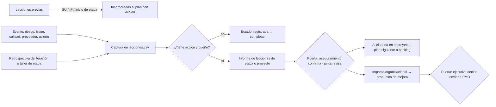

# Guía de lecciones aprendidas · Lessons learned guide

Detalle de `pm-lecciones-aprendidas`. El SKILL.md cita cada sección por número. Script:
`python3 ${CLAUDE_SKILL_DIR}/../pm-estado-proyecto/scripts/registro.py --proyecto <dir> …`.

## 1. Buscar lecciones previas (SU, IP, inicio de etapa)
1. Localizar lecciones de proyectos anteriores (repositorio, informes previos, PMO); filtrar por categoría (proceso, técnica, entorno, interesados, adquisiciones, calidad, riesgos, equipo).
2. Por cada lección aplicable: fila en `lecciones.csv` con `categoria`, `situacion` (origen y contexto), `recomendacion`, `responsable_seguimiento`; entra `registrada` y, una vez aplicada, pasa a `accionada-proyecto` con `notas=incorporada: <artefacto>` (business case, enfoque, plan o descripción de producto). Listar las incorporadas en el campo "lecciones incorporadas" del plan.
3. Sin lecciones disponibles: constancia en el diario y en el plan ("sin lecciones previas disponibles"); no inventarlas.

## 2. Captura continua (CS, MP)
- Disparadores: riesgo materializado, issue cerrado, revisión de calidad fallida o destacada, cambio aprobado, reclamación, auditoría, buena práctica observada, desvío de especificación (BMAD) resuelto.
- Comando: `registro.py agregar lecciones --campo etapa=.. --campo categoria=.. --campo situacion=".." --campo efecto=".." --campo recomendacion=".." --campo prioridad=alta|media|baja --campo responsable_seguimiento=".."` (estado `registrada` y fecha automáticos; rechaza estados fuera del esquema). En `notas`: ids relacionados (R-, I-, C-, Q-, FR-n), alertas tempranas, si antes era riesgo.
- Redactar la recomendación como acción transferible ("exigir X en el contrato antes de Y"), no como relato ni queja; capturar aciertos. `notas` con `impacto_organizacional=si` cuando exige cambiar política, plantilla o proceso fuera del proyecto.
- En cada checkpoint/highlight: `registro.py listar lecciones --abiertos`; completar las `registrada` sin responsable o sin acción; pasan a `revisada` cuando el gestor confirma texto, responsable y acción; informar las nuevas del período.

## 3. Taller de lecciones de etapa (no la retrospectiva de iteración)
**Distinción**: la retrospectiva de iteración mejora el trabajo del equipo en la próxima iteración, la conduce el equipo con `pm-agil-hibrido/templates/retrospectiva.md` y sus acciones van al backlog. El taller de etapa mira la etapa completa (incluidas esas retros), busca lo transferible y alimenta los informes de lecciones y de fin de etapa. Con BMAD, las retrospectivas de épica (`epic-N-retrospective` en `sprint-status.yaml`) también son insumo.
1. Preparar con `templates/retrospectiva-etapa.md`: formato (estrella de mar: empezar, dejar, mantener, más, menos; 4L: gustó, aprendió, faltó, anheló; reseña posterior a la acción: qué debía ocurrir, qué ocurrió, por qué, qué aprendemos), caja de tiempo, participantes (gestores de equipo, representantes, aseguramiento y proveedor si corresponde), facilitador preferiblemente neutral (aseguramiento, PMO u otro equipo; si facilita el gestor, anotar el sesgo y pedir que otra persona recoja los ítems sobre la gestión), datos del período, retros de iteración y acciones del taller anterior.
2. Facilitar sin culpas: revisar acciones anteriores (hechas / no hechas y por qué), recoger ítems por categoría, agrupar, priorizar por voto, acordar **una a tres acciones** con responsable y fecha. Con una transcripción de la sesión (normalizada por `pm-reuniones` en `03-control/reuniones/` o pegada), extraer ítems y acciones de ella.
3. Volcar: acciones al plan siguiente, al backlog o a `acciones.csv` (A-###); lecciones transferibles a `lecciones.csv` (una fila por lección); métricas al informe de fin de etapa. Sesión en `03-control/reportes/AAAA-MM-DD-retrospectiva-etapa-<n>.md`.

## 4. Informe de lecciones (SB, CP o a demanda)
1. `templates/informe-lecciones.md`: resumen ejecutivo; qué fue bien y qué mejorar por área (requisitos, alcance, cronograma, costos, calidad, recursos, equipo, comunicaciones, riesgos, adquisiciones, interesados, procesos, producto, cambios, etapas, enfoque híbrido, integración con BMAD si aplica); bloques de riesgos e issues relevantes, defectos de calidad, proveedores, desempeño excepcional y áreas de mejora; lecciones con efecto, causa, alertas tempranas, si fue riesgo previo y recomendación; cada una con destinatario, acción, responsable y fecha. Puede haber un informe por organización destinataria y en cualquier momento.
2. Cobertura: cada área con al menos una entrada o justificación; cada cita con su id de registro; las de impacto organizacional en la sección de propuestas.
3. Revisión: aseguramiento confirma responsables; la junta revisa (integrado en el informe de fin de etapa o de proyecto, o separado). Tras la revisión humana: `estado.py aprobar informe-lecciones --por "<rol: nombre>"` (o `informe-lecciones-etapa-<n>`). Estados de `lecciones.csv`: `revisada` (revisada por la junta), `accionada-proyecto` (acción en plan o backlog), `accionada-organizacion` (pasa a la PMO), `descartada` (con motivo).

## 5. Propuesta de mejora a la organización
Para lecciones con impacto organizacional: qué política, plantilla, proceso o estándar cambiar; evidencia; beneficio esperado; costo o esfuerzo; responsable propuesto en la organización; próxima oportunidad de aplicación. Dirigida a la PMO o a la capa de negocio vía el ejecutivo. Al enviarse: `estado = accionada-organizacion` y `notas` con fecha y destinatario. Decide el ejecutivo; envío externo solo con confirmación explícita.

## 6. Ciclo de una lección · Lesson life cycle

## 7. Estados de una lección · Lesson states
| Estado | Significado | Quién lo fija |
|---|---|---|
| registrada | Inicial: capturada (puede faltar acción o dueño) | Cualquiera (lo fija `registro.py`) |
| revisada | Texto, responsable y acción confirmados por el gestor o revisada por la junta | Gestor / junta |
| accionada-proyecto | Acción en el plan siguiente o el backlog; también lección previa incorporada (`notas=incorporada: <artefacto>`) | Gestor |
| accionada-organizacion | Propuesta enviada a la PMO o capa de negocio | Ejecutivo |
| descartada | Rechazada con motivo; nunca se borra | Junta, PMO o gestor |
Son los únicos estados que acepta `registro.py`. La verificación de la acción se anota en `notas` (`verificada AAAA-MM-DD`); `registrada` y `revisada` cuentan como abiertas.

## 8. Columnas de `lecciones.csv`
`id` (L-nnn) · `fecha` · `etapa` (etapa o iteración) · `categoria` (libre; sugeridos: proceso, tecnica, entorno, stakeholders, adquisiciones, calidad, riesgos, equipo, otro) · `situacion` (disparador/contexto) · `efecto` · `recomendacion` · `prioridad` (alta/media/baja) · `responsable_seguimiento` · `estado` · `notas` (ids relacionados, alertas tempranas, era-riesgo, `impacto_organizacional=si|no`, próxima oportunidad). El esquema de referencia de la Parte V separa tipo, disparador, próxima oportunidad e impacto organizacional en columnas; el paquete los lleva en `notas`; el canónico es `${CLAUDE_SKILL_DIR}/../pm-estado-proyecto/scripts/esquema.py`.

## 9. Reglas extendidas
1. [PRINCE2] Cada lección responde: efecto, causa o disparador, alertas tempranas, si era un riesgo identificado y recomendación; distingue lo que aplica al proyecto de lo transferible.
2. [PRINCE2] Las lecciones del ciclo de calidad, de riesgos y de proveedores se usan al planificar la etapa siguiente (campo "lecciones incorporadas").
3. [PRINCE2] Al cierre, aseguramiento confirma que lecciones y acciones están asignadas; el registro se cierra con todas las filas en estado final.
4. [PMBOK→Progress/SB] Técnica según la pregunta: retrospectiva (estrella de mar, 4L) para la próxima iteración; reseña posterior a la acción para hitos y cierre; autopsia en curso para etapas intermedias; declarar el formato.
5. [PMBOK→Organizing] Seguridad psicológica: un equipo bajo presión que no reporta nada es señal de alerta; si el gestor facilita (p. ej. también es scrum master), se declara y se mitiga el sesgo.
6. [PMBOK→Organizing] Las lecciones con impacto organizacional se elevan a la PMO o al repositorio con metadatos buscables.
7. [Plantillas] Retrospectiva: versión mínima tres columnas (bien / mejorar / acciones); completa con formato rotativo, métricas, seguimiento y exportación al registro.
8. [Plantillas] Informe: versión mínima tabla bien / mejorar con 5–8 filas y 3 lecciones prioritarias.

## 10. Ejemplos adicionales
- "Armá el informe de lecciones de la etapa 2 para el informe de fin de etapa."
- "Run a 4L stage lessons workshop for the integration team and turn the output into owned actions."
- "Draft the organizational improvement proposal for the PMO from the lessons marked as organizational."
