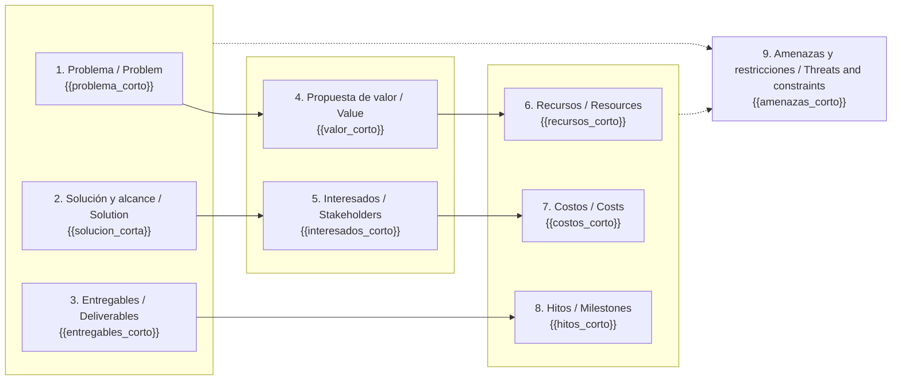

# Lienzo de arranque · Project startup canvas — {{proyecto}}

> Una página para alinear a los interesados antes de escribir documentos largos. Artefacto de consenso, no de aprobación formal. / One-page alignment tool; consensus artifact rather than a formal approval.

**Taller / Workshop:** {{fecha_taller}} · **Participantes / Participants:** {{participantes}}
*Cuándo se construyó y con quién. Un canvas hecho a solas por el gestor vale menos que uno hecho con los interesados.*

**Variante / Variant:** {{variante}}
*`proyecto` (entregables, recursos, hitos) o `nuevo-producto` (segmentos, canales, ingresos). Elegir una.*

## Bloques / Blocks

| Bloque / Block | Contenido / Content |
|---|---|
| **1. Problema u oportunidad / Problem or opportunity** | {{problema}} |
| **2. Solución y alcance / Solution and scope** | {{solucion_alcance}} |
| **3. Entregables / Deliverables** | {{entregables}} |
| **4. Propuesta de valor / Value proposition** | {{propuesta_valor}} |
| **5. Interesados y clientes / Stakeholders and customers** | {{interesados}} |
| **6. Recursos / Resources** | {{recursos}} |
| **7. Costos / Costs** | {{costos}} |
| **8. Hitos / Milestones** | {{hitos}} |
| **9. Amenazas y restricciones / Threats and constraints** | {{amenazas_restricciones}} |

*Bloque 1: qué duele, con contexto solo si aporta. Bloque 2: qué se hará y al menos una exclusión. Bloque 3: productos del proyecto y del producto. Bloque 4: por qué hace falta, conectado al bloque 1. Bloque 5: incluir al usuario final, no solo a quien paga. Bloque 6: habilidades críticas y recursos físicos. Bloque 7: separar costo del proyecto y costo de operación posterior. Bloque 8: hitos con fecha o ventana. Bloque 9: específicos de este proyecto, no genéricos. Tres a cinco viñetas por bloque.*

**Bloques de nuevo producto (si aplica) / New-product blocks (if applicable):**
**Segmentos de clientes / Customer segments:** {{segmentos}} · **Canales / Channels:** {{canales}} · **Fuentes de ingreso / Revenue streams:** {{ingresos}}
*Sustituyen a entregables, recursos e hitos cuando el proyecto crea un producto para el mercado.*

## Vista visual / Visual view

*Resumen de cada bloque en una línea para la vista gráfica. Si `estado.json.integraciones.diagramas` es `diagram-design` o `archify`, `pm-visuales` puede producir la versión de taller imprimible a partir de este bloque; el contenido no cambia.*

## Decisiones y acuerdos del taller / Workshop decisions and agreements

{{acuerdos}}
*Qué se acordó, qué quedó abierto y quién lo cierra. Lo abierto pasa a `[por confirmar]` en el brief.*

## Lista de verificación / Checklist
- [ ] Cabe en una página y se lee de un vistazo.
- [ ] Cada bloque tiene entre tres y cinco viñetas.
- [ ] La propuesta de valor responde al problema del bloque 1.
- [ ] El bloque de alcance contiene al menos una exclusión.
- [ ] Los hitos tienen fecha o ventana.
- [ ] Los costos distinguen proyecto y operación.
- [ ] Los interesados incluyen al usuario final.
- [ ] Amenazas y restricciones son específicas del proyecto.
- [ ] Coherente con la visión, la propuesta y el brief (datos de fuente única).
- [ ] Participantes del taller registrados; frontmatter completo; estado `borrador`.
