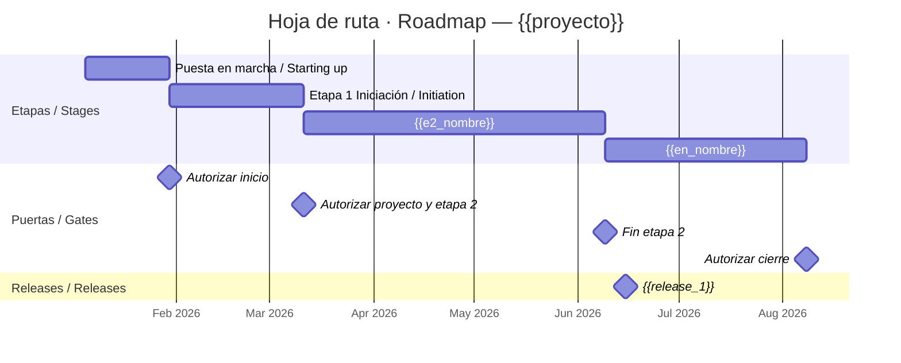

# Hoja de ruta inicial · Initial project roadmap — {{proyecto}}

> Vista gráfica de alto nivel: etapas de gestión, entregables principales, hitos, puertas de la junta y revisiones. En proyectos pequeños esta hoja de ruta, con una tabla de tolerancias, puede hacer de plan de proyecto resumido. / High-level graphic view by management stages, milestones and board gates.

**Enfoque de entrega / Delivery approach:** {{enfoque_entrega}}
*Predictivo, ágil o híbrido según `estado.json.enfoque_entrega`. Determina si se muestran releases e iteraciones.*

**Regla de actualización / Update rule:** {{regla_actualizacion}}
*Se versiona cuando cambia una fecha clave, un hito o la secuencia de etapas; se revisa en cada fin de etapa.*

## 1. Etapas de gestión / Management stages

| # | Etapa / Stage | Propósito / Purpose | Entregables o eventos principales / Main deliverables or events | Inicio / Start | Fin previsto / Planned end | Puerta de salida / Exit gate |
|---|---|---|---|---|---|---|
| 0 | Puesta en marcha / Starting up (pre-proyecto, no es etapa de gestión) | Decidir si vale la pena iniciar | Mandato, brief, business case esquemático, plan de la etapa 1 | {{e0_inicio}} | {{e0_fin}} | autorizar-inicio |
| 1 | Iniciación / Initiation | Producir el PID y el plan de la primera etapa de entrega | PID, business case completo, enfoques, plan de proyecto, `plan-etapa-2.md` | {{e1_inicio}} | {{e1_fin}} | autorizar-proyecto + autorizar-etapa |
| 2 | {{e2_nombre}} | {{e2_proposito}} | {{e2_entregables}} | {{e2_inicio}} | {{e2_fin}} | autorizar-etapa (fin de etapa 2) |
| n | {{en_nombre}} (última etapa de entrega; incluye el cierre CP) | {{en_proposito}} | Productos finales, aceptación, traspaso, informe de fin de proyecto | {{en_inicio}} | {{en_fin}} | autorizar-cierre |

*Numeración canónica del paquete: la puesta en marcha es pre-proyecto (0); la etapa 1 es siempre la iniciación; las etapas de entrega son 2…n. El cierre no es una etapa aparte: ocurre al final de la última etapa de entrega (`estado.py cierre`). Las etapas de entrega se cortan en puntos de decisión naturales (fin de un producto mayor, transición de capacidades, cambio de proveedor), no por calendario. Fechas como ventanas si aún no hay plan.*

## 2. Hitos significativos / Significant milestones

| Hito / Milestone | Fecha o ventana / Date or window | Origen / Source | Tipo / Type |
|---|---|---|---|
| {{hito_1}} | {{hito_1_fecha}} | {{hito_1_origen}} | {{hito_1_tipo}} |
| {{hito_2}} | {{hito_2_fecha}} | {{hito_2_origen}} | {{hito_2_tipo}} |
| {{hito_3}} | {{hito_3_fecha}} | {{hito_3_origen}} | {{hito_3_tipo}} |

*Origen: mandato, brief, canvas, contrato, regulación. Tipo: entregable, puerta, evento externo, release. Fuente única: los hitos nacen en el brief o canvas y se copian aquí.*

## 3. Revisiones y puertas / Reviews and gates

| Momento / When | Tipo / Type | Quién decide / Decided by | Entrada / Input |
|---|---|---|---|
| Fin de la puesta en marcha | Puerta autorizar-inicio | Junta (ejecutivo) | Brief, business case esquemático, plan de la etapa 1 (iniciación) |
| Fin de la etapa 1 (iniciación) | Puerta autorizar-proyecto y autorizar-etapa | Junta | PID, plan de la etapa 2 |
| Fin de cada etapa | Puerta autorizar-etapa | Junta | Informe de fin de etapa, plan de etapa siguiente, business case actualizado |
| {{revision_extra}} | {{revision_extra_tipo}} | {{revision_extra_quien}} | {{revision_extra_entrada}} |
| Fin del proyecto | Puerta autorizar-cierre | Junta | Informe de fin de proyecto, enfoque de beneficios |

*Añadir revisiones de cliente, demos, auditorías regulatorias o revisiones de beneficios intermedias. Cada fila dice tipo y momento, no "revisiones periódicas".*

## 4. Releases e iteraciones (ágil / híbrido) / Releases and iterations (agile / hybrid)

{{releases}}
*Solo si el enfoque es ágil o híbrido: release, objetivo en términos de capacidad para el usuario, ventana, etapa que la contiene. Cada release aparece como hito del roadmap. Vía por entregable si es híbrido.*

## 5. Vista gráfica / Graphic view

*Duraciones en formato Mermaid (`30d`, `6w`). Si `estado.json.integraciones.diagramas` es `diagram-design` o `archify`, o `cronograma` es `mspdi`, `pm-visuales` o `pm-cronograma-estimacion` pueden generar la versión avanzada; esta vista sigue siendo la referencia de contenido.*

## 6. Supuestos de la hoja de ruta / Roadmap assumptions

{{supuestos}}
*Qué se asumió para fechar (disponibilidad de personas, aprobación en plazo, proveedor adjudicado). Cada uno con responsable; registrar en `supuestos.csv`.*

## Lista de verificación / Checklist
- [ ] Se lee en una sola vista.
- [ ] Numeración canónica: puesta en marcha = 0 (pre-proyecto), iniciación = etapa 1, entrega desde la etapa 2; puerta al final de cada etapa.
- [ ] Cada hito tiene fecha o ventana y coincide con el brief o el acta.
- [ ] Las revisiones indican tipo y momento.
- [ ] Entregables principales coinciden con los del brief y el canvas.
- [ ] En ágil/híbrido, las releases aparecen como hitos y cada entregable tiene su vía.
- [ ] Bloque Mermaid válido y fechas coherentes con la tabla.
- [ ] Supuestos de fechado listados con responsable.
- [ ] Regla de actualización declarada; frontmatter completo; estado `borrador`.
