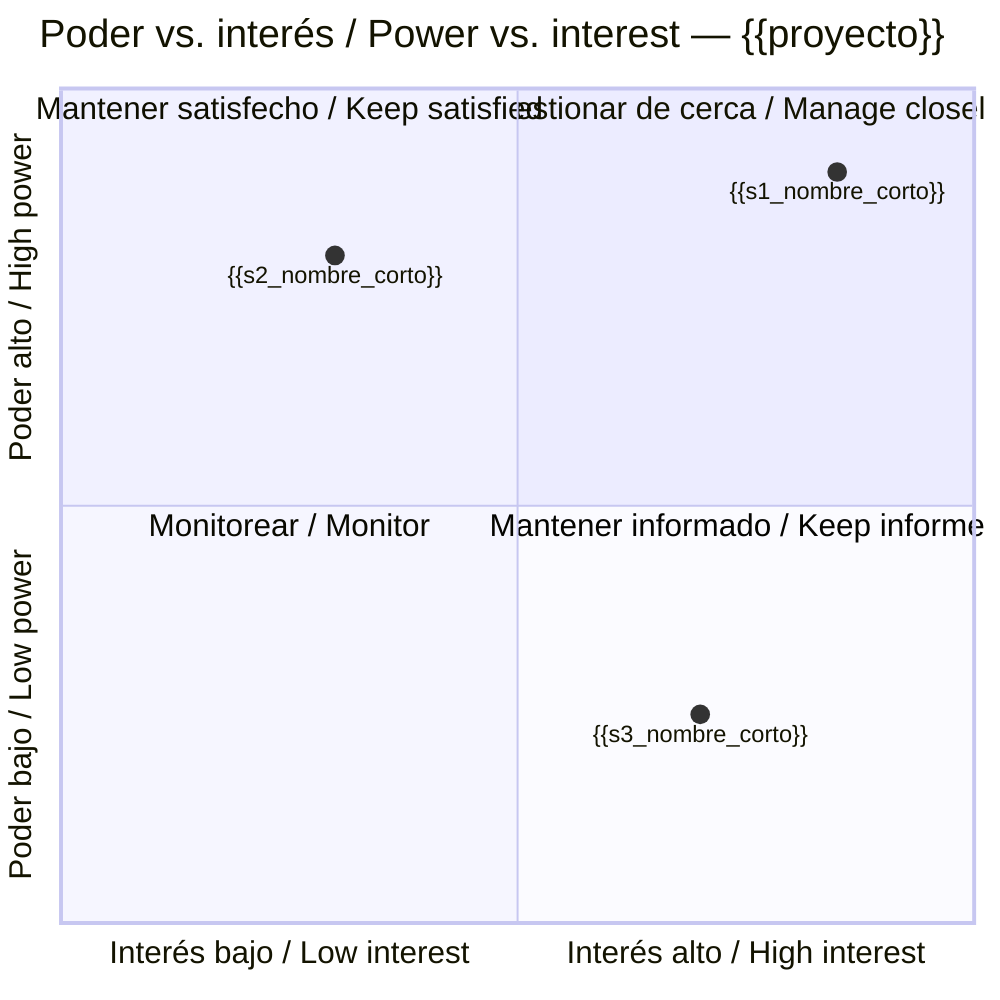

# Análisis de interesados · Stakeholder analysis — {{proyecto}}

> Clasificación de los interesados por poder, interés y actitud para alimentar el registro y el plan de compromiso. **Circulación restringida**: contiene valoraciones sobre personas. Mapeo del paquete: sección de análisis del enfoque de gestión de la comunicación. / Restricted document: power, interest and attitude of stakeholders.

**Modelo de clasificación / Classification model:** {{modelo}}
*`poder-interes` (2×2, por defecto), `poder-interes-actitud` (cubo 3×3), `salience` (poder, urgencia, legitimidad) para muchos interesados. Declarar cuál y por qué.*

**Circulación / Circulation:** {{circulacion}}
*Quién puede leer este documento (normalmente ejecutivo, gestor, aseguramiento). No exportar a versiones públicas sin filtrar actitudes.*

## 1. Identificación / Identification

| Id | Interesado / Stakeholder | Tipo / Type | Rol en la organización / Role in the organisation | Rol en el proyecto / Role in the project | Fuente / Source |
|---|---|---|---|---|---|
| ST-001 | {{s1_nombre}} | {{s1_tipo}} | {{s1_rol_org}} | {{s1_rol_proy}} | {{s1_fuente}} |
| ST-002 | {{s2_nombre}} | {{s2_tipo}} | {{s2_rol_org}} | {{s2_rol_proy}} | {{s2_fuente}} |
| ST-003 | {{s3_nombre}} | {{s3_tipo}} | {{s3_rol_org}} | {{s3_rol_proy}} | {{s3_fuente}} |

*Tipo: interno, externo, regulador, proveedor, comunidad, operación y mantenimiento, usuario final. Incluir siempre a quien operará el producto y al usuario final. Fuente: brief, canvas, entrevista, taller.*

## 2. Valoración / Assessment

| Id | Poder / Power | Interés / Interest | Actitud / Attitude | Compromiso actual / Current engagement | Compromiso deseado / Desired engagement | Expectativas / Expectations | Preocupaciones / Concerns | Fuente de la valoración / Assessment source | Confidencial / Confidential |
|---|---|---|---|---|---|---|---|---|---|
| ST-001 | {{s1_poder}} | {{s1_interes}} | {{s1_actitud}} | {{s1_actual}} | {{s1_deseado}} | {{s1_expectativas}} | {{s1_preocupaciones}} | {{s1_fuente_val}} | {{s1_confidencial}} |
| ST-002 | {{s2_poder}} | {{s2_interes}} | {{s2_actitud}} | {{s2_actual}} | {{s2_deseado}} | {{s2_expectativas}} | {{s2_preocupaciones}} | {{s2_fuente_val}} | {{s2_confidencial}} |
| ST-003 | {{s3_poder}} | {{s3_interes}} | {{s3_actitud}} | {{s3_actual}} | {{s3_deseado}} | {{s3_expectativas}} | {{s3_preocupaciones}} | {{s3_fuente_val}} | {{s3_confidencial}} |

*Poder e interés: alto / medio / bajo. Actitud y compromiso: líder, partidario, neutral, resistente, desconocedor. La actitud se evalúa por separado del interés (un interesado muy interesado puede ser opositor). Cada valoración con fuente: entrevista con fecha, observación, histórico; nunca solo la opinión del gestor.*

## 3. Cuadrícula poder / interés / Power–interest grid

*Coordenadas entre 0 y 1 (interés en x, poder en y). La actitud se indica en la tabla, no en la cuadrícula. Si `estado.json.integraciones.diagramas` es `diagram-design` o `archify`, `pm-visuales` puede producir una versión con actitud por color.*

## 4. Estrategia por grupo / Strategy by group

| Cuadrante / Quadrant | Interesados / Stakeholders | Estrategia base / Base strategy | Modulación por actitud / Attitude adjustment |
|---|---|---|---|
| Poder alto · interés alto | {{q1_lista}} | Gestionar de cerca; involucrar en decisiones | {{q1_modulacion}} |
| Poder alto · interés bajo | {{q2_lista}} | Mantener satisfecho; comunicación ejecutiva | {{q2_modulacion}} |
| Poder bajo · interés alto | {{q3_lista}} | Mantener informado; aliados o resistencia temprana | {{q3_modulacion}} |
| Poder bajo · interés bajo | {{q4_lista}} | Monitorear con esfuerzo mínimo | {{q4_modulacion}} |

*Un opositor de alto poder exige plan de conversión o mitigación; un aliado de alto poder puede actuar como patrocinador informal. Las acciones concretas van al plan de compromiso.*

## 5. Interrelaciones / Interrelationships

{{interrelaciones}}
*Relaciones, solapamientos y dependencias entre interesados (misma jefatura, influencia sindical, proveedor que depende de otro). Opcional salvo con muchos interesados.*

## 6. Cambios previstos / Expected changes

{{cambios_previstos}}
*Altas, bajas o cambios de personas en roles clave y su impacto (por ejemplo, cambio del responsable regulatorio que podría reabrir requisitos).*

## 7. Riesgos derivados / Derived risks

| Id `riesgos.csv` | Interesado / Stakeholder | Riesgo / Risk | Respuesta / Response |
|---|---|---|---|
| {{r1_id}} | {{r1_stk}} | {{r1_riesgo}} | {{r1_respuesta}} |

*Resistencia de alto poder, falta de disponibilidad del usuario sénior, dependencia de un regulador: se registran como riesgos.*

## 8. Carga al registro / Register load

{{carga_registro}}
*Confirmación de que cada fila se cargó en `03-control/registros/stakeholders.csv` con `registro.py`, tras revisión humana de las actitudes. Indicar ids creados.*

## Lista de verificación / Checklist
- [ ] Interesados internos, externos, reguladores, operación y usuario final incluidos.
- [ ] Modelo de clasificación declarado.
- [ ] Poder, interés y actitud valorados por separado, cada uno con fuente.
- [ ] Compromiso deseado realista (no todos líderes).
- [ ] Cuadrícula Mermaid coherente con la tabla.
- [ ] Estrategia por cuadrante con modulación por actitud.
- [ ] Riesgos derivados registrados en `riesgos.csv`.
- [ ] Filas cargadas en `stakeholders.csv` tras revisión humana; ids anotados.
- [ ] Marcado como confidencial; filas sensibles con `confidencial=si` también en `stakeholders.csv`; circulación definida; estado `borrador`.
