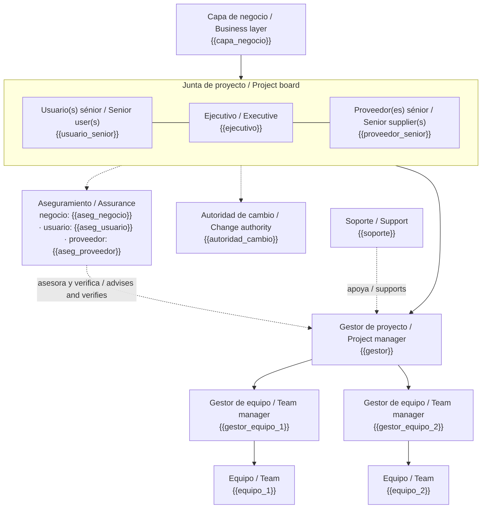

# Estructura del equipo de gestión del proyecto · Project management team structure — {{proyecto}}

> Quién participa, cómo se relacionan y cómo trabajarán juntos. Diseñada por el gestor; confirmada y aprobada por el ejecutivo, que confirma los nombramientos. Esbozo en el brief, completa en el PID, revisada en cada fin de etapa. / Who takes part, how they relate and how they will work together; approved by the executive.

**Versión mínima / Minimal version:** {{version_minima}}
*`sí` en proyectos pequeños: el ejecutivo puede asumir usuario sénior **o** proveedor sénior (no ambos); el gestor puede asumir gestor de equipo y soporte; aseguramiento lo hacen los miembros de la junta. La separación gestor / ejecutivo / aseguramiento se mantiene siempre.*

## 1. Contexto organizacional / Organisational context

**Organizaciones participantes / Participating organisations:** {{organizaciones}}
*Negocio, áreas usuarias, proveedores internos y externos, programa o PMO si existe.*

**Interfaces con la organización permanente / Interfaces with the permanent organisation:** {{interfaces}}
*Quién retiene la gestión de personas (desempeño, bienestar), qué decisiones siguen gobernanza corporativa, políticas y formas de trabajo aplicables, cómo entran y salen las personas del proyecto.*

**Modelo de entrega / Delivery model:**

| Bloque de trabajo o habilidad / Work block or skill | Interno · externo · mixto | Por producto · por mano de obra | Aseguramiento / Assurance | Riesgo asignado a / Risk owned by | Notas / Notes |
|---|---|---|---|---|---|
| {{bloque_1}} | {{bloque_1_origen}} | {{bloque_1_base}} | {{bloque_1_aseg}} | {{bloque_1_riesgo}} | {{bloque_1_notas}} |
| {{bloque_2}} | {{bloque_2_origen}} | {{bloque_2_base}} | {{bloque_2_aseg}} | {{bloque_2_riesgo}} | {{bloque_2_notas}} |

*Por mano de obra el cliente sigue respondiendo por el desempeño; por producto responde el proveedor. El riesgo va a quien mejor puede gestionarlo. Se refleja en el enfoque comercial.*

## 2. Organigrama / Organisation chart

*Líneas sólidas: autoridad. Punteadas: aseguramiento, apoyo y delegación. Si `estado.json.integraciones.diagramas` es `diagram-design` o `archify`, `pm-visuales` puede producir la versión presentable; este bloque sigue siendo la referencia.*

## 3. Roles y personas / Roles and people

| Rol / Role | Persona / Person | Organización / Organisation | Dedicación / Allocation | Combinado con / Combined with | Descripción de rol / Role description |
|---|---|---|---|---|---|
| Ejecutivo / Executive | {{ejecutivo}} | {{ejecutivo_org}} | {{ejecutivo_ded}} | {{ejecutivo_comb}} | `roles/descripcion-rol-ejecutivo.md` |
| Usuario sénior / Senior user | {{usuario_senior}} | {{usuario_senior_org}} | {{usuario_senior_ded}} | {{usuario_senior_comb}} | `roles/descripcion-rol-usuario-senior.md` |
| Proveedor sénior / Senior supplier | {{proveedor_senior}} | {{proveedor_senior_org}} | {{proveedor_senior_ded}} | {{proveedor_senior_comb}} | `roles/descripcion-rol-proveedor-senior.md` |
| Gestor de proyecto / Project manager | {{gestor}} | {{gestor_org}} | {{gestor_ded}} | {{gestor_comb}} | `roles/descripcion-rol-gestor.md` |
| Gestor(es) de equipo / Team manager(s) | {{gestores_equipo}} | {{gestores_equipo_org}} | {{gestores_equipo_ded}} | {{gestores_equipo_comb}} | `roles/descripcion-rol-gestor-equipo.md` |
| Aseguramiento / Assurance | {{aseguramiento}} | {{aseguramiento_org}} | {{aseguramiento_ded}} | — (nunca gestor, equipos ni soporte) | `roles/descripcion-rol-aseguramiento.md` |
| Soporte / Support | {{soporte}} | {{soporte_org}} | {{soporte_ded}} | {{soporte_comb}} | `roles/descripcion-rol-soporte.md` |
| Autoridad de cambio / Change authority | {{autoridad_cambio}} | {{autoridad_cambio_org}} | {{autoridad_cambio_ded}} | {{autoridad_cambio_comb}} | `roles/descripcion-rol-autoridad-cambio.md` |

*Nombres reales solo si el usuario los dio; si no, `[por confirmar]`. Un solo ejecutivo; nunca ejecutivo = gestor; usuario sénior ≠ proveedor sénior salvo excepción justificada. Se copian a `estado.json.roles`.*

## 4. Resumen de autoridad por nivel / Authority summary by level

| Nivel / Level | Quién / Who | Decide / Decides | Dentro de / Within | Rinde cuentas ante / Accountable to | Asegurado por / Assured by |
|---|---|---|---|---|---|
| Comisionamiento / Commissioning | capa de negocio | mandato, ejecutivo, tolerancias de proyecto | — | — | — |
| Dirección / Directing | junta | autorizar etapas, tolerancias de etapa, excepciones | tolerancias de proyecto | capa de negocio | aseguramiento |
| Gestión / Managing | gestor | gestión diaria, paquetes de trabajo, tolerancias de paquete | tolerancias de etapa | junta | aseguramiento |
| Entrega / Delivering | gestores de equipo | ejecución de paquetes | tolerancias de paquete | gestor | gestor y aseguramiento |
| Cambio delegado / Delegated change | autoridad de cambio | solicitudes de cambio y fuera de especificación | {{limite_autoridad_cambio}} con presupuesto {{presupuesto_cambio}} | junta | aseguramiento |

*Cifras o criterios en "dentro de"; coherentes con `estado.json.tolerancias` y con el enfoque de issues y cambio.*

## 5. Mapeo de roles del método de entrega / Delivery-method role mapping

| Rol del método de entrega / Delivery-method role | Rol PRINCE2 / PRINCE2 role | Relación o nota / Relationship or note |
|---|---|---|
| Product owner | Usuario sénior delegado (`estado.json.roles.product_owner`) | Ordena el backlog e intercambia ítems dentro de la tolerancia de alcance de la etapa; decisiones con `nivel=product-owner` |
| Scrum master / facilitador | Parte del equipo (no es aseguramiento ni gestor de equipo) | Facilita eventos; si el gestor del proyecto cumple este rol, se declara el sesgo en retrospectivas |
| Equipo de desarrollo | Gestor de equipo colectivo con punto único de contacto | Recibe paquetes de trabajo = objetivos de release o de iteración |
| {{rol_entrega_1}} | {{rol_prince2_1}} | {{nota_mapeo_1}} |

*Solo si `enfoque_entrega` es ágil o híbrido: product owner ≈ usuario sénior (o delegado), equipo autoorganizado = gestor de equipo colectivo con punto único de contacto {{punto_contacto}}. Los roles que no mapean se añaden con su relación. Se registra como adaptación en el PID.*

## 6. Prácticas de trabajo / Working practices

{{practicas_trabajo}}
*Co-ubicación o remoto, husos horarios, cadencia de contacto gestor–junta, herramientas de colaboración, reglas de onboarding y offboarding, captura de lecciones al salir.*

## 7. Estructuras por etapa / Structures by stage

| Etapa / Stage | Cambio de estructura / Structure change | Recursos para la transición / Transition resources |
|---|---|---|
| {{etapa_1}} | {{cambio_1}} | {{recursos_transicion_1}} |
| {{etapa_2}} | {{cambio_2}} | {{recursos_transicion_2}} |

*Por ejemplo, pasar de equipo de diseño liderado por el cliente a equipo de entrega liderado por el proveedor. "Sin cambios previstos" es válido.*

## 8. Personas clave externas al equipo / Key people outside the team

{{personas_clave}}
*Gerentes funcionales que ceden recursos, gestor de contratos, PMO, responsable de sostenibilidad; su relación con el proyecto.*

## 9. Verificación de reglas / Rule check

- [ ] Un solo ejecutivo; no es el gestor.
- [ ] Tres intereses representados; junta mínima.
- [ ] Usuario sénior y proveedor sénior son personas distintas (o excepción justificada: {{excepcion_us_ps}}).
- [ ] Aseguramiento por interés; nunca gestor, gestores de equipo, miembros ni soporte.
- [ ] Soporte separado de aseguramiento.
- [ ] Operación y mantenimiento representados desde el inicio.
- [ ] Autoridad de cambio con presupuesto de cambio (si existe).
- [ ] Internos y externos no comparten paquete de trabajo.
- [ ] Todas las responsabilidades asignadas.

## Lista de verificación / Checklist
- [ ] Contexto e interfaces con la organización permanente documentados.
- [ ] Modelo de entrega por bloque con base contractual y riesgo asignado.
- [ ] Organigrama Mermaid válido y coherente con la tabla de roles.
- [ ] Tabla de roles completa; nombres reales o `[por confirmar]`; copiada a `estado.json.roles`.
- [ ] Autoridades por nivel con cifras coherentes con tolerancias y enfoques.
- [ ] Mapeo ágil registrado como adaptación (si aplica).
- [ ] Estructuras por etapa previstas; prácticas de trabajo acordadas.
- [ ] Verificación de reglas sin incumplimientos (o excepciones registradas en `decisiones.csv`).
- [ ] Confirmación del ejecutivo prevista; estado `borrador` hasta entonces.
