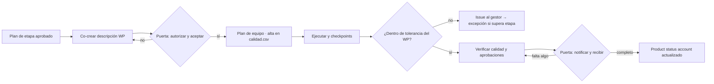

# Guía de paquetes de trabajo · Work package guide

## 1. Contenido de la descripción del paquete (paso 2)
Campos a co-crear con el gestor de equipo en `templates/paquete-trabajo.md`:
- descripción del trabajo y fragmento de WBS/PBS; productos y enlace a sus descripciones de producto;
- técnicas y procedimientos obligatorios; interfaces (con quién se coordina, qué recibe y qué entrega);
- requisitos de control de cambios dentro del paquete; restricciones (horas, seguridad, acceso);
- monitoreo y reporte (frecuencia y formato del checkpoint);
- objetivos y tolerancias del paquete (tiempo, costo, alcance; riesgo y sostenibilidad si aplican);
- criterios de aceptación por producto (copiados de la descripción de producto, no inventados);
- quién aprueba cada producto y referencias a planes superiores.
Todo lo generado se marca como borrador.

**Granularidad.** Un paquete cubre uno o más productos completos; si un producto requiere varios equipos, se descompone en subproductos con descripción propia. Un paquete grande se gobierna como un proyecto: puede tener subpaquetes, pero el gestor de nivel superior responde por el conjunto.

**Tolerancias.** Caben dentro de las de la etapa y se declara el reparto (p. ej. "etapa ±10 días → paquete ±4 días"). Si el gestor de equipo pide tolerancias que no caben, no se ceden: el gestor del proyecto ajusta el plan de etapa o escala a `pm-director`.

**Plan de equipo.** Cronograma, recursos, actividades de calidad y riesgos del paquete. En contexto comercial el gestor del proyecto puede recibir solo un extracto de hitos (el plan puede ser confidencial); en ágil es el backlog de la iteración.

## 2. Registro de los actos humanos (pasos 6 y 10)
- Documento: `${CLAUDE_SKILL_DIR}/../pm-estado-proyecto/scripts/estado.py --proyecto <dir> artefacto WP-nnn --ruta 03-control/paquetes-trabajo/WP-nnn-<nombre>.md --estado en-revision`.
- Tras la autorización humana: `estado.py --proyecto <dir> aprobar WP-nnn --por "Gestor del proyecto: <nombre>" --nivel gestor` (sincroniza frontmatter y `estado.json` y escribe la fila de `decisiones.csv`; no duplicarla a mano).
- Aceptación del gestor de equipo: fila propia `registro.py --proyecto <dir> agregar decisiones --campo nivel=equipo ...`. Con proveedor, la aceptación sigue el contrato.
- Recepción: `registro.py agregar decisiones --campo nivel=gestor --campo decision="recibido WP-nnn" ...`.
- **Estado operativo vs documental.** `estado_paquete` (autorizado, en-ejecucion, en-verificacion, completado, suspendido) vive en el frontmatter y la sección 1 del WP y se respalda con filas Q-nnn `completada`. `estado.json.artefactos["WP-nnn"]` guarda solo el estado documental (`borrador|en-revision|aprobado|obsoleto`), que no cambia al completarse el trabajo.

## 3. Flujo CS ↔ MP

## 4. Criterios de completitud
| Criterio | Evidencia | Dónde se registra |
|---|---|---|
| Todos los productos producidos según su descripción | Entregables en la ubicación acordada | Product status account |
| Actividades de calidad ejecutadas y aprobadas | Filas Q-nnn con `resultado = aprobado` | `calidad.csv` |
| Aprobación de la autoridad nombrada por producto | Nombre y fecha | Registro de aceptación / product status account |
| Entrega conforme al procedimiento del paquete | Nota en la notificación de finalización | Bloque Acuerdo del WP |
| Issues, riesgos y lecciones pendientes comunicados | Ids I-, R-, L- | Registros + checkpoint final |
| Off-specifications declarados, no silenciados | Issue con decisión (completar o concesión) | `issues.csv`, `decisiones.csv` |
| Recepción por el gestor del proyecto | Fila D-nnn, `estado_paquete: completado`, plan de etapa actualizado | `decisiones.csv`, documento WP |

## 5. Product status account (estado de productos)
Lista cada producto del plan con estado (no iniciado / en desarrollo / en revisión / aprobado / aceptado / con concesión / fuera de especificación), versión, fecha de aprobación de la descripción y de aceptación, y referencias a `calidad.csv`; fuente de cada dato y fecha de corte. Se produce a fin de etapa, cierre, excepción, auditoría o a demanda. El "estado de paquetes" (tabla de WP en curso) va al pie o en `03-control/reportes/AAAA-MM-DD-estado-paquetes.md`.

Es el registro de productos de PRINCE2 7 (A13; `pm-knowledge/references/prince2-practicas-riesgo-issues-progreso-productos.md` §4.b, P-06 y P-07: comparar el estado registrado con el físico), **derivado de los registros, sin registro propio**:
`python3 ${CLAUDE_SKILL_DIR}/../pm-estado-proyecto/scripts/estado.py --proyecto <dir> productos [--corte AAAA-MM-DD] [--fuente auto|backlog|wbs] [--alcance proyecto|WP-###|<release o iteración>|<código WBS>] [--max 40] [--json | --markdown [RUTA]]`
(solo lectura; `--markdown` escribe el borrador de `templates/product-status-account.md`, por defecto `03-control/reportes/<corte>-product-status-account.md`, nunca encima de uno aprobado; registrarlo con `estado.py artefacto product-status-account … --estado en-revision`).
- **Productos:** las historias de `backlog.csv` (sin épicas ni retiradas) o, sin backlog (predictivo) o con `--fuente wbs`, las hojas de `wbs.csv` que no son hitos. `--alcance WP-###` toma los que cita la descripción del paquete.
- **Cómo se cita un producto** (en `calidad.csv` —producto, criterios, notas—, en `issues.csv` y en el alcance del WP): una historia por su id o su clave corta `N-M` ("historia 1-3", la regla de QUA-01); un elemento de la WBS por su código precedido de "producto", "paquete" o "WBS" ("producto 3.1"; también en listas: "productos 3.1, 3.2 y 4.1").
- **Estado, en este orden:** fuera de especificación (issue `fuera-especificacion` abierto que cita el producto o su Q) · aceptado (`aceptacion-<id|N-M|código>` aprobada, o `registro-aceptacion` aprobado con la revisión aprobada vigente anterior a esa fecha) · con concesión o fuera de especificación (última revisión rechazada: con issue cerrado que registra la concesión, o sin él) · aprobado (última revisión completada aprobada y ninguna pendiente) · en revisión (revisión pendiente, `review` o terminado sin revisión aprobada) · en desarrollo (en curso, o su paquete autorizado) · no iniciado. Los conteos suman el total.
- **Diferencias registrado/físico:** terminado sin revisión aprobada (QUA-01) · aceptado sin revisión aprobada, o paquete recibido (decisión `nivel=gestor` "WP-### recibido|aceptado") sin revisión del producto (QUA-04 en la WBS) · rechazo sin tratamiento (QUA-03) · revisión vencida (QUA-02).
- **Corte:** `--corte` deja afuera revisiones hechas, issues, aceptaciones y recepciones posteriores; el estado de `backlog.csv` es el vigente. Sin `--corte` no filtra por fecha (así lo usa la verificación de puertas).
- **Must sin aceptar:** historias Must y requisitos Must (prioridad propia o la más alta de sus historias) con algún producto sin aceptar ni concesión; es el control **C-07** de `autorizar-cierre`.
- **Lo usan:** el informe de fin de etapa (E-04), la aceptación (`pm-calidad`), el cierre (C-07 y `product-status-account-final` de `pm-cierre-proyecto`) y el expediente de auditoría. Lo que no se deriva (versión, descripción aprobada, gestor del WP, pronóstico) queda `[por confirmar]`.

## 6. Columnas de `calidad.csv`
Cabecera técnica (ver `registro.py esquema calidad`): `id` (Q-nnn), `producto`, `metodo_verificacion` (`revision`, `prueba`, `inspeccion`, `demostracion`, `auditoria`), `criterios`, `responsable_productor`, `revisores`, `aprobador`, `fecha_prevista`, `fecha_real`, `resultado` (`aprobado`, `aprobado-con-observaciones`, `rechazado`, `pendiente`), `estado` (`planificada` al crear, `en-curso`, `completada`, `cancelada`), `notas`.

## 7. Variante ágil / híbrida
- La iteración es el paquete: fechas y costo fijos, alcance con tolerancia amplia.
- Ítems del backlog comprometidos ↔ productos o subproductos; definición de hecho ↔ criterios de calidad; plan de equipo ↔ backlog de la iteración; checkpoint ↔ tablero o burn-down consultado por "pull".
- Revisión de la iteración ↔ verificación de calidad; demo ↔ aprobación del usuario (evento que convoca `pm-comunicacion-stakeholders`; su acta, `pm-reuniones`).
- Retrospectiva de iteración: `pm-agil-hibrido` (`retrospectiva.md`); lecciones relevantes a `lecciones.csv`.
- El product owner intercambia ítems de igual tamaño dentro de la tolerancia de alcance de la etapa sin solicitud de cambio (`decisiones.csv`, `nivel=product-owner`); desplazar un Must o exceder la tolerancia es solicitud de cambio.
- Lo no completado vuelve al backlog y se declara en la notificación de finalización; nada de "casi hecho".

## 8. Variante BMAD (`integraciones.especificacion = bmad`)
- Cada sprint de BMAD es un paquete de trabajo; los productos son las historias (claves `N-M-slug`) y los requisitos que cubren se citan por id (FR-n), sin copiarlos.
- El backlog del sprint se sincroniza con `${CLAUDE_SKILL_DIR}/../pm-bmad-puente/scripts/bmad.py backlog`; el estado de las historias sale de `bmad.py avance` (no se edita `sprint-status.yaml`).
- Métodos de calidad del paquete: DoD y code review de BMAD, registrados como filas Q-nnn.
- Una historia retirada o una Sprint Change Proposal durante el sprint → `pm-issues-cambios` (`solicitud-cambio`).

## 9. Proveedores externos y otros casos
- Con proveedor externo el paquete es instrucción escrita conforme al contrato; la aceptación contractual precede a la del proyecto (`pm-adquisiciones`).
- El checkpoint del proveedor sigue el formato de reporte de estado del contratista (plantillas §32); sus riesgos e issues se replican en los registros del proyecto con referencia al contrato.
- Versión mínima: descripción de una página con tabla de productos, tolerancias y fechas de checkpoint; el gestor del proyecto puede actuar como gestor de equipo. Versión completa con plan de equipo, interfaces y control de cambios cuando hay proveedores, riesgo o varios equipos.
- Métrica de avance según la pregunta: % completado por producto, burn-down o EVM si hay línea base de costo; declarar supuestos y fórmulas.
- La seguridad psicológica del equipo es condición para que se reporten issues: un paquete bajo presión sin issues reportados es señal de alerta.
- Si hay tracker conectado, el estado de los ítems se lee vía `pm-integraciones` como instantánea en `03-control/fuentes/`; escribir en el tracker solo con confirmación.
