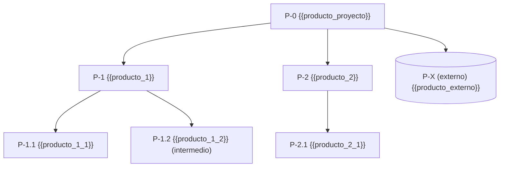
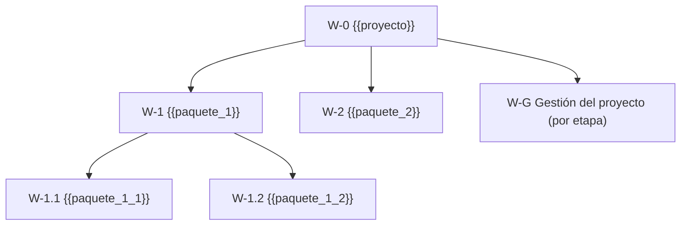

# Estructura de desglose de productos y de trabajo · Product and work breakdown structures

> Borrador generado con asistencia de IA. / AI-assisted draft.

**Nivel de plan / Plan level:** {{nivel_plan}}
*Proyecto completo o etapa N; una PBS de etapa debe rastrearse a la PBS del plan de proyecto.*

**Enfoque de entrega / Delivery approach:** {{enfoque_entrega}}
*predictivo, ágil o híbrido, tomado de estado.json; en ágil los productos de nivel inferior pueden ser épicas.*

## 1. Árbol de productos (PBS) / Product tree

*Un nodo por producto; prefijo P-; los externos con doble paréntesis y la palabra "externo"; los intermedios anotados; descomponer solo hasta el nivel que el proyecto controla. Si estado.json.integraciones.diagramas es diagram-design o archify, pm-visuales puede generar la versión gráfica a partir de esta tabla.*

## 2. Tabla PBS / PBS table
| Código / Code | Producto / Product | Padre / Parent | Tipo / Type | Estado del producto / Product state | Etapa / Stage | Descripción de producto / Product description |
|---|---|---|---|---|---|---|
| P-1.1 | {{producto}} | P-1 | final · intermedio · externo | {{estado_producto}} | {{etapa}} | `productos/{{archivo}}.md` |
*Una fila por nodo del árbol; "estado del producto" se usa cuando un mismo producto pasa por estados con calidad propia (diseñado → construido → probado).*

## 3. Alineación PBS ↔ WBS / PBS ↔ WBS alignment
| Producto (PBS) / Product | Paquete de trabajo (WBS) / Work package | Actividades principales / Main activities | Equipo o proveedor / Team or supplier | Método de entrega / Delivery method |
|---|---|---|---|---|
| P-1.1 | W-1.1 {{paquete}} | {{actividades}} | {{equipo}} | secuencial · iterativo |
*Regla: cada producto de nivel inferior tiene un paquete y cada paquete entrega al menos un producto; sin solapamientos entre paquetes; registrar aquí si el paquete se entrega de forma lineal o por iteraciones.*

## 4. Árbol de trabajo (WBS/EDT) / Work tree

*Mismo código numérico que el producto que entrega (P-1.1 ↔ W-1.1) para que la trazabilidad sea evidente; incluir un paquete de gestión del proyecto por etapa aunque no se presupueste aparte.*

## 5. Verificaciones / Checks
- Regla del 100 % en PBS: {{verificacion_100_pbs}}
- Regla del 100 % en WBS: {{verificacion_100_wbs}}
- Productos sin paquete: {{productos_sin_paquete}}
- Paquetes sin producto: {{paquetes_sin_producto}}
*Resultado de la revisión cruzada; "ninguno" o la lista de códigos a corregir.*

## 6. Registro de productos / Product register
| Código / Code | Producto / Product | Versión descripción / Description version | Descripción aprobada el / Description approved on | Estado / Status | Aceptado el / Accepted on |
|---|---|---|---|---|---|
| P-1.1 | {{producto}} | {{version_descripcion}} | {{fecha_aprobacion}} | pendiente · en-desarrollo · en-revision · aceptado | {{fecha_aceptacion}} |
*Lo mantiene soporte de proyecto; se actualiza al aprobar cada descripción y al aceptar cada producto.*

## 7. Fuentes y pendientes / Sources and open points
{{fuentes_pendientes}}
*Documentos de origen y preguntas abiertas marcadas [por confirmar].*

## Lista de verificación / Checklist
- [ ] Cada nodo de la PBS es un producto (sustantivo), no una actividad.
- [ ] Productos externos e intermedios identificados y marcados.
- [ ] Regla del 100 % verificada en ambas estructuras.
- [ ] Correspondencia PBS ↔ WBS sin vacíos ni solapamientos.
- [ ] Cada producto tiene (o tendrá) una descripción de producto enlazada.
- [ ] Paquete de gestión del proyecto incluido por etapa.
- [ ] Registro de productos iniciado.
