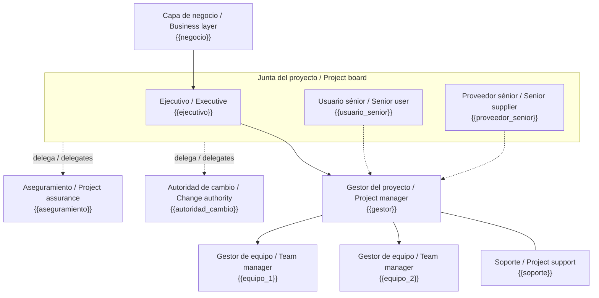
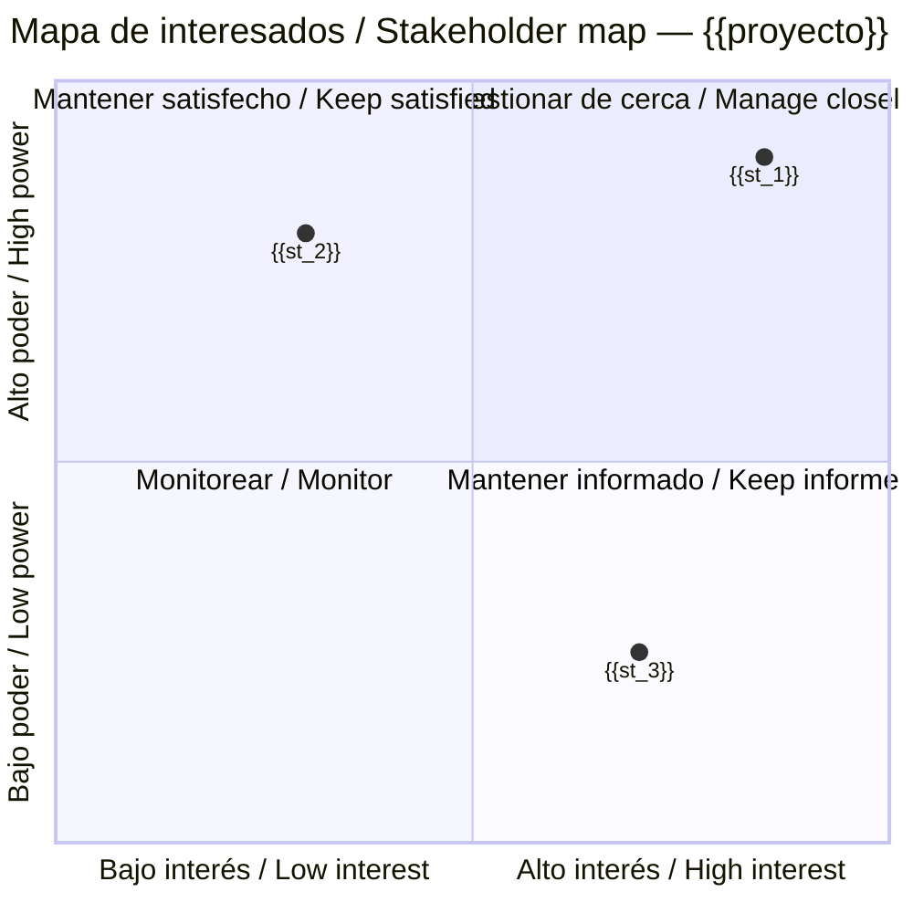
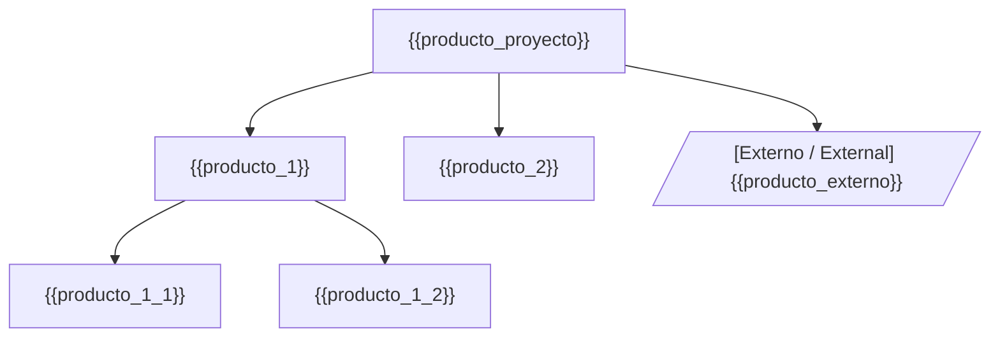
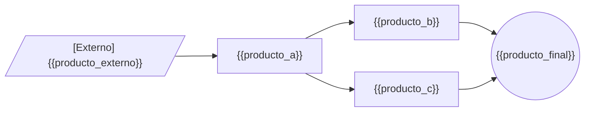
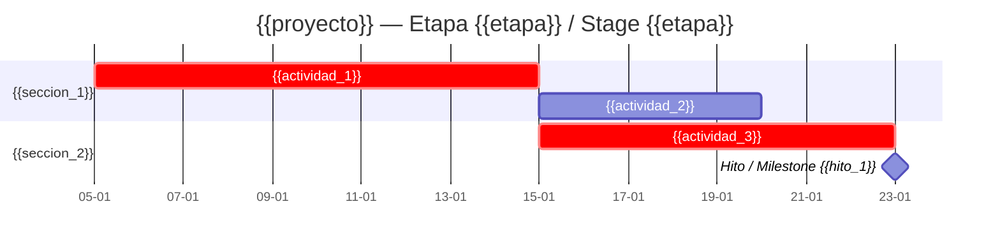
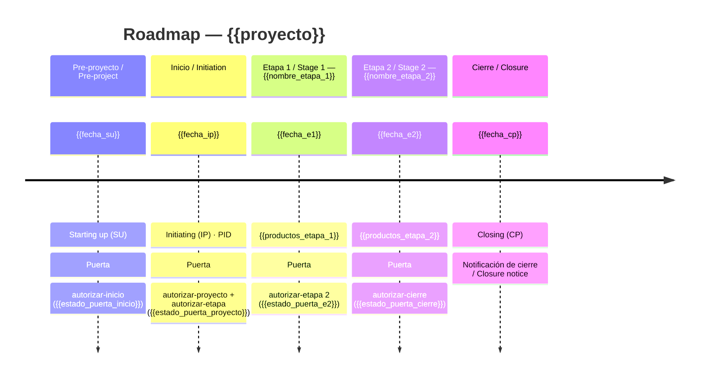
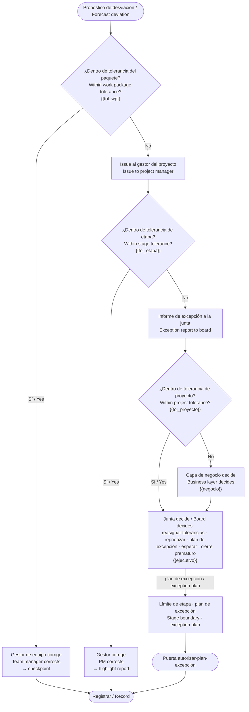
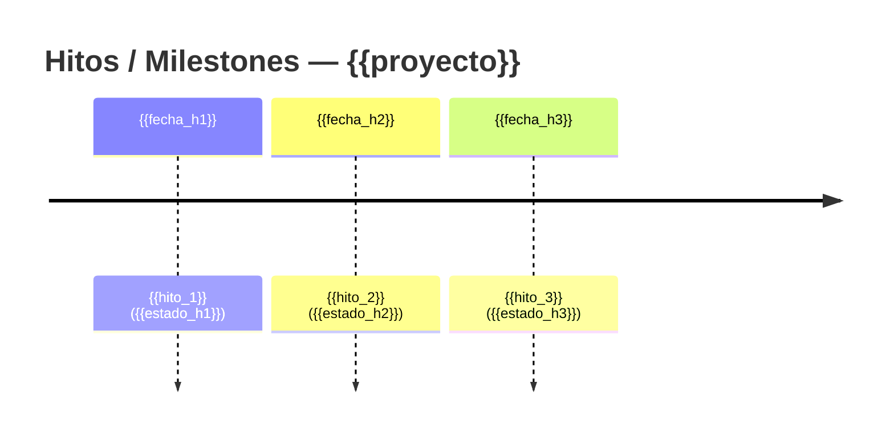

# Diagramas Mermaid del método · Mermaid diagram snippets

> **BORRADOR generado con asistencia de IA / AI-assisted DRAFT.** Cada bloque es un esqueleto: reemplazar `{{placeholders}}`, añadir o quitar nodos según la fuente citada en cada sección, y conservar el pie con fuente y fecha de corte. Mermaid es el respaldo versionable aunque se use un motor externo.

**Proyecto / Project:** {{proyecto}} · **Fecha de corte / Cut-off:** {{fecha_corte}}
*Los nodos salen de registros y documentos; lo que falte se escribe `[por confirmar]`.*

## 1. Organigrama del equipo de gestión / Project management team org chart
*Fuente: estado.json.roles y 00-direccion/estructura-organizativa.md. Tres intereses en la junta, un solo ejecutivo, aseguramiento separado del gestor.*

*Línea continua: reporte. Punteada: delegación o acuerdo. Si una persona ocupa dos roles, repetir el nombre en ambos nodos y añadir nota.*

## 2. Mapa de stakeholders poder/interés / Power–interest stakeholder map
*Fuente: stakeholders.csv (poder, interes, actitud). Documento de circulación restringida; sin valoraciones personales. Escala 0–1 derivada de la escala del registro (declararla).*

*Estrategia por cuadrante en la matriz de comunicaciones. La actitud (a favor / neutral / en contra) se indica en una tabla aparte, no en el gráfico compartido.*

## 3. Estructura de desglose de productos / Product breakdown structure (PBS)
*Fuente: 02-planificacion/pbs-wbs.md. Solo productos (sustantivos), nunca actividades. Productos externos entre corchetes.*

*Para una WBS derivada, usar el mismo árbol con paquetes de trabajo como hojas y referencia al id de PBS.*

## 4. Diagrama de flujo de productos / Product flow diagram
*Fuente: PBS y descripciones de producto del plan de etapa. Flechas = dependencia "necesario para". Externos como entradas.*

*Si el diagrama supera ~40 nodos, dividir por etapa de gestión.*

## 5. Gantt del plan de etapa / Stage plan Gantt
*Fuente: cpm.py --mermaid o el cronograma del plan. Marcar las actividades críticas con `crit`; hitos con `milestone`.*

*Supuestos: días laborables, sin nivelación de recursos (cpm.py). Para SS/FF/SF o calendarios, MSPDI (`cpm.py --mspdi`) completado en MS Project o ProjectLibre, desde pm-cronograma-estimacion.*

## 6. Roadmap por etapas con puertas / Stage roadmap with gates
*Fuente: plan de proyecto (etapas) y estado.json.puertas. Las puertas aparecen siempre entre etapas.*

*Alternativa con fechas exactas: usar el Gantt de la sección 5 con una sección por etapa y las puertas como hitos.*

## 7. Flujo de excepciones por nivel / Exception flow by level
*Fuente: tolerancias en estado.json y 00-direccion/tolerancias-y-autoridad.md. Quién decide en cada nivel.*

*Para una versión swimlane por nivel (equipo · gestor · junta · negocio), usar diagram-design con estos mismos nodos.*

## 8. Línea de hitos simple / Simple milestone line
*Fuente: plan de etapa. Útil para el comunicado al cliente.*

## Pie obligatorio para cada diagrama / Mandatory footer for each diagram
`Fuente / Source: {{fuente}} · Corte / Cut-off: {{fecha_corte}} · Estado / Status: borrador · Generado con asistencia de IA`

## Lista de verificación / Checklist
- [ ] Cada diagrama cita su fuente y fecha de corte en el pie.
- [ ] Organigrama: tres intereses, un ejecutivo, aseguramiento separado del gestor.
- [ ] Mapa de stakeholders: escala declarada, sin valoraciones personales, circulación restringida.
- [ ] PBS sin actividades; externos marcados; flujo de productos con externos como entradas.
- [ ] Gantt con críticas marcadas y supuestos declarados; roadmap con puertas entre etapas.
- [ ] Flujo de excepciones con tolerancias y decisor por nivel.
- [ ] Ningún nodo inventado; faltantes como `[por confirmar]`.
- [ ] Menos de ~40 nodos por diagrama; dividir si hace falta.
